<details>
<summary>🧐 <code>&#64;ServletComponentScan</code>과 <code>SpringBootServletInitializer</code>의 차이</summary>

<a id="1c3eda9b0fe1810fa5eed5fa18ae1222"></a>

### <strong>&#64;ServletComponentScan</strong>

<a id="1c3eda9b0fe1816bb4c3c83322ab40f1"></a>

<code>&#64;ServletComponentScan</code>은 스프링부트 애플리케이션에서 서블릿, 필터, 리스너 등을 자동으로 등록하기 위해 사용되는 Anotation이다&#46;<br><code>&#64;WebServlet</code>, <code>&#64;WebFilter</code>, <code>&#64;WebListener</code> 애노테이션이 달린 클래스를 스캔하여 서블릿 컨테이너에 등록할 수 있다&#46;

<a id="1c3eda9b0fe1816295d8e6deaf9ae77d"></a>

```java
import org.springframework.boot.SpringApplication;
import org.springframework.boot.autoconfigure.SpringBootApplication;
import org.springframework.boot.web.servlet.ServletComponentScan;

@SpringBootApplication
@ServletComponentScan
public class SpringMvc1Application {
    public static void main(String[] args) {
        SpringApplication.run(SpringMvc1Application.class, args);
    }
}
```

<a id="1c3eda9b0fe18147a947d10af25fcf53"></a>

### <strong>SpringBootServletInitializer</strong>

<a id="1c3eda9b0fe18114b79add0f601127ef"></a>

<strong>스프링 부트 애플리케이션을 </strong><strong><u>외부 서블릿 컨테이너에서 실행</u></strong>할 수 있도록 설정하는 역할을 한다&#46;

<a id="1c3eda9b0fe1814197c8cce57690715b"></a>

이는 주로 <strong>WAR 파일로 패키징</strong>하여 <strong><u>서블릿 컨테이너(Tomcat, Jetty 등)에서 애플리케이션을 배포</u></strong>할 때 사용된다&#46; 

<a id="1c3eda9b0fe181e3897fd12cd77a184f"></a>

```java
public class ServletInitializer extends SpringBootServletInitializer {

    @Override
    protected SpringApplicationBuilder configure(SpringApplicationBuilder application) {
        return application.sources(SpringMvc1Application.class);
    }

}
```

<a id="1c3eda9b0fe181888d89f16f7b3ea5d2"></a>

<strong>주요 차이점</strong>

- <strong>기능</strong>
    - <code>&#64;ServletComponentScan</code>
        - 애플리케이션이 <strong>시작</strong>될 때, 애플리케이션 내에서 <strong><u>서블릿, 필터, 리스너와 같은 서블릿 컴포넌트를 스캔하고 자동으로 등록하고 관리</u></strong>함

    - <code>SpringBootServletInitializer</code>
        - WAR 파일로 패키징된 스프링 부트 애플리케이션을 외부 서블릿 컨테이너에서 배포하고 실행할 수 있도록 설정

        - 서블릿 컨테이너가 애플리케이션을 초기화할 때 configure 메서드를 통해 설정을 적용

- <strong>요약</strong>
    - &#64;ServletComponentScan은 주로 서블릿, 필터, 리스너를 자동으로 스캔하고 등록하는 데 사용

    - SpringBootServletInitializer는 스프링 부트 애플리케이션을 WAR 파일로 패키징하여 외부 서블릿 컨테이너에서 실행할 수 있도록 설정하는 데 사용

</details>

<details>
<summary><strong>프로젝트 생성</strong></summary>

- Spring web

- Lombok

<details>
<summary><code>War</code> 로 생성</summary>

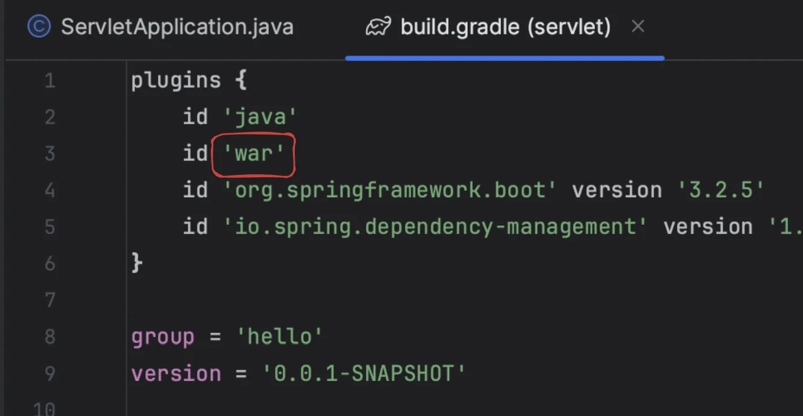

</details>

<a id="1c3eda9b0fe1818a8b49c73607ed6fed"></a>

해당 메세지가 확인되면 <a href="http://localhost:8080">localhost&#58;8080</a> 포트가 정상 실행되고 접속 가능하다는 의미이다&#46; 

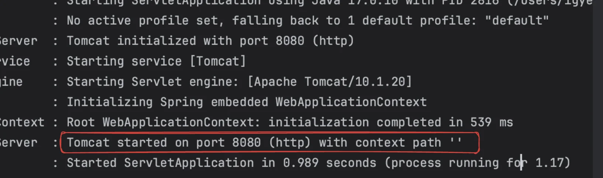

</details>

<a id="1c3eda9b0fe181e8b070cb0689d1842d"></a>

### 서블릿

> 📌 <strong>서블릿(Servlet)</strong>이란<strong><u> </u></strong><strong><u>동적 웹페이지를 만</u></strong>들 때 사용되는 자바 기반의 웹 애플리케이션 프로그래밍 기술이다&#46; <strong>서블릿은 웹 요청과 응답의 흐름</strong>을 <strong><u>간단한 메서드 호출</u></strong>만으로 체계적으로 다룰 수 있게 해준다&#46; 

<details>
<summary><strong>특징</strong></summary>

- 클라이언트의 Request에 대해 동적으로 작동하는 웹 어플리케이션 컴포넌트<br> →  기존의 정적 웹 프로그램의 문제점을 보완하여 동적인 여러 가지 기능을 제공한다&#46;

- Java Thread를 이용하여 동작

- MVC 패턴에서 Controller로 이용

<details>
<summary>HTTP 프로토콜 서비스를 지원하는 <code>jakarta&#46;servlet&#46;http </code>모듈 지원</summary>


</details>

- UDP 보다 처리 속도가 느림

- HTML 변경 시 Servlet을 재컴파일해야 하는 단점이 있음

- 컨테이너에서 실행

- 보안 기능을 적용하기 쉽다&#46;

</details>

<details>
<summary><strong>서블릿 컨테이너 동작 방식 </strong></summary>

> 스프링부트에 생성되는 내장 톰켓 서버에서  서블릿을 생성


> HTTP 프로토콜을 지원하는 <code>HttpServlet</code> ( <code>request</code>, <code>response</code> ) 을 사용한 요청 응답 처리


</details>

<a id="1c3eda9b0fe18128b8b0f3fb6b288427"></a>

### ex) Hello 서블릿

> ⚠️ <strong>주의</strong>
> 
> > src/main/webapp
> 
> <a id="1c3eda9b0fe1812d84fceb17fe7f918d"></a>
> 
> 해당하는 direct에 위치해야 정상적으로 view가 보임
> 
> 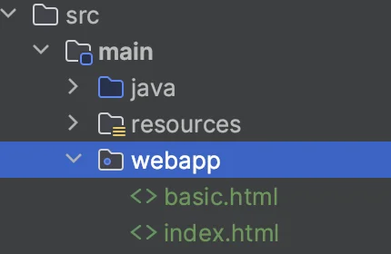

<details>
<summary><strong>Tip) 스프링 부트 로거 기능 활용</strong></summary>

> 버전 업데이트로 인한 오류) <a href="https://www.inflearn.com/questions/1188109/%EC%84%9C%EB%B8%94%EB%A6%BF%EA%B3%BC-%ED%8C%8C%EC%9D%BC-%EC%97%85%EB%A1%9C%EB%93%9C1-debug-%EB%A1%9C%EA%B7%B8-%EB%82%B4%EC%9A%A9%EC%9D%B4-%EC%B6%9C%EB%A0%A5-%EB%90%98%EC%A7%80-%EC%95%8A%EC%8A%B5%EB%8B%88%EB%8B%A4">참조 링크</a>

- <code>application&#46;properties</code> &#45; <strong>로깅 기능 추가</strong>
    <details>
    <summary>🧐 main &#45; resources &#45; application&#46;properties</summary>

    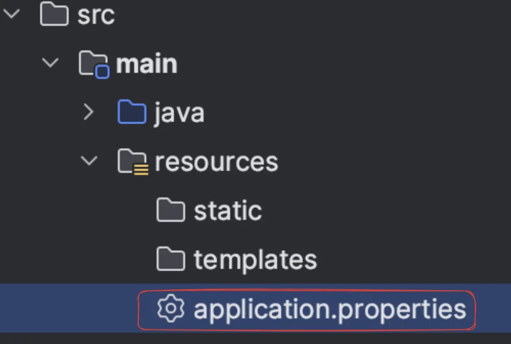

    </details>

    <a id="1c3eda9b0fe181409d53c7f594b6bd0a"></a>

    ```plaintext
    lologging.level.org.apache.coyote.http11=trace
    ```

<a id="1c3eda9b0fe181689d12cc44abbb03a6"></a>

아래와 같이 로깅 내역 출력됨 

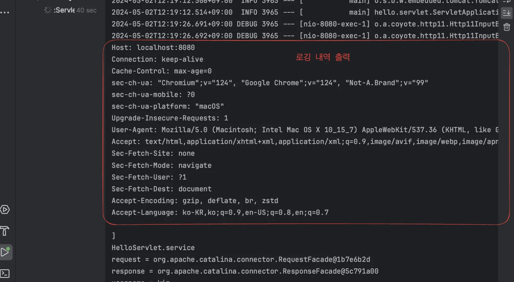

> ⚠️ 운영 서버에 이렇게 모든 정보를 남기는 로깅을 사용하면 성능저하가 발생할 수 있다&#46; <br>  → <strong><u>개발 단계</u></strong>에서만 적용

</details>

<details>
<summary><strong>Welcome 페이지 작성</strong></summary>

> 페이지로 들어갈 시 기본으로 렌더링 되는 페이지 
> 
> - <strong> </strong><strong><code>localhost&#58;8080</code></strong>  ==  localhost&#58;8080/index&#46;html

<details>
<summary>main &#45; webapp &#45;<strong> index&#46;html</strong></summary>

<a id="1c3eda9b0fe18135ad8ce5d1e3a22d34"></a>

```html

<!DOCTYPE html>
<html>
<head>
    <meta charset="UTF-8">
    <title>Title</title>
</head>
<body> <ul>
    <li><a href="basic.html">서블릿 basic</a></li> </ul>
</body>
</html>

```

</details>

<details>
<summary>main &#45; webapp &#45; <strong>basic&#46;html</strong></summary>

<a id="1c3eda9b0fe181a2bf04caa06f6a270b"></a>

```html
<!DOCTYPE html>
<html>
    <head>
        <meta charset="UTF-8">
        <title>Title</title>
    </head>
    <body>
        <ul>
            <li>hello 서블릿 <ul>
                <li><a href="/hello?username=servlet">hello 서블릿 호출</a></li> </ul>
            </li>
            <li>HttpServletRequest
                <ul>
                    <li><a href="/request-header">기본 사용법, Header 조회</a></li>
                    <li>HTTP 요청 메시지 바디 조회
                        <ul>
                            <li><a href="/request-param?username=hello&age=20">GET - 쿼리 파라미터</a></li>
                                <li><a href="/basic/hello-form.html">POST - HTML Form</a></li>
                                <li>HTTP API - MessageBody -> Postman 테스트</li> </ul>
                        </ul>
                    </li>
            <li>HttpServletResponse
                <ul>
                    <li><a href="/response-header">기본 사용법, Header 조회</a></li>
                    <li>HTTP 응답 메시지 바디 조회
                        <ul>
                            <li><a href="/response-html">HTML 응답</a></li>
                            <li><a href="/response-json">HTTP API JSON 응답</a></li>
                        </ul>
                    </li>
                </ul>
            </li>
        </ul>
    </body>
</html>
```

</details>

</details>

<details>
<summary><strong>스프링 부트 서블릿 환경 구성</strong></summary>

> 📌 <strong><code>ServletComponentScan</code></strong><br>스프링 부트에서 서블릿을 자동 스캔하여 등록

> <strong>hello&#46;servlet&#46;ServletApplication</strong>

<a id="1c3eda9b0fe1819bb677fff5e2e9bc8c"></a>

```java
package hello.servlet;

import org.springframework.boot.SpringApplication;
import org.springframework.boot.autoconfigure.SpringBootApplication;
import org.springframework.boot.web.servlet.ServletComponentScan;

@ServletComponentScan  // 서블랫 자동 등록
@SpringBootApplication
public class ServletApplication {

	public static void main(String[] args) {
		SpringApplication.run(ServletApplication.class, args);
	}
}
```

</details>

<details>
<summary><strong>서블릿 등록</strong></summary>

> 📌 <strong><code>&#64;WebServlet (name = “”, urlPatterns=””)</code></strong>
> 
> - <code>name</code>&#58; 서블릿 명칭
> 
> - <code>urlPatterns</code>&#58; URL 매핑
>     > <strong>⚠️ 두 이름(서블릿, URL 매핑)은 중복이 되면 안됨 </strong>

- HTTP 요청이 전달되면 서블릿 컨테이너는 해당하는 url와 매핑되는 서블릿을 실행한다&#46;
    - 웹 브라우저 실행&#58; http&#58;//localhost&#58;8080/hello?username=world

    - <strong><code>&#64;WebServlet (&#46;&#46;&#46; , urlPatterns=”</code></strong><strong><code>/</code></strong><code>hello</code><strong><code>”)</code></strong>  서블릿 실행

    - <strong>HttpServletRequest</strong> 에 파싱된 내용이 담겨 전달됨

<details>
<summary><strong>ex) HelloServlet</strong></summary>

- 서블릿을 통해 http 스펙의 메세지 간단하게 파싱하여 사용할 수 있다&#46;

- 요청 받은 HTTP 메세지의 파싱된 내용은 <strong>HttpServletRequest</strong> 객체 담겨 전달된다&#46;
    -  <code>request&#46;getParameter()</code>&#58; 쿼리 파라미터 값 가져옴

<a id="1c3eda9b0fe181598ea7cca4f64c7655"></a>

```java
package hello.servlet.basic;
 import javax.servlet.ServletException;
 import javax.servlet.annotation.WebServlet;
 import javax.servlet.http.HttpServlet;
 import javax.servlet.http.HttpServletRequest;
 import javax.servlet.http.HttpServletResponse;
 import java.io.IOException;
 
 @WebServlet(name = "helloServlet", urlPatterns = "/hello")
 public class HelloServlet extends HttpServlet {
 
		@Override
     protected void service(HttpServletRequest request, HttpServletResponseresponse) throws ServletException, IOException {
         System.out.println("HelloServlet.service");
         System.out.println("request = " + request);
         System.out.println("response = " + response);
         
         String username = request.getParameter("username");
         System.out.println("username = " + username);
         
         response.setContentType("text/plain");
         response.setCharacterEncoding("utf-8");
         response.getWriter().write("username " + username);
		} 
}

```

- 실행 시 출력 값

<a id="1c3eda9b0fe1811f9677d4561b003ce1"></a>

```plaintext
HelloServlet.service
request = org.apache.catalina.connector.RequestFacade@5e4e72
response = org.apache.catalina.connector.ResponseFacade@37d112b6

// localhost:8080/hello?username=world
username = world   
```

</details>

</details>

<details>
<summary><strong>응답 메세지 작성 (</strong><code>HttpServletResponse</code><strong>) </strong></summary>

- Content Header 입력
    - <code>setContentType()</code>&#58; Content Type 
        - ex) text/plain … 

    - <code>setCharacterEncoding()</code>&#58; 인코딩 설정  
        - ex) utf&#45;8 …

- <code>getWriter()&#46;write()</code>&#58; Content Body 입력

<details>
<summary>ex) 사용 예시</summary>

<a id="1c3eda9b0fe181ffa973d5025c511189"></a>

```java
// Header
response.setContentType("text/plain"); // content-type
response.setCharacterEncoding("utf-8"); // encoding 정보

// Body
response.getWriter().write("hello " + username);
```

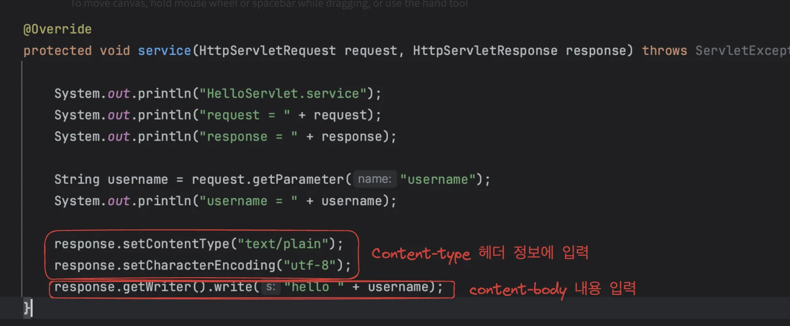

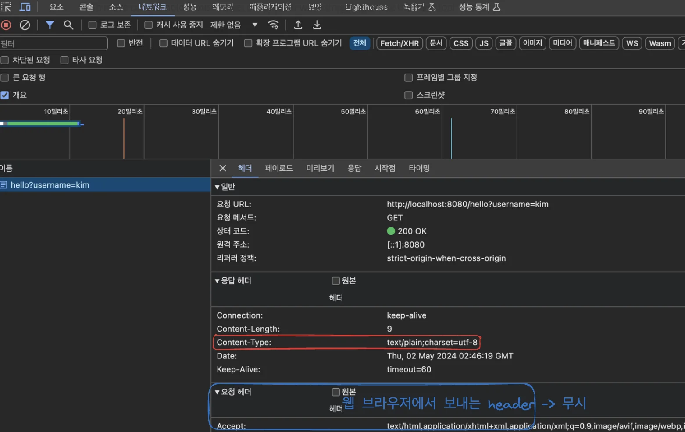

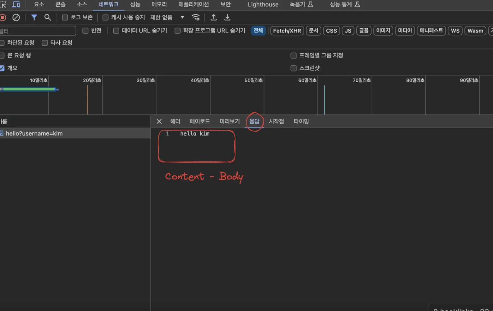

</details>

</details>

<a id="1c3eda9b0fe1816fbcdfc6926a74c372"></a>

## HTTP 요청 데이터 ( 3 )

<a id="1c3eda9b0fe181dea3e3cabaa8369347"></a>

### HttpServletRequest 

> 📌 <strong>HttpServletRequest</strong><br><em>HTTP 요청 메세지 </em>를 <u>직접 파싱</u>해서 사용하면 <u>굉장히 불편하며 번거롭다&#46;</u> <br><strong><u>서블릿</u></strong>을 통해 대신 <strong><u>HTTP 요청 메서지를 파싱 처리한다&#46;<br></u></strong>그리고 그 결과를 <strong><code>HttpServletRequest</code></strong><strong>  객체에 담</strong>아서 제공한다&#46;<strong><u><br></u></strong>

<details>
<summary>??</summary>

<a id="1c3eda9b0fe181c99112dbea7a08ff39"></a>

<a href="#/post/1c3eda9b-0fe1-81c8-b57f-fa069abfcbbf">페이지</a> 

<details>
<summary>HTTP 요청 메세지</summary>

<a id="1c3eda9b0fe181d39d66c1971da75113"></a>

```plaintext
POST /save HTTP/1.1
Host: localhost:8080
Content-Type: application/x-www-form-urlencoded

username=kim&age=20
```

- START LINE
    - HTTP 메서드

    - URL

    - 쿼리 스트링

    - 스키마, 프로토콜

- 헤더
    - 헤더 조회

- 바디 
    - form 파라미터 형식 조회

    - message body 데이터 직접 조회

</details>

<details>
<summary><strong>부가기능</strong></summary>

<details>
<summary><strong>임시 저장소</strong></summary>

> 해당 HTTP 요청이 시작부터 끝날 때 까지 유지되는 임시 저장소 기능

- 저장&#58; <code>request&#46;setAttribute(name, value)</code>

- 조회&#58; <code>request&#46;getAttribute(name)</code>

</details>

<details>
<summary><strong>세션 관리</strong></summary>

<a id="1c3eda9b0fe181c9ad92daa1ec976ae9"></a>

<code>request&#46;getSession(create&#58; true)</code>

</details>

</details>

</details>

<a id="1c3eda9b0fe1817f85a9ce406a6ea949"></a>

### <strong>ex) 편의 메서드</strong>

> <strong>HttpServletRequest &#45; 편의 메서드 </strong>

<a id="1c3eda9b0fe1818c8157f2f0e2a5082e"></a>

```java
//http://localhost:8080/request-header?username=hello
@WebServlet(name = "requestHeaderServlet", urlPatterns = "/request-header")
public class RequestHeaderServlet extends HttpServlet {

	  @Override
	  protected void service(HttpServletRequest request, HttpServletResponse response) throws ServletException, IOException {
	
	      printStartLine(request);
	      printHeaders(request);
	      printHeaderUtils(request);
	      printEtc(request);
	
	      response.getWriter().write("ok");
	  }
```

> 해당 함수 테스트 <br>⇒ 해당하는 서블릿에 매핑되는 url(<code>&#34;/request&#45;header&#34;</code>)로 접속하면됨

<details>
<summary><strong>start&#45;line 정보&#58; </strong><code>printStartLine()</code></summary>

<a id="1c3eda9b0fe18171a86ceae86c7b2f67"></a>

```java
//start line 정보
private void printStartLine(HttpServletRequest request) {
    System.out.println("--- REQUEST-LINE - start ---");
    System.out.println("request.getMethod() = " + request.getMethod()); //GET
    System.out.println("request.getProtocol() = " + request.getProtocol()); // HTTP/1.1
    System.out.println("request.getScheme() = " + request.getScheme()); //http
    // http://localhost:8080/request-header
    System.out.println("request.getRequestURL() = " + request.getRequestURL());
    // /request-header
    System.out.println("request.getRequestURI() = " + request.getRequestURI());
    //username=hi
    System.out.println("request.getQueryString() = " +
            request.getQueryString());
    System.out.println("request.isSecure() = " + request.isSecure()); //https 사용 유무
    System.out.println("--- REQUEST-LINE - end ---");
    System.out.println();
}
```

- <code>printStartLine</code>  결과값 확인(테스트)

<a id="1c3eda9b0fe18199b0e2e4ae266459cf"></a>

<a href="http://localhost:8080/request-header"><code>http&#58;//localhost&#58;8080/request&#45;header</code></a> 접속, 아래와 같이 출력됨

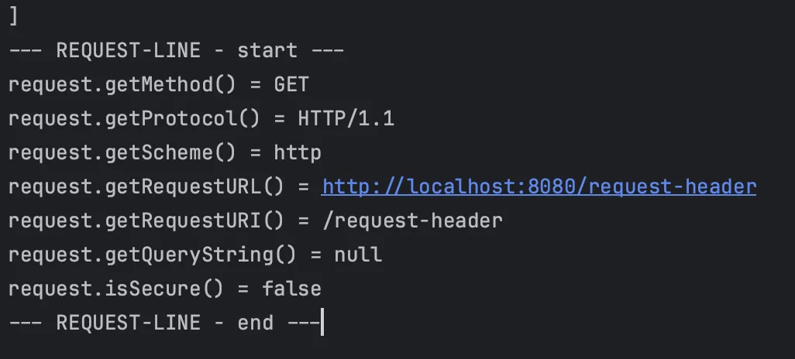

<a id="1c3eda9b0fe181b9a8e4e71f5d2e614b"></a>

```java
 --- REQUEST-LINE - start ---
 request.getMethod() = GET
 request.getProtocol() = HTTP/1.1
 request.getScheme() = http
 request.getRequestURL() = http://localhost:8080/request-header
 request.getRequestURI() = /request-header
 request.getQueryString() = username=hello
 request.isSecure() = false
 --- REQUEST-LINE - end ---
```

</details>

<details>
<summary><strong>헤더정보&#58; </strong><code>printHeaders()</code></summary>

<a id="1c3eda9b0fe1817ea1d0dbf5b0d532a4"></a>

```java
//Header 모든 정보
private void printHeaders(HttpServletRequest request) {
     System.out.println("--- Headers - start ---");
 /*
     Enumeration<String> headerNames = request.getHeaderNames();
     while (headerNames.hasMoreElements()) {
         String headerName = headerNames.nextElement();
         System.out.println(headerName + ": " + request.getHeader(headerName));
     }
*/
		request.getHeaderNames().asIterator()
        .forEachRemaining(headerName -> System.out.println(headerName + ": "+ request.getHeader(headerName)));
     System.out.println("--- Headers - end ---");
     System.out.println();
}
```

- <code>printHeaders()</code> 결과값 확인<br>아래와 같이 결과값 출력 확인

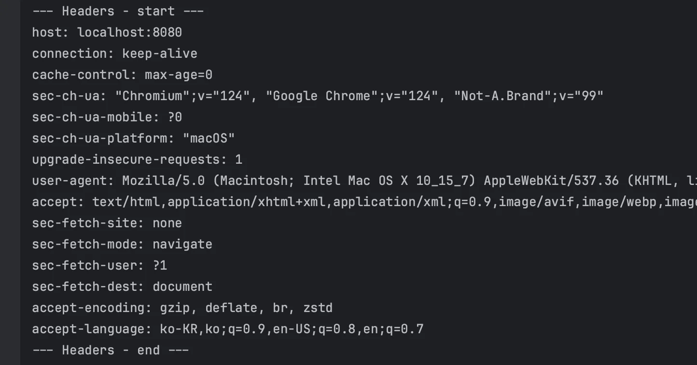

<a id="1c3eda9b0fe18136a6a9f23dfba48ee9"></a>

```plaintext
--- Headers - start ---
 host: localhost:8080
 connection: keep-alive
 cache-control: max-age=0
 sec-ch-ua: "Chromium";v="88", "Google Chrome";v="88", ";Not A Brand";v="99"
 sec-ch-ua-mobile: ?0
 upgrade-insecure-requests: 1
  user-agent: Mozilla/5.0 (Macintosh; Intel Mac OS X 11_2_0) AppleWebKit/537.36
 (KHTML, like Gecko) Chrome/88.0.4324.150 Safari/537.36
 accept: text/html,application/xhtml+xml,application/xml;q=0.9,image/avif,image/
 webp,image/apng,*/*;q=0.8,application/signed-exchange;v=b3;q=0.9
 sec-fetch-site: none
 sec-fetch-mode: navigate
 sec-fetch-user: ?1
 sec-fetch-dest: document
 accept-encoding: gzip, deflate, br
 accept-language: ko,en-US;q=0.9,en;q=0.8,ko-KR;q=0.7
 --- Headers - end ---
```

</details>

<details>
<summary><strong>Header 편리한 조회&#58; </strong><code>printHeaderUtils()</code></summary>

<a id="1c3eda9b0fe181cc8432de2d5ecc53e6"></a>

```java
//Header 편리한 조회
private void printHeaderUtils(HttpServletRequest request) {
    System.out.println("--- Header 편의 조회 start ---");
    System.out.println("[Host 편의 조회]");
    System.out.println("request.getServerName() = " +
    request.getServerName()); //Host 헤더
    System.out.println("request.getServerPort() = " + request.getServerPort()); //Host 헤더
    System.out.println();

    System.out.println("[Accept-Language 편의 조회]");
    request.getLocales().asIterator()
            .forEachRemaining(locale -> System.out.println("locale = " + locale));

    System.out.println("request.getLocale() = " + request.getLocale());
    System.out.println();

    System.out.println("[cookie 편의 조회]"); if (request.getCookies() != null) {
        for (Cookie cookie : request.getCookies()) {
            System.out.println(cookie.getName() + ": " + cookie.getValue());
        }
    }

    System.out.println();
    System.out.println("[Content 편의 조회]");
    System.out.println("request.getContentType() = " + request.getContentType());
    System.out.println("request.getContentLength() = " + request.getContentLength());
    System.out.println("request.getCharacterEncoding() = " + request.getCharacterEncoding());
    System.out.println("--- Header 편의 조회 end ---");
    System.out.println();
}
```

- <code>printHeaderUtils()</code>  결과값 확인

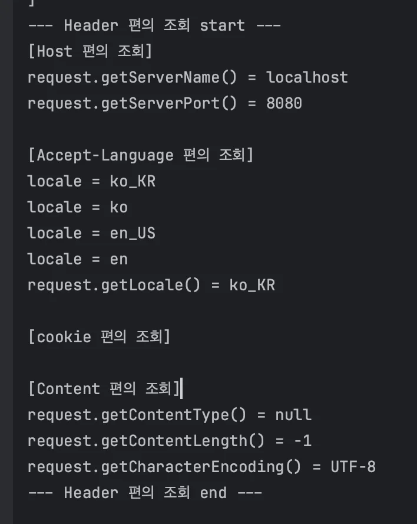

<a id="1c3eda9b0fe181f688fceda9422f2bbe"></a>

```java
--- Header 편의 조회 start ---
[Host 편의 조회] request.getServerName() = localhost 
request.getServerPort() = 8080

[Accept-Language 편의 조회] 
locale = ko
locale = en_US
locale = en
locale = ko_KR
request.getLocale() = ko

[cookie 편의 조회]
[Content 편의 조회] 
request.getContentType() = null 
request.getContentLength() = -1 
request.getCharacterEncoding() = UTF-8 
--- Header 편의 조회 end ---
```

</details>

<details>
<summary><strong>기타 정보&#58; </strong><code>printEtc()</code></summary>

<a id="1c3eda9b0fe181b4b026f39cca06328f"></a>

```java
//기타 정보
private void printEtc(HttpServletRequest request) {
		System.out.println("--- 기타 조회 start ---");
		
		System.out.println("[Remote 정보]");
		System.out.println("request.getRemoteHost() = " + request.getRemoteHost());
		System.out.println("request.getRemoteAddr() = " + request.getRemoteAddr()); //
		System.out.println("request.getRemotePort() = " + request.getRemotePort()); //
		System.out.println();
		
		System.out.println("[Local 정보]"); 
		System.out.println("request.getLocalName() = " + request.getLocalName()); // 
		System.out.println("request.getLocalAddr() = " + request.getLocalAddr()); // 
		System.out.println("request.getLocalPort() = " + request.getLocalPort()); //
		
		System.out.println("--- 기타 조회 end ---");
    System.out.println();
}
```

- <code>printEtc()</code> 결과값 확인

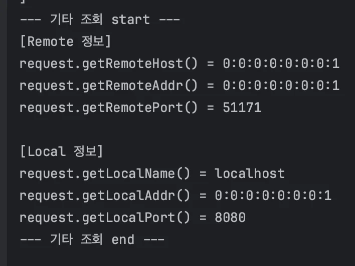

<a id="1c3eda9b0fe181ddaec9f755a0b7691f"></a>

```java
 --- REQUEST-LINE - start ---
 request.getMethod() = GET
 request.getProtocol() = HTTP/1.1
 request.getScheme() = http
 request.getRequestURL() = http://localhost:8080/request-header
 request.getRequestURI() = /request-header
 request.getQueryString() = username=hello
 request.isSecure() = false
 --- REQUEST-LINE - end ---
```

</details>

---

> ☝🏻 <strong><u>HTTP 요청 메세지</u></strong>를 통해 <strong><u>&#91; 클라이언트 → 서버 &#93; 데이터를 전달</u></strong><strong> </strong>하는 방법은 아래의 <strong><u>3가지 방법</u></strong> 사용한다&#46;

<a id="1c3eda9b0fe18113aae8ec2385bc5382"></a>

### 1) GET &#45; <u>쿼리 파라미터</u>

> <a href="#/post/1c3eda9b-0fe1-8140-8c00-cc68f544eeea">페이지</a> 

> 👉🏻 <strong>쿼리 파라미터</strong>
> 
> > http&#58;//localhost&#58;8080/request&#45;param<strong><u>?</u></strong><strong><u>username=hello</u></strong><strong><u>&#38;</u></strong><strong><u>age=20</u></strong>
> 
> - <strong>?</strong> &#58; 시작
> 
> - <strong>&#38;</strong>&#58; <strong>and</strong>, 추가 파라미터 구분<br>
> 
> <a id="1c3eda9b0fe1813f9b2bc4645a44f1bf"></a>
> 
> 메세지 바디 없이 <strong><u>쿼리 파라미터</u></strong>를 사용한 데이터 전달은  <strong><u>검색, 필터, 페이징 </u></strong>등에서 많이 사용한다&#46;

- <strong><u>쿼리 파라미터 </u></strong><strong>조회 예시 </strong>
    <a id="1c3eda9b0fe1817cba6ae5add3c02980"></a>

    ```java
    // 단일 파라미터 조회
    String username = request.getParameter("username");  

    // 파라미터 이름 모두 조회 => ?username=hello&age=20: username, age 조회
    Enumeration<String> parameterNames = request.getParmeterNames(); 

    // 파라미터 Map 조회
    Map<Stirng, String[]> parameterMap = request.getParameterMap();

    // 복수 파라미터 조회
    String[] usernames = request.getParameterValues("username"); 
    ```

<details>
<summary><strong>RequestParamServlet</strong></summary>

<a id="1c3eda9b0fe1817b804cdde028e9ef98"></a>

```java
package hello.servlet.basic.request;


import jakarta.servlet.ServletException;
import jakarta.servlet.annotation.WebServlet;
import jakarta.servlet.http.HttpServlet;
import jakarta.servlet.http.HttpServletRequest;
import jakarta.servlet.http.HttpServletResponse;

import java.io.IOException;
import java.util.Enumeration;

@WebServlet(name = "requestParamServlet", urlPatterns = "/request-param")
public class RequestParamServlet extends HttpServlet {

    @Override
    protected void service(HttpServletRequest request, HttpServletResponse response) throws ServletException, IOException {

        System.out.println("[전체 파라미터 조회] - start");

        request.getParameterNames().asIterator()
                .forEachRemaining(paramName -> System.out.println(paramName + "=" + request.getParameter(paramName)));

        System.out.println("[전체 파라미터 조회] - end");
        System.out.println();

        System.out.println("[단일 파라미터 조회]");
        String username = request.getParameter("username");
        System.out.println("request.getParameter(username) = " + username);

        String age = request.getParameter("age");
        System.out.println("request.getParameter(age) = " + age);
        System.out.println();

        System.out.println("[이름이 같은 복수 파라미터 조회]");
        System.out.println("request.getParameterValues(username)");
        String[] usernames = request.getParameterValues("username");
        for (String name : usernames) {
            System.out.println("username = " + name);
        }

        response.getWriter().write("ok ");
    }
}


```

</details>

<details>
<summary><strong>Case 1) 파라미터 전송</strong></summary>

> http&#58;//localhost&#58;8080/request&#45;param<strong><u>?</u></strong><strong><u>username=hello</u></strong><strong><u>&#38;</u></strong><strong><u>age=20</u></strong>

- <strong>출력값</strong>
    <a id="1c3eda9b0fe1816f996ae4ba15a09cc7"></a>

    ```java
    [전체 파라미터 조회] - start
    username=hello
    age=20
    [전체 파라미터 조회] - end

    [단일 파라미터 조회]
    request.getParameter(username) = hello
    request.getParameter(age) = 20

    [이름이 같은 복수 파라미터 조회]
    request.getParameterValues(username)
    username = hello
    ```

</details>

<details>
<summary><strong>Case 2) </strong><strong><u>동일한 key</u></strong><strong>를 가진 파라미터 전송</strong></summary>

> http&#58;//localhost&#58;8080/request&#45;param<strong><u>?</u></strong><strong><u>username=hello</u></strong><strong><u>&#38;</u></strong><strong><u>username=kim</u></strong><strong><u>&#38;</u></strong><strong><u>age=20</u></strong>

- <strong> 출력값</strong>
    <a id="1c3eda9b0fe181cfac21dce27f325f23"></a>

    ```java
    [전체 파라미터 조회] - start
    username=hello
    age=20
    [전체 파라미터 조회] - end

    [단일 파라미터 조회]
    request.getParameter(username) = hello
    request.getParameter(age) = 20

    [이름이 같은 복수 파라미터 조회]
    request.getParameterValues(username)
    username = hello
    username = kim
    ```

> ☝🏻 <strong>동일한 key값을 가지는 파라미터들</strong><br><strong>username=hello&#38;username=kim</strong> 과 같이 <strong><u>동일한 key 값을 가지는 파라미터들</u></strong><u>은 </u><strong><u><code>request&#46;getParameterValues()</code></u></strong><strong><u> 를 사용</u></strong>해야 한다<br><br>이렇게 중복된 key 값을 가질 때 <code>request&#46;getParameter()</code>를 사용하면 <code>request&#46;getParameterValues()</code> 의 첫 번째 값을 반환한다&#46; 

</details>

<a id="1c3eda9b0fe181ec95acdc196cdf30ab"></a>

### 2) POST &#45; HTML Form

> ☝🏻 <strong>HTML Form</strong>
> 
> - <strong>content&#45;type&#58; </strong><code>application/x&#45;www&#45;form&#45;urlencoded</code>
> 
> - <strong><u>메시지 바디</u></strong><u>에 </u><strong><u>쿼리 파리미터</u></strong><strong><u> 형식</u></strong><u>으로</u><strong><u> 데이터를 전달</u></strong>한다&#46; <code>username=hello&#38;age=20</code>

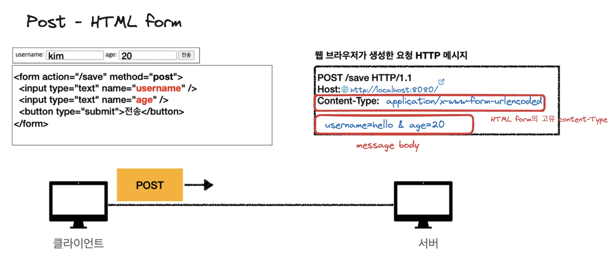

<a id="1c3eda9b0fe18168b86bed08df2836be"></a>

<code>application/x&#45;www&#45;form&#45;urlencoded</code> 형식은 앞서 GET에서 살펴본 <strong>쿼리 파라미터 형식과 같</strong>다&#46; 따라서 <em><strong>쿼리 파라미터 조회 메서드 </strong></em><em><strong>를 그대로 사용 </strong></em>하면 된다&#46;

<a id="1c3eda9b0fe181ed8058cc3dfd58844c"></a>

클라이언트(웹 브라우저) 입장에서는 두 방식의 차이가 있지만, 서버 입장에서는 둘의 형식이 동일하므로, <code>requset&#46;getParameter()</code>로 편리하게 구분없이 조회할 수 있다&#46; 

> <code>request&#46;getParameter()</code> → <strong><u>GET URL 쿼리 파라미터</u></strong>, <strong><u>POST HTML Form</u></strong><strong> </strong>둘다<strong> </strong>지원

> ☝🏻 <strong>참고) 메세지 바디 유무에 따른 content&#45;type 지정</strong><br><code>content&#45;type</code>은 <u>HTTP 메시지 바디의 데이터 형식을 지정</u>한다&#46;<br><br><strong>GET URL 쿼리 파라미터 형식</strong><strong> </strong>클라이언트에서 서버로 데이터를 전달할 때는 <u>HTTP 메시지 바디를 사용하지 않</u>기 때문에 <u>content&#45;type이 없</u>다&#46;<br><br><strong>POST HTML Form 형식</strong>으로 데이터를 전달하면  HTTP 메시지 바디에 해당 데이터를 포함해서 보내기 때문에 바디에 포함된 데이터가 어떤 형식인지 content&#45;type을 꼭 지정해야 한다<br>이렇게 폼으로 데이터를 전송하는 형 식을 <code>application/x&#45;www&#45;form&#45;urlencoded</code> 라 한다&#46;

> ☝🏻 <strong>참고<br></strong><strong>HTML form 데이터</strong>도 메세지 바디를 통해 전송되므로 직접 읽을 수 있다&#46; 그러나 <strong>편리한 파라미터 조회 기능(</strong><strong><code>request&#46;getParameter(…)</code></strong><strong>)을 이미 제공</strong>하기 때문에 파라미터 조회 기능을 사용하면 된다&#46;

<details>
<summary><strong>form&#46;html</strong></summary>

> src/main/webapp/basic/hello&#45;form&#46;html

<a id="1c3eda9b0fe18136b814eceeba3784fd"></a>

```html
 <!DOCTYPE html>
 <html>
 <head>
     <meta charset="UTF-8">
     <title>Title</title>
 </head>
 <body>
 <form action="/request-param" method="post">
username: <input type="text" name="username" /> age: <input type="text" name="age" /> <button type="submit">전송</button>
</form>
</body>
</html>
```

</details>

<details>
<summary><strong>RequestParamServlet</strong></summary>

<a id="1c3eda9b0fe181b9a263dd53eadbfe36"></a>

```java
package com.example.springmvc1.basic.request;

import jakarta.servlet.ServletException;
import jakarta.servlet.annotation.WebServlet;
import jakarta.servlet.http.HttpServlet;
import jakarta.servlet.http.HttpServletRequest;
import jakarta.servlet.http.HttpServletResponse;

import java.io.IOException;

/**
* 1. 파라미터 전송 기능
    s
* 2. 동일한 파라미터 전송 가능
    * http://localhost:8080/request-param?username=hello&username=kim&age=20
 * */
@WebServlet(name = "requestParamServlet", urlPatterns = "/request-param")
public class RequestParamServlet extends HttpServlet {
    @Override
    protected void service(HttpServletRequest request, HttpServletResponse response) throws ServletException, IOException {

        System.out.println("[전체 파라미터 조회] - start");
        /*
            Enumeration<String> parameterNames = request.getParameterNames();
            while (parameterNames.hasMoreElements()) {
                String paramName = parameterNames.nextElement();
                System.out.println(paramName + "=" + request.getParameter(paramName));
        } */

        request.getParameterNames().asIterator()
                .forEachRemaining(paramName -> System.out.println(paramName + "=" + request.getParameter(paramName)));
        System.out.println("[전체 파라미터 조회] - end");
        System.out.println();

        System.out.println("[단일 파라미터 조회]");
        System.out.println("request.getParameter(username) = " + request.getParameter("username"));
        System.out.println("request.getParameter(age) = " + request.getParameter("age"));
        System.out.println();

        System.out.println("[이름이 같은 복수 파라미터 조회]");
        System.out.println("request.getParameterValues(username)");
        String[] usernames = request.getParameterValues("username");
        for (String name : usernames) {
            System.out.println("username=" + name);
        }

        response.getWriter().write("ok");
    }
}

```

</details>

<details>
<summary><strong>Postman을 사용한 테스트</strong></summary>

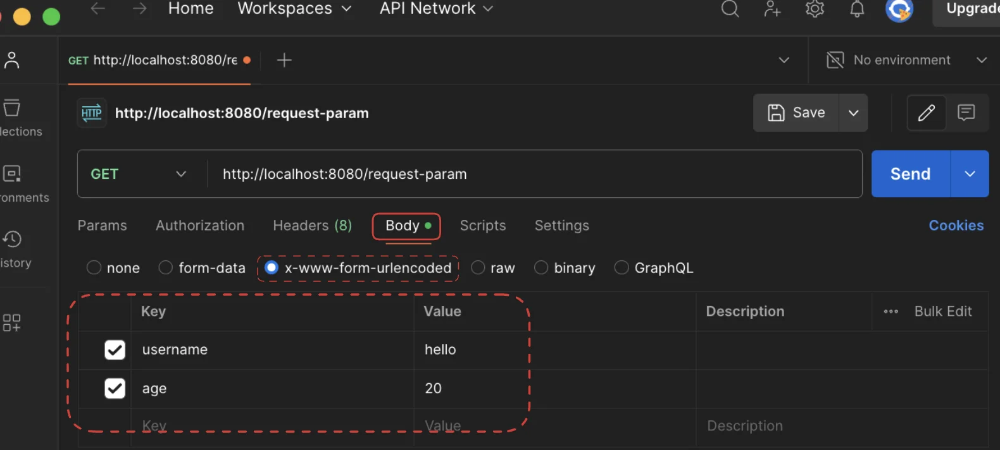

</details>

<a id="1c3eda9b0fe18142a718f1fdfc68c4c3"></a>

### 3) HTTP message body (API 메세지 바디)<br>

<details>
<summary><strong>🧐 </strong><strong><code>ObjectMapper</code></strong><strong> 객체란?</strong></summary>

<a id="1c3eda9b0fe181c8a589cab2b6f2aedf"></a>

JSON 결과를 파싱해 사용할 수 있는 자바 객체로 변환하려면 Jackson, Gson 같은 JSON 변환 라이브러리를 추가하여 사용해야한다&#46; 스프링 부트로 <strong>Spring MVC</strong>를 선택하면 <strong>기본으로 Jackson 라이브러리가 제공</strong>되며 <code>ObjectMapper</code>를 통해 <strong>JSON을 파싱</strong>할 수 있다&#46;

</details>

<details>
<summary><strong>🧐 </strong><strong><code>ServletInputStream</code></strong><strong> 객체란? </strong></summary>

---

<a id="1c3eda9b0fe1812890b4e010cc7c9d37"></a>

Provides an input stream for reading binary data from a client request, including an efficient readLine method for reading data one line at a time&#46; With some protocols, such as HTTP POST and PUT, a <code>ServletInputStream</code> object can be used to read data sent from the client&#46;<br>

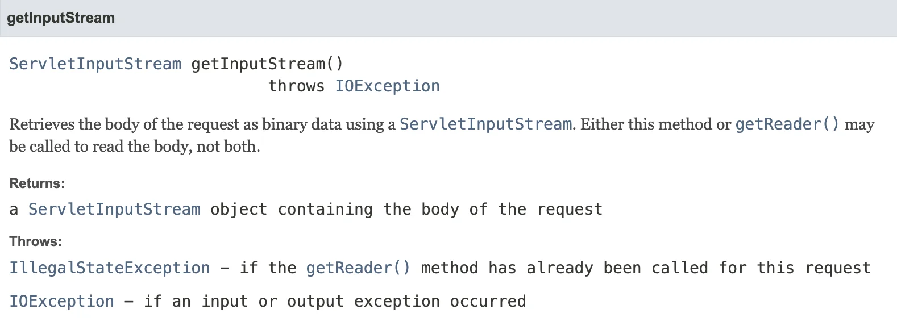

<a id="1c3eda9b0fe18102ade6e0931c542daa"></a>

&#45;<a href="https://docs.oracle.com/javaee%2F7%2Fapi%2F%2F/javax/servlet/ServletInputStream.html"> Dos</a> 발췌 

---

<a id="1c3eda9b0fe181468720f8d0fbfd403e"></a>

<br>위 내용처럼 클라이언트에서 요청 받는 바이너리 데이터를  읽어오는 객체이다&#46; 

<a id="1c3eda9b0fe181b6acdbdb660297758d"></a>

<code>getInputStream()</code>를 통해 요청의 body를 포함하는 <code>ServletInputStream</code> 객체를 불러올 수 있다&#46; 

</details>

<details>
<summary><strong>🧐</strong><strong><code> StreamUtils&#46;copyToString()</code></strong><strong><a href="https://docs.spring.io/spring-framework/docs/current/javadoc-api/org/springframework/util/StreamUtils.html"> </a></strong><strong>?</strong></summary>

---

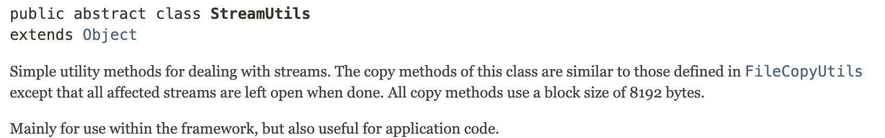

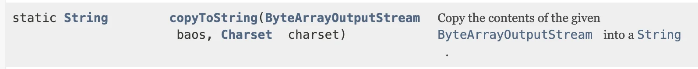

<a id="1c3eda9b0fe1813b83c8d96599366fb5"></a>

&#45;<a href="https://docs.spring.io/spring-framework/docs/current/javadoc-api/org/springframework/util/StreamUtils.html">Dos</a> 발췌

---

<a id="1c3eda9b0fe181399676cbb84f5b1613"></a>

클라이언트로부터 요청받은 바이너리 데이터인 <code>ServletInputStream</code>을 복사해 String으로 파싱해주는 메서드  <br>

</details>

<a id="1c3eda9b0fe181b9904bebbda57f17f8"></a>

###  단순 텍스트

<details>
<summary>🧐 HTTP Body 읽어오기 </summary>

- <code>getInputStrean()</code>&#58; 

- <code>StreamUtils&#46;copyToString()</code> &#58; byte 코드 변환   

</details>

<details>
<summary><strong>RequestBodyStringServlet</strong></summary>

- <code>StreamUtils&#46;copyToString(inputStream, StandardCharsets&#46;UTF&#95;8);</code>
    - inputStream은 byte 코드를 반환한다&#46;<br> byte 코드를 우리가 읽을 수 있는 문자(String)로 보려면 해당하는 인코딩 정보(<code>UTF&#95;8</code>)를 지정 해주어야 한다&#46; 

<a id="1c3eda9b0fe18112a2edf251d511e274"></a>

```java
package hello.servlet.basic.request;

import jakarta.servlet.ServletException;
import jakarta.servlet.ServletInputStream;
import jakarta.servlet.annotation.WebServlet;
import jakarta.servlet.http.HttpServlet;
import jakarta.servlet.http.HttpServletRequest;
import jakarta.servlet.http.HttpServletResponse;
import org.springframework.util.StreamUtils;

import java.io.IOException;
import java.nio.charset.StandardCharsets;
import java.util.stream.Stream;

@WebServlet(name = "requestBodyStringServlet", urlPatterns = "/request-body-string")
public class RequestBodyStringServlet extends HttpServlet {

    @Override
    protected void service(HttpServletRequest request, HttpServletResponse response) throws ServletException, IOException {
        ServletInputStream inputStream = request.getInputStream();
        String messageBody = StreamUtils.copyToString(inputStream, StandardCharsets.UTF_8);

        System.out.println("messageBody = " + messageBody);

        response.getWriter().write("ok");
    }
}
```

</details>

<details>
<summary><strong>PostMan 테스트</strong></summary>

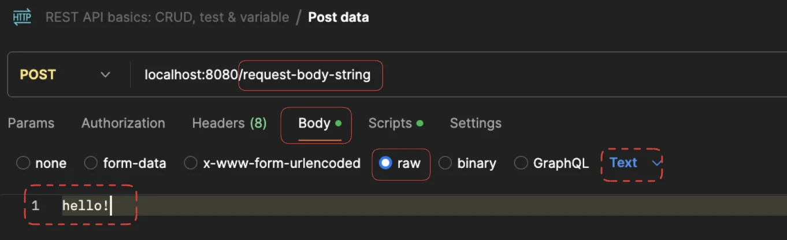

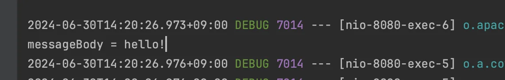

</details>

<a id="1c3eda9b0fe181dcb254f0b85e9abe51"></a>

###  JSON

> 👉🏻 <strong>JSON 형식 전송</strong><br>
> 
> - <strong>POST http&#58;//localhost&#58;8080/request&#45;body&#45;json</strong>
> 
> - <strong>content&#45;type&#58;</strong> <strong><code>application/json</code></strong>
> 
> - <strong>message body</strong>&#58; <code>{&#34;username&#34;&#58; &#34;hello&#34;, &#34;age&#34;&#58; 20}</code>
> 
> <a id="1c3eda9b0fe181a783ccee8d887eaf55"></a>
> 
> 결과&#58; <code>messageBody = {&#34;username&#34;&#58; &#34;hello&#34;, &#34;age&#34;&#58; 20}</code>

<details>
<summary><strong>JSON 데이터를 파싱할 때 사용할 객체 생성</strong></summary>

- Lombok
    - <code>Getter</code>

    - <code>Setter</code> 

<a id="1c3eda9b0fe1814f9d45daa6d8680ce8"></a>

```java
import lombok.Getter;
import lombok.Setter;

@Getter @Setter
public class HelloData {

    private String username;
    private int age;
}
```

</details>

<details>
<summary><strong>서블릿을  통한 JSON massage body  파싱</strong></summary>

1. <code>ServletInputStream</code> 객체를 통해 클라이언트로 부터 요청 받는 바이너리 데이터 읽어옴

1. <code>StreamUtils&#46;copyToString()</code>을 통해 받이온 바이너리 데이터 String으로 파싱

1. 스프링 MVC에서 기본적으로 제공되는 Jackson 라이브러리(<code>ObjectMapper</code>)를 통해  받아온 JSON 데이터(String 형태임)를 파싱 및 자바 객체로 변환

<a id="1c3eda9b0fe181709661d3d67bf04aee"></a>

```java
package hello.servlet.basic.request;

import com.fasterxml.jackson.databind.ObjectMapper;
import hello.servlet.basic.HelloData;
import jakarta.servlet.ServletException;
import jakarta.servlet.ServletInputStream;
import jakarta.servlet.annotation.WebServlet;
import jakarta.servlet.http.HttpServlet;
import jakarta.servlet.http.HttpServletRequest;
import jakarta.servlet.http.HttpServletResponse;
import org.springframework.util.StreamUtils;

import java.io.IOException;
import java.nio.charset.StandardCharsets;

@WebServlet(name = "requestBodyJsonServlet", urlPatterns = "/request-body-json")
public class RequestBodyJsonServlet extends HttpServlet {

    private ObjectMapper objectMapper = new ObjectMapper();

    @Override
    protected void service(HttpServletRequest request, HttpServletResponse response) throws ServletException, IOException {

        ServletInputStream inputStream = request.getInputStream();

        String messageBody = StreamUtils.copyToString(inputStream, StandardCharsets.UTF_8);

        System.out.println("messageBody = " + messageBody);

        HelloData helloData = objectMapper.readValue(messageBody, HelloData.class);;

        System.out.println("helloData.username = " + helloData.getUsername());

        System.out.println("helloData.age = " + helloData.getAge());

        response.getWriter().write("ok");
    }
}

```

- 출력결과 

<a id="1c3eda9b0fe1813caf41cad6a65a0d52"></a>

```plaintext
messageBody={"username": "hello", "age": 20}
data.username=hello
data.age=20
```

</details>

<details>
<summary><strong>PostMan 테스트</strong></summary>

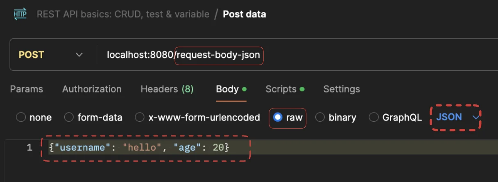

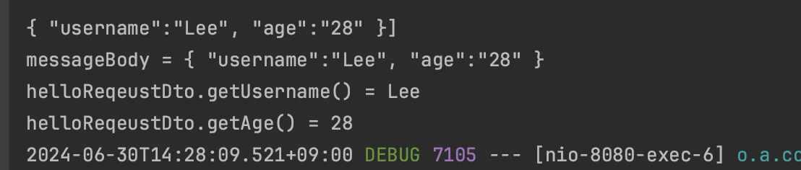

</details>

<a id="1c3eda9b0fe1811ab6e5c52c15ef75bb"></a>

## HTTP 응답 데이터 ( 3 ) 

<details>
<summary>🧐 <code>HttpServletResponse</code> 에 정의된 상태(Status) 필드</summary>

> 가져다가 사용하면 됨 

<a id="1c3eda9b0fe181a28ec4fcdbbba413b3"></a>

```java
int SC_CONTINUE = 100;
int SC_SWITCHING_PROTOCOLS = 101;
int SC_OK = 200;
int SC_CREATED = 201;
int SC_ACCEPTED = 202;
int SC_NON_AUTHORITATIVE_INFORMATION = 203;
int SC_NO_CONTENT = 204;
int SC_RESET_CONTENT = 205;
int SC_PARTIAL_CONTENT = 206;
int SC_MULTIPLE_CHOICES = 300;
int SC_MOVED_PERMANENTLY = 301;
int SC_MOVED_TEMPORARILY = 302;
int SC_FOUND = 302;
int SC_SEE_OTHER = 303;
int SC_NOT_MODIFIED = 304;
int SC_USE_PROXY = 305;
int SC_TEMPORARY_REDIRECT = 307;
int SC_BAD_REQUEST = 400;
int SC_UNAUTHORIZED = 401;
int SC_PAYMENT_REQUIRED = 402;
int SC_FORBIDDEN = 403;
int SC_NOT_FOUND = 404;
int SC_METHOD_NOT_ALLOWED = 405;
int SC_NOT_ACCEPTABLE = 406;
int SC_PROXY_AUTHENTICATION_REQUIRED = 407;
int SC_REQUEST_TIMEOUT = 408;
int SC_CONFLICT = 409;
int SC_GONE = 410;
int SC_LENGTH_REQUIRED = 411;
int SC_PRECONDITION_FAILED = 412;
int SC_REQUEST_ENTITY_TOO_LARGE = 413;
int SC_REQUEST_URI_TOO_LONG = 414;
int SC_UNSUPPORTED_MEDIA_TYPE = 415;
int SC_REQUESTED_RANGE_NOT_SATISFIABLE = 416;
int SC_EXPECTATION_FAILED = 417;
int SC_INTERNAL_SERVER_ERROR = 500;
int SC_NOT_IMPLEMENTED = 501;
int SC_BAD_GATEWAY = 502;
int SC_SERVICE_UNAVAILABLE = 503;
int SC_GATEWAY_TIMEOUT = 504;
int SC_HTTP_VERSION_NOT_SUPPORTED = 505;
```

</details>

<a id="1c3eda9b0fe181f3bf49d2684cc1fca1"></a>

### <strong>HttpServletRespone &#45; 기본 사용법</strong>

> 👉🏻 <strong>HttpServletRespone</strong> 
> 
> - <strong>HTTP 응답 메서지 생성</strong>
>     - <strong><u>HTTP 응답코드</u></strong><strong> </strong>지정&#58; <code>setStatus(HttpResponseServlet&#46;Type)</code>
> 
>     - <strong><u>헤더</u></strong><strong> </strong>입력&#58; <code>setHeader()</code>
> 
>     - <strong><u>바디</u></strong> 입력&#58; <code>getWriter()</code>
> 
> - <strong>편의 메서드</strong>
>     > 아래 정리 내용 참조
> 
>     - <strong>Content&#45;Type&#58; </strong><code>content()</code>
> 
>     - <strong>쿠키&#58; </strong><code>cookie()</code>
> 
>     - <strong>Redirect&#58; </strong><code>redirect()</code>

<details>
<summary><strong>ResponseHeaderServlet</strong></summary>

<a id="1c3eda9b0fe18144b029cd7c90183d67"></a>

```java
package hello.servlet.basic.response;


import jakarta.servlet.ServletException;
import jakarta.servlet.annotation.WebServlet;
import jakarta.servlet.http.HttpServlet;
import jakarta.servlet.http.HttpServletRequest;
import jakarta.servlet.http.HttpServletResponse;

import java.io.IOException;

@WebServlet(name = "responseHeaderServlet", urlPatterns = "/response-header")
public class ResponseHeaderServlet extends HttpServlet {

    @Override
    protected void service(HttpServletRequest request, HttpServletResponse response) throws ServletException, IOException {
        //[status-line]
        response.setStatus(HttpServletResponse.SC_OK); //200
        
        //[response-headers]
        response.setHeader("Content-Type", "text/plain;charset=utf-8");
        response.setHeader("Cache-Control", "no-cache, no-store, must- revalidate");
        response.setHeader("Pragma", "no-cache");
        response.setHeader("my-header","hello");

        //[Header 편의 메서드]
        content(response);
        cookie(response);
        redirect(response);

        //[message body]
        PrintWriter writer = response.getWriter();
        writer.println("안녕하세요");
    }
}
```


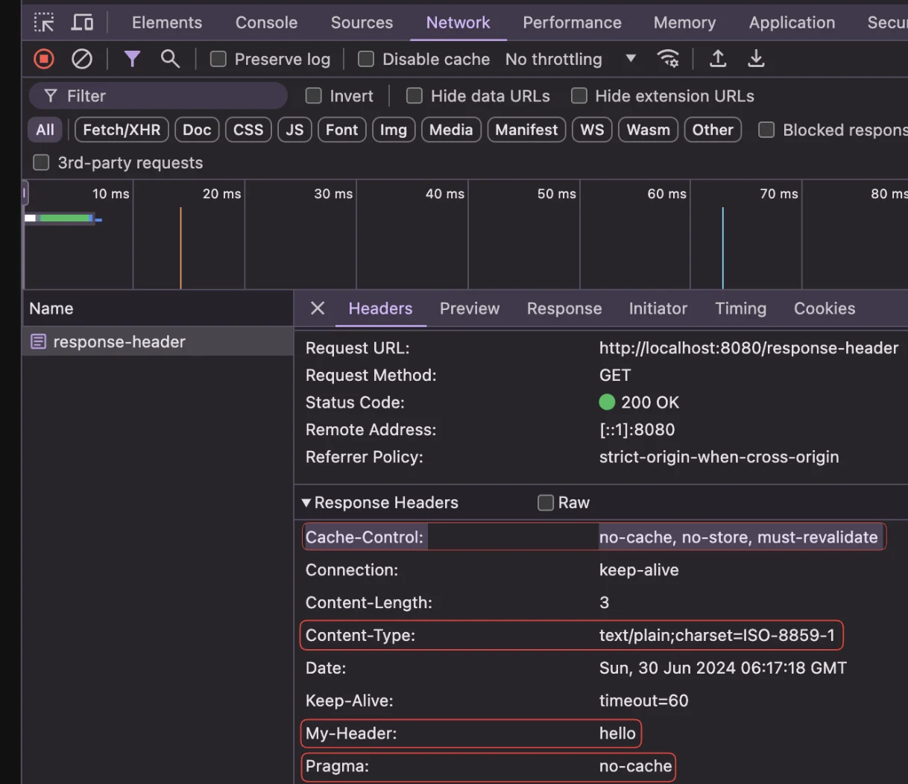

</details>

<details>
<summary><strong>편의 메서드 &#45; </strong><strong><code>content()</code></strong><strong>, </strong><strong><code>cookie()</code></strong><strong>, </strong><strong><code>redirect()</code></strong></summary>

<details>
<summary><strong>Content&#45;Type&#58;</strong> <strong><code>content()</code></strong></summary>

<a id="1c3eda9b0fe1811e8346d6cfe18a5e6f"></a>

```java
private void content(HttpServletResponse response) {
		//Content-Type: text/plain;charset=utf-8
		//Content-Length: 2
		//response.setHeader("Content-Type", "text/plain;charset=utf-8"); 
		response.setContentType("text/plain"); 
		response.setCharacterEncoding("utf-8"); 
		//response.setContentLength(2); //(생략시 자동 생성)
}
```

</details>

<details>
<summary><strong>쿠키&#58; </strong><strong><code>cookie()</code></strong></summary>

<a id="1c3eda9b0fe18180b14acc67f4eeba19"></a>

```java
private void cookie(HttpServletResponse response) {
		//Set-Cookie: myCookie=good; Max-Age=600; 
		//response.setHeader("Set-Cookie", "myCookie=good; Max-Age=600"); 
		Cookie cookie = new Cookie("myCookie", "good"); 
		cookie.setMaxAge(600); //600초
    response.addCookie(cookie);
}
```

</details>

<details>
<summary><strong>Redirect&#58; </strong><strong><code>redirect()</code></strong></summary>

<a id="1c3eda9b0fe181f2a37add93ef280411"></a>

```java
private void redirect(HttpServletResponse response) throws IOException {
   //Status Code 302
   //Location: /basic/hello-form.html
   //response.setStatus(HttpServletResponse.SC_FOUND); //302
   //response.setHeader("Location", "/basic/hello-form.html");
   response.sendRedirect("/basic/hello-form.html");
}
```

</details>

</details>

---

<details>
<summary><strong>단순 텍스트 응답</strong></summary>

- <code>setContentType()</code>&#58; Content&#45;type 지정

- <code>setCharacterEncoding()</code>&#58;  인코딩 형식    
    - ex) <code>utf&#45;8</code>  …

- <code>getWriter()&#46;write()</code>&#58;  응답 HTTP 메세지에 content  입력

- <code>objectMapper&#46;writeValueAsString( &#39;인스턴스&#39;)</code> &#58; 인스턴스 → JSON 문자 변환

</details>

<details>
<summary><strong>HTML 응답</strong></summary>

> <del>완전 노가다&#46;&#46; 그냥 이런 방법이 있다는 정도만 알아두자</del>

<a id="1c3eda9b0fe18176aec3c5f54e065f35"></a>

```java
package hello.servlet.basic.response;

import jakarta.servlet.ServletException;
import jakarta.servlet.annotation.WebServlet;
import jakarta.servlet.http.HttpServlet;
import jakarta.servlet.http.HttpServletRequest;
import jakarta.servlet.http.HttpServletResponse;

import java.io.IOException;
import java.io.PrintWriter;


@WebServlet(name = "responseHtmlServlet", urlPatterns = "/response-html")
public class ResponseHtmlServlet extends HttpServlet {

    @Override
    protected void service(HttpServletRequest request, HttpServletResponse response) throws ServletException, IOException {
	
        //Content-Type: text/html;charset=utf-8
        response.setContentType("text/html");
        response.setCharacterEncoding("utf-8");
				
				// html 작성 
        PrintWriter writer = response.getWriter();
        writer.println("<html>");
        writer.println("<body>");
        writer.println(" <div>안녕?</div>");
        writer.println("</body>");
        writer.println("</html>");

    }
}
```

</details>

<a id="1c3eda9b0fe181b9955ace17fe8eb307"></a>

### API JSON

<details>
<summary>👍🏻 <strong>Spring MVC</strong> 사용 시</summary>

- 해당 객체만 반환하면 알아서 처리해줌

<a id="1c3eda9b0fe1814fa35ddf8692d5c152"></a>

```java
 @Override
    protected HelloData service(HttpServletRequest request, HttpServletResponse response) throws ServletException, IOException {
        HelloData helloData = new HelloData();
        helloData.setUsername("LEE");
        helloData.setAge(28);
        return helloData;
    }
```

</details>

> 해당 방식을 주로 사용

<details>
<summary>HTTP 응답으로 <strong>JSON을 반환</strong></summary>

- <strong><code>content&#45;type&#58; application/json</code></strong>

> 🧐 <strong>참고</strong><br><code>application/json</code>은 스펙상 <code>utf&#45;8</code> 형식을 사용하도록 정의되어 있다&#46; 그래서 스펙에서 <code>charset=utf&#45;8</code> 과 같은 추가 파라미터를 지원하지 않는다&#46; <br>   → <code>application/json</code> 
> 
> <a id="1c3eda9b0fe18193b83fe0e7ab5fb620"></a>
> 
> <br><code>application/json;</code><strong><u><code>charset=utf&#45;8</code></u></strong> 으로 전달하는 것은 <strong><u>의미 없는 파라미터를 추가</u></strong>한 것이 된다&#46;
> 
> <a id="1c3eda9b0fe18145afebc58cf82c563b"></a>
> 
> <code>response&#46;getWriter()</code>를 사용하면 추가 파라미터를 자동으로 추가해버린다&#46; <br>이때는 <code>response&#46;getOutputStream()</code>으로 출력하면 그런 문제가 없다&#46;

</details>

<a id="1c3eda9b0fe181118554c48fcaa18e9d"></a>

```java
package hello.servlet.basic.response;

import com.fasterxml.jackson.databind.ObjectMapper;
import hello.servlet.basic.HelloData;
import jakarta.servlet.ServletException;
import jakarta.servlet.annotation.WebServlet;
import jakarta.servlet.http.HttpServlet;
import jakarta.servlet.http.HttpServletRequest;
import jakarta.servlet.http.HttpServletResponse;

import java.io.IOException;

/**
 * http://localhost:8080/response-json
 *
 */

@WebServlet(name = "responseJsonServlet", urlPatterns = "/response-json")
public class ResponseJsonServlet extends HttpServlet {

    private ObjectMapper objectMapper = new ObjectMapper();

    @Override
    protected void service(HttpServletRequest request, HttpServletResponse response) throws ServletException, IOException {

        //Content-Type: application/json
        response.setHeader("content-type", "application/json");
        response.setCharacterEncoding("utf-8");
        HelloData data = new HelloData();
        data.setUsername("kim");
        data.setAge(20);
        //{"username":"kim","age":20}
        String result = objectMapper.writeValueAsString(data);
        response.getWriter().write(result);
    }
}
```
