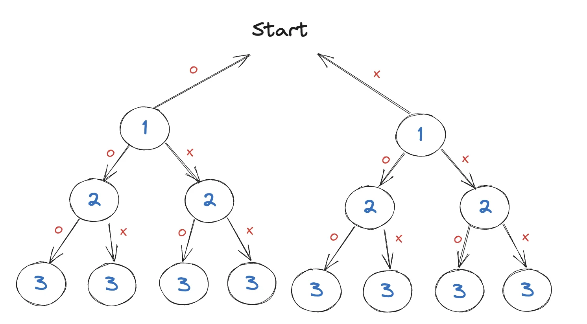
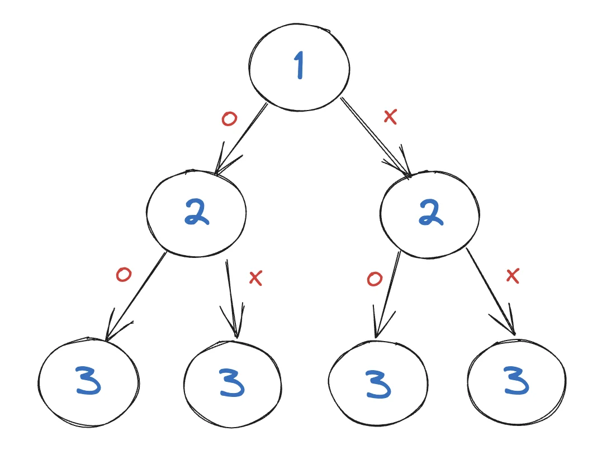

<a id="1c3eda9b0fe181c8acc1dba974edc642"></a>

# 문제

<a id="1c3eda9b0fe181d9af88f7d7d1d487b1"></a>

## 6&#46; 부분집합 구하기(DFS)

<a id="1c3eda9b0fe181279538cb18368d29a2"></a>

### 설명

<a id="1c3eda9b0fe181a9ae99eec45c732f2f"></a>

자연수 N이 주어지면 1부터 N까지의 원소를 갖는 집합의 부분집합을 모두 출력하는 프로그램을 작성하세요&#46;

<a id="1c3eda9b0fe1812e98b9fd6f10f9acee"></a>

### 입력

<a id="1c3eda9b0fe181d19353d31b9f6cfda6"></a>

첫 번째 줄에 자연수 N(1≤N≤10)이 주어집니다&#46;

<a id="1c3eda9b0fe18177ad35eba28ef00b88"></a>

### 출력 

<a id="1c3eda9b0fe18116a6eaf747358a2092"></a>

첫 번째 줄부터 각 줄에 하나씩 부분집합을 아래와 출력 예제와 같은 순서로 출력한다&#46;

<a id="1c3eda9b0fe181d5a914d683ec2927dd"></a>

단, 공집합은 출력하지 않습니다&#46;

---

<a id="1c3eda9b0fe181cdbe15caff286b4583"></a>

### 입력 예제1

<a id="1c3eda9b0fe18134a1b0ea21056b10c7"></a>

```plaintext
3
```

<a id="1c3eda9b0fe18136b645e4ca1e97de98"></a>

### 출력 예제1

<a id="1c3eda9b0fe181cd9e76e73a982785ac"></a>

```plaintext
1 2 3
1 2
1 3
1
2 3
2 
3
```

<a id="1c3eda9b0fe181b4b730fd9b47550271"></a>

# 풀이





<a id="1c3eda9b0fe181809d95f64aae873cc4"></a>

## 풀이1) <code>내풀이</code>  개별 출력

<a id="1c3eda9b0fe18184bbd7efae7fadbb5e"></a>

```java
import java.util.*;
public class Main {
    static int n;
    static int[] ch;
    public void DFS(int L) {
        if(L==n+1){
            for(int i=1; i<=n; i++){
                if(ch[i]==1){
                    System.out.print(i+" ");
                }
            }
            System.out.println("");
        }
        else {
            // left
            ch[L]=1;
            DFS(L+1);
            // right
            ch[L]=0;
            DFS(L+1);
        }
    }

    public static void main(String args[]) {
        Main T = new Main();
        Scanner sc = new Scanner(System.in);
        n = sc.nextInt();
        ch = new int[n+1];
        T.DFS(1);
    }
}
```

<a id="1c3eda9b0fe1815897d5cde42ba96c47"></a>

## 풀이2) <code>강의풀이</code>  문자열

<a id="1c3eda9b0fe181fa834ef2a4c48b8ea4"></a>

```java
import java.util.*;
public class Main {
    static int n;
    static int[] ch;
    public void DFS(int L) {
        if(L==n+1){
            String tmp="";
            for(int i=1; i<=n; i++){
                if(ch[i]==1) tmp+=(i+" ");
            }
            if(tmp.length()>0) System.out.println(tmp);
        }
        else {
            // left
            ch[L]=1;
            DFS(L+1);
            // right
            ch[L]=0;
            DFS(L+1);
        }
    }

    public static void main(String args[]) {
        Main T = new Main();
        Scanner sc = new Scanner(System.in);
        n = sc.nextInt();
        ch = new int[n+1];
        T.DFS(1);
    }
}
```
