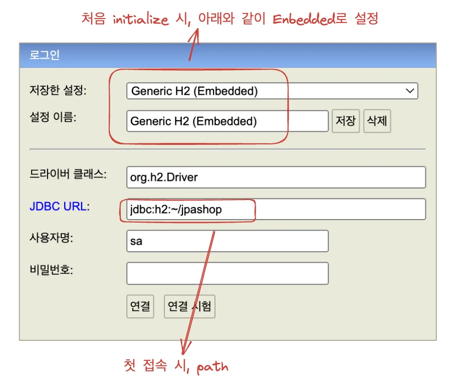
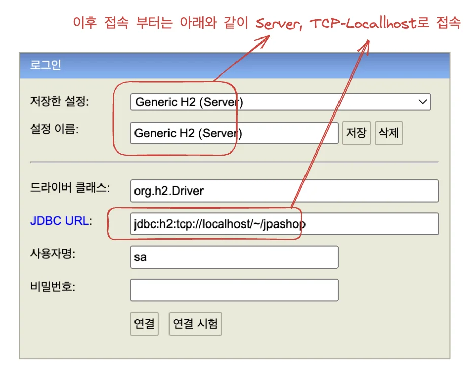
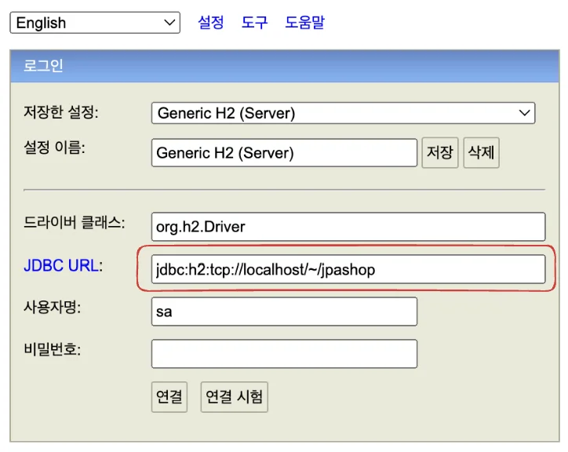
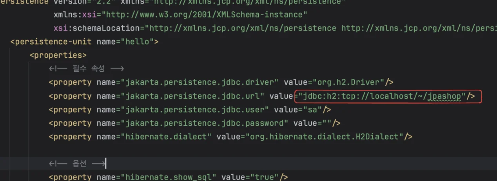
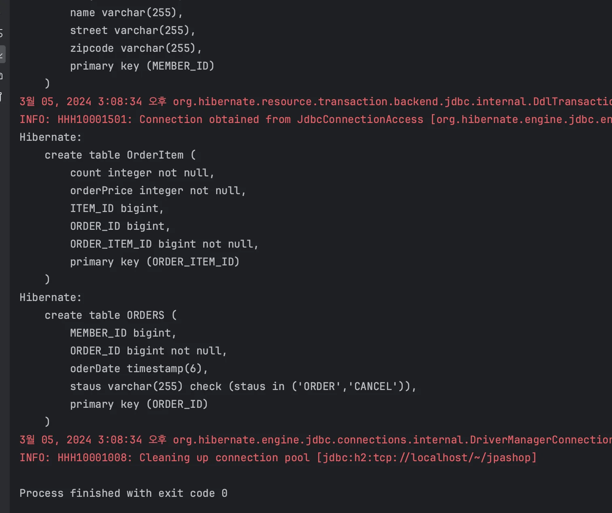

<a id="1c3eda9b0fe18103a2caf2bb6de30eca"></a>

강의를 따라하다가 2번째 DB(jpashop)를 생성 및 연결에서 자꾸 오류가 나서 수동으로 파일 생성해서 해결함 

<a id="1c3eda9b0fe18179be0dc40729a853ea"></a>

### DB 파일 수동 생성

<a id="1c3eda9b0fe1817dbebee4506874d72b"></a>

<strong><code>/Users/igyeongseob/</code></strong> (기본 시작) 경로에 <strong><u>수동으로 DB 파일(</u></strong><strong><u><code>jpashop&#46;mv&#46;db</code></u></strong><strong>) </strong><strong><u>생성</u></strong>

<a id="1c3eda9b0fe1816f9fe3fefa797e2a9d"></a>

```shell
touch jpashop.mv.db
```

<a id="1c3eda9b0fe181938fd8c27b58d68c8b"></a>

### h2 DB 시작 설정

- initialize 설정



- 이후 접속 시 설정



<a id="1c3eda9b0fe181bd8271f9f18bab86bd"></a>

### hibernate &#45; DB 경로 설정하기

> 두 경로 동일하게 작성 후 접속 





> JapMain 실행 시, 아래와 같이 정상적으로 쿼리 날림


