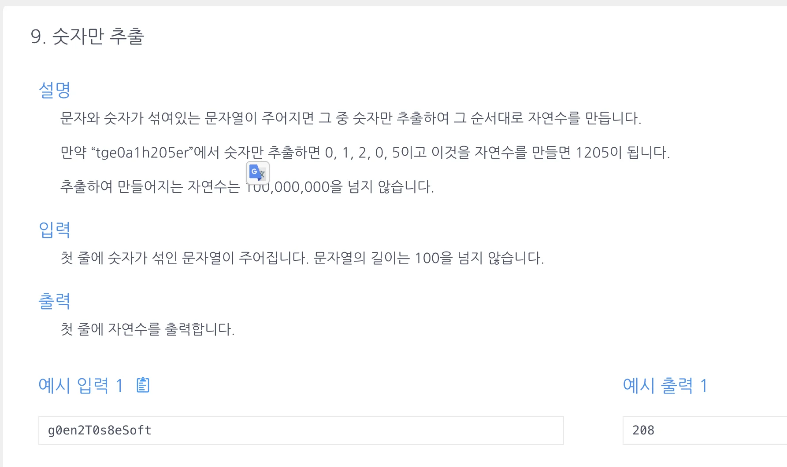

<a id="1c3eda9b0fe18118b980cd8b4df5e3d9"></a>

## 문제)



<a id="1c3eda9b0fe18167be40fdaad9d5c535"></a>

예시 입력 1

<a id="1c3eda9b0fe1816baca8f56f3db9253e"></a>

```plaintext
g0en2T0s8eSoft
```

<a id="1c3eda9b0fe1817fbf8fd6b1ed56cdeb"></a>

예시 출력 1

<a id="1c3eda9b0fe181ffb5cfd72ce00a39a5"></a>

```plaintext
208
```

<a id="1c3eda9b0fe18182ba5dc0b93539707f"></a>

## 풀이)

<a id="1c3eda9b0fe181729765f98f3afba13b"></a>

### 내 풀이1) 정규식 &#43; int 형변환

<a id="1c3eda9b0fe18100839dcfaed8407f8d"></a>

```java
import java.util.Scanner;

public class Main {
    public int solution(String s){
        s= s.replaceAll("[^0-9]", "");
        return Integer.parseInt(s);
    }
    public static void main(String[] args){
        Main m = new Main();
        Scanner in=new Scanner(System.in);
        String str = in.nextLine();
        System.out.println(m.solution(str));
    }
}
```

<a id="1c3eda9b0fe1818cabb9cdab4a983ad7"></a>

### 내 풀이2) ASCII &#43; int 형변환

<a id="1c3eda9b0fe181c98d11d2b9147fa863"></a>

```java
import java.util.ArrayList;
import java.util.Scanner;

public class Main {
    public int solution(String x){
        String answer="";
        for (char s : x.toCharArray()){
            if (48<s && s<58){
                answer+=s;
            }
        }
        return Integer.parseInt(answer);
    }
    public static void main(String[] args) {
        Main m = new Main();
        Scanner sc = new Scanner(System.in);
        String str = sc.nextLine();
        System.out.println(m.solution(str.toUpperCase()));
    }
}
```

<a id="1c3eda9b0fe181c6bee4f602de15f93f"></a>

### 풀이 3) 숫자 판별 (Character&#46;isDigit())

<a id="1c3eda9b0fe181618af8ea845bc38c9c"></a>

```java
import java.util.Scanner;

public class Main {
    public int solution(String s){
        String answer = "";
        // 문자가 숫자랑 비교될 시, 자동으로 아스키문자(int형)로 형변환이 일어남.
        for ( char x : s.toCharArray()){
            if (Character.isDigit(x)) answer+=x;
        }
        return Integer.parseInt(answer);
    }
    public static void main(String[] args){
        Main m = new Main();
        Scanner in=new Scanner(System.in);
        String str = in.nextLine();
        System.out.println(m.solution(str));
    }
}
```

<a id="1c3eda9b0fe181caba43d141327bca66"></a>

### 풀이 4) 문자 판별  역순(풀이3으로 개선 가능) 

<a id="1c3eda9b0fe181a98e1fd660c1aba70d"></a>

```java
import java.util.Scanner;

public class Main {

    public int solution(String str){
        String s ="";
        char[] sList = str.toUpperCase().toCharArray();
        for ( char x : sList){
            if (!Character.isUpperCase(x)){
                s += x;
            }
        }
        int answer = Integer.parseInt(s);
        return answer;
    }
    public static void main(String[] args){
        Main m = new Main();
        Scanner sc=new Scanner(System.in);
        String str = sc.next();
        System.out.print(m.solution(str));
    }
}
```

<a id="1c3eda9b0fe18117be64d227484e785a"></a>

### 강의 풀이 5) 아스키번호

> 문자 ‘0’ 이 <code>&#45;</code>, <code>&#43;</code> 를 만나면 아스키 번호(<code>48</code>)로 연산처리된다&#46; <br>문자&#58; ‘0’ &#126; ‘9’ → 아스키번호&#58; 48 &#126; 57

<a id="1c3eda9b0fe18115897bdd7acaf66b5f"></a>

```java
import java.util.Scanner;

public class Main {
    public int solution(String s){
        int answer = 0;
        // 문자가 숫자랑 비교될 시, 자동으로 아스키문자(int형)로 형변환이 일어남.
        for ( char x : s.toCharArray()){
            if(x>=48 && x<=57) answer=answer*10+(x-48);
        }
        return answer;
    }
    public static void main(String[] args){
        Main m = new Main();
        Scanner in=new Scanner(System.in);
        String str = in.nextLine();
        System.out.println(m.solution(str));
    }
}
```
