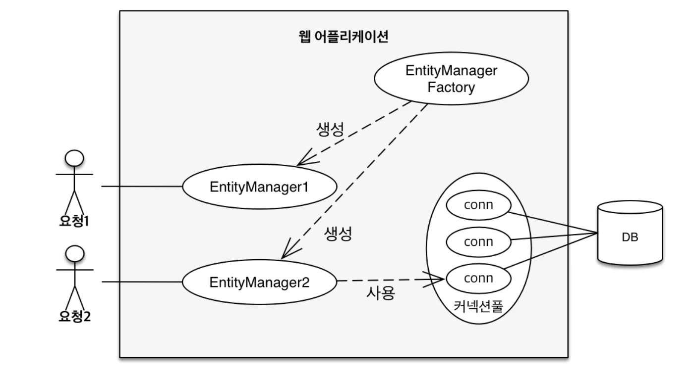
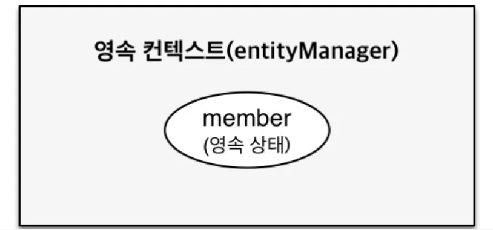
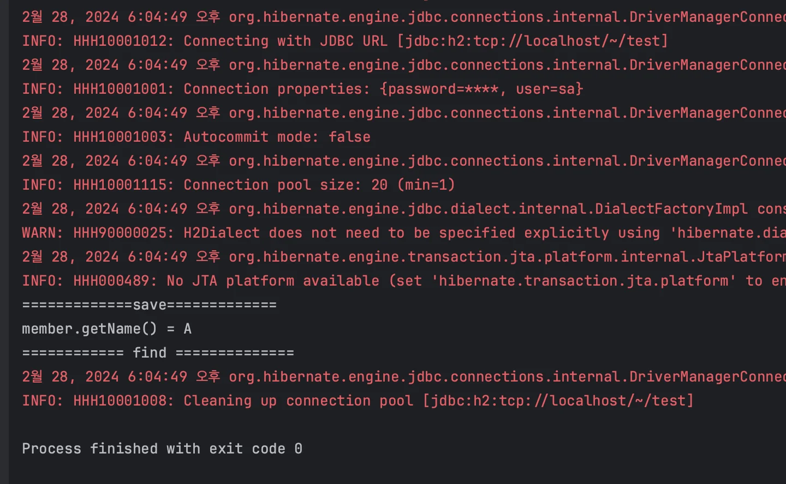
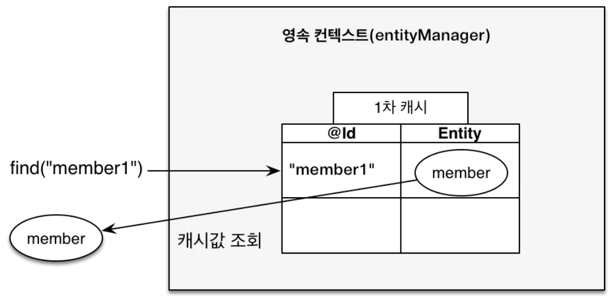
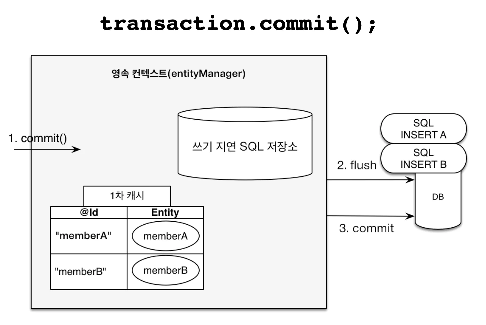
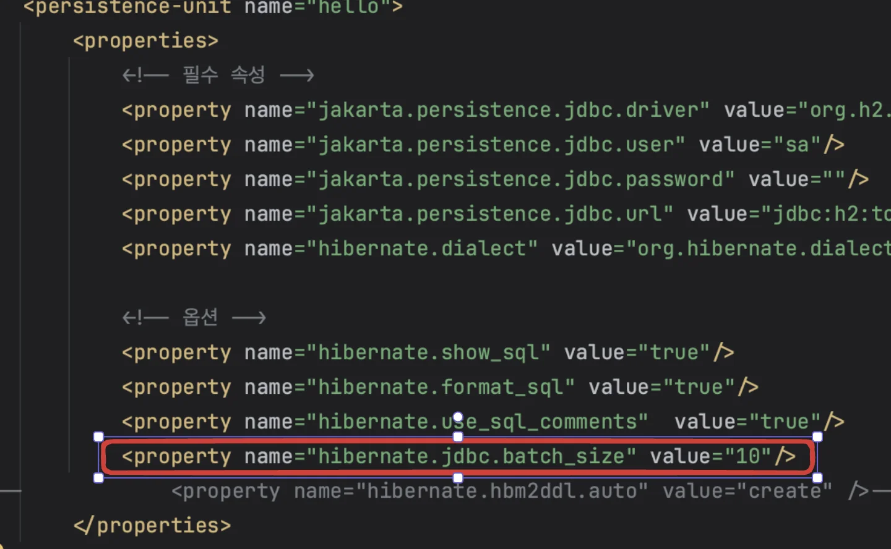
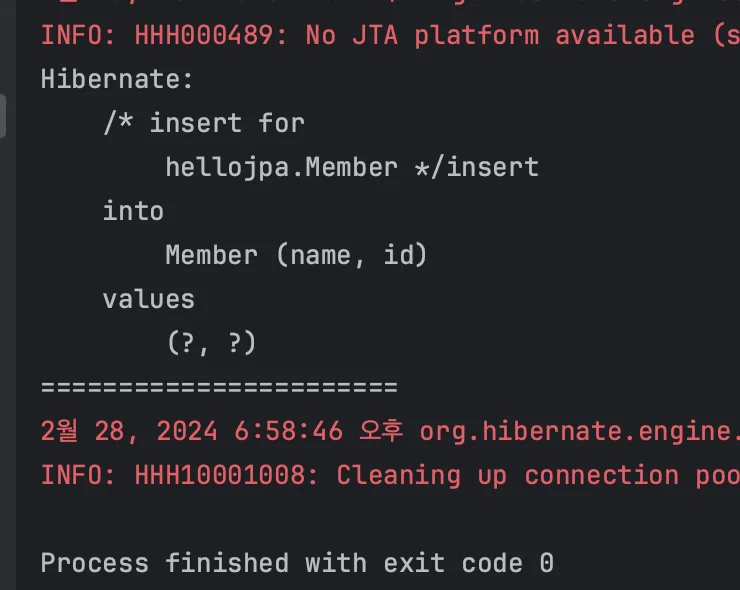
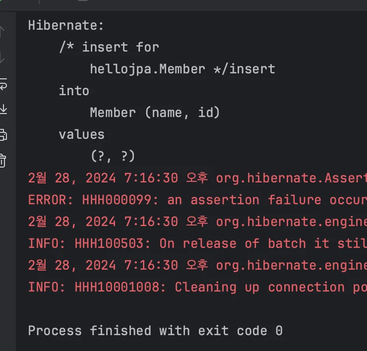
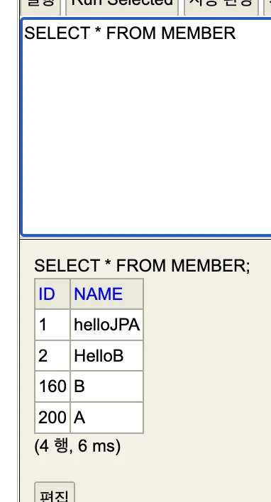

> ☝🏻 <strong>JPA에서 가장 중요한 2가지 </strong>
> 
> - 객체와  관계형 데이터 베이스 매핑 ( Object Relational Mapping )
> 
> - <strong>영속성 컨텍스트 &#45; 내부 동작 방식</strong>

<details>
<summary>사용자 요청 시,  엔티티 매니저 팩토리, 엔티티 매니저  동작 방식 (복습)</summary>



</details>

<a id="1c3eda9b0fe181529c22cf16fc4c1fc6"></a>

### 영속성 컨텍스트 

> 영속성 컨텍스트는  <strong><u>엔티티를 영구 저장하는 환경</u></strong>을 말하는 <strong><u>논리적인 개념</u></strong>으로써 <strong><u>Entity Manager 를 통해서 접근</u></strong> 할수 있다&#46; 

<a id="1c3eda9b0fe181828b6ef35ba3f38f40"></a>

<strong>→ Entity 영속성 컨텍스트에 저장&#58;</strong><strong><code> EntityManager&#46;</code></strong><strong><u><code>persist(</code></u></strong><strong><code>entity</code></strong><strong><u><code>)</code></u></strong><strong><code>;</code></strong>

> 애플리케이션과 데이터베이스 사이에 존재하는 중간 계층  ⇒ 영속성 컨텍스트(Entity Manager)<br> → 버퍼링,  캐싱  등 이점 사용 가능

<a id="1c3eda9b0fe18132b58bd751cbda0ae0"></a>

## Entity Life Cycle (생명주기)


<a id="1c3eda9b0fe1814092e0f568c26ba9bc"></a>

### 비영속 (new/transient) 

> 영속성 컨텍스트와 전혀 관계가 없는 <strong>새로운</strong> 상태


<a id="1c3eda9b0fe181ba8f86e5f35804aace"></a>

```java
//객체를 생성한 상태(비영속)
Member member = new Member();
member.setId("member1");
member.setUsername("회원1");
```

<a id="1c3eda9b0fe1818787b2e6c837b0d3b8"></a>

### 영속 (managed)

> 영속성 컨텍스트에 <strong>관리</strong>되는 상태



<a id="1c3eda9b0fe1818a8059e3d21b92d342"></a>

```java
//객체를 생성한 상태(비영속)
Member member = new Member();
member.setId("member1");
member.setUsername(“회원1”);

EntityManager em = emf.createEntityManager();
em.getTransaction().begin();

//객체를 저장한 상태(영속)
em.persist(member);
```

<a id="1c3eda9b0fe1813d978ac0e971beb8f3"></a>

###  준영속 (detached)

> 영속성 컨텍스트에 저장되었다가 <strong>분리</strong>된 상태

<a id="1c3eda9b0fe1812e93ced64c183632cb"></a>

```java
//회원 엔티티를 영속성 컨텍스트에서 분리(준영속)
em.detach(member);
```

<a id="1c3eda9b0fe1818992cefee36d24f660"></a>

### 삭제 (removed)

> <strong>삭제</strong>된 상태

<a id="1c3eda9b0fe1818295cae2eb10ab5a01"></a>

```java
//객체를 삭제한 상태(삭제)
em.remove(member);
```

<details>
<summary>🧐 삭제 후 조회 시, 출력값은? </summary>

<a id="1c3eda9b0fe181fb9c48d6be0981fee9"></a>

```java
package hellojpa;

import jakarta.persistence.EntityManager;
import jakarta.persistence.EntityManagerFactory;
import jakarta.persistence.EntityTransaction;
import jakarta.persistence.Persistence;

public class JapMain {
    public static void main(String[] args) {
        EntityManagerFactory emf = Persistence.createEntityManagerFactory("hello");

        EntityManager em = emf.createEntityManager();

        EntityTransaction tx = em.getTransaction();
        tx.begin();

        try {
            Member member1 = new Member(150L, "A");
            em.persist(member1);

            System.out.println("=============save=============");


            Member member2 = em.find(Member.class, 150L);
            System.out.println("member.getName() = " + member2.getName());
            em.remove(member2);

            System.out.println("============ find ==============");


            Member member3 = em.find(Member.class, 150L);
            System.out.println("member.getName() = " + member3.getName());


            System.out.println("============= delete =============");


            System.out.println("===========commit===============");

            tx.commit();

        } catch (Exception e){
            tx.rollback();
        } finally {
            em.close();
        }
        emf.close();
    }
}
```

- 오류&#58; NullPointerException 발생  →  tx&#46;rollback() 처리됨 
    <a id="1c3eda9b0fe181ff9252da70696814e4"></a>

    ```plaintext
    Exception in thread "main" java.lang.NullPointerException:
    Cannot invoke "hellojpa.Member.getName()" because "member3" is null
    at hellojpa.JapMain.main(JapMain.java:31)
    ```

    

    <a id="1c3eda9b0fe18122b469e19f1543065d"></a>

    아래의 출력값과 같이 NullPointerException이 발생되어 tx&#46;rollback()이 실행되어 오류 발생 이후로는 아무 출력이 발생되지 않음&#46;

</details>

<a id="1c3eda9b0fe1815cbc2ffa8d3c80f5d7"></a>

## 영속성 컨텍스트의 이점

> 📌 Entity Manager(영속성 컨텍스트)는 데이터 베이스 트랜젝션 단위로 생성되어 해당 데이터베이스  트랜젝션이 끝날 때, 종료 및 삭제된다&#46; <br><br>즉, 고객의 요청이 들어와서 비지니스가 끝나버리면 해당 영속성 컨텍스트(Entity Manager를 지운다&#46; ( 각 요청당 하나씩 생성되어 처리된다&#46; )<br><br>영속성 컨텍스트 내부에 존재하는 1차 캐시는 영속성 컨텍스트와 같이 데이터 베이스의 한 트랙젝션 안에서만 효과가 있기 때문에 성능적으로는 큰 이점은 없다&#46; (굉장히 짧은 시점에서만 존재)<br><br>성능적 이점 보다는 해당 컨셉(객체지향)으로 부터 이점이 있음 → 뒤 챕터에서 설명

> ☝🏻 여러명의 고객이 사용하는, 애플리케이션 전체에서 공유하는 2차 캐쉬 = JPA, Hibernate

<a id="1c3eda9b0fe18167bd03c04731912a82"></a>

### 1차 캐시

> 트렌젝션 종료 → 영속성 컨텍스트 종료  = 1차 캐시 삭제됨 

<a id="1c3eda9b0fe181aa82c4cde66a789e02"></a>

### <strong>저장</strong>

> 생성된 entity 객체(비영속)를 영속 컨텍스트에 저장(영속) 시 1차 캐시에 해당 emtity가 저장된다&#46;


<a id="1c3eda9b0fe18164a270c46f28c6135e"></a>

```java
//엔티티를 생성한 상태(비영속)
Member member = new Member();
member.setId("member1");
member.setUsername("회원1");

//엔티티(영속), 1차 캐시 저장됨
em.persist(member);
```

<a id="1c3eda9b0fe181d5aff1db7b10575175"></a>

### <strong>조회 &#45; 1차 캐시</strong>

> 조회(<code>em&#46;find(type, key)</code>)  시 해당 값이 1차 캐시에  존재<br>→ 1차 캐시에서 가져옴



> 👉🏻 싱글톤 방식? → 동일성(identity) 보장

<a id="1c3eda9b0fe1813d8d42c8cfbfe031ec"></a>

```java
Member member = new Member();
member.setId("member1");
member.setUsername("회원1");

//1차 캐시에 저장됨
em.persist(member);

//1차 캐시에서 조회
Member findMember = em.find(Member.class, "member1");
```

> 동일 트랜젝션 내에서, 조회한 엔티티를 재조회 시, DB가 아닌 1차 캐시에서 참조한다&#46;<br>→ DB에 쿼리를 날리지 않음&#46;

<a id="1c3eda9b0fe181d79dc9d169e820d462"></a>

### 조회 &#45; 데이터베이스

> 조회 시 해당 값이 1차 캐시에 존재하지 않는 경우<br>→ DB 조회,<br>→ 해당하는 값이 있을 시 1차 캐시에 저장<br>→ 1차 캐시에서 값 가져오옴


<a id="1c3eda9b0fe1814e900ccdd983b2903d"></a>

```java
Member findMember2 = em.find(Member.class, "member2");
```

<a id="1c3eda9b0fe181d6bc94ccd10b8b65df"></a>

### 동일성(identity) 보장

> 👉🏻 <strong>1차 캐시로 반복 가능한 읽기(REPEATABLE READ) 등급의 트랜잭<br>션 격리 수준을 데이터베이스가 아닌 애플리케이션 차원에서 제공<br>&#45; 강의 PDF 발췌 &#45;</strong>

<details>
<summary>🧐 애플리케이션 차원에서 제공? 여기서 말하는 애플리케이션이란 무엇?</summary>


</details>

<details>
<summary>🧐 영속성 컨텍스트(EntityManager) 내부에 Transaction을 논리적으로 어떻게 구분하는가? </summary>


</details>

> 같은 트랜젝션 안에서 실행되는 동일한 Entity 참조값 비교(==)는 항상 일치(true)한다&#46; 


<a id="1c3eda9b0fe181c294bee46fb9473070"></a>

```java
Member a = em.find(Member.class, "member1");
Member b = em.find(Member.class, "member1");

System.out.println(a == b); //동일성 비교 true
```

<a id="1c3eda9b0fe18101ad77dcc2c97cfff0"></a>

### 버퍼링 &#45;  트랜잭션을 지원하는 쓰기 지연( transactional write&#45;behind)  




<a id="1c3eda9b0fe1819f9e59ff84796ba9b4"></a>

```java
EntityManager em = emf.createEntityManager();
EntityTransaction transaction = em.getTransaction();

// 모든 데이터 변경은 트렉젝션 안에서 이루어져야 한다. 
transaction.begin(); // 트랜젝션 시작
 
em.persist(memberA);    // 1차 캐시에 해당 Entity 저장 및 
em.persist(memberB);    // INSERT SQL 생성되고 쓰기지연 SQL 저장소에 저장
--------------------------------------
			    쓰기(SQL) 지연                
    -> persist() 시, Entity 객체가      
          1차 캐시에 저장되면서            
        해당하는 SQL문이 생성된다           
 생성된 SQL문은 쓰기 지연 SQL 저장소에 저장되고 
   commit() 시, 저장된 SQL 문이 실행된다.                     
--------------------------------------
transaction.commit(); // 트랜젝션을 커밋, 커밋 시 데이터베이스에 INSERT SQL을 보냄
```

<details>
<summary> 강의) 예제 코드 </summary>

> ☝🏻 JPA는 기본적으로 내부에서 리플렉션 등을 사용하기 때문에 동적으로 객체를 생성해야한다&#46;따라서 생성자 사용 시, 기본 생성자가 존재해야 한다&#46;
> 
> <details>
> <summary>ex)</summary>
> 
> <a id="1c3eda9b0fe18110a184dca038bfe729"></a>
> 
> ```java
> @Entity
> public class Member {
> 
>     @Id
>     private Long id;
>     private String name;
> 
>     public Member() {
>     }
> 
>     public Member(Long id, String name) {
>         this.id = id;
>         this.name = name;
>     }
> ```
> 
> </details>

<a id="1c3eda9b0fe181b0b803c68be224847b"></a>

```java
package hellojpa;

import jakarta.persistence.EntityManager;
import jakarta.persistence.EntityManagerFactory;
import jakarta.persistence.EntityTransaction;
import jakarta.persistence.Persistence;

import java.util.List;

public class JapMain {
    public static void main(String[] args) {
        EntityManagerFactory emf = Persistence.createEntityManagerFactory("hello");

        EntityManager em = emf.createEntityManager();

        EntityTransaction tx = em.getTransaction();
        tx.begin();

        try {
            // 영속
            Member member1 = new Member(150L, "A");
            Member member2 = new Member(160L, "B");

            em.persist(member1);
            em.persist(member2);

            System.out.println("==========================");

            tx.commit();

        } catch (Exception e){
            tx.rollback();
        } finally {
            em.close();

        }
        emf.close();
    }
}
```


</details>

<details>
<summary>jdbc&#46;batch&#95;size</summary>

> 버퍼링, 해당 개수 만큼 모았다가 한번에 보냄 

<a id="1c3eda9b0fe181d2bd00f39a21b74805"></a>

( 실제 여러개 entity를 DB에 저장하는 경우(버퍼링)는 거의 없음)



</details>

<a id="1c3eda9b0fe18173b316e2c0b8807919"></a>

### 엔티티 수정 시, 변경 감지(Dirty Checking), 

> ☝🏻 &#91; 수정 / 삭제 &#93; 시, 업데이트 (<code>em&#46;update(entity)</code> )  ❌<br>JPA 목적&#58; java 컬렉션 다루듯이 Entity 객체를 다루는 <strong>것</strong>

> 🤔 <strong>(중요) </strong><strong><code>em&#46;update(member)</code></strong><strong>?,  자동 업데이트가 되는 이유는?<br></strong>엔티티 값을 가져와 변경만 하였는데도, 자동으로 update 쿼리를 날려 해당 데이터를 업데이트 함&#46;<br><br>JPA는 영속성 컨텍스트의 1차 캐시 안에 <strong><u>스냅샷</u></strong>이 존재하며 <br>스냅샷에 <strong><u>값을 읽어오는 최초  시점의 상태를 저장</u></strong>한다&#46; <br><br>JPA는 <strong><u>트랜젝션 커밋 발생</u></strong>하면 <strong><u>스냅샷과 비교하여 달라진 정보를 자동으로 업데이트</u></strong> 한다&#46;<br><br>⇒  자동 업데이트 사용 (<code>tx&#46;commit()</code>)<br>     ( 수동 업데이트(<code>em&#46;update()</code>) 는 오류 발생 할수 있음,  그냥 사용 x )


- 예시) 수정

<a id="1c3eda9b0fe18132b925e4428dc3f75e"></a>

```java
EntityManager em = emf.createEntityManager();
EntityTransaction transaction = em.getTransaction();

transaction.begin(); // [트랜잭션] 시작

//  조회
Member memberA = em.find(Member.class, "memberA");

// 수정
memberA.setUsername("hi");
memberA.setAge(10);

// em.update(memberA) 사용 X, commit 시 자동 업데이트 처리됨

transaction.commit(); // [트랜잭션] 커밋
```

- 예시) 삭제 

<a id="1c3eda9b0fe1815c8885cf803fcf4cba"></a>

```java
EntityManager em = emf.createEntityManager();
EntityTransaction transaction = em.getTransaction();

transaction.begin(); // [트랜잭션] 시작
// 영속 엔티티 조회
Member memberA = em.find(Member.class, "memberA");

// 삭제
em.removee(memberA);

// em.update(memberA) 사용 X, commit 시 자동 업데이트 처리됨

transaction.commit(); // [트랜잭션] 커밋
```

- <strong>지연 로딩 (Lazy Loading) </strong>→ 실무에서 중요한 기능, 뒤에서 다룸

<a id="1c3eda9b0fe18161b1b3f0c6cd3c93de"></a>

## 플러시(flush)

> 📌 영속성 컨텍스트와 트랜젝션의 주기가 동일해야지 오류가 발생되지 않는다&#46;
> 
> > (<code>tx&#46;commit()</code>, <code>em&#46;close()</code>)
> 
> <a id="1c3eda9b0fe1819fb9e2cb20f9f9caf8"></a>
> 
> 따라서 플러시는 영속성 컨텍스트를 제어(클리어&#46;&#46; )하지 않고 <br>영속성 컨텍스트의 변경 내용을 데이터베이스에 동기화한다&#46; <br><br>트랜젝션 작업 단위 내에서, 커밋 전에 발생

<a id="1c3eda9b0fe18182bb7fce61680599ff"></a>

### 플러시?

<a id="1c3eda9b0fe18121886fe1cd4be4da56"></a>

영속성 컨텍스트의 변경 내용을 데이터 베이스에 반영한다&#46; 

<a id="1c3eda9b0fe1813da54bfd5b98251f8d"></a>

→ 데이터베이스 트랜젝션이 커밋될 때, 플러시가 발생

<a id="1c3eda9b0fe18147b0d6c3bb3cfee46d"></a>

→ 영속성 컨텍스트의  쓰기 지연 SQL 저장소에 저장된 쿼리들을 데이터베이스에 날리는 작업

> 영속성 컨텍스트의 변경사항과 데이터베이스를 맞춘다&#46; 

- <strong>플러시</strong>  <strong>→ 커밋 </strong>
    >  플러시  &#91; <br>Entity 변경 내용 감지 → 해당하는 SQL 생성 및   ⌜쓰기 지연 SQL 저장소⌟ 저장 <br>  → 데이터베이스 저장된 SQL(등록, 수정, 삭제)  날림 <br>&#93; <br>⇒ 커밋 

<a id="1c3eda9b0fe1815e8b7af04c1634a22e"></a>

### 영속성 컨텍스트 플러시 방법

> ☝🏻 직접 사용하는 일은 거의 없으나, <strong>테스트</strong>에서<strong> 사용</strong>할 수 있음

<details>
<summary><strong><u>직접 </u></strong><strong>호출</strong> (<code>em&#46;flush()</code> )</summary>

> <strong><u>쿼리 미리 반영</u></strong>하거나, <strong><u>날라가는 쿼리를 commit 전에 확인</u></strong>하고 싶은 경우<br>→ 강제 호출(<code>em&#46;flush()</code>) 사용

<a id="1c3eda9b0fe1816588cfd5911e73ecfb"></a>

```java
Member member1 = new Member(200L, "A");
em.persist(member1);

em.flush();

System.out.println("=======================");
tx.commit();
```

> 커밋 전, 쿼리 호출 확인 



</details>

<details>
<summary><strong>플러시 </strong><strong><u>자동</u></strong><strong> 호출 </strong></summary>

- 트랜잭션 커밋(<code>transaction&#46;comit()</code>)   

- JPQL 쿼리 실행(<code>em&#46;createQuery()</code>)
    > JPQL은  SQL로 번역되어 바로 실행된다&#46; <br>잘못하면 문제 발생 (이전에 저장된 SQL문 실행전, JPQL이 먼저 실행될 수 있음)<br>⇒ JPQL 실행 시, 같이 플러시도 실행

</details>

<a id="1c3eda9b0fe1819c82b0c91700383ed8"></a>

### 플러시 모드 옵션

> 📌 쓸일 없음, 그냥 기본값 사용

- <strong>FlushModeType&#46;AUTO ( default )</strong>
    <a id="1c3eda9b0fe1819e93d9e3ce7b460a8a"></a>

    커밋이나 쿼리를 실행할 때,  플러시가 먼저 실행됨

- <strong>FlushModeType&#46;COMMIT</strong>
    > <strong><code>em&#46;setFlushMode(FlushModeType&#46;COMMIT)</code></strong><strong><br>→ </strong>별로 쓸일 없음&#46; 그냥 손대지 말고  기본값 사용

    <a id="1c3eda9b0fe181b18371cee9b5b001a8"></a>

    커밋할 때만 플러시를 먼저 실행, 쿼리에는 실행하지 않음

    <a id="1c3eda9b0fe181e2a8ddd44ff659b195"></a>

    예를 들어, JPQL을 실행 시, 이전에 사용한 테이블이 아닌 전혀 관계없는 테이블에 쿼리를 날릴 시, 굳이 같이 플러시가 실행될 필요가 없다&#46;

<a id="1c3eda9b0fe181ca9e5ef7c977ad8f57"></a>

## 준영속

> 👉🏻 뒤 챕터, 애플리케이션 만들때 더 자세히 설명

> 영속성 컨텍스트 내부의 존재하는 엔티티(영속)를 <strong><u>영속성 컨텍스트에서 분리(detached)</u></strong>시킨 것<br>따라서 영속성 컨텍스트가 제공하는 기능을 사용할 수 없다&#46; 

<a id="1c3eda9b0fe1817aa07fe5db4c4d6a9e"></a>

### 준영속 상태로 만드는 방법 

- <code>em&#46;detach(entity)</code>
    <a id="1c3eda9b0fe1813096e7fe83e8e9e0ba"></a>

    특정 엔티티만 준영속 상태로 전환

- <code>em&#46;clear()</code>
    <a id="1c3eda9b0fe1814d8dd2f07c2e09c02e"></a>

    영속성 컨텍스트 초기화

- <code>em&#46;close()</code>
    <a id="1c3eda9b0fe181f9b9c2d1af7959e853"></a>

    영속성 컨텍스트 종료

<details>
<summary>예시)</summary>

<a id="1c3eda9b0fe181cfadd5c4ff1e587c9a"></a>

```java
public class JapMain {
    public static void main(String[] args) {
        EntityManagerFactory emf = Persistence.createEntityManagerFactory("hello");

        EntityManager em = emf.createEntityManager();

        EntityTransaction tx = em.getTransaction();
        tx.begin();

        try {
            Member member = new Member(180L, "C");
            em.persist(member);

            em.detach(member);

            tx.commit();

        } catch (Exception e){
            tx.rollback();
        } finally {
            em.close();
        }
        emf.close();
    }
}
```

> irnsert 쿼리가 실행되지만, Entity가 테이블에 저장되진 않음<br>→ 영속성 컨텍스트에 제거되어 저장될 Entity가 존재하지 않음 





</details>
