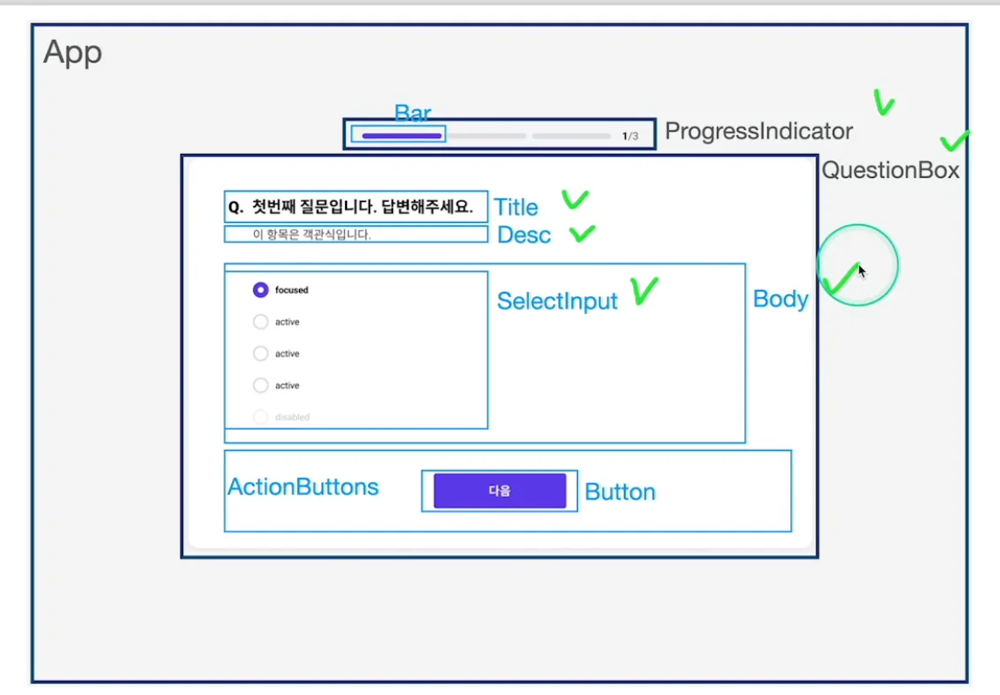

> ☝🏻 
> 
> <a id="1c3eda9b0fe18177a345d02ce15fd167"></a>
> 
> VS code같은 IDE의 템플릿 기능 활용 가능
> 
> <a id="1c3eda9b0fe181209737e891794a0257"></a>
> 
> 간단하게 몇 자만 치면, 기본 템플릿 코드 작성 가능함



[feat&#58; 기본 컴포넌트 설정 및 타입 파일로 분리 · gyungsubLee/inflearn&#95;react&#95;prac&#64;0793be9]()

- ProgressIndicator
    - Bar

- QuestionBox
    - Title

    - Desc

    - Body
        > Input

        - SelectInput

    - ActionButtons
        - Button

> ☝🏻 
> 
> <a id="1c3eda9b0fe1812ba994e6eeb7692c2b"></a>
> 
> 처음부터 너무 디테일하게 작업하지 않는다&#46; 
> 
> <a id="1c3eda9b0fe181249456f40c234448cd"></a>
> 
> 그냥 대략적으로 만들고 수정작업을 진행한다&#46; 

- 관심사 구분
    - 아래와 같이 상위 컴포넌트에서 setter를 정의하면, 

    - 하위 컴포넌트에서는 새로운 값만을 인자로 넣어주면 되기 때문에, 관심사를 분리할 수 있다

    <a id="1c3eda9b0fe1817ba1b6ca3373acd178"></a>

    ```java
    function App() {
      const step = 0;
      const [answers, setAnsers] = useState([]);
      return (
        <div className="App">
          <ProgressIndicator />
          <QuestionBox
            question={questions[step]}
            questionsLength={questions.length}
            step={step}
            answer={answers[step]}
            setAnswers={(newAnswer) => {
              setAnsers((answers) => {
                const newAnswers = [...answers];
                newAnswers[step] = newAnswer;
                return newAnswers;
              });
            }}
          />
        </div>
      );
    }
    ```

- 타입스크립트 적용 및 interface 데이터 분리
    <details>
    <summary>types&#46;ts</summary>

    <a id="1c3eda9b0fe181c7a746d5299f1c0996"></a>

    ```javascript
    export interface IQuestion {
      title: string;
      desc: string;
      type: string;
      required: boolean;
      options: object;
    }

    export interface IQuestionBox {
      question: IQuestion;
      questionsLength: number;
      step: number;
      answer: string;
      setAnswers: (newAnswer: string) => void;
    }

    export interface IBody {
      type: string;
      answer: string;
      setAnswers: (newAnswer: string) => void;
    }
    export interface ITextInput {
      answer: string;
      setAnswers: (newAnswer: string) => void;
    }

    export interface IActionButtons {
      questionsLength: number;
      step: number;
    }
    ```

    </details>

    <details>
    <summary>사용 예시</summary>

    <a id="1c3eda9b0fe1818e868dc0b72b6fd709"></a>

    ```javascript
    import React from "react";
    import TextInput from "../TextInput";
    import { IBody, ITextInput } from "../../\btypes";

    const Body: React.FC<IBody> = ({ type, answer, setAnswers }) => {
      // Define the component type based on ITextInput props
      let InputComponent: React.ComponentType<ITextInput> | null = null;

      if (type === "select") {
        // InputComponent = SelectInput; // Placeholder
      } else if (type === "text") {
        InputComponent = TextInput;
      } else if (type === "textarea") {
        // InputComponent = TextareaInput; // Placeholder
      }

      if (!InputComponent) {
        return <div>유효하지 않은 Type</div>;
      }

      return <InputComponent answer={answer} setAnswers={setAnswers} />;
    };

    export default Body;
    ```

    - <code>React&#46;FC&#60;Props&#95;Type&#62;</code>&#58; 함수형 컴포넌트의 Props 타입 설정
        - FC&#58; Functional Component, 함수형 컴포넌트를 의미

    - <code>React&#46;ComponentType&#60;Type&#62;</code>&#58; 동적으로 정의되는 컴포넌트의 Props 타입 설정

    </details>
