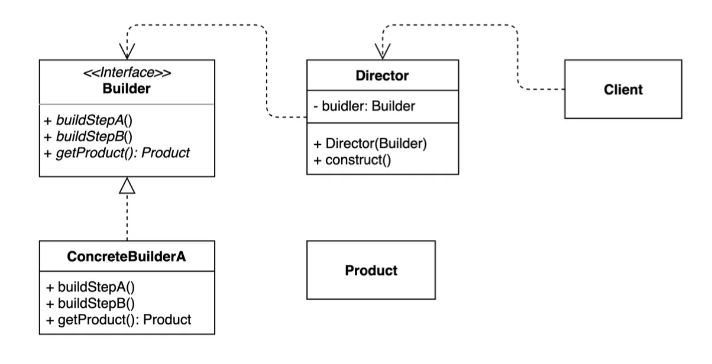
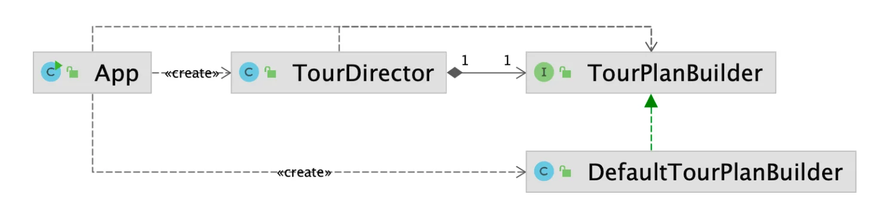
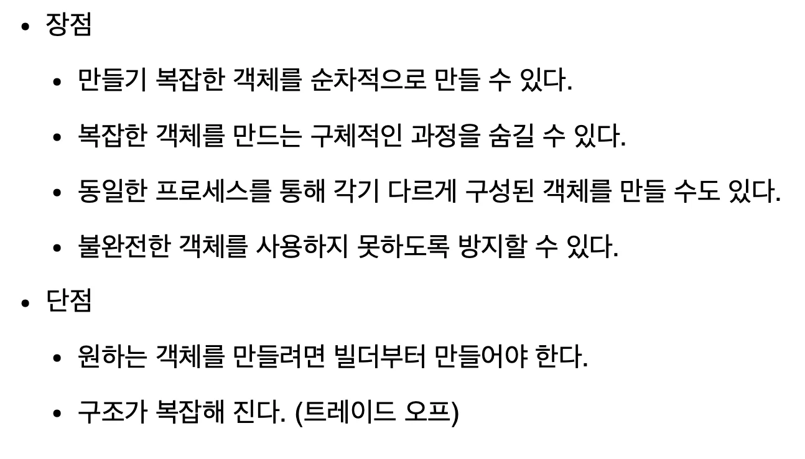

<a id="1c3eda9b0fe180e6af34f1cb1238eb73"></a>

‣

<a id="1c4eda9b0fe180beb8e7cff60626b285"></a>

## 빌더 패턴

---

> ✏️ 
> 
> <a id="1c4eda9b0fe1809f9d5fdacfbe590606"></a>
> 
> <strong>빌더 패턴</strong>
> 
> 
> 
> - 동일한 프로세스를 거쳐 다양한 구성의 인스턴스를 만드는 패턴이다&#46;
> 
> - ( 복잡한 ) 객체를 만드는 프로세스를 독립적으로 분리할 수 있다&#46;

<a id="1c4eda9b0fe180c69789c78a42a6587b"></a>

### 1&#46; 기본 예제

---

<a id="1c4eda9b0fe180d28beddc5f12db5c06"></a>

### 코드 

[DesignPattern&#95;with&#95;jave/src/&#95;01&#95;creational&#95;patterns/&#95;04&#95;builder/&#95;01&#95;before at main · gyungsubLee/DesignPattern&#95;with&#95;jave]()

<details>
<summary>&#91; 코드 &#93; DetailPlan</summary>

<a id="1c4eda9b0fe18074aa6ff6b0d8f75117"></a>

```java
package _01_creational_patterns._04_builder._01_before;

public class DetailPlan {

    private int day;

    private String plan;

    public DetailPlan(int day, String plan) {
        this.day = day;
        this.plan = plan;
    }

    public int getDay() {
        return day;
    }

    public void setDay(int day) {
        this.day = day;
    }

    public String getPlan() {
        return plan;
    }

    public void setPlan(String plan) {
        this.plan = plan;
    }

    @Override
    public String toString() {
        return "DetailPlan{" +
                "day=" + day +
                ", plan='" + plan + '\'' +
                '}';
    }
}
```

</details>

<details>
<summary>&#91; 코드 &#93; TourPlan</summary>

<a id="1c4eda9b0fe18047bdc8f62026f03161"></a>

```java
package _01_creational_patterns._04_builder._01_before;

import java.time.LocalDate;
import java.util.ArrayList;
import java.util.List;

public class TourPlan {

    private String title;

    private int nights;

    private int days;

    private LocalDate startDate;

    private String whereToStay;

    private List<DetailPlan> plans;

    public TourPlan() {
        this.plans = new ArrayList<>();
    }

    public TourPlan(String title, int nights, int days, LocalDate startDate, String whereToStay, List<DetailPlan> plans) {
        this.title = title;
        this.nights = nights;
        this.days = days;
        this.startDate = startDate;
        this.whereToStay = whereToStay;
        this.plans = plans;
    }

    @Override
    public String toString() {
        return "TourPlan{" +
                "title='" + title + '\'' +
                ", nights=" + nights +
                ", days=" + days +
                ", startDate=" + startDate +
                ", whereToStay='" + whereToStay + '\'' +
                ", plans=" + plans +
                '}';
    }

    public String getTitle() {
        return title;
    }

    public void setTitle(String title) {
        this.title = title;
    }

    public int getNights() {
        return nights;
    }

    public void setNights(int nights) {
        this.nights = nights;
    }

    public int getDays() {
        return days;
    }

    public void setDays(int days) {
        this.days = days;
    }

    public LocalDate getStartDate() {
        return startDate;
    }

    public void setStartDate(LocalDate startDate) {
        this.startDate = startDate;
    }

    public String getWhereToStay() {
        return whereToStay;
    }

    public void setWhereToStay(String whereToStay) {
        this.whereToStay = whereToStay;
    }

    public List<DetailPlan> getPlans() {
        return plans;
    }

    public void addPlan(int day, String plan) {
        this.plans.add(new DetailPlan(day, plan));
    }
}
```

</details>

<details>
<summary>&#91; 코드 &#93; App</summary>

<a id="1c4eda9b0fe18058bec0ccc57e8925c6"></a>

```java
public class App {

    public static void main(String[] args) {
        TourPlan shortTrip = new TourPlan();
        shortTrip.setTitle("오레곤 롱비치 여행");
        shortTrip.setStartDate(LocalDate.of(2021, 7, 15));


        TourPlan tourPlan = new TourPlan();
        tourPlan.setTitle("칸쿤 여행");
        tourPlan.setNights(2);
        tourPlan.setDays(3);
        tourPlan.setStartDate(LocalDate.of(2020, 12, 9));
        tourPlan.setWhereToStay("리조트");
        tourPlan.addPlan(0, "체크인 이후 짐풀기");
        tourPlan.addPlan(0, "저녁 식사");
        tourPlan.addPlan(1, "조식 부페에서 식사");
        tourPlan.addPlan(1, "해변가 산책");
        tourPlan.addPlan(1, "점심은 수영장 근처 음식점에서 먹기");
        tourPlan.addPlan(1, "리조트 수영장에서 놀기");
        tourPlan.addPlan(1, "저녁은 BBQ 식당에서 스테이크");
        tourPlan.addPlan(2, "조식 부페에서 식사");
        tourPlan.addPlan(2, "체크아웃");


        for (DetailPlan plan : tourPlan.getPlans()) {
            System.out.println("Day: " + plan.getDay() + ", plan - " + plan.getPlan());
        }
    }
}
```

</details>

<a id="1c4eda9b0fe180dc9884def778eb6233"></a>

### 문제점

> ✏️ 
> 
> <a id="1c4eda9b0fe180798213d411f3de3664"></a>
> 
> 해당 코드의 문제점
> 
> 1. 객체 생성이 복잡하고 가독성이 떨어진다&#46;
>     - setter 를 통해 값을 설정하기 때문에 필드 값이 누락될 수 있음
> 
>     - 어떤 값이 필수이고 선택인지 명확하지 않음
> 
> 1. 불변(immutable) 객체를 만들기 어렵다&#46;
>     - setter를 통한 값 초기화이기 때문에, 값이 언제든지 변경 가능하다 &#46;
> 
>     - 멀티 스레딩 환경에서 특히 위험
> 
> <a id="1c4eda9b0fe1802a927de48321d55f12"></a>
> 
> 🧐 의문점 )그렇다면 생성자를 사용하여 해결할 수 있지 않나? 굳이 빌더 패턴을 사용해서 중간 객체를 하나 더 만들어야 하나?
> 
> <a id="1c4eda9b0fe180a49c74cc11cb791767"></a>
> 
> 생성자를 사용한다면 불별성 문제를 해결할 수 있지만, 세팅해야 하는 필드 값이 많아질수록 가독성이 떨어지며 유연성 및 확정성이 낮다&#46;
> 
> <a id="1c4eda9b0fe1805ca1d8e355b8c4dacb"></a>
> 
> 또한 생성자는 매개변수가 고정적이다&#46; 
> 
> <a id="1c4eda9b0fe180a39a0cc12939299567"></a>
> 
> 만약 인자 순서를 잘못 입력하면 잘못된 값이 할당 될 수 있는데<br>동일한 타입을 가지는 매개변수인 경우인 경우, 잘못된 값이 들어가도 컴파일 오류를 발생 시키지 않기 때문에 추적하기 어려운 오류를 발생시킨다&#46;
> 
> <a id="1c4eda9b0fe18083a1d2f490bb732e46"></a>
> 
> 위와 같은 문제점은 빌더 패턴을 통해 해결 가능하다&#46;
> 
> <a id="1c4eda9b0fe1805e9a35f269ad17e316"></a>
> 
> 빌더 라는 중간 객체를 만들어 setter를 통해 값을 할당한다&#46; 이를 통해 인자 순서를 무시할 수 있다&#46;
> 
> <a id="1c4eda9b0fe180f2915bd6299c44dc0a"></a>
> 
> 또한 내부적으로 생성자를 사용하여 실제 객체를 생성하기 때문에 불변성을 유지할 수 있다&#46;
> 
> <a id="1c4eda9b0fe180aebd2dd6921c9ffd56"></a>
> 
> 그리고 체이닝을 사용하기 때문에 가독성 측면에서도 뛰어나다&#46;
> 
> <a id="1c4eda9b0fe18054bde3eb10ca0df57e"></a>
> 
> &#39;🧐<code>setter</code>를 사용하기 때문에 NPE가 발생될 수 있지 않나?&#39; 라는 의문점이 생길 수 있는데,
> 
> <a id="1c4eda9b0fe18029a399f05da5f3f38f"></a>
> 
> 해당 부분도 여러 팁을 통해서 필수값을 강제할 수 있다&#46;
> 
> - 빌더 내부 필드에 final 키워드 사용
> 
> - 실제 객체를 만드는 build() 메서드 내부에서 유효성 검사 진행
> 
> - 롬복 사용 시
>     - 생성자에 &#64;Builder 사용
> 
>     - &#64;NonNnull을 통한 유효성 검사
> 
>     - &#64;Builder&#46;Default를 통한 기본값 설정 등

<a id="1c4eda9b0fe18028af0bdd351d2339a5"></a>

### 2&#46; 빌더 패턴 적용



<a id="1c4eda9b0fe1809fa220dd49d0664892"></a>

### 코드

[DesignPattern&#95;with&#95;jave/src/&#95;01&#95;creational&#95;patterns/&#95;04&#95;builder/&#95;02&#95;after at main · gyungsubLee/DesignPattern&#95;with&#95;jave]()

> ✏️ 
> 
> <a id="1c4eda9b0fe180919fe5dbc09ac42515"></a>
> 
> 빌더 패턴 적용
> 
> >   ✅ 장점
> 
> <a id="1c4eda9b0fe1802bb535d6fc08c2e037"></a>
> 
> 1&#46; 체이닝을 통한 가독성 향샹
> 
> <a id="1c4eda9b0fe180849863de144b377318"></a>
> 
> 2&#46; 코드 유연성 및 확장성이 뛰어남
> 
> <a id="1c4eda9b0fe180d4ad9bfa04c922aea8"></a>
> 
> 3&#46; 불변성 &#45; 실제 인스턴스를 생성자를 통해 생성됨
> 
> <a id="1c4eda9b0fe18084851ee65ec06107d7"></a>
> 
> 4&#46; 인스턴스 생성 시, 인자 순서를 무시 가능 &#45; 빌더 객체의 setter 를 통해 생성
> 
> >  🤬단점
> 
> <a id="1c4eda9b0fe18042b39dd504f83e37e0"></a>
> 
> 1&#46; 미미하지만, builder 인스턴스를 생성하기 때문에 메모리 낭비가 발생됨
> 
> <a id="1c4eda9b0fe180909a3bf8af80651bb0"></a>
> 
> 2&#46; 빌더 객체에 대한 설계가 추가로 필요함
> 
> <a id="1c4eda9b0fe180ddadf5ce1e136eeb4a"></a>
> 
> 3&#46; 내부 필드 값을 강제하기 위한 추가 조치가 필요함

<details>
<summary>&#91; 코드 &#93; DefaultTourBuilder</summary>

<a id="1c4eda9b0fe18048961bf16cc085df65"></a>

```java
package _01_creational_patterns._04_builder._02_after;

import _01_creational_patterns._04_builder._01_before.DetailPlan;
import _01_creational_patterns._04_builder._01_before.TourPlan;

import java.time.LocalDate;
import java.util.ArrayList;
import java.util.List;

public class DefaultTourBuilder implements TourPlanBuilder {
    private String title;
    private int nights;
    private int days;
    private LocalDate startDate;
    private String whereToStay;
    private List<DetailPlan> plans;

    @Override
    public TourPlanBuilder nightsAndDays(int night, int days) {
        this.nights = night;
        this.days = days;
        return this;
    }

    @Override
    public TourPlanBuilder title(String title) {
        this.title = title;
        return this;
    }

    @Override
    public TourPlanBuilder startDate(LocalDate startDate) {
        this.startDate = startDate;
        return this;
    }

    @Override
    public TourPlanBuilder whereToStay(String whereToStay) {
        this.whereToStay = whereToStay;
        return this;
    }

    @Override
    public TourPlanBuilder addPlan(int day, String plan) {
        if (this.plans == null) {
            this.plans = new ArrayList<>();
        }

        this.plans.add(new DetailPlan(day, plan));
        return this;
    }

    @Override
    public TourPlan getPlan() {
        return new TourPlan(title, nights, days, startDate, whereToStay, plans);
    }
}
```

</details>

<details>
<summary>&#91; 코드 &#93; TourPlanBuilder</summary>

<a id="1c4eda9b0fe18083acf6ed7147a98f6c"></a>

```java
package _01_creational_patterns._04_builder._02_after;

import _01_creational_patterns._04_builder._01_before.TourPlan;

import java.time.LocalDate;

public interface TourPlanBuilder {

    TourPlanBuilder nightsAndDays(int night, int days);

    TourPlanBuilder title(String title);

    TourPlanBuilder startDate(LocalDate localDate);

    TourPlanBuilder whereToStay(String whereToStay);

    TourPlanBuilder addPlan(int day, String plan);

    TourPlan getPlan();
}
```

</details>

<details>
<summary>&#91; 코드 &#93; BuilderExample</summary>

<a id="1c4eda9b0fe1806391b2c4f8e8a66cfc"></a>

```java
package _01_creational_patterns._04_builder._02_after.client;

import _01_creational_patterns._04_builder._01_before.TourPlan;
import _01_creational_patterns._04_builder._02_after.DefaultTourBuilder;
import _01_creational_patterns._04_builder._02_after.TourPlanBuilder;

import java.time.LocalDate;


public class BuilderExample {

    public static void main(String[] args) {
        TourPlanBuilder tourBuilder = new DefaultTourBuilder();

        TourPlan cancunTrip = tourBuilder
                .title("칸쿤 여행")
                .nightsAndDays(2, 3)
                .startDate(LocalDate.of(2025, 3, 28))
                .whereToStay("게스트하우스")
                .addPlan(0, "공항도착")
                .addPlan(0, "체크인 및 짐 풀기")
                .addPlan(1, "맛집 탐방")
                .getPlan();

        System.out.println(cancunTrip.toString());

        TourPlan longBeachTrip = tourBuilder
                .title("롱비치")
                .startDate(LocalDate.of(2025, 8, 25))
                .getPlan();

        System.out.println(longBeachTrip.toString());
    }
}
```

</details>

> ✏️ 
> 
> <a id="1c4eda9b0fe1803faff4ca80b70d06d9"></a>
> 
> 자주 반복되는 빌더 프로세스의 경우 <code>Director</code>를 통해 메서드로 추출하여 최적화 가능하다&#46;
> 
> > <strong>✅ 장점</strong>
> 
> <a id="1c4eda9b0fe180deac8ffe3aac5cada6"></a>
> 
>  1&#46; 복잡한 객체 생성 프로세스를 포장할수 있다&#46;<br> 2&#46; 동일한 프로세스 가지는 경우, 구성(composition)을 통해 확장된 다른 객체들을 생성할 수 있다&#46; =&#62; 전략 패턴
> 
> - ex) VIP 용 서비스, 외국인 전용 서비스 등&#46;&#46;&#46;
>     -  VIP 용 서비스 &#45;&#62; VIPTourPlanBuilder 로 확장하여 해당 인스턴스 생성
> 
> > <strong>❗️단점</strong>
> 
> 1. director, builder 인스턴스를 생성해야 한다&#46;
> 
> 1. 구조가 복잡하다&#46;

<details>
<summary>&#91; 코드 &#93; TourDirector</summary>

<a id="1c4eda9b0fe180499193c94b3d249706"></a>

```java
package _01_creational_patterns._04_builder._02_after;

import _01_creational_patterns._04_builder._01_before.TourPlan;

import java.time.LocalDate;

public class TourDirector {

    private TourPlanBuilder tourPlanBuilder;

    public TourDirector(TourPlanBuilder tourPlanBuilder) {
        this.tourPlanBuilder = tourPlanBuilder;
    }

    public TourPlan cancunTrip() {
        return tourPlanBuilder.title("칸쿤 여행")
                .nightsAndDays(2, 3)
                .startDate(LocalDate.of(2020, 12, 9))
                .whereToStay("리조트")
                .addPlan(0, "체크인하고 짐 풀기")
                .addPlan(0, "저녁 식사")
                .getPlan();
    }

    public TourPlan longBeachTrip() {
        return tourPlanBuilder.title("롱비치")
                .startDate(LocalDate.of(2021, 7, 15))
                .getPlan();
    }
}
```

</details>

<details>
<summary>&#91; 코드 &#93; BuilderDirectorExample</summary>

<a id="1c4eda9b0fe180a5b86feafbc170a7aa"></a>

```java
package _01_creational_patterns._04_builder._02_after.client;

import _01_creational_patterns._04_builder._01_before.TourPlan;
import _01_creational_patterns._04_builder._02_after.DefaultTourBuilder;
import _01_creational_patterns._04_builder._02_after.TourDirector;

public class BuilderDirectorExample {
    public static void main(String[] args) {
        TourDirector tourDirector = new TourDirector(new DefaultTourBuilder());

        TourPlan cancunTrip = tourDirector.cancunTrip();
        TourPlan longBeachTrip = tourDirector.longBeachTrip();

        System.out.println(longBeachTrip.toString());
        System.out.println(cancunTrip.toString());
    }
}
```

</details>

<a id="1c4eda9b0fe180209a2fd7f55ed789fe"></a>

### 3&#46; 빌더 패턴의 장•단점



- 복잡한 개체를 순차적으로 만들 수 있는 방법을 제공한다&#46; 
    - 잘 설계한다면, 순차적인 프로세스를 강제하여 <br>클라이언트가 해당 프로세스를 자기도 모르게 그냥 따라갈 수 밖에 없게끔 만들 수 있다&#46; 

    - 생성자와 달리 인스턴스의 생성 순서를 구성하여 <br>복잡한 구성을 가진 인스턴스를 만들 때, 조금 더 완벽하게 체크할 수 있다 &#46;

- 파리미터가 많아 질수록 가독성 측면에 더 큰 장점이 있다 &#46;
    - 생성자를 사용하는 경우, 오버로딩을 통해 여러 경수의 수를 표현할 수 있지만<br>가독성 측면에서 좋지 않다&#46; 
        - 파라미터에 따른 경우의 수를 분석하는데, 비용이 많이 든다&#46; 

- 적합한 상황
    - 필드가 많고 일부만 선택적으로 설정하는 경우

    - 같은 타입의 파라미터가 많은 경우 (순서 실수 방지)

    - 가독성이 중요한 경우 (코드를 읽는 사람 입장에서)

    - 객체 생성 로직이 복잡하거나 값 조합이 다양할 때

- 한계 
    - 상대적으로 코드 길고, 별도 Builder 클래스 필요

    - 단순 객체에는 오버엔지니어링이 될 수 있음

<a id="1c4eda9b0fe18029acb5ef2114825df8"></a>

<strong>정리</strong>

| <strong>항목</strong> | <strong>설명</strong> |
| --- | --- |
| <code>가독성 ↑</code> | 명시적으로 어떤 필드에 어떤 값을 넣는지 확인 가능 |
| <code>선택적 필드 대응</code> | 필요한 필드만 넣고 나머지는 기본값 유지 가능 |
| <code>유연한 확장</code> | 필드가 추가되어도 기존 사용 코드에 영향 없음 |
| <code>불변 객체와 찰떡</code> | 객체 완성 후 변경 불가로 설계 용이 |

<a id="1c4eda9b0fe18029a762c69d9b16d98e"></a>

### 4&#46; 실무 사용 예제

> ✏️ 
> 
> <a id="1c4eda9b0fe18014ab07f4d37585beb8"></a>
> 
> <strong>실무 사용</strong>
> 
> - 자바 8 Stream&#46;Buidler API
> 
> - StringBuilder
> 
> <details>
> <summary> 롬복의 &#64;Builder</summary>
> 
> - ‣
> 
> </details>
> 
> <details>
> <summary>스프링</summary>
> 
> - UriComponentsBuilder
> 
> - MockMvcWebClientBuilder
> 
> - <code>…Builder</code> 의 subffix를 가지는 클래스 대부분
> 
> </details>

<a id="1c4eda9b0fe180c9be75dbe2c2accb61"></a>

### 코드

[DesignPattern&#95;with&#95;jave/src/&#95;01&#95;creational&#95;patterns/&#95;04&#95;builder/&#95;03&#95;java at main · gyungsubLee/DesignPattern&#95;with&#95;jave]()

<details>
<summary>&#91; 코드 &#93; LombokExample &#45; <code>&#64;Builder</code></summary>

<a id="1c4eda9b0fe180c5914ad5fec6c988aa"></a>

```java
package _01_creational_patterns._04_builder._03_java;

import lombok.Builder;

@Builder
public class LombokExample {

    private String title;
    private int nights;
    private int days;

    public static void main(String[] args) {
        LombokExample trip = LombokExample.builder()
                .title("여행")
                .nights(2)
                .days(3)
                .build();
    }
}
```

</details>

<details>
<summary>&#91; 코드 &#93; SpringExample &#45; <code>UriComponents</code></summary>

<a id="1c4eda9b0fe1804fbfa4cf2fd59d9706"></a>

```java
package _01_creational_patterns._04_builder._03_java;

import spring_dumy.util.UriComponents;
import spring_dumy.util.UriComponentsBuilder;

public class SpringExample {

    public static void main(String[] args) {
        UriComponents howToStudyJava = UriComponentsBuilder.newInstance()
                .scheme("http")
                .host("www.whiteship.me")
                .path("java playlist ep1")
                .build();

        System.out.println(howToStudyJava);
    }
}
```

</details>

<details>
<summary>&#91; 코드 &#93; StreamExample &#45; <code>Stream&#46;builder()</code></summary>

<a id="1c4eda9b0fe180a09ed2ec561d13ecb5"></a>

```java
package _01_creational_patterns._04_builder._03_java;

import java.util.stream.Stream;

public class StreamExample {

    public static void main(String[] args) {
        Stream<String> names = Stream.<String>builder().add("keesun").add("whiteship").build();
        names.forEach(System.out::println);
    }
}
```

</details>

<details>
<summary>&#91; 코드 &#93; StringBuilderExample &#45; <code>StringBuilder</code></summary>

<a id="1c4eda9b0fe18048b642cbeaa0210067"></a>

```java
package _01_creational_patterns._04_builder._03_java;


public class StringBuilderExample {

    public static void main(String[] args) {
        StringBuilder stringBuilder = new StringBuilder();
        String result = stringBuilder.append("whiteship").append("keesun").toString();
        System.out.println(result);
    }
}
```

</details>

<details>
<summary> 필드값 유효성 검사 </summary>


</details>

<details>
<summary> lombok 에서의 해결책</summary>


</details>
