<a id="1c3eda9b0fe1811b960bd518810046ca"></a>

## &#91; 실습 3 &#93; AWS EC2 &#45; Spring Boot, Redis, MySQL

---

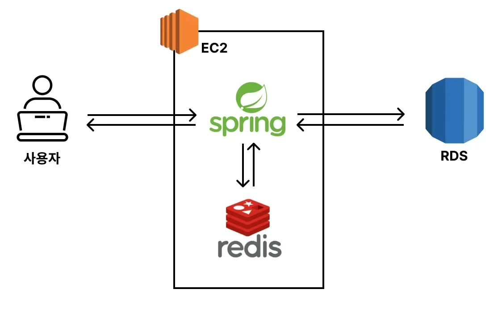

<a id="1c3eda9b0fe1811e8296d10e83f007e1"></a>

### <strong>RDS </strong>

<details>
<summary>RDS 생성</summary>

- ‘데이터베이스 생성’ 클릭
    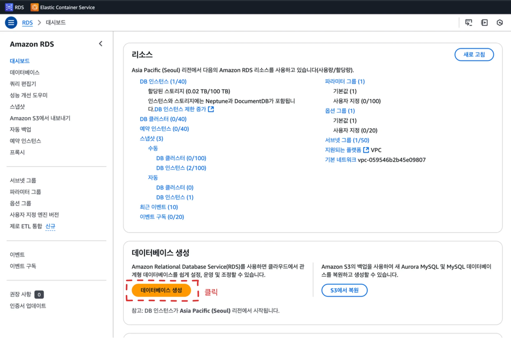

- DB 유형 설정 &#45; MySQL
    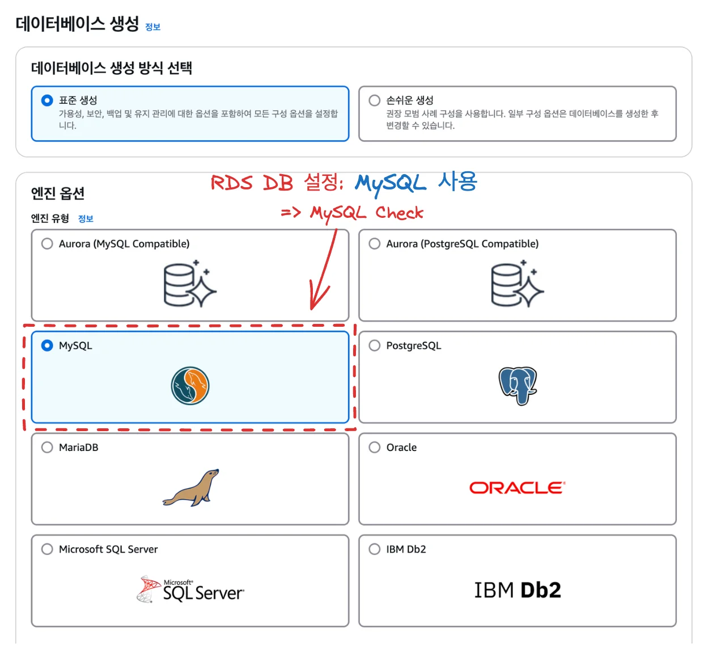

- DB 아키텍처 설정 &#45; 단순 Redis 테스트용이기 때문에, ‘프리티어’로 선택
    > ✏️ 
    > 
    > <a id="1c3eda9b0fe18111bfbdce375932420d"></a>
    > 
    > 실제 운영 서버인 경우, 고가용성 확보를 위해 분산 DB 환경( master / slave, DB 클러스터링)을 권장

    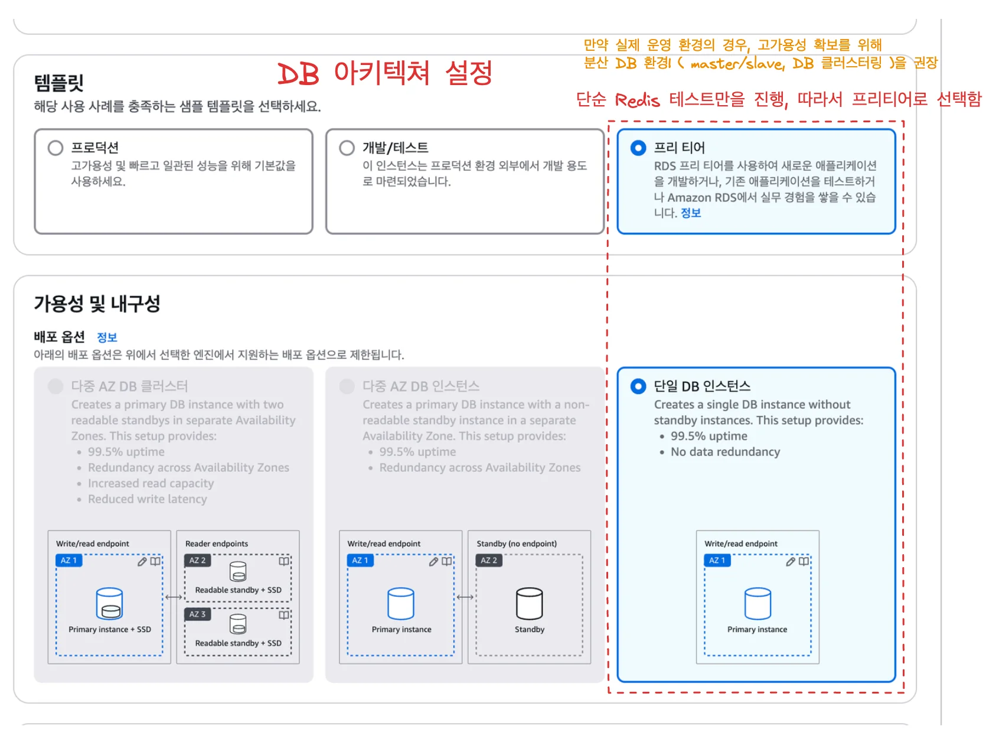

- RDS 인스턴스 이름, 관리자 계정 설정
    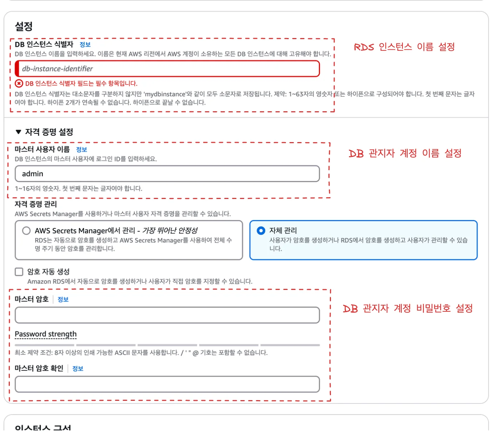

- EC2 연결, 퍼블릭 엑세스 설정
    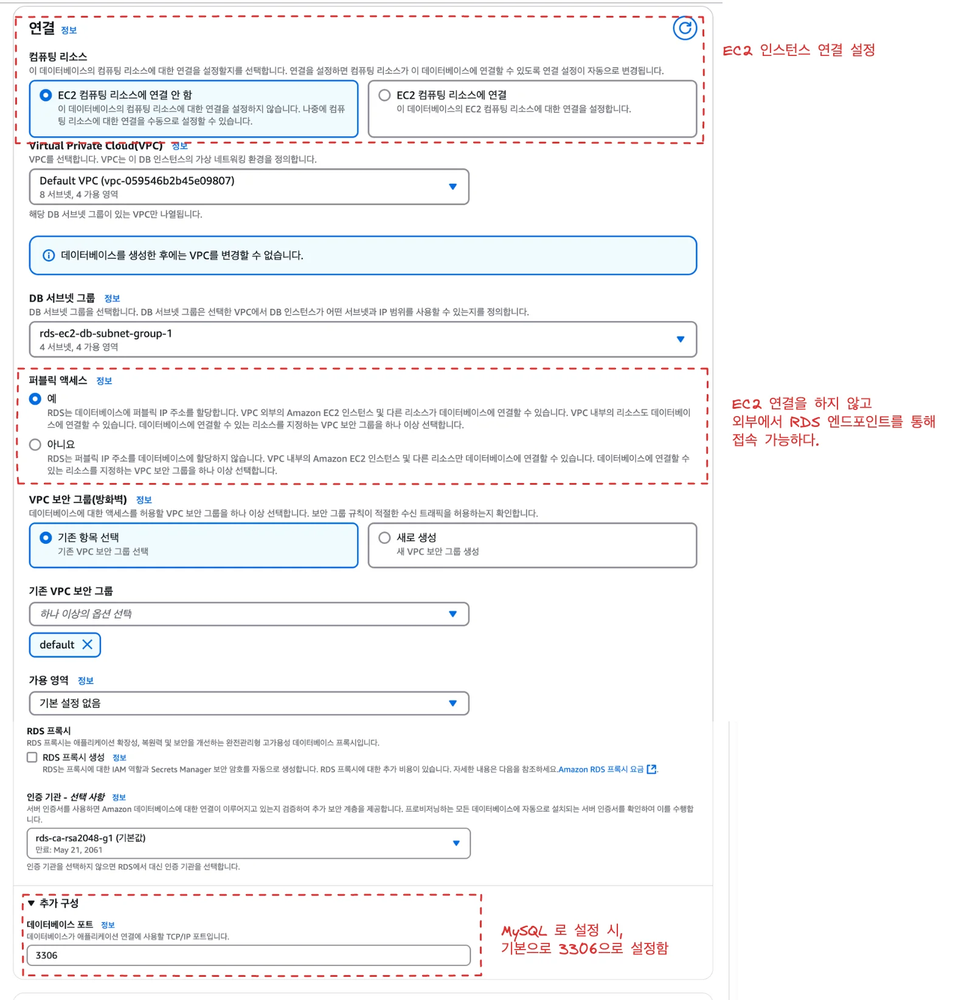

- 앱에서 사용할 DB 초기화
    - 해당 프로젝트에서는  DB  초기화 이름 <code>mydb</code>로 설정

    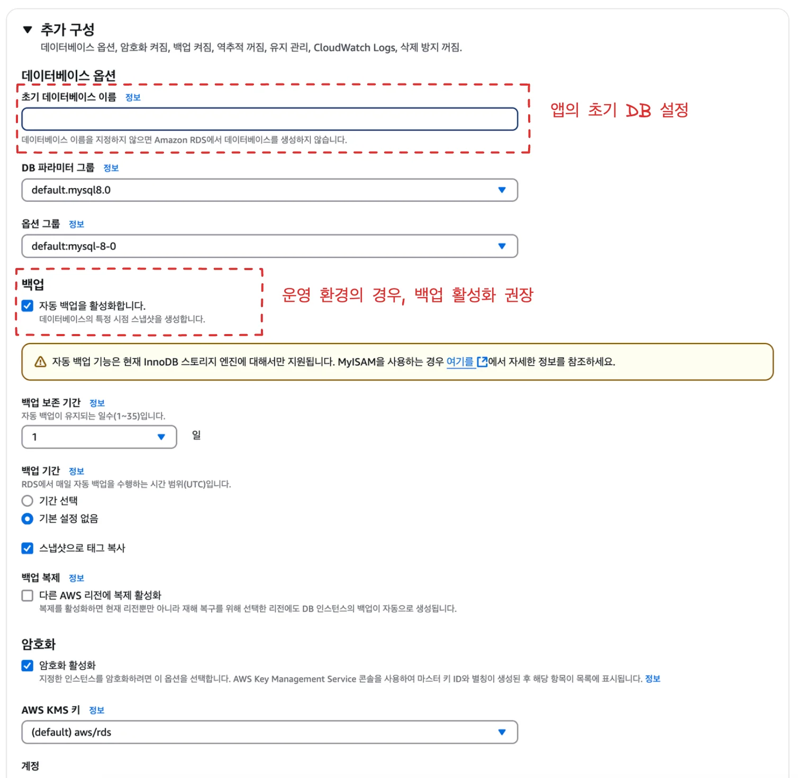

- ‘데이터베이스 생성’ 버튼 클릭 → RDS 인스턴스 생성
    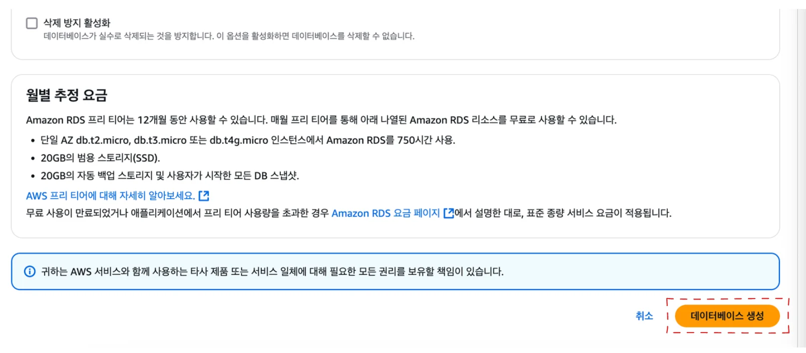

</details>

<details>
<summary><u>보안 그룹 설정</u>에서 <code>3306</code>번 포트 열어줘야 한다&#46;</summary>

- 생성한 RDS 인스턴스 클릭  → 해당 인스턴스의 보안 규칙  클릭 
    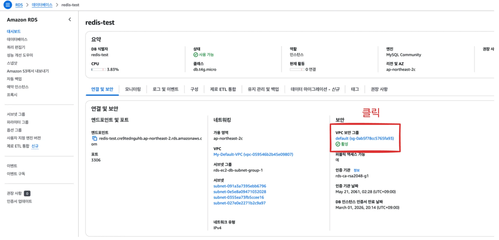

    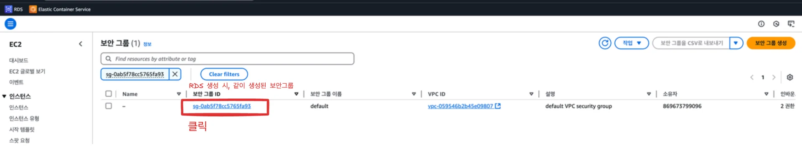

- 인바운드 규칙 추가 &#45; 3306 포트 
    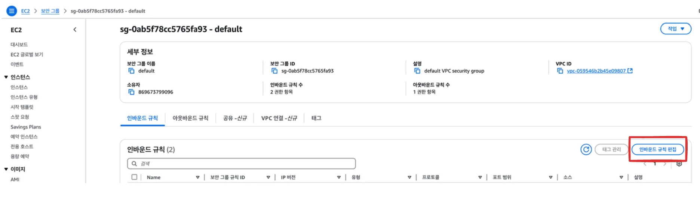

    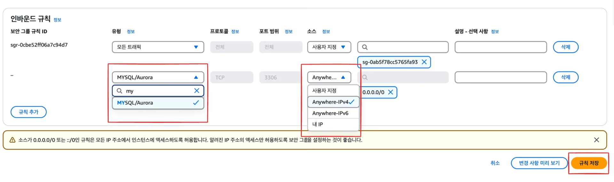

- 새로 추가한 인바운드 규칙 &#45; 3306 포트
    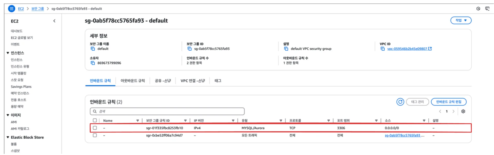

</details>

<details>
<summary>프로젝트 <code>application&#46;yml</code>&#58;  RDS 엔드포인트 연결</summary>

- RDS 인스턴스에서 엔드포인트 확인
    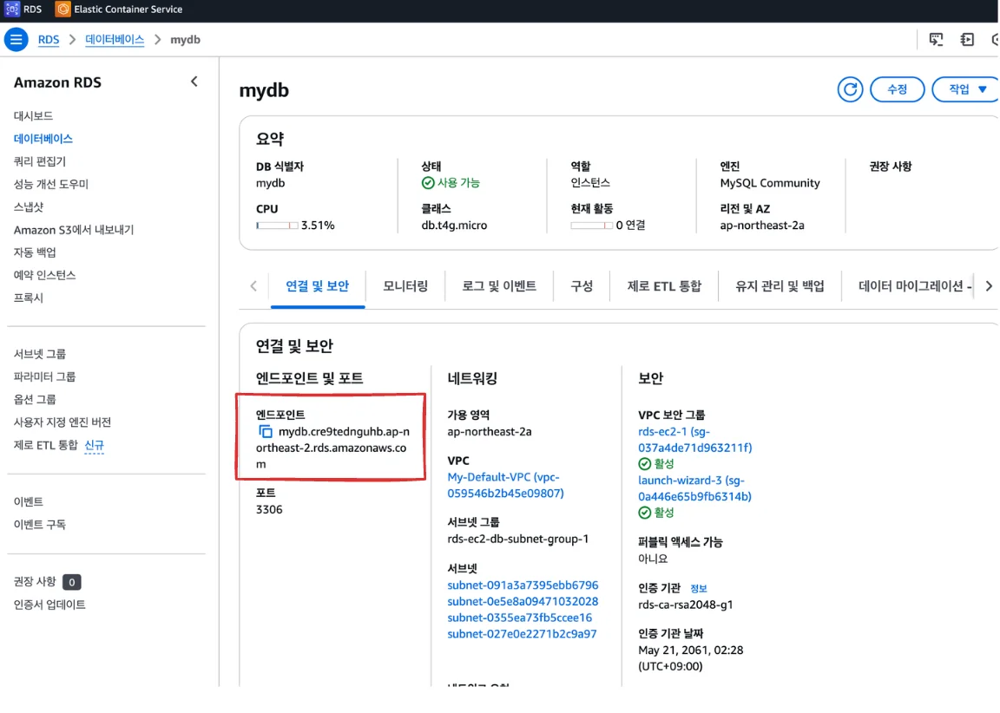

- 프로젝트  application 파일에 <strong><u>RDS 엔드포인트</u></strong>로 datasource url 수정
    <details>
    <summary>application&#46;yml</summary>

    <a id="1c3eda9b0fe18105bd19d3b3149b19b3"></a>

    ```yaml
    # local 환경
    spring:
      profiles:
        default: local
      datasource:
        url: jdbc:mysql://localhost:3306/mydb
        username: root
        password: password
        driver-class-name: com.mysql.cj.jdbc.Driver
      jpa:
        hibernate:
          ddl-auto: update
        show-sql: true
      data:
        redis:
          host: localhost
          port: 6379

    logging:
      level:
        org.springframework.cache: trace 

    ---
    # prod 환경
    spring:
      config:
        activate:
          on-profile: prod
      datasource:
        url: jdbc:mysql://{rds 주소}:3306/mydb
        username: admin
        password: password
    ```

    </details>

    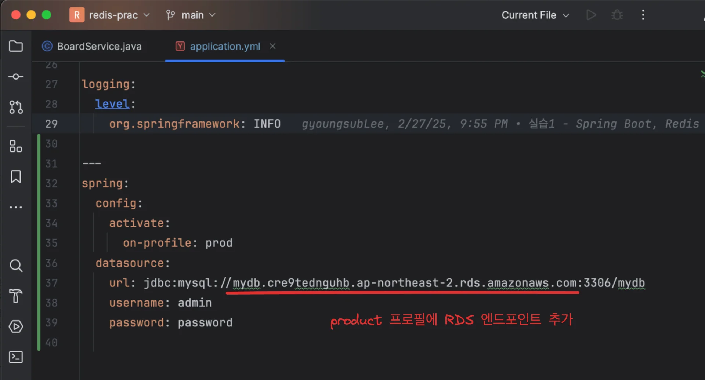

</details>

<details>
<summary>RDS 인스턴스 삭제</summary>

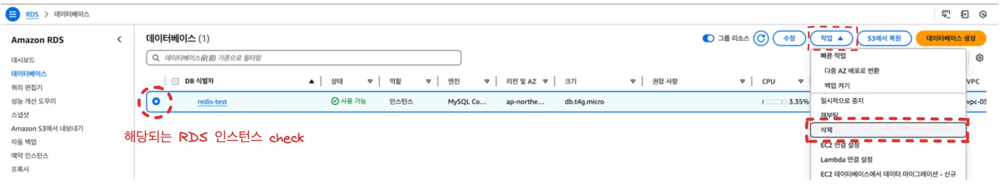

</details>

<a id="1c3eda9b0fe181f09e11d696fee7b520"></a>

### EC2 

<details>
<summary><strong>EC2 생성</strong></summary>

- <code>t3a&#46;small </code>이상 생성 권장
    - t2&#46;micro에서 Spring Boot, Redis를 다 돌리기에는 성능이 모자라다

    - 중간에 EC2가 멈춘다&#46;

- 보안 그룹 설정에 <code>8080</code>번 포트 열어줘야 한다&#46;

</details>

<details>
<summary><strong>Redis, JDK  설치</strong></summary>

- Redis 설치
    <a id="1c3eda9b0fe181a39e05c34017c92532"></a>

    ```bash
    # apt 업데이트
    sudo apt update

    # redis 설치
    sudo apt install redis

    # 설치 확인
    redis-cli

    127.0.0.1:6379> ping
    # PONG
    ```

- <strong>JDK 설치 </strong>
    <a id="1c3eda9b0fe18130bcfbf25d2805cce5"></a>

    ```bash
    sudo apt install openjdk-17-jdk

    # 설치 확인
    java-version
    ```

    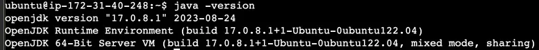

</details>

<details>
<summary>프로젝트 github에서 clone 하기</summary>

> ✏️ 
> 
> <a id="1c3eda9b0fe1814fa3a6f58b24116aa7"></a>
> 
> 한 프로젝트에 여러 remote 연결 가능
> 
> - 기존 소스코드 업데이트 remote&#58; <code>main</code>
> 
> - EC2 테스트용 remote&#58; <code>test</code>

[redis-test](https://github.com/gyungsubLee/redis-test)

- 리포지토리 클론을 위한 github 토큰 생성 
    <a id="1c3eda9b0fe18141853cc22b0035d36d"></a>

    <a href="#/post/1c3eda9b-0fe1-815d-b376-f17c48552655">페이지</a> 

- EC2 콘솔에서 git clone
    <a id="1c3eda9b0fe181dba4eaf91de6c257ab"></a>

    ```bash
    # HTTPS로 Clone
    git clone https://github.com/gyungsubLee/redis-test.git /app

    # Cloning into 'app'...
    # Username for 'https://github.com':
    gyungsubLee

    # Password for 'https://gyungsubLee@github.com': 
    ${생성한 토큰}  # 위에서 생성한 토큰 입력
    ```

- 프로젝트 clone 정상 동작 확인
    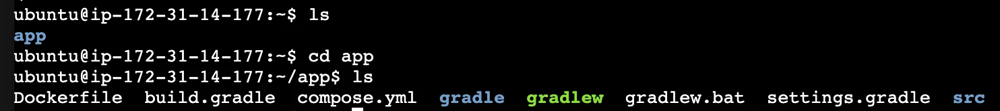

- <strong>application&#46;yml</strong>
    > ✏️ 
    > 
    > <a id="1c3eda9b0fe18191aabadf69e89d1ff8"></a>
    > 
    > 실습에서는 편의를 위해 <code>application&#46;yml</code> 정보를 <code>&#46;gitignore</code> 처리를 하지 않았다&#46;
    > 
    > <a id="1c3eda9b0fe1814ea4fcebe97f63bc2e"></a>
    > 
    > 실제 프로젝트에서는 보안을 위해 <code>application&#46;yml</code> 정보를 <code>&#46;gitignore</code> 처리를 하거나, <strong><u>환경 변수를 활용</u></strong>하여 보안 처리를 해야한다&#46;

    <details>
    <summary>로컬</summary>

    <a id="1c3eda9b0fe181aa9410ec1a0471fbcf"></a>

    ```yaml
    # local 환경
    spring:
      profiles:
        default: local
      datasource:
        url: jdbc:mysql://localhost:3306/mydb
        username: root
        password: password
        driver-class-name: com.mysql.cj.jdbc.Driver
      jpa:
        hibernate:
          ddl-auto: update
        show-sql: true
      data:
        redis:
          host: localhost
          port: 6379

    logging:
      level:
        org.springframework.cache: trace 

    ---
    # prod 환경
    spring:
      config:
        activate:
          on-profile: prod
      datasource:
        url: jdbc:mysql://{rds 주소}:3306/mydb
        username: admin
        password: password
    ```

    </details>

    <details>
    <summary>docker compose</summary>

    <a id="1c3eda9b0fe18120a719f7c3c875d8f1"></a>

    <a href="#/post/1c3eda9b-0fe1-81a1-83fe-c13f2e23db04">페이지</a> 

    </details>

- EC2에서 서버 실행
    <a id="1c3eda9b0fe181269b61d84809271564"></a>

    ```bash
    ./gradlew clean build -x test

    cd build/libs

    java -jar -Dspring.profiles.active=prod {빌드된 jar 파일명}
    ```

<details>
<summary><strong>&#91; 🤬 오류 &#93;</strong>   <strong>Error creating bean with name &#39;redisConfig&#39;&#58; Injection of autowired dependencies failed</strong></summary>

---

<a id="1c3eda9b0fe181cda9a0c7261fb218d7"></a>

### 오류 메세지

<details>
<summary>오류 메세지</summary>

<a id="1c3eda9b0fe1815b907af1f3c32723f7"></a>

```plaintext
Error starting ApplicationContext. To display the condition evaluation report re-run your application with 'debug' enabled.
2025-03-02T05:54:15.342Z ERROR 1974 --- [           main] o.s.boot.SpringApplication               : Application run failed

org.springframework.beans.factory.BeanCreationException: Error creating bean with name 'redisConfig': Injection of autowired dependencies failed
        at org.springframework.beans.factory.annotation.AutowiredAnnotationBeanPostProcessor.postProcessProperties(AutowiredAnnotationBeanPostProcessor.java:515) ~[spring-beans-6.2.3.jar!/:6.2.3]
        at org.springframework.beans.factory.support.AbstractAutowireCapableBeanFactory.populateBean(AbstractAutowireCapableBeanFactory.java:1445) ~[spring-beans-6.2.3.jar!/:6.2.3]
        at org.springframework.beans.factory.support.AbstractAutowireCapableBeanFactory.doCreateBean(AbstractAutowireCapableBeanFactory.java:600) ~[spring-beans-6.2.3.jar!/:6.2.3]
        at org.springframework.beans.factory.support.AbstractAutowireCapableBeanFactory.createBean(AbstractAutowireCapableBeanFactory.java:523) ~[spring-beans-6.2.3.jar!/:6.2.3]
        at org.springframework.beans.factory.support.AbstractBeanFactory.lambda$doGetBean$0(AbstractBeanFactory.java:339) ~[spring-beans-6.2.3.jar!/:6.2.3]
        at org.springframework.beans.factory.support.DefaultSingletonBeanRegistry.getSingleton(DefaultSingletonBeanRegistry.java:346) ~[spring-beans-6.2.3.jar!/:6.2.3]
        at org.springframework.beans.factory.support.AbstractBeanFactory.doGetBean(AbstractBeanFactory.java:337) ~[spring-beans-6.2.3.jar!/:6.2.3]
        at org.springframework.beans.factory.support.AbstractBeanFactory.getBean(AbstractBeanFactory.java:202) ~[spring-beans-6.2.3.jar!/:6.2.3]
        at org.springframework.beans.factory.support.DefaultListableBeanFactory.instantiateSingleton(DefaultListableBeanFactory.java:1155) ~[spring-beans-6.2.3.jar!/:6.2.3]
        at org.springframework.beans.factory.support.DefaultListableBeanFactory.preInstantiateSingleton(DefaultListableBeanFactory.java:1121) ~[spring-beans-6.2.3.jar!/:6.2.3]
        at org.springframework.beans.factory.support.DefaultListableBeanFactory.preInstantiateSingletons(DefaultListableBeanFactory.java:1056) ~[spring-beans-6.2.3.jar!/:6.2.3]
        at org.springframework.context.support.AbstractApplicationContext.finishBeanFactoryInitialization(AbstractApplicationContext.java:987) ~[spring-context-6.2.3.jar!/:6.2.3]
        at org.springframework.context.support.AbstractApplicationContext.refresh(AbstractApplicationContext.java:627) ~[spring-context-6.2.3.jar!/:6.2.3]
        at org.springframework.boot.web.servlet.context.ServletWebServerApplicationContext.refresh(ServletWebServerApplicationContext.java:146) ~[spring-boot-3.4.3.jar!/:3.4.3]
        at org.springframework.boot.SpringApplication.refresh(SpringApplication.java:752) ~[spring-boot-3.4.3.jar!/:3.4.3]
        at org.springframework.boot.SpringApplication.refreshContext(SpringApplication.java:439) ~[spring-boot-3.4.3.jar!/:3.4.3]
        at org.springframework.boot.SpringApplication.run(SpringApplication.java:318) ~[spring-boot-3.4.3.jar!/:3.4.3]
        at org.springframework.boot.SpringApplication.run(SpringApplication.java:1361) ~[spring-boot-3.4.3.jar!/:3.4.3]
        at org.springframework.boot.SpringApplication.run(SpringApplication.java:1350) ~[spring-boot-3.4.3.jar!/:3.4.3]
        at com.example.redis_prac.RedisPracApplication.main(RedisPracApplication.java:14) ~[!/:0.0.1-SNAPSHOT]
        at java.base/jdk.internal.reflect.NativeMethodAccessorImpl.invoke0(Native Method) ~[na:na]
        at java.base/jdk.internal.reflect.NativeMethodAccessorImpl.invoke(NativeMethodAccessorImpl.java:77) ~[na:na]
        at java.base/jdk.internal.reflect.DelegatingMethodAccessorImpl.invoke(DelegatingMethodAccessorImpl.java:43) ~[na:na]
        at java.base/java.lang.reflect.Method.invoke(Method.java:569) ~[na:na]
        at org.springframework.boot.loader.launch.Launcher.launch(Launcher.java:102) ~[redis-prac-0.0.1-SNAPSHOT.jar:0.0.1-SNAPSHOT]
        at org.springframework.boot.loader.launch.Launcher.launch(Launcher.java:64) ~[redis-prac-0.0.1-SNAPSHOT.jar:0.0.1-SNAPSHOT]
        at org.springframework.boot.loader.launch.JarLauncher.main(JarLauncher.java:40) ~[redis-prac-0.0.1-SNAPSHOT.jar:0.0.1-SNAPSHOT]
Caused by: org.springframework.util.PlaceholderResolutionException: Could not resolve placeholder 'spring.redis.host' in value "${spring.redis.host}"
        at org.springframework.util.PlaceholderResolutionException.withValue(PlaceholderResolutionException.java:81) ~[spring-core-6.2.3.jar!/:6.2.3]
        at org.springframework.util.PlaceholderParser$ParsedValue.resolve(PlaceholderParser.java:423) ~[spring-core-6.2.3.jar!/:6.2.3]
        at org.springframework.util.PlaceholderParser.replacePlaceholders(PlaceholderParser.java:128) ~[spring-core-6.2.3.jar!/:6.2.3]
        at org.springframework.util.PropertyPlaceholderHelper.parseStringValue(PropertyPlaceholderHelper.java:118) ~[spring-core-6.2.3.jar!/:6.2.3]
        at org.springframework.util.PropertyPlaceholderHelper.replacePlaceholders(PropertyPlaceholderHelper.java:114) ~[spring-core-6.2.3.jar!/:6.2.3]
        at org.springframework.core.env.AbstractPropertyResolver.doResolvePlaceholders(AbstractPropertyResolver.java:255) ~[spring-core-6.2.3.jar!/:6.2.3]
        at org.springframework.core.env.AbstractPropertyResolver.resolveRequiredPlaceholders(AbstractPropertyResolver.java:226) ~[spring-core-6.2.3.jar!/:6.2.3]
        at org.springframework.context.support.PropertySourcesPlaceholderConfigurer.lambda$processProperties$0(PropertySourcesPlaceholderConfigurer.java:201) ~[spring-context-6.2.3.jar!/:6.2.3]
        at org.springframework.beans.factory.support.AbstractBeanFactory.resolveEmbeddedValue(AbstractBeanFactory.java:971) ~[spring-beans-6.2.3.jar!/:6.2.3]
        at org.springframework.beans.factory.support.DefaultListableBeanFactory.doResolveDependency(DefaultListableBeanFactory.java:1574) ~[spring-beans-6.2.3.jar!/:6.2.3]
        at org.springframework.beans.factory.support.DefaultListableBeanFactory.resolveDependency(DefaultListableBeanFactory.java:1552) ~[spring-beans-6.2.3.jar!/:6.2.3]
        at org.springframework.beans.factory.annotation.AutowiredAnnotationBeanPostProcessor$AutowiredFieldElement.resolveFieldValue(AutowiredAnnotationBeanPostProcessor.java:785) ~[spring-beans-6.2.3.jar!/:6.2.3]
        at org.springframework.beans.factory.annotation.AutowiredAnnotationBeanPostProcessor$AutowiredFieldElement.inject(AutowiredAnnotationBeanPostProcessor.java:768) ~[spring-beans-6.2.3.jar!/:6.2.3]
        at org.springframework.beans.factory.annotation.InjectionMetadata.inject(InjectionMetadata.java:146) ~[spring-beans-6.2.3.jar!/:6.2.3]
        at org.springframework.beans.factory.annotation.AutowiredAnnotationBeanPostProcessor.postProcessProperties(AutowiredAnnotationBeanPostProcessor.java:509) ~[spring-beans-6.2.3.jar!/:6.2.3]
        ... 26 common frames omitted
```

</details>

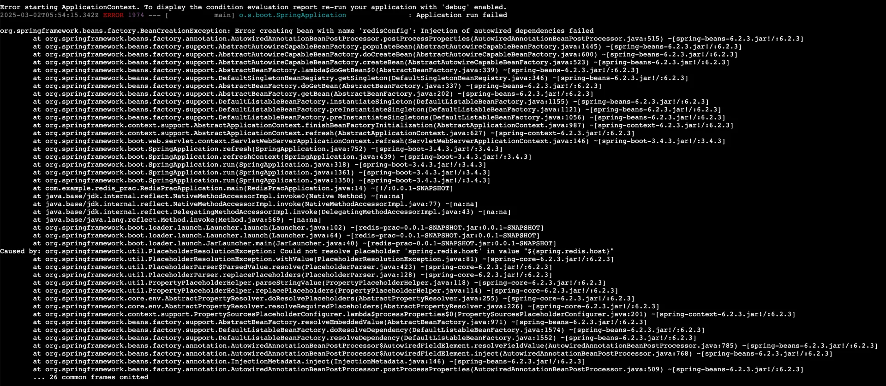

<a id="1c3eda9b0fe18130bad7c6a3593ce672"></a>

### 원인

<a id="1c3eda9b0fe1813ebc18d26a9d50ad20"></a>

```plaintext
Error creating bean with name 'redisConfig': Injection of autowired dependencies failed
```

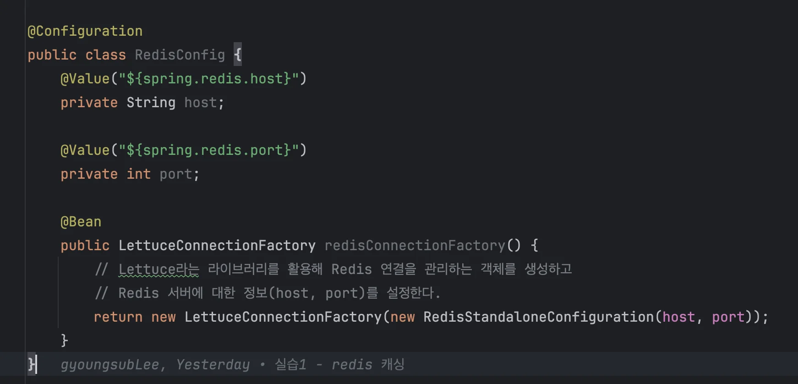

<a id="1c3eda9b0fe181b1afb7eb395aa41b93"></a>

RedisConfig에 정의산 host, port 값을 yaml 파일에서 찾을 수 없어 발생되는 오류이다&#46;

<a id="1c3eda9b0fe181e1b976f0f26230d3d3"></a>

### 해결

> ☝🏻 
> 
> <a id="1c3eda9b0fe1811c819aecc84a98c4bc"></a>
> 
> Profiles 설정 시, 변경되는 부분만 부분적으로 적용된다&#46; 
> 
> <a id="1c3eda9b0fe181c7986fd963cb131220"></a>
> 
> 즉, default 프로필에 정의한 redis 설정 내용은 <code>local(default)</code>, <code>prod</code> 둘다 사용된다&#46; 

<details>
<summary>오류 </summary>

> ✏️ 
> 
> <a id="1c3eda9b0fe18163b5fae83930cf0d60"></a>
> 
> 강의 코드를 복붙하다가, cofig에 정의한 경로와 일치하지 않아 발생되었다&#46; 
> 
> - 강의&#58; <code>data&#58;redis&#58;…</code>
> 
> - 내 프로젝트&#58; <code>redis&#58;…</code>

<a id="1c3eda9b0fe18170aa5fd791413b72bc"></a>

```yaml

# local 환경
spring:
  profiles:
    default: local
  datasource:
    url: jdbc:mysql://localhost:3306/mydb
    username: root
    password: password
    driver-class-name: com.mysql.cj.jdbc.Driver
  jpa:
    hibernate:
      ddl-auto: update
    show-sql: true
  data:
	  redis:
	    host: localhost
	    port: 6379

logging:
  level:
    org.springframework.cache: trace

---

# Product 환경
spring:
  config:
    activate:
      on-profile: prod
  datasource:
    url: jdbc:mysql://redist-test.cre9tednguhb.ap-northeast-2.rds.amazonaws.com:3306/mydb
    username: admin
    password: password
  redis:

```

</details>

<details>
<summary>수정</summary>

<a id="1c3eda9b0fe181e1a88cd42a22e8b4fe"></a>

```yaml

# local 환경
spring:
  profiles:
    default: local
  datasource:
    url: jdbc:mysql://localhost:3306/mydb
    username: root
    password: password
    driver-class-name: com.mysql.cj.jdbc.Driver
  jpa:
    hibernate:
      ddl-auto: update
    show-sql: true
  redis:
    host: localhost
    port: 6379

logging:
  level:
    org.springframework.cache: trace

---

# Product 환경
spring:
  config:
    activate:
      on-profile: prod
  datasource:
    url: jdbc:mysql://redist-test.cre9tednguhb.ap-northeast-2.rds.amazonaws.com:3306/mydb
    username: admin
    password: password
  redis:

```

- 위와 같이 config 경로와 일치되도록 설정 정보를 수정하여 해결하였다&#46;

</details>

</details>

<details>
<summary><strong>&#91; 🤬 오류 &#93;</strong>  <strong>RDS ( MySQL ) </strong>외부 연결 오류 </summary>

---

<a id="1c3eda9b0fe181219da5e97482e0a7e1"></a>

보안 그룹 설정이 꼬여서 안되었다&#46;

<a id="1c3eda9b0fe1814eb0e7e46d208b4acf"></a>

VPC와 기본 보안그룹을 제외하고 모두 다 삭제 후 다시 생성하여 해결하였다&#46;

</details>

</details>

<details>
<summary>curl 호출 테스트</summary>

- EC2 퍼블릭 주소 ( 엔드포인트) 
    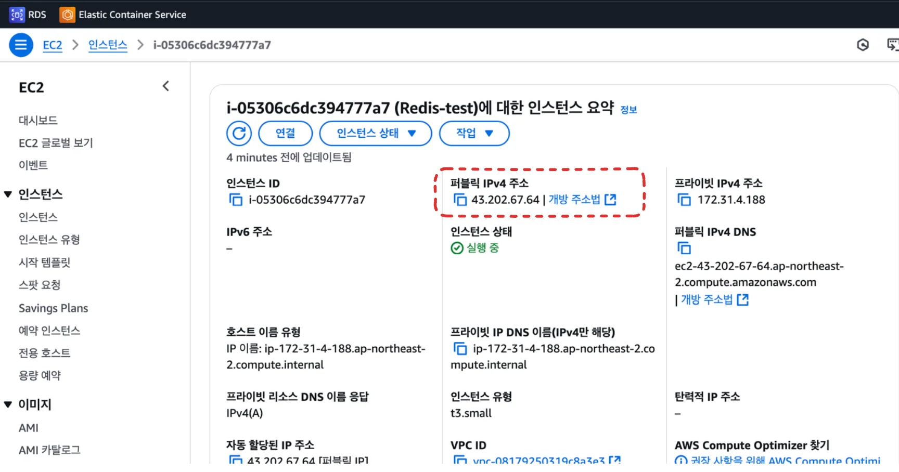

- EC2 &#45; 부트 실행
    <a id="1c3eda9b0fe18114b984d88ffc97d2c0"></a>

    ```bash
    # jar 파일 build  : gradle 미설치 시, 자동으로 설치됨
    ./gradlew clean build -x test

    # build된 jar 파일명 확인
    cd build/libs
    ls 

    # prod profile 환경으로 부트 실행 
    java -jar -Dspring.profiles.active=prod {jar 파일명}
      # java -jar -Dspring.profiles.active=prod redis-prac-0.0.1-SNAPSHOT.jar

    ```

- Postman 테스트 
    <a id="1c3eda9b0fe181049de2cc8fa466eaf5"></a>

    ```bash
    # url
    http://{EC2 엔드포인트}/boards?page=1&size=10
    ```

    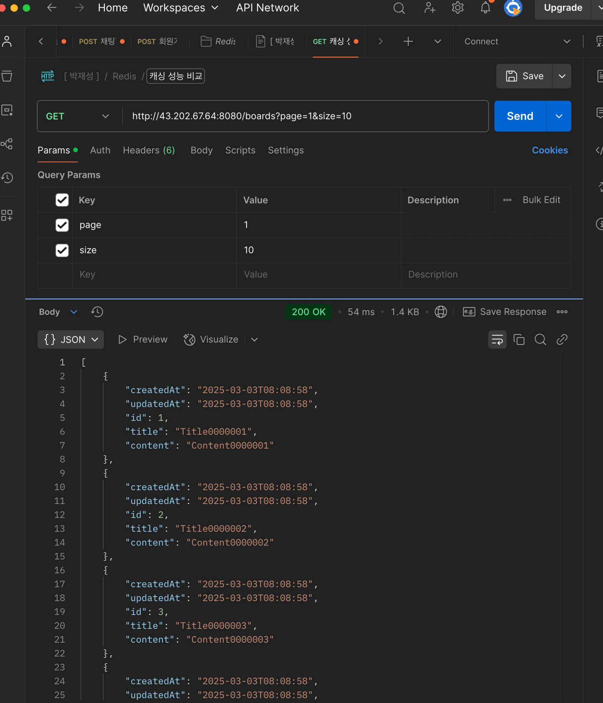

</details>

<a id="1c3eda9b0fe181a8be3ef50fab28c564"></a>

### 로컬에서 정상 동작 확인

- <strong>application&#46;yml</strong>
    <a id="1c3eda9b0fe18173bd3ff4103b27d2ce"></a>

    ```yaml
    # local 환경
    spring:
      profiles:
        default: local
      datasource:
        url: jdbc:mysql://localhost:3306/mydb
        username: root
        password: password
        driver-class-name: com.mysql.cj.jdbc.Driver
      jpa:
        hibernate:
          ddl-auto: update
        show-sql: true
      redis:
        host: localhost
        port: 6379

    logging:
      level:
        org.springframework.cache: trace

    ---

    # Product 환경
    spring:
      config:
        activate:
          on-profile: prod
      datasource:
        url: jdbc:mysql://{RDS 엔드포인트}:3306/mydb
        username: admin
        password: password
      redis:

    ```

- <strong>boot 실행</strong>
    <a id="1c3eda9b0fe1817f9223cff69d64f647"></a>

    ```bash
    # jar 파일 build
    ./gradlew clean build

    # build된 jar 파일명 확인
    cd build/libs
    ls 

    # prod profile 환경으로 부트 실행 
    java -jar -Dspring.profiles.active=prod {jar 파일명}
      # java -jar -Dspring.profiles.active=prod redis-prac-0.0.1-SNAPSHOT.jar

    ```

- <strong>curl 호출</strong>
    <a id="1c3eda9b0fe18138afe9dd0ed91649b0"></a>

    ```bash
     curl -X GET "http://localhost:8080/boards?page=1&size=10"
    ```

    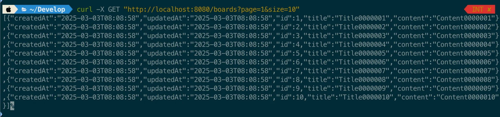

<a id="1c3eda9b0fe181a2ac05fc5aa9c76ba2"></a>

### Redis 전, 후 성능 비교 

<details>
<summary>Redis를 적용 시, 성능 측정</summary>

- 부트 실행
    <a id="1c3eda9b0fe181a38edbc62c2992116d"></a>

    ```bash
    # EC2 프로젝트 경로로 이동
    cd app

    # jar 파일 빌드
    ./gradlew clean build -x test 

    # jar 파일 실행
    cd build/libs
    java -jar -Dspring.profiles.active=prod {빌드된 jar 파일명}
    ```

- Redis 호출
    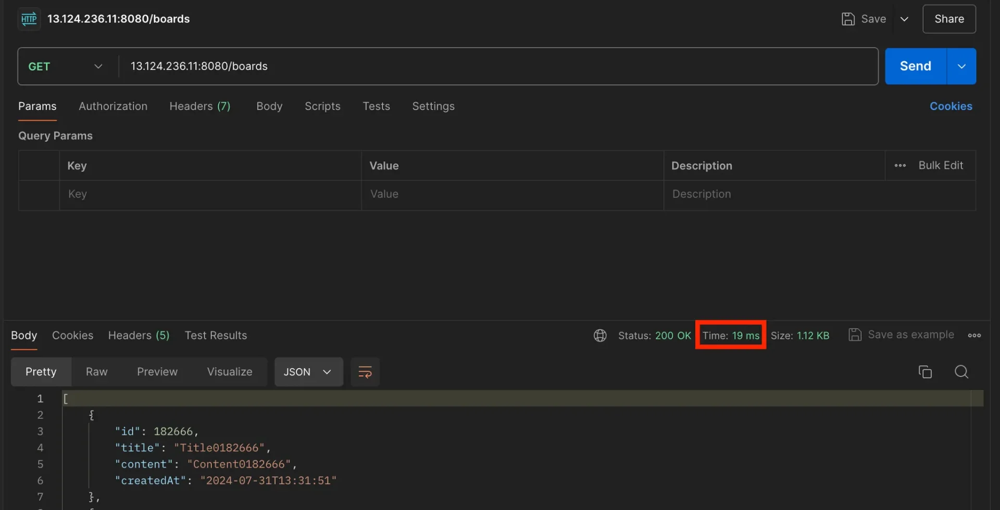

    <a id="1c3eda9b0fe1817b80d9ce8399c910d9"></a>

    평균적으로 20ms 정도의 속도가 나오는 것을 확인할 수 있다&#46; 

</details>

<details>
<summary>Redis 적용하지 않을 시, 성능 측정</summary>

- <strong>&#91; 코드 &#93; BoardService</strong>
    <a id="1c3eda9b0fe181228c24cb4ee16ab20e"></a>

    ```java
    @Service
    public class BoardService {
      ...
      //  @Cacheable(cacheNames = "getBoards", key = "'boards:page:' + #page + ':size:' + #size", cacheManager = "boardCacheManager")
      public List<Board> getBoards(int page, int size) {
        Pageable pageable = PageRequest.of(page - 1, size);
        Page<Board> pageOfBoards = boardRepository.findAllByOrderByCreatedAtDesc(pageable);
        return pageOfBoards.getContent();
      }
    }
    ```

    - Redis 캐시 적용 Annotation 주석 처리

- 부트 실행
    <a id="1c3eda9b0fe1810cb5b2d0d53e100c11"></a>

    ```bash
    # 스프링 프로젝트 경로로 들어가서 아래 명령어 실행
    ./gradlew clean build -x test 

    cd build/libs
    java -jar -Dspring.profiles.active=prod {빌드된 jar 파일명}
    ```

- 포스트맨 확인
    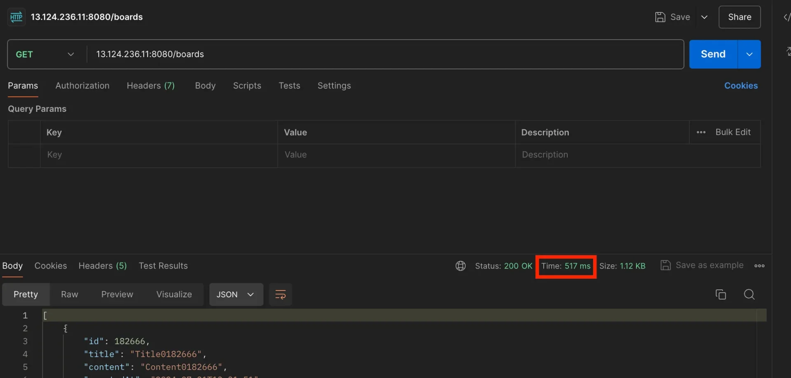

    <a id="1c3eda9b0fe1816cbd5afae6d507ba23"></a>

    평균적으로 500ms 정도의 속도가 나오는 걸 확인 가능하다&#46; 

    - 레디스를 적용하지 않으니 확연하게 성능이 느려졌다&#46; 

</details>
