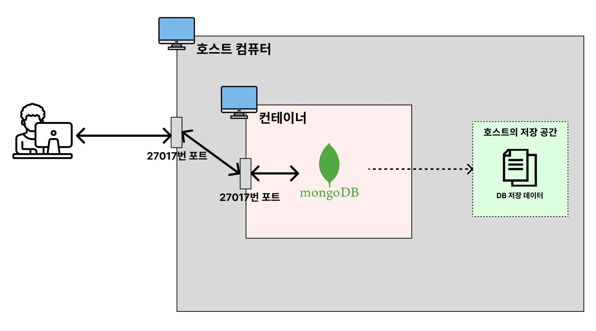
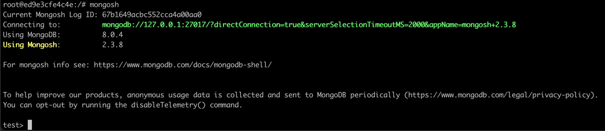
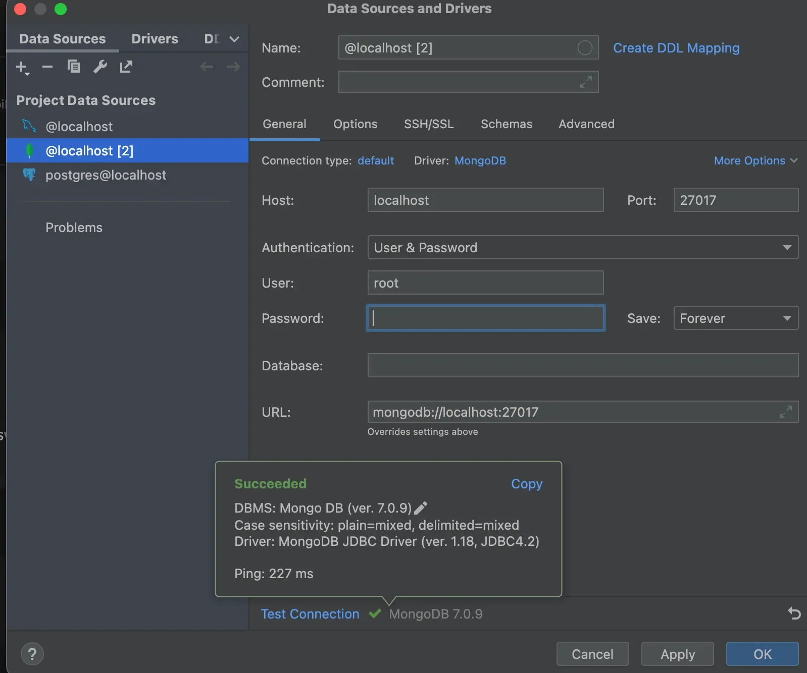
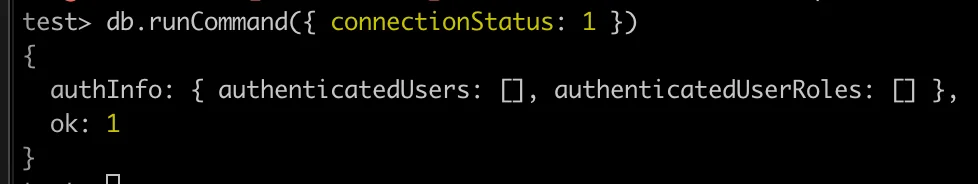
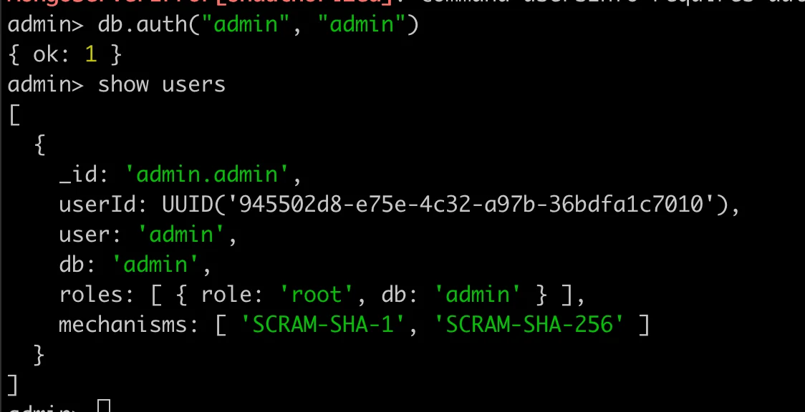
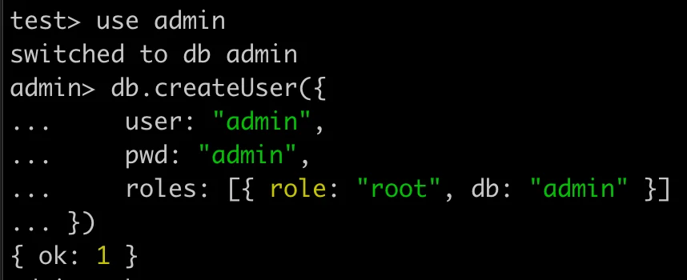
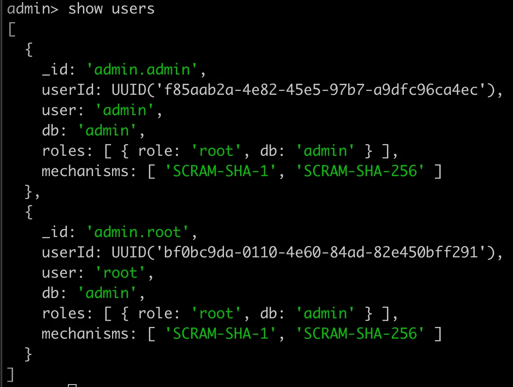

<a id="1c3eda9b0fe181089d6ff4289034b95d"></a>

### &#91; Volume O  &#93;   Docker로 <code>MongoDB</code> 실행

---



<details>
<summary>dockerhub &#45; <strong>MongoDB</strong></summary>

[mongo &#45; Official Image &#124; Docker Hub]()

</details>

<details>
<summary>1&#46; <strong>MongoDB</strong> 데이터를 저장할 volume 폴더 생성</summary>

<a id="1c3eda9b0fe18180bab4ebe8f73c54d6"></a>

```bash
cd /Users/igyeongseob/Develop

mkdir docker-mongodb
```

</details>

<details>
<summary>2&#46; <strong>MongoDB </strong>컨테이너 실행 &#45; volume 설정 추가 </summary>

<a id="1c3eda9b0fe18136b789d135665b3c4a"></a>

```bash
docker run -e MONGO_INITDB_ROOT_USERNAME=root -e MONGO_INITDB_ROOT_PASSWORD=pwd123 -p 27017:27017  -v /Users/igyeongseob/Develop/docker-mongodb/mongodb_data:/data/db -d mongo
```

</details>

<details>
<summary>3&#46; 컨테이너 접속 및 <strong> </strong>MongoDB에 접근</summary>

<a id="1c3eda9b0fe1818b8e2cf46bc41dfede"></a>

```bash
# 컨테이너 실행 및 ID 확인
docker ps 

# 컨테이너 실행시킬 때 에러 없이 잘 실행됐는 지 로그 체크
docker logs [컨테이너 ID 또는 컨테이너명]

# 컨테이너 내부 bash 접속
docker exec -it [컨테이너 ID] bash

# MongoDB 접근
mongosh
```

<a id="1c3eda9b0fe181d8a4cad31c7ddec28c"></a>

```bash
# 바로 접근 가능
docker exec -it [컨테이너 ID or 명] mongosh
```



</details>

<details>
<summary>4&#46; MongoDB CLI</summary>

- MongoDB 접속
    <a id="1c3eda9b0fe181bdbf55df908de951fb"></a>

    ```bash
    # MongoDB 접속
    mongosh

    # DB 접속
    use [DB명]

    # 특정 호스트와 포트로 접속
    mongosh --host localhost --port 27017
     # --host localhost: 로컬 서버 접속
     # --port 27017: 기본 포트(27017) 사용
    ```

- MongoDB 기본 명령어
    <a id="1c3eda9b0fe1816f92bcdfb87fc94fcd"></a>

    ```bash
    # 데이터베이스 목록 조회
    show dbs

    # 특정 데이터베이스로 이동
    use <db>

    # 현재 데이터베이스의 컬렉션(테이블) 목록 조회
    show collections

    # 컬렉션 생성
    db.createCollection("<컬렉션이름>")

    # 컬렉션의 모든 문서 조회
    db.<컬렉션>.find()

    # MongoDB CLI 종료
    exit
    ```

</details>

<details>
<summary>5&#46; <strong>MongoDB 연결</strong></summary>



</details>

<details>
<summary>6&#46; <strong>MongoDB 데이터가 볼륨에 잘 저장되고 있는지 확인</strong></summary>

<a id="1c3eda9b0fe1812eac53e9438cf2add1"></a>

```bash
cd /Users/igyeongseob/Develop/docker-mongodb/mongodb_data
ls
```

</details>

<details>
<summary>🧐  Mongo DB 사용자 인증</summary>

<details>
<summary><strong>1&#46; 현재 사용자가 인증이 필요한지 확인</strong></summary>

<a id="1c3eda9b0fe18110a728cc1c7decf624"></a>

```bash
db.runCommand({ connectionStatus: 1 })
```



- <code>authInfo&#58; { authenticatedUsers&#58; &#91;&#93; }</code> &#45;&#62; 인증 필요

- <code>authInfo</code>에 현재 사용자 정보가 있으면 인증이 완료된 상태이다&#46;

</details>

<details>
<summary><strong>2&#46; MongoDB 기본 사용자로 접속&#58; </strong><strong><code> </code></strong><strong><code>관리자 계정</code></strong><strong><code> </code></strong><strong><code>O</code></strong></summary>

<a id="1c3eda9b0fe181c29824cb59f2431f95"></a>

관리자 계정이 있는 경우, admin DB를 사용하여 인증 가능하다&#46; 

<a id="1c3eda9b0fe181388ddde1c71d880a7e"></a>

```bash
# 1. mongosh 실행할 때, 인증
mongosh -u admin -p --authenticationDatabase admin
  # -> 비밀번호 입력 후 로그인

 
# 2. mongosh 실행 후, 아래 명령어를 통해서도 인증 가능
use admin
db.auth("admin", {비밀번호})
```



</details>

<details>
<summary><strong>2&#46;1 &#45;  인중 비활성화 후 관리자 계정 생성 및 로그인&#58; </strong><strong><code>관리자 계정</code></strong><strong><code> X</code></strong></summary>

> 관리자 계정이 없다면 MongoDB 컨테이너를 일시적으로 <strong><u>인증 없이 실행</u></strong>한 후 계정을 만들어야 한다&#46; 

1. 현재 컨테이너 중지
    <a id="1c3eda9b0fe1811bab1cf75ed5147e11"></a>

    ```bash
    docker stop my-mongo
    docker rm my-mongo
    ```

1. 인증 없이 MongoDB 컨테이너 실행
    <a id="1c3eda9b0fe1815f9894dff2a0cd4bd5"></a>

    ```bash
    docker run -d \
      --name my-mongo \
      -p 27017:27017 \
      -v /Users/igyeongseob/Develop/docker-mongodb/mongodb_data:/data/db \
      mongo:latest --noauth
    ```

    - <strong><code>&#45;&#45;noauth</code></strong><strong> 옵션을 추가</strong>하여 인증 없이 MongoDB에 접근할 수 있도록 설정

1. <strong> MongoDB에 접속 후 관리자 계정 생성</strong>
    <a id="1c3eda9b0fe181918401cdd40f05d741"></a>

    ```bash
    # MongoDB 접속
    docker exec -it [컨테이너 ID] mongosh

    # admin db 접속
    use admin

    # 관리자 계정 생성
    db.createUser({
        user: "admin",
        pwd: "admin",
        roles: [{ role: "root", db: "admin" }]
    })

    # 계정이 정상적으로 생성 되었는지 확인
    show users
    ```

    

    

1. MongoDB 컨테이너를 인증 활성화 모드로 재실행
    - 현재 컨테이너 삭제 
        <a id="1c3eda9b0fe1811c97a9cc6feab065b0"></a>

        ```bash
        docker stop my-mongo
        docker rm my-mongo
        ```

    - 관리자 계정을 사용도록 새로운 컨테이너 생성
        <a id="1c3eda9b0fe181b5b41bcbfa69710955"></a>

        ```bash
        docker run -d \
          --name my-mongo \
          -p 27017:27017 \
          -e MONGO_INITDB_ROOT_USERNAME=admin \
          -e MONGO_INITDB_ROOT_PASSWORD=admin \
          -v mongo_data:/data/db \
          mongo:latest --auth
        ```

        - <code>&#45;e MONGO&#95;INITDB&#95;ROOT&#95;USERNAME=admin</code>&#58; 관리자 계정 설정

        - <code>&#45;e MONGO&#95;INITDB&#95;ROOT&#95;PASSWORD=your&#95;secure&#95;password</code>&#58; 비밀번호 설정

        - <code>—auth</code>&#58; MongoDB 인증 활성화

</details>

<details>
<summary>3&#46; 인증 비활성화 ( 테스트용 )</summary>

<a id="1c3eda9b0fe181838535f2d493cc2e04"></a>

로컬 개발 환경에서 인증을 비활성화하는 경우, MongoDB <code>설정 파일(mongod&#46;conf)</code>을 수정하면 된다&#46; 

<details>
<summary><strong>MongoDB 실행 시 </strong><strong><code>&#45;&#45;noauth</code></strong><strong> 옵션 사용</strong></summary>

<a id="1c3eda9b0fe18106adfccabdd76deb06"></a>

```bash
mongod --noauth --dbpath /usr/local/var/mongodb
```

</details>

<details>
<summary>config 파일 직접 수정</summary>

- config 파일 열기 
    <a id="1c3eda9b0fe181fa8cdcc2d4b4fd3998"></a>

    ```bash
    nano /usr/local/etc/mongod.conf
    ```

- <strong>아래 설정을 추가 또는 수정</strong>
    <a id="1c3eda9b0fe18190aeefc3c9a5a72e8b"></a>

    ```bash
    security:
      authorization: "disabled"
    ```

</details>

</details>

</details>

<details>
<summary>🤬 오류 &#45; 컨테이너 실행 후, 오류 메세지 없이 바로 종료</summary>

- 해당하는 컨테이너의 로그 확인
    <a id="1c3eda9b0fe181bb9df1d7c16482fd43"></a>

    ```bash
    docker logs [컨테이너 ID, 명]
    ```

    <a id="1c3eda9b0fe1819e9a89cb8662247298"></a>

    오류 발생된 로그 확인 후 ( 시간대로 확인하기? )

    <a id="1c3eda9b0fe181f396beecb5cb90ffe5"></a>

    해결하기 ( GPT 사용 )

</details>
