> /icons/checkmark-line_gray.svg <strong>목표</strong>
> 
> - <strong>&#91; 객체 &#45; 테이블 &#93; 연관관계의 차이 이해</strong>
> 
> - <strong>객체의 참조와 테이블의 외래 키를 매핑</strong>
> 
> - 용어 이해
>     - <strong>방향</strong>(Direction)&#58; 단방향, 양방향
> 
>     - <strong>다중성</strong>(Multiplicity)&#58; 다대일(N&#58;1), 일대다(1&#58;N), 일대일(1&#58;1), 다대다(N&#58;N)
> 
>     - <strong>연관관계의 주인(Owner)</strong>&#58; 객체 양방향 연관관계는 관리 주인 필요 (어려움)

<details>
<summary>추가정리</summary>

> 🤔 <a href="https://namu.wiki/w/%EB%A7%A4%ED%95%91">매핑(mapping) 뜻</a><br>어떤 값을 다른 값에 대응시키는 과정을 총징한다&#46;<br><br>프로그래밍 영역에서는 <strong>키(key) 역할을 하는 데이터</strong> 와 <strong>값(value) 역할을 하는 데이터</strong>를 <strong>짝 지어 저장</strong>하는 데이터 구조를 말한다&#46;<br><br>ex) Map, Dictionary

<details>
<summary>🤔 <strong>  쿼리(SQL) 중복 입력 가능 (</strong><strong><code>;</code></strong><strong>)</strong></summary>

<a id="1c3eda9b0fe1815db29ddd14fde53852"></a>

```sql
SELECT * FROM MEMBER;
select * from team;
```

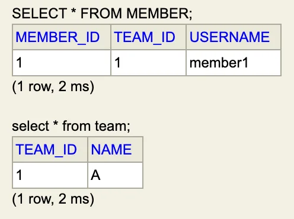

</details>

> ☝🏻 JPA 내부적으로 Sequence 전략을 기본값으로 사용함

> 👉🏻 <strong>권장)</strong> <strong>안시 표준 문법 사용</strong>
> 
> <a id="1c3eda9b0fe181fc8187ee7951dcb876"></a>
> 
> ex) join 문 (member, team)
> 
> <a id="1c3eda9b0fe181f3aef0e8281ee4d899"></a>
> 
> ```sql
> select * from member m 
> 	join team t on m.team_id = t.team_id;
> ```

</details>

<a id="1c3eda9b0fe18140ad6ae18041934a7e"></a>

## 단방향 연관관계

> 💬 인용 문구 &#45; 조영호(객체지향의 사실과 오해)<br><br><strong>‘객체지향 설계의 목표는 자율적인 </strong><strong><u>객체들의 협력 공동체를 만</u></strong><strong>드는 것이다&#46;’<br></strong><br>&#45; 강의 PPT 발췌 &#45;	

<a id="1c3eda9b0fe1817c9b12d1a72ad5d23b"></a>

### Bad Case) 테이블을 맞춘 객체 설계

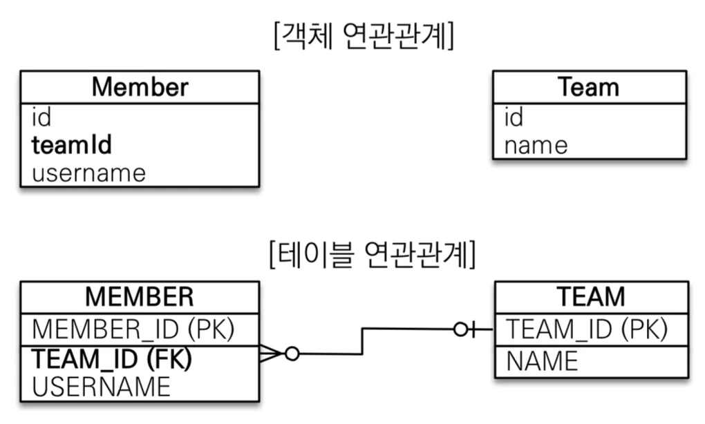

> 참조 대신 외래 키를 그대로 사용

<details>
<summary>jpashop</summary>

<details>
<summary>domain</summary>

<details>
<summary><strong>Member</strong></summary>

<a id="1c3eda9b0fe181e7b04bd4b8614e41c8"></a>

```java
package jpabook.jpashop.domain;

import jakarta.persistence.Column;
import jakarta.persistence.Entity;
import jakarta.persistence.GeneratedValue;
import jakarta.persistence.Id;

@Entity
public class Member {

    @Id @GeneratedValue
    @Column(name = "MEMBER_ID")
    private Long id;

    @Column(name = "TEAM_ID")
    private Long teamId;

    @Column(name = "USERNAME")
    private String name;

    public Member() {
    }

    public Member(Long teamId, String name) {
        this.teamId = teamId;
        this.name = name;
    }

    public Long getId() {
        return id;
    }

    public Long getTeamId() {
        return teamId;
    }

    public String getName() {
        return name;
    }
}

```

</details>

<details>
<summary><strong>Team</strong></summary>

<a id="1c3eda9b0fe181ae992df00dc9616d89"></a>

```java
package jpabook.jpashop.domain;

import jakarta.persistence.Column;
import jakarta.persistence.Entity;
import jakarta.persistence.GeneratedValue;
import jakarta.persistence.Id;

@Entity
public class Team {

    @Id @GeneratedValue
    @Column(name = "TEAM_ID")
    private Long id;
    private String name;

    public Team() {
    }

    public Team(String name) {
        this.name = name;
    }

    public Long getId() {
        return id;
    }

    public String getName() {
        return name;
    }
}

```

</details>

</details>

<details>
<summary><strong>JapMain</strong></summary>

<details>
<summary><strong>오류</strong></summary>

> sequence 전략의 pk값 가져오는 것을 확인하기위해 저장하고 생성을 분리하였더니 <br>team 엔티티에서 시퀀스 값을 가져와 PK를 지정 전에 member 엔티티가 생성되어 teamId 회원의 값이 null 상태가 되어<br>회원 teamId 값으로 Team 조회가 불가능 해짐 

<a id="1c3eda9b0fe1814a85efd456300071e8"></a>

MEMBER 테이블에 

<a id="1c3eda9b0fe181ae93c4d5e182f663c6"></a>

```java
// 팀, 회원 생성
Team team = new Team("A");
Member member = new Member(team.getId(), "member1 ");

System.out.println("=============================");

// 저장
em.persist(team);
em.persist(member);;

System.out.println("=============================");

// flush를 미리 날려야 DB에 데이터가 들어가고 조회 가능함. 
em.flush();
em.clear();  // 1차 캐시 초기화

// 칮고싶은 회원 ID DB의 MEMBER 테이블에서 조회
Member findMember = em.find(Member.class, member.getId());

// 가져온 회원의 team_ID DB TEAM 테이블에서 조회
Long findTeamId = findMember.getTeamId();
Team findTeam = em.find(Team.class, findTeamId);


System.out.println("findTeam = " + findTeam);

tx.commit();
```

</details>

<a id="1c3eda9b0fe181e2ba01e6236f60f62d"></a>

```java
  // 팀 생성 및 저장
  Team team = new Team("A");
  em.persist(team);

  // 회원 생성 및 저장
  Member member = new Member(team.getId(), "member1 ");
  em.persist(member);

  em.flush();
  em.clear();

  Member findMember = em.find(Member.class, member.getId());

  Long findTeamId = findMember.getTeamId();
  Team findTeam = em.find(Team.class, findTeamId);
  System.out.println("findTeam = " + findTeam);

  tx.commit();
```

</details>

</details>

<details>
<summary><strong>쿼리 분석</strong></summary>

> 엔티티의 연관관계가 형성되지 않아 필요한 값을 매번 DB에 요청해서 받아야함

<a id="1c3eda9b0fe1816ca077d8d0a2687ca7"></a>

```sql
// 시퀀스, 테이블 생성
Hibernate: 
    create sequence Member_SEQ start with 1 increment by 50
Hibernate: 
    create sequence Team_SEQ start with 1 increment by 50
Hibernate: 
    create table Member (
        MEMBER_ID bigint not null,
        TEAM_ID bigint,
        USERNAME varchar(255),
        primary key (MEMBER_ID)
    )
Hibernate: 
    create table Team (
        TEAM_ID bigint not null,
        name varchar(255),
        primary key (TEAM_ID)
    )


// 시퀀스 전략 사용: 저장 시점에 시퀀스에서 값을 가져와 1차 캐시의 PK의 값으로 사용
Hibernate: 
    select
        next value for Team_SEQ
Hibernate: 
    select
				next value for Member_SEQ


// em.flush() -> commit 전 수동 flush, 그래야 한번에 조회 가능
Hibernate: 
    /* insert for
        jpabook.jpashop.domain.Team */insert 
    into
        Team (name, TEAM_ID) 
    values
        (?, ?)
Hibernate: 
    /* insert for
        jpabook.jpashop.domain.Member */insert 
    into
        Member (USERNAME, TEAM_ID, MEMBER_ID) 
    values
        (?, ?, ?)


// DB에 회원 조회
Hibernate: 
    select
        m1_0.MEMBER_ID,
        m1_0.USERNAME,
        m1_0.TEAM_ID 
    from
        Member m1_0 
    where
        m1_0.MEMBER_ID=?

// DB에 팀 조회
Hibernate: 
    select
        t1_0.TEAM_ID,
        t1_0.name 
    from
        Team t1_0 
    where
        t1_0.TEAM_ID=?


// 출력값
findTeam = jpabook.jpashop.domain.Team@9c73fff
```

</details>

> 🤔 <strong>연관관계 형성을 통한 참조 활용</strong><br>위 case는 <u>테이블을 기준으로 한  데이터중심 설계</u>는 <u>객체지향의 특성인</u><strong><u> </u></strong><strong><u>참조 ( reference </u></strong><u>) </u><u>를 전혀 활용하지 못</u>한 bad case 이다&#46;
> 
> - <strong>DB 테이블</strong>은 <strong>외래 키</strong>로 <strong>조인(</strong><strong><code>join</code></strong><strong>)</strong>을 사용하여 <strong><u>연관된 테이블을 찾</u></strong>는다&#46; 
> 
> - <strong>객체</strong>는 <strong>참조</strong>를 사용하여 <strong><u>연관된 객체를 찾 </u></strong>는다&#46;
> 
> <a id="1c3eda9b0fe181569803d951f3e05a83"></a>
> 
> <br>이런 <strong>둘 사이의 매커니즘(외래키, 참조)의 차이를 인식</strong>하고 엔티티가 <strong><u>참조를 활용</u></strong><u> 할 수 있는 올바른 설계</u>를 해야한다&#46; <br><br><strong>JPA 제공</strong>하는 <strong><u>어노테이션</u></strong><u>을 활용</u>해 <strong><u>엔티티의 연관관계를 형성</u></strong>하고 참조를 활용할 수 있다&#46; 
> 
> <a id="1c3eda9b0fe18193ba43d37553dc2c35"></a>
> 
> → <strong>방향(단방향, 양방향)</strong>, <strong>다중성</strong> 확인
> 
> <a id="1c3eda9b0fe181498d4ccfd07839540a"></a>
> 
>        ex) <code>&#64;ManyToOne</code>, <code>&#64;JoinColumn(name = {컬럼이름})</code>

<a id="1c3eda9b0fe1811fa92bc85b1e4cd18d"></a>

### 참조 활용 &#45; 단방향 연관관계

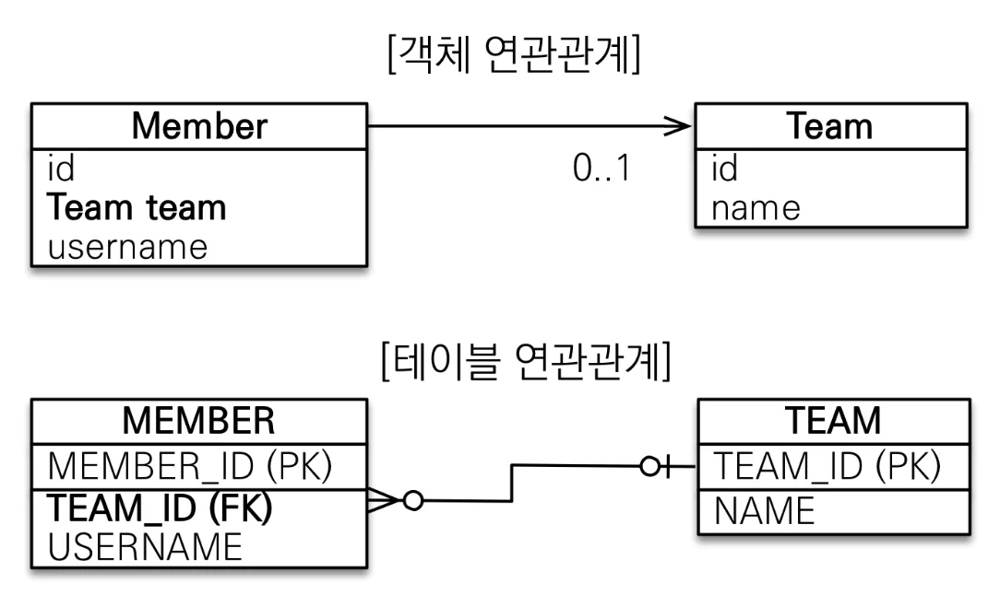

<a id="1c3eda9b0fe1811c8098df45bb0e43c0"></a>

Member 테이블에서 <strong>T</strong><strong><u>EAM PK 값을 외래키</u></strong><u>로 가져</u>와 <strong><u>다대일</u></strong>의 <strong><u>단방향</u></strong><strong> </strong>연관관계를 형성한다&#46; 

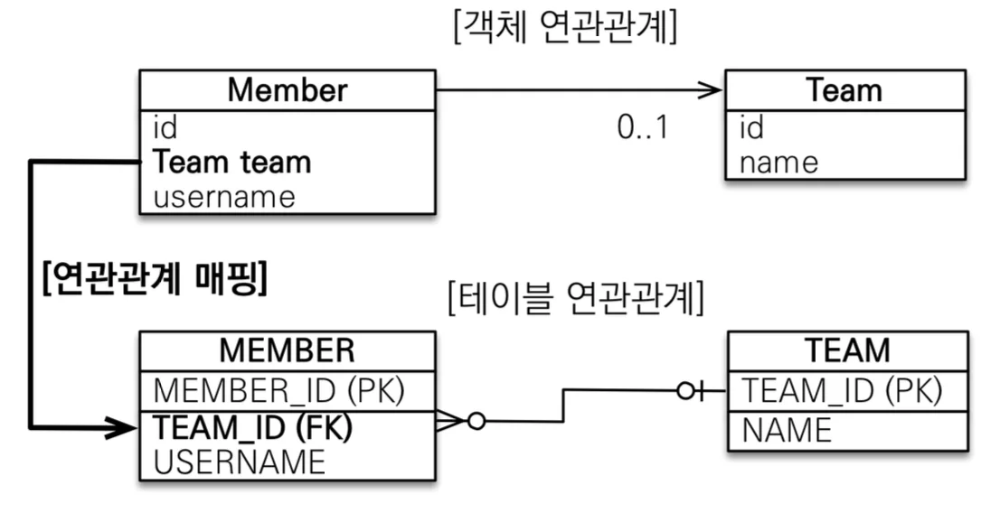

<a id="1c3eda9b0fe181f09044ec13e8240495"></a>

 <strong>외래키에 대응하는 필드</strong>에 <strong><u>다대일(N&#58;1)을 표현하는 </u></strong><strong><u><code>&#64;ManyToOne</code></u></strong>과<strong><u> 연관관계를 나타내는 </u></strong><strong><u><code>&#64;JoinColumn(name = {컬럼명})</code></u></strong>  명시하면 엔티티를 통해서 다대일 단방향 연관관계를 DB에 표현할 수 있다&#46;

<a id="1c3eda9b0fe181378b2ec732bd9dc66b"></a>

(JPA가 해당하는 어노테이션이 적용된 필드 값이 업데이트되면 매핑되는 외래키 필드의 값을 업데이트 함)

<details>
<summary><strong>Member</strong></summary>

<a id="1c3eda9b0fe181ca9cabe14ef469f7ae"></a>

```java
@Entity
public class Member {   

     .   .   .

		// 단방향 연관관계 
		@ManyToOne
		@JoinColumn(name = "TEAM_ID")
		private Team team;
```

</details>

<details>
<summary><strong>JpaMain</strong></summary>

<a id="1c3eda9b0fe181df830ae0c235ce8ff8"></a>

```java
// 팀 저장
Team team = new Team("TeamA");

// 회원 저장
Member memeber = new Member("member1 ", team);

System.out.println("==========================");

em.persist(team);
em.persist(memeber);

System.out.println("==========================");

// DB에서 가져오기 -> 1차 캐시 초기화
em.flush();
em.clear();

// 회원 조회
Member findMember = em.find(Member.class, memeber.getId());

// 가져온 회원의 팀 소속(TEAM_ID) 찾기
Team teamId = findMember.getTeam();  // 참조 활요
System.out.println("teamId = " + teamId);

tx.commit();
```

</details>

<details>
<summary><strong>쿼리 분석</strong></summary>

<a id="1c3eda9b0fe181668e43dace481df185"></a>

```sql
// 기존 내용(시퀀스, 테이블) drop - [ hibernate.hbm2ddl.auto = create ]
Hibernate: 
    drop table if exists Member cascade 
Hibernate: 
    drop table if exists Team cascade 
Hibernate: 
    drop sequence if exists Member_SEQ
Hibernate: 
    drop sequence if exists Team_SEQ

// 시퀀스, 테이블 생성
Hibernate: 
    create sequence Member_SEQ start with 1 increment by 50
Hibernate: 
    create sequence Team_SEQ start with 1 increment by 50
Hibernate: 
    create table Member (
        MEMBER_ID bigint not null,
        TEAM_ID bigint,
        USERNAME varchar(255),
        primary key (MEMBER_ID)
    )
Hibernate: 
    create table Team (
        TEAM_ID bigint not null,
        name varchar(255),
        primary key (TEAM_ID)
    )

// 테이블 수정: 팀의 PK 가져와 회원 TEAM_ID FK 값 지정?
    alter table if exists Member 
       add constraint FKl7wsny760hjy6x19kqnduasbm 
       foreign key (TEAM_ID) 
       references Team


// 수동 플러시 및 1차 캐시 초기화
Hibernate: 
    /* insert for
        jpabook.jpashop.domain.Team */insert 
    into
        Team (name, TEAM_ID) 
    values
        (?, ?)
Hibernate: 
    /* insert for
        jpabook.jpashop.domain.Member */insert 
    into
        Member (USERNAME, TEAM_ID, MEMBER_ID) 
    values
        (?, ?, ?)


// 회원 테이블 조회 
Hibernate: 
    select
        m1_0.MEMBER_ID,
        m1_0.USERNAME,
        t1_0.TEAM_ID,
        t1_0.name 
    from
        Member m1_0 
    left join          // 참조 -> join 
        Team t1_0 
            on t1_0.TEAM_ID=m1_0.TEAM_ID 
    where
        m1_0.MEMBER_ID=?

// teamId 값 정상 도출
teamId = jpabook.jpashop.domain.Team@4cffcc61
```

</details>

<details>
<summary>🤔 참조 활용 → 한번 요청에 의존성이 너무 큰 객체를 가져오는 것이 아닌가? 요청에 따른 비용이 너무 크지 않나?</summary>

<a id="1c3eda9b0fe1815ebd92f0c4e80f3156"></a>

<br>

</details>

<a id="1c3eda9b0fe1815e80bec481600dae5a"></a>

## 양방향 연관관계와 연관관계의 주인

> 📌 <strong>양방향 매핑 정리</strong><br><strong>단방향 매핑</strong>만으로도 <strong><u>이미 연관관계 매핑은 완료</u></strong>된 것이다&#46; <br><strong>양방향 매핑</strong>은 <strong>반대 방향으로 조회(객체 그래프 탐색)기능만 추가</strong>된 것 뿐이다&#46;<br>( JPQL 에서 역방향 탐색할 일이 많음 )<br><br><strong>⇒ 권장)</strong><strong><u> 단방향 매핑을 외래키가 있는 곳에 잘 설정</u></strong><strong>하고 </strong><strong><u>양방향 매핑은 필요할 때만 추가</u></strong><strong>해서 사용</strong>

> 🤔 <strong><u>일단 단방향 매핑으로 설계를 완료</u></strong>해야 한다&#46;
> 
> <a id="1c3eda9b0fe181bfa32fdad7c73946b1"></a>
> 
> 실무에서 객체만으로는 설계를 끝낼 수는 없다&#46; 
> 
> <a id="1c3eda9b0fe1813b8e5ef9fb158ec7cd"></a>
> 
> 테이블 설계와 고려하여 객체 설계를 해야한다&#46; 
> 
> <a id="1c3eda9b0fe18113b2caefb369d1db81"></a>
> 
> 그때, 테이블의 다대일 관계에서 다에 해당하는 테이블에 FK값을 보고  객체의 단방향 매핑을 설계한다&#46;<br>실직적으로 양방향 매핑은 참조값 하나 더해지는 단방향 매핑과 같다&#46; 따라서 양방향 매핑은 역방향의 객체 탐색이 필요한 경우에만 부분적으로 추가 한다&#46;

<a id="1c3eda9b0fe181738e59fd85cf9a669c"></a>

### 연관관계 주인, mappedBy

> 👉🏻 <strong>비유) 연관관계 주인, mappedBy </strong>→ <strong>자동차, 자동차 바퀴</strong>
> 
> - 연관관계 주인 = 자동차 바퀴
> 
> - mappedBy ( 읽기 전용 )   = 자동차

> 🤔 <strong>양방향 관계에서의 객체와 외래키 맵핑</strong>
> 
> <details>
> <summary><strong>테이블(DB)</strong>은 <strong>하나</strong>의<strong> </strong><strong>외래키(PK)</strong>를 가지고 <strong>양방향 연관관계</strong>를 정의한다&#46;</summary>
> 
> 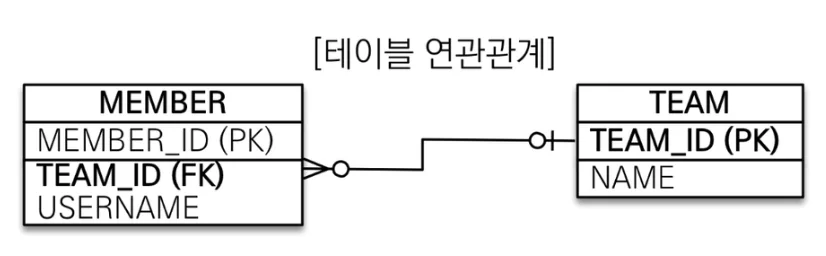
> 
> > MEMBER&#46;TEAM&#95;ID 외래키(Foreign key) 하나로 양방향 연관관계 가짐 (양쪽으로 조인 가능)
> 
> <a id="1c3eda9b0fe1816486d5d3064c094c08"></a>
> 
> ```java
> SELECT *
> FROM MEMBER M
> JOIN TEAM T ON M.TEAM_ID = T.TEAM_ID
> 
> SELECT *
> FROM TEAM T
> JOIN MEMBER M ON T.TEAM_ID = M.TEAM_ID
> ```
> 
> </details>
> 
> <details>
> <summary><strong>객체</strong>는<strong> 2개</strong>의<strong> 단향향 연관관계(참조)</strong>를 가지고 <strong>양방향 연관관계</strong>를 정의한다&#46; </summary>
> 
> 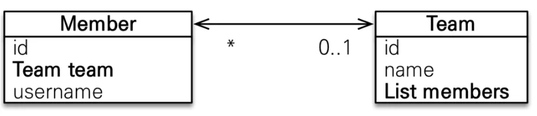
> 
> > <strong>2개</strong>의 <strong>단방향</strong>(<strong>참조 값</strong>)을 통해 <strong>양방향 연관관계 형성</strong>
> > 
> > - <strong>Member&#46;getTeam() &#58;</strong> 회원(Member) → 팀(Team)
> > 
> > - <strong>Team&#46;getMembers() &#58; </strong>단방향 연관관계&#58; 팀(Team<strong>)</strong> → 화원(Member)
> 
> </details>
> 
> <a id="1c3eda9b0fe181d0898dd04fb44c88c3"></a>
> 
> <br>이렇게 <code>DB</code> 와 <code>객체</code>의 연관관계에 대한 <strong>매커니즘 차이점</strong>이 떄문에<br>아래와 같은 딜레마가 생긴다&#46;
> 
> - 2개의 필드(team, members) 중 어느 필드가 테이블의 외래 키(TEAM&#95;ID)와 매핑되어야 하는가?
> 
> - 2개의 필드(team, members) 중 어느 필드가 업데이트가 되었을 때, 외래키(TEAM&#95;ID) 값이 업데이트 되는가?
> 
> - 멤버를 바꾸거나 새로운 팀에 들어가고 싶을 때, 멤버의 team 값을 바꿔야하는가? 아니면 members 리스트 값을 바꿔야 하는가?
> 
> 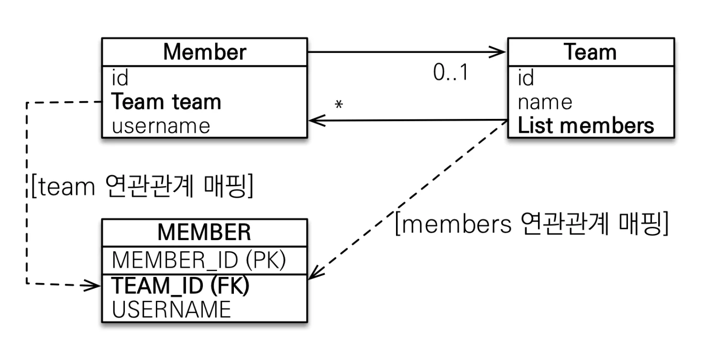
> 
> <a id="1c3eda9b0fe181cab3dfd83d76734453"></a>
> 
> 이때, 등장하는 개념이 <strong><u>연관관계의 주인</u></strong>이다&#46; 

<a id="1c3eda9b0fe1810c9fd6ce3c849bd62e"></a>

<strong>회원과 팀</strong>은 <strong>N&#58;1(다대일)</strong> 연관관계를 가진다&#46; 이때, <strong>N(다</strong><strong>)</strong>에 해당하는 <strong>회원(Member)</strong>이 <strong>연관관계의 주인(Owner)</strong>이 되어 <strong>외래키와 매핑</strong>되어 관리한다&#46;

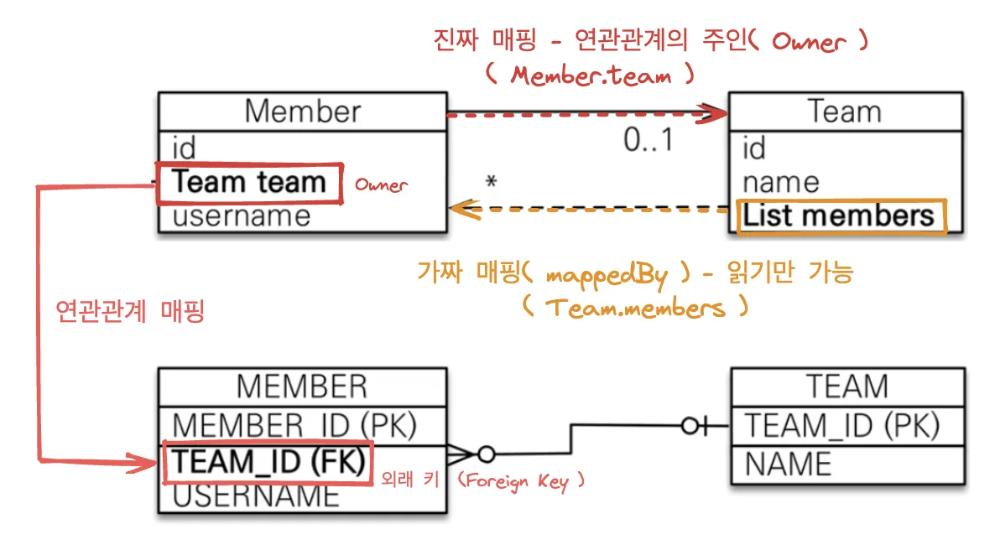

> 📌 <strong> Tip) </strong><strong><u>외래 키</u></strong><strong>가 있는  곳을  </strong><strong><u>주인</u></strong><strong>으로 정해라&#33;</strong>

> /icons/checkmark-line_red.svg <strong>특징</strong>
> 
> - <strong>연관관계의 주인</strong>만이 <strong>외래 키</strong>를  <strong>관리(등록 및 수정)</strong> 할수 있다&#46; <br>   → <code>&#64;ManyToOne</code>, <code>&#64;JoinColumn()</code>
> 
> - <strong>주인이 아닌 쪽은 읽기만 가능하다&#46; </strong><br>   → <code>mappedBy</code>

<a id="1c3eda9b0fe181be90dadaaf40ec8163"></a>

### 예제

> <strong>members(mappedBy, 가짜 매핑)</strong>는 DB에서 <strong>조회</strong>(<strong><code>getMembers()</code></strong>)만 가능하다&#46;<br>값을 업데이트하거나 넣을 때는 <strong>team(연관관계 주인, 진짜 매핑)</strong>을 <strong>참조</strong>하여 DB에 업데이트 및 추가한다&#46;

<details>
<summary><strong>Member</strong></summary>

<a id="1c3eda9b0fe181d3a0cccd9aca3e74cb"></a>

```java
@Entity
public class Member {

		@id @GeneratedValue
		private Long id;
		 
		@Column(name = "USERNAME")
		 private String name;
		 private int age;
		
		// 진짜 매핑 - 연관관계의주인 
		@ManyToOne
		@JoinColumn(name = "TEAM_ID")
		private Team team;
		 ...
```

</details>

<details>
<summary><strong>Team</strong></summary>

<a id="1c3eda9b0fe18149888fcd229c086dd9"></a>

```java
@Entity
public class Team {

		@Id @GeneratedValue
		 private Long id;
		
		private String name;

		// 가짜 매핑 - 조회만 가능
		@OneToMany(mappedBy = "team")
		List<Member> members = new ArrayList<Member>();
		 ...
}
```

</details>

<a id="1c3eda9b0fe1816a88c4f7008c34e17d"></a>

## 양방향 매핑 시, Error Case

<a id="1c3eda9b0fe181c4bca0d430c093f706"></a>

### <strong>Case) 연관관계의 주인에 값을 입력하지 않음</strong>

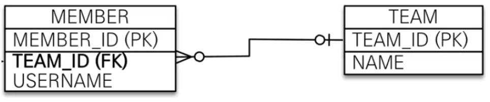

<details>
<summary><strong>오류) mappedBy(</strong><strong><code>Team&#46;members()</code></strong>)에서  <strong>FK 값(</strong><strong><code>TEAM&#95;ID</code></strong><strong>)</strong>을 업데이트 → <code>null</code></summary>

> ⚠️ <strong><code>mappedBy</code></strong><strong> 속성</strong><strong>이 적용된</strong><strong> 필드</strong>는 <strong>읽기 전용 필드</strong>이다&#46;<br>따라서 <strong>JPA에서 </strong><strong><code>update</code></strong><strong>나 </strong><strong><code>insert</code></strong><strong> 할 때 해당 속성을 확인하지 않</strong>는다&#46;<br>⇒ <strong><u>값이 업데이트나 추가되지 않</u></strong>음, <strong>엔티티 참조만을 위한 </strong><strong><code>가짜 매핑</code></strong>

<a id="1c3eda9b0fe181c49f3df2d2c562c9a8"></a>

```java
// Team
@Entity
public class Team {

      .  .  .
      
    @OneToMany(mappedBy = "team")
    private List<Member> members = new ArrayList<>();
    
    public void setMembers(List<Member> members) {
        this.members = members;
    }
    
       .  .  .
```

<a id="1c3eda9b0fe181d1a70bc5b1cfc273af"></a>

```java
// JpaMain
Member member = new Member();
member.setUsername("member1");
em.persist(member);

Team team = new Team("TeamA");
team.getMembers().add(member);   // Team
em.persist(team);


em.flush();
em.clear();

tx.commit();
```

<a id="1c3eda9b0fe1815c959af9440e8b9a96"></a>

mappedBy가 적용된 필드를 통해서는 DB에 값을 업데이트 할 수 없다&#46;

<a id="1c3eda9b0fe18179b595d1721de69a05"></a>

아래와 같이 외래키 값이 <code>null</code>이 나오는 것을 확인 할 수 있다&#46;

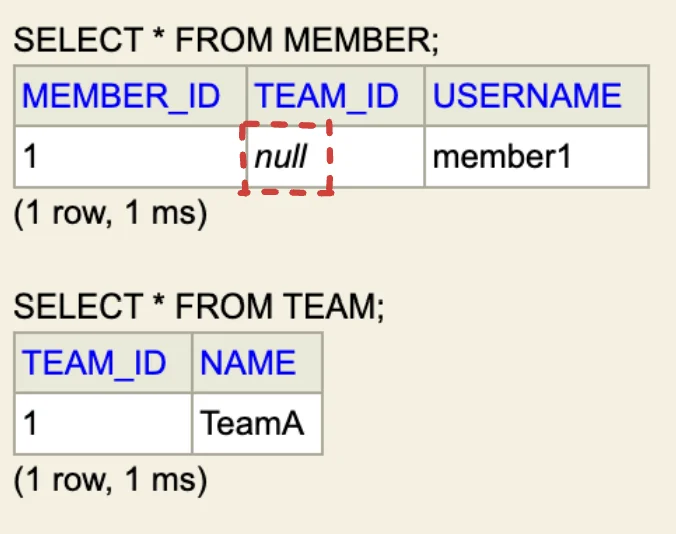

</details>

<details>
<summary><strong>해결)  연관관계의 주인(</strong><strong><code>member&#46;team</code></strong><strong>)을 통한 FK 값(</strong><strong><code>TEAM&#95;ID</code></strong><strong>) 업데이트 (</strong><strong><code>member&#46;setTeam(team)</code></strong><strong>)</strong></summary>

<a id="1c3eda9b0fe181658005d858a79ea68e"></a>

```java
// Member
@Entity
public class Member {
   .  .  .
    @ManyToOne
    @JoinColumn(name = "TEAM_ID")
    private Team team;
   
	   public void setTeam(Team team) {
	        this.team = team;
	    }
```

<a id="1c3eda9b0fe181d0849cecb1bed91520"></a>

```java
// JpaMain
Team team = new Team("TeamA");
em.persist(team);

Member member = new Member();
member.setUsername("member1");
member.setTeam(team);
em.persist(member);
```

<a id="1c3eda9b0fe1813eb88ccbd206d38fc4"></a>

연관관계의 주인 필드(team)을 통해서 값을 넣는 경우, 아래와 같이 정상적으로 값이 들어가는 것을 확인 할 수 있다&#46;

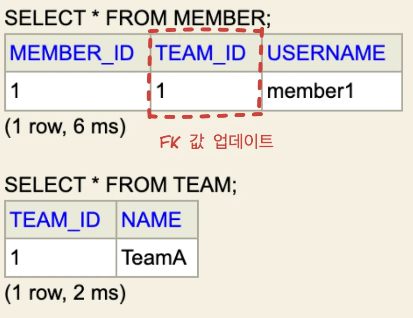

</details>

<a id="1c3eda9b0fe18111bc3bc0ffb3e99588"></a>

### <strong>Case) 양방향 연관관계 시, </strong><u>양쪽으로 값 설정</u>

<details>
<summary><strong>오류) 단방향  값 설정</strong>, <strong>순수 객체</strong>에서 조회(<strong><code>DB ❌</code></strong>)하는 경우 <strong>조회 안됨</strong></summary>

> ⚠️ 중간 수동 플러시(em&#46;flush)하지 않는 경우, <strong><u>1차 캐시에서 값을 조회</u></strong>한다&#46; <br> → DB에서 가져오지 않음, select 쿼리 <br><br>그러나 단방향(  member → team )으로만 값을 설정했기 때문에,  <br>Team에서 Member로  침조하는 경우, 참조값이 존재하지 않(<code> members&#46;size()=0</code>)기 때문에 조회가 되지 않는다&#46; <br>이처럼 <strong>DB에서 값을 가져오지 않는</strong><strong><u> 순수 객체 상태</u></strong><strong> 동작을 고려하여 양쪽에 값을 설정 해야한다&#46;</strong><br>   ex) DB없이 테스트 하는 경우 등

<details>
<summary><strong>JpaMain</strong></summary>

<a id="1c3eda9b0fe181ee983ffb335fbf78dc"></a>

```java
// 단방향 조회
Team team = new Team();
team.setName("teamA");
em.persist(team);

Member member = new Member();
member.setUsername("memberA");
member.setTeam(team);   참조: member -> team
em.persist(member);

//  team.getMembers().add(member);

//  em.flush();
//  em.clear();

Team findTeam = em.find(Team.class, team.getId());
List<Member> members = findTeam.getMembers();

System.out.println("========================");
for (Member m : members) {
    System.out.println("m = " + m.getUsername());
}
System.out.println("========================");

tx.commit();
```

</details>

<details>
<summary><strong>쿼리</strong></summary>

<a id="1c3eda9b0fe181fd8615cd77e29b9ce2"></a>

```sql
Hibernate: 
    select
        next value for Team_SEQ
Hibernate: 
    select
        next value for Member_SEQ
        
// 값 조회 X, members.size() = 0
========================
========================

// commit 시 flush
Hibernate: 
    /* insert for
        jpabook.jpashop.domain.Team */insert 
    into
        Team (name, TEAM_ID) 
    values
        (?, ?)
Hibernate: 
    /* insert for
        jpabook.jpashop.domain.Member */insert 
    into
        Member (TEAM_ID, USERNAME, MEMBER_ID) 
    values
        (?, ?, ?)
```

</details>

</details>

<details>
<summary><strong>해결) 양방향으로 값 설정</strong></summary>

<details>
<summary><strong>JpaMain</strong></summary>

<a id="1c3eda9b0fe181a7bb40d73babbaacdc"></a>

```java
// 양방향 조회
Team team = new Team();
team.setName("teamA");
em.persist(team);

Member member = new Member();
member.setUsername("memberA");
member.setTeam(team);  // 참조: member -> team
em.persist(member);

team.getMembers().add(member);  // 참조: team.members -> member

//  em.flush();
//  em.clear();

Team findTeam = em.find(Team.class, team.getId());
List<Member> members = findTeam.getMembers();

System.out.println("========================");

for (Member m : members) {
  System.out.println("m = " + m.getUsername());
}
System.out.println("========================");

tx.commit();
```

</details>

<details>
<summary><strong>쿼리</strong></summary>

<a id="1c3eda9b0fe181e09f99cae1f5718f25"></a>

```sql
// 저장 시점, 시퀀스 값 가져옴
Hibernate: 
    select
        next value for Team_SEQ
Hibernate: 
    select
        next value for Member_SEQ
        
// 객체에서 값 조회, members -> member.getUserName
========================
m = memberA
========================

// 커밋 -> flush
Hibernate: 
    /* insert for
        jpabook.jpashop.domain.Team */insert 
    into
        Team (name, TEAM_ID) 
    values
        (?, ?)
Hibernate: 
    /* insert for
        jpabook.jpashop.domain.Member */insert 
    into
        Member (TEAM_ID, USERNAME, MEMBER_ID) 
    values
        (?, ?, ?)
```

</details>

</details>

<a id="1c3eda9b0fe1818f8044c80e4ce38536"></a>

### Tip) 연관관계 편의 메소드 

> <strong><u>양방향 참조 값 </u></strong><strong><u>한번에</u></strong><strong><u> 설정</u></strong><strong>&#58;  </strong><strong><code>changeTeam()</code></strong>, <strong><code>addMember()</code></strong><strong> (둘 중 하나만)</strong>

<a id="1c3eda9b0fe18167b206f290eeec32cc"></a>

```sql
// Member
public void changeTeam(Team team) {
  this.team = team;
    team.getMembers().add(this);
}
```

<a id="1c3eda9b0fe1818c8d35d145ad7eff2e"></a>

```sql
// Team
public void addMember(Member member) {
    member.setTeam(this);
    this.getMembers().add(member);
}
```

<a id="1c3eda9b0fe1816eae39f90426a4f3c2"></a>

정상적으로 값 들어감

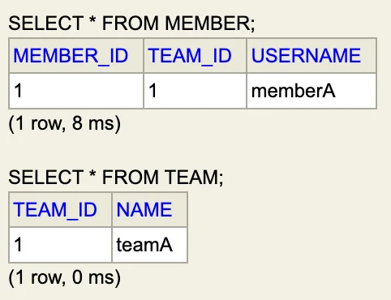

<a id="1c3eda9b0fe181cc9e11c3b565573ce9"></a>

### Case)  무한 루프(<strong>StackOverflowError)</strong> &#45; toString(), lombok, JSON 생성 라이브러리

<details>
<summary><strong>toString()</strong></summary>

> member→ team → members → member → team → … 무한루프 발생

<a id="1c3eda9b0fe181a8b869faf615c4e399"></a>

⇒ <strong>StackOverflowError </strong>

<a id="1c3eda9b0fe181bb8bfbc2644bc76df3"></a>

```sql
m// Team
@Override
public String toString() {
    return "Team{" +
            "id=" + id +
            ", name='" + name + '\'' +
            ", members=" + members +
            '}';
}
```

<a id="1c3eda9b0fe1819d97adc0eebb4e5cc4"></a>

```sql
// Member
@Override
public String toString() {
    return "Member{" +
            "id=" + id +
            ", username='" + username + '\'' +
            ", team=" + team +
            '}';
}
```

</details>

<details>
<summary><strong>컨트롤러 JSON 생성 라이브러리</strong></summary>

<details>
<summary>🤔 DTO?</summary>


</details>

> 📌 <strong>권장) 엔티티 DTO 변환 후 컨트롤러(json&#45;api) 반환</strong>

<a id="1c3eda9b0fe1811d8768dab2abab7fc8"></a>

스프링에서 컨트롤러&#45;엔티티를 json으로 api 스펙에 반환하면 문제가 발생한다&#46;

- 무한루프

- 엔티티가 변경되면 api 스펙도 바뀐다&#46; 

</details>

<a id="1c3eda9b0fe18135902be713a9b3d4e1"></a>

## 실전 예제2 &#45; 연관관계 매핑 

<a id="1c3eda9b0fe181d8bb4bf02567efdd65"></a>

### 테이블 구조

>  실전 1과 구조 동일

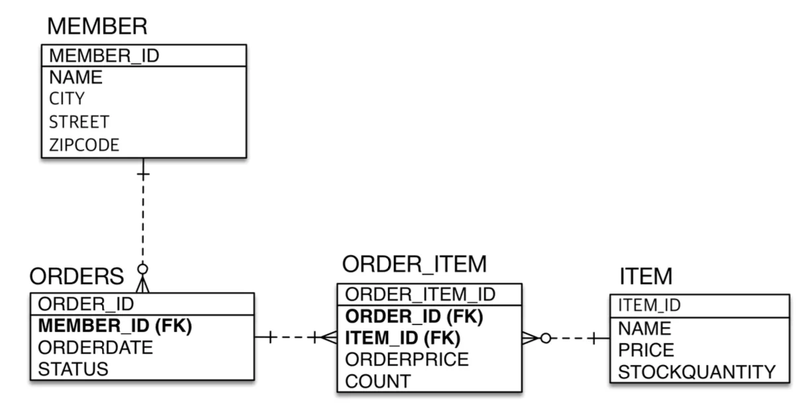

<a id="1c3eda9b0fe181b693ced5655f515712"></a>

### 객체 구조

> 참조 활용

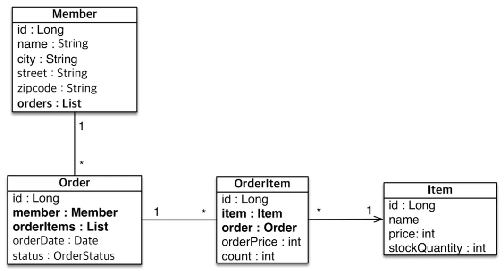

<a id="1c3eda9b0fe18197998fdbbf2fe80a51"></a>

### 구현

> 📌 <strong>설계</strong>
> 
> - FK 값을 기준으로 단방향 매핑 
> 
> -  Order의 orderItems 만 양방향(역방향)으로 설계
>     <a id="1c3eda9b0fe181f1873afa9f22daeb7f"></a>
> 
>     → 양방향이 필요한 중요 비지니스에만 추가
> 
>     <a id="1c3eda9b0fe181ae87bcd6c13aece8bb"></a>
> 
>     →주문의 경우, 주문한 상품 리스트가 비니지스적으로 중요함 따라서 양방향 설계<br>

> 👍🏻 <strong>역방향 연관관계 설정&#58;</strong><strong><code> &#64;OneToMany(mappedBy= {</code></strong><strong><code>연관관계의 주인인 필드 명</code></strong><strong><code>}</code></strong>

> ➕ <strong>Order ↔ Item &#58; 다대다 </strong>
> 
> - <strong><u>중간</u></strong>에 <strong><u>OrderItem 엔티티 추가</u></strong>
> 
> - <strong><u>Order ↔ OrderItem ↔ Item </u></strong>&#58; <strong>일대다 &#45; 다대일 </strong>

<details>
<summary>jpabool&#46;jpashop</summary>

<details>
<summary>domain</summary>

<details>
<summary><strong>Member</strong></summary>

<a id="1c3eda9b0fe18166bc02f785527cfe27"></a>

```java
@Entity
public class Member {

		@Id
		@GeneratedValue
		private Long id;
		
		private String name;
		
		private String city;
		private String street;
		private String zipcode;
		
		private List<Order> orders;
		
		// getter, setter
```

</details>

<details>
<summary><strong>Order   ( 단방향, 양방향 연관관계,</strong><strong> 연관관계 편의 메서드</strong><strong> )</strong></summary>

<a id="1c3eda9b0fe1818a96f5f64482621757"></a>

```java
@Entity
@Table(name = "ORDERS")  // DB에 기본으로 ORDER가 '예약어'로 걸려있음 (안되어 있는 DB도 있음)
public class Order {
		@Id @GeneratedValue
		@Column(name = "ORD ER_ID")
		private Long id;
		
		@ManyToOne
		@JoinColumn(name = "MEMBER_ID")
		private Member member;
		
		private LocalDateTime oderDate;
		
		@Enumerated(EnumType.STRING)   // ORIGIN: 충돌 오류 발생
		private OrderStaus staus;
		
		@OneToMany(mappedBy = "OrderItem")  // 양방향 설계 (역방향 추가함)
		private List<OrderItem> orderItems = new ArrayList<>();
		
		// 연관관계 편의 메서드
		public void addOrderItems(OrderItem orderItem) {
	        orderItems.add(orderItem);
	        orderItem.setOrder(this);
    }
```

</details>

<details>
<summary><strong>OrderItem  (  단방향 연관관계&#58; 2 )</strong></summary>

<a id="1c3eda9b0fe181f18e5ee1d7f01bd931"></a>

```java
@Entity
@Table(name="ORDER_ITEM")
public class OrderItem {
		@Id @GeneratedValue
		@Column(name = "ORDER_ITEM_ID")
		private Long id;
		
		@ManyToOne
		@JoinColumn(name = "ORDER_ID")
		private Order order;
		
		@ManyToOne
		@JoinColumn(name = "ITEM_ID")
		private Item item;
		
		private int orderPrice;
		
		private int count;
```

</details>

<details>
<summary><strong>Item</strong></summary>

<a id="1c3eda9b0fe1812eb379c6b6f9b65578"></a>

```java
@Entity
public class Item {

		@Id 
		@GeneratedValue
		@Column(name = "ITEM_ID")
		private Long id;
		private String name;
		private int price;
		private int stockQuantity;
```

</details>

<details>
<summary><strong>OrderStatus </strong>(<strong>enum</strong>) </summary>

<a id="1c3eda9b0fe181cda9b0e8ba0163e231"></a>

```sql
package jpabook.jpashop.domain;

public enum OrderStaus {
    ORDER, CANCEL
}
```

</details>

</details>

<details>
<summary><strong>jpaMain</strong></summary>

<details>
<summary><strong>단방향 설계 시</strong></summary>

> 양방향 연관관계는 개발의 편의 및 조회를 더해주기 위한 기능이다&#46;<br>→ 단방향 연관관계만으로도 애플리케이션은 개발 가능하다&#46;

> jpql 사용 시, 양방향 연관관계를 많이 사용함  ( 아직 jpql 안배움)

<a id="1c3eda9b0fe181e682b7ccb808cb7f6f"></a>

```java
            Order order = new Order();
//            order.addOrderItems(new OrderItem());
            em.persist(order);

            OrderItem orderItem = new OrderItem();
            orderItem.setOrder(order);

            em.persist(orderItem);
```

</details>

> 객체지향의 패러다임을 사용하면서 애플리케이션을 개발하려면 양방향 연관관계가 필요할 때가 있다&#46; 추가해서 사용

<a id="1c3eda9b0fe1810d938bfbae08896135"></a>

```sql
Order order = new Order();
order.addOrderItems(new OrderItem());
em.persist(order);
```

</details>

</details>
