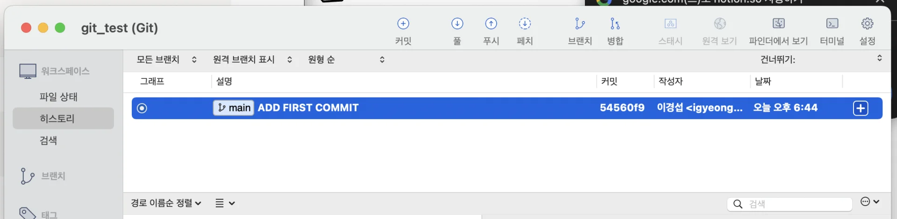
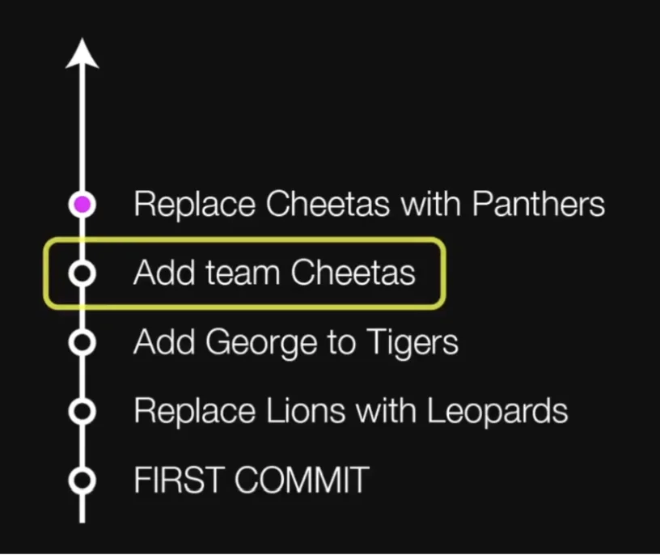
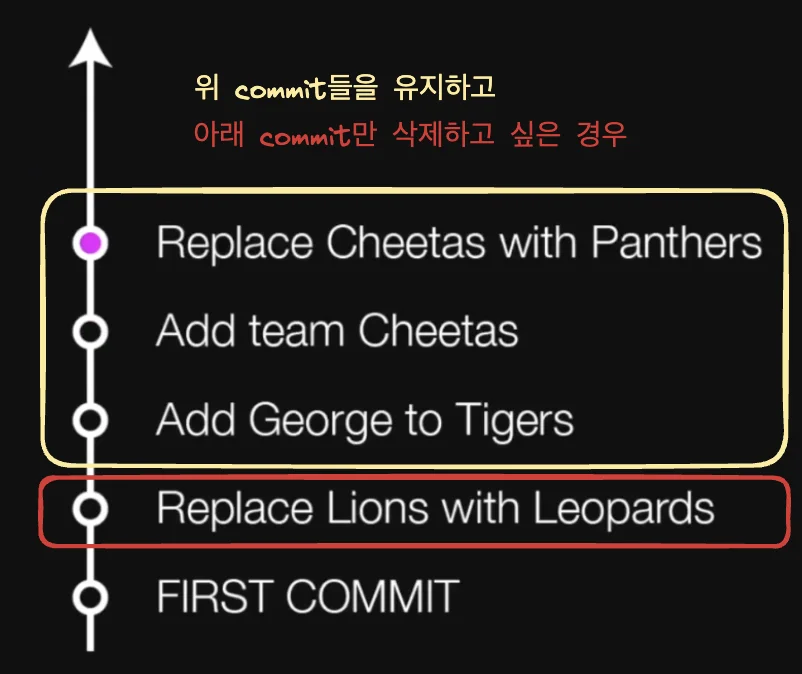
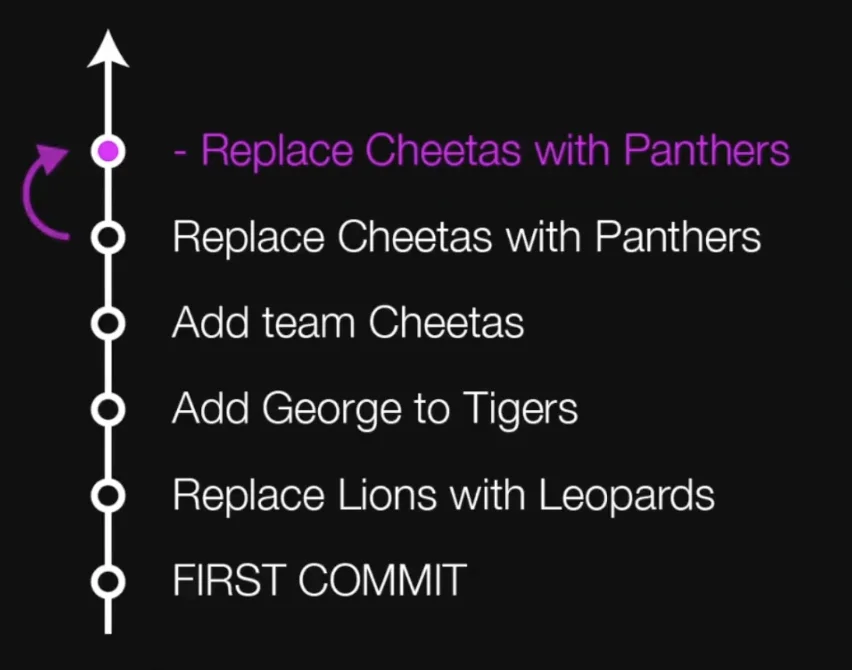
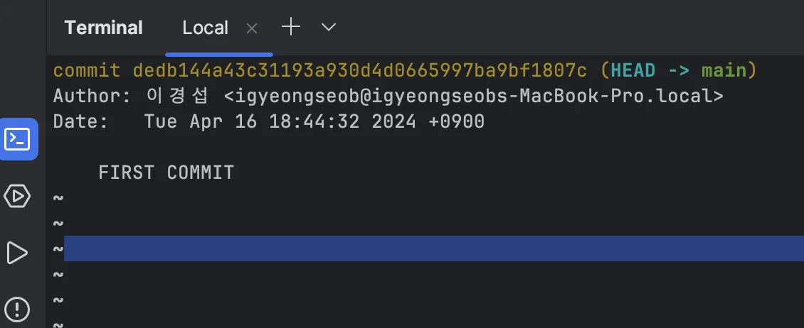
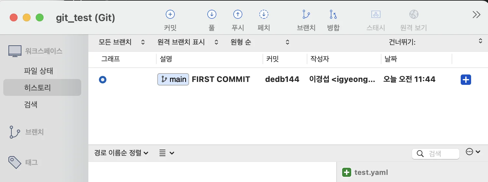
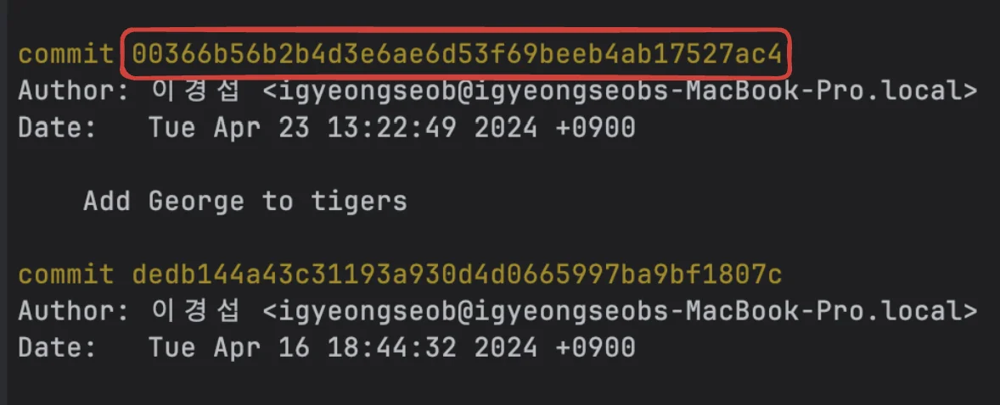
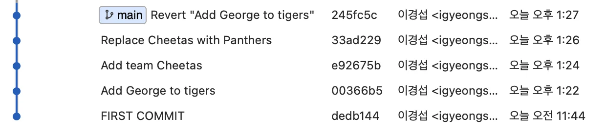

> 📌 <strong>목차</strong>
> 
> - [타임캡슐](#1c3eda9b0fe1818496a4d8df5517342b)
> - [1. 프로젝트 변경사항들 타입캡슐(버전)에 담기](#1c3eda9b0fe181dc8ea9d3c30ee7549e)
> - [2.  타입캡슐 묻기(commit)](#1c3eda9b0fe1815ea386edf5b3285026)
> - [vim 명령어](#1c3eda9b0fe18174bfe9edfdf89053cf)
> - [3. 과거로 돌아가기](#1c3eda9b0fe1810e882fcc0b87ec4fe5)
> - [3.1 - Reset ](#1c3eda9b0fe181e483a8d78cd1605249)
> - [3.2 - Revert](#1c3eda9b0fe1819bba6afc6a15be5460)
> - [실습](#1c3eda9b0fe181d4a7e1ee1efa5f7ce2)

<a id="1c3eda9b0fe1818496a4d8df5517342b"></a>

### <strong>타임캡슐</strong>

> 해당 강의에서 git을 staging area에 넣고 commit 하는 것을 git을 <strong>타임캡슐</strong>에 비유하여 설명한다&#46;<br>꽤 이해하기 쉬운 비유라서 인용하여 정리한다&#46;


<a id="1c3eda9b0fe18161b432c803880e2f7f"></a>

타임캡슐은 위와 같이 미래에 열어 추억하고 싶은 물건들을 보관해, 땅에 묻고 후에 다시 꺼내 추억하기 위한 물건이다&#46;

<a id="1c3eda9b0fe181148025dd52f052d074"></a>

강의에선 이를 git에 비유하여 추적하고 싶은 파일들을 <strong>staging area</strong>로 복사 해오는 것을(<code>git add</code> ) 타임캡슐에 변경사항을 담고 

<a id="1c3eda9b0fe1813ba928d0badab041fd"></a>

commit을 하여(<code>git commit</code>) 버전을 남기는 것을 타입캡슐을 묻는다고 표현했다&#46; 

<a id="1c3eda9b0fe181dc8ea9d3c30ee7549e"></a>

## 1&#46; 프로젝트 변경사항들 타입캡슐(버전)에 담기

---

- 변경사항 확인
    <a id="1c3eda9b0fe181cc9c35ff88d6718fe9"></a>

    ```bash
    git status
    ```

- 타입 캡슐(버전)에 파일 담기 &#91;스테이징&#93;
    <a id="1c3eda9b0fe1811e9853f9db4f026507"></a>

    ```bash
    git add [파일명.형식]
    ```

- 모든 파일 담기
    <a id="1c3eda9b0fe1812c960af9fdb0baa31a"></a>

    ```bash
    git add .
    ```

    <a id="1c3eda9b0fe181fdbbeffa6a44fbd47b"></a>

    ⇒ <code>git status</code> 로 상태 확인

<a id="1c3eda9b0fe1815ea386edf5b3285026"></a>

## 2&#46;  타입캡슐 묻기(commit)

---

<a id="1c3eda9b0fe18174bfe9edfdf89053cf"></a>

### vim 명령어

> ➕ <a href="https://beautiful-college-c84.notion.site/b2c01c46437d4b4389373f2f94c379a3">페이지</a> 

|  |  |  |
| --- | --- | --- |
| <strong>작업</strong> | <strong>Vi 명령어</strong> | <strong>상세</strong> |
| 입력 시작 | <strong>i</strong> | 명령어 입력 모드에서 텍스트 입력 모드로 전환 |
| 입력 종료 | <code>ESC</code> | 텍스트 입력 모드에서 명령어 입력 모드로 전환 |
| 저장 없이 종료 | <strong>&#58;q</strong> |  |
| 저장 없이 강제 종료 | <strong>&#58;q&#33;</strong> | 입력한 것이 있을 때 사용 |
| 저장하고 종료 | <strong>&#58;wq</strong> | 입력한 것이 있을 때 사용 |
| 위로 스크롤 | <strong>k</strong> | <code>git log</code>등에서 내역이 길 때 사용 |
| 아래로 스크롤 | <strong>j</strong> | <code>git log</code>등에서 내역이 길 때 사용 |

- 커밋

<a id="1c3eda9b0fe181ab80f7fff8e0121a79"></a>

```bash
git commit
```

- 커밋 메세지까지 함께 작성하기

<a id="1c3eda9b0fe1817b8791ececf18d24d4"></a>

```bash
git commit -m "MESSAGE" (' ', " ")
```

- commit들 확인
    - CLI
        <a id="1c3eda9b0fe1812ab732ea75ab5e5120"></a>

        ```bash
        git log
        ```

    - 소스트리 확인
        

- TIP) <code>add</code> 와 <code>commit</code> 한꺼번에 하기
    > &#45;a&#58; add   &#91; 새로 추가된(untracked) 파일이 없을 때만 가능 &#93;

    <a id="1c3eda9b0fe1812e9e68de982dbb4a53"></a>

    ```bash
    git commit -am "(메세지)" 
    ```

<a id="1c3eda9b0fe1810e882fcc0b87ec4fe5"></a>

## 3&#46; 과거로 돌아가기

---

> <strong>Case1) </strong>아래와 같이 이전 커밋으로 돌아가려는 경우



> <strong>Case2)</strong> 위 commit들을 유지하고 특정 커밋만 삭제하고 싶은 경우



<a id="1c3eda9b0fe181e483a8d78cd1605249"></a>

### 3&#46;1 &#45; Reset 

> <strong>Case1) </strong>돌아가고자 하는 이전 commit으로 돌아가  해당 commit 이후 내용들은 history에서 지워진다&#46; 


> <strong>Case2)</strong>   <strong>불가능</strong>

<a id="1c3eda9b0fe1819bba6afc6a15be5460"></a>

### 3&#46;2 &#45; Revert

> <strong>Case1) </strong><strong><u>이전 내용으로 돌아가는 commit을 추가</u></strong>하여 되돌린다&#46; 



<a id="1c3eda9b0fe1812f98f6dc7ace83060e"></a>

 

> <strong>Case2) </strong>revert를 아래와 같이 사용하면  특정 commit 내용만 삭제 가능하다&#46;


> ⚠️ <strong>reset</strong>을 협업에서 사용하는 경우 다른 사람들의 history와 충돌이 발생되어 심각한 오류가 발생된다&#46;  따라서 <strong>한번 공유가 된 코드는  </strong><strong><code>revert</code></strong><strong>를 사용하야 되돌려야 한다&#46;</strong>
> 
> 

> 📌 <strong>git 폴더(</strong><strong><code>&#46;git</code></strong><strong>) 유무 </strong><br><code>&#46;git</code> 을 통해 commit 내역들이 기록된다&#46; 

<a id="1c3eda9b0fe181d4a7e1ee1efa5f7ce2"></a>

### 실습

<details>
<summary><strong>reset 실습</strong></summary>

> <code>—hard</code>&#58; 강제 실행??<br><code>&#60;hash&#62;</code>&#58; git log 로 확인

<a id="1c3eda9b0fe181b7a941ffc95c55890a"></a>

```bash
git reset --hard  <hash>
```

- git log 확인 
    

- 소스트리 확인 
    

</details>

<details>
<summary><strong>reset 전으로 복원</strong></summary>

<a id="1c3eda9b0fe1819cac2fcf216391d98c"></a>

백업해 둔 <strong>&#46;git</strong> 폴더 사용

- <code>&#46;git</code> 폴더 복원

- <code>git log</code>, <code>git status</code>로 상태 확인

- 아래 명령어로 현 커밋 상태로 초기화

<a id="1c3eda9b0fe181d4b67fee2eeb4a5a0e"></a>

```bash
git reset --hard
```

- 💡 뒤에 커밋 해시가 없으면 마지막 커밋을 가리킴

- <code>lions&#46;yaml</code> 삭제

</details>

<details>
<summary><strong>revert 실습</strong></summary>

<a id="1c3eda9b0fe181a288eecb650b35285b"></a>

```bash
git log
```

<a id="1c3eda9b0fe18117a5d3f372fecaad99"></a>

hash 값 찾기



<a id="1c3eda9b0fe181e69b1dc4c75bbe5dab"></a>

```bash
git revert (되돌릴 커밋 해시)
```



</details>

<details>
<summary><strong>커밋 하지않고 revert하기</strong></summary>

<a id="1c3eda9b0fe1818d9425d4036749dad2"></a>

```bash
git revert --no-commit (되돌릴  커밋 해시)
```

- 원하는 다른 작업을 추가한 다음 함께 커밋

- 취소하려면 <code>git reset &#45;&#45;hard</code>

</details>

<details>
<summary><strong><code>Replace Lions with Leopards</code></strong><strong>의 커밋 되돌려보기</strong></summary>

- 이후 <code>leopards&#46;yaml</code> 수정한 내역 때문에 충돌
    - <code>git rm leopards&#46;yaml</code>로 Git에서 해당 파일 삭제

    - <code>git revert &#45;&#45;continue</code>로 마무리

    - <code>&#58;wq</code>로 커밋 메시지 저장

</details>
