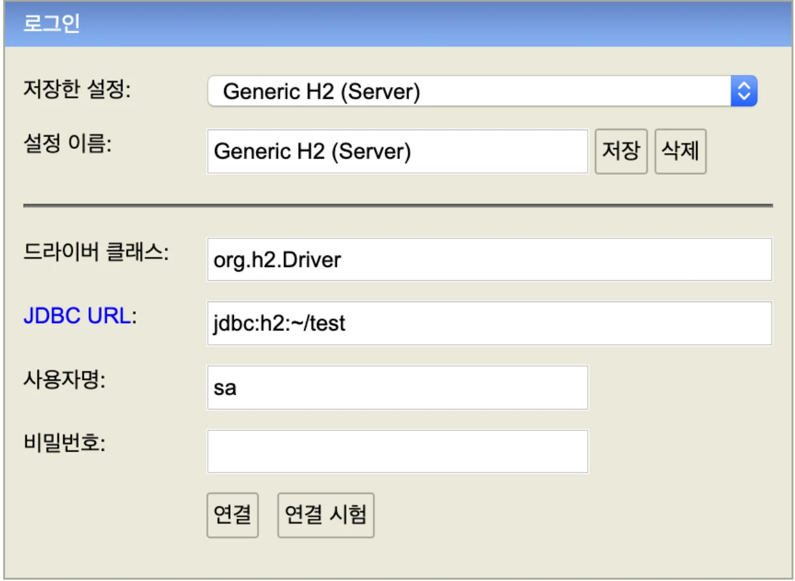

> 📌 Reference)<br> <a href="https://atoz-develop.tistory.com/entry/H2-Database-%EC%84%A4%EC%B9%98-%EC%84%9C%EB%B2%84-%EC%8B%A4%ED%96%89-%EC%A0%91%EC%86%8D-%EB%B0%A9%EB%B2%95">https&#58;//atoz&#45;develop&#46;tistory&#46;com/entry/H2&#45;Database&#45;설치&#45;서버&#45;실행&#45;접속&#45;방법</a>

<a id="1c3eda9b0fe181ee9921dd12ee0c8884"></a>

### 1&#46; Homebrew 를 통한 h2 설치

<a id="1c3eda9b0fe181fe85daf578af64a6d8"></a>

```java
homebrew install h2
```

<a id="1c3eda9b0fe18105af2bd3411c678f1c"></a>

### 2&#46; &#45;web 옵션을 통한 웹 실행 후 설정 변경

<a id="1c3eda9b0fe181a79996f4a05160b713"></a>

```java
h2 -web
Web Console server running at http://localhost:8082?key=5a2cbb4701528a42716722624fb5aa241f7f36c94fe2753a4dac92b06399a86c (only local connections)
```

<a id="1c3eda9b0fe181a2a5a4e7b284d99f29"></a>

해당 명령어 실행 후 출력되는 URL 브라우저에 입력

<a id="1c3eda9b0fe1810889afe64ddcc49953"></a>

### 3&#46; 설정 변경



- 저장한 설정(Saved Settings)&#58; <strong>Generic H2 (Server)</strong>

- JDBC URL&#58;<strong> jdbc&#58;h2&#58;&#126;/test</strong>

<a id="1c3eda9b0fe1814e84c0def235d7d708"></a>

### 4&#46; 아래 명령어로 h2 실행

<a id="1c3eda9b0fe1818b99c8f52c4b2210e6"></a>

```java
brew services start h2
```

<a id="1c3eda9b0fe181a785effd0e809d0a06"></a>

or 

<a id="1c3eda9b0fe18191962fd0d1ad94ac80"></a>

<code>127&#46;0&#46;0&#46;1&#58;8082</code>로 브라우저에 접속
