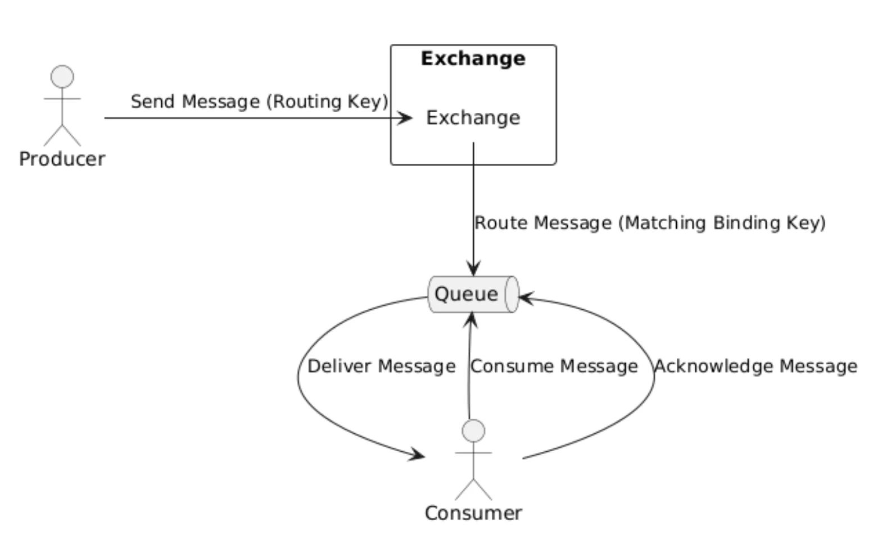
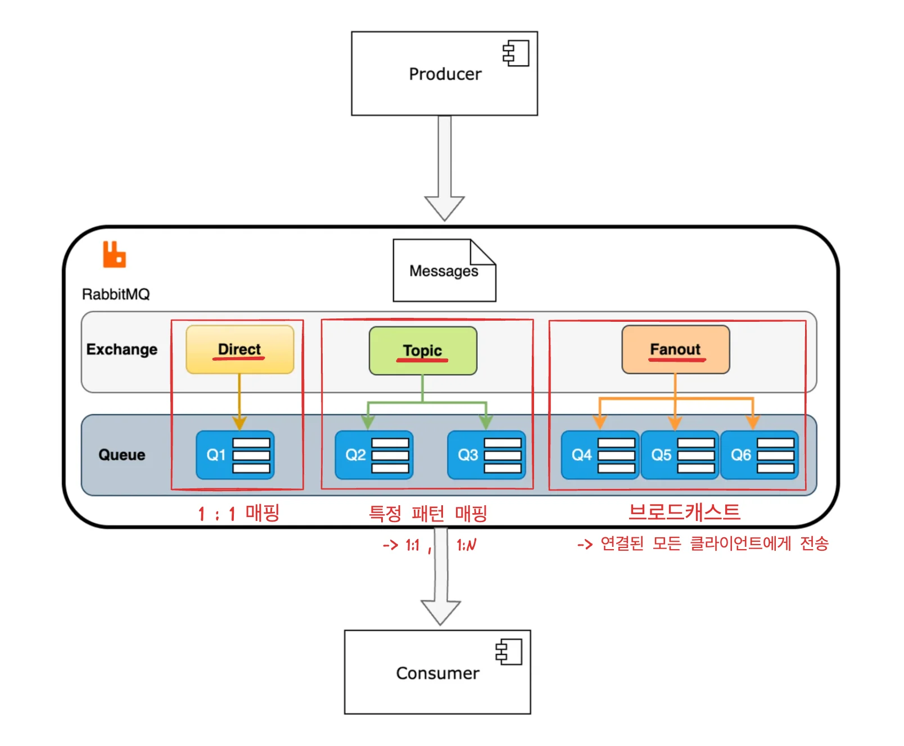
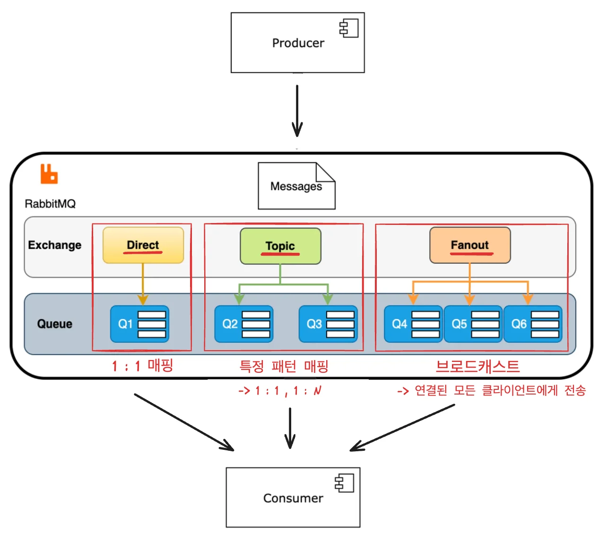
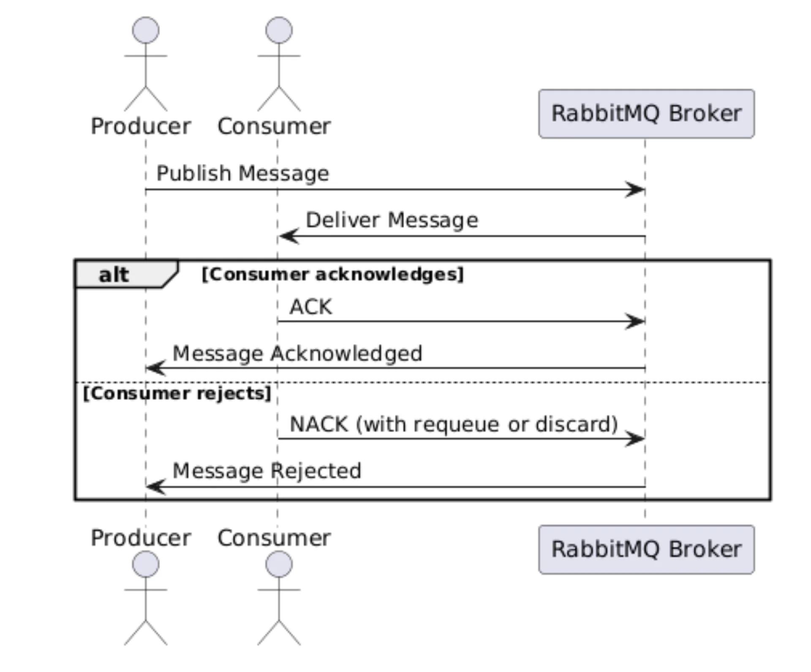

<a id="1c3eda9b0fe18177b3b9c29ecc788362"></a>

## Rabbit MQ  &#45; 동작 및 용어

---

> /icons/circle-dashed_gray.svg 
> 
> 
> 
> 1. Producer가 메세지와 Routing Key를 Exchage에 전송
>     <details>
>     <summary>🧐 Routing Key는 라우팅되는 큐에 대한 식별자이다&#46; 그렇다면 언제, 어디서 생성되는가? 클라이언트에서 메세지가 발급되면서 생성되는가? 아니면 메세지 큐가 생성되면서 식별자를 생성하고 클라이언트로 던지는가?</summary>
> 
>     <details>
>     <summary> config에서 매핑한다&#46; </summary>
> 
>     <a id="1c3eda9b0fe181e7914dce2ccfd452e1"></a>
> 
>     ```java
>     @Configuration
>     public class RabbitMQConfig {
> 
>         public static final String CHAT_TOPIC_EXCHANGE = "chat.*";
>         public static final String CHAT_QUEUE = "chatQueue";
>         public static final String CHAT_TOPIC_DLX = "deadLetterExchange";
>         public static final String DLQ = "deadLetterQueue";
>         public static final String DEAD_LETTER_ROUTING_KEY = "dead.letter";
> 
>         @Bean
>         public TopicExchange chatExchange() {
>             return new TopicExchange(CHAT_TOPIC_EXCHANGE);
>         }
> 
>         @Bean
>         public TopicExchange deadLetterExchange() {
>             return new TopicExchange(CHAT_TOPIC_DLX);
>         }
> 
>         // 메시지가 처리되지 못했을 경우 자동으로 Deadletterqueue 이동시킴
>         @Bean
>         public Queue chatQueue() {
>             return QueueBuilder.durable(CHAT_QUEUE)
>                     .withArgument("x-dead-letter-exchange", CHAT_TOPIC_DLX)
>                     .withArgument("x-dead-letter-routing-key", DEAD_LETTER_ROUTING_KEY)
>                     .build();
>         }
> 
>         @Bean
>         public Queue deadLetterQueue() {
>             return new Queue(DLQ);
>         }
>     		
>     		// Queue 와 exchange를 routing Key로 바운딩
>         @Bean
>         public Binding chatBinding(Queue chatQueue, TopicExchange chatExchange) {
>             return BindingBuilder
>                     .bind(chatQueue)
>                     .to(chatExchange)
>                     .with(CHAT_TOPIC_EXCHANGE);
>         }
> 
>         @Bean
>         public Binding deadLetterBinding() {
>             return BindingBuilder
>                     .bind(deadLetterQueue())
>                     .to(deadLetterExchange())
>                     .with(DEAD_LETTER_ROUTING_KEY);
>         }
> 
>         // 메시지를 JSON형식으로 직렬화하고 역직렬화하는데 사용되는 변환기
>         // RabbitMQ 메시지를 JSON형식으로 보내고 받을 수 있음
>         @Bean
>         public Jackson2JsonMessageConverter jsonMessageConverter() {
>             //LocalDateTime serializable을 위해
>             ObjectMapper objectMapper = new ObjectMapper();
>             objectMapper.configure(SerializationFeature.WRITE_DATES_AS_TIMESTAMPS, true);
>             objectMapper.registerModule(dateTimeModule());
> 
>             Jackson2JsonMessageConverter converter = new Jackson2JsonMessageConverter(objectMapper);
> 
>             return converter;
>         }
> 
>         public Module dateTimeModule() {
>             return new JavaTimeModule();
>         }
>     }
>     ```
> 
>     </details>
> 
>     <details>
>     <summary>클라이언트에서 구독한 websocket 엔드포인트로 consumer(subscriber)가 메세지를 전송한다&#46;</summary>
> 
>     <a id="1c3eda9b0fe181a2bc6cf0e8487aa337"></a>
> 
>     ```java
>     @Slf4j
>     @Component
>     @RequiredArgsConstructor
>     public class ChatSubscriber {
> 
>         private int retryCount;
> 
>         private final SimpMessagingTemplate messagingTemplate;
> 
>         @RabbitListener(queues = RabbitMQConfig.CHAT_QUEUE)
>         public void javaNews(ChatResDto chat) {
>             
> 
>             if("실패".equals(chat.getMessage())) {
>     		        log.warn("Subscriber Received message: {}, count : {}", chat.getMessage(), retryCount++);
>                 throw new RuntimeException();
>             } else {
>     		        log.info("Subscriber Received message: {}, count : {}", chat.getMessage());
>             }
>     				
>     				// 구독한 엔드포인트로 클라이언트에 전송
>             messagingTemplate.convertAndSend("/sub/chats", chat);
>         }
>     }
>     ```
> 
>     </details>
> 
>     </details>
> 
> 1. Exchange가 Routing Key를 사용해 Binding Key가 일치하는 큐에 메세지를 라우팅
> 
> 1. Consumer가 큐에서 메세지를 가져와 처리하고, 성공적으로 처리되었음을 <code>acknowledgment</code>로 RabbitMQ에 알린다&#46;

<a id="1c3eda9b0fe1819fb6a0e9a9d83fac5a"></a>

### 주요 용어

<details>
<summary>1&#46;  Producer ( 생산자 )</summary>

- 메세지를 생성하고 RabbitMQ에 전송하는 애플리케이션

- Producer는 특정 Exchange에 메세지를 전송하고 Exchange는 메세지를 라우팅하여 큐에 배치한다&#46;
    - Routing Key를 통해 매핑되는 큐에  메세지를 전달

</details>

<details>
<summary>2&#46;  Exchange</summary>

> /icons/push-pin_red.svg 
> 
> <a id="1c3eda9b0fe181df8d5cf99d1dbc0699"></a>
> 
> <strong>Exchange 유형</strong>
> 
> - <code>Direct</code>
>     - 특정 라우팅 키와 정확히 일치하는 큐에 메세지를 전송
> 
> - <code>Fanout</code>
>     - 모든 큐에 메세지를 브로드캐스트
> 
> - <code>Topic</code>
>     - 라우팅 키 패턴을 기반으로 메세지를 특정 큐에 전달
> 
> - <code>Headers</code>
>     - 메세지 헤더 속성에 따라 메세지를 라우팅

- Producer 로 부터 받은 메세지를 큐에 전달

- 메세지가 Exchage로 전송될 때, Routing Key가 함께 전달된다&#46;
    - client로부터 메세지를 받을 때 헤더 값으로 함께 전달 받는다&#46; 

</details>

<details>
<summary>3&#46;  Routing Key</summary>

- 메세지를 전송할 때 Producer가 Exchange에 전달하는 키

- Exchange는 해당 <code>Routing Key</code>를 참고하여 <strong><u>어떤 큐</u></strong>에 <strong><u>메세지를 전달할 지를 결정</u></strong>한다&#46; 

</details>

<details>
<summary>4&#46;  Queue</summary>

- 메세지를 일시적으로 저장하는 버퍼 역할 

- RabbitMQ의  큐는 FIFO(First In, First Out) 방식으로 동작하며, 메세지가 소비자에 전달될 떄까지 보관된다&#46;

- 각 큐는 <strong><u>여러 Consumer가 구독(수신) 가능</u></strong>하다

-  메세지는 큐에 들어온 순서대로 전달된다&#46;

- 비동기적으로 동작하며, 여러 컨슈머가 동시에 메세지를 소비할 수 있다&#46;
    - 단 하나의 메세지가 여러 소비자에게 중복으로 전달될 수 없다&#46; 

    - 동일 메세지를 수신하려면 Fanout Exchange 방식으로 동작해야 한다&#46;

</details>

<details>
<summary>5&#46;  Binding</summary>

- exchange와 큐 간의 관계를 정의

- 바인딩은 메세지를 라우팅할 때 어떤 조건으로 큐에 보낼지 정의하고 이를 위해 binding key가 사용된다&#46;

- Binding Key와 Routing Key가 일치하면 해당 큐로 메세지가 전달된다&#46; 
    - 패턴 매칭 가능

</details>

<details>
<summary>6&#46; Consumer ( 소비자 )</summary>

- 큐에서 메세지를 가져와 처리하는 애플리케이션

- RabbitMQ는 여러 소비자에게 메세지를 로드 밸런싱 할 수 있다&#46; 

- Consumer는 큐에서 메세지를 받아 처리하면 메세지에 대한 확인(ACK, acknowledgment)을 브로커에 전송한다&#46; 

- 확인(ACK)를 보내지 않으면, 브로커는 메세지를 재전송하거나 설정한 다른 Consumer에게 전달할 수 있다&#46;

</details>

<details>
<summary>7&#46; Message Acknowledgment ( 메세지 확인 )</summary>

- 메세지가 성공적으로 처리되었음을 RabbitMQ에 알리는 과정

- 만약 소비자가 메세지를 성공적으로 처리하지 못했다면, 메세지를 다시 큐에 넣어 다른 소비자가 처리하도록 할 수 있다&#46;

</details>

<a id="1c3eda9b0fe181b7b21ac15285c836e9"></a>

### 추가 용어

<details>
<summary>1&#46; Prefetch Count (프리페치 카운트)</summary>

- 소비자가 받을 수 있는 최대 메세지 수를 설정

- 한번에 많은 양의 메세지를 처리하지 않도록 하여 소비자 성능을 최적화 할 수 있다&#46; 

</details>

<details>
<summary>2&#46; Virtual Host ( 가상 호스트 )</summary>

- RabbitMQ 서버 내 논리적인 구획으로, 메세지 큐, exchange, 사용자 권한 등을 구분

- <strong><u>하나의 RabbitMQ 서버 내</u></strong>에 <strong><u>여러 개의 가상 호스트를 설정</u></strong>하여 <strong><u>서로 다른 애플리케이션의 메세지를 격리</u></strong> 할 수 있다&#46;

</details>

<details>
<summary>3&#46; Dead Letter Queue ( DLQ )</summary>

- 메세지가 <strong><u>처리되지 못</u></strong>하거나 <strong><u>유효 기간이 지난 경우</u></strong>, <u>별도의 큐로 이동</u>하는 구조도  설정 가능

</details>

<a id="1c3eda9b0fe1810fb086f5ceaaa73f3b"></a>

## Exchange 유형(4)에 따른 처리 흐름

---

<details>
<summary>reference</summary>

[&#91;Java&#93; Spring Boot AMQP RabbitMQ 이해하기 &#45;4 &#58; RabbitMQ Exchange 종류 별 이해 및 사용예시]()

</details>





<a id="1c3eda9b0fe18179a56ad15373528367"></a>

### 1&#46; Direct Exchange

-  메세지가 라우팅  키(Routing Key)에 따라 특정 큐로 하나씩 전달되는 방식

- 메세지를 발행할 때 사용하는 라우팅 키와 동일한 키로 exchange에 바인딩 된 모든 큐에 메세지를 전달한다&#46; 

- 해당 라우팅 키와 일치하는 큐에만 메세지가 전달되는 방식이기 때문에 Direct Exchange라고 한다&#46; 
    - 사용 예시) 주문에 따른 상태 지시

- 활용
    - 주문 상태별로 라우팅 키를 정의하고, 각 상태에 해당하는 큐가 메세지를 받는다&#46; 

    - 하나의 라우팅 키에 대해 여러 큐가 바인딩 될 수 있다&#46; 
        - 메세지&#58;큐 = <code>1&#58;1</code> or <code>1&#58;N</code>

- 사용
    - 메세지가 명확하게 특정 큐로 전달되어야 할 때

    - 큐마다 고유한 라우팅 규칙을 적용하여 메세지를 분류해야 할 때

    - 예시 업무&#58; 주문 상태 처리, 결제 처리, 사용자 알림 시스템 등

<a id="1c3eda9b0fe181639ff0d838710629de"></a>

### 2&#46; Topic Exchange

<a id="1c3eda9b0fe1817e87ccf508570a4c4e"></a>

라우팅 키를 패턴 기반으로 정의히ㅏ여 메세지를 여러 큐에 유연하게 전달할 수 있는 방식이다&#46; 

<a id="1c3eda9b0fe1818c91a6fc95f01c8ccc"></a>

라우팅 키에 와일드카드(<code>&#42;</code>, <code>&#35;</code> )매칭을 사용하여 더 복잡한 라우팅이 가능하다&#46; 

- 와일드 카드(<code>&#42;</code>)
    - 하나의 단어를 대체하는 의미로 <code>log&#46;info</code>, <code>log,warn</code>, <code>log,error<br></code>와 같은 패턴의 메세지를 수신할 때, <code>log&#46;&#42;</code> 로 info, warn, error를 다 수신 가능하도록 할 수 있다&#46;

- <code>&#35;</code>
    - 0개의 단어를 대체

    -  <code>app&#46;order&#46;success</code>, <code>app&#46;payment&#46;success</code>와 같은 라우팅 키를 <code>&#35;&#46;success</code>로 다 수신할 수 있다&#46;

<details>
<summary>사용 예시 </summary>

<a id="1c3eda9b0fe181179af4d91d1f27f8a0"></a>

동적이고 유연한 라우팅이 필요할 때(로그 수집 시스템, 이벤트 기반 모니터링 등)

<a id="1c3eda9b0fe18115ba45f54a8acdab10"></a>

 

</details>

<a id="1c3eda9b0fe1814ab809ecf6fab7ddef"></a>

### 3&#46; Fanout Exchange

<a id="1c3eda9b0fe18171951dffc6d884ff27"></a>

Fanout Exchange는 <strong><u>브로드캐스트 </u></strong>방식으로 메세지를 모든 바인딩된 큐에 전달한다&#46; 

<a id="1c3eda9b0fe1817b95d4c02c64a36be5"></a>

한 번의 메세지 발행으로 모든 큐가 동일한 메세지를 받는다&#46; 

<details>
<summary>사용 예시</summary>

- 이벤트가 발생하면 모든 서비스가 동일한 메세지를 받는 서비스에서 유용
    - ex) 시스템 점검 공지 등

</details>

<a id="1c3eda9b0fe181adbb94fe2458998ebb"></a>

### 4&#46; Header Exchange

<a id="1c3eda9b0fe181da9768f988acd12e1e"></a>

메시지의 속성(헤더)에 기반한 복잡한 라우팅이 필요할 때 사용한다&#46;

<details>
<summary><strong>사용 예시</strong></summary>

> 다국어 서비스, 고객의 등급별 혜택 알림

- 메시지 헤더에 <code>language&#58; &#34;ko&#34;</code>, <code>language&#58; &#34;en&#34;</code> 등의 값을 설정하여 <strong><u>헤더 기반 라우팅</u></strong>을 수행
    - <code>language&#58; &#34;ko&#34;</code>&#58;  한국어 이메일 서비스에서 처리

    - <code>language&#58; &#34;en&#34;</code>&#58; 영어 이메일 서비스에서 처리

</details>

<a id="1c3eda9b0fe181a2974dcdaa795c2e74"></a>

## 메세지 전송 단계별 프로세스

---



<a id="1c3eda9b0fe181cab92ae4a7d5f665cb"></a>

### 1&#46; 메세지 송신 ( Producer → Broker )

- Producer가 RabbitMQ Broker로 메세지를 송신

- 이떄 메세지는 큐에 저장되며, Exchange와 binding 설정에 따라 적절한 큐로 라우팅 된다&#46; 

<a id="1c3eda9b0fe181b38cd6e86db091b118"></a>

### 2&#46; 메세지 전달 ( Broker → Consumer )

- Broker는 큐에 있는 메세지를 Consumer에게 전달

- Cunsumer는 큐에서 메세지를 가져나거나(Polling) 메세지를 푸시(Push) 받는 방식으로 수신

<a id="1c3eda9b0fe181c2b8c8f1b120f312c0"></a>

### 3&#46; 메세지 확인 ( ACK ), 거절 ( NACK )

- ACK ( Acknowledgment )

- NACK ( Negative Acknowledgment )
    > <code>Consumer</code>가 메세지를 <code>NACK</code>하면, <code>Broker</code>는 <code>Producer</code>에게 <code>Message Rejected</code> 응답을 전송한다&#46; 

    ---

    - 메세지가 정상 처리가 되지 않은 경우( <code>NACK</code> &#91;<code>오류</code>, <code>거절</code>&#93; )에 대해 처리 가능
        - <code>오류</code>&#58;  메세지를 다시 큐로 전송 (<code>requeue</code> )

        - <code>거절</code>&#58; 메세지 폐기 ( <code>discard</code> )

    ---

    - <strong>재전송 요청 ( Requeue )</strong>
        - 메세지를 다시 큐로 보내고 재처리하도록 설정

    - <strong>폐기 ( Discard ) </strong>
        - 메세지를 큐에서 제거하고, 폐기 처리

<a id="1c3eda9b0fe181989592e93e7b680872"></a>

### 4&#46; Producer에 응답 ( <code>Message Acknowledged </code>/ <code>Message Rejected</code> )

- Producer가 <strong><u>Publisher Confirms</u></strong> 를 활성화한 경우, Broker는 ACK 또는 NACK 결과를 Producer에게 전송한다&#46; 

- <code>ACK</code>를 받은 경우, 메세지가 성공적으로 소비된 것으로  간주

- <code>NACK</code>를 받은 경우, Producer는 메세지 실패를 기록하거나 재전송
