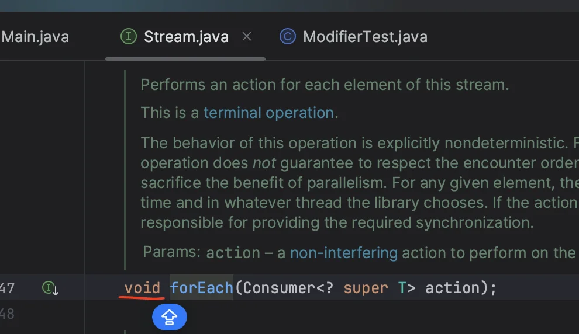
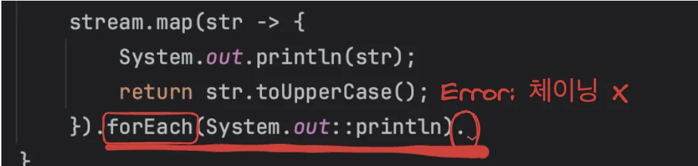
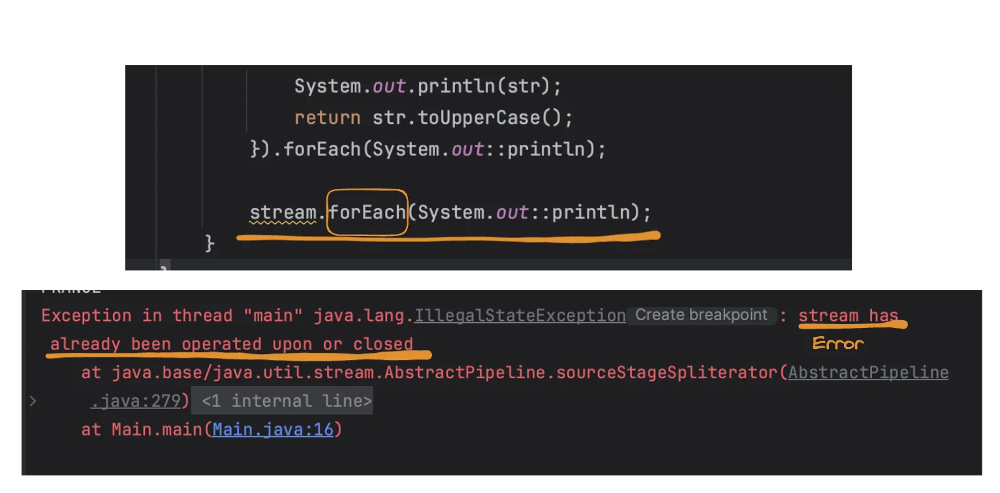

> <a href="https://docs.oracle.com/javase/8/docs/api/java/util/stream/Stream.html#count--">Java &#45; stream 명세서</a>

<a id="1c3eda9b0fe1816d8b45da9ef13e6b94"></a>

## 스트림이란?

<a id="1c3eda9b0fe181099b03d46049cf79f2"></a>

스트림 = 하나의 데이터의 흐름(데이터 여러개의 표현) 

<a id="1c3eda9b0fe181859097f64fdcef4f45"></a>

대표적으로 Collection을 통해 스트림을 처리함

<a id="1c3eda9b0fe181c9b214f9ee637254e4"></a>

자바스크립트의 &#91; 배열 메서드(map, filter, sort 등) &#43; 체이닝 &#93; 유사

<a id="1c3eda9b0fe18147ba52fa47a5b4352f"></a>

스트림의 특징&#58; 데이터 소스(원본 데이터)를 변경하지 않고 로직 수행

<a id="1c3eda9b0fe181f28693ccbcafd95dca"></a>

## 스트림 생성

<a id="1c3eda9b0fe1810ebff0ca6cb0cc2482"></a>

<a href="#/post/1c3eda9b-0fe1-81e2-8ff4-eb6fe679e475">페이지</a> 

<a id="1c3eda9b0fe181b3b841ddb6b95bb391"></a>

### 방법1) <code>Stream&#60;Type&#62;</code> stream = <code>&#91;ArrayList&#93;&#46;stream()</code>

<a id="1c3eda9b0fe18160be54d8eec2dac850"></a>

```java
List<String> list = new ArrayList<>();
list.add("korea");
list.add("japen");
list.add("france");
Stream<String> stream = list.stream();
```

<a id="1c3eda9b0fe181fd8822e9c134e12a10"></a>

### 방법2) <code>Arrays&#46;stream(&#91;List&#93;)</code>

<a id="1c3eda9b0fe181028babce04eff0abee"></a>

```java
String[] arr = {"SQL", "Java", "Python"};
Stream<String> stringStream = Arrays.stream(arr);
```

<a id="1c3eda9b0fe1817a88a4e27a3c14bd8c"></a>

### 방법3)  <code>Arrays&#46;asList(list 요소들)&#46;stream()</code>

<a id="1c3eda9b0fe181d59e49e3dc10990e98"></a>

```java
List<Integer> numArr = Arrays.asList(1, 2, 3, 4, 5, 6, 7, 8, 9, 10);
 Integer result = numArr.stream().reduce(0, Integer::sum); 
```

<a id="1c3eda9b0fe181e49cb0ce14810192f1"></a>

```java
List<String> names = Arrays.asList("김정우", "김호정", "이하늘", "이정희", "박정우", "박지현", "정우석", "이지수");
long count = names.stream()
```

<a id="1c3eda9b0fe181f5a5a5fc2d943b420b"></a>

## 스트림 매서드

<a id="1c3eda9b0fe181ec8140f86be5078b2b"></a>

 <code>&#46;collect(Collectors&#46;toList())</code>

<a id="1c3eda9b0fe18147a94dd0e55b40d5b7"></a>

<code>&#46;map()</code>

<a id="1c3eda9b0fe18134847dda4ec8b67307"></a>

 <code>&#46;limit()</code>

<a id="1c3eda9b0fe18164a04bdde3d45ec821"></a>

  <code>&#46;filter</code>

<a id="1c3eda9b0fe18193925edce102d3d4e1"></a>

<code>&#46;reduce()</code>

<a id="1c3eda9b0fe18194a27be009cba64468"></a>

&#46;<code>forEach()</code>

---

<a id="1c3eda9b0fe18157a889cb6ce26f056a"></a>

## 예제 1) stream &#45; <code>&#46;map()</code>

> •<code>&#46;map</code> &#58; 각 요소 하나씩 꺼내서 출력<br>•<code>&#46;collect(Collectors&#46;toList())</code> &#58; stream → list

<a id="1c3eda9b0fe18155bf2fdd6663e16e04"></a>

```java
import java.util.ArrayList;
import java.util.List;
import java.util.stream.Stream;
public class Main {
    public static void main(String[] args) {
        List<String> list = new ArrayList<>();
        list.add("korea");
        list.add("japen");
        list.add("france");
        Stream<String> stream = list.stream();
        stream.map(str -> {
            System.out.println(str);
            return str.toUpperCase();
        }).forEach(System.out::println); 

				System.out.println(list);
    }
}


======================= 출력 ==============================
korea
KOREA
japen
JAPEN
france
FRANCE
[korea, japen, france]
```

<details>
<summary><strong>🧐 </strong><code>System&#46;out&#58;&#58;println</code> ?</summary>

<a id="1c3eda9b0fe181e8880ded339bd5ec19"></a>

<a href="#/post/1c3eda9b-0fe1-816a-b449-d277bad3e7e6">페이지</a> 

</details>

<details>
<summary><strong>🧐 스트림 → deep copy?</strong></summary>

<a id="1c3eda9b0fe18140a1f6f5810f7354aa"></a>

<a href="#/post/1c3eda9b-0fe1-8198-b701-fc2f42a97f3f">페이지</a> 

</details>

<a id="1c3eda9b0fe1810781fdfba1df604f30"></a>

### ⚠️ Stream &#45; forEach 문  → 스트림 닫힘



<a id="1c3eda9b0fe181e3832cf909b2a4e1f4"></a>

<strong>Stream의 forEach 메소드</strong>는<strong> </strong><strong>void</strong><strong>(return 값 X) 타입</strong>이다&#46;  <br>따라서 해당 메소드를 사용할 경우 stream이 닫혀 <strong>체이닝을 사용할 수 없</strong>다&#46; 



<a id="1c3eda9b0fe1812f88c2c67f62ff5c1c"></a>

forEach 문을 사용하여 stream이 닫혀, 다음 forEach 문이 수행되지 않음&#46;



<a id="1c3eda9b0fe1819c8c49ed1b6f203390"></a>

## 예제 2) stream &#45; <code>&#46;limit()</code> ,   <code>&#46;filter</code>

> •<code>&#46;collect(Collectors&#46;toList())</code> &#58; stream → list<br>•<code>&#46;limit(개수)</code> &#58; 개수 만큼  요소 출력<br>•<code>&#46;filter</code> &#58; 조건에 해당하는 요소만 출력

<a id="1c3eda9b0fe1811c868ef7ed1c7890dc"></a>

```java
import java.util.ArrayList;
import java.util.List;
import java.util.Set;
import java.util.stream.Collectors;
import java.util.stream.Stream;
public class Main {
    public static void main(String[] args) {
        List<String> list = new ArrayList<>();
        list.add("서울");
        list.add("부산");
        list.add("대구");
        list.add("서울");
        System.out.println(list);

        List<String> result = list.stream()
                .limit(2)
                .collect(Collectors.toList());  // stream -> list
        System.out.println(result);

        System.out.println("list -> transformation -> set");
        Set<String> set = list.stream()
                .filter("서울"::equals) // 람다식: it -> "서울".equals(it)
                .collect(Collectors.toSet());

        System.out.println(set);
    }
}
```

<a id="1c3eda9b0fe181e49db0c445e3af7bdf"></a>

## 예제 3)  <code>Arrays&#46;stream()</code>

<a id="1c3eda9b0fe181d5810fcbe3858e3101"></a>

```java
public class Main {
    public static void main(String[] args) {
        String[] arr = {"SQL", "Java", "Python"};
        Stream<String> stringStream = Arrays.stream(arr);
        stringStream.forEach(System.out::println);
    }
}
```

<a id="1c3eda9b0fe1811fae81f17e44a1be61"></a>

## 예제 4)  ?

<a id="1c3eda9b0fe181a6bf33f5abeb8e2f38"></a>

```json
// build.gradle

dependencies {
implementation 'org.apache.commons:commons-lang3:3.0'
//
```

<a id="1c3eda9b0fe181e1a27cc8c9d5a99be7"></a>

```java
import java.util.Arrays;
import java.util.List;
import java.util.stream.Stream;

class Sale {
    String fruitName;
    int price;
    float discount;

    public Sale(String fruitName, int price, float discount) {
        this.fruitName = fruitName;
        this.price = price;
        this.discount = discount;
    }
}

public class Main {
    public static void main(String[] args) {
        List<Sale> sales = Arrays.asList(
                new Sale("Apple", 5000, 0.05f),
                new Sale("Orange", 4000, 0.2f),
                new Sale("Grape", 2000, 0)
        );

        sales.stream()
                .map(sale -> Pair.of(sale.fruitName, sale.price * (1-sale.discount)))
                .forEach(pair -> System.out.println(pair.getLeft()+ "실구매가" + pair.getRight() + "원 입니다."));
    }
}
```

<a id="1c3eda9b0fe1817d9b82d7677a123a1b"></a>

## 예제 5) stream  &#45; <code>&#46;reduce()</code>

<a id="1c3eda9b0fe1814eadeed817812e3876"></a>

```java
import java.util.Arrays;
import java.util.List;

public class Main {
    public static void main(String[] args) {
        List<Integer> numArr = Arrays.asList(1, 2, 3, 4, 5, 6, 7, 8, 9, 10);
				// reduce와 sum을 활용하여 1부터 10까지 더함
        Integer result = numArr.stream().reduce(0, Integer::sum); 
        System.out.println(result);
    }
}
```

<a id="1c3eda9b0fe181318c36ee5eb3a3c8f0"></a>

### Quiz) 

> <code>&#39;이&#39;</code>씨 성을 가진 사람들의 수 구하기 (스트림을 활용)<br>이름 &#58; &#91;&#34;김정우&#34;, &#34;김호정&#34;, &#34;이하늘&#34;, &#34;이정희&#34;, &#34;박정우&#34;, &#34;박지현&#34;, &#34;정우석&#34;, &#34;이지수&#34;&#93;

<details>
<summary>code </summary>

<a id="1c3eda9b0fe18151a83bc120d51f5ca8"></a>

```java
import java.util.Arrays;
import java.util.List;
public class Main {
    public static void main(String[] args) {
        List<String> names = Arrays.asList("김정우", "김호정", "이하늘", "이정희", "박정우", "박지현", "정우석", "이지수");
        long count = names.stream()
                .filter(str -> str.startsWith("이"))
                .count();
        System.out.println("count : " + count);
    }
}
```

</details>
