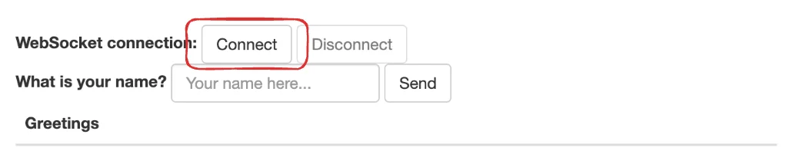
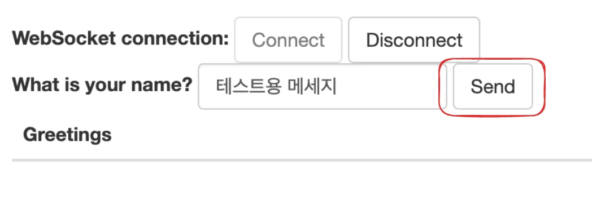
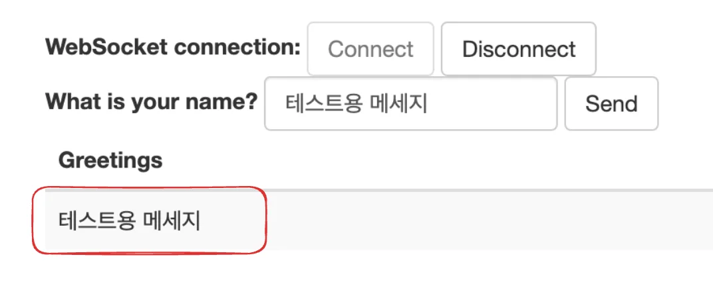
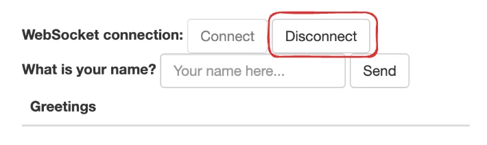

<a id="1c3eda9b0fe1815a8d5fe63b96a79fe9"></a>

## WebSocket, 메세지브로커 &#45; 실습

---

> 📖 
> 
> <a id="1c3eda9b0fe1819da83dc0e25d017e09"></a>
> 
> <strong>실습 &#45; WebSocket을 사용하여 대화형 웹 애플리케이션 구축</strong>
> 
> - Spring에서 STOMP 메세징을 사용한 대화형 웹 애플리케이션 구축
> 
> - WebSocket은 TCP 위의 얇고 가벼운 계층으로 &#34;서브 프로토콜&#34;을 사용하여 메시지를 임베드하는 데 적합하다&#46;
> 
> - <a href="https://en.wikipedia.org/wiki/Streaming_Text_Oriented_Messaging_Protocol#Implementations">STOMP(Streaming Text Oriented Messaging Protocol)</a>는 하위 수준 WebSocket 위에서 작동하는 서브 프로토콜이다&#46;

<details>
<summary>참고자료</summary>

[Getting Started &#124; Using WebSocket to build an interactive web application]()

[gs-messaging-stomp-websocket](https://github.com/spring-guides/gs-messaging-stomp-websocket)

</details>

<details>
<summary>코드 </summary>

<details>
<summary>github &#45; 소스코드 </summary>

[websocket_tutorial](https://github.com/gyungsubLee/websocket_tutorial)

</details>

<details>
<summary>클라이언트 </summary>

<details>
<summary>&#91; 코드 &#93;  index&#46;html</summary>

<a id="1c3eda9b0fe1819ca27bea6fddbeca7f"></a>

```html
<!DOCTYPE html>
<html>
<head>
    <title>Hello WebSocket</title>
    <link rel="stylesheet" href="https://maxcdn.bootstrapcdn.com/bootstrap/3.3.7/css/bootstrap.min.css" integrity="sha384-BVYiiSIFeK1dGmJRAkycuHAHRg32OmUcww7on3RYdg4Va+PmSTsz/K68vbdEjh4u" crossorigin="anonymous">
    <link href="/main.css" rel="stylesheet">
    <script src="https://code.jquery.com/jquery-3.1.1.min.js"></script>
    <script src="https://cdn.jsdelivr.net/npm/@stomp/stompjs@7.0.0/bundles/stomp.umd.min.js"></script>
    <script src="/app.js"></script>
</head>
<body>
<noscript><h2 style="color: #ff0000">Seems your browser doesn't support Javascript! Websocket relies on Javascript being
    enabled. Please enable
    Javascript and reload this page!</h2></noscript>
<div id="main-content" class="container">
    <div class="row">
        <div class="col-md-6">
            <form class="form-inline">
                <div class="form-group">
                    <label for="connect">WebSocket connection:</label>
                    <button id="connect" class="btn btn-default" type="submit">Connect</button>
                    <button id="disconnect" class="btn btn-default" type="submit" disabled="disabled">Disconnect
                    </button>
                </div>
            </form>
        </div>
        <div class="col-md-6">
            <form class="form-inline">
                <div class="form-group">
                    <label for="name">What is your name?</label>
                    <input type="text" id="name" class="form-control" placeholder="Your name here...">
                </div>
                <button id="send" class="btn btn-default" type="submit">Send</button>
            </form>
        </div>
    </div>
    <div class="row">
        <div class="col-md-12">
            <table id="conversation" class="table table-striped">
                <thead>
                <tr>
                    <th>messages</th>
                </tr>
                </thead>
                <tbody id="messages">
                </tbody>
            </table>
        </div>
    </div>
</div>
</body>
</html>
```

</details>

<details>
<summary>&#91; 코드 &#93; main&#46;css</summary>

<a id="1c3eda9b0fe181ca8f47f4eae2171c2b"></a>

```javascript
body {
    background-color: #f5f5f5;
}

#main-content {
    max-width: 940px;
    padding: 2em 3em;
    margin: 0 auto 20px;
    background-color: #fff;
    border: 1px solid #e5e5e5;
    -webkit-border-radius: 5px;
    -moz-border-radius: 5px;
    border-radius: 5px;
}
```

</details>

<details>
<summary>&#91; 코드 &#93;  app&#46;js</summary>

<a id="1c3eda9b0fe1819daeb5f080afe707ea"></a>

```javascript
// 소켓 연결 시 엔드포인트 설정
const stompClient = new StompJs.Client({
    brokerURL: 'ws://localhost:8080/ws'
});

// Websocket 연결
function connect() {
    stompClient.activate();
}

// Websocket 연결 해제
function disconnect() {
    stompClient.deactivate();
    setConnected(false);
    console.log("Disconnected");
}

// 메세지 수신, 구독 ( Subscribe )
stompClient.onConnect = (frame) => {
    setConnected(true);
    console.log('Connected: ' + frame);
    stompClient.subscribe('/topic/receiveMessage', (message) => {
        showMessages(JSON.parse(message.body).content);
    });
};

// 메세지 전송, 발생 ( Publish ) 
function sendMessage() {
    stompClient.publish({
        destination: "/app/sendMessage",
        body: JSON.stringify({'content': $("#name").val()})
    });
}

// 응답 받은 메세지 값, html로 생성 및 추가
function showMessages(message) {
    $("#messages").append("<tr><td>" + message + "</td></tr>");
}

// 오류 처리
stompClient.onWebSocketError = (error) => {
    console.error('Error with websocket', error);
};

stompClient.onStompError = (frame) => {
    console.error('Broker reported error: ' + frame.headers['message']);
    console.error('Additional details: ' + frame.body);
};

// 버튼 클릭 이벤트 
$(function () {
    $("form").on('submit', (e) => e.preventDefault());
    $( "#connect" ).click(() => connect());
    $( "#disconnect" ).click(() => disconnect());
    $( "#send" ).click(() => sendMessage());
});

// 버튼 활성화/비활성화 
function setConnected(connected) {
    $("#connect").prop("disabled", connected);
    $("#disconnect").prop("disabled", !connected);
    if (connected) {
        $("#conversation").show();
    }
    else {
        $("#conversation").hide();
    }
    $("#messages").html("");
}
```

</details>

</details>

<details>
<summary>백엔드</summary>

- config
    <details>
    <summary>&#91; 코드 &#93; WebSocketConfig</summary>

    > <a href="#/post/1c3eda9b-0fe1-8164-b8cc-c9c380f6530f">페이지</a> 

    <a id="1c3eda9b0fe18171859be1dc82ba6803"></a>

    ```java
    package com.example.websocket_tutorial;

    import org.springframework.context.annotation.Configuration;
    import org.springframework.messaging.simp.config.MessageBrokerRegistry;
    import org.springframework.web.socket.config.annotation.EnableWebSocketMessageBroker;
    import org.springframework.web.socket.config.annotation.StompEndpointRegistry;
    import org.springframework.web.socket.config.annotation.WebSocketMessageBrokerConfigurer;

    @Configuration
    @EnableWebSocketMessageBroker
    public class WebSocketConfig implements WebSocketMessageBrokerConfigurer {

        @Override
        public void configureMessageBroker(MessageBrokerRegistry config) {
            config.enableSimpleBroker("/receive");
            config.setApplicationDestinationPrefixes("/send");
        }

        @Override
        public void registerStompEndpoints(StompEndpointRegistry registry) {
            registry.addEndpoint("/ws");
        }
    }
    ```

    </details>

- DTO
    <details>
    <summary>&#91; 코드 &#93; MessageRequestDto</summary>

    <a id="1c3eda9b0fe1818f80f8e80c1fca039a"></a>

    ```java
    package com.example.websocket_tutorial.dto;

    import com.fasterxml.jackson.annotation.JsonCreator;
    import com.fasterxml.jackson.annotation.JsonProperty;

    public class MessageRequestDto {

        private final String content;

        @JsonCreator
        public MessageRequestDto(@JsonProperty("content") String content) {
            this.content = content;
        }

        public String getContent() {
            return content;
        }
    }
    ```

    </details>

    <details>
    <summary>&#91; 코드 &#93; MessageResponseDto</summary>

    <a id="1c3eda9b0fe1813493cec272f7ded7bf"></a>

    ```java
    package com.example.websocket_tutorial.dto;

    import com.fasterxml.jackson.annotation.JsonCreator;
    import com.fasterxml.jackson.annotation.JsonProperty;

    public class MessageResponseDto {

        private final String content;

        @JsonCreator
        public MessageResponseDto(@JsonProperty("content") String content) {
            this.content = content;
        }

        public String getContent() {
            return content;
        }
    }
    ```

    </details>

- Controller
    <details>
    <summary>&#91; 코드 &#93; MessageController</summary>

    <a id="1c3eda9b0fe1815782f0d787f9ca2fc2"></a>

    ```java
    @Controller
    public class MessageController {

        @MessageMapping("/message")
        @SendTo("/receive/message")
        public MessageResponseDto mesaging(MessageRequestDto message) throws Exception {
            Thread.sleep(1000);
            return new MessageResponseDto(HtmlUtils.htmlEscape(message.getContent()));
        }
    }
    ```

    - <code>&#64;MessageMapping(URI)</code>
        - <code>URI</code>&#58; publish(요청) 메세지 받아오는 엔드포인트

        -  해당되는 엔드포인트 요청을 받으면 명시한 메서드가 처리된다&#46; 

    - <code>&#64;SendTo(URI)</code>
        - <code>URI</code>&#58; 응답(subscribe) 메세지 처리하는 엔드포인트

        - 메서드가 처리되어 반환된 값을 해당 엔드포인트(클라이언트)로 응답 메세지를 전달함

    - <code>HtmlUtils&#46;htmlEscape()</code>

    </details>

- Test
    <details>
    <summary>&#91; 코드 &#93; MessageIntegrationTests</summary>

    <a id="1c3eda9b0fe18142a7dec4738e7f53b3"></a>

    ```java
    package com.example.websocket_tutorial;


    import com.example.websocket_tutorial.dto.MessageRequestDto;
    import org.junit.jupiter.api.BeforeEach;
    import org.junit.jupiter.api.Test;
    import org.springframework.boot.test.context.SpringBootTest;
    import org.springframework.boot.test.web.server.LocalServerPort;
    import org.springframework.messaging.converter.MappingJackson2MessageConverter;
    import org.springframework.messaging.simp.stomp.*;
    import org.springframework.web.socket.WebSocketHttpHeaders;
    import org.springframework.web.socket.client.WebSocketClient;
    import org.springframework.web.socket.client.standard.StandardWebSocketClient;
    import org.springframework.web.socket.messaging.WebSocketStompClient;

    import java.lang.reflect.Type;
    import java.util.concurrent.CountDownLatch;
    import java.util.concurrent.TimeUnit;
    import java.util.concurrent.atomic.AtomicReference;

    import static org.junit.jupiter.api.Assertions.assertEquals;
    import static org.junit.jupiter.api.Assertions.fail;

    @SpringBootTest(webEnvironment = SpringBootTest.WebEnvironment.RANDOM_PORT)
    public class MessageIntegrationTests {

        @LocalServerPort
        private int port;

        private WebSocketStompClient stompClient;

        private final WebSocketHttpHeaders headers = new WebSocketHttpHeaders();

        @BeforeEach
        public void setup() {
            WebSocketClient webSocketClient = new StandardWebSocketClient();
            this.stompClient = new WebSocketStompClient(webSocketClient);
            this.stompClient.setMessageConverter(new MappingJackson2MessageConverter());
        }

        @Test
        public void getMessaging() throws Exception {

            final CountDownLatch latch = new CountDownLatch(1);
            final AtomicReference<Throwable> failure = new AtomicReference<>();

            StompSessionHandler handler = new TestSessionHandler(failure) {

                @Override
                public void afterConnected(final StompSession session, StompHeaders connectedHeaders) {
                    session.subscribe("/receive/message", new StompFrameHandler() {
                        @Override
                        public Type getPayloadType(StompHeaders headers) {
                            return MessageRequestDto.class;
                        }

                        @Override
                        public void handleFrame(StompHeaders headers, Object payload) {
                            MessageRequestDto message = (MessageRequestDto) payload;
                            try {
                                assertEquals("안녕하세요", message.getContent());
                            } catch (Throwable t) {
                                failure.set(t);
                            } finally {
                                session.disconnect();
                                latch.countDown();
                            }
                        }
                    });
                    try {
                        session.send("/send/message", new MessageRequestDto("안녕하세요"));
                    } catch (Throwable t) {
                        failure.set(t);
                        latch.countDown();
                    }
                }
            };

            this.stompClient.connectAsync("ws://localhost:{port}/ws", this.headers, handler, this.port);

            if (latch.await(3, TimeUnit.SECONDS)) {
                if (failure.get() != null) {
                    throw new AssertionError("", failure.get());
                }
            }
            else {
                fail("Message not received");
            }

        }

        private static class TestSessionHandler extends StompSessionHandlerAdapter {

            private final AtomicReference<Throwable> failure;

            public TestSessionHandler(AtomicReference<Throwable> failure) {
                this.failure = failure;
            }

            @Override
            public void handleFrame(StompHeaders headers, Object payload) {
                this.failure.set(new Exception(headers.toString()));
            }

            @Override
            public void handleException(StompSession s, StompCommand c, StompHeaders h, byte[] p, Throwable ex) {
                this.failure.set(ex);
            }

            @Override
            public void handleTransportError(StompSession session, Throwable ex) {
                this.failure.set(ex);
            }
        }
    }
    ```

    </details>

</details>

</details>

<details>
<summary>websocket 연결 시 http, Websocket 통신으로  업그레이드 </summary>

> <strong>WebSocket 엔드포인트</strong>

- 엔드포인트&#58; <code>ws&#58;//localhost&#58;8080/ws</code>

- <strong>프로토콜</strong>&#58; WebSocket

> <strong>HTTP, 웹소캣 프로토콜 업그레이드  ( WebSocket 연결 요청 및 응답 )</strong>

- <strong>요청</strong>
    <a id="1c3eda9b0fe1813ea54dc0374b9f998e"></a>

    ```plaintext
    GET /ws HTTP/1.1
    Host: localhost:8080
    Upgrade: websocket
    Connection: Upgrade
    Sec-WebSocket-Key: x3JJHMbDL1EzLkh9GBhXDw==
    Sec-WebSocket-Version: 13
    ```

- <strong>응답</strong>
    <a id="1c3eda9b0fe181f78c13d439826f1c1e"></a>

    ```plaintext
    HTTP/1.1 101 Switching Protocols
    Upgrade: websocket
    Connection: Upgrade
    Sec-WebSocket-Accept: HSmrc0sMlYUkAGmm5OPpG2HaGWk=
    ```

</details>

<details>
<summary>메세지 요청, 응답</summary>

<details>
<summary><strong>메시지 요청</strong></summary>

- <strong>발행 엔드포인트</strong>&#58; <code>/app/sendMessage</code>

- <strong>Content&#45;Type</strong>&#58; <code>application/json</code>

---

<details>
<summary><strong>요청 예시 (JSON)</strong></summary>

<a id="1c3eda9b0fe181eaaddbd6a1342c83f5"></a>

```json
{
  "content": "안녕하세요!"
}
```

</details>

<details>
<summary><strong>Curl 명령어 예시</strong></summary>

<a id="1c3eda9b0fe18167b80bd3999389c55d"></a>

```json
curl -X POST \
-H "Content-Type: application/json" \
-d '{
  "content": "안녕하세요!"
}' \
http://localhost:8080/app/sendMessage
```

</details>

</details>

<details>
<summary><strong>메시지 응답</strong></summary>

- <strong>구독 엔드포인트</strong>&#58; <code>/topic/receiveMessage</code>

-  <strong>Content&#45;Type</strong>&#58; <code>application/json</code>

---

<details>
<summary><strong>응답 예시 (JSON)</strong></summary>

<a id="1c3eda9b0fe1810fbc3fd2b384fa61f9"></a>

```json
{
  "message": "안녕하세요!",
}
```

</details>

</details>

</details>

<details>
<summary>동작 순서</summary>

<details>
<summary>1&#46; connect 연결</summary>

- Connect 버튼 클릭
    

- 클릭 event &#45; connect() 호출
    <a id="1c3eda9b0fe1814999f9cc1a7fbcb058"></a>

    ```javascript
    $(function () {
        $("form").on('submit', (e) => e.preventDefault());
        $( "#connect" ).click(() => connect());
        $( "#disconnect" ).click(() => disconnect());
        $( "#send" ).click(() => sendName());
    });
    ```

- <code>connect()</code>&#58; 소켓 연결 &#45;  설정한 엔드포인트 활성화 
    <a id="1c3eda9b0fe18167ae66d12c95ce05ad"></a>

    ```javascript
    const stompClient = new StompJs.Client({
        brokerURL: 'ws://localhost:8080/gs-guide-websocket'
    });

    . . .

    function connect() {
        stompClient.activate();
    }
    ```

</details>

<details>
<summary>2&#46; 메세지 전송 &#45; <code>pulish()</code> </summary>

- 메세지 전송
    

- 클릭 event
    <a id="1c3eda9b0fe1812d8e33f783e315dfa8"></a>

    ```javascript
    $(function () {
        $("form").on('submit', (e) => e.preventDefault());
        $( "#connect" ).click(() => connect());
        $( "#disconnect" ).click(() => disconnect());
        $( "#send" ).click(() => sendName());
    });
    ```

- <code>sendName()</code> &#45; 클라이언트로 부터 받은 메세지, 서버로 전송
    - destination&#58; 메세지를 전송할 목적지 url

    - body&#58; 

    <a id="1c3eda9b0fe181d3914cc53fcfc1cd56"></a>

    ```javascript
    function sendName() {
        stompClient.publish({
            destination: "/app/hello",
            body: JSON.stringify({'name': $("#name").val()})
        });
    }
    ```

- 

- 메세지 응답값 html 반환
    

</details>

<details>
<summary>3&#46; 소켓 연결 활성화 시, connect 이벤트 처리, <code>subsribe()</code></summary>

- <code>connect Event</code>  &#45;   응답값(JSON) html로 변환 
    - subscribe()&#58;  메세지 브로커를 통해  publish(발행)된 메세지를 subsribe(구독)하여 받아옴

    <a id="1c3eda9b0fe1810bba01f00687f3aa9c"></a>

    ```javascript
    // Connect 이벤트 처리
    stompClient.onConnect = (frame) => {
        setConnected(true);
        console.log('Connected: ' + frame);
        stompClient.subscribe('/topic/greetings', (greeting) => {
            showGreeting(JSON.parse(greeting.body).content);
        });
    };

     .  .  .

    // 응답값 html 변환
    function showGreeting(message) {
        $("#greetings").append("<tr><td>" + message + "</td></tr>");
    }


    // 버튼 활성화 비활성화 처리 
    function setConnected(connected) {
        $("#connect").prop("disabled", connected);
        $("#disconnect").prop("disabled", !connected);
        if (connected) {
            $("#conversation").show();
        }
        else {
            $("#conversation").hide();
        }
        $("#greetings").html("");
    }
    ```

</details>

<details>
<summary>3&#46;  연결 비활성화</summary>

- Disconnect 클릭
    

- 클릭 event 
    <a id="1c3eda9b0fe181048a47ee014aba6a6a"></a>

    ```javascript
    $(function () {
        $("form").on('submit', (e) => e.preventDefault());
        $( "#connect" ).click(() => connect());
        $( "#disconnect" ).click(() => disconnect());
        $( "#send" ).click(() => sendName());
    });
    ```

- <code>disconnect()</code>&#58;  소캣 연결 비활성화
    <a id="1c3eda9b0fe18129bf4ad5b2033c00ba"></a>

    ```javascript
    function disconnect() {
        stompClient.deactivate();
        setConnected(false);
        console.log("Disconnected");
    }

      .  .  .
      

    ```

<a id="1c3eda9b0fe1815cb051ffb3fecdb48b"></a>

 

</details>

</details>

<details>
<summary>예외처리 ( 추가 전 )</summary>

- <strong>MessageConversionException</strong>&#58; 요청 본문이 DTO 구조와 일치하는지 확인 필요

- <strong>Connection Refused</strong>&#58; WebSocket 서버가 실행 중이며 접근 가능한지 확인 필요

</details>
