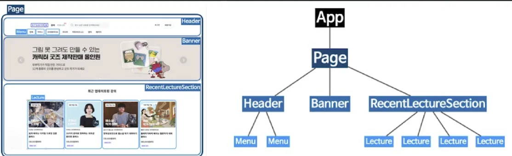

<a id="1c3eda9b0fe18171b6d6e0ac88177e92"></a>

## 코드 실습

---

<details>
<summary>index&#46;js</summary>

<a id="1c3eda9b0fe1815ab8ffe49bebab8647"></a>

```javascript
import { StrictMode } from "react";
import { createRoot } from "react-dom/client";

import App from "./App";

const rootElement = document.getElementById("root");
const root = createRoot(rootElement);

root.render(
  <StrictMode>
    <App />
  </StrictMode>
);
```

</details>

<details>
<summary>App&#46;js</summary>

<a id="1c3eda9b0fe18121a632ca7dc7e271c4"></a>

```javascript
import "./styles.css";
import Hello from "./Hello";
import World from "./World";

export default function App() {
  return (
    <div className="App">
      <Hello></Hello>
      <World />
      <h2>Start editing to see some magic happen!</h2>
    </div>
  );
}
```

</details>

<details>
<summary>Hello&#46;js</summary>

<a id="1c3eda9b0fe181cda35bd641348aea73"></a>

```javascript
export default function Hello() {
  return <div>Hello</div>;
}
```

</details>

<details>
<summary>World&#46;js</summary>

<a id="1c3eda9b0fe18134b421f0ed6e344cbf"></a>

```
export default function World() {
  return <div>World!</div>;
}
```

</details>

<a id="1c3eda9b0fe181379c79cb6866f8d79e"></a>

## 컴포넌트

---

<a id="1c3eda9b0fe1813b9544f27180e05a84"></a>

### JSX와의 차이점

- 컴포넌트는 기본적으로 함수이기 때문에 자신만의 고유한 로직이 들어갈 수 있다&#46; 

- 스스로 상태를 가질 수 있다&#46; ( 상태가 변하면 알아서 반영된다&#46; )

<a id="1c3eda9b0fe181ef8f01fe442da70f8f"></a>

### import, export

- es6에서 모듈을 불러오고 내보내는 방법

<a id="1c3eda9b0fe1810083c9c4027532d2a1"></a>

## 컴포넌트 생성 시, 주의사항

---

<a id="1c3eda9b0fe18161b166fc16acbc4de4"></a>

### 컴포넌트 이름은 Pascal Case로 작성

> <code>Parscal Case</code>&#58; 첫 문자 대문자로 표기

- MyComponent

- ArticlePage

- UserProfile

<a id="1c3eda9b0fe1810b98bafbcce6dc251b"></a>

### 컴포넌트는 의미 단위로 쪼개서 파일 분리



- 각 컴포넌트가 명확한 범위와 의미를 지닐 수 있도록 쪼개는 것이 좋다&#46;

- 이렇게 컴포넌트를 쪼갠다면 오른쪽 처럼  컴포넌트를 각각 개별의 파일로 만들게 되며, 상위 컴포넌트에서 하위 컴포넌트를 임포트하는 형태의 트리 구조가 형성된다&#46; 

<a id="1c3eda9b0fe1811684ebf7d19100760c"></a>

### 최상의 컴포넌트의 이름은 일반적으로 App 이다&#46;

- <code>index&#46;js</code> &#45; 모든 React 코드의 entry point 이다&#46;
    - 최상위 컴포넌트인 App 컴포넌트를 <code>React DOM&#46;render</code>를 통해 <u>렌더링하는 코드</u>는 일반적으로 index&#46;js에 둔다&#46;

- <code>App&#46;js</code>, App 컴포넌트 &#45; 모든 컴포넌트의 루트 컴포넌트
