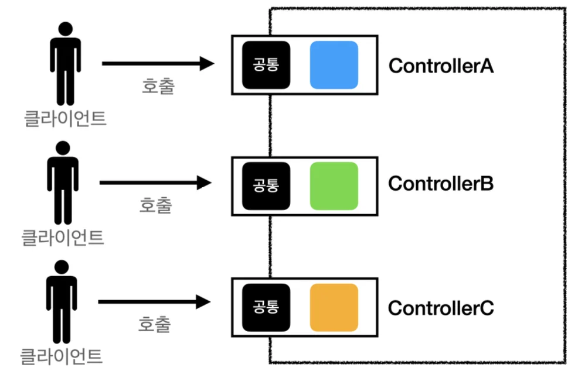
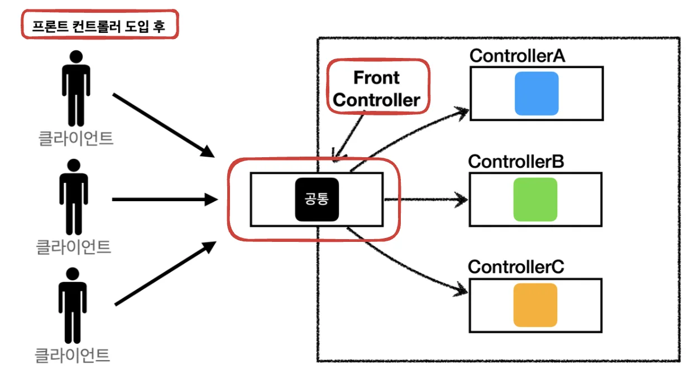
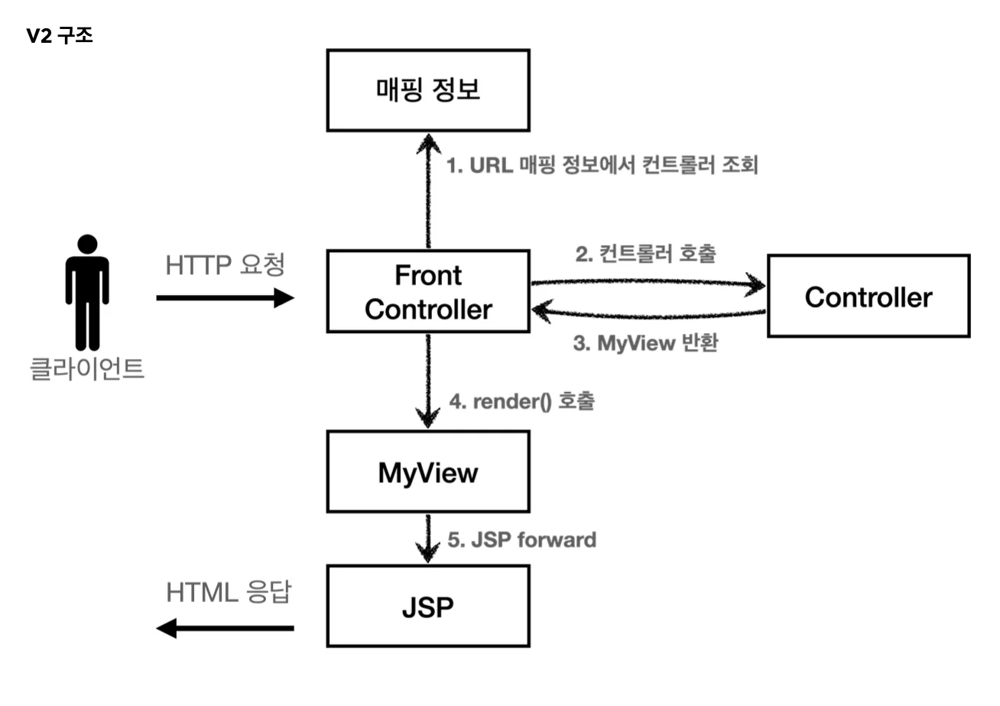
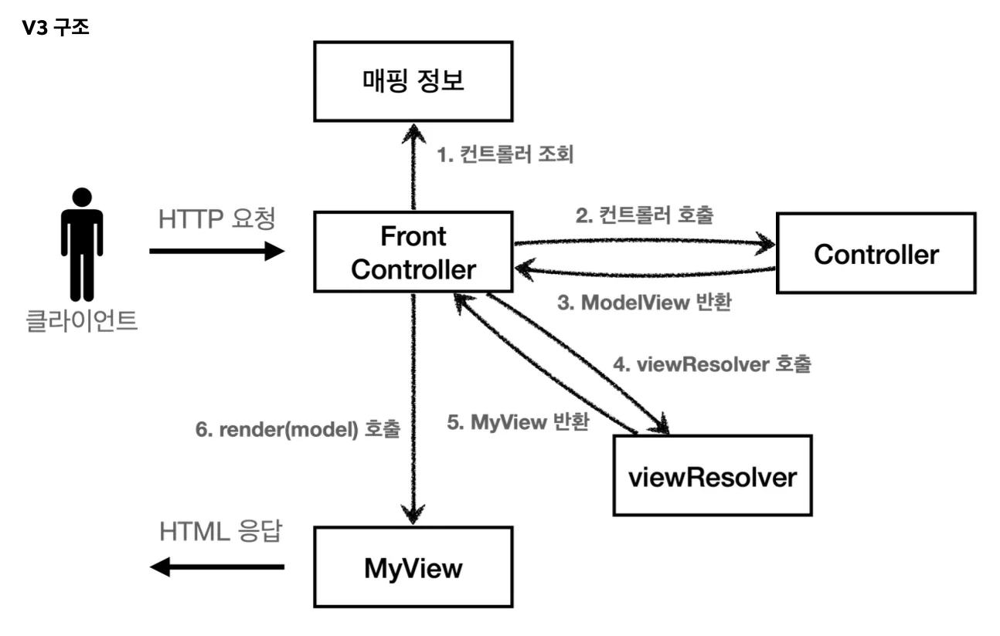
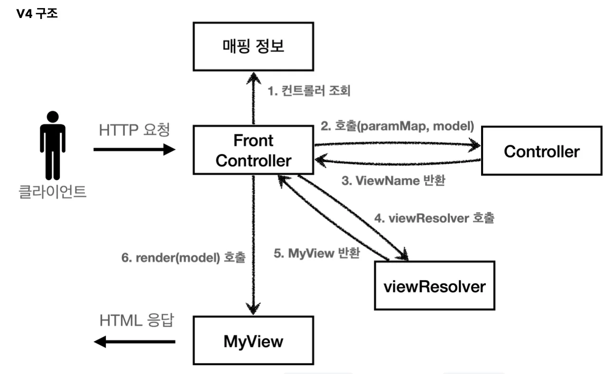
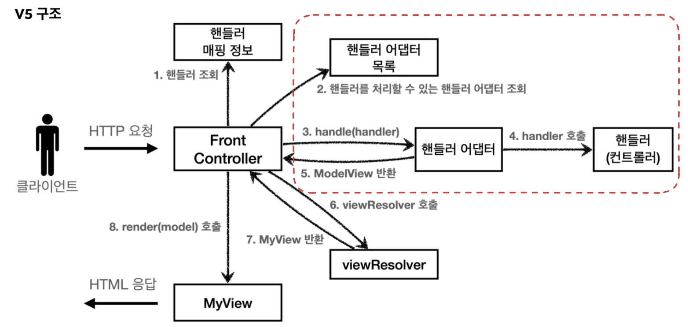

<a id="1c3eda9b0fe18124873ae31e798d047a"></a>

## 프론트 컨트롤러 패턴 

<details>
<summary>프론트 컨트롤러 패턴 <strong><u>도입 전</u></strong></summary>



</details>



- <strong>프론트 컨트롤러 </strong><strong><u>서블릿 하나</u></strong>로 <strong>클라이언트 요청을 받</strong>음

- 프론트 컨트롤러가<strong> 요청에 맞는 컨트롤러를 찾</strong>아서 <strong>호출</strong>

- 프론트 컨트롤러(입구) 하나로 <strong><u>공통 처리 가능</u></strong> <br>따라서 프론트 컨트톨러를 제외한 <strong><u>나머지 컨트롤러</u></strong>는 <strong><u>서블릿을 사용하지 않아도 됨</u></strong>

> 🧐 <strong><u>스프링 웹 MVC의 핵심</u></strong>도 바로 <strong><u>프론트 컨트롤러 패턴</u></strong>이다&#46; <br>스프링 웹 MVC의 <strong><code>DispatcherServlet</code></strong>이 <strong><u>프론트 컨트롤러 패턴</u></strong>으로 구현되어 있다&#46;

---

<a id="1c3eda9b0fe181029313e1e762467ab6"></a>

## v1 &#45; 프론트 컨트롤러 도입


<details>
<summary><strong>FrontControllerServletV1</strong></summary>

- <code>urlPatterns = &#34;/front&#45;controller/v1/&#42;&#34;</code>
    - <code>/front&#45;controller/v1</code>를 포함한 하위 모든 요청은 해당 서블릿에서 처리

    - ex) <code>/front&#45;controller/v1</code>, <code>/front&#45;controller/v1/a</code>, <code>/front&#45;controller/v1/a/b</code>

- <code>Map&#60;String, ControllerV1&#62; controllerMap</code>
    - Path, Controller 매핑 정보들 저장
        <a id="1c3eda9b0fe1816bac8ec58425ebc08b"></a>

        ```java
        controllerMap.put("/front-controller/v1/members/new-form", new MemberFormControllerV1());
        ```

- <code>String requestURI = request&#46;getRequestURI()</code>
    - HttpServletRequest에서 요청 URI 가져옴

- <code>ControllerV1 controller = controllerMap&#46;get(requestURI)</code>
    - 가져온  URI에 매핑 되는 controller 조회

<details>
<summary>예외처리</summary>

<a id="1c3eda9b0fe181a09f0ec9442ae2928b"></a>

```java
if (controller == null){
    response.setStatus(HttpServletResponse.SC_NOT_FOUND);
    return;
}
```

</details>

<a id="1c3eda9b0fe181c98cc6d4cb92d4e05c"></a>

```java
package com.example.springmvc1.web.frontcontroller.v1;

import com.example.springmvc1.web.frontcontroller.v1.ControllerV1;
import com.example.springmvc1.web.frontcontroller.v1.controller.MemberFormControllerV1;
import com.example.springmvc1.web.frontcontroller.v1.controller.MemberListControllerV1;
import com.example.springmvc1.web.frontcontroller.v1.controller.MemberSaveControllerv1;
import jakarta.servlet.ServletException;
import jakarta.servlet.annotation.WebServlet;
import jakarta.servlet.http.HttpServlet;
import jakarta.servlet.http.HttpServletRequest;
import jakarta.servlet.http.HttpServletResponse;

import java.io.IOException;
import java.util.HashMap;
import java.util.Map;

@WebServlet(name = "frontControllerServletV1", urlPatterns = "/front-controller/v1/*")
public class FrontControllerServletV1 extends HttpServlet {

    private Map<String, ControllerV1> controllerMap = new HashMap<>();

    public FrontControllerServletV1()  {
        controllerMap.put("/front-controller/v1/members/new-form", new MemberFormControllerV1());
        controllerMap.put("/front-controller/v1/members/save", new MemberSaveControllerv1());
        controllerMap.put("/front-controller/v1/members", new MemberListControllerV1());
    }

    @Override
    protected void service(HttpServletRequest request, HttpServletResponse response) throws ServletException, IOException {

        System.out.println("FrontControllerServletV1.service");
        String requestURI = request.getRequestURI();

        ControllerV1 controller = controllerMap.get(requestURI);

        if (controller == null){
            response.setStatus(HttpServletResponse.SC_NOT_FOUND);
            return;
        }

        controller.process(request, response);
    }
}

```

</details>

<details>
<summary>&#60; interface &#62; <strong>ControllerV1</strong></summary>

<a id="1c3eda9b0fe181598ca3e8fd80e36b0b"></a>

```java
package hello.servlet.web.frontcontroller.v1;

import jakarta.servlet.ServletException;
import jakarta.servlet.http.HttpServletRequest;
import jakarta.servlet.http.HttpServletResponse;

import java.io.IOException;

public interface ControllerV1 {

    void process(HttpServletRequest request, HttpServletResponse response) throws ServletException, IOException;
}
```

</details>

<details>
<summary>controller</summary>

<details>
<summary><strong>MemberFormControllerV1</strong></summary>

<a id="1c3eda9b0fe181759906d2d475b27b8b"></a>

```java
package hello.servlet.web.frontcontroller.v1.controller;

import hello.servlet.web.frontcontroller.v1.ControllerV1;
import jakarta.servlet.RequestDispatcher;
import jakarta.servlet.ServletException;
import jakarta.servlet.http.HttpServletRequest;
import jakarta.servlet.http.HttpServletResponse;

import java.io.IOException;

public class MemberFormControllerV1 implements ControllerV1 {
    
    @Override
    public void process(HttpServletRequest request, HttpServletResponse response) throws ServletException, IOException {
        String viewPath = "/WEB-INF/view/new-form.jsp";
        RequestDispatcher dispatcher = request.getRequestDispatcher(viewPath);
        dispatcher.forward(request, response);
    }
}
```

</details>

<details>
<summary><strong>MemberSaveControllerV1</strong></summary>

<a id="1c3eda9b0fe181cb87b3f1944295aeb0"></a>

```java
package hello.servlet.web.frontcontroller.v1.controller;

import hello.servlet.domain.member.Member;
import hello.servlet.domain.member.MemberRepository;
import hello.servlet.web.frontcontroller.v1.ControllerV1;
import jakarta.servlet.RequestDispatcher;
import jakarta.servlet.ServletException;
import jakarta.servlet.http.HttpServletRequest;
import jakarta.servlet.http.HttpServletResponse;

import java.io.IOException;

public class MemberSaveControllerV1 implements ControllerV1 {

    private MemberRepository memberRepository = MemberRepository.getInstance();

    @Override
    public void process(HttpServletRequest request, HttpServletResponse response) throws ServletException, IOException {
        String username = request.getParameter("username");
        int age = Integer.parseInt(request.getParameter("age"));

        Member member = new Member(username, age);
        memberRepository.save(member);

        request.setAttribute("member", member);

        String viewPath = "/WEB-INF/views/save-result.jsp";
        RequestDispatcher dispatcher = request.getRequestDispatcher(viewPath);
        dispatcher.forward(request, response);
    }
}


```

</details>

<details>
<summary><strong>MemberListControllerV1</strong></summary>

<a id="1c3eda9b0fe181f1862ee93f2e03bdfc"></a>

```java
package hello.servlet.web.frontcontroller.v1.controller;

import hello.servlet.domain.member.Member;
import hello.servlet.domain.member.MemberRepository;
import hello.servlet.web.frontcontroller.v1.ControllerV1;
import jakarta.servlet.RequestDispatcher;
import jakarta.servlet.ServletException;
import jakarta.servlet.http.HttpServletRequest;
import jakarta.servlet.http.HttpServletResponse;

import java.io.IOException;
import java.util.List;

public class MemberListControllerV1 implements ControllerV1 {

    private MemberRepository memberRepository = MemberRepository.getInstance();

    @Override
    public void process(HttpServletRequest request, HttpServletResponse response) throws ServletException, IOException {
        List<Member> members = MemberRepository.findAll();
        request.setAttribute("members", members);

        String viewPath = "/WEB-INF/view/members.jsp";
        RequestDispatcher dispatcher = request.getRequestDispatcher(viewPath);
        dispatcher.forward(request, response);
    }
}
```

</details>

</details>

<a id="1c3eda9b0fe181689d87d300d7ba45be"></a>

## v2 &#45; View 분리

<details>
<summary><strong>🧐 v1의 개선점 </strong></summary>

- <strong>뷰 로직 중복</strong>
    - 모든 컨트롤러에서 뷰로 이동하는 부분에 중복이 로직 존재
        <a id="1c3eda9b0fe181a8a565e6fdb89109e8"></a>

        ```java
        String viewPath = "/WEB-INF/views/new-form.jsp";
        RequestDispatcher dispatcher = request.getRequestDispatcher(viewPath);
        dispatcher.forward(request, response);
        ```

    - <strong><u>별도로 뷰를 처리하는 객체를 만</u></strong>들어 리펙토링 → MyView

</details>



<details>
<summary><strong>FrontControllerServletV2</strong></summary>

<a id="1c3eda9b0fe181ce973ecbd2142a07b5"></a>

```java
package com.example.springmvc1.web.frontcontroller.v2;

import com.example.springmvc1.web.frontcontroller.MyView;
import com.example.springmvc1.web.frontcontroller.v2.controller.MemberFormControllerV2;
import com.example.springmvc1.web.frontcontroller.v2.controller.MemberListControllerV2;
import com.example.springmvc1.web.frontcontroller.v2.controller.MemberSaveControllerV2;
import jakarta.servlet.ServletException;
import jakarta.servlet.annotation.WebServlet;
import jakarta.servlet.http.HttpServlet;
import jakarta.servlet.http.HttpServletRequest;
import jakarta.servlet.http.HttpServletResponse;

import java.io.IOException;
import java.util.HashMap;
import java.util.Map;

@WebServlet(name = "frontControllerServletV2", urlPatterns = "/front-controller/v2/*")
public class FrontControllerServletV2 extends HttpServlet {

    private Map<String, ControllerV2> controllerMap = new HashMap<>();

    public FrontControllerServletV2() {
        controllerMap.put("/front-controller/v2/members/new-form", new MemberFormControllerV2());
        controllerMap.put("/front-controller/v2/members/save", new MemberSaveControllerV2());
        controllerMap.put("/front-controller/v2/members", new MemberListControllerV2());
    }

    @Override
    protected void service(HttpServletRequest request, HttpServletResponse response) throws ServletException, IOException {

        System.out.println("FrontControllerServletV2.service");
        String requestURI = request.getRequestURI();
        ControllerV2 controller = controllerMap.get(requestURI);

        if(controller == null){
            response.setStatus(HttpServletResponse.SC_NOT_FOUND);
            return;
        }

        controller
                .process(request, response)
                .render(request, response);
    }
}
```

</details>

<details>
<summary><strong>MyView</strong></summary>

<a id="1c3eda9b0fe18130a6fad502b02a65c0"></a>

```java
package hello.servlet.web.frontcontroller;

import javax.servlet.RequestDispatcher;
import javax.servlet.ServletException;
import javax.servlet.http.HttpServletRequest;
import javax.servlet.http.HttpServletResponse;
import java.io.IOException;

public class MyView {

     private String viewPath;
     
     public MyView(String viewPath) {
         this.viewPath = viewPath;
			}
			
     public void render(HttpServletRequest request, HttpServletResponse response) throws ServletException, IOException {
         RequestDispatcher dispatcher = request.getRequestDispatcher(viewPath);
         dispatcher.forward(request, response);
     }
}
```

</details>

<details>
<summary>&#60;interface&#62; <strong>ControllerV2</strong></summary>

<a id="1c3eda9b0fe181ffaf07c21739d08402"></a>

```java
package hello.servlet.web.frontcontroller.v2;

import hello.servlet.web.frontcontroller.MyView;

import javax.servlet.ServletException;
import javax.servlet.http.HttpServletRequest;
import javax.servlet.http.HttpServletResponse;
import java.io.IOException;

public interface ControllerV2 {

		MyView process(HttpServletRequest request, HttpServletResponse response) throws ServletException, IOException;
}
```

</details>

<details>
<summary>controller</summary>

<details>
<summary><strong>MemberFormControllerV2</strong></summary>

<a id="1c3eda9b0fe18120bc7ee03cb77bda2f"></a>

```java
package hello.servlet.web.frontcontroller.v2.controller;

import hello.servlet.web.frontcontroller.MyView;
import hello.servlet.web.frontcontroller.v2.ControllerV2;
import jakarta.servlet.ServletException;
import jakarta.servlet.http.HttpServletRequest;
import jakarta.servlet.http.HttpServletResponse;

import java.io.IOException;

public class MemberFormControllerV2 implements ControllerV2 {

    @Override
    public MyView process(HttpServletRequest request, HttpServletResponse response) throws ServletException, IOException {
        return new MyView("/WEB-INF/views/new-form.jsp");
    }
}
```

</details>

<details>
<summary><strong>MemberSaveControllerV2</strong></summary>

<a id="1c3eda9b0fe181888576d35a6a01c5b4"></a>

```java
package hello.servlet.web.frontcontroller.v2.controller;

import hello.servlet.domain.member.Member;
import hello.servlet.domain.member.MemberRepository;
import hello.servlet.web.frontcontroller.MyView;
import hello.servlet.web.frontcontroller.v2.ControllerV2;
import jakarta.servlet.ServletException;
import jakarta.servlet.http.HttpServletRequest;
import jakarta.servlet.http.HttpServletResponse;

import java.io.IOException;

public class MemberSaveControllerV2 implements ControllerV2 {

    private MemberRepository memberRepository = MemberRepository.getInstance();

    @Override
    public MyView process(HttpServletRequest request, HttpServletResponse response) throws ServletException, IOException {
        String username = request.getParameter("username");
        int age = Integer.parseInt(request.getParameter("age"));

        Member member = new Member(username, age);
        memberRepository.save(member);

        request.setAttribute("member", member);

        return new MyView("/WEB-INF/views/save-result.jsp");
    }
}
```

</details>

<details>
<summary><strong>MemberListControllerV2</strong></summary>

<a id="1c3eda9b0fe1813d8db7c8a253d3d9b8"></a>

```java
package com.example.springmvc1.web.frontcontroller.v2.controller;

import com.example.springmvc1.domain.member.Member;
import com.example.springmvc1.domain.member.MemberRepository;
import com.example.springmvc1.web.frontcontroller.MyView;
import com.example.springmvc1.web.frontcontroller.v2.ControllerV2;
import jakarta.servlet.ServletException;
import jakarta.servlet.http.HttpServletRequest;
import jakarta.servlet.http.HttpServletResponse;

import java.io.IOException;
import java.util.List;

public class MemberListControllerV2 implements ControllerV2 {

    MemberRepository memberRepository = MemberRepository.getInstance();

    @Override
    public MyView process(HttpServletRequest request, HttpServletResponse response) throws ServletException, IOException {

        List<Member> members = memberRepository.findAll();

        request.setAttribute("members", members);

        return new MyView("/WEB-INF/views/members.jsp");
    }
}
```

</details>

</details>

<a id="1c3eda9b0fe181918502d7387efa598f"></a>

## v3 &#45; Model 추가 

<details>
<summary><strong>🧐 V2 개선점 </strong></summary>

- <strong>서블릿 종속성 제거</strong>
    > 컨트롤러에서  서블릿에 종속적인 HttpServletRequest를 사용함<br>Model도 <code>request&#46;setAttribute()</code> 를 통해 데이터를 저장하고 뷰에 전달함

    - 컨트롤러에서 요청 파라미터 정보(HttpServletRequest, HttpServletResponse)를 자바의 Map으로 대신 넘기도록 처리하면 컨트롤러가 서블릿 기술을 몰라도 동작 가능하다&#46;

    - request 객체를 Model로 사용하는 대신 <strong><u>별도의 Model 객체를 만</u></strong>들어서 반환

    <a id="1c3eda9b0fe1816881afe25e082e0179"></a>

    ⇒ 컨트롤러가 서블릿 기술을 전혀 사용하지 않도록 변경<br>

- <strong>뷰 이름 중복 제거</strong>
    > 컨트롤러에서 지정하는 뷰 이름에 중복이 있는 것을 확인할 수 있다&#46; 

    - 컨트롤러는<u> </u><strong><u>뷰의 논리 이름</u></strong><u>을 반환</u>하고, <u>실제 물리 위치의 이름은 프론트 컨트롤러에서 처리</u>
        <a id="1c3eda9b0fe181159ec8c7361d8bae88"></a>

        이렇게 해두면 향후 뷰의 폴더 위치가 변경되어도 프론트 컨트롤러에서만 수정하면 됨<br>

    - <code>/WEB&#45;INF/views/new&#45;form&#46;jsp</code>  →  <strong>new&#45;form</strong>

    - <code>/WEB&#45;INF/views/save&#45;result&#46;jsp</code>   → <strong>save&#45;result</strong>

    - <code>/WEB&#45;INF/views/members&#46;jsp</code>   →  <strong>members</strong><br>

</details>




<details>
<summary><strong>서블릿(</strong><strong><code>HttpRequestServlet</code></strong><strong>) 종속성 제거</strong></summary>

<details>
<summary><code>Map&#60;String, String&#62; paramMap</code></summary>

- <strong><u>r</u></strong><strong><u>equest(</u></strong><strong><u><code>HttpRequestServlet</code></u></strong><strong><u>) 객체</u></strong><u>의 </u><strong><u>Form 데이터(회원 정보)</u></strong> <strong><u>paramMap 객체로 분리</u></strong>하여 <strong><u>controller로 넘</u></strong>김

</details>

<details>
<summary><code>ModelView</code></summary>

- <strong>viewName&#58; </strong><u><code>viewResolver</code></u><u>에 전달</u>하여 해당하는 &#46;jsp 매핑

- <strong>model</strong>
    - <strong><u>서블릿 종속성 분리</u></strong>를 위한 컨트롤러에서 <strong><u>데이터 캐싱 객체</u></strong>

    - <code>MyView&#46;render(model …)</code>을 통해<strong> </strong><code>request&#46;setAttribute()</code> 처리 → view(<code>&#46;jsp</code>) 동적 데이터 처리

- <strong>Modelview  </strong>
    <a id="1c3eda9b0fe181238ca1dc1f71b19707"></a>

    ```java
    @Getter @Setter
    public class ModelView {
        private String viewName;
        private Map<String, Object> model = new HashMap<>();

        public ModelView(String viewName) {
            this.viewName = viewName;
        }
    }
    ```

</details>

- <strong>ControllerV3</strong>
    <a id="1c3eda9b0fe181aa805bc03e3643bed6"></a>

    ```java
    public interface ControllerV3 {
        ModelView process(Map<String, String> paramMap);
    }
    ```

- <strong>FrontControllerServletV3</strong>
    <a id="1c3eda9b0fe181b099a7fcd36bbf32d6"></a>

    ```java
    Map<String, String> paramMap = createParamMap(request);
    ModelView mv = controller.process(paramMap);
    String viewName = mv.getViewName();
    MyView view = viewResolver(viewName);
    view.render(mv.getModel(), request, response);
    ```

    <a id="1c3eda9b0fe181009c4cfa1b6a7bd822"></a>

    ```java
    private Map<String, String> createParamMap(HttpServletRequest request) {
        Map<String, String> paramMap = new HashMap<>();
        request.getParameterNames().asIterator()
                .forEachRemaining(paramName ->
                    paramMap.put(paramName, request.getParameter(paramName)));
        return paramMap;
    }
    ```

- <strong>Controller</strong>
    <a id="1c3eda9b0fe181d0be52c09113e55c27"></a>

    ```java
    // MemberFormControllerV3
    return new ModelView("new-form");  


    // MemberSaveControllerV3
    ModelView mv = new ModelView("save-result");
    mv.getModel().put("member", member);
    return mv;


    // MemberListControllerV3
    ModelView mv = new ModelView("members");
    mv.getModel().put("members", members);
    return mv;
    ```

- <strong>MyView</strong>
    <a id="1c3eda9b0fe181b38a03ff5283c85955"></a>

    ```java
    public void render(Map<String, Object> model, HttpServletRequest request, HttpServletResponse response) throws ServletException, IOException {
        modelToRequestAttribute(model, request);
        RequestDispatcher dispatcher = request.getRequestDispatcher(viewPath);
        dispatcher.forward(request, response);
    }

    private void modelToRequestAttribute(Map<String, Object> model, HttpServletRequest request){
        model.forEach((key, value) -> request.setAttribute(key, value));
    }
    ```

</details>

<details>
<summary><strong>뷰 이름 중복 제거&#58; </strong><code>viewResolver</code></summary>

- <strong>FrontControllerServletV3</strong>
    <a id="1c3eda9b0fe18105ae4bd11cb5129ee0"></a>

    ```java
    MyView view = viewResolver(viewName);
    ```

    <a id="1c3eda9b0fe181d79987cfcbf5616585"></a>

    ```java
    private MyView viewResolver(String viewName) {
        return new MyView("/WEB-INF/views/" + viewName + ".jsp");
    }
    ```

- <strong>Controller</strong>
    <a id="1c3eda9b0fe181089d60cb0441e56297"></a>

    ```java
    // MemberFormControllerV3
    return new ModelView("new-form");  


    // MemberSaveControllerV3
    ModelView mv = new ModelView("save-result");
    mv.getModel().put("member", member);
    return mv;


    // MemberListControllerV3
    ModelView mv = new ModelView("members");
    mv.getModel().put("members", members);
    return mv;
    ```

</details>

<details>
<summary><strong>FrontControllerServletV3</strong></summary>

<a id="1c3eda9b0fe1813f9404ff1b51fa24d5"></a>

```java
 package hello.servlet.web.frontcontroller.v3;

import hello.servlet.web.frontcontroller.ModelView;
import hello.servlet.web.frontcontroller.MyView;
import hello.servlet.web.frontcontroller.v3.controller.MemberFormControllerV3;
import hello.servlet.web.frontcontroller.v3.controller.MemberListControllerV3;
import hello.servlet.web.frontcontroller.v3.controller.MemberSaveControllerV3;
import jakarta.servlet.ServletException;
import jakarta.servlet.annotation.WebServlet;
import jakarta.servlet.http.HttpServlet;
import jakarta.servlet.http.HttpServletRequest;
import jakarta.servlet.http.HttpServletResponse;

import java.io.IOException;
import java.util.HashMap;
import java.util.Map;

@WebServlet(name = "frontControllerServletV3", urlPatterns = "/front-controller/v3/*")
public class FrontControllerServletV3 extends HttpServlet {

    private Map<String, ControllerV3> controllerMap = new HashMap<>();

    public FrontControllerServletV3() {
        controllerMap.put("/front-controller/v3/members/new-form", new MemberFormControllerV3());
        controllerMap.put("/front-controller/v3/members/save", new MemberSaveControllerV3());
        controllerMap.put("/front-controller/v3/members", new MemberListControllerV3());
    }

    @Override
    protected void service(HttpServletRequest request, HttpServletResponse response) throws ServletException, IOException {
        String requestURI = request.getRequestURI();

        ControllerV3 controller = controllerMap.get(requestURI);
        if(controller == null ){
            response.setStatus(HttpServletResponse.SC_NOT_FOUND);
            return;
        }

        Map<String, String> paramMap = createParamMap(request);
        ModelView mv = controller.process(paramMap);

        String viewName = mv.getViewName();
        MyView view = viewResolver(viewName);
        view.render(mv.getModel(), request, response);
    }

    private Map<String, String> createParamMap(HttpServletRequest request) {
        Map<String, String> paramMap = new HashMap<>();

        request.getParameterNames().asIterator()
                .forEachRemaining(paramName -> paramMap.put(paramName, request.getParameter(paramName)));
            return paramMap;
    }

    private MyView viewResolver(String viewName){
        return new MyView("WEB-INF/views" + viewName + ".jsp");
    }

}

```

</details>

<details>
<summary>&#60;interface&#62; <strong>ControllerV3</strong></summary>

<a id="1c3eda9b0fe181b598fbce81130b9848"></a>

```java
package com.example.springmvc1.web.frontcontroller.v3;

import com.example.springmvc1.web.frontcontroller.ModelView;

import java.util.Map;

public interface ControllerV3 {
    ModelView process(Map<String, String> paramMap);
}
```

</details>

<details>
<summary>controller</summary>

<details>
<summary><strong>MemberFormControllerV3</strong></summary>

<a id="1c3eda9b0fe181d59559d64915f1c92f"></a>

```java
package hello.servlet.web.frontcontroller.v3.controller;

import hello.servlet.web.frontcontroller.ModelView;
import hello.servlet.web.frontcontroller.v3.ControllerV3;

import java.util.Map;

public class MemberFormControllerV3 implements ControllerV3 {

    @Override
    public ModelView process(Map<String, String> paramMap) {
        return new ModelView("new-form");
    }
}

```

</details>

<details>
<summary><strong>MemberListControllerV3</strong></summary>

<a id="1c3eda9b0fe18179b482d5f4c6f09d49"></a>

```java
package hello.servlet.web.frontcontroller.v3.controller;

import hello.servlet.domain.member.Member;
import hello.servlet.domain.member.MemberRepository;
import hello.servlet.web.frontcontroller.ModelView;
import hello.servlet.web.frontcontroller.v3.ControllerV3;

import java.util.List;
import java.util.Map;

public class MemberListControllerV3 implements ControllerV3 {

    private MemberRepository memberRepository = MemberRepository.getInstance();

    @Override
    public ModelView process(Map<String, String> paramMap) {
        List<Member> members = memberRepository.findAll();

        ModelView mv = new ModelView("members");
        mv.getModel().put("members", members);

        return mv;
    }
}

```

</details>

<details>
<summary><strong>MemberSaveControllerV3</strong></summary>

<a id="1c3eda9b0fe18108a42bfa1fea11e354"></a>

```java
package hello.servlet.web.frontcontroller.v3.controller;

import hello.servlet.domain.member.Member;
import hello.servlet.domain.member.MemberRepository;
import hello.servlet.web.frontcontroller.ModelView;
import hello.servlet.web.frontcontroller.v3.ControllerV3;

import java.util.Map;

public class MemberSaveControllerV3 implements ControllerV3 {

    private MemberRepository memberRepository = MemberRepository.getInstance();

    @Override
    public ModelView process(Map<String, String> paramMap) {
        String username = paramMap.get("username");
        int age = Integer.parseInt(paramMap.get("age"));

        Member member = new Member(username, age);
        memberRepository.save(member);

        ModelView mv = new ModelView("save-result");
        mv.getModel().put("member", member);
        return mv;
    }
}

```

</details>

</details>

<details>
<summary><strong>ModelView</strong></summary>

- <strong>서블릿의 종속성을 제거</strong>하기 위한 Model

- View 이름 전달

- 다른 버전에서도 사용하여 <code>/frontcontroller</code> 하위에 생성

<a id="1c3eda9b0fe181fbaff3d0e87b9161e4"></a>

```java
package hello.servlet.web.frontcontroller;

import lombok.Getter;
import lombok.Setter;

import java.util.HashMap;
import java.util.Map;

@Getter @Setter
public class ModelView {

    private String viewName;
    private Map<String, Object> model = new HashMap<>();

    public ModelView(String viewName) {
        this.viewName =viewName;
    }
}

```

</details>

<details>
<summary><strong>MyView</strong></summary>

<a id="1c3eda9b0fe181d8bf77dd7a88cd3839"></a>

```java
package hello.servlet.web.frontcontroller;

import jakarta.servlet.RequestDispatcher;
import jakarta.servlet.ServletException;
import jakarta.servlet.http.HttpServletRequest;
import jakarta.servlet.http.HttpServletResponse;

import java.io.IOException;
import java.util.Map;

public class MyView {

    private String viewPath;

    public MyView(String viewPath) {
        this.viewPath = viewPath;
    }

    public void render(HttpServletRequest request, HttpServletResponse response) throws ServletException, IOException {
        RequestDispatcher dispatcher = request.getRequestDispatcher(viewPath);
        dispatcher.forward(request, response);
    }

    public void render (Map<String, Object> model, HttpServletRequest request, HttpServletResponse response) throws  ServletException, IOException {
        modelToRequestAttribute(model, request);
        RequestDispatcher dispatcher = request.getRequestDispatcher(viewPath);
        dispatcher.forward(request, response);
    }

    private void modelToRequestAttribute(Map<String, Object> model, HttpServletRequest request) {
        model.forEach((key, value) -> request.setAttribute(key, value));
    }
}

```

</details>

<a id="1c3eda9b0fe1816f8220e7ec7f6dbcaf"></a>

## v4 &#45; 단순, 실용적인 컨트롤러 

<details>
<summary>🧐 <strong>V3 개선점</strong></summary>

<a id="1c3eda9b0fe18196a43ac8ea72907538"></a>

앞서 만든 v3 컨트롤러는 서블릿 종속성을 제거하고 뷰 경로의 중복을 제거하는 등, 잘 설계된 컨트롤러이지만,

<a id="1c3eda9b0fe18137a1a7d9c952c0acc8"></a>

실제 컨트톨러 인터페이스를 구현하는 개발자 입장에서 보면, <strong><u>항상 ModelView 객체를 생성하고 반환해야 하는 부분이 번거롭다&#46;</u></strong>

<a id="1c3eda9b0fe1817fbfb2d7aba4f0814c"></a>

좋은 프레임워크는 아키텍처도 중요하지만, 그와 더불어 실제 개발하는 개발자가 단순하고 편리하게 사용할 수 있어야 한다&#46; 즉, 실용성이 있어야 한다&#46; 

<a id="1c3eda9b0fe181b4ab85d42614f04d14"></a>

⇒ 컨트롤러&#45; <code>ModelView</code> 대신  <strong>ViewName(String)</strong> 반환<br>

</details>



<details>
<summary><strong>모델 객체  분리 및 전달</strong></summary>

<a id="1c3eda9b0fe1812e8cb5e0d2765ac8fd"></a>

모델 객체를 <strong>프론트 컨트롤러에서 생성</strong>해서 컨트롤러로 넘기고<br>컨트롤러에서 모델 객체에 값을 저장

> HashMap은 Reference Type 이기 때문에 참조값 넘긴다&#46;<br>따라서 하위 컨트롤러에서 값이 추가되어도 프론트 컨트롤러에서 생성한 원본 Map에도 반영이 된다&#46;  ( 얕은 복사 )

<a id="1c3eda9b0fe18173bd0ce485dbb6e827"></a>

이후 로직은 v3와 동일함

- <strong>ControllerV4</strong>
    <a id="1c3eda9b0fe181a59a38e777298b7acb"></a>

    ```java
    public interface ControllerV4 {

        /**
         * @param paramMamp
         * @param model
         * return viewName
         */

        String process(Map<String, String> paramMamp, Map<String, Object> model);
    }
    ```

- <strong>FrontControllerServletV4</strong>
    <a id="1c3eda9b0fe18133b040dae894583c6c"></a>

    ```java
    Map<String, Object> model = new HashMap<>();  // 추가

    String viewName = controller.process(paramMap, model);

    MyView view = viewResolver(viewName);
    view.render(model, request, response); // model 데이터, request.setAttribute에 저장
    ```

- <strong>Controller</strong>
    <a id="1c3eda9b0fe18190ad43fe0fa7ed926e"></a>

    ```java
    public String process(Map<String, String> paramMamp, Map<String, Object> model) {
      
    		  .  .  .
      
    	model.put("member", member);   // MemberSaveControllerV4
    	
    	model.put("members", members);  // MemberListControllerV4
    ```

- <strong>MyView</strong>
    <a id="1c3eda9b0fe181b58d0bf795bccd0946"></a>

    ```java
    public void render(Map<String, Object> model, HttpServletRequest request, HttpServletResponse response) throws ServletException, IOException {
        modelToRequestAttribute(model, request);
        RequestDispatcher dispatcher = request.getRequestDispatcher(viewPath);
        dispatcher.forward(request, response);
    }

    private void modelToRequestAttribute(Map<String, Object> model, HttpServletRequest request){
        model.forEach((key, value) -> request.setAttribute(key, value));
    }
    ```

</details>

<details>
<summary><strong>뷰의 논리 이름을 직접 반환</strong></summary>

<a id="1c3eda9b0fe18112bc8ae3177509ecbe"></a>

컨트롤로가 직접 뷰의 논리 이름을 반환하므로 해당 값을 사용해서 실제 물리 뷰를 찾을 수 있다&#46;

<a id="1c3eda9b0fe1817aa328f941222fc049"></a>

```java
 String viewName = controller.process(paramMap, model);
 MyView view = viewResolver(viewName);
```

<a id="1c3eda9b0fe18141992cc826b2209361"></a>

```java
private MyView viewResolver(String viewName) {
    return new MyView("/WEB-INF/views/" + viewName + ".jsp");
}
```

</details>

<details>
<summary>🧐 Model 객체는 save 로직에서만 사용된다&#46;</summary>

- interface에 parameter로 model 객체를 명시했다&#46;

- 따라서 interface를 상속하여 컨트롤러 구현 시, model 객체는 필수적으로 넘겨줘야 한다&#46;

- 그러나 Form 컨트롤러에서는 model 객체를 사용하지 않는다&#46; 

- 즉, 불필요한 인자를 넘겨준다&#46; 

- 개선이 필요하다&#46;<br>⇒  오버라이드<br>

</details>

<details>
<summary>🧐 <strong>Model 객체 전역 처리?</strong></summary>

<a id="1c3eda9b0fe181329603f3e5798f51cd"></a>

프론트컨트롤러에서 모델 객체를 생성하여 인자로 각 컨트롤러로 넘겨준다&#46; 

- FrontControllerServletV4
    <a id="1c3eda9b0fe18121bbd9ec38e4b516c9"></a>

    ```java
    Map<String, Object> model = new HashMap<>();  // 추가
    String viewName = controller.process(paramMap, model);
    ```

- MemberListControllerV4
    <a id="1c3eda9b0fe181208b4fd4fe2481ccd4"></a>

    ```java
    public class MemberListControllerV4 implements ControllerV4 {

        private MemberRepository memberRepository = MemberRepository.getInstance();

        @Override
        public String process(Map<String, String> paramMamp, Map<String, Object> model) {
            List<Member> members = memberRepository.findAll();
            model.put("members", members);

            return "members";
        }
    }
    ```

<a id="1c3eda9b0fe1810a8a46c8cfdc715d2a"></a>

그리고 넘겨준 model 객체에 members를 캐싱한다&#46; 

<a id="1c3eda9b0fe1814c8a37f431fac62afe"></a>

<strong>그러나 해당 코드에서 어떻게 model 객체의 값을 view에서 가져다가 쓰는지 이해 되지 않았다</strong>

- model 객체를 전역 변수로 선언하지 않았다&#46; 

- model 객체를 반환하지 않는다&#46;

<a id="1c3eda9b0fe18152b453e72d255bd65c"></a>

Java에서<strong><u> 객체를 메서드의 인자로 전달</u></strong>할 때, <strong>객체의 참조(레퍼런스)가 전달</strong>된다&#46; 따라서<strong><u> 메서드 내부에서 해당 객체의 상태를 변경하면, 그 변경 사항이 메서드 호출자에게도 반영</u></strong>된다&#46; 

- ex) <strong>객체 참조 테스트 </strong>
    <details>
    <summary>&#60;interface&#62; ControllerV4</summary>

    <a id="1c3eda9b0fe181548be8d238a5f418aa"></a>

    ```java
    public interface ControllerV4 {
        String process(Map<String, String> paramMap, Map<String, Object> model);
    }
    ```

    </details>

    <details>
    <summary><strong>MemberSaveControllerV4</strong></summary>

    <a id="1c3eda9b0fe18171bf86c7220dd2f1a6"></a>

    ```java
    public class MemberSaveControllerV4 implements ControllerV4 {

        private MemberRepository memberRepository = MemberRepository.getInstance();

        @Override
        public String process(Map<String, String> paramMap, Map<String, Object> model) {
            String username = paramMap.get("username");
            int age = Integer.parseInt(paramMap.get("age"));

            Member member = new Member(username, age);
            memberRepository.save(member);

            model.put("member", member); // 모델에 데이터를 추가합니다.

            return "save-result"; // 뷰 이름을 반환합니다.
        }
    }
    ```

    </details>

    <details>
    <summary><strong>테스트 코드</strong></summary>

    <a id="1c3eda9b0fe181b5b256ce9bb9bb3236"></a>

    ```java
    public class ControllerTest {
        public static void main(String[] args) {
            // ControllerV4 객체 생성
            ControllerV4 controller = new MemberSaveControllerV4();

            // 파라미터 맵 생성
            Map<String, String> paramMap = new HashMap<>();
            paramMap.put("username", "john");
            paramMap.put("age", "25");

            // 모델 맵 생성
            Map<String, Object> model = new HashMap<>();

            // 컨트롤러의 process 메서드 호출
            String viewName = controller.process(paramMap, model);

            // 메서드 호출 후 model 객체에 접근하여 데이터 확인
            Member savedMember = (Member) model.get("member");

            // 결과 출력
            System.out.println("View Name: " + viewName);
            System.out.println("Saved Member: " + savedMember);
            System.out.println("Model: " + model);
        }
    }
    ```

    </details>

<a id="1c3eda9b0fe181bdbe28d0f41838575c"></a>

<strong>즉, 얕은 복사가 일어나 참조되는 하위 클래스에서도 해당하는 객체의 변형이 일어나면 원본 객체에도 반영이 된다&#46; </strong>

<a id="1c3eda9b0fe181c2a86bed7241b24741"></a>

<strong>따라서 오류 가능성이 높은 안좋은 코드이다&#46;<br></strong>

</details>

<details>
<summary><strong>FrontControllerServletV4</strong></summary>

<a id="1c3eda9b0fe181f58f99e7651b263e75"></a>

```java
package hello.servlet.web.frontcontroller.v4;

import hello.servlet.web.frontcontroller.MyView;
import hello.servlet.web.frontcontroller.v4.controller.MemberFormControllerV4;
import hello.servlet.web.frontcontroller.v4.controller.MemberListControllerV4;
import hello.servlet.web.frontcontroller.v4.controller.MemberSaveControllerV4;
import jakarta.servlet.ServletException;
import jakarta.servlet.http.HttpServlet;
import jakarta.servlet.http.HttpServletRequest;
import jakarta.servlet.http.HttpServletResponse;

import java.io.IOException;
import java.util.HashMap;
import java.util.Map;

public class FrontControllerServletV4 extends HttpServlet {

    private Map<String, ControllerV4> controllerMap = new HashMap<>();

    public FrontControllerServletV4() {
        controllerMap.put("/front-controller/v4/members/new-form", new MemberFormControllerV4());
        controllerMap.put("/front-controller/v4/members/save", new MemberSaveControllerV4());
        controllerMap.put("/front-controller/v4/members", new MemberListControllerV4());
    }

    @Override
    protected void service(HttpServletRequest request, HttpServletResponse response) throws ServletException, IOException {
        String requestURI = request.getRequestURI();

        ControllerV4 controller = controllerMap.get(requestURI);
        if(controller == null) {
            response.setStatus(HttpServletResponse.SC_NOT_FOUND);
            return;
        }

        Map<String, String> paramMap = createParamMap(request);
        Map<String, String> model = new HashMap<>(); // 추가

        String viewName = controller.process(paramMap, model);

        MyView view = viewResolver(viewName);
        view.render(model, request, response);
    }

    private Map<String, String> createParamMap(HttpServletRequest request) {
        Map<String, String> paramMap = new HashMap<>();
        request.getParameterNames().asIterator()
                .forEachRemaining(paramName -> paramMap.put(paramName, request.getParameter(paramName)));
        return paramMap;
    }

    private MyView viewResolver(String viewName) {
        return new MyView("/WEB-INF/views/" + viewName + ".jsp");
    }
}

```

</details>

<details>
<summary><strong>&#60;interface&#62; </strong> <strong>ControllerV4</strong></summary>

<a id="1c3eda9b0fe181bb9a0ae3a16a706a4a"></a>

```java
package hello.servlet.web.frontcontroller.v4;
import java.util.Map;

public interface ControllerV4 {
    /**
     * @param paramMap
     * @param model
     * @return viewName
     */

    String process(Map<String, String> paramMap, Map<String, Object> model);
}
```

</details>

<details>
<summary>Controller</summary>

<details>
<summary><strong>MemberFormControllerV4</strong></summary>

<a id="1c3eda9b0fe1812e9eeadb4159b0c365"></a>

```java
package hello.servlet.web.frontcontroller.v4.controller;
import hello.servlet.web.frontcontroller.v4.ControllerV4;
import java.util.Map;

public class MemberFormControllerV4 implements ControllerV4 {

    @Override
    public String process(Map<String, String> paramMap, Map<String, Object>
            model) {
        return "new-form";
    }
}
```

</details>

<details>
<summary><strong>MemberSaveControllerV4</strong></summary>

<a id="1c3eda9b0fe1810da5b9ee03c403954d"></a>

```java
package hello.servlet.web.frontcontroller.v4.controller;
import hello.servlet.domain.member.Member;
import hello.servlet.domain.member.MemberRepository;
import hello.servlet.web.frontcontroller.v4.ControllerV4;
import java.util.Map;

public class MemberSaveControllerV4 implements ControllerV4 {
    private MemberRepository memberRepository = MemberRepository.getInstance();

    @Override
    public String process(Map<String, String> paramMap, Map<String, Object>  model) {

        String username = paramMap.get("username");
        int age = Integer.parseInt(paramMap.get("age"));

        Member member = new Member(username, age);
        memberRepository.save(member);

        model.put("member", member);

        return "save-result";
    }
}
```

</details>

<details>
<summary><strong>MemberListControllerV4</strong></summary>

<a id="1c3eda9b0fe181e88296eef2cb44d97c"></a>

```java
package hello.servlet.web.frontcontroller.v4.controller;

import hello.servlet.domain.member.Member;
import hello.servlet.domain.member.MemberRepository;
import hello.servlet.web.frontcontroller.v4.ControllerV4;

import java.util.List;
import java.util.Map;

public class MemberListControllerV4 implements ControllerV4 {

    private MemberRepository memberRepository = MemberRepository.getInstance();

    @Override
    public String process(Map<String, String> paramMap, Map<String, Object> model) {
        List<Member> members = memberRepository.findAll();
        model.put("members", members);

        return "members";
    }
}
```

</details>

</details>

<a id="1c3eda9b0fe18105907ee1da8e456ef2"></a>

## v5 &#45; 유연한 컨트롤러  (V3)

- <strong><code>어댑터 패턴</code></strong>
    <a id="1c3eda9b0fe1811b8849ec83d71420f6"></a>

    프론트 컨트롤러가 다양한 방식의 컨트롤러를 처리할 수 있도록 변경

    - <code>핸들러 어댑터</code>
        - 중간에 어댑터 역활하는 어댑터, 이로 인해 다양한 종류의 컨트롤러를 호출 가능

    - <code>핸들러</code>
        - 컨트롤러의 이름을 더 넓은 범위인 핸들러로 변경

        - 어댑터 패턴을 통해 해당하는 종류의 어댑터만 있으면 유연하게 변경 가능하기 때문



<details>
<summary><strong>&#60;interface &#62; MyHandlerAdapter</strong></summary>

- <code>boolean supports(Object handler)</code>
    - 어댑터가 해당 컨트롤러를 처리할 수 있는지 판단
        <a id="1c3eda9b0fe1816d84fdd92eba35aa6f"></a>

        (handler는 컨트롤러를 말함)

- <code>ModelView handle(HttpServletRequest request, HttpServletResponse response, Object handler)</code>
    - 어댑터는 실제 컨트롤러를 호출하고, 그 결과로 ModelView를 반환함

    - 실제 컨트롤러가 ModelView를 반환하지 못하면, 어댑터가 ModelView를 직접 생성해서라도 반환 해야한다&#46;

    - 해당 어댑터를 통해 실제 컨트롤러가 호출 (이전에는 프론트 컨트롤러가 실제 컨트롤러를 호출함)

<a id="1c3eda9b0fe181128b7ecc4f4668f7bd"></a>

```java
package com.example.springmvc1.web.frontcontroller.v5;

import com.example.springmvc1.web.frontcontroller.ModelView;
import jakarta.servlet.ServletException;
import jakarta.servlet.http.HttpServletRequest;
import jakarta.servlet.http.HttpServletResponse;

import java.io.IOException;

public interface MyHandlerAdapter {

    boolean supports(Object handler);

    ModelView handle(HttpServletRequest request, HttpServletResponse response, Object handler) throws ServletException, IOException;
}

```

</details>

<details>
<summary><strong>FrontControllerServletV5</strong></summary>

<a id="1c3eda9b0fe181ccac27d5826450c581"></a>

```java
package com.example.springmvc1.web.frontcontroller.v5;

import com.example.springmvc1.web.frontcontroller.ModelView;
import com.example.springmvc1.web.frontcontroller.MyView;
import com.example.springmvc1.web.frontcontroller.v3.controller.MemberFormControllerV3;
import com.example.springmvc1.web.frontcontroller.v3.controller.MemberListControllerV3;
import com.example.springmvc1.web.frontcontroller.v3.controller.MemberSaveControllerV3;
import com.example.springmvc1.web.frontcontroller.v5.adapter.ControllerV3HandlerAdapter;
import jakarta.servlet.ServletException;
import jakarta.servlet.annotation.WebServlet;
import jakarta.servlet.http.HttpServlet;
import jakarta.servlet.http.HttpServletRequest;
import jakarta.servlet.http.HttpServletResponse;

import java.io.IOException;
import java.util.ArrayList;
import java.util.HashMap;
import java.util.List;
import java.util.Map;

@WebServlet(name = "frontControllerServletV5", urlPatterns = "/front-controller/v5/*")
public class FrontControllerServletV5 extends HttpServlet {
    private final Map<String, Object> handlerMappingMap = new HashMap<>();
    private final List<MyHandlerAdapter> handlerAdapters = new ArrayList<>();

    public FrontControllerServletV5() {
        initHandlerMappingMap();
        initHandlerAdapters();
}
    private void initHandlerMappingMap() {
        handlerMappingMap.put("/front-controller/v5/v3/members/new-form", new MemberFormControllerV3());
        handlerMappingMap.put("/front-controller/v5/v3/members/save", new MemberSaveControllerV3());
        handlerMappingMap.put("/front-controller/v5/v3/members", new MemberListControllerV3());
    }

    private void initHandlerAdapters() {
        handlerAdapters.add(new ControllerV3HandlerAdapter());
    }

    @Override
    protected void service(HttpServletRequest request, HttpServletResponse response) throws ServletException, IOException {
        System.out.println("request = " + request);
        Object handler = getHandler(request);
        System.out.println("handler = " + handler);

        if (handler == null) {
            response.setStatus(HttpServletResponse.SC_NOT_FOUND);
            return;
        }

        MyHandlerAdapter adapter = getHandlerAdapter(handler);
        ModelView mv = adapter.handle(request, response, handler);
        MyView view = viewResolver(mv.getViewName());
        view.render(mv.getModel(), request, response);
    }

    private Object getHandler(HttpServletRequest request) {
        String requestURI = request.getRequestURI();
        return handlerMappingMap.get(requestURI);
    }

    private MyHandlerAdapter getHandlerAdapter(Object handler) {
        for (MyHandlerAdapter adapter : handlerAdapters) {
            if (adapter.supports(handler)) {
                return adapter;
            }
        }
        throw new IllegalArgumentException("handler adapter를 찾을 수 없습니다. handler=" + handler);
    }

    private MyView viewResolver(String viewName) {
        return new MyView("/WEB-INF/views/" + viewName + ".jsp");
    }
}
```

</details>

<details>
<summary><code>adapter</code></summary>

<details>
<summary><strong>ControllerV3HandlerAdapter</strong></summary>

<a id="1c3eda9b0fe181ddb528f434cd880b5c"></a>

```java
package com.example.springmvc1.web.frontcontroller.v5.adapter;

import com.example.springmvc1.web.frontcontroller.ModelView;
import com.example.springmvc1.web.frontcontroller.v3.ControllerV3;
import com.example.springmvc1.web.frontcontroller.v5.MyHandlerAdapter;
import jakarta.servlet.ServletException;
import jakarta.servlet.http.HttpServletRequest;
import jakarta.servlet.http.HttpServletResponse;

import java.io.IOException;
import java.util.HashMap;
import java.util.Map;

public class ControllerV3HandlerAdapter implements MyHandlerAdapter {

    @Override
    public boolean supports(Object handler) {
        return (handler instanceof ControllerV3);
    }

    @Override
    public ModelView handle(HttpServletRequest request, HttpServletResponse response, Object handler) throws ServletException, IOException {
        ControllerV3 controller = (ControllerV3) handler;
        Map<String, String> paramMap = createParamMap(request);
        ModelView mv = controller.process(paramMap);
        return mv;
    }

    private Map<String, String> createParamMap(HttpServletRequest request) {
        Map<String, String> paramMap = new HashMap<>();
        request.getParameterNames().asIterator()
                .forEachRemaining(paramName -> paramMap.put(paramName, request.getParameter(paramName)));
        return paramMap;
    }
}

```

</details>

</details>

<a id="1c3eda9b0fe1811f9bd4f11fb8685513"></a>

## v5 &#45; 유연한 컨트롤러  (V4)

- V4 핸들러 어뎁터(<code>ControllerV4HandlerAdapter</code>) 만을 추가하여 앱을 확장하였다&#46; 
    <details>
    <summary><strong>ControllerV4HandlerAdapter</strong></summary>

    <a id="1c3eda9b0fe1811c96c2ddef06e02dc3"></a>

    ```java
    package com.example.springmvc1.web.frontcontroller.v5.adapter;

    import com.example.springmvc1.web.frontcontroller.ModelView;
    import com.example.springmvc1.web.frontcontroller.MyView;
    import com.example.springmvc1.web.frontcontroller.v4.ControllerV4;
    import com.example.springmvc1.web.frontcontroller.v5.MyHandlerAdapter;
    import jakarta.servlet.ServletException;
    import jakarta.servlet.http.HttpServletRequest;
    import jakarta.servlet.http.HttpServletResponse;

    import java.io.IOException;
    import java.util.HashMap;
    import java.util.Map;

    public class ControllerV4HandlerAdapter implements MyHandlerAdapter {
        @Override
        public boolean supports(Object handler) {
            return ( handler instanceof ControllerV4);
        }

        @Override
        public ModelView handle(HttpServletRequest request, HttpServletResponse response, Object handler) throws ServletException, IOException {
            ControllerV4 controller = (ControllerV4) handler;

            Map<String, String> paramMap = createParamMap(request);
            Map<String, Object> model = new HashMap<>();

            String viewName = controller.process(paramMap, model);

            ModelView mv = new ModelView(viewName);
            mv.setModel(model);

            return mv;
        }

        private Map<String, String> createParamMap ( HttpServletRequest request ) {
            Map<String, String> paramMap = new HashMap<>();
            request.getParameterNames().asIterator()
                    .forEachRemaining(paramName -> paramMap.put(paramName, request.getParameter(paramName)));
            return paramMap;
        }
    }

    ```

    </details>

- 프론트 컨트롤러(<code>FrontControllerServletV5</code>)에서는 
    <details>
    <summary>handlerMappingMap에 <strong><u>V4 Controller  매핑 정보</u></strong>(<code>path</code>, <code>instance</code>)</summary>

    <a id="1c3eda9b0fe181a2bfc8c6f3555a4e18"></a>

    ```java
    private void initHandlerMappingMap() {
        // V3
        handlerMappingMap.put("/front-controller/v5/v3/members/new-form", new MemberFormControllerV3());
        handlerMappingMap.put("/front-controller/v5/v3/members/save", new MemberSaveControllerV3());
        handlerMappingMap.put("/front-controller/v5/v3/members", new MemberListControllerV3());

        // V4
        handlerMappingMap.put("/front-controller/v5/v4/members/new-form", new MemberFormControllerV4());
        handlerMappingMap.put("/front-controller/v5/v4/members/save", new MemberSaveControllerV4());
        handlerMappingMap.put("/front-controller/v5/v4/members", new MemberListControllerV4());
    }
    ```

    </details>

    <details>
    <summary>V4 HandlerAdapter 핸들러 </summary>

    <a id="1c3eda9b0fe18155aab2e90a0b2509bd"></a>

    ```java
    private void initHandlerAdapters() {
        handlerAdapters.add(new ControllerV3HandlerAdapter());
        handlerAdapters.add(new ControllerV4HandlerAdapter());
    }
    ```

    </details>

    <a id="1c3eda9b0fe181e1a4f7cbd360f178e9"></a>

    위 2개의 로직만  추가 되었을 뿐, 다른 코드는 수정되지 않았다&#46;<br>따라서 해당하는 로직만을 따로 분리하여 모듈화 시키면<u> </u><strong><u>OCP의 원칙을 만족</u></strong>하게 앱을 설계 할 수 있다&#46; 

<a id="1c3eda9b0fe181a0b3f1d2266eb8a9b9"></a>

### 코드

<details>
<summary><strong>adapter</strong></summary>

<details>
<summary><strong>ControllerV4HandlerAdapter</strong></summary>

<a id="1c3eda9b0fe181278f53f921663c5b87"></a>

```java
package com.example.springmvc1.web.frontcontroller.v5.adapter;

import com.example.springmvc1.web.frontcontroller.ModelView;
import com.example.springmvc1.web.frontcontroller.MyView;
import com.example.springmvc1.web.frontcontroller.v4.ControllerV4;
import com.example.springmvc1.web.frontcontroller.v5.MyHandlerAdapter;
import jakarta.servlet.ServletException;
import jakarta.servlet.http.HttpServletRequest;
import jakarta.servlet.http.HttpServletResponse;

import java.io.IOException;
import java.util.HashMap;
import java.util.Map;

public class ControllerV4HandlerAdapter implements MyHandlerAdapter {
    @Override
    public boolean supports(Object handler) {
        return ( handler instanceof ControllerV4);
    }

    @Override
    public ModelView handle(HttpServletRequest request, HttpServletResponse response, Object handler) throws ServletException, IOException {
        ControllerV4 controller = (ControllerV4) handler;

        Map<String, String> paramMap = createParamMap(request);
        Map<String, Object> model = new HashMap<>();

        String viewName = controller.process(paramMap, model);

        ModelView mv = new ModelView(viewName);
        mv.setModel(model);

        return mv;
    }

    private Map<String, String> createParamMap ( HttpServletRequest request ) {
        Map<String, String> paramMap = new HashMap<>();
        request.getParameterNames().asIterator()
                .forEachRemaining(paramName -> paramMap.put(paramName, request.getParameter(paramName)));
        return paramMap;
    }
}

```

</details>

</details>

<details>
<summary><strong>FrontControllerServletV5</strong></summary>

<a id="1c3eda9b0fe181ea8a68fb812e805f6d"></a>

```java
 private void initHandlerMappingMap() {
    // V3
    handlerMappingMap.put("/front-controller/v5/v3/members/new-form", new MemberFormControllerV3());
    handlerMappingMap.put("/front-controller/v5/v3/members/save", new MemberSaveControllerV3());
    handlerMappingMap.put("/front-controller/v5/v3/members", new MemberListControllerV3());

    // V4
    handlerMappingMap.put("/front-controller/v5/v4/members/new-form", new MemberFormControllerV4());
    handlerMappingMap.put("/front-controller/v5/v4/members/save", new MemberSaveControllerV4());
    handlerMappingMap.put("/front-controller/v5/v4/members", new MemberListControllerV4());
}

private void initHandlerAdapters() {
    handlerAdapters.add(new ControllerV3HandlerAdapter());
    handlerAdapters.add(new ControllerV4HandlerAdapter());
}
```

<details>
<summary>전체코드 </summary>

<a id="1c3eda9b0fe181f88953dde1a940e2a0"></a>

```java
package com.example.springmvc1.web.frontcontroller.v5;

import com.example.springmvc1.web.frontcontroller.ModelView;
import com.example.springmvc1.web.frontcontroller.MyView;
import com.example.springmvc1.web.frontcontroller.v3.controller.MemberFormControllerV3;
import com.example.springmvc1.web.frontcontroller.v3.controller.MemberListControllerV3;
import com.example.springmvc1.web.frontcontroller.v3.controller.MemberSaveControllerV3;
import com.example.springmvc1.web.frontcontroller.v4.controller.MemberFormControllerV4;
import com.example.springmvc1.web.frontcontroller.v4.controller.MemberListControllerV4;
import com.example.springmvc1.web.frontcontroller.v4.controller.MemberSaveControllerV4;
import com.example.springmvc1.web.frontcontroller.v5.adapter.ControllerV3HandlerAdapter;
import com.example.springmvc1.web.frontcontroller.v5.adapter.ControllerV4HandlerAdapter;
import jakarta.servlet.ServletException;
import jakarta.servlet.annotation.WebServlet;
import jakarta.servlet.http.HttpServlet;
import jakarta.servlet.http.HttpServletRequest;
import jakarta.servlet.http.HttpServletResponse;

import java.io.IOException;
import java.util.ArrayList;
import java.util.HashMap;
import java.util.List;
import java.util.Map;

@WebServlet(name = "frontControllerServletV5", urlPatterns = "/front-controller/v5/*")
public class FrontControllerServletV5 extends HttpServlet {
    private final Map<String, Object> handlerMappingMap = new HashMap<>();
    private final List<MyHandlerAdapter> handlerAdapters = new ArrayList<>();

    public FrontControllerServletV5() {
        initHandlerMappingMap();
        initHandlerAdapters();
}
    private void initHandlerMappingMap() {
        // V3
        handlerMappingMap.put("/front-controller/v5/v3/members/new-form", new MemberFormControllerV3());
        handlerMappingMap.put("/front-controller/v5/v3/members/save", new MemberSaveControllerV3());
        handlerMappingMap.put("/front-controller/v5/v3/members", new MemberListControllerV3());

        // V4
        handlerMappingMap.put("/front-controller/v5/v4/members/new-form", new MemberFormControllerV4());
        handlerMappingMap.put("/front-controller/v5/v4/members/save", new MemberSaveControllerV4());
        handlerMappingMap.put("/front-controller/v5/v4/members", new MemberListControllerV4());
    }

    private void initHandlerAdapters() {
        handlerAdapters.add(new ControllerV3HandlerAdapter());
        handlerAdapters.add(new ControllerV4HandlerAdapter());
    }

    @Override
    protected void service(HttpServletRequest request, HttpServletResponse response) throws ServletException, IOException {
        Object handler = getHandler(request);

        if (handler == null) {
            response.setStatus(HttpServletResponse.SC_NOT_FOUND);
            return;
        }

        MyHandlerAdapter adapter = getHandlerAdapter(handler);
        ModelView mv = adapter.handle(request, response, handler);
        MyView view = viewResolver(mv.getViewName());
        view.render(mv.getModel(), request, response);
    }

    private Object getHandler(HttpServletRequest request) {
        String requestURI = request.getRequestURI();
        return handlerMappingMap.get(requestURI);
    }

    private MyHandlerAdapter getHandlerAdapter(Object handler) {
        for (MyHandlerAdapter adapter : handlerAdapters) {
            if (adapter.supports(handler)) {
                return adapter;
            }
        }
        throw new IllegalArgumentException("handler adapter를 찾을 수 없습니다. handler=" + handler);
    }

    private MyView viewResolver(String viewName) {
        return new MyView("/WEB-INF/views/" + viewName + ".jsp");
    }
}
```

</details>

</details>

<a id="1c3eda9b0fe181afa026cbf677caf4ea"></a>

### 정리

- <strong>v1&#58; 프론트 컨트롤러를 도입</strong>
    - 기존 구조를 최대한 유지하면서 프론트 컨트롤러를 도입

- <strong>v2&#58; View 분류</strong>
    - 단순 반복 되는 뷰 로직 분리

- <strong>v3&#58; Model 추가</strong>
    - 서블릿 종속성 제거

    - 뷰 이름 중복 제거

- <strong>v4&#58; 단순하고 실용적인 컨트롤러</strong>
    - v3와 거의 비슷

    - 구현 입장에서 ModelView를 직접 생성해서 반환하지 않도록 편리한 인터페이스 제공

- <strong>v5&#58; 유연한 컨트롤러</strong>
    - 어댑터 도입

    - 어댑터를 추가해서 프레임워크를 유연하고 확장성 있게 설계
