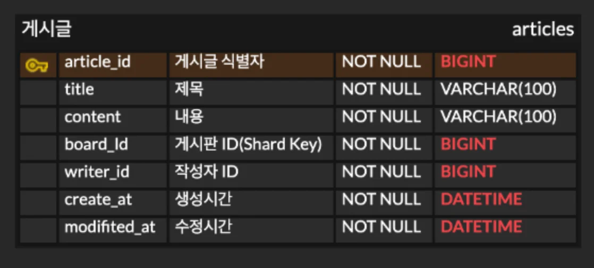

<a id="1c3eda9b0fe181e1b111dab59d4bd6c1"></a>

### ERD

---



<a id="1c3eda9b0fe181fba58ad32d844c056c"></a>

분산 DB를 가정하기 때문에 게시글이   N 개의 샤드 로 분산되는 상황을 고려한다&#46; 

- 샤딩을 직접 구현하지는 않지만 ( 추가로 진행 하기 )<br><strong><u>Shard Key</u></strong> = <strong><u>board&#95;id</u></strong> ( 게시판 ID )로 가정한다&#46; 

- 게시글 테이블 생성
    <a id="1c3eda9b0fe181348ec9f403fd27e0fe"></a>

    ```sql
    CREATE TABLE article (
        article_id BIGINT NOT NULL PRIMARY KEY,
        title VARCHAR(100) NOT NULL,
        content VARCHAR(3000) NOT NULL,
        board_id BIGINT NOT NULL,
        writer_id BIGINT NOT NULL,
        created_at DATETIME NOT NULL,
        modified_at DATETIME NOT NULL
    );
    ```
