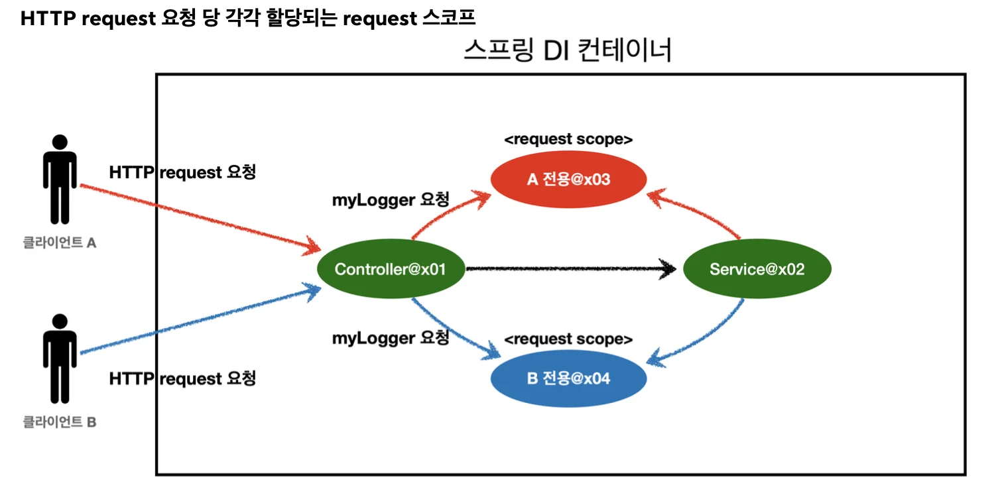

> 웹 스코프란, 웹 환경에서 생성되는 스코프로, 스프링이 해당 스코프의 종료 시점까지 관리한다&#46;  → 종료 메서드 호출됨

### 웹 스코프 종류

- <strong>request&#58;</strong> HTTP 요청 하나가 들어오고 나갈 때 까지 유지되는 스코프, 각각의 HTTP 요청마다 별도의 빈 인스턴스가 생성되고, 관리된다&#46;

- <strong>session&#58;</strong> HTTP Session과 동일한 생명주기를 가지는 스코프

- <strong>application&#58;</strong> 서블릿 컨텍스트( <code>ServletContext</code> )와 동일한 생명주기를 가지는 스코프

- <strong>websocket&#58;</strong> 웹 소켓과 동일한 생명주기를 가지는 스코프

### 예제)  request 스코프 

> 나머지 웹 스코프도 동작 방식은 비슷함&#46;

