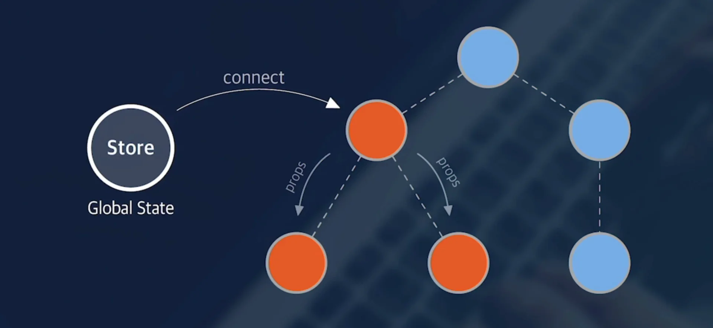
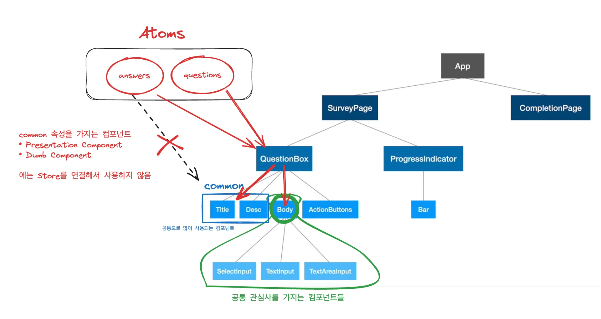

<a id="1c3eda9b0fe18137b669ec1613625e9e"></a>

## 전역 상태 사용에 있어 두가지 고민

---

<a id="1c3eda9b0fe181b18893d44b61584ecb"></a>

### 1&#46; 어떤 데이터를 전역 상태로 관리할 것인가?

- 여러 컴포넌트에서 공유되어 사용되는 데이터
    - ex) 인증 이후, 사용자 정보

<a id="1c3eda9b0fe181d9be79cb682252a34d"></a>

### 2&#46; 스토어와 어떤 컴포넌트를 연결할 것인가?

- 가장 렌더링 영향이 적은 컴포넌트 
    <a id="1c3eda9b0fe18175b7fdc0c84310220a"></a>

    극단적으로 봤을 경우, 스토어를 최상위 컴포넌트에 연결하면, 서비스 전체가 렌더링 영향 범위에 놓이기 때문에 굉장히 비효율적이다&#46; 

    <a id="1c3eda9b0fe18162886be428b370767c"></a>

    따라서 가능한 하위 컴포넌트에 연결하는 것이 좋다&#46; 

- <strong><u>여러 컴포넌트가 하나의 관심사</u></strong>로 <code>그룹핑</code> 된다면, <strong><u>그 중 </u></strong><strong><u>상위 컴포넌트</u></strong>에 <strong><u>전역 상태를 연결</u></strong>
    

<a id="1c3eda9b0fe181ae9cbdea313983ca44"></a>

### 3&#46; Survey 프로젝트 적용 



<a id="1c3eda9b0fe1810788d6e8102c8e7b23"></a>

common 컴포넌트의 경우, 상위 컴포넌트에서 어떤 데이터를 연결하느냐에 따라 역할이 달라질 수 있기 때문에, 

<a id="1c3eda9b0fe181409209d16c96d166a7"></a>

Store ( 전역 상태 저장소) 와 연결하지 않는다&#46;

<a id="1c3eda9b0fe181b2b4a5c64b94f24c99"></a>

9분 30초 부터 다시

- Common 컴포넌트 store 처리 방법

- Contiainer Component &#45; Presentation Component
    - or Smart Component  &#45; Dumb Component

<details>
<summary>1&#46; store &#45; question state 정의</summary>

- type 정의 시, default의 타입만을 정의한다&#46; 

<a id="1c3eda9b0fe1810bad91e97249e15345"></a>

```javascript
import { atom } from "recoil";
import { IQuestion } from "../../\btypes";

const questionsState = atom<IQuestion[]>({
  key: "questionsState",
  default: [
    {
      title: "질문1 입니다.",
      desc: "설명1 입니다.",
      type: "text",
      required: false,
      options: {
        placeholder: "placeholde 입니디.",
      },
    },
    {
      title: "질문2 입니다.",
      desc: "설명2 입니다.",
      type: "textarea",
      required: false,
      options: {
        placeholder: "placeholde 입니디.",
      },
    },
    {
      title: "질문3 입니다.",
      desc: "설명3 입니다.",
      type: "select",
      required: false,
      options: {
        items: ["답변1", "답변2", "답변3", "답변4", "답변5"],
      },
    },
  ],
});

export default questionsState;

```

</details>
