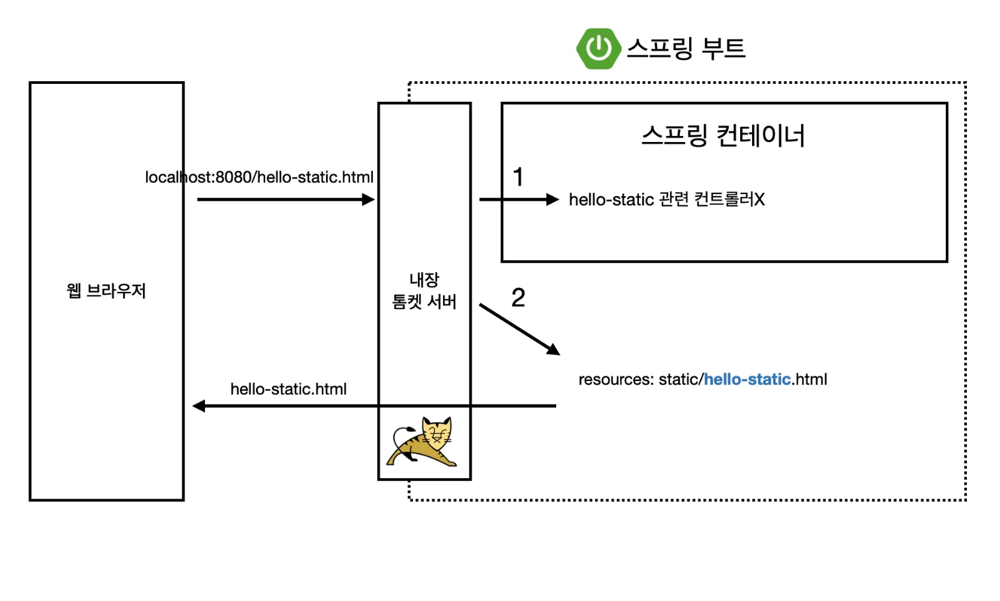
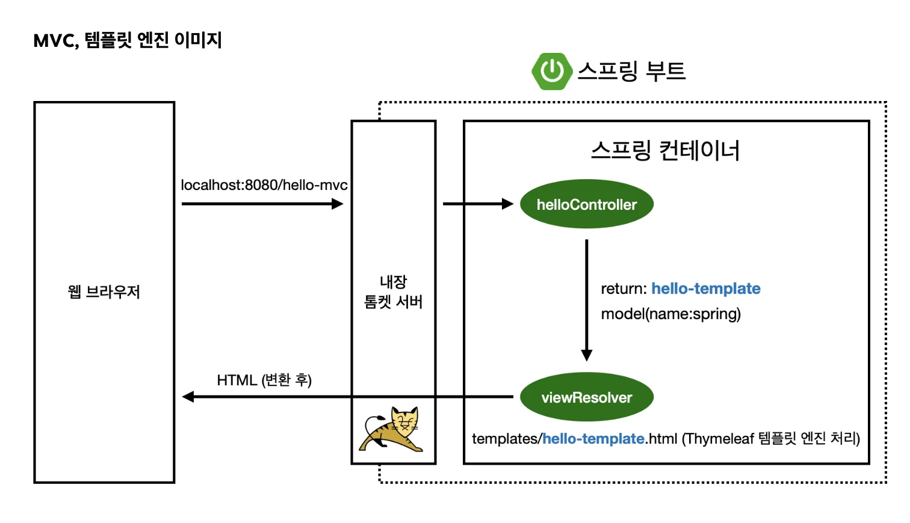
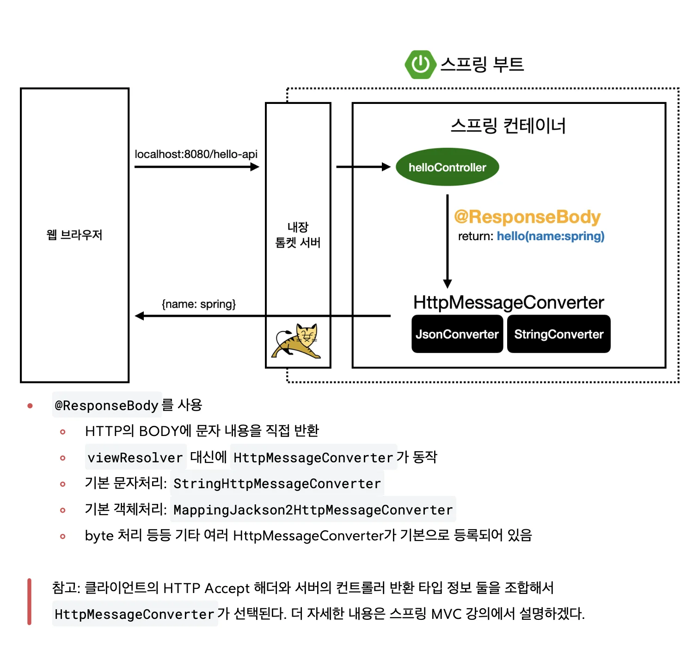

<a id="1c3eda9b0fe181f3b97fced5fb0ecd40"></a>

# 2&#45;1) 정적 컨텐츠

<a id="1c3eda9b0fe1819581f4da6e5f2ae889"></a>

파일(html)을 그대로 웹브라우저에 전달 



<a id="1c3eda9b0fe1819c8811ea5cad05afe7"></a>

# 2&#45;2) MVC 와 템플릿 엔진

> 서버에서<em> </em><strong>html을 변형</strong>시켜 내려주는 방식<br>MVC&#58; Model, View, Controller

<a id="1c3eda9b0fe1812f9b89faa2df770201"></a>

### 모델(model) , 컨트롤러(controller)

<a id="1c3eda9b0fe18109aeb5e5ee92fcf9f3"></a>

비지니스 로직, 데이터 내부적 처리 로직

<a id="1c3eda9b0fe18199b057e5906b318dcb"></a>

### 뷰(view)

<a id="1c3eda9b0fe18120b849fb2a497f6187"></a>

화면을 그리는데 관련되는 모든 로직만 들어감, → 🧐 클라이언트에서 그리는 것과 다른 것인가? → 서버사이드렌더링 방식



<details>
<summary>ex) <strong>Controller</strong></summary>

<a id="1c3eda9b0fe1810cb166dda9ba100a0d"></a>

```java
@Controller
 public class HelloController {
     @GetMapping("hello-mvc")
     public String helloMvc(@RequestParam("name") String name, Model model) {
         model.addAttribute("name", name);
         return "hello-template";
     }
}
```

</details>

<details>
<summary>ex) <strong>view</strong></summary>

<a id="1c3eda9b0fe1814e8bf2ed415f8d2016"></a>

```html
<!-- resources/templates/hello-template.html -->
<html xmlns:th="http://www.thymeleaf.org">
 <body>
	 <p th:text="'hello ' + ${name}">hello! empty</p>
 </body>
</html>
```

</details>

<a id="1c3eda9b0fe18163af90c3b99dea41b6"></a>

# 2&#45;3) API (JSON, 표준) 

<a id="1c3eda9b0fe18195b495d41add27084e"></a>

<strong>JSON 데이터 구조 </strong><strong>포맷</strong>을 내려주는 방식 

<a id="1c3eda9b0fe1813a96afca9bd6a8da7e"></a>

ex1)  &#91;클라이언트 ↔ 서버&#93; 요세 많이 씀(데이터만 내려주면, 클라이언트에서 처리)

<a id="1c3eda9b0fe18104888fe2b66a8e9bf2"></a>

ex2) &#91;서버 ↔ 서버&#93;

<a id="1c3eda9b0fe18129b1f3ea29f8fd6281"></a>

```java
@Controller
 public class HelloController {

     @GetMapping("hello-api")
     @ResponseBody 반환하는 객체를 JSON 포맷으로 변경해줌, 뷰리졸버(viewResolver) X
     public Hello helloApi(@RequestParam("name") String name) {
         Hello hello = new Hello();
         hello.setName(name);
         return hello;
     }

     static class Hello {
         private String name;

         public String getName() {
             return name;
				 }

         public void setName(String name) {
             this.name = name;
				 } 
		 }
}
```


