> 💬 
> 
> <a id="1feeda9b0fe180f5b089ce71e973dda0"></a>
> 
> 이전 챕터에서 프록시 적용을 통해 기존 코드를 변경하지 않고, 로그 추적기라는 부가 기능을 적용할 수 있었다&#46; 
> 
> <a id="1feeda9b0fe18080bcb0e44bd32a9bdd"></a>
> 
> 그러나 대상 클래스  수만큼 로그 추적을 위한 클래스를 생성해야 한다는 단점이 있었다&#46; 
> 
> <a id="1feeda9b0fe18086913cdcce495ff85c"></a>
> 
> 그리고 생성되는 로그 추적 클래스들은 거의 동일한 로직을 갖는다&#46; <br><br>이러한 문제점을 <strong><code>JDK 동적 프록시 기술</code></strong> 이나 <strong><code>CGLIB</code></strong><strong> </strong>같은 프록시 생성 오픈소스 기술을 활용하여 프록시 객체를 동적으로 생성해 해결할 수 있다&#46;
> 
> - 프록시를 적용할 코드 하나만을 만들어두고 동적 프록시 기술을 사용하여 프록시 객체를 찍어낸다&#46;  

<a id="1feeda9b0fe180d7b4c3ff65d37f0416"></a>

### 리플렉션

> ✏️ 
> 
> <a id="1feeda9b0fe180e58cf1d293a56a3dd0"></a>
> 
> JDK 동적 프록시를 이해하기 위해서는 <strong><u>먼저 자바의 리플렉션 기술을 이해</u></strong>해야 한다&#46; 
> 
> <a id="1feeda9b0fe1804d8f2ddaf0aef528ee"></a>
> 
> 리플렉션 기술을 사용하면 <strong><u>클래스나 메서드의 메타 정보를 동적으로 획득</u></strong>하고, <strong><u>코드도 동적으로 호출</u></strong><strong><u> 가능</u></strong>하다&#46;

<details>
<summary>1&#46;  기본 예제</summary>

<details>
<summary>&#91; 코드 &#93; ReflectionTest</summary>

<a id="1feeda9b0fe180b9b318d9f0cdbfd6a2"></a>

```java
package com.inflearn.lecture_prac.jdkdynamic;

import lombok.extern.slf4j.Slf4j;
import org.junit.jupiter.api.Test;

@Slf4j
public class ReflectionTest {

    @Test
    void reflection0() {
        Hello target = new Hello();

        // 공통 로직1 시작
        log.info("start");
        String result1 = target.callA(); // 호출하는 메서드가 다름
        log.info("result={}", result1);
        // 공통 로직1 종료

        // 공통 로직2 시작
        log.info("start");
        String result2 = target.callA(); // 호출하는 메서드가 다름
        log.info("result={}", result2);
        // 공통 로직2 종료
    }

    static class Hello {
        public String callA() {
            log.info("callA");
            return "A";
        }

        public String callB() {
            log.info("callB");
            return "B";
        }
    }
}
```

</details>

<a id="1feeda9b0fe18020a639f371492a69f9"></a>

공통 로직 1 과 공통 로직 2는 호출하는 메서드만 다르고 코드 흐름은 완전히 같다&#46; 

<a id="1feeda9b0fe1804c9124d7bfdb9b87cb"></a>

```java
log.info("start");
String result = xxx(); //호출 대상이 다름, 동적 처리 필요
log.info("result={}", result);
```

<a id="1feeda9b0fe180c583c1c2f495e9dc23"></a>

이를 공통 메서드로 내기 위해서는 호출하는 메서드인 <code>target&#46;callA()</code>, <code>target&#46;callB()</code> 해당 부분만 동적으로 처리해야 한다&#46;

<a id="1feeda9b0fe180dea041d84cf0a32023"></a>

이때 사용하는 기술이 리플랙션이다&#46; 

</details>

<details>
<summary>2&#46; 리플랙션을 통한 공통 로직 메서드 추출</summary>

> 💬 
> 
> <a id="1feeda9b0fe180ab8293ea8fb816890e"></a>
> 
> 이전 챕터에서처럼 상위 형식으로 정의 후, 구현하여 처리해도 공통 로직을 추출 가능하다 &#46;
> 
> <a id="1feeda9b0fe18002951ad7632cf5bc64"></a>
> 
> 그러나 위에서 설명헀듯이 매번 클래스를 생성해, 유지보수 포인트를 증가시키는 단점이 있다&#46; 
> 
> <a id="1feeda9b0fe180078122c5a4b89f6bc1"></a>
> 
> 이를 <code>리플렉션</code>을 통해서 <strong><u>변경되는 메서드명을 동적</u></strong>으로 넘겨 위 문제점을 해결할 수 있다&#46;

> 📌 
> 
> <a id="1feeda9b0fe18011b7a8f0939954d16a"></a>
> 
> <strong>리플랙션 사용법</strong>
> 
> ---
> 
> <details>
> <summary>클래스 메타 정보&#58; <code>Class&#46;forName(&#34;{경로}&#36;{클래스명}&#34;)</code></summary>
> 
> - 클래스의 메타 정보 획득
> 
> - 내부 클래스는 구분을 위해 <code>&#36;</code>를 사용한다&#46; 
> 
> </details>
> 
> <details>
> <summary>메서드 메타 정보&#58; <code>클래스메타정보&#46;getMethod(&#34;{메서드명}&#34;)</code></summary>
> 
> - 가져온 메타정보에서 해당하는 메서드의 메타 정보를 가져온다&#46; 
> 
> </details>
> 
> <details>
> <summary>인스턴스 호출&#58; <code>메서드메타정보&#46;invoke(인스턴스)</code></summary>
> 
> - 획득한 메서드 메타 정보로 실제 인스턴스의 메서드를 호출한다&#46;
> 
> - <code>methodCallA</code>는 Hello 클래스의 <code>callA()</code>라는 메서드의 메타정보이다&#46; 
> 
> - <code>methodCallA&#46;invoke(인스턴스)</code>
>     - 위 메서드를 호출하면서 인스턴스를 넘겨주면, 해당 인스턴스의 <code>callA()</code> 메서드를 찾아 실행한다&#46; 
> 
>     - 아래 예제에서는 <code>target</code>의 <code>callA()</code> 메서드를 호출한다&#46;
> 
> </details>

<details>
<summary>&#91; 코드 &#93; ReflectionTest<code>&#46;reflection1()</code> &#45; 리플랙션 적용</summary>

<a id="1feeda9b0fe18039b965f65d88c334cb"></a>

```java
package com.inflearn.lecture_prac.jdkdynamic;

import lombok.extern.slf4j.Slf4j;
import org.junit.jupiter.api.Test;

@Slf4j
public class ReflectionTest {

	   . . .
	  
	  // 리플랙션 적용
		@Test
		void reflection1() throws Exception {
				// 클래스 정보
				Class classHello = Class.forName("com.inflearn.lecture_prac.jdkdynamic.ReflectionTest$Hello");
				
				Hello target = new Hello();
				
				// callA 메서드 정보
				Method methodCallA = classHello.getMethod("callA");
				Object result1 = methodCallA.invoke(target);
				log.info("result1={}", result1);
				
				// callB 메서드 정보
				Method methodCallB = classHello.getMethod("callB");
				Object result2 = methodCallB.invoke(target);
				log.info("result2={}", result2);
		}
		
	   . . .
}
```

</details>

<details>
<summary>&#91; 코드 &#93; ReflectionTest<code>&#46;reflection2()</code> &#45; 공통 메서드 추출</summary>

> 📌 
> 
> <a id="1feeda9b0fe1807e8e99ffa287e0a4b4"></a>
> 
> <code>dynamicCall(Method method, Object target)</code>
> 
> > 공통 로직 1, 2를 통합하여 처리하는 공통화 메서드이다&#46; 
> 
> <details>
> <summary><code>Method method</code></summary>
> 
> - 첫번째 파라미터, 호출할 메서드 메타 정보
> 
> - 해당 메타 정보를 통해 호출할 메서드 정보를 동적으로 제공한다&#46;
> 
> </details>
> 
> <details>
> <summary><code>Object target</code></summary>
> 
> - 실제 실행할 인스턴 정보
> 
> - <code>method&#46;invoke(target)</code> 를 사용할 때, 호출할 클래스와 메서드 정보가 서로 다르면 예외가 발생된다&#46; 
> 
> </details>

<a id="1feeda9b0fe180fea989c20d40f023f1"></a>

```java
package com.inflearn.lecture_prac.jdkdynamic;

import lombok.extern.slf4j.Slf4j;
import org.junit.jupiter.api.Test;

@Slf4j
public class ReflectionTest {

	   . . .
	  
	  // 리플랙션 - 공통 메서드 추출
		@Test
    void reflection2() throws Exception {
        Class classHello = Class.forName("hello.proxy.jdkdynamic.ReflectionTest$Hello");

        Hello target = new Hello();
        Method methodCallA = classHello.getMethod("callA");
        dynamicCall(methodCallA, target);

        Method methodCallB = classHello.getMethod("callB");
        dynamicCall(methodCallB, target);
    }

    private void dynamicCall(Method method, Object target) throws Exception {
        log.info("start");
        Object result = method.invoke(target);
        log.info("result={}", result);
    }
    
     . . .
}
```

</details>

> 💬 
> 
> <a id="1feeda9b0fe180359174c455c308c70b"></a>
> 
> 람다를 통해서도 공통화 처리가 가능하다&#46;

<details>
<summary>&#91; 코드 &#93; LambdaReflectionTest</summary>

<a id="1feeda9b0fe180128059e625b3f6c3ae"></a>

```java
import lombok.extern.slf4j.Slf4j;
import org.junit.jupiter.api.Test;

import java.util.function.Supplier;

@Slf4j
public class LambdaReflectionTest {

    @Test
    void dynamicCallTest() {
        Hello target = new Hello();

        dynamicCall(target::callA);
        dynamicCall(target::callB);
    }

    // 공통 로직 처리
    private void dynamicCall(Supplier<String> method) {
        log.info("start");
        String result = method.get();  // 메서드 실행
        log.info("result={}", result);
    }

    static class Hello {
        public String callA() {
            log.info("callA");
            return "A";
        }

        public String callB() {
            log.info("callB");
            return "B";
        }
    }
}
```

</details>

</details>

> ⚠️ 
> 
> <a id="1feeda9b0fe180c19513e30d2b12c32c"></a>
> 
> <strong>주의</strong>
> 
> <a id="1feeda9b0fe180798dc9cabe09b01358"></a>
> 
> 리플렉션을 사용하면 클래스와 메서드의 메타정보를 사용해서 애플리케이션을 동적으로 유연하게 만들 수 있다&#46; 
> 
> <a id="1feeda9b0fe180e69a20e015b740811d"></a>
> 
> 하지만 리플렉션 기술은 <strong><u>런타임에 동작</u></strong>하기 때문에, <strong>컴파일 시점에 오류를 잡을 수 없</strong>다&#46; 
> 
> <a id="1feeda9b0fe180318bb4e15445e193e6"></a>
> 
> 만약 <code>getMethod(&#34;callA&#34;)</code> 안에 들어가는 문자를 실수로 <code>getMethod(&#34;callZ&#34;)</code> 로 작성해도 컴파일 오류가 발생하지 않는다&#46;
> 
> <a id="1feeda9b0fe180f68db0f7f7da3cecdf"></a>
> 
> 해당 코드를 직접 실행하는 시점(런타임)에서 오류가 발생한다&#46;
> 
> - 가장 좋은 오류는 개발자가 즉시 확인할 수 있는 컴파일 오류이고, 가장 무서운 오류는 <strong><u>사용자가 직접 실행할 때 발생</u></strong>하는 <strong>런타임 오류</strong>다&#46;
> 
> <a id="338eda9b0fe18033a169d5fe7bba63cf"></a>
> 
> 따라서 리플랙션을 일반적으로 사용하면 안된다&#46; 
> 
> - <strong><u>프레임워크 개발</u></strong>이나, <strong><u>매우 일반적인 공통 처리가 필요</u></strong>할 때 <strong>부분적으로 주의해서 사용</strong>해야 한다&#46;

<a id="1feeda9b0fe18018a102f3043bb69326"></a>

### JDK 동적 프록시

<details>
<summary>1&#46; JDK 동적 프록시 &#45; 실습</summary>

> ✏️ 
> 
> <a id="1feeda9b0fe180efaa40eb6c052d35cb"></a>
> 
> <code>동적 프록시 기술</code>을 사용하면 프록시 객체를 <strong>Dynamic</strong>하게 런타임 환경에서 생성할 수 있다&#46; 
> 
> - 동적 프록시에 원하는 실행 로직을 지정 가능하다&#46; 

> ☝🏻 
> 
> <a id="1feeda9b0fe18082a3a4f2b144cc1bc2"></a>
> 
> <code>JDK 동적 프록시</code>는 <strong><u>인터페이스를 기반</u></strong>으로 <strong><u>프록시를 동적으로 만</u></strong>들어준다&#46; 따라서 <strong>인터페이스가 필수</strong>이다&#46; 

<details>
<summary>1&#46; 기본 예제</summary>

<a id="1feeda9b0fe180b5a138c2666ba04d50"></a>

### 코드

<details>
<summary>&#91; 코드 &#93; &#60;interface&#62; AInterface</summary>

<a id="1feeda9b0fe1808bb996e47ca0b7574f"></a>

```java
package com.inflearn.lecture_prac.jdkdynamic.code;

public interface AInterface {
    String call();
}
```

</details>

<details>
<summary>&#91; 코드 &#93; AImpl</summary>

<a id="1feeda9b0fe18044bcacd1d30fccb80c"></a>

```java
package com.inflearn.lecture_prac.jdkdynamic.code;

import lombok.extern.slf4j.Slf4j;

@Slf4j
public class AImpl implements AInterface {

    @Override
    public String call() {
        log.info("A 호출");
        return "a";
    }
}
```

</details>

<details>
<summary>&#91; 코드 &#93; &#60;interface&#62; BInterface</summary>

<a id="1feeda9b0fe1806e8da2f2fe5a63980b"></a>

```java
package com.inflearn.lecture_prac.jdkdynamic.code;

public interface BInterface {
    String call();
}

```

</details>

<details>
<summary>&#91; 코드 &#93; BImpl</summary>

<a id="1feeda9b0fe180e4a888c63f330a0c97"></a>

```java
package com.inflearn.lecture_prac.jdkdynamic.code;

import lombok.extern.slf4j.Slf4j;

@Slf4j
public class BImpl implements BInterface {

    @Override
    public String call() {
        log.info("B 호출");
        return "b";
    }
}
```

</details>

</details>

<details>
<summary>2&#46; JDK <strong>동적 프록시 적용&#58; </strong><code>InvocationHandler</code></summary>

> ✏️ 
> 
> <a id="1feeda9b0fe18086aaf9c896950adebb"></a>
> 
> <strong><u>JDK 동적 프록시에 적용할 로직</u></strong>은 자바 언어 차원에서 제공되는 <code>InvocationHandler</code> 인터페이스를 구현하여 개발한다&#46;
> 
> <details>
> <summary>&#91; 코드 &#93; <strong>InvocationHandler</strong></summary>
> 
> <details>
> <summary>코드 이미지</summary>
> 
> 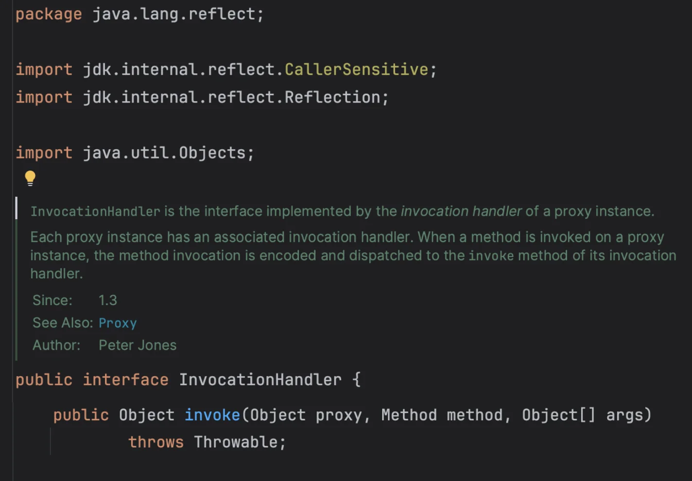
> 
> </details>
> 
> <a id="1feeda9b0fe180ca8360e11df041403c"></a>
> 
> ```java
> package java.lang.reflect;
> 
> public interface InvocationHandler {
>     public Object invoke(Object proxy, Method method, Object[] args)
>        throws Throwable;
> }
> ```
> 
> - <code>Object proxy</code>&#58; 프록시 자신
> 
> - <code>Mehod method</code>&#58; 호출한 메서드
> 
> - <code>Object&#91;&#93; args</code>&#58; 메서드를 호출할 때 전달한 인수
> 
> </details>

<a id="1feeda9b0fe1800abb5af28c50fb895a"></a>

### 코드

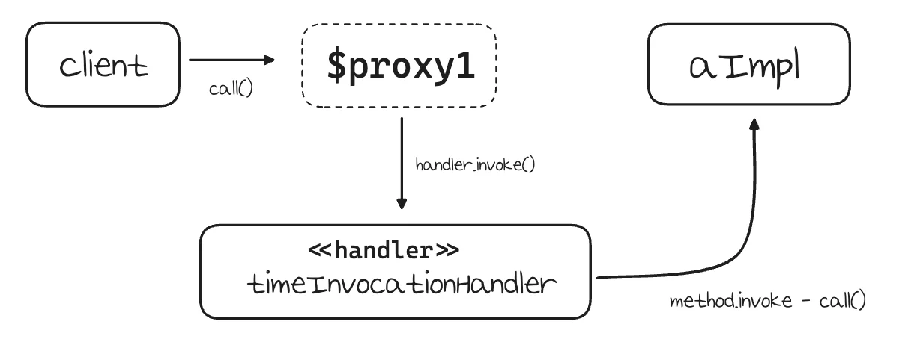

<details>
<summary>실행 순서</summary>

1. 클라이언트 JDK 동적 프록시 <code>call()</code>을 실행한다&#46; 

1. JDK 동적 프록시는 <code>InvocationHanlder&#46;invoke()</code>를 호출한다&#46; 
    - 구현체인<code>TimeInvocationHandler&#46;invoke()</code>가 호출된다&#46; 

1. <code>TimeInvocationHandler</code>가 내부 로직을 수행하고, <code>method&#46;invoke(target, args)</code>를 호출해 <code>target</code>인 실제 객체(<code>AImpl</code>)를 호출한다&#46; 

1. <code>AImpl</code> 인스턴스의 <code>call()</code>이 실행된다&#46; 

1. <code>AImpl</code> 인스턴스의 <code>call()</code>의 실행이 끝나면 <code>TimeInvocationHandler</code>로 응답이 돌아온다&#46; <br>시간 로그를 출력하고 결과를 반환한다&#46; 

</details>

<details>
<summary>&#91; 코드 &#93; <strong>TimeInvocationHandler</strong></summary>

> 📌 
> 
> - <code>InvocationHandler</code> 인터페이스를 구현해 JDK 동적 프록시를 적용할 공통 로직을 개발
> 
> - <code>Object target</code>&#58; 동적 프록시가 호출할 대상
> 
> - <code>method&#46;invoke(target, args)</code>
>     - 리플랙션을 사용하여 target 인스턴스의 메서드를 실행한다&#46;
> 
>     - <code>args</code>&#58;메서드 호출 시 넘겨줄 인수

<a id="1feeda9b0fe180729827e341d64783d7"></a>

```java
package com.inflearn.lecture_prac.jdkdynamic.code;

import lombok.RequiredArgsConstructor;
import lombok.extern.slf4j.Slf4j;

import java.lang.reflect.InvocationHandler;
import java.lang.reflect.Method;

@Slf4j
@RequiredArgsConstructor
public class TimeInvocationHandler implements InvocationHandler {

    private final Object target;

    @Override
    public Object invoke(Object proxy, Method method, Object[] args) throws Throwable {
        log.info("TimeProxy 실행");
        long startTime = System.currentTimeMillis();

        Object result = method.invoke(target, args);

        long endTime = System.currentTimeMillis();
        long resultTime = endTime - startTime;
        log.info("TimeProxy 종료 resultTime={}", resultTime);
        return result;
    }
}
```

</details>

<details>
<summary>&#91; 코드 &#93; <strong>JdkDynamicProxyTest</strong></summary>

> 📌 
> 
> <details>
> <summary><code>new TimeInvocationHanlder(target)</code></summary>
> 
> - 동적 프록시를 적용할 헨들러 로직
> 
> </details>
> 
> <details>
> <summary><code>Proxy&#46;newProxyInstance(클래스로더, 타겟 인터페이스, 헨들러)</code></summary>
> 
> - 동적 프록시는 <code>java&#46;lang&#46;reflect&#46;Proxy</code>를 통해서 생성 가능하다&#46; 
> 
> - 클래스 로더 정보, 인터페이스, 헨들러를 파라미터로 넘긴다&#46; 
> 
> - 그러면 해당 인터페이스를 기반으로 동적 프록시를 생성하고 그 결과를 반환한다&#46; 
> 
> </details>

<a id="1feeda9b0fe1800b9c07dcea8d4fe60e"></a>

```java
package com.inflearn.lecture_prac.jdkdynamic;

import com.inflearn.lecture_prac.jdkdynamic.code.*;
import lombok.extern.slf4j.Slf4j;
import org.junit.jupiter.api.Test;

import java.lang.reflect.Proxy;

@Slf4j
public class JdkDynamicProxyTest {

    @Test
    void dynamicA() {
        AInterface target = new AImpl();
        TimeInvocationHandler handler = new TimeInvocationHandler(target);
        AInterface proxy = (AInterface) Proxy.newProxyInstance(
                AInterface.class.getClassLoader(),
                new Class[]{AInterface.class},
                handler
        );

        proxy.call();
        log.info("targetClass={}", target.getClass());
        log.info("proxyClass={}", proxy.getClass());
    }

    @Test
    void dynamicB() {
        BInterface target = new BImpl();
        TimeInvocationHandler handler = new TimeInvocationHandler(target);
        BInterface proxy = (BInterface) Proxy.newProxyInstance(
                BInterface.class.getClassLoader(),
                new Class[]{BInterface.class},
                handler
        );
        proxy.call();

        log.info("targetClass={}", target.getClass());
        log.info("proxyClass={}", proxy.getClass());
    }
}
```

<a id="1ffeda9b0fe180dc88bbeb8e957ee652"></a>

<strong><code>dynamicA()</code></strong><strong> 출력 결과</strong>

<a id="1feeda9b0fe180388b0cfacc1f52c378"></a>

```java
TimeInvocationHanlder - TimeProxy 실행
AImpl - A 호출
TimeInvocationHandler - TimeProxy 종료 resultTime=0
JdkDynamicProxyTest - targetClass=class hello.proxy.jdkdynamic.code.AImpl
JdkDynamicProxyTest - proxyClass=class com.sun.proxy.$Proxy1
```

</details>

<a id="1feeda9b0fe18003a64cd83e14e8f0b6"></a>

### NOTES

<details>
<summary>🧐 <strong><code>Proxy&#46;newProxyInstance()</code></strong></summary>

> ✏️ 
> 
> <a id="1feeda9b0fe1801b8d18e2fe5324cb6a"></a>
> 
> 지정한 인터페이스들을 구현하는 프록시 클래스(proxy class)를 JVM이 런타임에 생성한다&#46;
> 
> <a id="1feeda9b0fe180648752dbf575dddb69"></a>
> 
> 그리고 넘긴 <code>handler</code>로 모든 메서드 호출을 대신처리한다&#46;
> 
> - 해당 인터페이스를 구현한 프록시 클래스의 바이트코드를 JVM이 직접 만들어 로딩한다&#46; 
> 
> - 즉, 실제 <code>&#46;java</code> 파일이 존재하지 않는 익명 클래스를 바이트코드 수준에서 만들고, JVM 메모리에 올려서 사용한다&#46; 
> 
> <details>
> <summary>&#91; 코드 &#93; Proxy&#46;<code>newProxyInstance()</code></summary>
> 
> <a id="1feeda9b0fe1800db7b9f4b755218fbb"></a>
> 
> ```java
> package java.lang.reflect;
> 
> 
> public class Proxy implements java.io.Serializable {
>     @java.io.Serial
>     private static final long serialVersionUID = -2222568056686623797L;
>     
> 			. . .
>     
> 	  @CallerSensitive
>     public static Object newProxyInstance(ClassLoader loader,
>                                           Class<?>[] interfaces,
>                                           InvocationHandler h) {
>         Objects.requireNonNull(h);
> 
>         @SuppressWarnings("removal")
>         final Class<?> caller = System.getSecurityManager() == null
>                                     ? null
>                                     : Reflection.getCallerClass();
> 
>         /*
>          * Look up or generate the designated proxy class and its constructor.
>          */
>         Constructor<?> cons = getProxyConstructor(caller, loader, interfaces);
> 
>         return newProxyInstance(caller, cons, h);
>     }
>     
> 
>     private static Object newProxyInstance(Class<?> caller, // null if no SecurityManager
>                                            Constructor<?> cons,                                           InvocationHandler h) {
>         /*
>          * Invoke its constructor with the designated invocation handler.
>          */
>         try {
>             if (caller != null) {
>                 checkNewProxyPermission(caller, cons.getDeclaringClass());
>             }
> 
>             return cons.newInstance(new Object[]{h});
>         } catch (IllegalAccessException | InstantiationException e) {
>             throw new InternalError(e.toString(), e);
>         } catch (InvocationTargetException e) {
>             Throwable t = e.getCause();
>             if (t instanceof RuntimeException) {
>                 throw (RuntimeException) t;
>             } else {
>                 throw new InternalError(t.toString(), t);
>             }
>         }
>     }
>     
>      . . .
> ```
> 
> </details>

<details>
<summary>비유) 전화</summary>

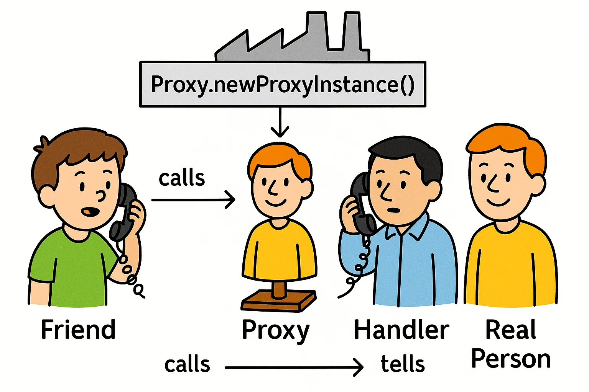

- <strong><code>Friend</code></strong>
    - “친구”는 <strong><u>어떤 서비스를 요청하는 사용자</u></strong>이다&#46; 

    - AInterface 타입의 어떤 객체에게 <code>call()</code>메서드를 호출을 요청한다&#46; 

    - 하지만 직접 구현체(사람)한테 요청하지 않고 프록시에게 전달한다&#46;

- <strong><code>Proxy</code></strong>
    - 요청을 대신 받는 대리자 

    - 겉모습은 진짜 AImpl 같지만, 실제로는 요청을 대신 받는 프록시 객체이다&#46;

- <strong><code>Handler</code></strong>
    - 프록시가 받은 요청을 <strong>Handler (InvocationHandler)</strong>에게 넘겨준다&#46;

    - 메서드 이름, 인자 등 <strong>모든 정보</strong>를 받아서 판단한다&#46;

    - 진짜 사람에게 일을 시킬 수 있고, 가짜로 응답을 줄 수도 있다&#46;
        - 시간 측정, 로깅, 보안 검증, 캐싱 등

- <strong><code>Real Person</code></strong>
    - 핵심 비지니스 로직을 실행하는 객체이다&#46; 

    - 실제로는 호출자가 이 사람을 몰라도 되고, handler가 대신 전달하낟&#46;

    - 이렇게 하면 실제 비지니스 코드를 실행하는 객체 코드는 <strong>아무 수정 없이</strong>, 다양한 기능(로깅, 보안 등)을 추가할 수 있다&#46;

</details>

<details>
<summary><strong>ex) </strong><strong><code>AInterface</code></strong><strong> 동적 프록시로 생성</strong></summary>

<a id="1ffeda9b0fe180ec9edec4ad753e38c8"></a>

```java
Proxy.newProxyInstance(loader, interfaces, handler)
          │
          ▼
 getProxyConstructor(...)  
          │
          ▼
JVM이 인터페이스 구현한 class (ex: $Proxy0) 생성
          │
          ▼
프록시 클래스의 생성자(Constructor) 추출
          │
          ▼
생성자.newInstance(handler)
          │
          ▼
프록시 객체 생성 → handler가 메서드 호출을 가로채 처리

```

<details>
<summary>1&#46; <code>Proxy&#46;newProxyInstance()</code> 호출</summary>

<a id="1feeda9b0fe1800bb03bd5f1a63e27bf"></a>

```java
AInterface proxy = (AInterface) Proxy.newProxyInstance(
    AInterface.class.getClassLoader(),
    new Class[]{AInterface.class},
    handler
);
```

- 파라미터로 아래 3개의 값을 넘긴다&#46;
    - 타겟 인터페이스의 메타 정보를 담고있는 클래스로더  &#45; <code>Ainterface&#46;class&#46;getClassLoader()</code>

    - 타겟 인터페이스 &#45; <code>AInterface</code>

    -  요청을 위임할 handler

</details>

<details>
<summary>2&#46; <code>newProxyInstance()</code> 내부 동작</summary>

<a id="1feeda9b0fe180b4a2e3eb106429655c"></a>

```java
@CallerSensitive
public static Object newProxyInstance(ClassLoader loader,
                                      Class<?>[] interfaces,
                                      InvocationHandler h) {
    Objects.requireNonNull(h);

    @SuppressWarnings("removal")
    final Class<?> caller = System.getSecurityManager() == null
                                ? null
                                : Reflection.getCallerClass();

    Constructor<?> cons = getProxyConstructor(caller, loader, interfaces);

    return newProxyInstance(caller, cons, h);
}
```

- <strong><code>Objects&#46;requireNonNull(h)</code></strong>
    - 받아오는 handler가 null인지 아닌지 체크

    - InvocationHandler 는 반드시 필요하므로, null이면 예외 발생

- <strong><code>final Class&#60;?&#62; caller = &#46;&#46;&#46;</code></strong>
    <a id="1feeda9b0fe18031a988d333bc6a5e56"></a>

    ```java
    final Class<?> caller = System.getSecurityManager() == null
                            ? null
                            : Reflection.getCallerClass();
    ```

    - 보안매니저(SecurityManager)가 존재하면, 누가 이 프록시를 만들었는지 <strong>호출자 클래스(caller class)</strong> 를 확인

    - 내부적으로 보안 검사를 위한 목적<br>(실제로는 잘 사용되지 않음)

- 

</details>

<details>
<summary>3&#46;  <code>Constructor&#60;?&#62; cons = getProxyConstructor(&#46;&#46;&#46;)</code></summary>

> ✏️ 
> 
> <a id="1ffeda9b0fe180b59c5fc1d3b5e2c988"></a>
> 
> 인터페이스 목록을 바탕으로 해당 인터페이스를 구현한 <strong>동적 클래스</strong>를 JVM이 만들고, 그 생성자(Constructor)를 가져온다&#46;

<a id="1feeda9b0fe180988a7cd638306497eb"></a>

```java
class $Proxy0 implements AInterface {
    private final InvocationHandler h;

    public $Proxy0(InvocationHandler h) {
        this.h = h;
    }

    public void call() {
        h.invoke(this, AInterface.class.getMethod("call"), null);
    }
}
```

<a id="1feeda9b0fe180469a57c250c0920f59"></a>

여기서 생성되는 프록시 클래스는 위처럼 생긴 가짜 클래스이다&#46;

<a id="1ffeda9b0fe180a189d9d6ec2123225d"></a>

즉, call()을 호출하면 진짜 로직이 실행되는게 아닌, 핸들러로 위임된다&#46;

</details>

<details>
<summary>4&#46; <code>return newProxyInstance(caller, cons, h)</code></summary>

- 마지막으로 위에서 만든 프록시 클래스 생성자(cons)를 통해, <strong>프록시 객체를 생성한다&#46;</strong>

- h 는 모든 메서드 호출을 위임받는 핸들러 객체이다&#46;
    - <code>invoke()</code> 메서드 실행

</details>

</details>

</details>

<details>
<summary>생성된 JDK 동적 프록시 클래스 정보</summary>

<a id="1ffeda9b0fe180e2ae73d987df051dee"></a>

```java
log.info("proxyClass={}", proxy.getClass());

// 출력 로그 
proxyClass=class com.sun.proxy.$Proxy1
```

<a id="1ffeda9b0fe180998806f84f3832fca6"></a>

출력 로그를 확인해보면 동적으로 생성된 프록시 클래스 정보를 확인할 수 있다 &#46;

- JDK 동적 프록시가 이름 그대로 동적으로 만든 프록시이다&#46; 

- 해당 프록시는 <code>TimeInvocationHandler</code> 로직을 실행한다&#46;

<a id="1ffeda9b0fe180f696d3ce9c2a7abe12"></a>

<strong>동적 프록시 클래스 정보</strong>

<a id="1ffeda9b0fe180b6ae68d39e94fbb88c"></a>

```java
proxyClass=class com.sun.proxy.$Proxy1 //dynamicA
proxyClass=class com.sun.proxy.$Proxy2 //dynamicB
```

- <code>dynamicA()</code>와 <code>dynamicB()</code> 둘을 동시에 함께 실행하면 JDK 동적 프록시가 각각 다른 동적 프록시 클래스를 만들어주는 것을 확인할 수 있다&#46; 

</details>

</details>

> 🗒️ 
> 
> <a id="1ffeda9b0fe18038a307f092e97b659b"></a>
> 
> <strong>정리</strong>
> 
> ---
> 
> > ✏️ 
> > 
> > <a id="1ffeda9b0fe180e4b72efa6a907f8650"></a>
> > 
> > <code>AImpl</code>, <code>BImpl</code> 각각 프록시 객체를 만들지 않고, JDK 동적 프록시를 사용해 동적으로 생성하고 헨들러를 통해 요청을 위임했다&#46; 
> > 
> > - <code>TimeInvocationHandler</code>는 공통으로 사용했다&#46; 
> 
> <details>
> <summary>클래스 의존관계 ( 도입 전 → 도입 후 )</summary>
> 
> 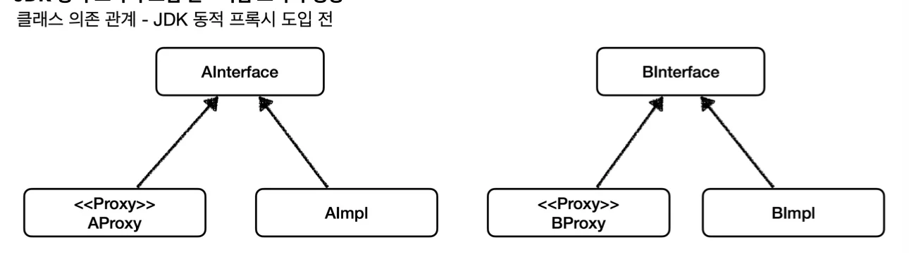
> 
> 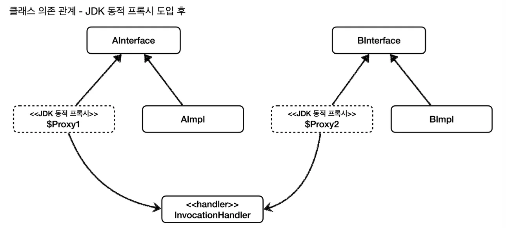
> 
> </details>
> 
> <details>
> <summary>런타임 객체 의존관계 ( 도입 전 → 도입 후 )</summary>
> 
> 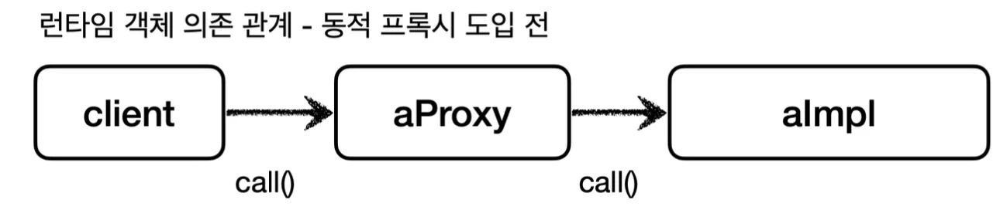
> 
> 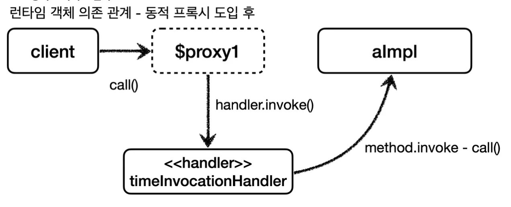
> 
> </details>
> 
> <a id="1ffeda9b0fe18084bf06c7d3912a80b6"></a>
> 
> JDK 동적 프록시 기술 덕분에 매번 프록시 객체를 만들지 않고 동적으로 생성할 수 있었다&#46; 
> 
> <a id="1ffeda9b0fe180b29476d552204ba23a"></a>
> 
> 그리고 같은 부가 기능 로직을 한번만 개발해서 공통으로 적용할 수 있었다&#46; 
> 
> <a id="1ffeda9b0fe180f3b5eff837e20551be"></a>
> 
> 결과적으로 프록시 클래스를 수 없이 만들어야 하는 문제도 해결하고, 부가 기능 로직도 하나의 클래스에 모아서 단일 책임 원칙(SRP)도 지킬 수 있게 되었다&#46; 

</details>

<details>
<summary>2&#46; JDK 동적 프록시 &#45; 적용 1</summary>

<details>
<summary>적용 전 &#45; 의존 관계</summary>

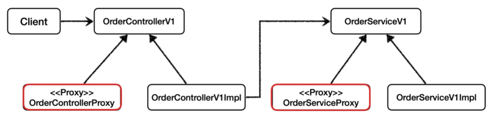


</details>

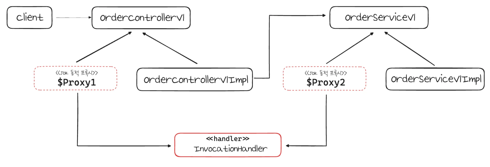

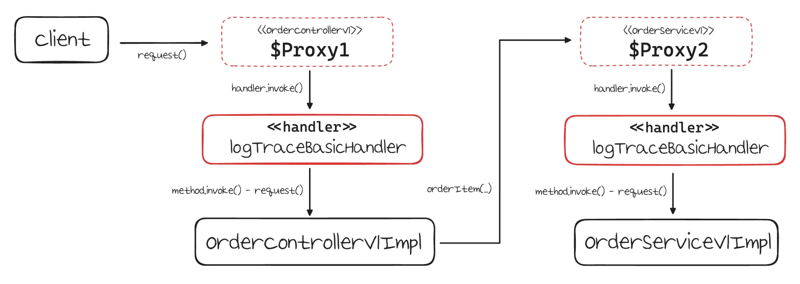

<a id="1ffeda9b0fe180bfbdfbf68ab7c8910d"></a>

### 코드 

<details>
<summary>&#91; 코드 &#93; LogTraceBasicHandler</summary>

<a id="1ffeda9b0fe180ccb75cde76b9cb29d7"></a>

```java
package com.inflearn.lecture_prac.proxy.config.v2_dynamicproxy.handler;

import com.inflearn.lecture_prac.proxy.app.basic_ex.trace.TraceStatus;
import com.inflearn.lecture_prac.proxy.app.basic_ex.trace.logtrace.LogTrace;
import lombok.RequiredArgsConstructor;

import java.lang.reflect.InvocationHandler;
import java.lang.reflect.Method;

@RequiredArgsConstructor
public class LogTraceBasicHandler implements InvocationHandler {

    private final Object target;
    private final LogTrace logTrace;

    @Override
    public Object invoke(Object proxy, Method method, Object[] args) throws Throwable {

        TraceStatus status = null;
        try {
            String message = method.getDeclaringClass().getSimpleName() + "." + method.getName() + "()";
            status = logTrace.begin(message);

            // 로직 호출
            Object result = method.invoke(target, args);

            logTrace.end(status);
            return result;
        } catch (Exception e) {
            logTrace.exception(status, e);
            throw e;
        }
    }
}

```

</details>

<details>
<summary>&#91; 코드 &#93; DynamicProxyBasicConfig</summary>

<a id="1ffeda9b0fe180b0b464c30adbee5147"></a>

```java
package com.inflearn.lecture_prac.proxy.config.v2_dynamicproxy;

import com.inflearn.lecture_prac.proxy.app.basic_ex.trace.logtrace.LogTrace;
import com.inflearn.lecture_prac.proxy.app.basic_ex.v1.*;
import com.inflearn.lecture_prac.proxy.config.v2_dynamicproxy.handler.LogTraceBasicHandler;
import org.springframework.context.annotation.Bean;
import org.springframework.context.annotation.Configuration;

import java.lang.reflect.Proxy;

@Configuration
public class DynamicProxyBasicConfig {

    @Bean
    public OrderControllerV1 orderControllerV1(LogTrace logTrace) {
        OrderControllerV1 orderController = new OrderControllerV1Impl(orderServiceV1(logTrace));
        OrderControllerV1 proxy = (OrderControllerV1) Proxy.newProxyInstance(
                OrderControllerV1.class.getClassLoader(),
                new Class[]{OrderControllerV1.class},
                new LogTraceBasicHandler(orderController, logTrace)
        );
        return proxy;
    }

    @Bean
    public OrderServiceV1 orderServiceV1(LogTrace logTrace) {
        OrderServiceV1 orderService = new OrderServiceV1Impl(orderRepositoryV1(logTrace));

        OrderServiceV1 proxy = (OrderServiceV1) Proxy.newProxyInstance(
                OrderServiceV1.class.getClassLoader(),
                new Class[]{OrderServiceV1.class},
                new LogTraceBasicHandler(orderService, logTrace)
        );

        return proxy;
    }

    @Bean
    public OrderRepositoryV1 orderRepositoryV1(LogTrace logTrace) {
        OrderRepositoryV1 orderRepository = new OrderRepositoryV1Impl();

        OrderRepositoryV1 proxy = (OrderRepositoryV1) Proxy.newProxyInstance(
                OrderRepositoryV1.class.getClassLoader(),
                new Class[]{OrderRepositoryV1.class},
                new LogTraceBasicHandler(orderRepository, logTrace)
        );
        return proxy;
    }
}

```

</details>

<details>
<summary>&#91; 코드 &#93; LecturePracApplication</summary>

<a id="1ffeda9b0fe180858569e6e1d5fffe23"></a>

```java
package com.inflearn.lecture_prac;

import com.inflearn.lecture_prac.proxy.app.basic_ex.trace.logtrace.LogTrace;
import com.inflearn.lecture_prac.proxy.app.basic_ex.trace.logtrace.ThreadLocalLogTrace;
import com.inflearn.lecture_prac.proxy.config.v2_dynamicproxy.DynamicProxyBasicConfig;
import org.springframework.boot.SpringApplication;
import org.springframework.boot.autoconfigure.SpringBootApplication;
import org.springframework.context.annotation.Bean;
import org.springframework.context.annotation.Import;


@Import(DynamicProxyBasicConfig.class)
@SpringBootApplication(scanBasePackages = "com.inflearn.lecture_prac.proxy.app")
public class LecturePracApplication {

    public static void main(String[] args) {
        SpringApplication.run(LecturePracApplication.class, args);
    }

    @Bean
    public LogTrace logTrace() {
        return new ThreadLocalLogTrace();
    }
}
```

</details>

<details>
<summary>&#91; 테스트 &#93; API 호출</summary>

<a id="1ffeda9b0fe180edb8f5d7d2824ca8b5"></a>

```plaintext
curl -X GET "http://localhost:8080/v1/request?itemId=1"
```

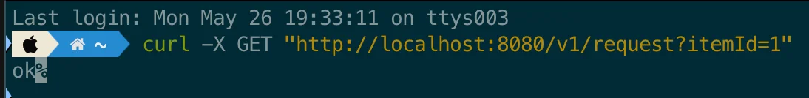

- 정상 수행됨을 확인

<a id="1ffeda9b0fe180bea505fc717d4c1d9e"></a>

출력 로그 확이

<a id="1ffeda9b0fe18050961de693c7d27b39"></a>

```plaintext
[c461350e] OrderController.request()
[c461350e] |-->OrderControllerV1.request()
[c461350e] |   |-->OrderServiceV1.orderItem()
[c461350e] |   |   |-->OrderRepositoryV1.save()
[c461350e] |   |   |<--OrderRepositoryV1.save() time=1097ms
[c461350e] |   |<--OrderServiceV1.orderItem() time=1099ms
[c461350e] |<--OrderControllerV1.request() time=1100ms
[c461350e] OrderController.request() time=1100ms
```

- 위와 같이 각 계층에 대한 로그 ID, 레벨에 대해서 정상적으로 출력되는 것을 확인할 수 있다&#46; 

</details>

<a id="1ffeda9b0fe1802db6cee87d097287b5"></a>

### NOTES

<details>
<summary><strong>&#91; 🤬 오류 &#93;</strong> &#45; 순환 참조 문제</summary>

> 🤬 
> 
> <a id="1ffeda9b0fe180fd83fffd236dad3105"></a>
> 
> <code>OrderControllerConcreteProxy</code> 순환 참조
> 
> ---
> 
> - 문제
>     - 새로운 예제를 추가하면서 이전에 학습을 위해 등록한 <code>ConcreteProxyConfig</code>를 스캔 범위에서 제외함
> 
>     - 이로 인해 수동 빈으로 등록한 구체 클래스(<code>orderSerivceV2</code>)가 스캔되지 않아 이를 상속하는 <code>OrderControllerConcreteProxy</code>를 빈으로 주입 ( 다형성 )
> 
>     - 따라서 자기 자신을 참조하는 순환 참조 문제가 발생됨
> 
> - 해결
>     - <code>OrderControllerConcreteProxy</code>를 스캔 범위에서 제거함 
> 
>     - <code>&#64;RestController</code> 주석 처리

<details>
<summary>&#91; 코드 &#93; ConcreteProxyConfig</summary>

<a id="1ffeda9b0fe18008935fd2efdedc2818"></a>

```java
package com.inflearn.lecture_prac.proxy.config.v1_proxy;

import com.inflearn.lecture_prac.proxy.app.basic_ex.trace.logtrace.LogTrace;
import com.inflearn.lecture_prac.proxy.app.v1_proxy.concrete_proxy.OrderRepositoryConcreteProxy;
import com.inflearn.lecture_prac.proxy.app.v1_proxy.concrete_proxy.OrderServiceConcreteProxy;
import com.inflearn.lecture_prac.proxy.app.basic_ex.v2.OrderControllerV2;
import com.inflearn.lecture_prac.proxy.app.basic_ex.v2.OrderRepositoryV2;
import com.inflearn.lecture_prac.proxy.app.basic_ex.v2.OrderServiceV2;
import org.springframework.context.annotation.Bean;
import org.springframework.context.annotation.Configuration;

@Configuration
public class ConcreteProxyConfig {

    @Bean
    public OrderControllerV2 target2(LogTrace logTrace) {
        return new OrderControllerV2(orderSerivceV2(logTrace));
    }

    @Bean
    public OrderServiceV2 orderSerivceV2(LogTrace logTrace) {
        OrderServiceV2 orderServiceImpl = new OrderServiceV2(orderRepositoryV2(logTrace));
        return new OrderServiceConcreteProxy(orderServiceImpl, logTrace);
    }

    @Bean
    public OrderRepositoryV2 orderRepositoryV2(LogTrace logTrace) {
        OrderRepositoryV2 repositoryImpl = new OrderRepositoryV2();
        return new OrderRepositoryConcreteProxy(repositoryImpl, logTrace);
    }

}

```

</details>

<details>
<summary>&#91; 코드 &#93; OrderControllerConcreteProxy</summary>

<a id="1ffeda9b0fe1807cb752c09ad9aeedee"></a>

```java
package com.inflearn.lecture_prac.proxy.app.v1_proxy.concrete_proxy;

import com.inflearn.lecture_prac.proxy.app.basic_ex.trace.TraceStatus;
import com.inflearn.lecture_prac.proxy.app.basic_ex.trace.logtrace.LogTrace;
import com.inflearn.lecture_prac.proxy.app.basic_ex.v2.OrderControllerV2;
import org.springframework.web.bind.annotation.GetMapping;
import org.springframework.web.bind.annotation.RestController;

// NOTES: 순환 참조 문제가 발생 되어 임시로 주석 처리함
    // 이유: target2를 등록한 ConcreteProxyConfig를 스캔 범위에서 제외함
    //      따라서 수동 빈으로 등록하던 concrete class인 OrderControllerV2가 빈으로 등록되지 않아
    //      이를 상속하는 OrderControllerConcreteProxy를 빈으로 주입함 ( 다형성 )
    //      이로 인해 자기 자신을 참조하는 순환 참조 문제가 발생됨.
//@RestController
public class OrderControllerConcreteProxy extends OrderControllerV2 {

    private final OrderControllerV2 target;
    private final LogTrace logTrace;

    public OrderControllerConcreteProxy(OrderControllerV2 target2, LogTrace logTrace) {
        super(null);
        this.target = target2;
        this.logTrace = logTrace;
    }

    @GetMapping("/v2/request")
    @Override
    public String request(String itemId) {

        TraceStatus status = null;
        try {
            status = logTrace.begin("OrderRepository.save()");
            // target 호출
            target.request(itemId);
            logTrace.end(status);
        } catch (Exception e) {
            logTrace.exception(status, e);
            throw e;
        }
        return "proxy";
    }
}
```

</details>

</details>

> ❗ 
> 
> <a id="1ffeda9b0fe180a68bc7d400bda28b8c"></a>
> 
> <strong>개선점</strong>
> 
> ---
> 
> > <code>http&#58;//localhost&#58;8080/v1/no&#45;log</code>	
> 
> - no&#45;log를 실행해도 동적 프록시가 적용되고, <code>LogTraceBasicHandler</code> 가 실행되기 때문에 로그가 남는다&#46; 
> 
> - 이 부분을 로그가 남지 않도록 처리해야 한다&#46;

</details>

<details>
<summary>2&#46; JDK 동적 프록시 &#45; 적용 2, fillter를 통한 특정 조건만 적용</summary>

<a id="1ffeda9b0fe18072af03d2346fce8f0b"></a>

### 코드 

<details>
<summary>&#91; 코드 &#93; LogTraceFilterHandler</summary>

<a id="1ffeda9b0fe180648052ce5197780fe2"></a>

```java
package com.inflearn.lecture_prac.proxy.config.v2_dynamicproxy.handler;

import com.inflearn.lecture_prac.proxy.app.basic_ex.trace.TraceStatus;
import com.inflearn.lecture_prac.proxy.app.basic_ex.trace.logtrace.LogTrace;
import org.springframework.util.PatternMatchUtils;

import java.lang.reflect.InvocationHandler;
import java.lang.reflect.Method;

public class LogTraceFilterHandler implements InvocationHandler {

    private final Object target;
    private final LogTrace logTrace;
    private final String[] patterns;

    public LogTraceFilterHandler(Object target, LogTrace logTrace, String ...patterns) {
        this.target = target;
        this.logTrace = logTrace;
        this.patterns = patterns;
    }

    @Override
    public Object invoke(Object proxy, Method method, Object[] args) throws Throwable {

        // 메서드 이름 필터
        String methodName = method.getName();
        if (!PatternMatchUtils.simpleMatch(patterns, methodName)) {
            return method.invoke(target, args);
        }

        TraceStatus status = null;
        try {
            String message = method.getDeclaringClass().getSimpleName() + "." + method.getName() +
                    "()";
            status = logTrace.begin(message);

            // 로직 호출
            Object result = method.invoke(target, args);

            logTrace.end(status);
            return result;
        } catch (Exception e) {
            logTrace.exception(status, e);
            throw e;
        }
    }
}

```

</details>

<details>
<summary>&#91; 코드 &#93; DynamicProxyFilterConfig</summary>

<a id="1ffeda9b0fe1801a9e2edc17b90d4700"></a>

```java
package com.inflearn.lecture_prac.proxy.config.v2_dynamicproxy;

import com.inflearn.lecture_prac.proxy.app.basic_ex.trace.logtrace.LogTrace;
import com.inflearn.lecture_prac.proxy.app.basic_ex.v1.*;
import com.inflearn.lecture_prac.proxy.config.v2_dynamicproxy.handler.LogTraceFilterHandler;
import org.springframework.context.annotation.Bean;
import org.springframework.context.annotation.Configuration;

import java.lang.reflect.Proxy;

@Configuration
public class DynamicProxyFilterConfig {

    private static final String[] PATTERNS = {"request", "order*", "save*"};

    @Bean
    public OrderControllerV1 orderControllerV1(LogTrace logTrace) {
        OrderControllerV1 orderController = new OrderControllerV1Impl(orderServiceV1(logTrace));
        return (OrderControllerV1) Proxy.newProxyInstance(
                OrderControllerV1.class.getClassLoader(),
                new Class[]{OrderControllerV1.class},
                new LogTraceFilterHandler(orderController, logTrace, PATTERNS)
        );
    }

    @Bean
    public OrderServiceV1 orderServiceV1(LogTrace logTrace) {
        OrderServiceV1 orderService = new OrderServiceV1Impl(orderRepositoryV1(logTrace));
        return (OrderServiceV1) Proxy.newProxyInstance(
                OrderServiceV1.class.getClassLoader(),
                new Class[]{OrderServiceV1.class},
                new LogTraceFilterHandler(orderService, logTrace)
        );
    }

    @Bean
    public OrderRepositoryV1 orderRepositoryV1(LogTrace logTrace) {
        OrderRepositoryV1 orderRepository = new OrderRepositoryV1Impl();
        return (OrderRepositoryV1) Proxy.newProxyInstance(
                OrderRepositoryV1.class.getClassLoader(),
                new Class[]{OrderRepositoryV1.class},
                new LogTraceFilterHandler(orderRepository, logTrace)
        );
    }

}

```

</details>

<details>
<summary>&#91; 코드 &#93; LecturePracApplication</summary>

<a id="1ffeda9b0fe18098836fcbb610d79319"></a>

```java
package com.inflearn.lecture_prac;

import com.inflearn.lecture_prac.proxy.app.basic_ex.trace.logtrace.LogTrace;
import com.inflearn.lecture_prac.proxy.app.basic_ex.trace.logtrace.ThreadLocalLogTrace;
import com.inflearn.lecture_prac.proxy.config.v2_dynamicproxy.DynamicProxyBasicConfig;
import com.inflearn.lecture_prac.proxy.config.v2_dynamicproxy.DynamicProxyFilterConfig;
import org.springframework.boot.SpringApplication;
import org.springframework.boot.autoconfigure.SpringBootApplication;
import org.springframework.context.annotation.Bean;
import org.springframework.context.annotation.Import;


@Import(DynamicProxyFilterConfig.class)
@SpringBootApplication(scanBasePackages = "com.inflearn.lecture_prac.proxy.app")
public class LecturePracApplication {

    public static void main(String[] args) {
        SpringApplication.run(LecturePracApplication.class, args);
    }

    @Bean
    public LogTrace logTrace() {
        return new ThreadLocalLogTrace();
    }
}
```

</details>

<details>
<summary>&#91; 테스트 &#93; API 호출</summary>

<a id="1ffeda9b0fe180e8a719eae8ccde7a78"></a>

```plaintext
curl -X GET "http://localhost:8080/v1/no-log
```


- 정상 수행됨을 확인

<a id="1ffeda9b0fe180ed9408c9f679002341"></a>

출력 로그 확인

<a id="1ffeda9b0fe18088b1dcd1a09e9c2f36"></a>

```plaintext
❌, 출력 로그 없음
```

</details>

<a id="200eda9b0fe1802a9c00e7b97e6811d0"></a>

### NOTES

<details>
<summary>fillter 통해 부가기능 제어</summary>

> ✏️ 
> 
> <a id="200eda9b0fe180f5837ed34e90a0f523"></a>
> 
> <code>LogTraceFilterHandler</code>를 빈으로 등록 시, 부가기능(로그 추적)을 적용한 patterns를 같이 넘긴다 &#46;
> 
> - patterns에 해당하는 경우, 부가기능이 적용된다&#46; 

<a id="200eda9b0fe180c89299d5ce69ac4818"></a>

```java
// DynamicProxyFilterConfig
@Configuration
public class DynamicProxyFilterConfig {
		
		// 부가기능을 적용할 패턴 명시
    private static final String[] PATTERNS = {"request", "order*", "save*"};

    @Bean
    public OrderControllerV1 orderControllerV1(LogTrace logTrace) {
        OrderControllerV1 orderController = new OrderControllerV1Impl(orderServiceV1(logTrace));
        return (OrderC][ontrollerV1) Proxy.newProxyInstance(
                OrderControllerV1.class.getClassLoader(),
                new Class[]{OrderControllerV1.class},
                new LogTraceFilterHandler(orderController, logTrace, PATTERNS)
        );
    }

   . . .
```

<a id="200eda9b0fe1800baf94df3663b3ddb2"></a>

```java
// LogTraceFilterHandler
public class LogTraceFilterHandler implements InvocationHandler {

    private final Object target;
    private final LogTrace logTrace;
    private final String[] patterns;

    public LogTraceFilterHandler(Object target, LogTrace logTrace, String ...patterns) {
        this.target = target;
        this.logTrace = logTrace;
        this.patterns = patterns;
    }

		@Override
		public Object invoke(Object proxy, Method method, Object[] args) throws Throwable {
		
		    String methodName = method.getName();
		    
		    // 해당되는 패턴이 아닌 경우, 바로 비지니스 로직으로 이동
		    if (!PatternMatchUtils.simpleMatch(patterns, methodName)) {
		        return method.invoke(target, args);
		    }
		
		    TraceStatus status = null;
		    try {
		        String message = method.getDeclaringClass().getSimpleName() + "." + method.getName() +
		                "()";
		        status = logTrace.begin(message);
		
		        // 로직 호출
		        Object result = method.invoke(target, args);
		
		        logTrace.end(status);
		        return result;
		    } catch (Exception e) {
		        logTrace.exception(status, e);
		        throw e;
		    }
		}
```

</details>

</details>

> ❗ 
> 
> <a id="1ffeda9b0fe1809083bbe589a7ab3e45"></a>
> 
> <strong>한계점</strong>
> 
> ---
> 
> <a id="1ffeda9b0fe1804c8842fb6b7bab7f62"></a>
> 
> <code>JDK 동적 프록시</code>는 <strong><u>인터페이스가 필수</u></strong>이다&#46;
> 
> <a id="200eda9b0fe1802288c0cc5cf184f4b6"></a>
> 
> 따라서 V2와 같은 <strong><code>Concrete Class</code></strong>를 상속하는 경우,
> 
> <a id="200eda9b0fe180b2826fce0421b7fc9b"></a>
> 
> <code>CGLIB</code>라는 바이트코드를 조작하는 특별한 라이브러리를 사용해야 한다&#46; 

<a id="1feeda9b0fe18072a566cd2ad01f2fad"></a>

### CGLIB

> ✏️ 
> 
> <a id="200eda9b0fe180ecb3a7ebfeff0f9c80"></a>
> 
> <strong>CGLIB ( Code Generator Library )</strong>
> 
> ---
> 
> <a id="200eda9b0fe1803b9b65e1d02127e849"></a>
> 
> CGLIB는 <strong><u>바이트코드를 조작해 동적으로 클래스를 생성</u></strong>하는 기술을 제공하는 라이브러리이다&#46;
> 
> - 인터페이스 없이 <code>Concrete Class</code>만을 가지고 동적 프록시 생성 가능
> 
> - CGLIB 외부 라이브러리 지만, 스프링 프레임워크 내부 소스코드에 포함되어 있다&#46; 따라서 스프링을 사용한다면 별도의 외부 라이브러리를 추가하지 않아도 된다&#46; 

> ☝🏻 
> 
> <a id="200eda9b0fe180e0a79be632e7ed0c8b"></a>
> 
> CGLIB를 직접 사용하는 경우는 거의 없다&#46; 
> 
> - 스프링의 <code>ProxyFactory</code>를 통해 편리하게 사용 가능하다&#46; 
> 
> <a id="200eda9b0fe180be8420cc0073d1db4b"></a>
> 
> 따라서 CGLIB가 무엇인지 대략 개념만 잡는 것을 권장한다&#46;

<details>
<summary>1&#46; CGLIB &#45; 실습</summary>

<details>
<summary>🧐 <strong>CGLIB 한계점 과 대체 기술</strong></summary>

<details>
<summary>Reference</summary>

- <a href="https://www.graalvm.org/reference-manual/native-image/">GraalVM Native Image 공식 문서</a>

- <a href="https://docs.spring.io/spring-framework/reference/core/aop/proxying.html">Spring AOP 프록시 공식 문서</a>

- <a href="https://docs.spring.io/spring-boot/docs/current/reference/html/native-image.html">Spring Boot Native Image 가이드</a>

- <a href="https://bytebuddy.net/">ByteBuddy 공식 문서</a>

- <a href="https://github.com/cglib/cglib">CGLIB GitHub 저장소</a>

</details>

> ✏️ 
> 
> <a id="200eda9b0fe180bca0feea7ffc40c21f"></a>
> 
> <strong>CGLIB</strong>
> 
> - CGLIB은 Java에서 <strong>클래스 기반 프록시 생성</strong>을 위한 라이브러리이다&#46;
> 
> - 인터페이스가 없는 클래스에도 프록시를 생성할 수 있어 Spring AOP, <code>&#64;Transactional</code>, <code>&#64;Async</code> 등에 사용된다&#46;

<details>
<summary>CGLIB의 주요 한계점</summary>

| 한계 | 설명 |
| --- | --- |
| 🔍 리플렉션 의존 | 런타임에 클래스 구조 분석과 바이트코드 생성이 필요함 |
| 🐢 성능 한계 | 런타임 동적 생성 → 기동 시간 느림, 메모리 사용 많음 |
| ❌ AOT 비호환 | GraalVM Native Image 빌드시 리플렉션/프록시 지원 제한 |
| 🚫 클래스 상속 제약 | final 클래스/메서드는 프록시 불가 |
| 🧩 디버깅 어려움 | 생성된 CGLIB 클래스가 복잡하여 추적이 힘듦 |
| 🔄 사용 감소 추세 | Spring 6 이후 AOT, Native 지원 위해 점차 지양됨 |

</details>

<details>
<summary>CGLIB 대체 기술 및 전략</summary>

| 기술 | 설명 | 장점 |
| --- | --- | --- |
| JDK Dynamic Proxy | 인터페이스 기반 프록시 | AOT 호환, 기본 JDK 지원 |
| ByteBuddy | 고성능 바이트코드 조작 라이브러리 | 유지보수 활발, Mockito 등 사용 |
| Spring AOT &#43; GraalVM | 정적 분석 기반 프록시 생성 | Native Image 변환 가능 |
| ProxyFactory (Spring Core) | 명시적으로 JDK/CGLIB 선택 가능 | 제어 용이, 테스트에 유리 |
| Sealed 클래스 &#43; Interface&#45;first 설계 | 정적 구조 강조 | AOT 최적화에 유리 |

</details>

<details>
<summary>AOT/GraalVM 환경에서의 권장 전략</summary>

- <code>&#64;Configuration(proxyBeanMethods = false)</code> 사용 → 프록시 생성 억제

- 리플렉션/프록시 의존 최소화

- Bean 명시 등록 (<code>&#64;ComponentScan</code> 대신 <code>&#64;Bean</code>)

- 인터페이스 기반 아키텍처로 전환

</details>

</details>

> ✏️ 
> 
> <a id="200eda9b0fe180058036ea2f04635519"></a>
> 
> JDK 동적 프록시에서 실행 로직을 위해 <code>InvocationHandler</code>를  제공했듯이, <br>CGLIB에서는 <code>MethodInterceptor</code>를 제공한다&#46; 
> 
> <details>
> <summary>&#91; 코드 &#93; <strong>MethodInterceptor</strong></summary>
> 
> <details>
> <summary>코드 이미지</summary>
> 
> 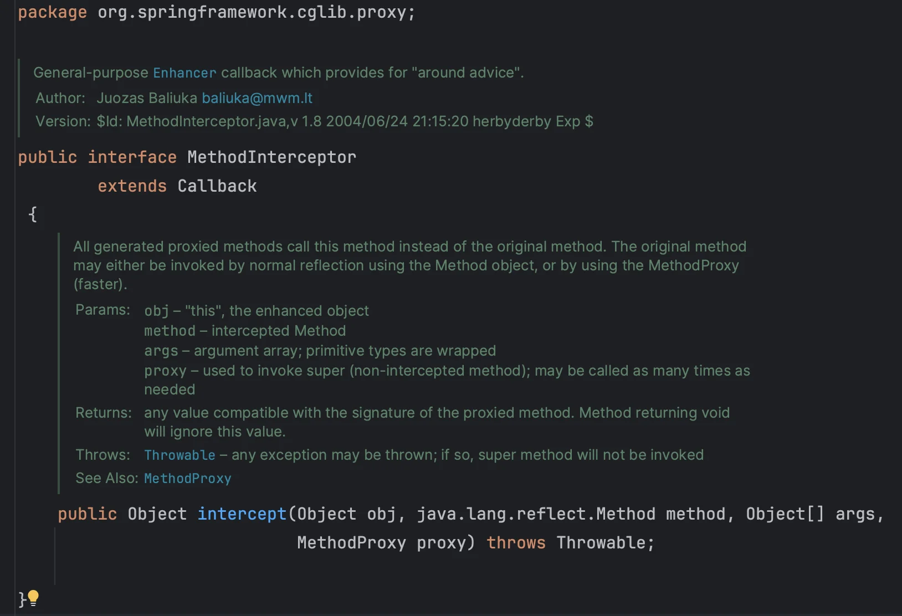
> 
> </details>
> 
> <a id="200eda9b0fe18094a6d5f6df6d326046"></a>
> 
> ```java
> package org.springframework.cglib.proxy;
> 
> public interface MethodInterceptor extends Callback {
> 
>    Object intercept(Object obj, Method method, Object[] args, MethodProxyproxy) throws Throwable;
> }
> ```
> 
> - <code>obj</code>&#58; <code>CGLIB</code>가 적용된 객체
> 
> - <code>method</code>&#58; 호출된 메서드
> 
> - <code>args</code>&#58; 메서드를 호출하면서 전달된 인수
> 
> - <code>proxy</code>&#58; 메서드 호출에 사용
> 
> </details>

<details>
<summary>1&#46; 기본 예제</summary>

<a id="200eda9b0fe180c88eedfac71168f0f3"></a>

### 코드  

<details>
<summary>&#91; 코드 &#93; ServiceInterface</summary>

<a id="200eda9b0fe1808bb5c4f5288751ca00"></a>

```java
package com.inflearn.lecture_prac.common.service;

public interface ServiceInterface {
    void save();
    void find();
}
```

</details>

<details>
<summary>&#91; 코드 &#93; ServiceImpl</summary>

<a id="200eda9b0fe18018aaa4c79c417f4194"></a>

```java
package com.inflearn.lecture_prac.common.service;

import lombok.extern.slf4j.Slf4j;

@Slf4j
public class ServiceImpl implements ServiceInterface {

    @Override
    public void save() {
        log.info("save 호출");
    }

    @Override
    public void find() {
        log.info("find 호출");
    }
}
```

</details>

<details>
<summary>&#91; 코드 &#93; ConcreteService</summary>

<a id="200eda9b0fe180a19c48f1ba88eede71"></a>

```java
package com.inflearn.lecture_prac.common.service;

import lombok.extern.slf4j.Slf4j;

@Slf4j
public class ConcreteService {
    public void call() {
        log.info("ConcreteService 호출");
    }
}
```

</details>

</details>

<details>
<summary>2&#46; CGLIB 적용</summary>

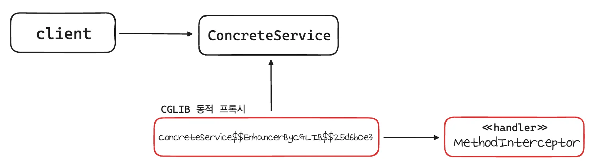

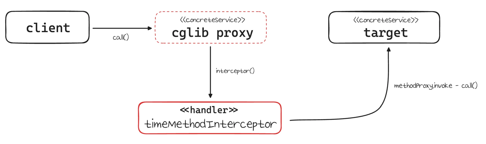

<a id="200eda9b0fe18046b8a2eb482353e31d"></a>

### 코드

<details>
<summary>&#91; 코드 &#93; <strong>TimeMethodInterceptor</strong></summary>

> 📌 
> 
> - <code>MethodInterceptor</code> 인터페이스를 구현
>     - CGLIB 프록시의 실행 로직 정의
> 
> - <code>Object target</code>&#58; 프록시가 호출할 실제 대상
> 
> - <code>proxy&#46;invoke(target, args)</code>
>     - 실제 대상을 동적으로 호출
> 
>     - method를 사용해도 되지만, CGLIB는 성능상 <code>MethodProxy proxy</code>를 사용하는 것을 권장

<a id="200eda9b0fe1803aae87c8bba158ff76"></a>

```java
package com.inflearn.lecture_prac.cglib.code;

import lombok.extern.slf4j.Slf4j;
import org.springframework.cglib.proxy.MethodInterceptor;
import org.springframework.cglib.proxy.MethodProxy;

import java.lang.reflect.Method;

@Slf4j
public class TimeMethodInterceptor implements MethodInterceptor {

    private final Object target;

    public TimeMethodInterceptor(Object target) {
        this.target = target;
    }

    @Override
    public Object intercept(Object obj, Method method, Object[] args, MethodProxy proxy) throws Throwable {
        log.info("TimeProxy 실행");
        long startTime = System.currentTimeMillis();

        Object result = proxy.invoke(target, args);

        long endTime = System.currentTimeMillis();
        long resultTime = endTime - startTime;
        log.info("TimeProxy 종료 resultTime={}", resultTime);
        return result;
    }
}
```

</details>

<details>
<summary>&#91; 코드 &#93; <strong>CglibTest</strong></summary>

> 📌 
> 
> <details>
> <summary>1&#46; <code>Enhancer</code></summary>
> 
> - CGLIB는 <code>Enhancer</code>를 사용해 프록시를 생성한다&#46;  
> 
> </details>
> 
> <details>
> <summary>2&#46;<code>enhancer&#46;setSuperclass(ConcreteService&#46;class)</code></summary>
> 
> - CGLIB는 구체 클래스를 상속 받아서 프록시를 생성할 수 있다&#46; 
> 
> - 어떤 구체 클래스를 상속 받을 지 지정한다&#46; 
> 
> </details>
> 
> <details>
> <summary>3&#46; <code>enhancer&#46;create()</code></summary>
> 
> - 프록시를 생성한다&#46;
> 
> - 앞서 설정한 <code>enhancer&#46;setSuperclass(ConcreteService&#46;class)</code>에서 지정한 클래스를 상속 받아서 프록시가 만들어진다&#46; 
> 
> </details>

<a id="200eda9b0fe18078a210daebac051e4c"></a>

```java
package com.inflearn.lecture_prac.cglib;

import com.inflearn.lecture_prac.cglib.code.TimeMethodInterceptor;
import com.inflearn.lecture_prac.common.service.ConcreteService;
import lombok.extern.slf4j.Slf4j;
import org.junit.jupiter.api.Test;
import org.springframework.cglib.proxy.Enhancer;

@Slf4j
public class CglibTest {

    @Test
    void cglib() {
        ConcreteService target = new ConcreteService();

        Enhancer enhancer = new Enhancer();
        enhancer.setSuperclass(ConcreteService.class);
        enhancer.setCallback(new TimeMethodInterceptor(target));
        ConcreteService proxy = (ConcreteService) enhancer.create();
        log.info("targetClass={}", target.getClass());
        log.info("proxyClass={}", proxy.getClass());

        proxy.call();
    }
}
```

<a id="200eda9b0fe18057ab31d612f1100623"></a>

실행 로그

<a id="200eda9b0fe18035b23ff9868c2ce773"></a>

```plaintext
CglibTest - targetClass=class com.inflearn.lecture_prac.common.service.ConcreteService
CglibTest - proxyClass=class com.inflearn.lecture_prac.common.service.ConcreteService$$EnhancerByCGLIB$$8e2d86a6
TimeMethodInterceptor - TimeProxy 실행
ConcreteService - ConcreteService 호출
TimeMethodInterceptor - TimeProxy 종료 resultTime=8
```

- <strong>CGLIB 가 생성한 프록시 클래스 이름</strong>
    <a id="200eda9b0fe18052ab97db3b4191e941"></a>

    ```java
    // 대상클래스$$EnhancerByCGLIB$$임의코드
    ConcreteService$$EnhancerByCGLIB$$25d6b0e3

    // 비교) JDK Proxy가 생성한 클래스 이름
    proxyClass=class com.sun.proxy.$Proxy1
    ```

</details>

</details>

</details>

> ❗ 
> 
> <a id="200eda9b0fe1804a8bffc1e14f6fee8c"></a>
> 
> <strong>CGLIB 제약</strong>
> 
> ---
> 
> <a id="200eda9b0fe180a4a20de992aa2d1e07"></a>
> 
> <strong><u>클래스 기반 프록시</u></strong>는 <strong>상속</strong>을 사용하기 때문에 아래와 같은 제약이 존재한다&#46; 
> 
> - <u>부모 클래스의 생성자를 확인</u>해야 한다&#46; 
>     - CGLIB는 <strong>자식 클래스를 동적으로 생성</strong>하기 때문에 <br><strong><u>기본 생성자가 필요</u></strong>하다&#46;
> 
> - 클래스에 <code>final</code> 키워드가 붙으면 <strong><u>상속이 불가능</u></strong>하다&#46; 
>     - CGLIB에서는 <u>예외가 발생</u>한다&#46; 
> 
> -  메서드에 <code>final</code> 키워드가 붙으면 <strong><u>해당 메서드를 오버라이딩 할 수 없</u></strong>다&#46; 
>     - CGLIB에서는 <u>프록시 로직이 동작하지 않</u>는다&#46; 

> ☝🏻 
> 
> <a id="200eda9b0fe1808f9199df825a7f8b78"></a>
> 
> CGLIB를 사용하면 인터페이스가 없는 V2 앱에 동적 프록시를 적용할 수 있다&#46; 
> 
> <a id="200eda9b0fe180649e7eed5225b3aaba"></a>
> 
> 그런데 지금 당장 적용 하기에는 몇가지 제약이 있다&#46; <br>V2 애플리케이션에 <strong><u>기본 생성자를 추가</u></strong>하고, 의존관계를 <code>setter</code> 를 사용해서 주입하면 <strong><u>CGLIB를 적용할</u></strong> 수 있다&#46; 
> 
> <a id="200eda9b0fe1807a85b3dc211f7f63f7"></a>
> 
> 하지만 다음 챕터부터 학습하는 <code>ProxyFactory</code> 를 사용하여 <code>CGLIB</code>를 적용하면 이런 단점을 해결하고 더 편리하게 사용 가능하다&#46; 

> 🗒️ 
> 
> <a id="200eda9b0fe18087bc67f12b05910bcd"></a>
> 
> <strong>남은 문제</strong>
> 
> ---
> 
> - [ ] 인터페이스가 있는 경우에는 JDK 동적 프록시를 적용하고, 그렇지 않은 경우에는 CGLIB를 적용하려면 어떻게해야 하는가?
> 
> - [ ] 두 기술을 함께 사용할 때 부가 기능을 제공하기 위해서 JDK 동적 프록시가 제공하는 <code>InvocationHandler</code>와 CGLIB가 제공하는 <code>MethodInterceptor</code> 를 각각 중복으로 만들어서 관리하는가?
> 
> - [ ] 특정 조건에 맞을 때 프록시 로직을 적용하는 기능도 공통으로 제공되었다면?
