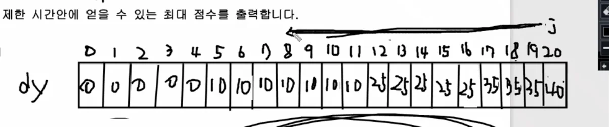

<a id="1c3eda9b0fe181c7a921d1f7283f683b"></a>

# 문제

<a id="1c3eda9b0fe181309105dab24c9d1666"></a>

## <strong>6&#46; 최대점수 구하기(냅색 알고리즘)</strong>

<a id="1c3eda9b0fe1814eb969e66cfe5aa6bf"></a>

### 설명

<a id="1c3eda9b0fe181b0b7e3dc3728debaa5"></a>

이번 정보올림피아드대회에서 좋은 성적을 내기 위하여 현수는 선생님이 주신 N개의 문제를 풀려고 합니다&#46;

<a id="1c3eda9b0fe18169b64ad7ff211fa115"></a>

각 문제는 그것을 풀었을 때 얻는 점수와 푸는데 걸리는 시간이 주어지게 됩니다&#46;

<a id="1c3eda9b0fe18161b511f17331908b75"></a>

제한시간 M안에 N개의 문제 중 최대점수를 얻을 수 있도록 해야 합니다&#46;

<a id="1c3eda9b0fe1819691acf86506ce12e1"></a>

(해당문제는 해당시간이 걸리면 푸는 걸로 간주한다, 한 유형당 한개만 풀 수 있습니다&#46;)

<a id="1c3eda9b0fe1812e8793db4328b79c8e"></a>

### 입력

<a id="1c3eda9b0fe181ebb04de44f2b38a122"></a>

첫 번째 줄에 문제의 개수N(1&#60;=N&#60;=50)과 제한 시간 M(10&#60;=M&#60;=300)이 주어집니다&#46;

<a id="1c3eda9b0fe181d28449f665a616d882"></a>

두 번째 줄부터 N줄에 걸쳐 문제를 풀었을 때의 점수와 푸는데 걸리는 시간이 주어집니다&#46;

<a id="1c3eda9b0fe1817597aae83fc612b722"></a>

### 출력

<a id="1c3eda9b0fe1818c8f60ec9fcc0a266b"></a>

첫 번째 줄에 제한 시간안에 얻을 수 있는 최대 점수를 출력합니다&#46;

---

<a id="1c3eda9b0fe181d8920bcdd9e2b5f71f"></a>

### 예시 입력 1

<a id="1c3eda9b0fe181f688fcc2cbd4c95753"></a>

```plaintext
5 20
10 5
25 12
15 8
6 3
7 4
```

<a id="1c3eda9b0fe181bd8ea8dbebe0c317e1"></a>

### 예시 출력 1

<a id="1c3eda9b0fe18148ba1ad0521a5cbe77"></a>

```plaintext
41
```

<a id="1c3eda9b0fe181cc91d2dcd512095f0f"></a>

# 풀이

<a id="1c3eda9b0fe181cb9195cddafd462374"></a>

## 풀이1) <code>냅식 알고리즘</code>



<a id="1c3eda9b0fe181ef84abf83b88becdf9"></a>

```java
import java.util.*;

public class Main {
    public static void main(String[] args) {
        Scanner sc = new Scanner(System.in);
        int n= sc.nextInt();
        int m = sc.nextInt();
        int[] dy = new int[m+1];
        for(int i=0; i<n; i++){
            int ps = sc.nextInt();
            int pt = sc.nextInt();
            for(int j=m; j>=pt; j--){
                dy[j]=Math.max(dy[j], dy[j-pt]+ps);
            }
        }
        System.out.println(dy[m]);
    }
}
```
