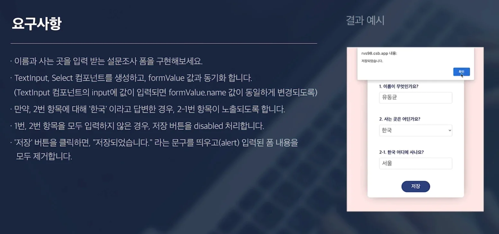
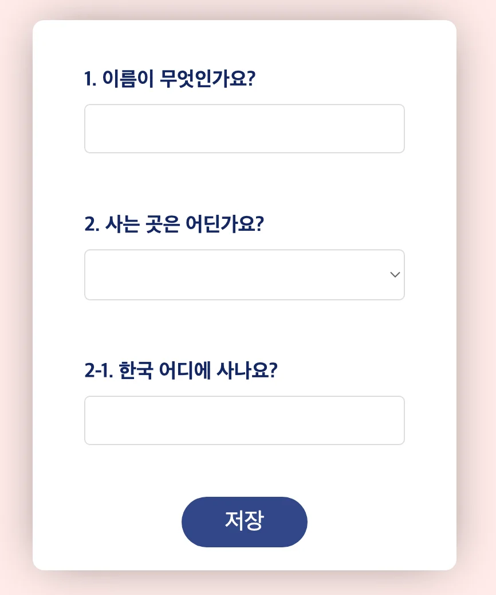

<a id="1c3eda9b0fe1816d873ef1ee829548af"></a>

### 요구사항



- controlled component
    - form value &#45; state 동기화 

- 항목&#58; 1, 2번 input 값 받기
    - 둘다 내용을 받지 않으면, button이 활성화 되지 않도록 설정 

- 1번, 2번 입력 → 저장 → 저장되었습니다 문구 alter로 띄어준 뒤, form 내용을 rest

<a id="1c3eda9b0fe181838876debb990839c0"></a>

### 실습

<a id="1c3eda9b0fe181248796df3ee3a5faff"></a>

‣

<details>
<summary>View </summary>



</details>

<details>
<summary>기본 코드 </summary>

<a id="1c3eda9b0fe181669052d2b7938b1af1"></a>

```javascript
import { useState } from "react";
import TextInput from "./components/TextInput";
import Select from "./components/Select";

const contryOptions = ["한국", "중국", "일본", "러시아", "미국"];

function App() {
  const [formValue, setFormValue] = useState({
    name: "",
    contry: "",
    address: "",
  });

  return (
    <div className="App">
      <div className="form">
        <div className="form-item">
          <h1>1. 이름이 무엇인가요?</h1>
          <TextInput />
        </div>
        <div className="form-item">
          <h1>2. 사는 곳은 어딘가요?</h1>
          <Select />
        </div>
        <div className="form-item">
          <h1>2-1. 한국 어디에 사나요?</h1>
          <TextInput />
        </div>
        <div className="button-group">
          <button>저장</button>
        </div>
      </div>
    </div>
  );
}

export default App;

```

</details>

<details>
<summary>해결</summary>

<details>
<summary>전체 코드 </summary>

<details>
<summary>App&#46;js</summary>

<a id="1c3eda9b0fe1813f95c2ef9375309033"></a>

```javascript
import { useState } from "react";
import TextInput from "./components/TextInput";
import Select from "./components/Select";

const contryOptions = ["한국", "중국", "일본", "러시아", "미국"];

const defaultFormValue = {
  name: "",
  contry: "",
  address: "",
};

function App() {
  const [formValue, setFormValue] = useState(defaultFormValue);

  const summitOnClickButton = () => {
    alert("저장되었습니다.");
    setFormValue(defaultFormValue);
  };

  return (
    <div className="App">
      <div className="form">
        <div className="form-item">
          <h1>1. 이름이 무엇인가요?</h1>
          <TextInput
            value={formValue.name}
            setValue={(value) => {
              setFormValue((state) => ({
                ...state,
                name: value,
              }));
            }}
          />
        </div>
        <div className="form-item">
          <h1>2. 사는 곳은 어딘가요?</h1>
          <Select
            value={formValue.contry}
            setValue={(value) => {
              setFormValue((state) => ({
                ...state,
                contry: value,
              }));
            }}
            options={contryOptions}
          />
        </div>
        {formValue.contry === "한국" && (
          <div className="form-item">
            <h1>2-1. 한국 어디에 사나요?</h1>
            <TextInput
              value={formValue.address}
              setValue={(value) => {
                setFormValue((state) => ({
                  ...state,
                  address: value,
                }));
              }}
            />
          </div>
        )}
        <div className="button-group">
          <button
            disabled={!formValue.name || !formValue.contry}
            onClick={summitOnClickButton}
          >
            {" "}
            저장
          </button>
        </div>
      </div>
    </div>
  );
}

export default App;

```

</details>

<details>
<summary>TextInput&#46;js</summary>

<a id="1c3eda9b0fe1819c9d00cfcd9b488091"></a>

```javascript
function TextInput({ value, setValue }) {
  return (
    <input
      type="text"
      value={value}
      onChange={() => {
        setValue(e.target.value);
      }}
    />
  );
}

export default TextInput;

```

</details>

<details>
<summary>Select&#46;js</summary>

<a id="1c3eda9b0fe181989d36ca1cc47149e2"></a>

```javascript
function Select({ value, setValue, options = [] }) {
  return (
    <select
      value={value}
      onChange={(e) => {
        setValue(e.target.value);
      }}
    >
      <option value="" disabled>
        지역을 선택해주세요.
      </option>
      {options.map((item) => (
        <option key={item} value={item}>
          {item}
        </option>
      ))}
    </select>
  );
}

export default Select;

```

</details>

---

<details>
<summary>index&#46;js</summary>

<a id="1c3eda9b0fe181429bf6f8fbb3579295"></a>

```javascript
import ReactDOM from 'react-dom';
import App from './App';

import './css/index.css';

ReactDOM.render(
  <App />,
  document.getElementById('root')
);
```

</details>

<details>
<summary>index&#46;cs</summary>

<a id="1c3eda9b0fe1811393f6d40cf5c7bc84"></a>

```javascript
* {
  font-size: 22px;
}
html,
body {
  padding: 0;
  margin: 0;
}

/* 화면 전체 배경 설정 */
.App {
  display: flex;
  /* width: 100vw; , 기본 설정 */
  height: 100vh; /* 기본 view 세로 길이 설정, 화면 전체 사용 */
  background: #ffebe9;
  justify-content: center;
  align-items: center;
}

/* Form 배경 설정 */
.form {
  background: #fff;
  padding: 20px 35px;
  border-radius: 10px;
  box-shadow: 0px 0px 40px -10px #0000007d;
  min-width: 300px; /*가로 길이 최솟값 설정*/
}

/* 인풋 요소 margin 설정 */
.form-item {
  padding: 10px;
  margin-bottom: 20px;
}

/* input 위 label view 설정*/
.form-item h1 {
  margin-bottom: 10px;
  font-size: 0.8em;
  color: #142663;
}

/* 1번째 input view 설정 */
.form-item input[type="text"] {
  padding: 8px 10px;
  outline: none; /* focus 시 발생되는 css 제거 */
  border: 1px solid #ddd;
  border-radius: 5px;
  color: #666;
  box-sizing: border-box; /* */
  width: 100%;
}

/* 2번쨰 option view 설정 */
.form-item select {
  padding: 8px 5px;
  outline: none;
  border: 1px solid #ddd;
  border-radius: 5px;
  color: #666;
  box-sizing: border-box;
  width: 100%;
}

/* 버튼 위치 정렬 */
.button-group {
  text-align: center;
  margin-top: 35px;
}

/* 버튼 */
.button-group button {
  padding: 10px 38px;
  border: none;
  border-radius: 100px;
  background-color: #32478a;
  color: #fff;
  font-size: 0.9em;
}

/* 버튼 disabled */
.button-group button:disabled {
  background-color: #56669a87;
}

```

</details>

</details>

<details>
<summary>Tip) <code>&#46;ma</code> 사용 시, 배열 기본값 설정</summary>

<a id="1c3eda9b0fe181dfbbacd84f9e7fcccb"></a>

```javascript
function Select({ value, setValue, options = [] }) {

			.  .  .
			
      {options.map((item) => (
        <option value={item.value} disabled>
          {item.value}
        </option>
      ))}
    </select>
  );
}
```

- 위 배열을 map을 통해 요소를 for문으로 처리 시, 해당 값이 없으면 오류가 발생됨

- 빈 배열( <code>= &#91;&#93;</code> )을  기본값으로 설정하여 해결

</details>

<details>
<summary>1&#46; Input </summary>

<a id="1c3eda9b0fe181d5912fc8cd5a9f8425"></a>

```javascript
// App.js
<TextInput
  value={formValue.name}
  setValue={(value) => {
    setFormValue((state) => ({
      ...state,
      name: value,
    }));
  }}
/>
			

// TextInput.js
function TextInput({ value, setValue }) {
  return (
    <input
      type="text"
      value={value}    // value를 넘겨, 입력한 받은 state를 보이도록 함
      onChange={(e) => {
        setValue(e.target.value);
      }}
    />
  );
}

export default TextInput;


```

</details>

<details>
<summary>2&#46; Option</summary>

<a id="1c3eda9b0fe181758671fad00a551332"></a>

```javascript
// App.js
<div className="form-item">
	<h1>2. 사는 곳은 어딘가요?</h1>
	<Select
	  value={formValue.contry}
	  setValue={(value) =>
	    setFormValue((state) => ({
	      ...state,
	      contry: value,
	    }))
	  }
	  options={contryOptions}
	/>
</div>


// Select.js
function Select({ value, setValue, options = [] }) {
  return (
    <select
      value={value}
      onChange={(e) => {
        setValue(e.target.value);
      }}
    >
      <option value="" disabled>
        지역을 선택해주세요.
      </option>
      {options.map((item) => (
        <option key={item} value={item}>
          {item}
        </option>
      ))}
    </select>
  );
}

export default Select;

```

</details>

<details>
<summary>3&#46; Input 2</summary>

<a id="1c3eda9b0fe18125a84cd5c5c8077056"></a>

```javascript
<div className="form-item">
  <h1>2-1. 한국 어디에 사나요?</h1>
  <TextInput
    value={formValue.address}
    setValue={(value) => {
      setFormValue((state) => ({
        ...state,
        address: value,
      }));
    }}
  />
</div>
```

</details>

<details>
<summary>3&#46;1  조건 설정을 통해 특정 DOM, 특정 상황에만 보이게 하기</summary>

- {<code>(조건)</code> <code>&#38;&#38;</code> <code>DOM</code> }

<a id="1c3eda9b0fe181d0bff8ce6df0f8af32"></a>

```javascript
{(formValue.contry === "한국") && (
  <div className="form-item">
    <h1>2-1. 한국 어디에 사나요?</h1>
    <TextInput
      value={formValue.address}
      setValue={(value) => {
        setFormValue((state) => ({
          ...state,
          address: value,
        }));
      }}
    />
  </div>
)}
```

</details>

<details>
<summary>4&#46; Button</summary>

<a id="1c3eda9b0fe181f99d7cd4a4c66ab22e"></a>

```javascript
const deafultFormValue = {
  name: "",
  contry: "",
  address: "",
};

const [formValue, setFormValue] = useState(deafultFormValue);

const clickEvent = () => {
		setFormValue(deafultFormValue);
		alert("저장이 되었습니다.");
};

const isActive = () => {
		// formValue.name 값이 존재하면 true로 판단한다.
		// 따라서 { !formValue.name || !formValue.contry } 는 아래와 동일하다
		return formValue.name === "" || formValue.contry === ""
}


 .  . .

<button
  onClick={clickEvent}
  disabled={isActive()}  // return이 있으면 () 명시 
>
  저장
</button>
```

</details>

</details>
