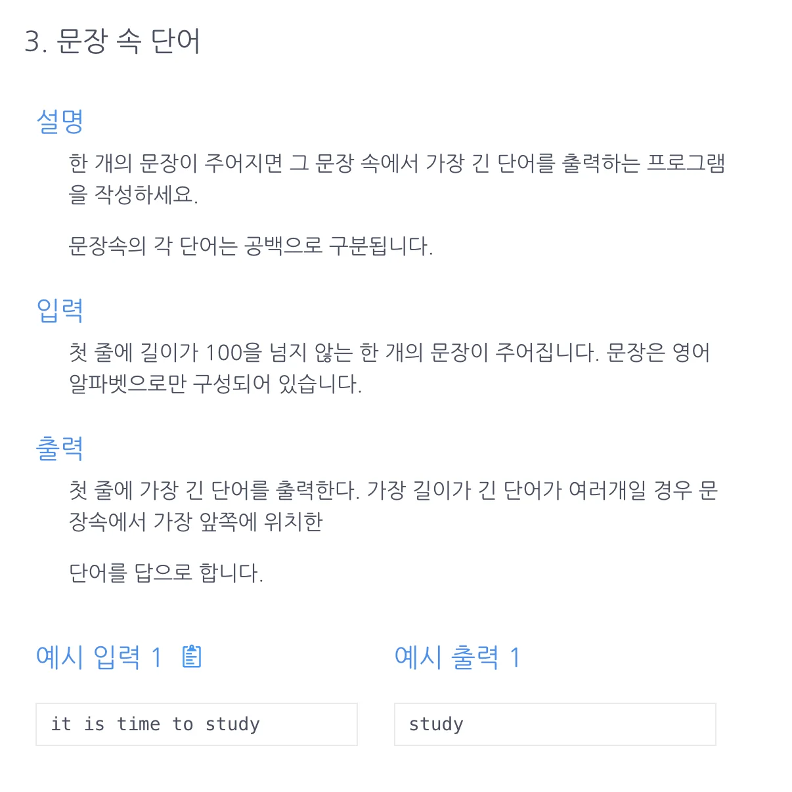

<a id="1c3eda9b0fe18178aabad8eaa1d1946f"></a>

## 문제)



<a id="1c3eda9b0fe18162a63cfcf4a9ab5248"></a>

입력값

<a id="1c3eda9b0fe18158936cfbca24df2d50"></a>

```plaintext
it is time to study
```

<a id="1c3eda9b0fe181c1a87cf30be07060f0"></a>

## 풀이)

<a id="1c3eda9b0fe181ba9efff18261e360a8"></a>

### 내 풀이 &#45; 투포인터) 

<a id="1c3eda9b0fe181f79f1fec258e6019c9"></a>

```java
import java.util.Scanner;

public class Main {
    public String solution(String str){
        String[] list = str.split(" ");
        String answer = "";
        int left = 0;
        int right = list.length -1;
        while(left <= right) {       // list 홀수인 경우 '='를 생략하면 중간 인덱스의 값이 생략됨. (이것 때문에 1시간 썻다...) 
            int left_len = list[left].length();
            int right_len = list[right].length();
            int answer_len = answer.length();
            if (left_len >= right_len && left_len > answer_len) answer = list[left];
            if (right_len >= left_len && right_len > answer_len) answer = list[right];
                left++;
                right--;
        }
        return answer;
    }
    public static void main(String[] args){
        Main m = new Main();
        Scanner sc = new Scanner(System.in);
        String str = sc.nextLine();
        System.out.print(m.solution(str));
    }
}
```

<details>
<summary>2) 2차 풀이</summary>

<a id="1c3eda9b0fe1811f9f49c8f60ff84079"></a>

```java
import java.util.Scanner;

public class Main {
    public String solution(String[] s1) {
        int max=Integer.MIN_VALUE;
        String answer = "";
        int len = s1.length-1;
        for(int i=0; i<=len/2; i++) {
            int leftPointLength = s1[i].length();
            int RightPointLength = s1[len-i].length();
            if(leftPointLength > max && leftPointLength > RightPointLength){
                max=leftPointLength;
                answer=s1[i];
            }
            else if (RightPointLength > max && RightPointLength > leftPointLength){
                max=RightPointLength;
                answer=s1[len-i];
            }
        }
        return answer;
    }
    public static void main(String[] args){
        Main m = new Main();
        Scanner sc = new Scanner(System.in);
        String s = sc.nextLine();
        String[] s1 = s.split(" ");
        System.out.println(m.solution(s1));
    }
}; 
```

</details>

<a id="1c3eda9b0fe181578b5dc099c479d672"></a>

### 풀이 1)

<a id="1c3eda9b0fe181e284abc439f3706e5b"></a>

```java
import java.util.Scanner;

public class Main {
    public String solution(String str){
        String answer="";
        int m=Integer.MIN_VALUE;
        String[] s=str.split(" ");
        for(String x : s) {
            int len=x.length();
            if (len>m){
                m=len;
                answer=x;
            }
        }
        return answer;
    }
    public static void main(String[] args ){
        Main m = new Main();
        Scanner sc = new Scanner(System.in);
				// next() 작성하여 오류남.. 한줄 전체를 받아오기 위해 nextLine() 으로 작성해야함.
			  String str = sc.nextLine();          
				System.out.print(m.solution(str));
    }
}
```

<a id="1c3eda9b0fe1817d9492c4623b07af1b"></a>

### 풀이 2)  split() → indexOf()

> • indexOf()<br>특정 문자, 문자열이 왼쪽부터 처음 발견되는 인덱스를 반환<br>만약찾지 못했을 경우&#34;&#45;1&#34;을 반환

<a id="1c3eda9b0fe18109833ff1dd08043ac4"></a>

```java
import java.util.Scanner;

public class Main {
    public String solution(String str){
        String answer = "";
        int m =Integer.MIN_VALUE, pos;
        while((pos=str.indexOf(" ")) != -1){
            String tmp=str.substring(0, pos);
            int len=tmp.length();
            if (len>m){
                m=len;
                answer=tmp;
            }
            str=str.substring(pos+1);
        }
        if(str.length()>m) answer=str;
        return answer;
    }
    public static void main(String[] args){
        Main m = new Main();
        Scanner sc = new Scanner(System.in);
        String str = sc.nextLine();
        System.out.print(m.solution(str));
    }
}
```
