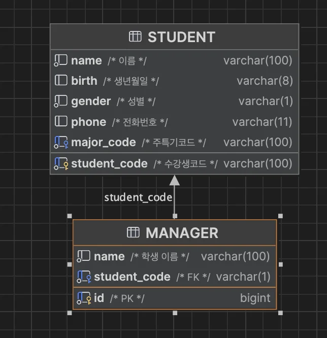

<a id="1c3eda9b0fe181c695a7cb25b676e8e6"></a>

<strong>FK 값 생성</strong> 시 <strong>추가로 제약조건을 주</strong>거나 <strong>제약조건 명칭</strong><strong>을 </strong><strong>한번에 추가하는 방법을 몰</strong>라 이전에 <u>ALTER에서 정리한 SQL을 참조하여 작성</u>함

<a id="1c3eda9b0fe181499469c6b6b6fed582"></a>

```sql
CREATE TABLE if not exists MANAGER
(
    id bigint primary key comment 'PK',
    name varchar(100) not null comment '학생 이름',
    student_code varchar(1) not null comment "FK"
);

ALTER TABLE MANAGER ADD CONSTRAINT manager_fk_student_code FOREIGN KEY(student_code) REFERENCES STUDENT(student_code);
```

<a id="1c3eda9b0fe181dabb26ec64f93d85f2"></a>

아래와 같이 테이블 생성 확인 및 참조값(FK) 생성 확인함


