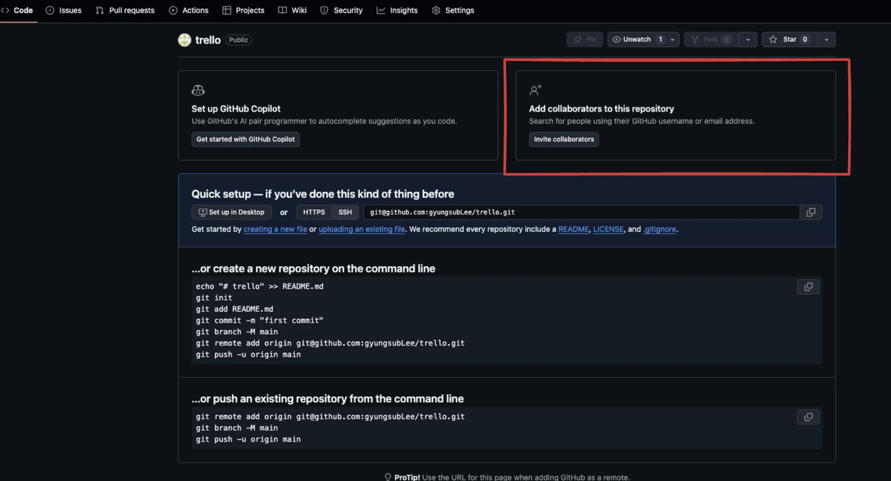
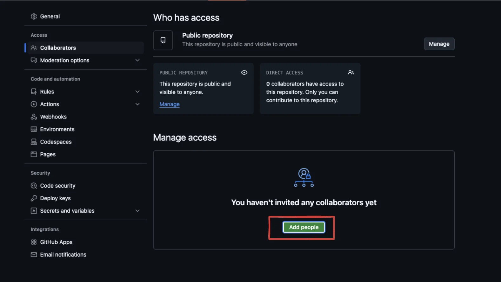
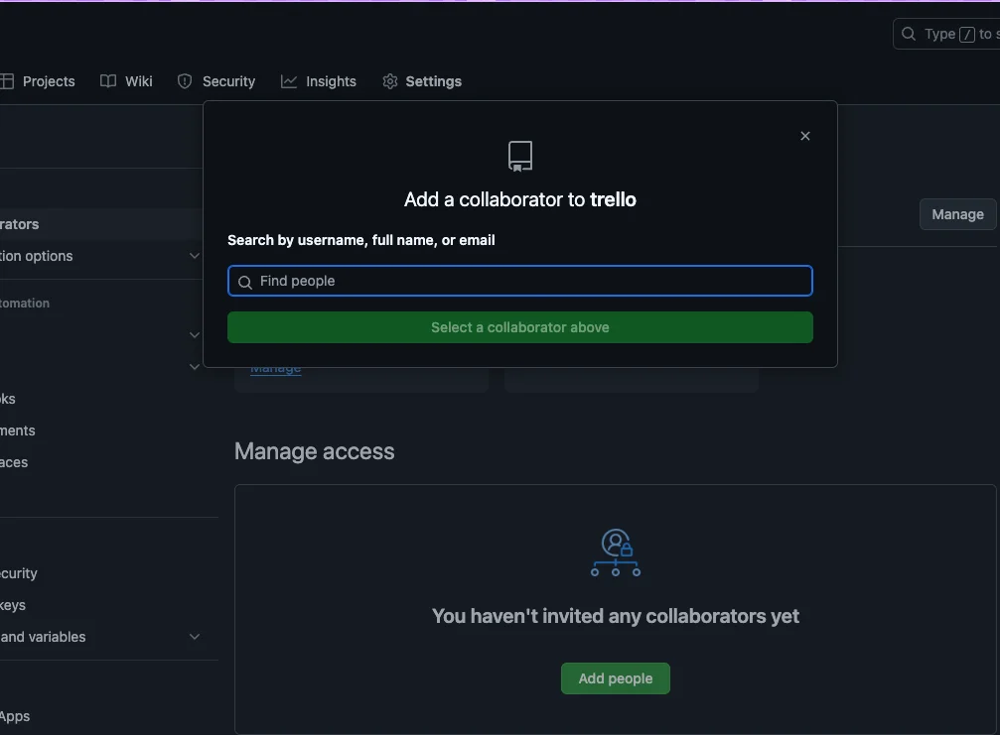

reference

‣

### 1&#46; 팀원 추가

1. public 리포지토리 생성

1. 팀원 추가 
    - Invite collaborators
        

    - Add people 클릭
        

- Email, username 등으로 초대 
    

### 2&#46; github projects 생성

### 3&#46; github projects 내부에서 issue 생성

### 4&#46; github projects &#45; issue  내부에서 feature banch 생성
