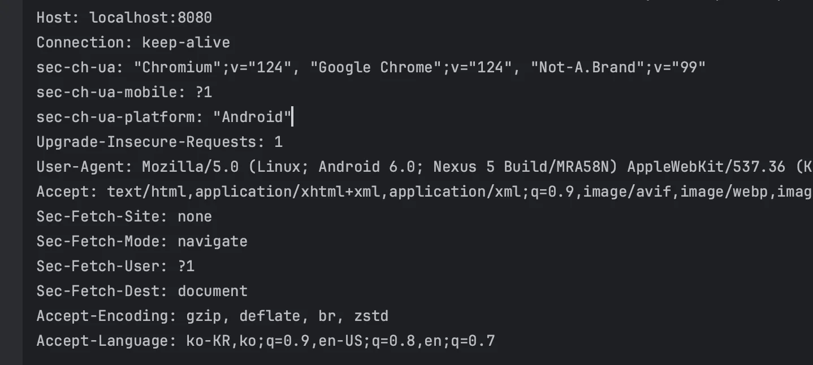
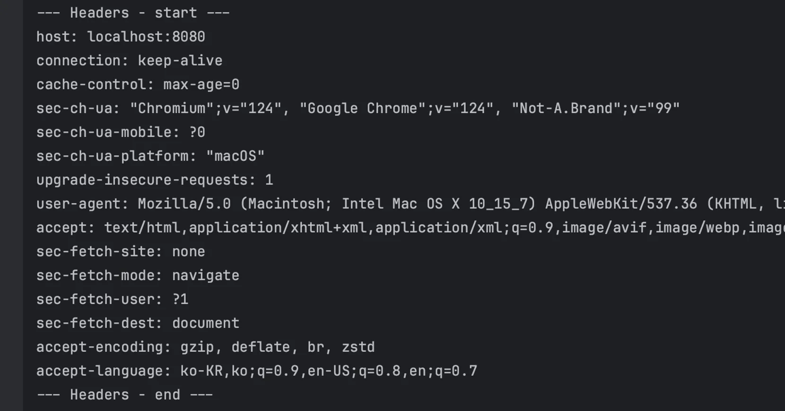
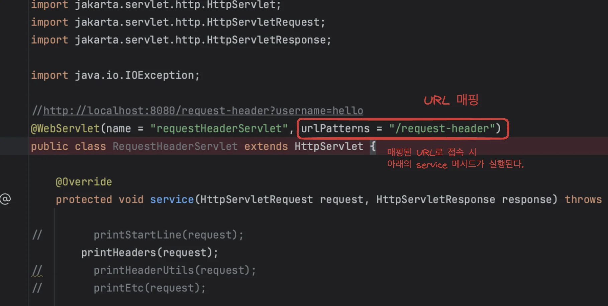

### 문제 

---

강의 코드를 따라하면서 학습하던 도중 이전에 발생되지 않았던 출력값 오류가 발생했다&#46;  

### 가정

---

<strong>가정)</strong> 출력되는 내용은 위와 같은데 해당 내용이 아래의 <code>Http ServletRequest </code>&#45; <code>printHeaders()</code> 와 유사하여  ‘해당 메서드가 어디서 잘못 실행되고 있나?’ 생각하여 다른 코드들을 뒤져보았다&#46;  

그러다가 <strong>서블릿을 통해 </strong><strong>매핑시킨 url에 접속 </strong>시에 <strong><u>그에 해당하는 메서드가 실행</u></strong>되는 것을 깨달았다&#46;

강의를 들으면서도 몇번 들었던 내용인데도 전혀 생각을 하지 못했다&#46; 

따라서 <code>/</code>, <code>/hello</code>, <code>/request&#45;eader</code>, <code>/request&#45;param</code> 등 매핑한 모든 url에 접속하여 오류라 인지한 출력값이 기본적으로 출력되는 내용이라는 것을 확인할 수 있었다&#46; 

### 결론

---

문제라고 인식한 내용을 가정을 통해 논리적으로 찾아갈 수 있는 경험이었다&#46;  결과적으론 큰 의미가 없는 작업이었지만, 문제를 해결과는 과정에 있어<strong> 논리적으로 접근하여 결론을 도출</strong>하는 중요하고 소중한 경험이었다&#46; 

> 문제 인식  → 가정 → 테스트 → 결과 도출

 또한 학습과 체화의 거리감을 인지할 수 있어 앞으로의 학습 방향에 대해 좀 더 심도있게 생각할 수 있게하는 굉장히 중요한 계기가 되었다&#46; 

> 학습과 기록 후 해당 내용을 머리에서 인지하고 생각할 수 있도록 체화시켜야 한다&#46; → 어떻게 체화 할 것인가?
