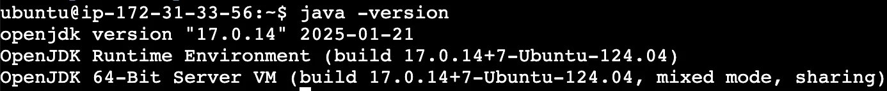
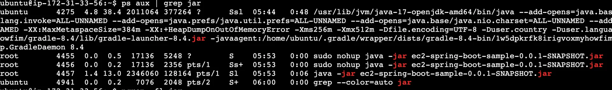
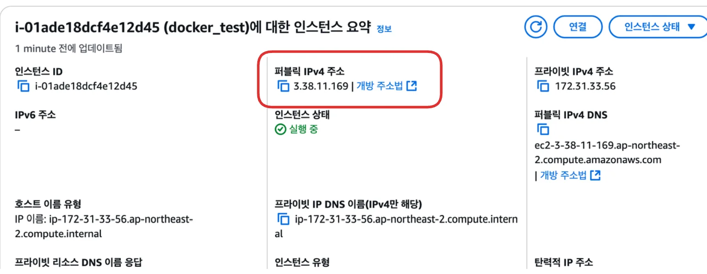
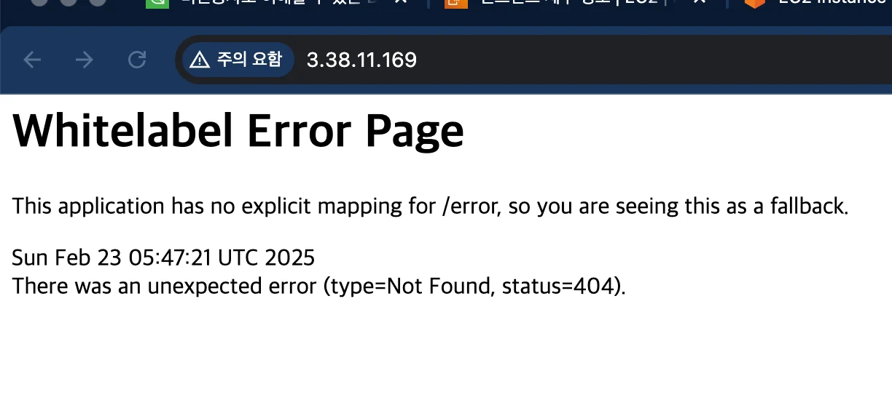

<details>
<summary>EC2 콘솔 접속</summary>

---

- 해당하는 인스턴스 클릭
    

- 연결 클릭
    

    

- 해당 EC2의 콘솔 창으로 접속 
    

</details>

<a id="1c3eda9b0fe181c1b66dca12d5d93e37"></a>

## &#91; 실습 &#93; Spring Boot 서버 EC2에 배포

---

<a id="1c3eda9b0fe181108b96d9f016e86aad"></a>

### 1&#46; Ubuntu 환경에 JDK 설치

- jdk 17 설치
    <a id="1c3eda9b0fe181c4abedd524e7ecdbf1"></a>

    ```shell
    sudo apt update && /
    sudo apt install openjdk-17-jdk -y
    ```

- 설치 확인
    <a id="1c3eda9b0fe1812d9bede838ec213c27"></a>

    ```shell
    java -version
    ```

    

<a id="1c3eda9b0fe181afb1d7d893a78cd76d"></a>

### 2&#46; Github &#45;  Spring Boot 프로젝트 clone

[GitHub &#45; JSCODE&#45;EDU/ec2&#45;spring&#45;boot&#45;sample&#58; &#60;비전공자도 이해할 수 있는 AWS 입문/실전&#62; 中 예제 프로젝트]()

<a id="1c3eda9b0fe1818aaefccabe6526ea6c"></a>

```shell
git clone https://github.com/JSCODE-EDU/ec2-spring-boot-sample.git
cd ec2-spring-boot-sample
```

<a id="1c3eda9b0fe1810c8636d3aafd9a934e"></a>

### 3&#46; <code>application&#46;yml</code> 생성

<a id="1c3eda9b0fe18143a8f5fcd279a1a6ee"></a>

<code>application&#46;yml</code>와 같은 민감한 정보가 포함된 파일 git으로 관리하지 않는 것이 일반적이다&#46;

- <code>vim</code>으로 <code>application&#46;yml</code> 생성
    <a id="1c3eda9b0fe181328d13f02b64764b86"></a>

    ```shell
    vim src/main/resources/application.yml
    ```

- application&#46;yml
    <a id="1c3eda9b0fe181868e22c0cc660dcad8"></a>

    ```yaml
    server:
      port: 80
    ```

<a id="1c3eda9b0fe181b28092db6343c363f5"></a>

### 4&#46; 앱 실행

<a id="1c3eda9b0fe181b79eb2e60b5b43d5cc"></a>

```shell
# 1. 기존 빌드된 파일을 삭제하고 새롭게 JAR로 빌드
./gradlew clean build 

# 2. build된 jar 파일이 있는 폴더로 이동
cd ~/ec2-spring-boot-sample/build/libs

# 3. jar 파일로 Spring_Boot(앱) 싫행
sudo java -jar ec2-spring-boot-sample-0.0.1-SNAPSHOT.jar

sudo java -jar ec2-spring-boot-sample/build/libs/ec2-spring-boot-sample-0.0.1-SNAPSHOT.jar

# 참고) 백그라운드에서 Spring Boot 실행
sudo nohup java -jar ec2-spring-boot-sample-0.0.1-SNAPSHOT.jar &

sudo nohup java -jar ec2-spring-boot-sample/build/libs/ec2-spring-boot-sample-0.0.1-SNAPSHOT.jar &
```

<details>
<summary>실행 중인 jar 종료</summary>

<details>
<summary>ps 조회</summary>

<a id="1c3eda9b0fe181bb8553c7442b1b428e"></a>

```shell
ps aux | grep jar
```

- <strong><code>ps aux</code></strong>
    - <strong>현재 실행 중인 프로세스</strong>의 정보 출력

    - <strong> 사용자 정보, CPU 사용량, 메모리 사용량 등</strong>

- <strong><code>grep &#60;패턴&#62;</code></strong>
    - 주어진 패턴을 기준으로 <strong>텍스트를 검색</strong>

- <code>ps aux &#124; grep &#60;패턴&#62;</code>
    - 해당 패턴의 문자열을 포함하는 프로세스 필터링

</details>

<a id="1c3eda9b0fe181ceae82d667c8c994e4"></a>

```shell
# 실행 중인 jar 확인
ps aux | grep jar

# 해당.jar 프로세스 종료
sudo kill -9 <PID>

# pkill 명령어 사용 (프로세스 이름으로 종료)
pkill -f <프로세스 이름>
```



</details>

<details>
<summary>실행 확인</summary>





</details>
