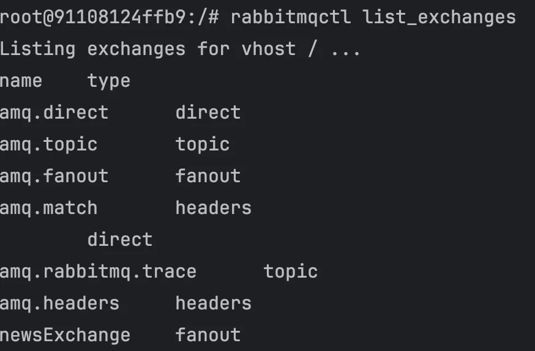
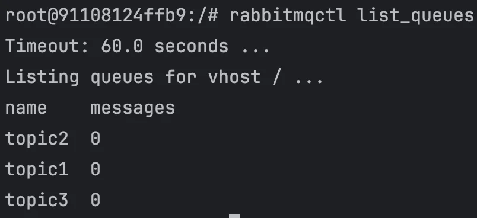
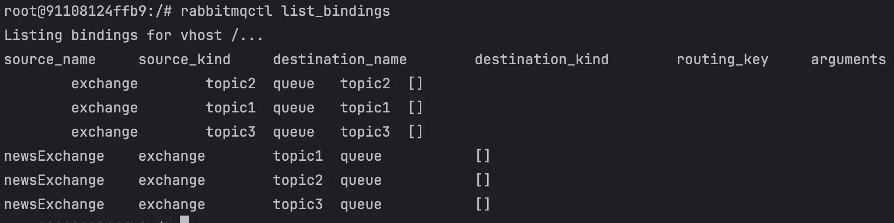

- docker 실행 시, rabbitmq 컨테이너 내부 bash 접속
    <a id="1c3eda9b0fe181188056c843c68fe5dc"></a>

    ```bash
    docker exec -it [RabbitMQ 컨테이너 ID] bash
    ```

- exchange 확인
    <a id="1c3eda9b0fe18189bfcce74be90282d6"></a>

    ```bash
    rabbitmqctl list_queues
    ```

    

- queue 확인
    <a id="1c3eda9b0fe181b08ad4df2f44200699"></a>

    ```bash
    rabbimqctl list_queues
    ```

    

- binding 정보 확인
    <a id="1c3eda9b0fe181a49bc4cbd0da96dc5a"></a>

    ```bash
    rabbitmqctl list_exchagnes
    ```

    
