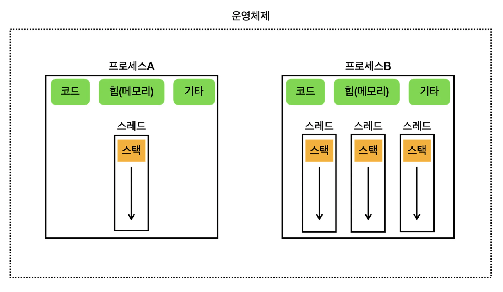
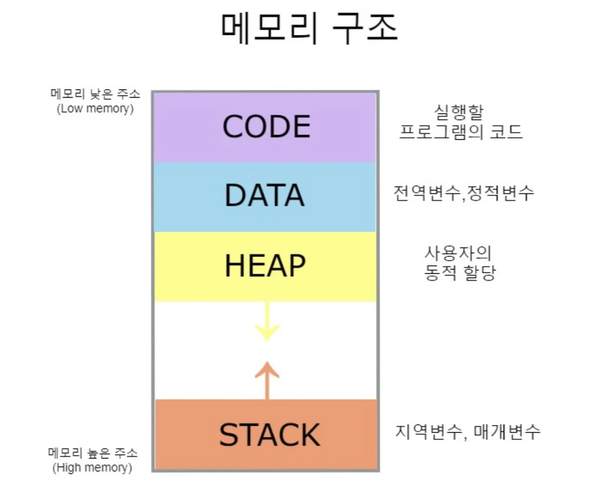

<a id="1c3eda9b0fe181ebaf07d24740a36f68"></a>

## 프로세스

---

> 📖 
> 
> <a id="1c3eda9b0fe181e283abe8ebb1cdd4ac"></a>
> 
> 프로그램은 실제 <u>실행하기 전</u>까지는 <strong>단순한 파일</strong>에 불과하다&#46; 
> 
> <a id="1c3eda9b0fe1816aa3abf10de9921ec8"></a>
> 
> <u>프로그램을 실행</u>하면 <u>프로세스가 만</u>들어지고 <u>프로그램이 실행</u>된다&#46; 
> 
> <a id="1c3eda9b0fe181b1abe4d64ec9c96f25"></a>
> 
> 이렇게 <strong><u>운영체제 안에서 </u></strong><strong><u>실행 중인 프로그램</u></strong>을 <code>프로세스</code>라 한다&#46; 
> 
> <a id="1c3eda9b0fe1818ebc68daab5513efc1"></a>
> 
> 프로세스는 <strong><u>실행 중인 프로그램의 인스턴스</u></strong><strong> </strong>이다&#46;
> 
> > 비유) 자바
> 
> - <code>클래스</code> →<strong>  </strong><strong><code>프로그램</code></strong>
> 
> - <code>인스턴스</code> → <strong><code>프로세스</code></strong>

<details>
<summary>🧐 스레드는 프로세스 내 실행되는 작업의 단위이다&#46; 그렇다면 멀티태스킹 에서의  변경되는 작업의 단위와 스레드는 어떤 관계가 있는가? ( 멀티프로세싱 도 동일)</summary>


</details>



<a id="1c3eda9b0fe18165b4a5cfbe69ed1c7e"></a>

프로세스는 실행 중인 프로그램의 인스턴스이다&#46; 

<a id="1c3eda9b0fe181739f6bf21cb694ebc9"></a>

<u>각 프로세스</u>는 <strong><u>독립적인 메모리 공간을 갖</u></strong>고 있으며, <strong>운영체제에서 </strong><strong><u>별도의 작업 단위로 분리</u></strong><strong>해서</strong><strong><u> 관리</u></strong>된다&#46; 

<a id="1c3eda9b0fe18132b9cde0ffb34c33ae"></a>

각 프로세스는 별도의 메모리 공간을 갖고 있기 떄문에 <strong><u>서로 간섭하지 않</u></strong>는다&#46; 

<a id="1c3eda9b0fe181e1b3d4c668e25af765"></a>

그리고 프로세스가 <strong><u>서로의 메모리에 직접 접근할 수 없</u></strong>다&#46; 

<a id="1c3eda9b0fe1810e934cfdc93e26c0a1"></a>

프로세스는 이렇듯 <strong><u>서로 격리되어 관리</u></strong>되기 때문에, <strong>하나의 프로세스가 충돌해도 다른 프로세스에는 영향을 미치지 않</strong>는다&#46; 

<a id="1c3eda9b0fe181bab97afb8144992714"></a>

쉽게 이야기해서 특정 프로세스(프로그램)에 심각한 문제가 발생하면 해당 프로세스만 종료되고, 다른 프로세스에 영향을 주지 않는다&#46; 

> ✏️ 
> 
> <a id="1c3eda9b0fe18150bef9c7222e2f9751"></a>
> 
> <strong>프로세스의  메모리 구성</strong>
> 
> <details>
> <summary>reference</summary>
> 
> <a id="1c3eda9b0fe18199a752fa81264b47c6"></a>
> 
> ‣
> 
> <a id="1c3eda9b0fe181d8a1ffc0c2c0e9da04"></a>
> 
> ‣
> 
> </details>
> 
> 
> 
> - <code>코드 영역(Code Area)</code>&#58; 실행할 프로그램의 코드가 저장되는 부분
> 
> - <code>데이터 영역(Data Area)</code>&#58; 전역 변수 및 정적 변수가 저장되는 부분 
> 
> - <code>힙 (Heap)</code>&#58; 동적으로 할당되는 메모리 영역
> 
> - <code>스택 (Stack)</code>&#58; 메서드(함수) 호출 시, 생성되는 지역 변수와 반환 주소가 저장되는 영역(스레드 포함)<br>
> 
> | 영역 | 설명 | 스레드 간 공유 여부 |
> | --- | --- | --- |
> | 코드(Code) 영역 | 프로그램 실행 코드 ( CPU가 실행할 명령 ) | ✅ 공유됨 |
> | 데이터(Data) 영역 | 전역 변수, 정적 변수 저장 | ✅ 공유됨 |
> | 힙(Heap) 영역 | 동적 할당된 메모리 ( 예&#58; new로 생성한 객체 ) | ✅ 공유됨 |
> | 스택(Stack) 영역 | 함수 호출, 지역 변수 저장 | ❌ 스레드별로 따로 존재 |

<a id="1c3eda9b0fe18157b9c0ce9a12fe0ce3"></a>

## 스레드 ( Thread )

---

> ✏️ 
> 
> <a id="1c3eda9b0fe181e3bfe9c0912212173b"></a>
> 
> <strong>프로세스는 하나 이상의 스레드를 반드시 포함한다&#46; </strong>
> 
> - 스레드는 <u>프로세스 내 실행되는 </u><u>작업의 단위</u>이다&#46; <u>한 프로세스 내</u>에서 <strong><u>여러 스레드가 존재</u></strong>할 수 있으며, 이들은 프로세스가 제공하는 <strong><u>동일한 메모리 공간을 공유</u></strong>한다&#46; 
> 
> - 스레드는 프로세스 보다 단순하므로 생성 및 관리가 단순하고 가볍다&#46; 
> 
> <a id="1c3eda9b0fe181518100d3eedeffb999"></a>
> 
> <strong>메모리 구성</strong>
> 
> - <code>공유 메모리</code>&#58; <u>같</u><u>은 프로세스</u>의 <code>코드 섹션</code>, <code>데이터 섹션</code>, <code>힙(메모리)</code>은 프로세스 안의 <strong><u>모든 스레드가 공유</u></strong>한다&#46; 
> 
> - <code>개별 스택</code>&#58; 각 스레드는 <strong><u>자신의 </u></strong><strong><u>스택</u></strong><strong><u>을 갖</u></strong>고 있다&#46; 

<a id="1c3eda9b0fe181449ac9c8999dc58aa6"></a>

### 프로그램이 실행된다는 것은 어떤 의미인가?

<a id="1c3eda9b0fe1817398d3da557af6931d"></a>

프로그램을 실행하면 운영체제는 먼저 디스크에 있는 파일 덩어리인 프로그램을 메모리로 불러오면서 프로세스를 만든다&#46; 

> 🧐 그럼 만들어진 프로세를 어떻게 실행하는가?

<a id="1c3eda9b0fe1819e80f7cbbb3b922627"></a>

프로그램이 실행된다는 것은 사실 프로세스 안에 있는 코드가  한 줄씩 실행되는 것이다&#46; 

<a id="1c3eda9b0fe1814f88f8e9a2bb232613"></a>

코드는 보통(<code>main()</code>)부터 시작해서 하나씩 순서대로 내려가면서 실행된다&#46; 

<a id="1c3eda9b0fe18134a06aca3e2abd873c"></a>

```java
public class Operator {

		public static void main(String[] args) {
				int sum1 = 1;
				int sum2 = sum1 + 1;
				System.out.println("sum1 = " + sum1);
				System.out.println("sum2 = "  + sum2);
		}
}
```

<a id="1c3eda9b0fe181708666fd08bd801e71"></a>

생각해보면 어떤 무언가가 코드를 하나씩 순서대로 실행하기 때문에 프로그램이 작동하고 계산하며, 출력도 할 수 있다&#46; 

> 🧐 이 코드를 하나씩 실행 하면서 내려가는 것은 정체가 무엇일까?

<a id="1c3eda9b0fe1812b9eaafeedb5aceacd"></a>

비유를 하자면 마치 실(thread) 같은 것이 코드를 위에서 아래로 하나씩 꿰면서 하나씩 내려가는 것 같다&#46; 

<a id="1c3eda9b0fe1817b87aef130a1545903"></a>

이렇듯 프로세스의 코드를 실행하는 흐름을 스레드(thread)라 한다&#46; 

- 스레드를 번역하면 “실”, “실을 꿰다”라는 뜻이다&#46; 

<a id="1c3eda9b0fe18126a084cd4c035bcc72"></a>

스레드는 <u>프로세스 내에서 실행</u>되는 <strong><u>작업의 단위</u></strong>이다&#46;  

<a id="1c3eda9b0fe181dc88cffef8f039e3dc"></a>

<strong><u>한 프로세스 내</u></strong>에 <strong><u>하나의 스레드</u></strong><strong> or </strong> <strong><u>여러 스레드</u></strong>가 존재할 수 있다&#46;

<a id="1c3eda9b0fe181e18d89f4bb6a15b0e6"></a>

그리고 스레드는 프로세스가 제공하는 동일한 메모리 공간을 공유한다&#46; 

<a id="1c3eda9b0fe181f9aac9cc9bb2094a38"></a>

 

> ✏️ 
> 
> - <code>단일 스레드</code>&#58; 한 프로세스 내에 하나의 스레드만 존재
> 
> - <code>멀티 스레드</code>&#58; 한 프로세스 내에 여러 스레드가 존재

<details>
<summary>🧐 <code>멀티태스킹</code>, <code>멀티스레딩</code>의 차이점?</summary>

- <code>멀티태스킹</code>&#58; 여러 개의 프로세스를 동시에 실행하는 것
    - 크롬, 게임, 음악 앱을 동시에 실행하는 것처럼 보이게 함

    - OS가 각 프로세스를 CPU 코어에 적절히 할당하여 실행

- <code>멀티스레딩</code>&#58; 하나의 프로세스 내부에서 여러 작업(스레드)을 동시에 실행하는 것
    - 크롬 브라우저(프로세스) 안에서 여러 개의 탭(스레드)이 동시에 동작

    - 게임(프로세스) 안에서 그래픽 처리, 네트워크 통신 등이 각각의 스레드로 동작

- 

| 구분 | 멀티태스킹 | 멀티스레딩 |
| --- | --- | --- |
| 개념 | 여러개의 프로세스를 동시에 실행 | 하나의 프로세스 내부에서 여러 스레드 실행 |
| 실행 단위 | 프로세스 | 스레드 |
| 메모리 사용 | 각 프로세스는 독립된 메모리 가짐 | 같은 프로세스 내 메모리 공유 |
| 문맥 전환 | 프로세스 간 전환 ( 비용 큼 ) | 스레드 간 전환 ( 비용이 적음 ) |

- 정리
    - 멀티태스킹은 운영체제(OS)가 프로세스를 관리하는 방식이고

    - 멀티스레딩은 <strong><u>프로세스 내부</u></strong>에서 여러 작업을 수행하는 방법이다&#46; 

</details>

<details>
<summary>하나의 프로세스 안에는 최소 하나의 스레드가 존재한다&#46; </summary>

<a id="1c3eda9b0fe1812297ffe0df23fde8aa"></a>

그래야 프로그램이 실행될 수 있다&#46; 

<a id="1c3eda9b0fe1810fadd5d691747a98be"></a>

위 예시의 자바 코드들은 모두 한 프로세스 내에서 하나의 스레드만 사용하는 단일 스레드였다&#46; 

<a id="1c3eda9b0fe181059205fcb0a8040efe"></a>

정리하자면 프로세스는 실행 환경과 자원을 제공하는 컨테이너 역할을 하고, 스레드는 CPU를 사용해서 코드를 하나하나 실행한다&#46; 

</details>

<details>
<summary>멀티스레드가 필요한 이유</summary>

<a id="1c3eda9b0fe18168b888cbc31da9e2b3"></a>

하나의 프로그램도 그 안에서 동시에 여러 작업이 필요하다&#46; 

- ex) 워드 프로그램으로 문서를 편집하면서, 문서가 자동으로 저장되고, 맞춤법 검사도 함께 수행된다&#46; 

- ex) 유튜브는 영상을 보는 동안, 댓글도 달 수 있다&#46; 

</details>


<a id="1c3eda9b0fe181c6a3a1e6f3f6094813"></a>

운영체제 관점에서 보면 아래와 같이 구분 가능하다&#46; 

- 워드 프로그램&#58; 프로세스 A
    - 스레드 1&#58; 문서 편집

    - 스레드 2&#58; 자동 저장

    - 스레드 3&#58; 맞춤법 검사

- 유튜브&#58; 프로세스 B
    - 스레드 1&#58; 영상 재생

    - 스레드 2&#58; 댓글

<a id="1c3eda9b0fe181d2b8b6f1d029e840e2"></a>

### 질문

<details>
<summary>🧐 <strong>코어에 프로세스가 할당되고 스레드들이 할당되어 실행되는 것인가?</strong></summary>

- <strong>✅ 맞다</strong>

- <strong>스레드 단위로 실행이 관리될 수도 있다&#46;</strong>
    - 운영체제(OS)는 CPU의 각 코어에 <strong>프로세스를 할당</strong>하는데, <strong>멀티스레딩을 지원하는 경우 스레드 단위로도 실행을 관리할 수 있다&#46; </strong>
        <details>
        <summary>실행 흐름</summary>

        1. 운영체제가 멀티태스킹을 관리하면서 여러 프로세스를 각 코어에 할당

        1. 프로세스 내부에 있는 스레드들은 OS의 스케줄러가 관리하며 실행

        1. 멀티코어 환경에서 하나의 프로세스가 여러 개의 코어에서 병렬 실행될 수 있음

        1. 싱글 코어 환경에서는 문맥 전환을 통해 번갈아 실행 되면서 동시처럼 보임

        </details>

    - 즉, 코어에 프로세스가 할당된다고 해도, 그 프로세스 내부에서 스레드 단위로 실행이 결정된다&#46; 

<a id="1c3eda9b0fe18192b18dfed027e493c2"></a>

<strong> </strong>

</details>

<details>
<summary>🧐 <strong>스레드가 프로세스의 하위 요소인가?</strong></summary>

<a id="1c3eda9b0fe18148ad09ce5f48272817"></a>

<strong>✅ 맞다</strong>

- 스레드는 프로세스 내부에서 실행되는 작은 작업 단위이다&#46; 
    - 프로세스&#58; 실행 중인 프로그램 ( 독립적인 메모리 공간을 가짐 )

    - 스레드&#58; 프로세스 내에서 실행되는 작업 단위 ( 같은 프로세스의 메모리 공유 )

- ex)
    - <strong><code>프로세스</code></strong> = <code>회사</code>

    - <strong><code>스레드</code></strong> = <code>회사 직원</code>

    <a id="1c3eda9b0fe18142b324c0f91c7698cf"></a>

    직원들은 <strong><u>같은 회사(프로세스) 자원을 공유</u></strong>하지만, <strong><u>각자 맡은 업무(스레드)가 따로 있</u></strong>다&#46;

</details>

<details>
<summary>🧐 프로세스가 실행되는 건 결국 그 안의 내부 스레드가 동작되어야만 실제 처리되는 것인가?</summary>

<a id="1c3eda9b0fe181f3b9b1e111063494f7"></a>

<strong>✅ 맞다</strong>

- 프로세스가 실행된다고 해서 자동으로 모든 작업이 처리되는 게 아니고, 그 안의 스레드들이 실제로 실행되어야만 일이 진행된다&#46; 
    <details>
    <summary>ex) 음악 앱을 실행할 때</summary>

    > 프로세스(음악 앱)가 실행되지만, 그 안에서 각 스레드들이 역할을 수행해야만 앱이 정상적으로 동작한다&#46; 

    - <strong>UI 스레드</strong>&#58; 화면을 표시하고 사용자 입력을 처리

    - <strong>오디오 스레드</strong>&#58; 음악 재생

    - <strong>네트워크 스레드</strong>&#58; 스트리밍 음악을 다운로드

    </details>

- 즉, 프로세스는 스레드가 실제로 일을 하게 해주는 껍데기 같은 개념이고, 내부의 스레드들이 실행되어야 실질적인 작업이 이루어진다&#46; 

</details>
