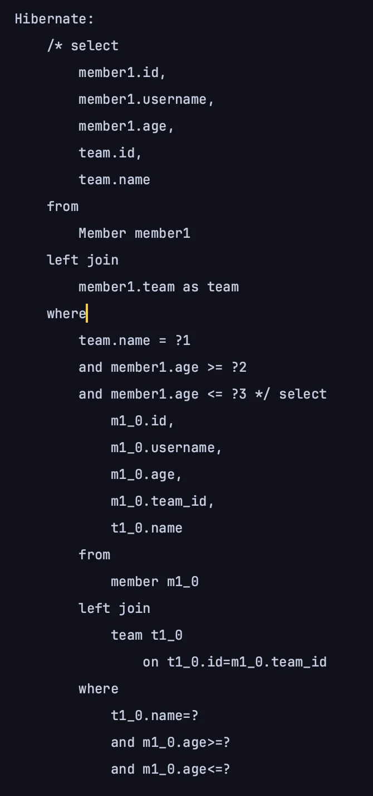
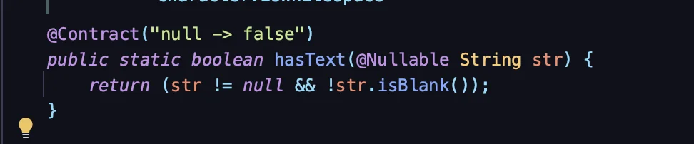

<a id="1c3eda9b0fe1819fb168f0302c947ad6"></a>

## 동적 쿼리와 성능 최적화 조회 &#45; Builder

---

> 📖 
> 
> <a id="1c3eda9b0fe181d9a573da4eb0207dbf"></a>
> 
> Builder를 사용하여 순수 JPA에서 동적 퀴리를 생성하여 조회한다&#46;

<details>
<summary>조회 최적화용 DTO 추가 </summary>

> ☝🏻 
> 
> <a id="1c3eda9b0fe1815db002cbed5d82447f"></a>
> 
> &#64;QueryProjection 사용 시, 해당하는 DTO의 Q 타입 클래스를 생성해야 한다&#46; 
> 
> - &#46;/gradlew clean
> 
> - &#46;/gradlew compileJava

<details>
<summary>&#91; 코드 &#93; <code>Dto</code>&#58; MemberTeamDto</summary>

<a id="1c3eda9b0fe18176a418dbb2d7f075c5"></a>

```java
package com.example.lectureprac.dto;

import com.querydsl.core.annotations.QueryProjection;
import lombok.Data;

@Data
public class MemberTeamDto {
    private Long memberId;
    private String username;
    private int age;
    private Long temaId;
    private String teamName;

    @QueryProjection
    public MemberTeamDto(Long memberId, String username, int age, Long temaId, String teamName) {
        this.memberId = memberId;
        this.username = username;
        this.age = age;
        this.temaId = temaId;
        this.teamName = teamName;
    }
}
```

</details>

<details>
<summary>&#91; 코드 &#93; <code>Dto</code>&#58; MemberSearchCondition</summary>

<a id="1c3eda9b0fe18141b65ad908a951bae8"></a>

```java
package com.example.lectureprac.dto;

import lombok.Data;

@Data
public class MemberSearchCondition {

    //회원명, 팀명, 나이(ageGoe, ageLoe)
    private String username;
    private String teamName;
    private Integer ageGoe;
    private Integer ageLoe;
}
```

</details>

</details>

<details>
<summary>동적 쿼리 &#45; Builder 사용</summary>

<details>
<summary>&#91; 코드 &#93; <code>repository</code>&#58; <code>MemberJpaRepository&#46;searchByBuilder()</code></summary>

<a id="1c3eda9b0fe181d29a66c3f15bf30d41"></a>

```java
public List<MemberTeamDto> searchByBuilder(MemberSearchCondition conditionh) {

    BooleanBuilder builder = new BooleanBuilder();

    if (StringUtils.hasText(conditionh.getUsername())) {
        builder.and(member.username.eq(conditionh.getUsername()));
    }

    if (StringUtils.hasText(conditionh.getTeamName())) {
        builder.and(team.name.eq(conditionh.getTeamName()));
    }

    if (conditionh.getAgeGoe() != null) {
        builder.and(member.age.goe(conditionh.getAgeLoe()));
    }

    if (conditionh.getAgeLoe() != null) {
        builder.and(member.age.loe(conditionh.getAgeLoe()));
    }

    return queryFactory
            .select(new QMemberTeamDto(
                    member.id,
                    member.username,
                    member.age,
                    team.id,
                    team.name))
            .from(member)
            .leftJoin(member.team, team)
            .where(builder)
            .fetch();
}
```

</details>

<details>
<summary>&#91; 코드 &#93; 테스트 코드 </summary>

<a id="1c3eda9b0fe18194b993eba0a3818675"></a>

```java
@Test
public void searchTest() {
    Team teamA = new Team("teamA");
    Team teamB = new Team("teamB");
    em.persist(teamA);
    em.persist(teamB);

    Member member1 = new Member("member1", 10, teamA);
    Member member2 = new Member("member2", 20, teamA);
    Member member3 = new Member("member3", 30, teamB);
    Member member4 = new Member("member4", 40, teamB);

    em.persist(member1);
    em.persist(member2);
    em.persist(member3);
    em.persist(member4);

    MemberSearchCondition condition = new MemberSearchCondition();
    condition.setAgeGoe(35);
    condition.setAgeLoe(40);
    condition.setTeamName("teamB");

    List<MemberTeamDto> result = memberJpaRepository.searchByBuilder(condition);

    assertThat(result).extracting("username").containsExactly("member4");
}
```

- 쿼리 확인
    

</details>

</details>

---

<details>
<summary>int 가 아닌 Integer를 쓰는 이유</summary>

- 값이 null 일수도 있기 때문이다&#46; 

- 그럼 null 여부에 따라 왜 Integer 와 Int를 나누는가?

</details>

<details>
<summary><code>StringUtils&#46;hasText()</code></summary>

> bean validation의 <code>&#64;NotBlank</code> 사용 시, 크게 상관없을 듯 하다&#46; 

- 실무에서 사용

- 입력 값으로 <code>null</code> 뿐만 아니라 빈 문자열 (<code>“”</code>)도 많이 들어온다&#46; 

- 이를 Spring Framwork에서 제공하는 <code>StringUtils&#46;hasText()</code> 사용하면 빈 문자열도 check 한다&#46; 
    

</details>

<details>
<summary>☝🏻 동적 쿼리 작성 시, 주의점 </summary>

<a id="1c3eda9b0fe181ff9d1dd48aab5e2fc5"></a>

동적 쿼리에서 조회하는 <u>데이터에 조건이 없</u>으면 쿼리에서 해당 엔티티들의 <u>모든 데이터를 다 끌고온다&#46; </u>

<a id="1c3eda9b0fe181799b5de7e467420cff"></a>

처음 개발 시에는 큰 문제는 없으나, 나중에 <u>운영하면서 데이터가 쌓</u>이면 쌓인 모든 데이터를 쿼리 한번에 다 끝고 오기 때문에, 성능적으로 좋지 않다 &#46;

<a id="1c3eda9b0fe181808325f45b2bdbdd70"></a>

따라서 <u>동적 쿼리를 작성</u>할 때는 <u>왠만하면 </u><u>기본 조건이 있</u><u>는 것이 좋</u>고, 아니면 <u>리미트 설정</u><u>을 하는 것</u>이 좋다 &#46;

<a id="1c3eda9b0fe181c78894fcac97fcd876"></a>

간단한 건 상관 없으나, 페이징같은 쿼리에는 <u>조건을 명시</u>하는 것이 좋다&#46; 

</details>
