> 네트워크 강의 학습 후 듣기 → <a href="https://beautiful-college-c84.notion.site/1c3eda9b0fe18126ac82d6b91d6bf70d">페이지</a> 

##  IP ( Internet Protocol )

> 각 host 마다 IP 주소를 부여하여 지정된 IP 주소로 데이터(Packet)을 전달함

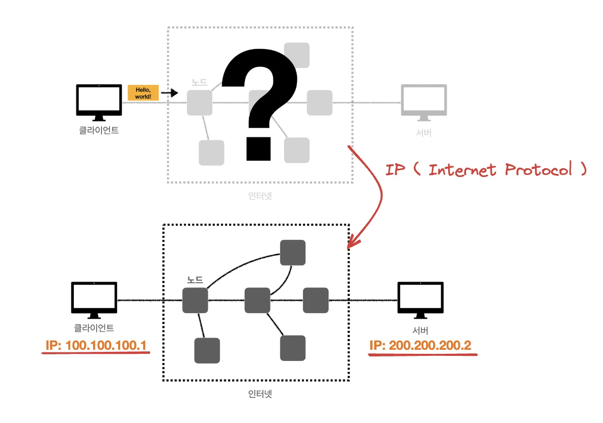

### IPv4 Header

### IP 프로토콜의 한계

- 비연결성&#58; 패킷을 받을 대상이 없거나 받을 대상이 서비스 불능 상태여도 패킷 전송함

- 비신뢰성&#58; 중간에 패킷이 소실거나, 패킷이 순서대로 오지 않는 오류 발생할 수 있음

- 프로그램 구분&#58; 같은 IP 주소를 가지는 App 이 둘 이상이면     → 아파트에서 호수 구분 없이 택배를 받는 상황

## TCP 

> <strong>T</strong><strong>ransmission </strong><strong>C</strong><strong>ontrol </strong><strong>P</strong><strong>rotocol</strong>

<strong>인터넷 프로토콜 4계층</strong>

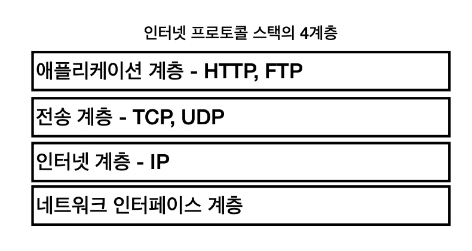

<strong>프로토콜 계층</strong>

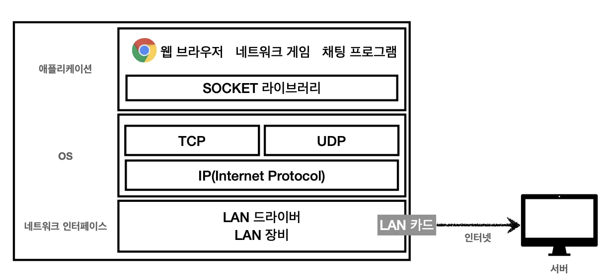

- 송신

> <code>Encaptulation</code>&#58;   Stream →(분할됨)  Segment → Packet →  Frame  ⇒ 수신&#58; 역순 ( <code>Decaptulation</code>)

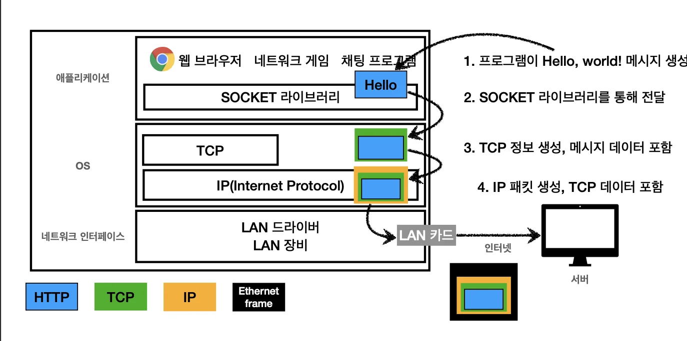

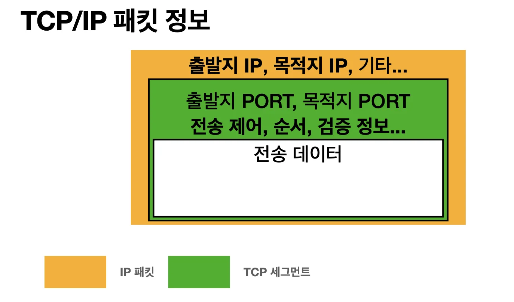

> TCP 전송 데이터 단위&#58; Segment    (UDP&#58; Datagram)  MSS(Maximum Segment Size) &#58; 1460 byte

### TCP 특징 

> <a href="#/post/1c3eda9b-0fe1-815d-b96f-fb22f04b49f2">페이지</a> 

- <strong>연결 지향</strong> &#45; <code>TCP 3 way handshake</code> ( 논리적(가상) 연결 )
    > 연결하고자 하는 주소(IP주소 &#43; Port 번호)에 요청을 보내고   알맞은 응답을 받으면 연결되었다고 판단함

    

       → End&#45;point 가 판단하는 주관적인 연결  

    

       → 보안성 X

- 데이터 전달 보증 

- 순서 보장 

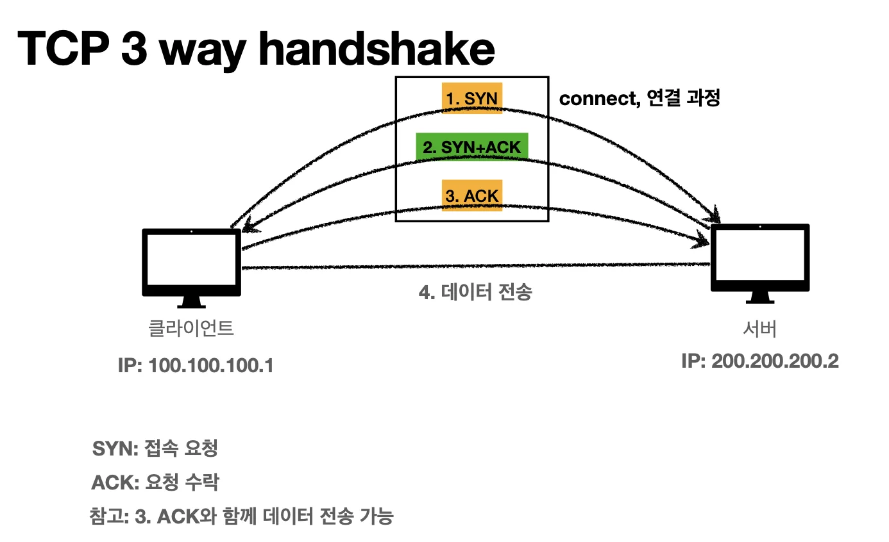

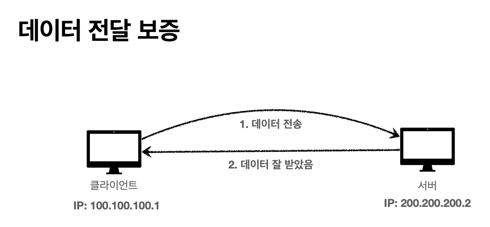

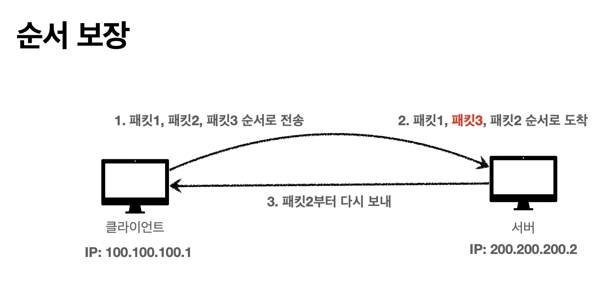

## UDP

> <strong>U</strong><strong>ser </strong><strong>D</strong><strong>atagram </strong><strong>P</strong><strong>rotocol</strong>

### UDP 특징

- 연결 지향  X 

- 데이터 전달 보증 X

- 순서 보장 X

데이터 전달 및 순서가 보장되지 않지만 단순하고 빠름

> <code>IP</code> &#43; <code>Port</code> &#43; 체크섬 (거의 IP 와 같다)

→  필요한 부분은 직접 구현해서 처리 

TCP 보다 더 최적화를 원할 때, 이미 TCP는 기본값으로 많이 사용하고 있다&#46; 따라서 UDP 를 통해 커스텀 해서 사용( 물론 더 최적화가 가능할때 사용해야 한다&#46; )

최근에 각광을 받고 있다&#46; 

HTTP3 가 나오면서 더 가볍고  TCP 프로토콜이 

## Port

> 한 host에 둘 이상의 연결이 필요한 경우, Port 번호로 구분 → <code>IP&#58; 아파트, Port&#58; 호</code>  

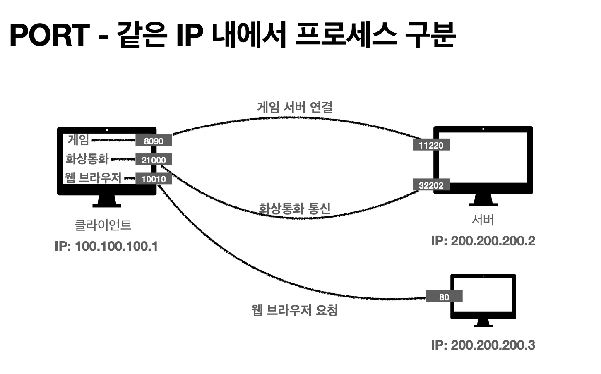

‘항구’ 라는 뜻을 가짐 하나의 클라이언트에 여러 개의 서버와 통실 할 때, 즉 한번에 둘 이상의 네트워크 통신이 필요한 경우

주고 받는 데이터(패킷)들에 <code>출발지 PORT</code> 와 <code>목적지 PORT</code> 로 각각 구분하여 알맞는 곳에 사용될 수 있어야 한다&#46; 

> 같은 IP 내에서 통신하는 애플리케이션을 구분하기 위해 사용함

<strong>TCP Header </strong>

UDP Header 

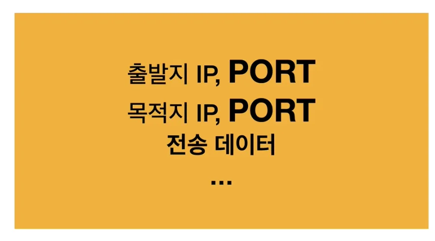

전달 되는 데이터(Segment)에 <code>출발지 PORT </code>와 <code>목적지 PORT</code>가 들어있어, 각 프로세스의 포트 번호에 맞게 전달된다&#46; 

### 포트(Port) 번호

> 0 &#126; 65535 할당 가능 → 0 &#126; 1023&#58; 잘 알려진 포트, 사용 x

> • FTP&#58; 20, 21 • TELNET&#58; 23 • HTTP&#58; 80 • HTTPS&#58; 443 

## DNS ( Domain Name System )

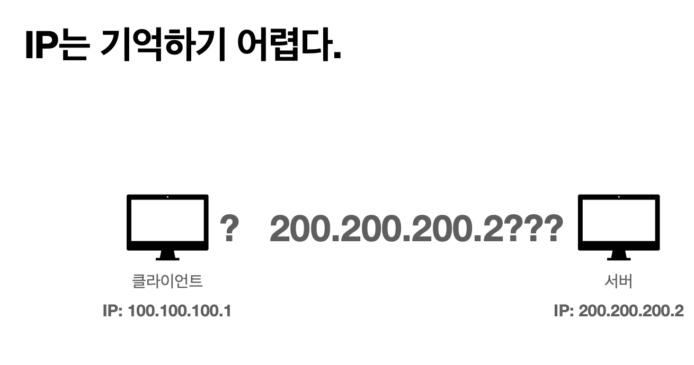

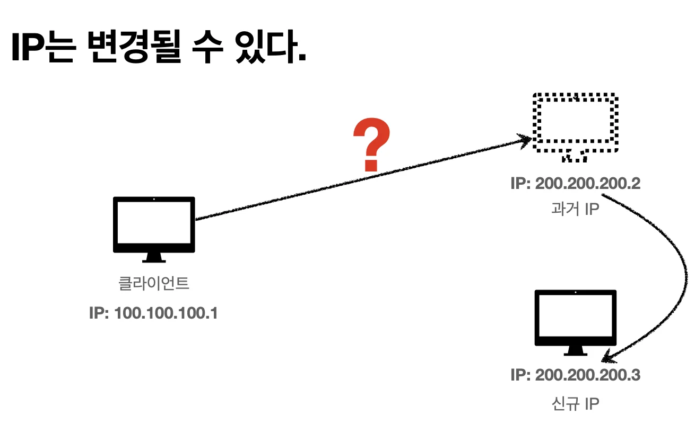

> IP는 기억하기 어렵고 변경될 수 있다&#46; 따라서 도메인을 이를 해결한다&#46; 

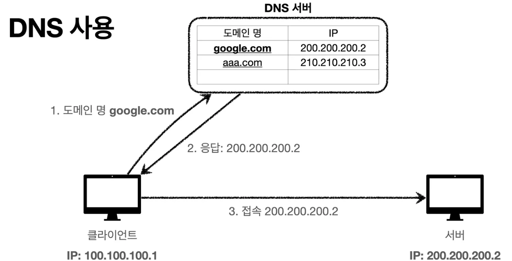

>  IP 주소를 도메인(영어형태 주소) 로 변경 ⇒  DNS 서버를 통해,  해당되는 도메인에 맞는  IP 주소 반환받음
