<a id="1c3eda9b0fe1815b8490ccdef25ed010"></a>

## Github actions 활용한 CI/CD 파이프라인 

---

> 📖 
> 
> <a id="1c3eda9b0fe18177b9b4d14199fd41c9"></a>
> 
> 베포 자동화를 위한 도구는 여러가지 있지만, Github Actions은 무료로 상당 부분 사용 가능하며  점점 더 많이 대중화되고 있다&#46; 

<details>
<summary>Github actions 이란?</summary>

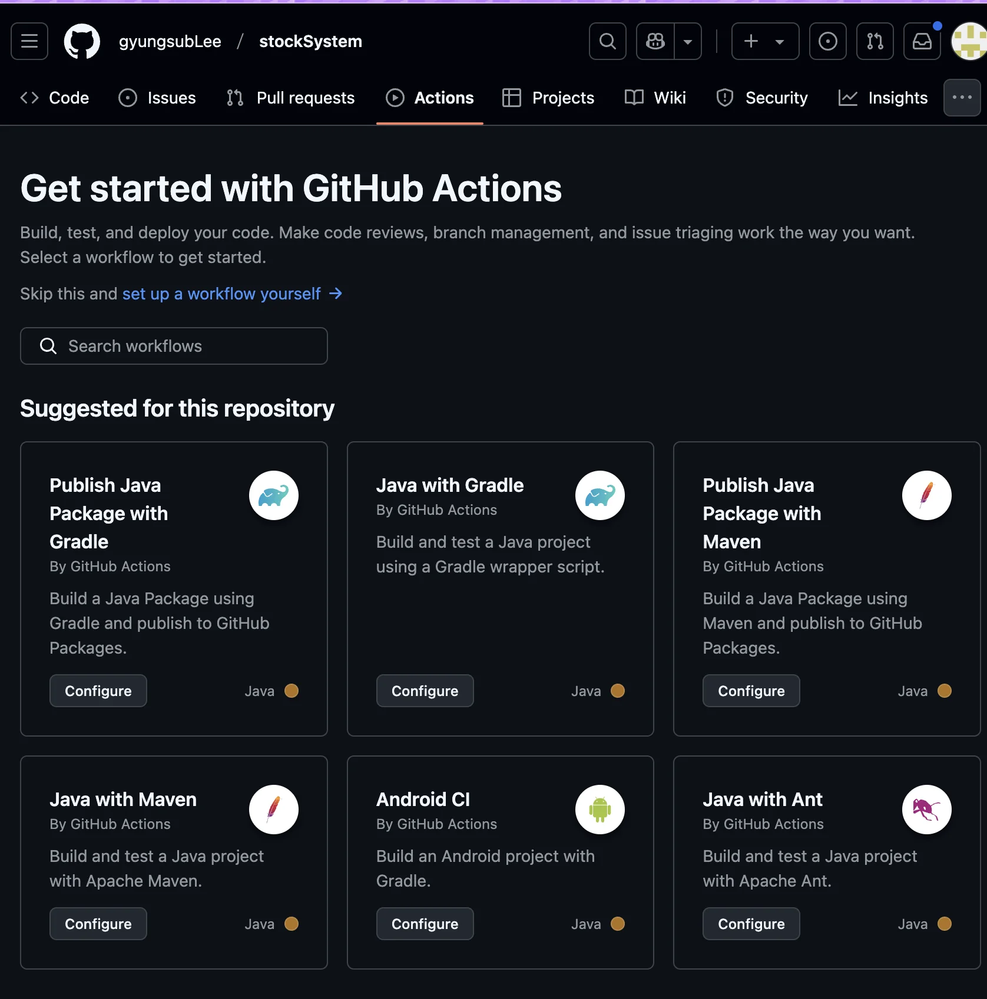

<a id="1c3eda9b0fe18110b6e7f916f28f34d9"></a>

Github에 내장되어 있는 CI/CD라 github와 통합이 쉽고, CI/CD 서버가 내장되어 CI/CD 서버를 따로 구축할 필요 없으며, 일정 수준까지 가격이 무료이다&#46; 

- 무료 버전&#58; 스토리지 500MB, 월 2000분

> ✏️ 
> 
> <a id="1c3eda9b0fe1816babe0d95ed8c4b506"></a>
> 
> <strong>Github actions 동작 방법</strong> 
> 
> <a id="1c3eda9b0fe181f1950fc2480889eb04"></a>
> 
> repository의 <code>&#46;github&#46;workflows</code> 디렉토리에 필요한 Actions 파일들을 yaml 형식으로 작성한다&#46; 
> 
> <a id="1c3eda9b0fe18141a850e615e88524ef"></a>
> 
> 반드시 <u><code>&#46;github/workflows</code></u><u> 폴더 아래에 YAML 파일이 위치</u>해야 한다&#46; 
> 
> <a id="1c3eda9b0fe18113b0def46a566e6605"></a>
> 
> 작성된 <strong><u>actions 파일</u></strong>들은<u> github에서 자동으로 실행</u>한다&#46; 

</details>

<details>
<summary>Github Actions 에서 <code>CI</code>( Continuous Integration,  지속적인 통합 )</summary>

<a id="1c3eda9b0fe181f3980fef01d5cec389"></a>

자동으로 테스트를 통과한 코드만 <code>develop</code> 브랜치와 <code>main</code> 브랜치에 merge 되도록 하여 오류를 방지하며 안정적인 코드가 자동으로 베포된다&#46; 

<details>
<summary>활용 예시</summary>

<details>
<summary>🧐 <code>feature/&#42;&#42;</code>, 와일드 카드</summary>

- <code>&#42;&#42; </code>( 와일드 카드 두번 ) 은 선언된 경로 시 작되는 모든 path을 포함한다&#46;

- 따라서 위의 경우는 <code>feature/</code> 경로로 시작되는 모든 path를 나타낸다&#46; 

- ex)
    - <code>/feature</code>

    - <code>/feature/&#46;&#46;&#46;</code>

    - <code>/feature/&#46;&#46;&#46;/&#46;&#46;&#46;</code>

    - … 

</details>

- <code>develop</code> 브랜치에 merge 된 경우, gradle test 를 진행한다&#46;

- <code>feature/&#42;&#42;</code> 브랜치가 push된 경우, gradle test를 진행한한다&#46;

- 만약 gradle test가 실패한 경우, slack 등 알람을 보내 코드를 수정하도록 하는 알람 설정이 가능하다&#46;
    - 이메일은 기본으로 자동 발송되도록  설정되어 있다&#46; 

<details>
<summary>ex) <code>github actions  CI</code> &#45; <code>yaml</code> 파일 </summary>

<a id="1c3eda9b0fe18164b61afc7343d887a6"></a>

```yaml
# Actions 이름 github 페이지에서 볼 수 있다.
name: 'CI'

# Event Trigger 특정 액션 (Push, Pull_Request)등이 명시한 Branch에서 일어나면 동작을 수행한다.
on: 
    push:
        # 배열로 여러 브랜치를 넣을 수 있다.
        branches: [ develop, feature/* ]
    # github pull request 생성시
    pull_request:
        branches: 
            - develop # -를 쓴 여러 줄로 여러 브랜치를 명시하는 것도 가능

    # 실제 어떤 작업을 실행할지에 대한 명시
jobs:
  ci:
  # 스크립트 실행 환경 (OS)
  # 배열로 선언시 개수 만큼 반복해서 실행한다. ( 예제 : 1번 실행)
    runs-on: [ ubuntu-latest ] 

    # 실제 실행 스크립트
    steps: 
      # uses는 github actions에서 제공하는 플러그인을 실행.(git checkout 실행)
      - name: checkout
        uses: actions/checkout@v4

      # with은 plugin 파라미터 입니다. (java 11버전 셋업)
      - name: java setup
        uses: actions/setup-java@v2
        with:
          distribution: 'adopt' # See 'Supported distributions' for available options
          java-version: '17'

      # run은 사용자 지정 스크립트 실행
      - name: run unittest
        run: |
          ./gradlew clean test
```

</details>

</details>

</details>

<details>
<summary>Github Actions 에서의 <code>CD</code> ( Continuous &#91; Delivery, Deployment &#93;, 지속적인 &#91; 베포, 서비스 &#93;) </summary>

<a id="1c3eda9b0fe181d5a89ee6ac68dbf766"></a>

<strong><u>베포를 자동화</u></strong><strong> → </strong>빠르고 간편하게 베포 가능하다&#46;

<details>
<summary>활용 예시</summary>

> <code>main</code> 브랜치 코드가 통합된 경우 운영 환경에 빠르게 베포 할 수 있게 한다&#46;

- <code>main</code> 브랜치에 merge 된 경우, <code>gradle test</code> 를 실행

- <code>main</code> 브랜치의 코드 기준으로 <code>jar</code> 파일을 생성

- 생성된 <code>jar</code>파일을 특정 환경(AWS, GCP 등)에 베포

<details>
<summary>ex)  <code>github actions CD</code> &#45; <code>yaml</code> 파일 (실제 동작 ❌)</summary>

<a id="1c3eda9b0fe181c19957efb41d0b07ad"></a>

```bash
name: 'CD'

on: 
    push:
        branches: [ main ]
jobs:
  cd:
    runs-on: [ ubuntu-latest ] 

    steps: 
      - name: checkout
        uses: actions/checkout@v4

      - name: java setup
        uses: actions/setup-java@v3
        with:
          distribution: 'adopt' # See 'Supported distributions' for available options
          java-version: '17'

      - name: run unittest
        run: |
          ./gradlew clean test
		  
      - name: deploy to heroku
	      uses: akhileshns/heroku-deploy@v3.12.12
		    with:
          heroku_api_key: ${{secrets.HEROKU_API_KEY}}
          heroku_app_name: "sampleapp-github-actions" #Must be unique in Heroku
          heroku_email: "nbcdocker@proton.me"
```

</details>

</details>

</details>

<details>
<summary> Github Actions 뜯어보기</summary>

> <code>event</code>, <code>runner</code>, <code>job</code>, <code>step</code>

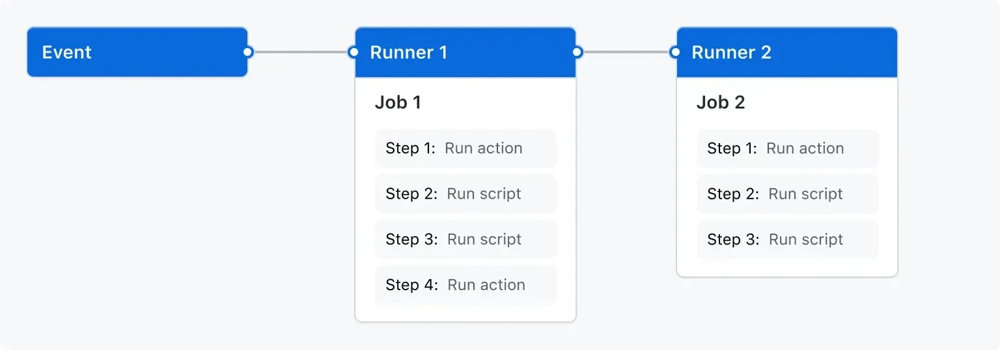

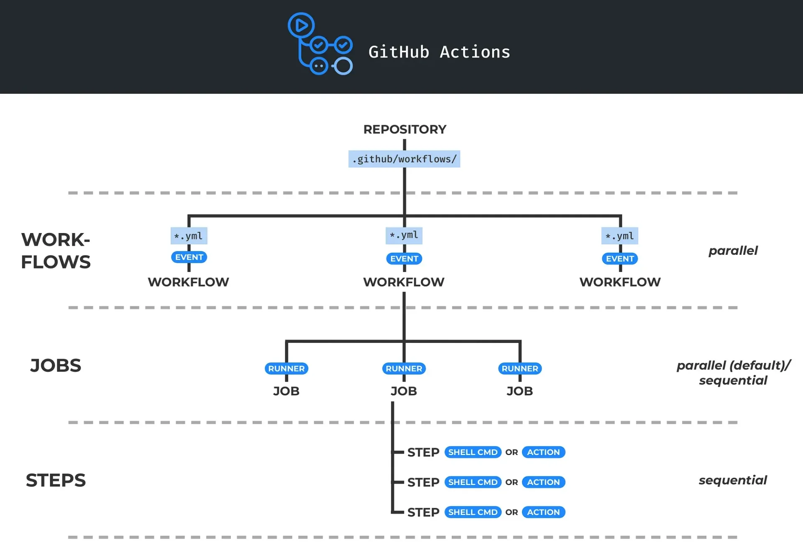

<details>
<summary>1&#46; <code>Workflow</code></summary>

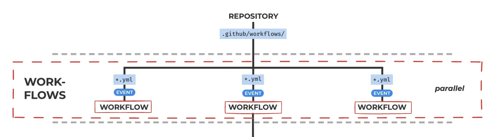

- 최상단의 개념이다&#46;

- 여러 <code>Job</code>으로 구성되고, <code>Event</code>에 의해 트리거될 수 있는 자동화된 프로세스이다&#46;

- Workflow 파일은 YAML 형식으로 작성되고, Github Repository의 <code>&#46;github/workflows</code> 폴더 아래에 저장된다&#46; 

</details>

<details>
<summary>2&#46; <code>event</code></summary>

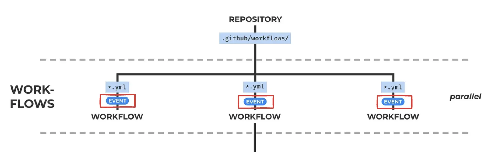

- Github Repository에 발생되는 <code>push</code>,<code> pull request open</code>, <code>issue open</code>, <code>특정 시간대 반복(cron)</code> 등의 특정한 규칙들을 말한다&#46; 

- <strong><u>workflow의 실행의 trigger 역할</u></strong>을 한다&#46; 

</details>

<details>
<summary>3&#46; <code>runner</code></summary>


- Github Action Runner app이 설치된 VM

- Workflow가 실행될 instance로 <u>각각의 Job들은 개별적인 runner에서 실행</u>된다&#46; 

</details>

<details>
<summary>4&#46; <code>Jobs</code></summary>

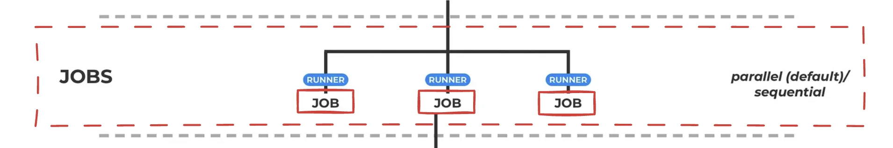

- <u>하나의 runner에서 실행</u>될<strong><u> 여러 step의 모음</u></strong>

</details>

<details>
<summary>5&#46; <code>step</code></summary>

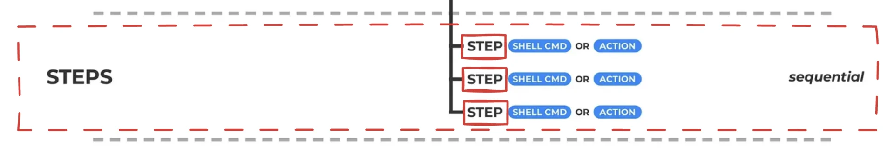

- 실행 가능한 하나의 shell script 또는 action

</details>

<details>
<summary>6&#46; <code>actions</code></summary>


- Workflow의 가장 작은 단위로 재사용이 가능하다&#46; 

- Job을 만들기 위한 Step들을 연결?

</details>

</details>

<details>
<summary>workflow 뜯어보기</summary>

<details>
<summary>1&#46; <code>name</code></summary>

- github actions의 명칭

</details>

<details>
<summary>2&#46; <code>on</code></summary>

- 이 action이 언제 실행되는지를 명시

</details>

<details>
<summary>3&#46; <code>jobs</code></summary>

- 실제 실행할 내용
    - <code>runs&#45;on</code>&#58; 어떤 환경에서 실행하는지 기술
        [GitHub 호스팅 실행기 정보 &#45; GitHub Docs]()

    - <code>steps</code>&#58; 실제 실행할 단계들을 기술
        - <code>name</code>&#58; 실행에 표시될 이름

        - <code>uses</code>&#58;  여러 가지 plugin 사용
            [bookmark]()

        - <code>with</code>&#58; plugin 에서 사용할 파라미터들

        - <code>run</code>&#58; 실제로 실행할 스크립트

</details>

</details>

<details>
<summary>실습 &#45;  github actions 실행해보기</summary>

> reference&#58; ‣

<details>
<summary>테스트할 설정 파일</summary>

<a id="1c3eda9b0fe181f9b3f8fe48a69a0e88"></a>

```yaml
name: GitHub Actions Demo
run-name: ${{ github.actor }} is testing out GitHub Actions 🚀
on: [push]
jobs:
  Explore-GitHub-Actions:
    runs-on: ubuntu-latest
    steps:
      - run: echo "🎉 The job was automatically triggered by a ${{ github.event_name }} event."
      - run: echo "🐧 This job is now running on a ${{ runner.os }} server hosted by GitHub!"
      - run: echo "🔎 The name of your branch is ${{ github.ref }} and your repository is ${{ github.repository }}."
      - name: Check out repository code
        uses: actions/checkout@v4
      - run: echo "💡 The ${{ github.repository }} repository has been cloned to the runner."
      - run: echo "🖥️ The workflow is now ready to test your code on the runner."
      - name: List files in the repository
        run: |
          ls ${{ github.workspace }}
      - run: echo "🍏 This job's status is ${{ job.status }}."
```

</details>

- 실습
    1. 실습할 github repository 생성

    <details>
    <summary>2&#46; 파일 생성  및 커밋</summary>

    > ☝🏻 
    > 
    > <a id="1c3eda9b0fe1818baad2dd2f4fbf5315"></a>
    > 
    > 폴더명 중요&#33;  정확하게 <code>&#46;github</code>, <code>workflows</code>(복수형) 라 명시해야 된다
    > 
    > - <code>workflow</code> 라고 잘못 생성해서 한참 헤맸음

    > directory&#58; <code>&#46;github/workflows/test&#46;yml</code>

    - 파일 생성 
        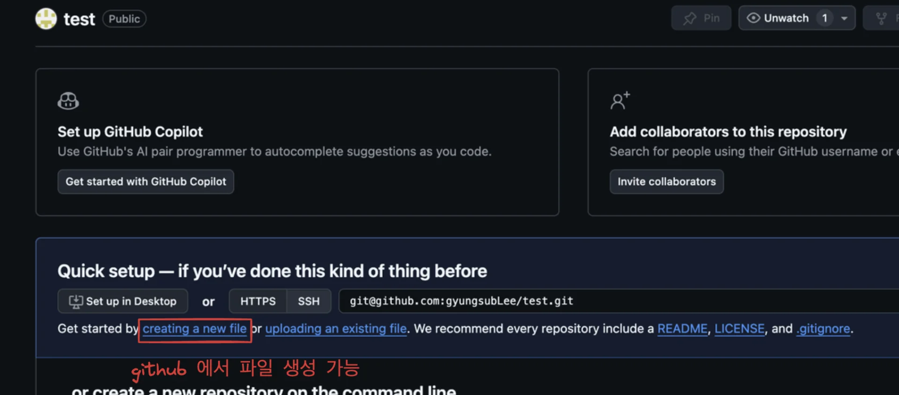

    - commit 생성
        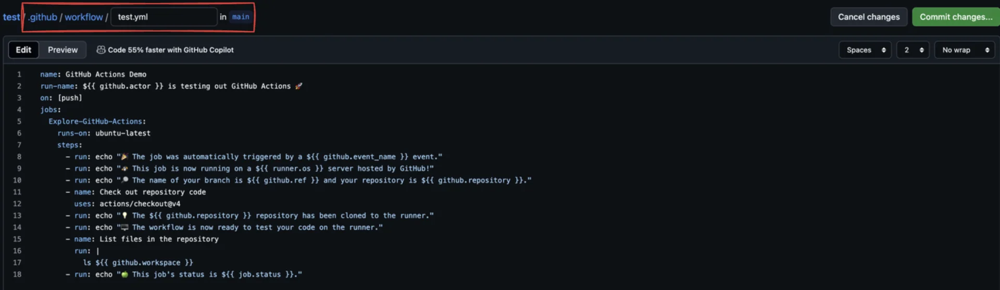

    </details>

    <details>
    <summary>3&#46; 실행된 action 확인</summary>

    - commit을 하면 아래와 같이 actions 에서 workflows에 명시한 파일이 실행된 것을 확인할 수 있다&#46; 
        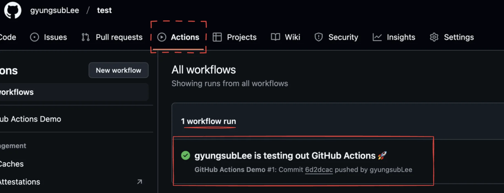

    - 해당 action을 클릭하면 아래와 같이 액션에 대한 정보들을 확인할 수 있다&#46; 
        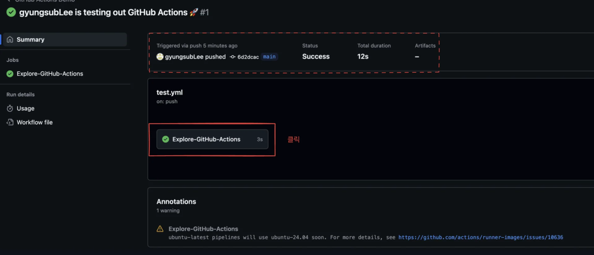

        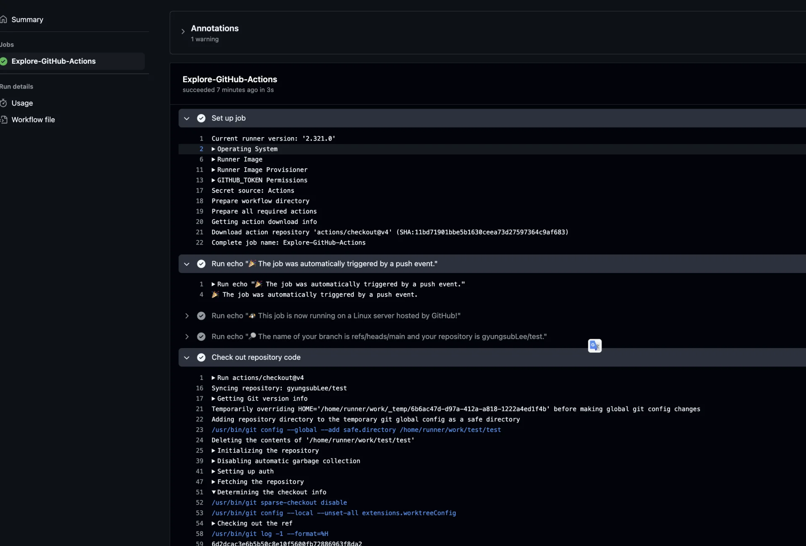

    </details>

</details>
