<a id="1c3eda9b0fe18155afa3e67f11d0c54f"></a>

## Spring Boot &#45; JPA

<details>
<summary>SpringBoot &#45;  JPA</summary>

<details>
<summary><strong>🧐 JPA와 SpringBott JPA의 차이점이 무엇인가?</strong></summary>

> <strong>JPA</strong>

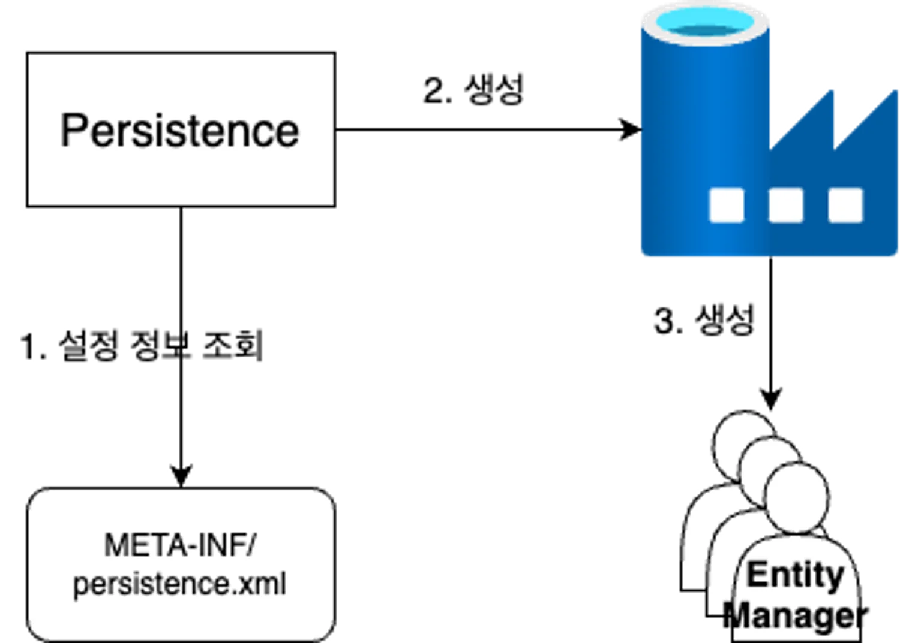

<a id="1c3eda9b0fe1819ab3f8e39def0214fd"></a>

이전 JPA에서는 <code>resources/META&#45;INF/persistence&#46;xml</code> 설정 정보 파일에 의해 영속성 컨텍스트(Persisten)가 생성되어,   <code>EntityManagerFactory</code> 생성 및 <code>EntityManger</code> 생성한다&#46;<br>그리고 EntityManger를 통해 Entity를 다루었다&#46; 

> <strong>Spring JPA</strong>

<a id="1c3eda9b0fe181318928c57a8519fee8"></a>

스프링부트 환경에서는 <u><code>application&#46;properties</code></u><u>  설정</u>을 바탕으로 <strong><code>EntityManagerFactory</code></strong>, <strong><code>EntityManager</code></strong>를 <strong><u>자동</u></strong>으로 생성해준다&#46; 

<a id="1c3eda9b0fe1811fbcead1c5e0f3ae2c"></a>

따라서 <code>application&#46;properties</code>에 <strong>DB 정보를 전달</strong>해 주면 이를 토대로 <strong><code>EntityManagerFactory</code></strong>가 생성된다&#46;

</details>

<details>
<summary><code>application&#46;properties</code> &#58; <strong>Hibernate 설정 정보</strong></summary>

<details>
<summary><strong><code>show&#95;sql</code></strong><strong><u>,</u></strong><strong> </strong><strong><code>format&#95;sql</code></strong><strong>, </strong><strong><code>use&#95;sql&#95;comments</code></strong> 옵션</summary>

- <strong>Hibernate가 DB에 요청하는 모든 SQL을 볼수 있게 출력</strong>
    <a id="1c3eda9b0fe1810d80efd86531d194b8"></a>

    ```sql
    spring.jpa.properties.hibernate.show_sql=true
    spring.jpa.properties.hibernate.format_sql=true
    spring.jpa.properties.hibernate.use_sql_comments=true
    ```

</details>

<details>
<summary><strong><code>ddl&#45;auto</code></strong></summary>

- <code>create</code> &#58; 기존 테이블 삭제 후 다시 생성 (DROP &#43; CREATE)

- <code>create&#45;drop</code> &#58; create와 같으나 종료시점에 테이블을 DROP  

- <code>update</code> &#58; 변경된 부분만 반영

- <code>validate</code> &#58; Entity와 테이블이 정상 매핑되었는지만 확인

- <code>none</code>&#58; 아무것도 하지 않음

</details>

</details>

<details>
<summary><strong>스프링부트에서의 EntityManager 생성&#58; </strong><strong><code>&#64;PersistenceConext</code></strong> </summary>

> 📌 <strong><code>&#64;PersistenceConext</code></strong> 사용하면 자동으로 생성된 EntityManager를 주입받아 사용할 수 있다

<details>
<summary>ex) </summary>

<a id="1c3eda9b0fe1816a99defff83dae9b5b"></a>

```java
@PersistenceContext
EntityManager em;
```

</details>

</details>

<details>
<summary><code>build&#46;gradle</code><strong>  &#45; JPA 의존성 추가</strong></summary>

<details>
<summary><code>build&#46;gradle</code><strong>  </strong><strong><u>jdbc 의존성 제거</u></strong> 및 <strong><u>JPA 의존성 추가</u></strong><strong> </strong></summary>

<a id="1c3eda9b0fe1811e9db9e7d6393941a1"></a>

```groovy
// JPA 의존성 추가 
implementation 'org.springframework.boot:spring-boot-starter-data-jpa'
```

<a id="1c3eda9b0fe1816a87ddcd3e9573128f"></a>

jdbc가 이제 필요가 없음, 지우기

<a id="1c3eda9b0fe181b3b371de3373faff4f"></a>

```groovy
/jdbc 의존성 제거
implementation 'org.springframework.boot:spring-boot-starter-data-jdbc'
```

</details>

<details>
<summary><code>application&#46;properties</code>  &#45;<strong>Hibernate 설정 정보 추가</strong></summary>

<a id="1c3eda9b0fe181feb44afa5de5a8c24d"></a>

```groovy
spring.jpa.hibernate.ddl-auto=update

spring.jpa.properties.hibernate.show_sql=true
spring.jpa.properties.hibernate.format_sql=true
spring.jpa.properties.hibernate.use_sql_comments=true
```

</details>

</details>

</details>

<details>
<summary>SpringBoot의 트랜잭션 &#45; <strong><code>&#64;Transactional</code></strong><strong> </strong></summary>

<details>
<summary><strong>🧐 JPA 와 스프링부트에서의 </strong><strong><code>transaction</code></strong><strong> 사용 차이점</strong></summary>

> <strong>jpa</strong>는 <strong><u>데이터베이스 트랜젝션 개념을 가져</u></strong>와서 사용한다&#46; 따라서 <strong><u>스프링부트 jpa를 사용할 때도 트랜젝션 개념을 jpa에게 부여</u></strong>해야 한다&#46;

- <strong>JPA</strong>에서는 entityManager에서 transaction을 가져와 사용했다&#46;
    <details>
    <summary>ex)</summary>

    <a id="1c3eda9b0fe181e38b37ca9df2eecc36"></a>

    ```java
    //EntityManagerFactory 생성
    EntityManagerFactory emf = Persistence.createEntityManagerFactory("h2");
    //EntityManager 생성
    EntityManager entityManager = emf.createEntityManager();
    //EntityTransaction 생성
    EntityTransaction tx = entityManager.getTransaction();
    ```

    </details>

- <strong>스프링부트 환경</strong>에서는 <code>&#64;Transactional</code>을 Anotation을 통해 손쉽게  DB의 트랜잭션 개념을 애플리케이션에 적용 할 수 있다&#46;
    <details>
    <summary>ex)</summary>

    <a id="1c3eda9b0fe18164a5beea14da4fbe3e"></a>

    ```java
    @Component
    class ProductProcessor(

    	@Transactional
    	public void create( ..) {
    	    .  .  .
    }
    ```

    </details>

</details>

<details>
<summary><strong>사용법) </strong><code>&#64;Transactional</code></summary>

<details>
<summary><strong>클래스 </strong></summary>

> 📌 클래스에 선언한 <code>&#64;Transactional</code>은 해당 클래스 <strong>내부의 모든 메서드에 트랜젝션 기능을 부여</strong>한다&#46; 

<details>
<summary>ex)  클래스</summary>

<a id="1c3eda9b0fe181389384ea2314d47221"></a>

```java
@Transactional
class 클래스명 {
		. . .
}
```

</details>

<details>
<summary>ex)<strong> SimpleJpaRepository</strong> &#45;<strong> save</strong></summary>

<a id="1c3eda9b0fe1817393d7ee881b006caf"></a>

<strong>Save 메서드</strong>는 &#64;Transactional 애너테이션이 추가되어있기 때문에 클래스의 <code>&#64;Transactional</code> 옵션인 <code>readOnly = true</code> 를 덮어쓰게 되어 <code>readOnly = false</code> 옵션으로 적용된된다&#46;

<a id="1c3eda9b0fe181c6a0fbcb49faa18e5f"></a>

```java
@Transactional(readOnly = true)
public class SimpleJpaRepository<T, ID> implements JpaRepositoryImplementation<T, ID> {
						...
			
		@Transactional
		@Override
		public <S extends T> S save(S entity) {
		
			Assert.notNull(entity, "Entity must not be null");
		
			if (entityInformation.isNew(entity)) {
				em.persist(entity);
				return entity;
			} else {
				return em.merge(entity);
			}
		}

						...
}
```

</details>

</details>

<details>
<summary><strong>메서드</strong></summary>

> 📌 <code>&#64;Transaction</code>이 명시된 메서드가 호출되면, <strong><u>해당 메서드 내에 수행되는 모든 DB 연산</u></strong><strong><u> 내용</u></strong>은 <strong>하나의 트랜젝션으로 묶</strong>인다&#46; 
> 
> <a id="1c3eda9b0fe181b1bc93ef9230577750"></a>
> 
> 이때, 해당 메서드가<strong> </strong><strong><u>정상</u></strong><strong>적으로 수행</strong>되면 <strong><u>트랜젝션을 커밋</u></strong>하고, <strong><u>예외</u></strong>가 발생하면 <strong><u>롤백</u></strong>한다&#46; 

<details>
<summary>ex)  메서드</summary>

<a id="1c3eda9b0fe18158a7b6ffe2a5e4efca"></a>

```java
class 클래스명 {

		@Transaction
		public void 메서드명() {
					.  .  .
		}
```

</details>

</details>

<details>
<summary>속성&#58; <code>readOnly</code></summary>

> default&#58; <code>false</code>

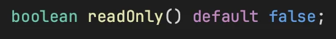

<details>
<summary>ex) 클래스에서 정의한 readOnly 속성, 메서드에서 Override</summary>

<a id="1c3eda9b0fe18106864ddf64a22d2654"></a>

```java
@Transactional(readOnly = true)
public class SimpleJpaRepository<T, ID> implements JpaRepositoryImplementation<T, ID> {
						...
			
		@Transactional
		@Override
		public <S extends T> S save(S entity) {
		
```

</details>

</details>

</details>

<details>
<summary>ex) 트랜젝션 테스트</summary>

<details>
<summary>메모 생성 성공</summary>

<a id="1c3eda9b0fe18122a54ffcc07ffa38b0"></a>

```java
@Test
@Transactional 
@DisplayName("메모 생성 성공") // 테스트 코드에서 @Transactional 를 사용하면 테스트가 완료된 후 롤백하기 때문에 false 옵션 추가
@Rollback(value = false)
void test1() {
    Memo memo = new Memo();
    memo.setUsername("Robbert");
    memo.setContents("@Transactional 테스트 중!");

    em.persist(memo);  // 영속성 컨텍스트에 메모 Entity 객체를 저장합니다.
}
```

</details>

<details>
<summary>메모 생성 실패</summary>

<a id="1c3eda9b0fe1814a8651f03626af39f2"></a>

```java
@Test
@DisplayName("메모 생성 실패")
void test2() {
    Memo memo = new Memo();
    memo.setUsername("Robbie");
    memo.setContents("@Transactional 테스트 중!");

    em.persist(memo);  // 영속성 컨텍스트에 메모 Entity 객체를 저장합니다.
}
```

</details>

</details>

<a id="1c3eda9b0fe18163a6dce9a41ce0dce1"></a>

 

</details>

<details>
<summary>영속성 컨텍스트와 트랜젝션의 생명주기( Life Cyrcle )</summary>

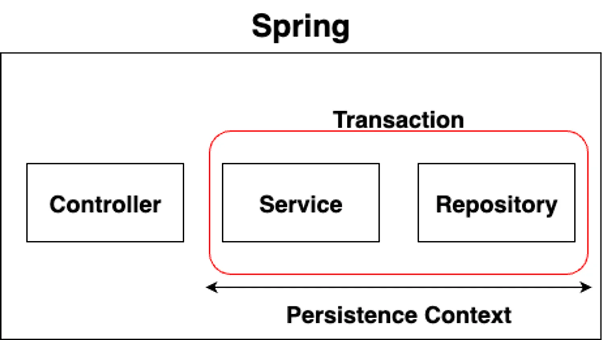

<a id="1c3eda9b0fe1813488b1d2bcfac76fec"></a>

<u>스프링 컨테이너 환경</u>에서는 <code>영속성 컨텍스트</code>와 <code>트랜젝션</code>의 생명주기가 일치한다&#46;  

<a id="1c3eda9b0fe18117ac40d01a269606e6"></a>

따라서 트랜잭션이 유지되는 동안 영속성 컨텍스트가 유지되기 때문에 영속성 컨텍스트의 기능을 사용할 수 있다&#46;

</details>

<details>
<summary>트랜잭션 전파 </summary>

> <code>&#64;Transactional</code>에서 <strong><u>트랜잭션 전파 옵션</u></strong>을 지정

</details>

<a id="1c3eda9b0fe181cebde7f7f1b014f281"></a>

## Spring Data  &#45; JPA

<details>
<summary>Spring Data JPA란?</summary>

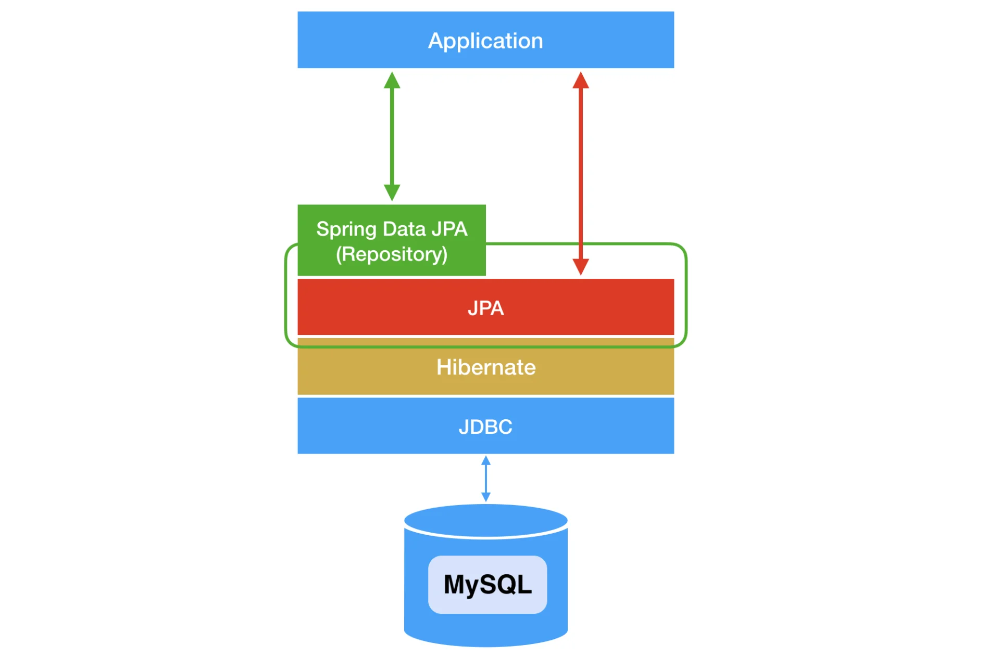

- <strong>Spring Data JPA</strong>는 <strong>JPA</strong>를 쉽게 사용할 수 있게 만들어놓은 하나의 모듈
    - <strong>JPA</strong>를 추상화시킨 <strong>Repository</strong> 인터페이스를 제공

- <strong>Repository 인터페이스</strong>는<strong> Hibernate</strong>와 같은 <strong>JPA구현체</strong>를 사용해서<strong> </strong>구현한 클래스를 통해 사용된다&#46;
    - 개발자들은 <strong>Repository </strong>인터페이스를 통해 JPA를 간편하게 사용할 수 있게 되었습니다&#46;

</details>

<details>
<summary>Spring Data JPA의 SimpleJpaRepository</summary>

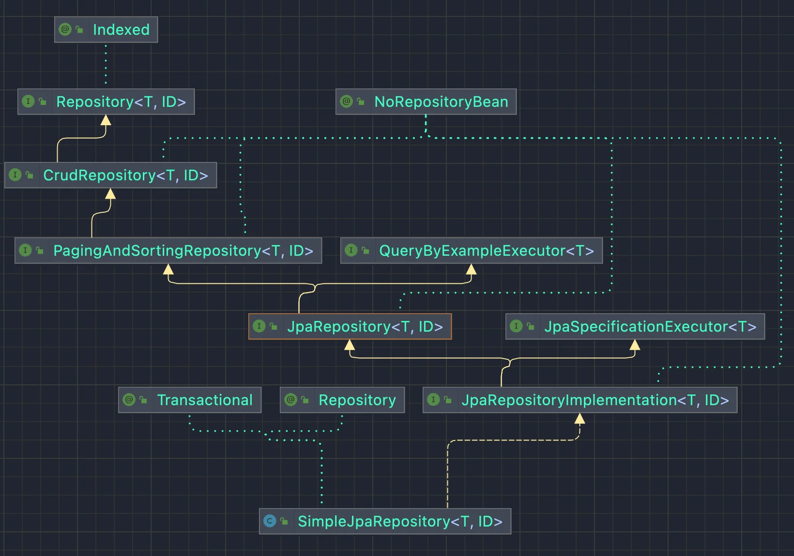

- Spring Data JPA에서는 JpaRepository 인터페이스를 구현하는 클래스를 자동으로 생성해줍니다&#46;
    - Spring 서버가 뜰 때 JpaRepository 인터페이스를 상속받은 인터페이스가 자동으로 스캔이 되면,

    - 해당 인터페이스의 정보를 토대로 자동으로 <strong>SimpleJpaRepository</strong> 클래스를 생성해 주고, 이 클래스를 Spring ‘<strong>Bean</strong>’으로 등록합니다&#46; 

- 따라서 인터페이스의 구현 클래스를 직접 작성하지 않아도 JpaRepository 인터페이스를 통해 JPA의 기능을 사용할 수 있습니다&#46;


</details>

<details>
<summary>Spring Data JPA 사용방법</summary>

- JpaRepository 등록
    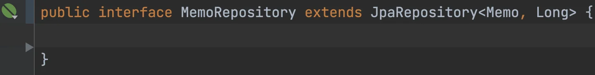

    - <strong>JpaRepository</strong>&#60;<strong>&#34;&#64;Entity 클래스&#34;, &#34;&#64;Id 의 데이터 타입&#34;&#62;</strong>를 상속받는 interface 로 선언합니다&#46;
        - Spring Data JPA에 의해 자동으로 Bean 등록이 되었습니다&#46;

        - 제네릭스의 <strong>&#64;Entity 클래스 </strong>위치에 Memo Entity를 추가했기 때문에 해당 MemoRepository는 DB의 memo 테이블과 연결되어 CRUD 작업을 처리하는 인터페이스가 되었습니다&#46;

</details>

<details>
<summary>메모장 프로젝트 Spring Data JPA 적용</summary>

- MemoRepository
    <a id="1c3eda9b0fe1810b9dabf6d923dd3025"></a>

    ```java
    public interface MemoRepository extends JpaRepository<Memo, Long> {

    }
    ```

<details>
<summary>save</summary>

<a id="1c3eda9b0fe1817a82c8c0aad154deba"></a>

```java
public MemoResponseDto createMemo(MemoRequestDto requestDto) {
    // RequestDto -> Entity
    Memo memo = new Memo(requestDto);

    // DB 저장
    Memo saveMemo = memoRepository.save(memo);

    // Entity -> ResponseDto
    MemoResponseDto memoResponseDto = new MemoResponseDto(saveMemo);

    return memoResponseDto;
}
```

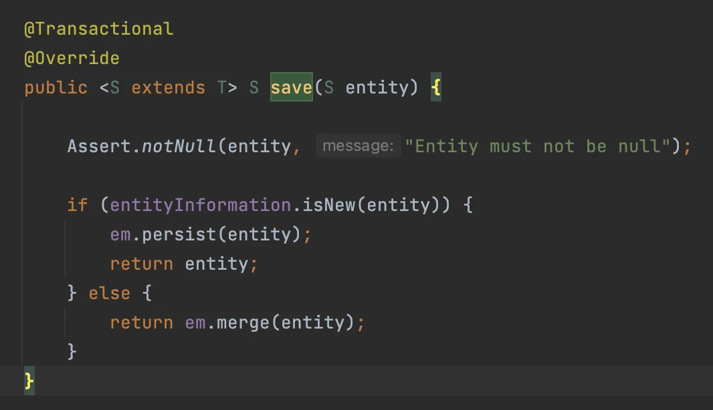

- SimpleJpaRepository의 save 메서드를 확인해보면 영속성 컨텍스트에 entity를 저장하는 코드가 작성되어있습니다&#46;

- save 메서드를 사용해 데이터를 저장할 수 있습니다&#46;
    - 파라미터로는 저장하려는 entity 객체를 넣어주면 됩니다&#46;

    - 해당 메서드에 &#64;Transactional이 적용되어있는 것을 확인할 수 있습니다&#46;

</details>

<details>
<summary>findAll</summary>

<a id="1c3eda9b0fe181d280a2fcc6ddaaa053"></a>

```java
public List<MemoResponseDto> getMemos() {
    // DB 조회
    return memoRepository.findAll().stream().map(MemoResponseDto::new).toList();
}
```

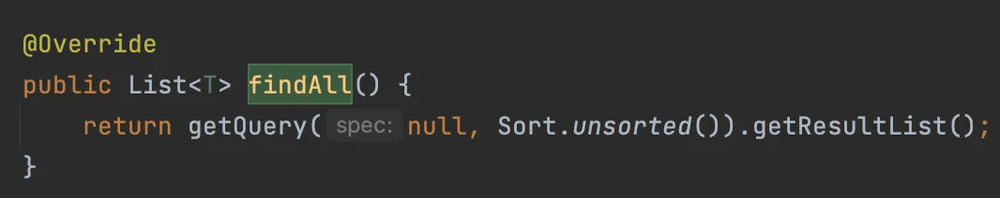

- findAll 메서드를 사용해 해당 테이블의 전체 데이터를 조회할 수 있습니다&#46;

</details>

<details>
<summary>findById</summary>

<a id="1c3eda9b0fe1810c9df3c9c14d3e4713"></a>

```java
private Memo findMemo(Long id) {
    return memoRepository.findById(id).orElseThrow(() ->
            new IllegalArgumentException("선택한 메모는 존재하지 않습니다.")
    );
}
```

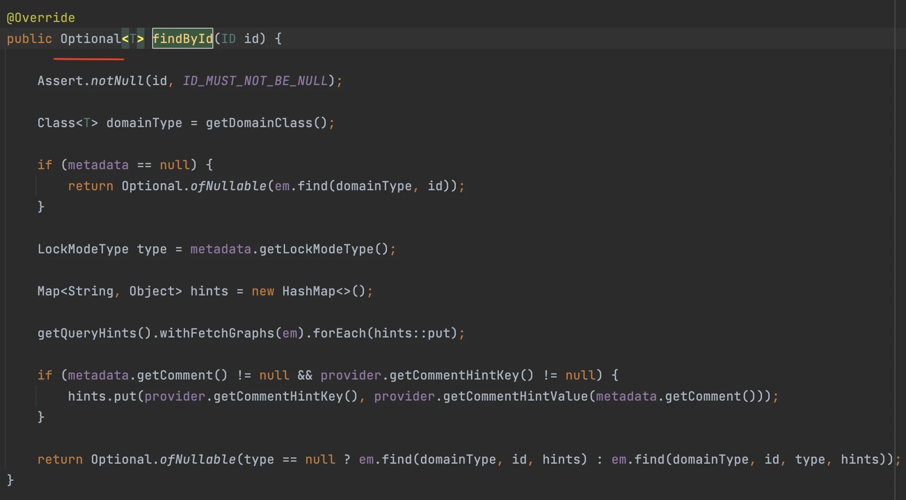

- SimpleJpaRepository의 findById 메서드를 확인해보면 반환 타입이 Optional인 것을 확인할 수 있습니다&#46;
    - 파라미터로는 삭제하고자하는 Entity의 id 값을 넣어주면 됩니다&#46;

- Optional&#60;Entity 타입&#62;을 반환 타입으로 받고 추가적으로 null을 체크하거나

- 위 코드와 같이 orElseThrow를 사용하여 반환 값이 null일 경우 예외를 던지도록 처리할 수 있습니다&#46;

- 앞으로의 강의에서는 최대한 코드 수를 적게 하기위해 orElseThrow를 사용하겠습니다&#46;

<details>
<summary>Optional 자료</summary>

<details>
<summary>&#91;코드 스니펫&#93; Optional</summary>

<a id="1c3eda9b0fe181caa435fe53a80acc9f"></a>

```java
https://www.baeldung.com/java-optional
```

[Guide To Java 8 Optional &#124; Baeldung]()

</details>

</details>

</details>

<details>
<summary>update</summary>

<a id="1c3eda9b0fe181e89ee2cd52c5cf83f1"></a>

```java
@Transactional
public Long updateMemo(Long id, MemoRequestDto requestDto) {
    // 해당 메모가 DB에 존재하는지 확인
    Memo memo = findMemo(id);

    // memo 내용 수정
    memo.update(requestDto);

    return id;
}
```

- SimpleJpaRepository에 update라는 메서드는 존재하지 않습니다&#46;

- 따라서 위 코드처럼 영속성 컨텍스트의 변경감지를 통해 update를 진행하겠습니다&#46;

- 변경감지가 적용되기 위해 해당 메서드에 &#64;Transactional을 추가하였습니다&#46;


</details>

<details>
<summary>delete</summary>

<a id="1c3eda9b0fe181caa8bfe464af368190"></a>

```java
public Long deleteMemo(Long id) {
    // 해당 메모가 DB에 존재하는지 확인
    Memo memo = findMemo(id);

    // memo 삭제
    memoRepository.delete(memo);

    return id;
}
```

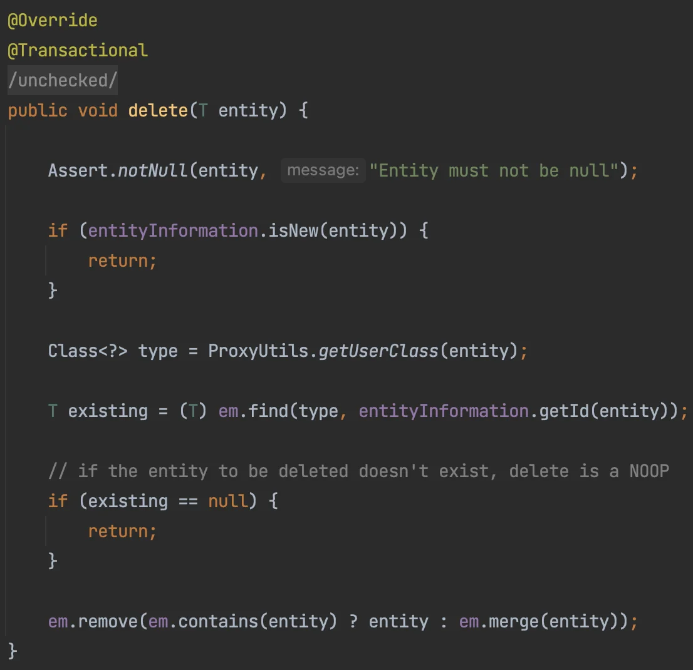

- delete 메서드를 사용해 해당 Entity(데이터)를 테이블에서 삭제할 수 있습니다&#46;

- 파라미터로는 삭제하려는 entity 객체를 넣어주면 됩니다&#46;

- delete 메서드에 &#64;Transactional이 적용되어있는 것을 확인할 수 있습니다&#46;

</details>

<details>
<summary>MemoService</summary>

<a id="1c3eda9b0fe1810c8953f028778e3d74"></a>

```java
package com.sparta.memo.service;

import com.sparta.memo.dto.MemoRequestDto;
import com.sparta.memo.dto.MemoResponseDto;
import com.sparta.memo.entity.Memo;
import com.sparta.memo.repository.MemoRepository;
import org.springframework.stereotype.Service;
import org.springframework.transaction.annotation.Transactional;

import java.util.List;

@Service
public class MemoService {

    private final MemoRepository memoRepository;

    public MemoService(MemoRepository memoRepository) {
        this.memoRepository = memoRepository;
    }

    public MemoResponseDto createMemo(MemoRequestDto requestDto) {
        // RequestDto -> Entity
        Memo memo = new Memo(requestDto);

        // DB 저장
        Memo saveMemo = memoRepository.save(memo);

        // Entity -> ResponseDto
        MemoResponseDto memoResponseDto = new MemoResponseDto(saveMemo);

        return memoResponseDto;
    }

    public List<MemoResponseDto> getMemos() {
        // DB 조회
        return memoRepository.findAll().stream().map(MemoResponseDto::new).toList();
    }

    @Transactional
    public Long updateMemo(Long id, MemoRequestDto requestDto) {
        // 해당 메모가 DB에 존재하는지 확인
        Memo memo = findMemo(id);

        // memo 내용 수정
        memo.update(requestDto);

        return id;
    }

    public Long deleteMemo(Long id) {
        // 해당 메모가 DB에 존재하는지 확인
        Memo memo = findMemo(id);

        // memo 삭제
        memoRepository.delete(memo);

        return id;
    }

    private Memo findMemo(Long id) {
        return memoRepository.findById(id).orElseThrow(() ->
                new IllegalArgumentException("선택한 메모는 존재하지 않습니다.")
        );
    }
}
```

</details>

</details>

<a id="1c3eda9b0fe18108a764cfc6cb55dd42"></a>

## JPA Auditing

> 📌 JPA Auditing<br><strong><u>엔티티의 생성 및 수정 시간을 자동으로 관리</u></strong> 해주는 기능
> 
> - <code>&#64;EnableJpaAuditing</code>&#58;  Auditing 기능을 활성화
> 
> - <code>&#64;CreatedDate&#58;</code> 엔티티가 처음 생성될 때 그 시점을 필드에 기록
> 
> - <code>&#64;LastModifiedDate&#58;</code> 엔티티가 수정될 때 그 시점을 필드에 기록
> 
> - 타입&#58; <strong>LocalDateTime</strong> 

<details>
<summary><code>MyselectshopApplication</code></summary>

<a id="1c3eda9b0fe1815d89d5f82e51709312"></a>

```java
package com.sparta.myselectshop;

import org.springframework.boot.SpringApplication;
import org.springframework.boot.autoconfigure.SpringBootApplication;
import org.springframework.data.jpa.repository.config.EnableJpaAuditing;
import org.springframework.scheduling.annotation.EnableScheduling;


@EnableScheduling
@EnableJpaAuditing
@SpringBootApplication
public class MyselectshopApplication {

    public static void main(String[] args) {
        SpringApplication.run(MyselectshopApplication.class, args);
    }

}

```

</details>

<details>
<summary><code>Timestamped</code></summary>

<a id="1c3eda9b0fe181f69efacacc2297a405"></a>

```java
package com.sparta.myselectshop.entity;

import jakarta.persistence.*;
import lombok.Getter;
import org.springframework.data.annotation.CreatedDate;
import org.springframework.data.annotation.LastModifiedDate;
import org.springframework.data.jpa.domain.support.AuditingEntityListener;

import java.time.LocalDateTime;

@Getter
@MappedSuperclass
@EntityListeners(AuditingEntityListener.class)
public abstract class Timestamped {

    @CreatedDate    
    @Column(updatable = false)  // 수정 불가
    @Temporal(TemporalType.TIMESTAMP)
    private LocalDateTime createdAt;

    @LastModifiedDate
    @Column
    @Temporal(TemporalType.TIMESTAMP)
    private LocalDateTime modifiedAt;
}
```

</details>

<details>
<summary>Entity에 상속</summary>

<a id="1c3eda9b0fe181a88d24e735430c22c6"></a>

```java
public class Memo extends Timestamped
```

</details>

<a id="1c3eda9b0fe1813aa44ae5b17b466b21"></a>

## Query Method

<a id="1c3eda9b0fe1812ab085efb2c92e0c09"></a>

 Spring Data JPA에서의 기능으로 <br><strong>간단한 메서드 이름</strong>을 통해 <strong>복잡한 SQL 쿼리를 자동으로 생성</strong>할 수 있도록 한다&#46;

<a id="1c3eda9b0fe1811a9307ddb3e2b9685f"></a>

### 사용 방법

<details>
<summary>1&#46; JPA 리포지토리 인터페이스 생성</summary>

<a id="1c3eda9b0fe181108502f383e1d45aed"></a>

```java
import org.springframework.data.jpa.repository.JpaRepository;

public interface UserRepository extends JpaRepository<User, Long> {
}
```

</details>

<details>
<summary>2&#46; 쿼리 메서드 정의</summary>

<a id="1c3eda9b0fe181eeb181ca7621a2fc53"></a>

```java
import java.util.List;

public interface UserRepository extends JpaRepository<User, Long> {
    // username으로 유저 조회
    User findByUsername(String username);

    // age가 특정 값보다 큰 유저들 조회
    List<User> findByAgeGreaterThan(int age);

    // 특정 도시에 사는 유저들 조회
    List<User> findByCity(String city);
}
```

</details>

<details>
<summary>3&#46; 엔티티 클래스 정의</summary>

<a id="1c3eda9b0fe181bf90bbeffd9f97c708"></a>

```java
import javax.persistence.Entity;
import javax.persistence.GeneratedValue;
import javax.persistence.GenerationType;
import javax.persistence.Id;

@Entity
public class User {
    @Id
    @GeneratedValue(strategy = GenerationType.IDENTITY)
    private Long id;

    private String username;
    private int age;
    private String city;

    // Getters and Setters
}
```

</details>

<details>
<summary>4&#46; 서버 or 컨트롤러에서 사용</summary>

<a id="1c3eda9b0fe181f0bff9c718319f498f"></a>

```java
import org.springframework.beans.factory.annotation.Autowired;
import org.springframework.stereotype.Service;

import java.util.List;

@Service
public class UserService {
    @Autowired
    private UserRepository userRepository;

    public User getUserByUsername(String username) {
        return userRepository.findByUsername(username);
    }

    public List<User> getUsersOlderThan(int age) {
        return userRepository.findByAgeGreaterThan(age);
    }

    public List<User> getUsersByCity(String city) {
        return userRepository.findByCity(city);
    }
}
```

</details>

<a id="1c3eda9b0fe181bd99fadad0883a5756"></a>

### 쿼리 메서드 &#45; 문법

<details>
<summary><strong>1&#46; 단일 조건&#58;  </strong><strong><code>findBy</code></strong><strong>, </strong><strong><code>readBy</code></strong><strong>, </strong><strong><code>getBy</code></strong><strong> 등의 접두사 &#43; 속성 이름 &#43; 조건 키워드</strong></summary>

<a id="1c3eda9b0fe181f384aec40303e8b907"></a>

```java
// username이 특정 값인 User 조회
User findByUsername(String username);

// age가 특정 값인 User 조회
List<User> findByAge(int age);
```

</details>

<details>
<summary><strong>2&#46; 여러조건&#58; </strong><strong><code>And</code></strong><strong>, </strong><strong><code>Or</code></strong>을 사용하여 조건 조합</summary>

<a id="1c3eda9b0fe18140ab1dd66e5b8550ff"></a>

```java
// username과 city가 특정 값인 User 조회
List<User> findByUsernameAndCity(String username, String city);

// age가 특정 값 이상이거나 city가 특정 값인 User 조회
List<User> findByAgeGreaterThanOrCity(int age, String city); 
```

</details>

<details>
<summary><strong>3&#46; 비교 조건&#58; </strong><strong><code>LessThan</code></strong><strong>, </strong><strong><code>GreaterThan</code></strong><strong>, </strong><strong><code>Between</code></strong><strong> 등의 키워드 사용</strong></summary>

<a id="1c3eda9b0fe181de8c19ceff790285af"></a>

```java
// age가 특정 값보다 큰 User 조회
List<User> findByAgeGreaterThan(int age);

// age가 특정 값 사이에 있는 User 조회
List<User> findByAgeBetween(int startAge, int endAge);
```

</details>

<details>
<summary><strong>4&#46; 문자열 비교&#58; </strong><strong><code>Like</code></strong><strong>, </strong><strong><code>Containing</code></strong><strong>, </strong><strong><code>StartingWith</code></strong><strong>, </strong><strong><code>EndingWith</code></strong><strong> 등 키워드를 사용<br></strong></summary>

<a id="1c3eda9b0fe181c2a5eecc98ed97e286"></a>

```java
// username이 특정 패턴과 일치하는 User 조회
List<User> findByUsernameLike(String pattern);

// username에 특정 문자열이 포함된 User 조회
List<User> findByUsernameContaining(String substring);

// username이 특정 문자열로 시작하는 User 조회
List<User> findByUsernameStartingWith(String prefix);

// username이 특정 문자열로 끝나는 User 조회
List<User> findByUsernameEndingWith(String suffix);
```

</details>

<details>
<summary><strong>응용 예제) 복합 조건</strong></summary>

<details>
<summary><strong>Entity &#45; User</strong></summary>

<a id="1c3eda9b0fe181608b19e7850253e211"></a>

```java
import javax.persistence.Entity;
import javax.persistence.GeneratedValue;
import javax.persistence.GenerationType;
import javax.persistence.Id;

@Entity
public class User {
    @Id
    @GeneratedValue(strategy = GenerationType.IDENTITY)
    private Long id;

    private String username;
    private int age;
    private String city;

    // Getters and Setters
}
```

</details>

<a id="1c3eda9b0fe1813a85e1f54d14dbb54d"></a>

```java
import java.util.List;
import org.springframework.data.jpa.repository.JpaRepository;

public interface UserRepository extends JpaRepository<User, Long> {
    // 특정 나이 이상의 유저 중 특정 도시의 유저 조회
    List<User> findByAgeGreaterThanAndCity(int age, String city);

    // username이 특정 패턴과 일치하고 특정 나이 이하인 유저 조회
    List<User> findByUsernameLikeAndAgeLessThan(String pattern, int age);

    // 특정 나이 사이에 있고, 특정 문자열로 시작하는 username을 가진 유저 조회
    List<User> findByAgeBetweenAndUsernameStartingWith(int startAge, int endAge, String prefix);

    // 특정 도시의 유저 중 username이 특정 문자열로 끝나는 유저 조회
    List<User> findByCityAndUsernameEndingWith(String city, String suffix);

    // 특정 나이 이상의 유저 중 username에 특정 문자열이 포함된 유저 조회
    List<User> findByAgeGreaterThanAndUsernameContaining(int age, String substring);
}
```

</details>

<a id="1c3eda9b0fe181a29841c0773e0c857e"></a>

### 쿼리 메서드 &#45; 키워드

> Reference&#58; <a href="https://docs.spring.io/spring-data/jpa/reference/jpa/query-methods.html#jpa.query-methods.query-creation">Dos </a>, ChatGPT

|  |  |  |  |
| --- | --- | --- | --- |
| <strong>키워드</strong> | <strong>메소드 이름 예시</strong> | <strong>JPQL 스니펫</strong> | <strong>설명</strong> |
| <strong>Distinct</strong> | findDistinctByLastnameAndFirstname | <code>select distinct …​ where x&#46;lastname = ?1 and x&#46;firstname = ?2</code> | lastname과 firstname에 따라 중복되지 않은 레코드를 선택합니다&#46; |
| <strong>And</strong> | findByLastnameAndFirstname | <code>… where x&#46;lastname = ?1 and x&#46;firstname = ?2</code> | lastname과 firstname이 주어진 값과 일치하는 레코드를 선택합니다&#46; |
| <strong>Or</strong> | findByLastnameOrFirstname | <code>… where x&#46;lastname = ?1 or x&#46;firstname = ?2</code> | lastname이나 firstname 중 하나가 주어진 값과 일치하는 레코드를 선택합니다&#46; |
| <strong>Is, Equals</strong> | findByFirstname, findByFirstnameIs, findByFirstnameEquals | <code>… where x&#46;firstname = ?1</code> | firstname이 주어진 값과 일치하는 레코드를 선택합니다&#46; |
| <strong>Between</strong> | findByStartDateBetween | <code>… where x&#46;startDate between ?1 and ?2</code> | startDate이 두 주어진 값 사이에 있는 레코드를 선택합니다&#46; |
| <strong>LessThan</strong> | findByAgeLessThan | <code>… where x&#46;age &#60; ?1</code> | age이 주어진 값보다 작은 레코드를 선택합니다&#46; |
| <strong>LessThanEqual</strong> | findByAgeLessThanEqual | <code>… where x&#46;age &#60;= ?1</code> | age이 주어진 값보다 작거나 같은 레코드를 선택합니다&#46; |
| <strong>GreaterThan</strong> | findByAgeGreaterThan | <code>… where x&#46;age &#62; ?1</code> | age이 주어진 값보다 큰 레코드를 선택합니다&#46; |
| <strong>GreaterThanEqual</strong> | findByAgeGreaterThanEqual | <code>… where x&#46;age &#62;= ?1</code> | age이 주어진 값보다 크거나 같은 레코드를 선택합니다&#46; |
| <strong>After</strong> | findByStartDateAfter | <code>… where x&#46;startDate &#62; ?1</code> | startDate이 주어진 값 이후인 레코드를 선택합니다&#46; |
| <strong>Before</strong> | findByStartDateBefore | <code>… where x&#46;startDate &#60; ?1</code> | startDate이 주어진 값 이전인 레코드를 선택합니다&#46; |
| <strong>IsNull, Null</strong> | findByAge(Is)Null | <code>… where x&#46;age is null</code> | age이 null인 레코드를 선택합니다&#46; |
| <strong>IsNotNull, NotNull</strong> | findByAge(Is)NotNull | <code>… where x&#46;age is not null</code> | age이 null이 아닌 레코드를 선택합니다&#46; |
| <strong>Like</strong> | findByFirstnameLike | <code>… where x&#46;firstname like ?1</code> | firstname이 주어진 패턴과 일치하는 레코드를 선택합니다&#46; |
| <strong>NotLike</strong> | findByFirstnameNotLike | <code>… where x&#46;firstname not like ?1</code> | firstname이 주어진 패턴과 일치하지 않는 레코드를 선택합니다&#46; |
| <strong>StartingWith</strong> | findByFirstnameStartingWith | <code>… where x&#46;firstname like ?1</code> (parameter bound with appended %) | firstname이 주어진 값으로 시작하는 레코드를 선택합니다&#46; |
| <strong>EndingWith</strong> | findByFirstnameEndingWith | <code>… where x&#46;firstname like ?1</code> (parameter bound with prepended %) | firstname이 주어진 값으로 끝나는 레코드를 선택합니다&#46; |
| <strong>Containing</strong> | findByFirstnameContaining | <code>… where x&#46;firstname like ?1</code> (parameter bound wrapped in %) | firstname이 주어진 값을 포함하는 레코드를 선택합니다&#46; |
| <strong>OrderBy</strong> | findByAgeOrderByLastnameDesc | <code>… where x&#46;age = ?1 order by x&#46;lastname desc</code> | age이 주어진 값과 일치하는 레코드를 lastname의 내림차순으로 정렬하여 선택합니다&#46; |
| <strong>Not</strong> | findByLastnameNot | <code>… where x&#46;lastname &#60;&#62; ?1</code> | lastname이 주어진 값과 일치하지 않는 레코드를 선택합니다&#46; |
| <strong>In</strong> | findByAgeIn(Collection&#60;Age&#62; ages) | <code>… where x&#46;age in ?1</code> | age이 주어진 컬렉션에 포함된 레코드를 선택합니다&#46; |
| <strong>NotIn</strong> | findByAgeNotIn(Collection&#60;Age&#62; ages) | <code>… where x&#46;age not in ?1</code> | age이 주어진 컬렉션에 포함되지 않은 레코드를 선택합니다&#46; |
| <strong>True</strong> | findByActiveTrue() | <code>… where x&#46;active = true</code> | active가 true인 레코드를 선택합니다&#46; |
| <strong>False</strong> | findByActiveFalse() | <code>… where x&#46;active = false</code> | active가 false인 레코드를 선택합니다&#46; |
| <strong>IgnoreCase</strong> | findByFirstnameIgnoreCase | <code>… where UPPER(x&#46;firstname) = UPPER(?1)</code> | firstname이 주어진 값과 대소문자 구분 없이 일치하는 레코드를 선택합니다&#46; |

<details>
<summary>검색&#58; <code>shift</code> &#42; 2</summary>

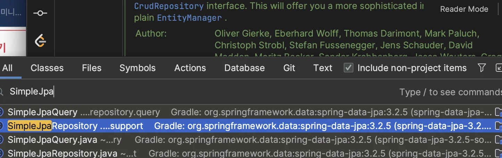

</details>
