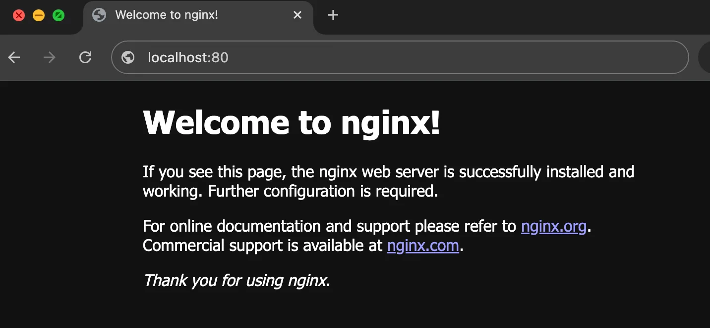
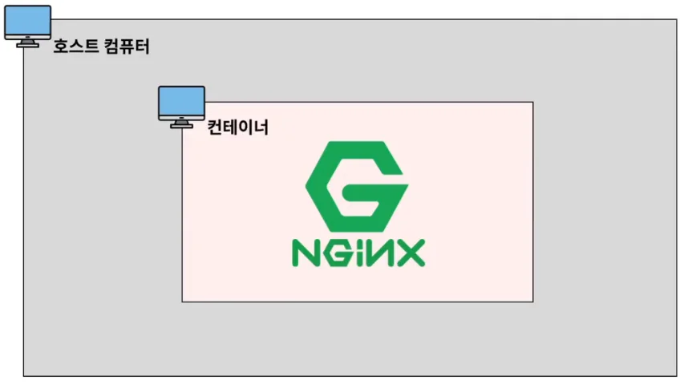
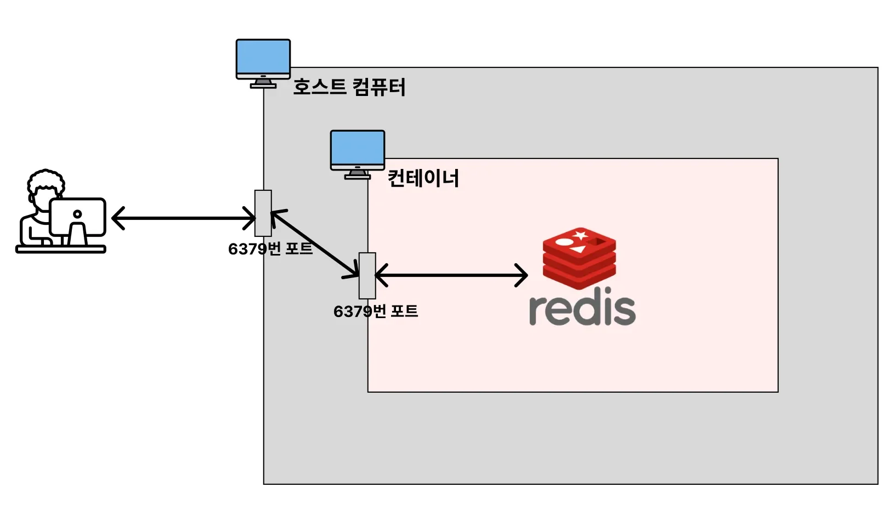

<a id="1c3eda9b0fe181bfa657d8939e33b5c1"></a>

### 컨테이너 CLI

---

> 컨테이너 ID는 일부만 입력해도 식별이 가능하다

<details>
<summary>컨테이너 ( Container ) 생성 / 실행 &#45; <code>create</code>, <code>start</code></summary>

> 컨테이너&#58; 내 컴퓨터 안에서 미니 컴퓨터를 띄운다&#46; 

> ✏️ 
> 
> <a id="1c3eda9b0fe181bd9bf8dd0f130f90c1"></a>
> 
> 컨테이너 생성(<code>create</code>) 시, <strong><u>해당하는 이미지가 존재하지 않</u></strong>으면 자동으로 dockerhub에서 이미지를 다운받아 컨테이너를 생성한다&#46; 

- 컨테이너 생성 &#45; <code>create</code>
    <a id="1c3eda9b0fe181bd84c0ee67465fbc2b"></a>

    ```docker
    docker create nginx
    ```

- 생성된 컨테이너 목록 확인 &#45; <code>ps &#45;a</code>
    <a id="1c3eda9b0fe181d6afdaf692b46a1348"></a>

    ```docker
    docker ps -a
    ```

- 컨테이너 실행 &#45; <code>start</code>
    <a id="1c3eda9b0fe181acaa35c7363af0dc1c"></a>

    ```docker
    docker start [컨테이너 ID] 
    # id 값은 일부만 입력해도 됨
    ```

    <details>
    <summary>ex)</summary>

    

    - 실행(<code>start</code>) 시, 해당하는 컨테이너의 STATUS가 <code>UP</code>으로 변경된다&#46; 

    </details>

</details>

<details>
<summary>컨테이너 ( Container ) 생성 / 실행 2 &#45; <code>run</code> ( = pull &#43; create &#43; start )</summary>

<a id="1c3eda9b0fe1816c8aace4eea157695a"></a>

```bash
# run: 이미지 다운 + 컨테이너 생성 + 실행
docker run 이미지명[:태그명]

# ex) docker run nginx
```

</details>

<details>
<summary>컨테이너 ( Container ) 조회 / 중지 / 삭제 &#45; <code>ps</code> / <code>stop</code>, <code>kill</code> / <code>rm</code></summary>

<details>
<summary>컨테이너 조회&#58; <code>ps</code>, <code>ps &#45;a</code></summary>

<a id="1c3eda9b0fe18188a72ced703698ff2f"></a>

```docker
# 실행 중인 컨테이너들 조회
docker ps

# 모든 (실행, 중단..) 컨테이너 조회 
docker ps -a
```

</details>

<details>
<summary>컨테이너 중단(중지)&#58; <code>stop</code>, <code>kill</code></summary>

- <code>stop</code>&#58; 컨테이너 종료 
    <a id="1c3eda9b0fe181deaea1f1c42ef22b5b"></a>

    ```docker
    docker stop [컨테이너 ID, 명]
    ```

    - stop은 컴튜터를 시스템 종료 버튼을 눌러 정상적으로 종료하는 것과 비슷하다&#46;<br>따라서 기존의 실행시키던 자원들을 차근차근 안전하게 종료를 시킨다&#46; 

- <code>kill</code>&#58; 컨테이너 강제 종료
    <a id="1c3eda9b0fe181a7a132eed4253a7ba1"></a>

    ```bash
    docker kill [컨테이너 ID, 명]
    ```

    - kill 은 강제종료와 비슷하다&#46; 따라서 파일 손상이 발생될 수 있고, 중간에 데이터가 날아갈 수 도 있다&#46; 

    - 좋지 않는 방법이지만, 중간에 프로그램(컨테이너)가 먹통이면 어쩔 수 없이 사용한다&#46; 

</details>

<details>
<summary>컨테이너 삭제&#58; <code>rm</code></summary>

<a id="1c3eda9b0fe18127a931c0fa4a930c7c"></a>

```docker
docker rm [컨테이너 ID or 이름]

# 여러 컨테이너 한번에 삭제 가능 - 구분 ( 띄어쓰기 ) 
```

<details>
<summary>☝🏻 중지된 컨테이너만 삭제 가능하다&#46; </summary>

<a id="1c3eda9b0fe181219400c0c7095e1c56"></a>

```bash
docker run -d nginx

docker ps

docker rm [컨테이너 ID]

# Error response from daemon: cannot remove container 
# "/strange_franklin": container is running: stop tje container before removing or force remove
```


</details>

</details>

<details>
<summary>중지 되어있는 모든 컨테이너 삭제&#58; <code>docker rm &#36;(docker ps &#45;qa)</code></summary>

<a id="1c3eda9b0fe18129b718c4eabe46df84"></a>

```bash
docker rm $(docker ps -qa)
```

</details>

<details>
<summary>실행 중인 컨테이너 강제 삭제&#58; <code>&#45;f</code></summary>

<a id="1c3eda9b0fe18125a89ee501e6627f63"></a>

```bash
docker rm -f [컨테이너 ID or 이름]
```

</details>

</details>

<details>
<summary>컨테이너 ( Container ) 로그 조회 &#45; <code>logs</code></summary>

> ✏️ 
> 
> <a id="1c3eda9b0fe18100af7be0ea8e8dd517"></a>
> 
> 로그를 통해 컨테이너(프로그램)가 정상 동작하는지, 어디서 오류가 발생 되었는지 확인 할 수 있다&#46; 따라서 로그를 확인하는 것은 매우 중요하다&#46; 
> 
> - 포그라운드로 컨테이너 실행 시, 실시간으로 로그를 확인할 수 있지만, 다른 커맨드 입력이 불가능하다&#46;
> 
> - 백그라운에서 <code>docker logs</code> 를 통해 로그 내역을 확인할 수 있따&#46; 

<a id="1c3eda9b0fe18140ac51c600d867d764"></a>

```bash
docker logs [컨테이너 ID]
```

<details>
<summary>옵션1) 끝에 있는 로그 <code>n</code> 줄만 출력 &#45; <code>—tail n</code></summary>

<a id="1c3eda9b0fe181bd8dedd329d56c8a6e"></a>

```bash
docker logs --tail n [컨테이너 ID]
```

<details>
<summary>ex) 끝 10줄만 출력</summary>

<a id="1c3eda9b0fe181b98908c398a182e9d0"></a>

```bash
docker logs --tail 10 1f505c84585c
```

- 로그 10 줄 출력 

</details>

</details>

<details>
<summary>옵션2) 로그 창 유지, 실시간으로 생성되는 내역 확인 가능 &#45; <code>&#45;f</code></summary>

<a id="1c3eda9b0fe181898cbdf6029680a58d"></a>

```bash
docker logs -f [컨테이너 ID]
```

<details>
<summary>실습</summary>

<a id="1c3eda9b0fe18126ac83c4e28de594cc"></a>

```bash
docker run -d -p 80:80 nginx

docker ps 

docker logs -f [컨테이너 ID]
```

- localhost&#58;80 접속
    

- <code>logs &#45;f</code> 사용 시, localhost&#58;80 접속 시 발생되는 GET 요청에 대해 실시간으로 로그가 찍히는 것을 확인할 수 있다&#46;
    

</details>

</details>

<details>
<summary>응용) 생성되는 실시간 로그만 확인&#58; <code>—tail 0 &#45;f</code></summary>

<a id="1c3eda9b0fe18171bd43eda7a2e349aa"></a>

```bash
docker logs --tail 0 -f [컨테이너 ID]
```

- <code>tail 0</code>&#58; 컨테이너 실행 시, 발생되는 로그를 표시하지 않음

- <code>&#45;f</code>&#58; 실시간으로 생성되는 로그 표시

</details>

</details>

<details>
<summary>실행 중인 컨테이너 내부에 접속하기 &#45; <code>exec &#45;it</code></summary>

> ✏️ 
> 
> <a id="1c3eda9b0fe1816e9b58d46a0f0f9d0a"></a>
> 
> 컨테이너는 호스트 안에 여러개를 띄울 수 있는 미니 컴퓨터이다&#46; 
> 
> <a id="1c3eda9b0fe181c98502dca7d930a3f6"></a>
> 
> 이 미니 컴퓨터는 호스트 안에 여러 개가 존재할 수 있으며, 각각 독립된 공간을 가지고 있다&#46; 
> 
> - 운영체제, 저장공간(메모리), 네트워크 …&#46;
> 
> 
> 
> <a id="1c3eda9b0fe18139abf7d6c545eaf4d4"></a>
> 
> 따라서 독립된 컨테이너 내부를 확인하려고 할 떄, 해당 컨테이너에 접속하기 위해 사용하는 명령어가 <code>exec &#45;it</code> 이다&#46;

- 내부 컨테이너 접속 &#45; <code>docker exec &#45;it &#46;&#46;&#46;</code>
    <a id="1c3eda9b0fe181d6b36ce841c002b999"></a>

    ```bash
    docker exec -it [컨테이너 ID] [프로그램명]
    ```

    <details>
    <summary>ex) 컨테이너 내부 bash 접속</summary>

    <a id="1c3eda9b0fe18147b9c4d7f122426137"></a>

    ```bash
    # 컨테이너 내부 접속 및 bash 실행
    docker exec -it [컨테이너 ID] bash
    ```

    </details>

- 나가기 &#45; <code>exit</code>
    <a id="1c3eda9b0fe1811f9435c16bd34e799c"></a>

    ```bash
    exit
    ```

<details>
<summary>실습) 내부 컨테이너 접속 및 bash 실행</summary>

<a id="1c3eda9b0fe1812ab117e25852fdc8c1"></a>

```bash
# nginx 컨테이너 실행 
docker run -d nginx

# 컨테이너 ID 확인
docker ps

# 컨테이너 내부 접속 및 bash 실행
docker exec -it [컨테이너 ID] bash

# cd /etc/nginx 
# cat nginx.conf  # nginx 내부  
```

</details>

</details>

<details>
<summary>실습 1) Nginx 설치 및 실행</summary>

<a id="1c3eda9b0fe18165abc5ebb247bb6450"></a>

```bash
# 이미지 다운
docker pull nginx:latest

# 컨테이너 생성
docker create nginx

# 컨테이너 실행
docker start [컨테이너 ID]

# 위 3개 축약: run
docker run -d -p 80:80 --name test nginx

# 실행 중인 컨테이너 리스트 확인
docker ps

# 로그 확인
docker logs [컨테아너 ID]

# 로그 하위 5개 확인
docker logs --tail 5 [컨테아너 ID]

# 로그 실시간 확인
docker logs -f [컨테아너 ID]

# 실시간으로 생성되는 로그만 확인
docker logs --tail 0 -f [컨테아너 ID]


# 내부 컨테이너(nginx)의 bash에 접속하기
docker exec -it [컨테이너 ID] bash

# 나가기
exit

# 컨테이너 종료
docker stop [컨테아너 ID]

# 중단된 컨테이너들 확인
docker ps -a

# 중단된 컨테이너 삭제 ( 컨테이너가 중단되지 않으면 삭제되지 않음 )
docker rm [컨테아너 ID]

# 컨테이너 강제 종료 
docker kill [컨테아너 ID]

# 실행 중인 컨테이너 강제 삭제 
docker rm -f [컨테아너 ID]

# 이미지 조회
docker image ls

# 이미지 삭제
docker rm [이미지 ID]
```

</details>

<details>
<summary>실습 2) Redis 실행</summary>

<a id="1c3eda9b0fe18160bdc2e57cdd55f064"></a>

```bash
# dockerhub에서 redis 이미지 다운
docker pull redis

# redis 기본 실행 포트: 6379
docker run -d -p 6379:6379 redis 

# 이미지 확인
docker image ls

# 실행 중인 컨테이너 확인
docker ps

# 내부 컨테이너에서 bash 실행
docker exec -it [컨테이너 ID] bash

# redis 접속
redis-cli

# 나가기
exit   # redis-cli
exit   # bash 

# 컨테이너 중단
docker stop [컨테이너 ID]

# 컨테이너 삭제 
docker rm [컨테이너 ID]

# 컨테이너 강제 중단 및 삭제
docker rm -f [컨테이너 ID]

# 이미지 삭제
docker image rm [이미지 ID]

```



</details>
