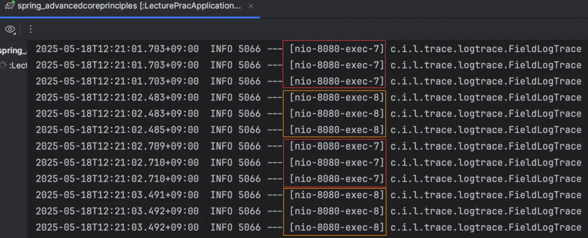
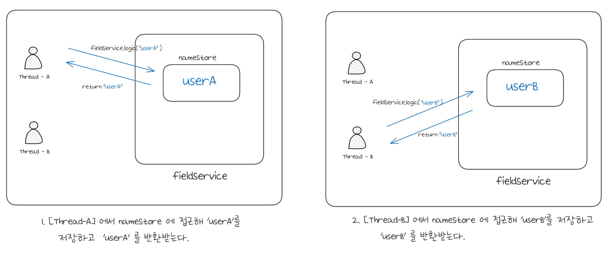
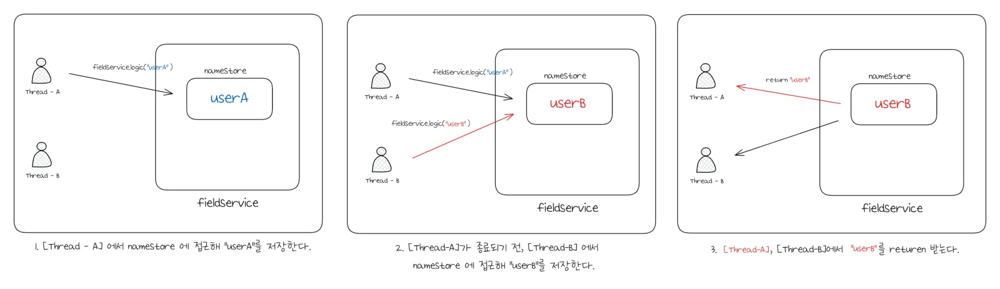
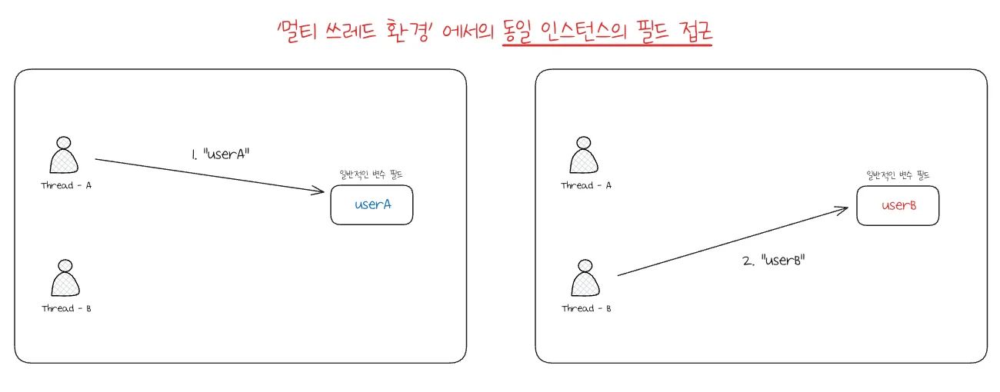
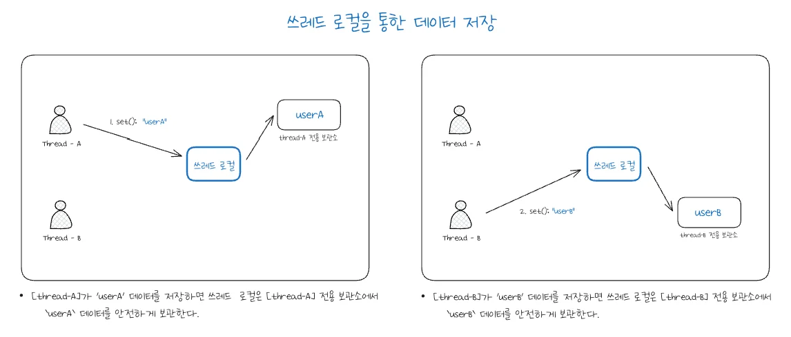
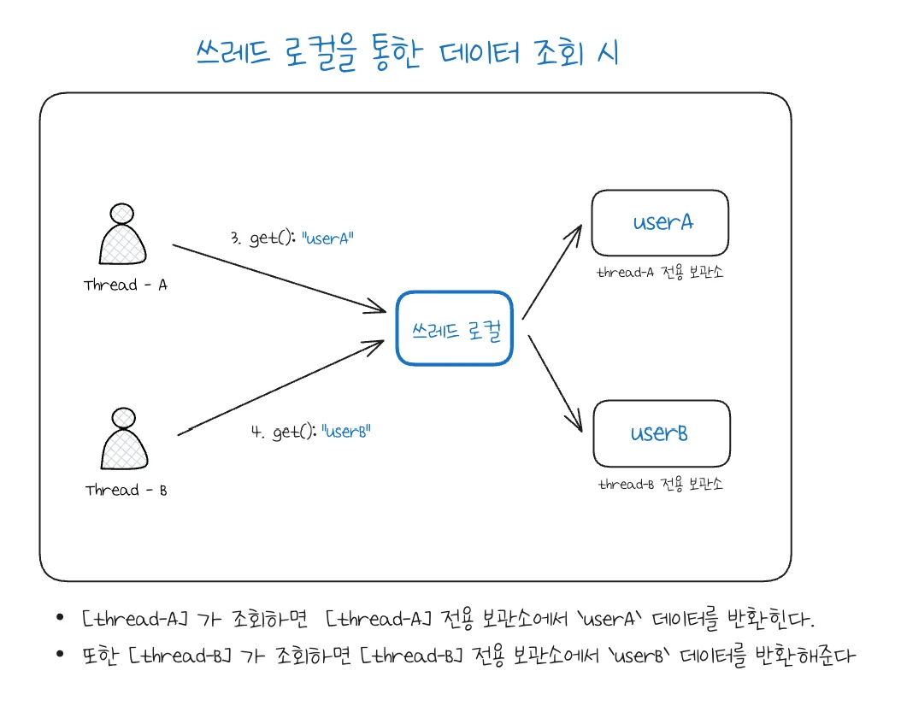
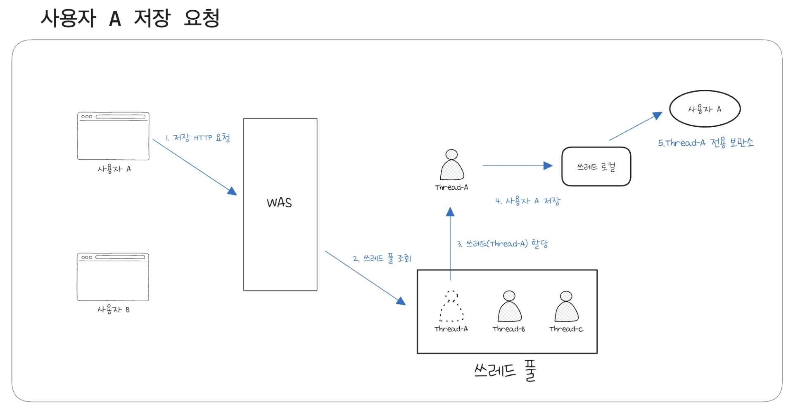
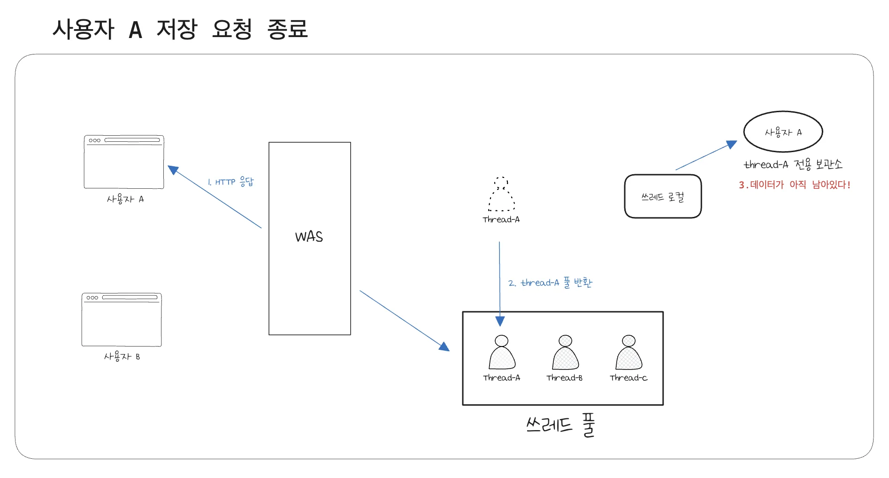
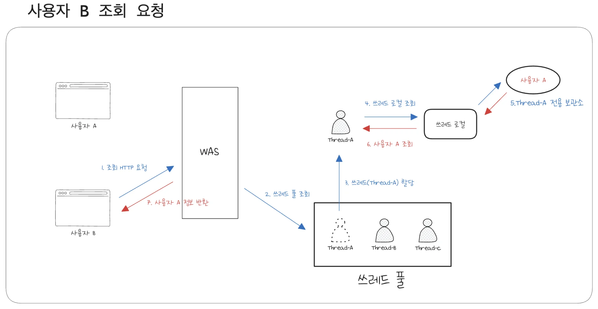

<details>
<summary>&#91; 코드 &#93;</summary>

<a id="1f6eda9b0fe180ae8237cc274928e6d5"></a>

```java

```

</details>

<a id="1f6eda9b0fe180df97f5ee6117de0abb"></a>

## 스레드 로컬 ( Thread Local )

---

<details>
<summary>기본 세팅</summary>

<details>
<summary>&#91; 코드 &#93; OrderControllerV0</summary>

<a id="1f6eda9b0fe18051a553f9012b74b0f4"></a>

```java
package com.inflearn.lecture_prac.app.v0;

import lombok.RequiredArgsConstructor;
import org.springframework.web.bind.annotation.GetMapping;
import org.springframework.web.bind.annotation.RestController;

@RestController
@RequiredArgsConstructor
public class OrderControllerV0 {

    private final OrderServiceV0 orderServiceV0;

    @GetMapping("/v0/request")
    public String request(String itemId) {
        orderServiceV0.orderItem(itemId);
        return "ok";
    }
}

```

</details>

<details>
<summary>&#91; 코드 &#93; OrderServiceV0</summary>

<a id="1f6eda9b0fe180ffb7aef02c0d7766f3"></a>

```java
package com.inflearn.lecture_prac.app.v0;

import lombok.RequiredArgsConstructor;
import org.springframework.stereotype.Service;

@Service
@RequiredArgsConstructor
public class OrderServiceV0 {

    private final OrderRepositoryV0 orderRepositoryV0;

    public void orderItem(String itemId) {
        orderRepositoryV0.save(itemId);
    }
}

```

</details>

<details>
<summary>&#91; 코드 &#93; OrderRepositoryV0</summary>

<a id="1f6eda9b0fe180648391ef93d5ead3ff"></a>

```java
package com.inflearn.lecture_prac.app.v0;

import lombok.RequiredArgsConstructor;
import org.springframework.stereotype.Repository;

import static java.lang.Thread.sleep;

@Repository
@RequiredArgsConstructor
public class OrderRepositoryV0 {


    public void save(String itemId) {
        // 저장 로직
        if (itemId.equals("ex")) {
            throw new IllegalStateException("예외 발생!");
        }
        sleep(1000);
    }

    private void sleep(int millis) {
        try {
            Thread.sleep(millis);
        } catch (InterruptedException e) {
            e.printStackTrace();
        }
    }
}

```

</details>

</details>

<a id="1f6eda9b0fe180c1ae2fddf647472350"></a>

### 필드 동기화 

<details>
<summary><strong>1&#46; LogTrace</strong> 개발</summary>

> ✏️ 
> 
> - LogTrace를 추상화하여 구현
>     - 공통된 상위 형식인 LogTrace 생성 및 구현
> 
> - LogTrace 구현체(<code>FieldLogTrace</code>)에 traceId를 저장하는 필드 생성
>     - 이를 통해, 매번 traceId를 파라미터로 넘기지 않아도 된다&#46; 
> 
> - <strong> 🤬 동시성 이슈 </strong>
>     - 그러나 위 방법은 <strong><u>멀티쓰레드 환경</u></strong>에서 동시성 이슈가 발생된다&#46; 

<a id="1f7eda9b0fe180d385cbc54ecf2bdaa4"></a>

### 코드

<details>
<summary>&#91; 코드 &#93; <strong>LogTrace</strong></summary>

<a id="1f6eda9b0fe180d5a601fd8e65477b8a"></a>

```java
package com.inflearn.lecture_prac.trace.logtrace;

import com.inflearn.lecture_prac.trace.TraceStatus;

public interface LogTrace {

    TraceStatus begin(String message);
    void end(TraceStatus status);
    void exception(TraceStatus status, Exception e);
}

```

</details>

<details>
<summary>&#91; 코드 &#93; <strong>FieldLogTrace</strong></summary>

<a id="1f6eda9b0fe180a9a46bf170412fe8ee"></a>

```java
package com.inflearn.lecture_prac.trace.logtrace;

import com.inflearn.lecture_prac.trace.TraceId;
import com.inflearn.lecture_prac.trace.TraceStatus;
import lombok.extern.slf4j.Slf4j;

@Slf4j
public class FieldLogTrace implements LogTrace {

    private static final String START_PREFIX = "-->";
    private static final String COMPLETE_PREFIX = "<--";
    private static final String EX_PREFIX = "<X-";

    private TraceId traceIdHolder;  // traceId 동기화, 동시성 이슈 발생

    @Override
    public TraceStatus begin(String message) {
        syncTraceId();
        TraceId traceId = traceIdHolder;
        Long startTimeMe = System.currentTimeMillis();
        log.info("{} {}{}", traceId.getId(), addSpace(START_PREFIX, traceId.getLevel()), message);
        return new TraceStatus(traceId, startTimeMe, message);
    }

    @Override
    public void end(TraceStatus status) {
        complete(status, null);
    }

    @Override
    public void exception(TraceStatus status, Exception e) {
        complete(status, e);
    }

    private void complete(TraceStatus status, Exception e) {
        Long stopTimeMs = System.currentTimeMillis();
        long resultTimeMs = stopTimeMs - status.getStartTimeMs();
        TraceId traceId = status.getTraceId();
        if (e == null) {
            log.info("[{}] {}{} time={}ms", traceId.getId(), addSpace(COMPLETE_PREFIX, traceId.getLevel()), status.getMessage(), resultTimeMs);
        } else {
            log.info("[{}] {}{} time={}ms ex={}", traceId.getId(), addSpace(EX_PREFIX, traceId.getLevel()), status.getMessage(), resultTimeMs, e.toString());
        }

        releaseTraceId();
    }
    
    private Object addSpace(String prefix, int level) {
        StringBuilder sb = new StringBuilder();
        for (int i = 0; i < level; i++) {
            sb.append((i == level -  1)? "|" + prefix : "|   " );
        }
        return sb.toString();
    }

    private void syncTraceId() {
        if (traceIdHolder == null) {
            traceIdHolder = new TraceId();
        } else {
            traceIdHolder = traceIdHolder.createNextId();
        }
    }

    private void releaseTraceId() {
        if (traceIdHolder.isFirstLevel()) {
            traceIdHolder = null; // destroy
        } else {
            traceIdHolder = traceIdHolder.createPreviousId();
        }
    }

}

```

</details>

<details>
<summary>&#91; 테스트 &#93; <strong>FieldLogTraceTest</strong></summary>

<a id="1f7eda9b0fe180048039e2bf8cb8da8c"></a>

```java
package com.inflearn.lecture_prac.trace.logtrace;

import com.inflearn.lecture_prac.trace.TraceStatus;
import org.junit.jupiter.api.Test;

class FieldLogTraceTest {

    LogTrace trace = new FieldLogTrace();

    @Test
    void begin_end_level2() {
        TraceStatus status1 = trace.begin("hello1");
        TraceStatus status2 = trace.begin("hello2");
        trace.end(status2);
        trace.end(status1);
    }

    @Test
    void begin_exception_level2() {
        TraceStatus status1 = trace.begin("hello");
        TraceStatus status2 = trace.begin("hello2");
        trace.exception(status2, new IllegalStateException());
        trace.exception(status1, new IllegalStateException());
    }
}
```

- <code>begin&#95;end&#95;level2()</code> &#45; 실행 결과
    <a id="1f7eda9b0fe180669849d1142fdebbbd"></a>

    ```java
    11:31:20.454 [Test worker] INFO com.inflearn.lecture_prac.trace.logtrace.FieldLogTrace -- [99beeb0b] hello1
    11:31:20.457 [Test worker] INFO com.inflearn.lecture_prac.trace.logtrace.FieldLogTrace -- [99beeb0b] |-->hello2
    11:31:20.457 [Test worker] INFO com.inflearn.lecture_prac.trace.logtrace.FieldLogTrace -- [99beeb0b] |<--hello2 time=0ms
    11:31:20.457 [Test worker] INFO com.inflearn.lecture_prac.trace.logtrace.FieldLogTrace -- [99beeb0b] hello1 time=4ms
    ```

- <code>begin&#95;end&#95;level2()</code> &#45; 실행 결과
    <a id="1f7eda9b0fe180eaa513cd4dcab4b4ec"></a>

    ```java
    11:31:20.462 [Test worker] INFO com.inflearn.lecture_prac.trace.logtrace.FieldLogTrace -- [5b25a584] hello
    11:31:20.462 [Test worker] INFO com.inflearn.lecture_prac.trace.logtrace.FieldLogTrace -- [5b25a584] |-->hello2
    11:31:20.462 [Test worker] INFO com.inflearn.lecture_prac.trace.logtrace.FieldLogTrace -- [5b25a584] |<X-hello2 time=0ms ex=java.lang.IllegalStateException
    11:31:20.462 [Test worker] INFO com.inflearn.lecture_prac.trace.logtrace.FieldLogTrace -- [5b25a584] hello time=0ms ex=java.lang.IllegalStateException
    ```

</details>

</details>

<details>
<summary>2&#46; <strong>LogTrace</strong> 적용</summary>

> ✏️ 
> 
> <a id="1f7eda9b0fe180658979f9b6398ae300"></a>
> 
> 개발한 LogTrace 적용 
> 
> - HelloLogTraceV2 → LogTrace
> 
> - beginSync() → begin()

<a id="1f7eda9b0fe180d38bdfeaa0dbb3ce32"></a>

### 코드

<details>
<summary>&#91; 코드 &#93; OrderControllerV3</summary>

<a id="1f7eda9b0fe18059831cfeb368c44e4e"></a>

```java
package com.inflearn.lecture_prac.app.v3;

import com.inflearn.lecture_prac.trace.TraceStatus;
import com.inflearn.lecture_prac.trace.logtrace.LogTrace;
import lombok.RequiredArgsConstructor;
import org.springframework.web.bind.annotation.GetMapping;
import org.springframework.web.bind.annotation.RequestParam;
import org.springframework.web.bind.annotation.RestController;

@RestController
@RequiredArgsConstructor
public class OrderControllerV3 {

    private final OrderServiceV3 orderService;
    private final LogTrace trace;

    @GetMapping("/v3/request")
    public String request(@RequestParam String itemId) {
        TraceStatus status = null;
        try {
            status = trace.begin("OrderController.request()");
            orderService.orderItem(itemId);
            trace.end(status);
            return "ok";
        } catch (Exception e) {
            trace.exception(status, e);
            throw e;
        }
    }
}
```

</details>

<details>
<summary>&#91; 코드 &#93; OrderServiceV3</summary>

<a id="1f7eda9b0fe18060ae0ed8679cfb660a"></a>

```java
package com.inflearn.lecture_prac.app.v3;

import com.inflearn.lecture_prac.trace.TraceStatus;
import com.inflearn.lecture_prac.trace.logtrace.LogTrace;
import lombok.RequiredArgsConstructor;
import org.springframework.stereotype.Service;

@Service
@RequiredArgsConstructor
public class OrderServiceV3 {

    private final OrderRepositoryV3 orderRepository;
    private final LogTrace trace;

    public void orderItem(String itemId) {
        TraceStatus status = null;
        try {
            status = trace.begin("OrderService.orderItem()");
            orderRepository.save(itemId);
            trace.end(status);
        } catch (Exception e) {
            trace.exception(status, e);
            throw e;
        }
    }
}
```

</details>

<details>
<summary>&#91; 코드 &#93; OrderRepositoryV3</summary>

<a id="1f7eda9b0fe180c08a33d704cf40899c"></a>

```java
package com.inflearn.lecture_prac.app.v3;

import com.inflearn.lecture_prac.trace.TraceStatus;
import com.inflearn.lecture_prac.trace.logtrace.LogTrace;
import lombok.RequiredArgsConstructor;
import org.springframework.stereotype.Repository;

@Repository
@RequiredArgsConstructor
public class OrderRepositoryV3 {

    private final LogTrace trace;

    public void save(String itemId) {

        TraceStatus status = null;
        try {
            status = trace.begin("OrderRepository.save()");

            // 저장 로직
            if (itemId.equals("ex")) {
                throw new IllegalStateException("예외 발생!");
            }
            sleep(1000);

            trace.end(status);
        } catch (Exception e) {
            trace.exception(status, e);
            throw  e;
        }
    }

    private void sleep(int millis) {
        try {
            Thread.sleep(millis);
        } catch (InterruptedException e) {
            e.printStackTrace();
        }
    }
}
```

</details>

<a id="1f7eda9b0fe180d5a928c7cccfb9a768"></a>

### 테스트

<details>
<summary>API 호출</summary>

> <code>http&#58;//localhost&#58;8080/v3/request?itemId=1</code>

<a id="1f7eda9b0fe180fc90e3cc0ae53d9452"></a>

```java
[14ba4bab] OrderController.request()
[14ba4bab] |-->OrderService.orderItem()
[14ba4bab] |   |-->OrderRepository.save()
[14ba4bab] |   |<--OrderRepository.save() time=1005ms
[14ba4bab] |<--OrderService.orderItem() time=1008ms
[14ba4bab] OrderController.request() time=1009m
```

</details>

</details>

<details>
<summary><strong>3&#46; ❗️동시성 문제 </strong></summary>

> ✏️ 
> 
> <a id="1f7eda9b0fe1805f8ba6ddece2641244"></a>
> 
> <code>FieldLogTrace</code>는 <strong><u>싱글톤</u></strong><strong><u>으로 등록된 스프링 빈</u></strong>이다&#46; 
> 
> <a id="1f7eda9b0fe180568898fc2237b64642"></a>
> 
> 즉, 해당 객체의 인스턴스가 애플리케이션에 딱 1개만 존재한다는 뜻이다&#46; 
> 
> <a id="1f7eda9b0fe1802caef7e612b7236fed"></a>
> 
> 이러한 <u>싱글 인스턴스를 가지는 객체(</u><code>FieldLogTrace</code><u>)의 필드</u>(<strong><code>FieldLogTrace&#46;traceIdHolder</code></strong>)에 <strong><u>여러 쓰레드가 동시에 접근</u></strong>하면 <strong>동시성 문제가 발생</strong>된다&#46; 
> 
> - 실무에서 한번 나타나면 개발자를 가장 괴롭히는 문제가 이런 동시성 문제이다&#46;

<details>
<summary> 🤬 <strong>동시성 이슈 </strong><strong>&#45; </strong>여러번 호출 </summary>

> http&#58;//localhost&#58;8080/v3/request?itemId=1

> ✏️ 
> 
> <a id="1f7eda9b0fe18050b5b5d1b78e71f086"></a>
> 
> 요청이 여러번 겹치면 아래와 같이 <strong><u>동시성 이슈 문제</u></strong>가 발생된다&#46; 
> 
> - depth가 중첩되어 출력된다&#46; 따라서 로그 출력값이 이상해진다&#46; 
> 
> - 다른 요청인데도 traceId가 구분되지 않는다&#46; 

<details>
<summary>✏️ WAS가 제공해주는 Thread Id  </summary>



</details>

<a id="1f7eda9b0fe18018b8dcc084b1c27da3"></a>

```java
[nio-8080-exec-7] : [96718c1e] OrderController.request()
[nio-8080-exec-7] : [96718c1e] |-->OrderService.orderItem()
[nio-8080-exec-7] : [96718c1e] |   |-->OrderRepository.save()
[nio-8080-exec-8] : [96718c1e] |   |   |-->OrderController.request()
[nio-8080-exec-8] : [96718c1e] |   |   |   |-->OrderService.orderItem()
[nio-8080-exec-8] : [96718c1e] |   |   |   |   |-->OrderRepository.save()
[nio-8080-exec-7] : [96718c1e] |   |<--OrderRepository.save() time=1005ms
[nio-8080-exec-7] : [96718c1e] |<--OrderService.orderItem() time=1007ms
[nio-8080-exec-7] : [96718c1e] OrderController.request() time=1007ms
[nio-8080-exec-8] : [96718c1e] |   |   |   |   |<--OrderRepository.save() time=1006ms
[nio-8080-exec-8] : [96718c1e] |   |   |   |<--OrderService.orderItem() time=1009ms
[nio-8080-exec-8] : [96718c1e] |   |   |<--OrderController.request() time=1010ms
```

</details>

</details>

<a id="1f7eda9b0fe180ad9684c3529d338dc3"></a>

### 동시성 문제 

> ☝🏻 
> 
> <a id="1f7eda9b0fe180bb8712c046e0a2d834"></a>
> 
> 이러한 <strong><u>동시성 이슈</u></strong>는 <strong>지역 변수에서는 발생하지 않</strong>는다&#46; 
> 
> - 지역 변수는 쓰레드마다 다른 메모리 영역에 할당된다&#46;
> 
> <a id="1f7eda9b0fe18092a0c2c8ac7ab979d6"></a>
> 
> 동시성 문제가 발생되는 곳은<strong> </strong><strong><u>같은 인스턴스의 필드(주로 싱글톤)</u></strong>, 또는 <strong><u>static 같은 공용 필드에 접근</u></strong>할 때 발생된다&#46; 
> 
> - 값을 읽기만 하면 발생되지 않는다&#46; <strong>어디선가 값을 변경</strong>하기 때문에 발생한다&#46;

<details>
<summary>정상 </summary>



1. &#91;Thread&#45;A&#93; 에서 <code>userA</code>를 <code>nameStore</code>에 저장한다&#46; 

1. &#91;Thread&#45;A&#93; 에서 <code>userA</code>를 <code>nameStore</code>에 조회하여 가져온다&#46; 

1. &#91;Thread&#45;B&#93; 에서 <code>userB</code>를 <code>nameStore</code>에 저장한다&#46; 

1. &#91;Thread&#45;B&#93; 에서 <code>userB</code>를 <code>nameStore</code>에 조회하여 가져온다&#46; 

</details>

<details>
<summary>오류 &#45; <strong>동시성 이슈</strong></summary>



1. <strong>&#91;Thread&#45;</strong><strong><code>A</code></strong><strong>&#93;</strong>&#58; <strong><code>userA</code></strong>를 <code>nameStore</code>에 저장했다&#46;

1. <strong>&#91;Thread&#45;</strong><strong><code>B</code></strong><strong>&#93;&#58;</strong> <strong><code>userB</code></strong>를 <code>nameStore</code>에 저장했다&#46;

1. <strong>&#91;Thread&#45;</strong><strong><code>A</code></strong><strong>&#93;</strong>&#58; <code>userB</code>를 <code>nameStore</code>에서 조회
    - 정상 흐름이면 <code>userA</code>가  조회 되어야 한다&#46;

1. <strong>&#91;Thread&#45;</strong><strong><code>B</code></strong><strong>&#93;</strong>&#58; <strong><code>userB</code></strong>를 <code>nameStore</code>에서 조회

</details>

<a id="1f7eda9b0fe180eb9604fb7e94449d51"></a>

### 코드

<details>
<summary>테스트 환경 롬복 추가</summary>

<a id="1f7eda9b0fe180248bbdf0324cd622db"></a>

```java
dependencies {   
       . . .

    //테스트에서 lombok 사용
    testCompileOnly 'org.projectlombok:lombok'
    testAnnotationProcessor 'org.projectlombok:lombok'
}
```

</details>

<details>
<summary>&#91; 코드 &#93; FieldService</summary>

<a id="1f7eda9b0fe180ceaeb2c7740db1020c"></a>

```java
package com.inflearn.lecture_prac.trace.threadlocal.code;

import lombok.extern.slf4j.Slf4j;

@Slf4j
public class FieldService {

    private String nameStore;

    public String logic(String name) {
        log.info("저장 name={} -> nameStore={}", name, nameStore);
        nameStore = name;
        log.info("조회 nameStore={}", nameStore);
        return nameStore;
    }

    private void sleep(int millis) {
        try {
            Thread.sleep(millis);
        } catch (InterruptedException e) {
            e.printStackTrace();
        }
    }
}
```

</details>

<details>
<summary>&#91; 코드 &#93; FieldServiceTest</summary>

<a id="1f7eda9b0fe18089b8aee3ad97c38328"></a>

```java
package com.inflearn.lecture_prac.trace.threadlocal;

import com.inflearn.lecture_prac.trace.threadlocal.code.FieldService;
import lombok.extern.slf4j.Slf4j;
import org.junit.jupiter.api.Test;

@Slf4j
class FieldServiceTest {

    private FieldService fieldService = new FieldService();

    @Test
    void field() throws InterruptedException {
        log.info("main start");
        Runnable userA = () -> {
            fieldService.logic("userA");
        };

        Runnable userB = () -> {
            fieldService.logic("userB");
        };

        Thread threadA = new Thread(userA);
        threadA.setName("thread-A");
        Thread threadB = new Thread(userB);
        threadB.setName("thread-B");

        threadA.start(); // A 실행
//        sleep(2000); // 동시성 문제 발생 x
        sleep(100); // 동시성 문제 발생 O

        threadB.start(); // B 실행
        sleep(3000); // 메인 쓰레드 종료 대기
//        log.info("main exit");
    }

    private void sleep(int millis) {
        try {
            Thread.sleep(millis);
        } catch (InterruptedException e) {
            throw new RuntimeException(e);
        }
    }
}
```

</details>

<a id="1f6eda9b0fe180dcaa8fd0691fa93679"></a>

### ThreadLocal

> ✏️ 
> 
> <a id="1f7eda9b0fe180d7b0eff71ed245b125"></a>
> 
> <strong>쓰레드 로컬</strong>
> 
> ---
> 
> <a id="1f7eda9b0fe180c0ac02c79f01d24dfb"></a>
> 
> 쓰레드 로컬은 <strong><u>해당 쓰레드만 접근할 수 있는 특별한 저장소</u></strong>이다&#46; 
> 
> <a id="1f7eda9b0fe18084b2e4cc94dbcd7fb6"></a>
> 
> 쉽게 이야기해 물건 보관 창구와 같다&#46; 
> 
> - 여러 사람이 같은 물건 보관 창구를 사용하더라도 청구 직원은 사용자를 인식해서 사용자 별로 물건을 구분해준다&#46;
> 
> - 사용자 A, 사용자 B 모두 창구 직원을 통해서 물건을 보관하고, 꺼낸다&#46;<br>( 공간이 분리되지는 않음, 직원을 통해 구분하여 가져오는 것임 )
> 
> <a id="1f7eda9b0fe180548792d2ed24158d0b"></a>
> 
> 위 예시와 같이 쓰레드 로컬이 동작한다&#46; 
> 
> - 쓰레드 로컬을 통해서 각 쓰레드마다 변수에 할당한 값을 구분하여 가져올 수 있다&#46; <br>⇒ <strong>동시성 문제 해결</strong>

<details>
<summary>일반적인 변수 필드</summary>

> ✏️ 
> 
> <a id="1f7eda9b0fe180c59496c247c524c834"></a>
> 
> 여러 쓰레드가 같은 인스턴스의 필드에 접근하면 <strong>처음 쓰레드가 보관한 데이터가 사라질 수 있</strong>다&#46; 
> 
> - <strong>동시성 이슈</strong>



- <code>thread&#45;A</code> 가 <code>userA</code> 라는 값을 저장하고 <code>thread&#45;B</code> 가 <code>userB</code> 라는 값을 저장하면 <br>직전에 <code>thread&#45;A</code> 가 저장한 <code>userA</code> 값은 사라진다

</details>

<details>
<summary>쓰레드 로컬</summary>

> ✏️ 
> 
> <a id="1f7eda9b0fe180f1a379c17c7dd4095f"></a>
> 
> 자바는 언어차원에서 쓰레드 로컬을 지원한다&#46;
> 
> -  <code>java&#46;lang&#46;ThreadLocal</code>

- 저장
    

    - <strong><u>쓰레드 로컬 사용</u></strong> 시 <strong><u>각 쓰레드마다  전용 보관소가지</u></strong>며 저장되는 데이터를 <u>전용 저장소에서 안전하게 보관</u>한다&#46; 

- 조회
    

    - 각 쓰레드마다 가지는 전용 보관소에서 데이터를 안전하게 조회 가능하다&#46; 

</details>

<a id="1f7eda9b0fe1804284c9eb4ed4b25ced"></a>

### 코드

> ✏️ 
> 
> <a id="1f8eda9b0fe180f4afb3c02811982406"></a>
> 
> <strong><code>ThreadLocal</code></strong><strong> 사용법</strong>
> 
> ---
> 
> - <strong><code>값 저장</code></strong>&#58; <code>ThreadLocal&#46;set(xxx)</code>
> 
> - <strong><code>값 조회</code></strong>&#58; <code>ThreadLocal&#46;get()</code>
> 
> - <strong><code>값 제거</code></strong>&#58; <code>ThreadLocal&#46;remove()</code>

> ☝🏻 
> 
> <a id="1f7eda9b0fe1801baabdeddbdac9a87b"></a>
> 
> 해당 쓰레드에서 <code>ThreadLocal</code>을 모두 사용했다면, <code>ThreadLocal&#46;remove()</code>를 호출해서 <strong><u>ThreadLoacl에 저장된 값을 제거</u></strong>해주어야 한다&#46; 
> 
> - 자세한 내용은 아래 주의사항 참고

<details>
<summary>&#91; 코드 &#93; <strong>ThreadLocalService</strong></summary>

<a id="1f7eda9b0fe180d89a64f3da51d8d41c"></a>

```java
package com.inflearn.lecture_prac.trace.threadlocal.code;

import lombok.extern.slf4j.Slf4j;

@Slf4j
public class ThreadLocalService {

    private ThreadLocal<String> nameStore = new ThreadLocal<>();

    public String logic(String name) {
        log.info("저장 name={} -> nameStore={}", name, nameStore.get());
        nameStore.set(name);
        sleep(1000);
        log.info("조회 nameStore={}", nameStore.get());
        return nameStore.get();
    }

    private void sleep(int millis) {
        try {
            Thread.sleep(millis);
        } catch (InterruptedException e) {
            e.printStackTrace();
        }
    }
}
```

</details>

<details>
<summary>&#91; 테스트 &#93; <strong>ThreadLocalServiceTest</strong></summary>

<a id="1f7eda9b0fe180f4b360c72f1a0d54e4"></a>

```java
package com.inflearn.lecture_prac.trace.threadlocal;

import com.inflearn.lecture_prac.trace.threadlocal.code.ThreadLocalService;
import lombok.extern.slf4j.Slf4j;
import org.junit.jupiter.api.Test;


@Slf4j
class ThreadLocalServiceTest {

    private ThreadLocalService service = new ThreadLocalService();

    @Test
    void threadLocal() {
        log.info("main start");
        Runnable userA = () -> {
            service.logic("userA");
        };

        Runnable userB = () -> {
            service.logic("userB");
        };

        Thread threadA = new Thread(userA);
        threadA.setName("thread-A");
        Thread threadB = new Thread(userB);
        threadB.setName("thread-B");

        threadA.start();
        sleep(100);
        threadB.start();

        sleep(2000);
        log.info("main exit");
    }

    private void sleep(int millis) {
        try {
            Thread.sleep(millis);
        } catch (InterruptedException e) {
            e.printStackTrace();
        }
    }
}
```

<a id="1f7eda9b0fe180008e45e597eb847a7e"></a>

<strong>출력값 요약 </strong>

<a id="1f7eda9b0fe180449885dff344256662"></a>

```java
[Test worker] main start
[thread-A] 저장 name=userA -> nameStore=null
[thread-B] name=userB -> nameStore=null
[thread-A] 조회 nameStore=userA
[thread-B] 조회 nameStore=userB
[Test worker] main exit
```

- ThreadLocal을 통해 각 쓰레드마다 별도의 데이터 저장소를 가진다&#46; <br>따라서 각각 쓰레드마다 데이터 저장 및  조회가 가능해 동시성 문제를 해결한다&#46;

</details>

<a id="1f6eda9b0fe18068ab40f3ce2ab68301"></a>

### 쓰레드 로컬 동기화

<details>
<summary><strong>LogTrace &#45; ThreadLocal 적용</strong></summary>

> ✏️ 
> 
> <a id="1f7eda9b0fe180119c33f3507c1c02e0"></a>
> 
> 위에 파트에서 간단하게 <code>ThreadLocal</code>을 사용해 동시성 문제를 해결했다&#46; <br>이를 <code>LogTrace</code>에서도 적용하여 동시성 문제를 해결한다&#46;

<a id="1f8eda9b0fe180c382e5f8cb4eb61b99"></a>

### 코드

<details>
<summary><strong>&#91; 코드 &#93; ThreadLocalLogTrace</strong></summary>

> 📌 
> 
> - <code>TraceId traceIdHolder</code> 
>     <a id="1f8eda9b0fe18002aa3dc7c4e872fcf2"></a>
> 
>     ⇒ <code>TheadLocal&#60;String&#62; nameStore = new TheadLocal&#60;&#62;()</code>

<a id="1f7eda9b0fe1802c8242c890f0fa2180"></a>

```java
package com.inflearn.lecture_prac.trace.logtrace;

import com.inflearn.lecture_prac.trace.TraceId;
import com.inflearn.lecture_prac.trace.TraceStatus;
import lombok.extern.slf4j.Slf4j;


@Slf4j
public class ThreadLocalLogTrace implements LogTrace {

    private static final String START_PREFIX = "-->";
    private static final String COMPLETE_PREFIX = "<--";
    private static final String EX_PREFIX = "<X-";

    private ThreadLocal<TraceId> traceIdHolder = new ThreadLocal<>();
    
    @Override
    public TraceStatus begin(String message) {
        syncTraceId();
        TraceId traceId = traceIdHolder.get();
        Long startTimeMs = System.currentTimeMillis();
        log.info("[{}] {}{}", traceId.getId(), addSpace(START_PREFIX, traceId.getLevel()), message);
        return new TraceStatus(traceId, startTimeMs, message);
    }

    @Override
    public void end(TraceStatus status) {
        complete(status, null);
    }

    @Override
    public void exception(TraceStatus status, Exception e) {
        complete(status, e);
    }

    private void complete(TraceStatus status, Exception e) {
        Long stopTimeMs = System.currentTimeMillis();
        long resultTimeMs = stopTimeMs - status.getStartTimeMs();
        TraceId traceId = status.getTraceId();
        if (e == null) {
            log.info("[{}] {}{} time={}ms", traceId.getId(), addSpace(COMPLETE_PREFIX, traceId.getLevel()), status.getMessage(), resultTimeMs);
        } else {
            log.info("[{}] {}{} time={}ms ex={}", traceId.getId(), addSpace(EX_PREFIX, traceId.getLevel()), status.getMessage(), resultTimeMs, e.toString());
        }
        releaseTraceId();
    }

    private void syncTraceId() {
        TraceId traceId = traceIdHolder.get();
        if (traceId == null) {
            traceIdHolder.set(new TraceId());
        } else {
            traceIdHolder.set(traceId.createNextId());
        }
    }

    private void releaseTraceId() {
        TraceId traceId = traceIdHolder.get();
        if (traceId.isFirstLevel()) {
            traceIdHolder.remove(); // 쓰레드 로컬에 저장된 값 제거
        } else {
            traceIdHolder.set(traceId.createPreviousId());
        }
    }

    private static String addSpace(String prefix, int level) {
        StringBuilder sb = new StringBuilder();
        for (int i = 0; i < level; i++) {
            sb.append((i == level - 1)? "|" + prefix : "|   ");
        }
        return sb.toString();
    }
}

```

</details>

<details>
<summary><strong>&#91; 코드 &#93; ThreadLocalLogTraceTest</strong></summary>

<a id="1f7eda9b0fe18079b3f3e7d198cd9ab8"></a>

```java
package com.inflearn.lecture_prac.trace.logtrace;

import com.inflearn.lecture_prac.trace.TraceStatus;
import lombok.extern.slf4j.Slf4j;
import org.junit.jupiter.api.Test;


@Slf4j
class ThreadLocalLogTraceTest {

    ThreadLocalLogTrace trace = new ThreadLocalLogTrace();

    @Test
    void begin_end_level2() {
        TraceStatus status1 = trace.begin("hello1");
        TraceStatus status2 = trace.begin("hello2");
        trace.end(status2);
        trace.end(status1);
    }

    @Test
    void begin_exception_level2() {
        TraceStatus status1 = trace.begin("hello");
        TraceStatus status2 = trace.begin("hello2");
        trace.exception(status2, new IllegalStateException());
        trace.exception(status1, new IllegalStateException());
    }
}
```

<a id="1f7eda9b0fe18042a1c1f2b6bb3012bd"></a>

<strong>실행 결과</strong>

<a id="1f8eda9b0fe180abb646e0aab09770e4"></a>

```java
// begin_end_level2
[Test worker]  [5b9b9bde] hello1
[Test worker]  [5b9b9bde] |-->hello2
[Test worker]  [5b9b9bde] |<--hello2 time=0ms
[Test worker]  [5b9b9bde] hello1 time=6ms

// begin_exception_level2
[Test worker]  [9d2786f6] hello
[Test worker]  [9d2786f6] |-->hello2
[Test worker]  [9d2786f6] |<X-hello2 time=1ms ex=java.lang.IllegalStateException
[Test worker]  [9d2786f6] hello time=1ms ex=java.lang.IllegalStateException
```

- 이전에 발생된 동기화 문제가 ThreadLocal 적용을 통해 해결된 것을 확인할 수 있다&#46;

</details>

</details>

<details>
<summary><strong>애플리케이션 개발</strong></summary>

> ✏️ 
> 
> <a id="1f8eda9b0fe1805895e1fdc84a1b10a9"></a>
> 
> 인터페이스를 사용해 <strong><u>상위 형식을 추상화하여 구현</u></strong>했기 때문에 ( <code>다형성</code> )<br>간단하게 Config에서 빈으로 등록하는 구현체만 변경하면 된다&#46;  ( <code>OCP</code> )
> 
> - <code>FieldLogTrace</code> → <code>ThreadLocalLogTrace</code>

<details>
<summary>&#91; 코드 &#93; <strong>ThreadLocalLogTrace</strong></summary>

<a id="1f8eda9b0fe180838626e2eff2ae345c"></a>

```java
package com.inflearn.lecture_prac;

import com.inflearn.lecture_prac.trace.logtrace.FieldLogTrace;
import com.inflearn.lecture_prac.trace.logtrace.LogTrace;
import com.inflearn.lecture_prac.trace.logtrace.ThreadLocalLogTrace;
import org.springframework.context.annotation.Bean;
import org.springframework.context.annotation.Configuration;

@Configuration
public class LogTraceConfig {

    @Bean
    public LogTrace logTrace() {
//        return new FieldLogTrace();
        return new ThreadLocalLogTrace();
    }
}
```

</details>

<details>
<summary>&#91; 테스트 &#93; API 호출</summary>

<details>
<summary>정상 실행</summary>

- <strong>요청 URL</strong>
    <a id="1f8eda9b0fe1805e9b8cf925c077b1e1"></a>

    ```java
    http://localhost:8080/v3/request?itemId=hello
    ```

- <strong>실행 결과</strong>
    <a id="1f8eda9b0fe180739b24f2b274e222c0"></a>

    ```java
    [a375d657] OrderController.request()
    [a375d657] |-->OrderService.orderItem()
    [a375d657] |   |-->OrderRepository.save()
    [a375d657] |   |<--OrderRepository.save() time=1005ms
    [a375d657] |<--OrderService.orderItem() time=1005ms
    [a375d657] OrderController.request() time=1006ms
    ```

</details>

<details>
<summary>예외 실행</summary>

- <strong>요청 URL</strong>
    <a id="1f8eda9b0fe180dfa59fdaa7931548bc"></a>

    ```java
    http://localhost:8080/v3/request?itemId=ex
    ```

- <strong>실행 결과</strong>
    <a id="1f8eda9b0fe18025b09af7d7c2504d89"></a>

    ```java
    [715a0204] OrderController.request()
    [715a0204] |-->OrderService.orderItem()
    [715a0204] |   |-->OrderRepository.save()
    [715a0204] |   |<X-OrderRepository.save() time=1ms ex=java.lang.IllegalStateException: 예외 발생!
    [715a0204] |<X-OrderService.orderItem() time=1ms ex=java.lang.IllegalStateException: 예외 발생!
    [715a0204] OrderController.request() time=1ms ex=java.lang.IllegalStateException: 예외 발생!
    ```

</details>

<details>
<summary>동시 요청</summary>

<a id="1f8eda9b0fe1803abd74cf34ccefc94f"></a>

```java
[nio-8080-exec-7] [c7166ea8] OrderController.request()
[nio-8080-exec-7] [c7166ea8] |-->OrderService.orderItem()
[nio-8080-exec-7] [c7166ea8] |   |-->OrderRepository.save()
----------------------------------------------------------------------------------
[nio-8080-exec-9] [e6f5318c] OrderController.request()
[nio-8080-exec-9] [e6f5318c] |-->OrderService.orderItem()
[nio-8080-exec-9] [e6f5318c] |   |-->OrderRepository.save()
----------------------------------------------------------------------------------
[nio-8080-exec-3] [a5877c02] OrderController.request()
[nio-8080-exec-3] [a5877c02] |-->OrderService.orderItem()
[nio-8080-exec-3] [a5877c02] |   |-->OrderRepository.save()
----------------------------------------------------------------------------------
[nio-8080-exec-7] [c7166ea8] |   |<--OrderRepository.save() time=1005ms
[nio-8080-exec-7] [c7166ea8] |<--OrderService.orderItem() time=1005ms
[nio-8080-exec-7] [c7166ea8] OrderController.request() time=1005ms
----------------------------------------------------------------------------------
[nio-8080-exec-9] [e6f5318c] |   |<--OrderRepository.save() time=1002ms
[nio-8080-exec-9] [e6f5318c] |<--OrderService.orderItem() time=1002ms
[nio-8080-exec-9] [e6f5318c] OrderController.request() time=1002ms
----------------------------------------------------------------------------------
[nio-8080-exec-3] [a5877c02] |   |<--OrderRepository.save() time=1004ms
[nio-8080-exec-3] [a5877c02] |<--OrderService.orderItem() time=1004ms
[nio-8080-exec-3] [a5877c02] OrderController.request() time=1004ms
```

- API가 동시에 여러번 호출 되어도 동시성 문제 없이 로그가 잘 출력되는 것을 확인할 수 있다&#46; 
    - <code>nio&#45;8080&#45;exec&#45;3</code>, <code>nio&#45;8080&#45;exec&#45;7</code>,  <code>nio&#45;8080&#45;exec&#45;9</code>

    - 각각의 쓰레드 별로 로그가 정확하게 분리되어 출력되는 것을 확인할 수 있다&#46; 

</details>

</details>

</details>

<a id="1f6eda9b0fe1802ca64fcbe5e419a927"></a>

### 쓰레드 로컬 &#45; 주의사항

> ⚠️ 
> 
> <a id="1f8eda9b0fe1801787effed7ffdb6b2d"></a>
> 
> <strong>쓰레드 로컬의 값을 사용 후 제거하지 않</strong>으면 <strong><u>WAS(톰캣)</u></strong> 처럼 쓰레드 풀을 사용하는 경우,<br><strong><u>심각한 문제가 발생</u></strong>할 수 있다&#46; 

<a id="1f8eda9b0fe18071b643f66aca4660ea"></a>

<strong>예제</strong> 

<details>
<summary>1&#46; 사용자 A 저장 요청</summary>



- <strong>1&#46; </strong><strong><code>사용자 A</code></strong> 가 HTTP 저장 요청

- 2&#46; WAS는 쓰레드 풀에서 쓰레드를 하나 조회한다&#46; 

- 3&#46; 쓰레드 ( <code>thread&#45;A</code>) 할당

- 4&#46; <code>thread&#45;A</code>는 사용자 A의 데이터를 쓰레드 로컬에 저장한다&#46; 

- 5&#46; 쓰레드 로컬의 <code>thread&#45;A</code> 전용 보관소에 <strong><code>사용자 A</code></strong> 데이터를 보관한다&#46; 

</details>

<details>
<summary>2&#46; 사용자 A 저장 요청 종료</summary>



- 1&#46; 사용자 A의 HTTP 응답이 끝났다&#46; 

- 2&#46; WAS는 사용이 끝난 <code>Thread&#45;A</code>를 쓰레드 풀에 반환한다&#46; 
    - 쓰레드를 생성하는 비용은 비싸기 때문에 쓰레드를 제거하지 않고, <br>보통 <strong><u>쓰레드 풀을 통해서 쓰레드를 재사용</u></strong>한다&#46; 

- 3&#46; <u><code>thread&#45;A</code></u><u>는 쓰레드풀에 아직 살</u>있기 때문에, <strong>쓰레드 로컬 thread&#45;A 전용보관소에 </strong><strong><u>사용자 A 데이터도 함께 살</u></strong>아있게 된다&#46; 

</details>

<details>
<summary>3&#46; 사용자 B 조회 요청</summary>



- 1&#46; <strong><code>사용자 B</code></strong>가 조회를 위한 새로운 HTTP 요청을 한다&#46; 

- 2&#46; WAS는 쓰레드 풀에서 쓰레드를 하나 조회한다&#46;

- 3&#46; 쓰레드(<strong><code>thread&#45;A</code></strong>)가 할당된다&#46;
    - 물론 다른 쓰레드도 할당될 수 있다&#46;

- 4&#46; <strong><code>thread&#45;A</code></strong>는 쓰레드 로컬에서 데이터를 조회한다&#46;

- 5&#46; 쓰레드 로컬은 <strong><code>thread&#45;A</code></strong> 전용 보관소에 있는 <strong><code>사용자 A</code></strong> 값을 반환한다&#46; 

- 6&#46; 결과적으로 <strong><code>사용자 A</code></strong> 값이 반환된다&#46; 

- 7&#46; <strong>사용자B 는 사용자A 의 정보를 조회</strong>하게 된다&#46;  ← <strong>🤬 오류</strong>

</details>

> ☝🏻 
> 
> <a id="1f8eda9b0fe18087b5e6d6a1514a2277"></a>
> 
> 결과적으로 <strong><code>사용자 B</code></strong>는 <strong><code>사용자 A</code></strong><code>의</code> 데이터를 확인하게 되는 심각한 문제가 발생된다 &#46;
> 
> <a id="1f8eda9b0fe18013bfcedbabb70e0853"></a>
> 
> 이러한 문제를 예방하기 위해서는, 사용자 A의 요청이 끝날 때, 쓰레드 로컬의 값을 <strong><u>ThreadLocal&#46;remove()</u></strong>를  통해서 <strong><u>꼭 제거</u></strong>해야한다&#46;
