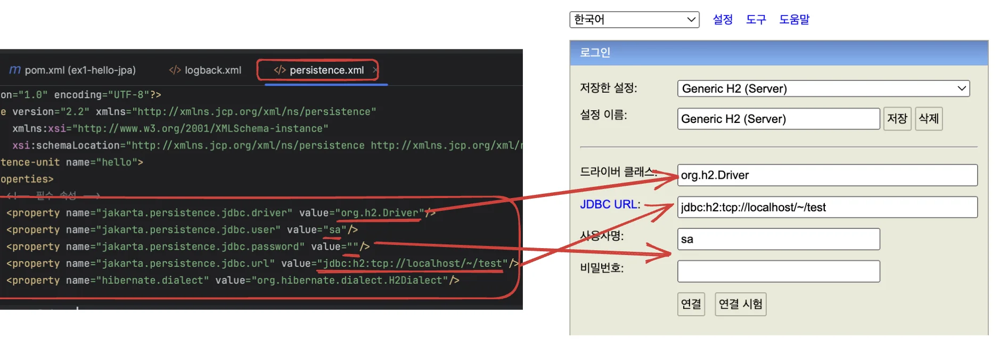
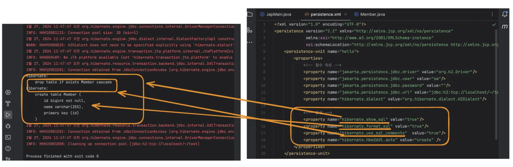
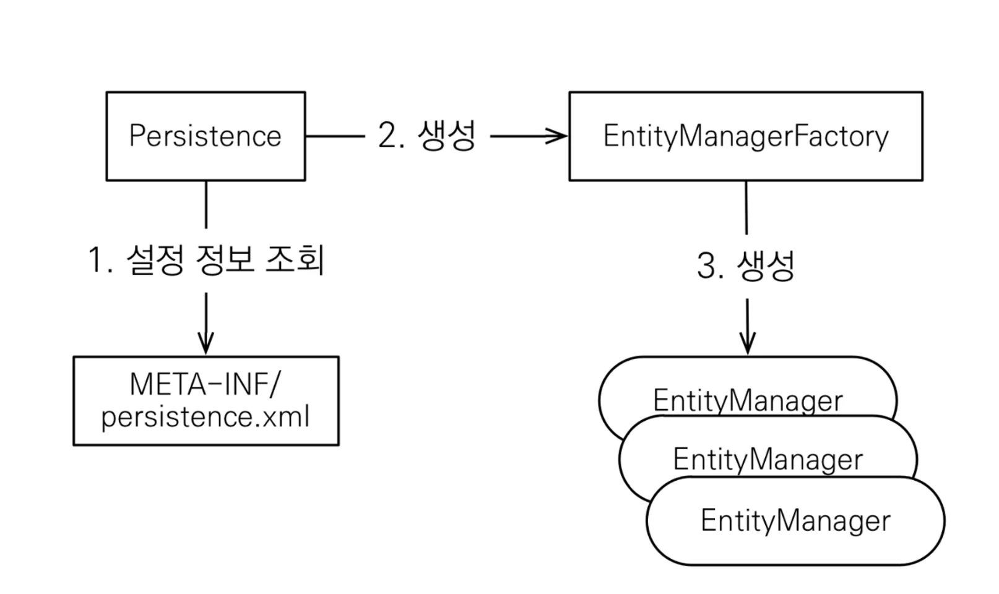
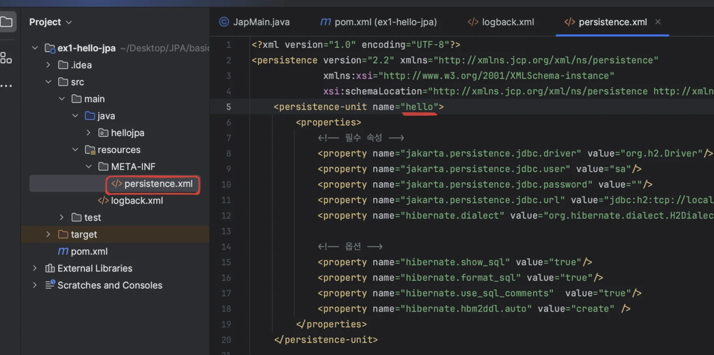
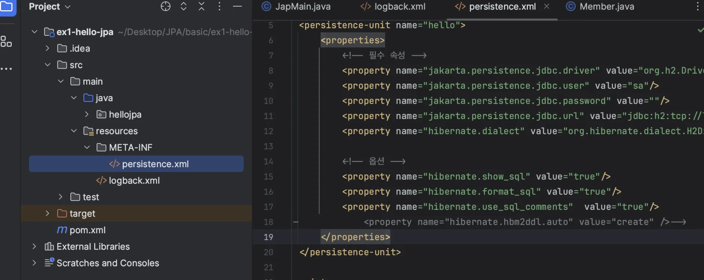
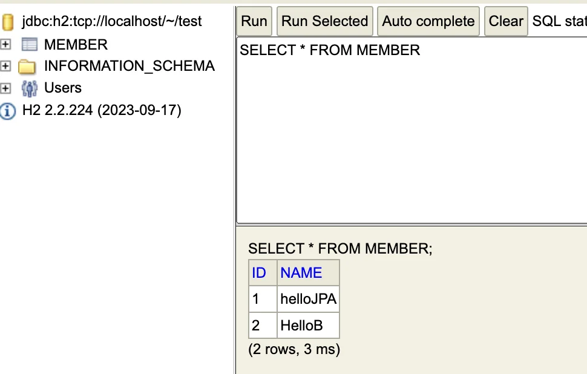

> 📌 <strong>핵심 내용</strong>
> 
> - h2 데이터베이스 실행
> 
> - <code>Persistance&#46;xml</code> ← 이게 있어야 돌아감
> 
> - <code>EntityManagerFactory</code><br>DB 당 하나, <code>Persistance&#46;xml</code> 설정 정보를 읽어와서 만듬
> 
> - <code>EntityManager</code>
>     <a id="1c3eda9b0fe1814982d7ce1728740c3d"></a>
> 
>     EntityManagerFactory에서 고객의 요청이 올때마다 DB 작업이 필요할 시, 꼭 Entity Manager를 통해 작업하며 일회성으로만 사용한다&#46; 
> 
> - <code>transaction</code>
>     <a id="1c3eda9b0fe181c1b63af2898ad98e27"></a>
> 
>     JPA의 모든 데이터 변경은 트랜젝션 안에서 일어나야 한다&#46; 
> 
> - <code>commit</code> 
>     <a id="1c3eda9b0fe181778ed0fe0be4444287"></a>
> 
>     commit을 해줘야 DB에 반영된다&#46; 
> 
> - 종료 (<code>close()</code>)
>     <a id="1c3eda9b0fe181258d35fc7cb0f09ff2"></a>
> 
>     자원(EntityManager)을 다 쓰면 무조건 종료해줘야 한다&#46; (<code>em&#46;close()</code>)<br>WAS가내려갈 때, EntityManagerFactor를 종료해줘야 한다&#46;(<code>emf&#46;close()</code>)

> <del>겁나 오래 걸림… 30분 짜리인데 정리하는데 7시간… 미쳤네…</del>

<a id="1c3eda9b0fe181eab04ae110fe5cacc0"></a>

### 프로젝트 세팅

<a id="1c3eda9b0fe181098209eef7d571b829"></a>

다운받은 소스 코드 intelliJ 로 열기 <br><code>JapMain&#46;java</code> 실행 (H2 가 실행된 상태에서 run)

<a id="1c3eda9b0fe181819afade3af90b194c"></a>

### <code>persistence&#46;xml</code>  &#45;  h2 설정



<a id="1c3eda9b0fe181cf98bffb4a4a244905"></a>

### 옵션 ( 출력값 설정 )



> 📌 <strong>hibernate&#46;show&#95;sql</strong>&#58; 매핑되는 Query 보여줌<br><strong>hibernate&#46;format&#95;sql&#58; </strong>보이기 편하게 포맷팅 해줌<strong><br>hibernate&#46;use&#95;sql&#95;comments&#58;</strong> 해당 쿼리가 왜 나오는건지 코멘트로 알려줌

<a id="1c3eda9b0fe1817cab4ecbeb24355397"></a>

## JPA 구동 방식 



> 👉🏻 구동 방식(아래 코드)<br><code>Persistence</code> 클래스의 <code>createEntityManagerFactory()</code> 메서드를 통해 <code>persistence&#46;xml </code>에 설정한 <code>unit</code> 이름(“hello”)으로 <strong>EmtitiyManagerFactory</strong>를 생성한다&#46;<br>그리고 <code>createEntityManager</code>  를 통해 하위 <strong>EmtityManager</strong>를 생성한다&#46;<br>



<a id="1c3eda9b0fe1811e855cd6deafe2a894"></a>

```java
package hellojpa;

import jakarta.persistence.EntityManager;
import jakarta.persistence.EntityManagerFactory;
import jakarta.persistence.Persistence;

public class JapMain {
    public static void main(String[] args) {
        EntityManagerFactory emf = Persistence.createEntityManagerFactory("hello");

        EntityManager entityManager = emf.createEntityManager();

        entityManager.close();

        emf.close();
    }
}
```

<details>
<summary>🧐 Entity란 무엇이며 EntityManager는 무엇인가?</summary>

<a id="1c3eda9b0fe1814fbe59d01859cd8ab9"></a>

JapMain는 DB가 연결되어 있어야 정상적으로 실행된다&#46;  EntityMager는 JapMain에서 생성되는 인스턴스이다&#46; 따라서 EntityManagers는 DB와 Java 객체를 연결시키는 무언가로 추측할 수 있는데,

<a id="1c3eda9b0fe1813a8547d641f338161c"></a>

자세한 내용은 공부하면서 다시 정리해야겠다… 

<a id="1c3eda9b0fe18150a337d4957853a4ad"></a>

Entity 객체는 jpa가 자바의 객체와 DB의 테이블간의 매핑을 하기위해 관리하는 객체를 말한다&#46;

<a id="1c3eda9b0fe1815f8e97fad417b8b9ae"></a>

(자바 객체에 <code>&#64;Entity</code>, <code>&#64;Id</code>  애노테이션을 적용하면 됨)

> Entity Object → Entity Manager  → Entity ManagerFactory(1개)

</details>

<a id="1c3eda9b0fe1811c923ee0ee368b454b"></a>

## 객체, 테이블 생성 및 매핑

<a id="1c3eda9b0fe181b99c99ffc5aeddd390"></a>

### Entity 객체

> 📌 <strong><code>&#64;Entity</code></strong>&#58; JPA가 관리할 객체<br><strong><code>&#64;Id</code></strong>&#58; 데이터베이스 PK와 매핑

<a id="1c3eda9b0fe181bb973ee71ff92c8a61"></a>

```java
package hellojpa;
import javax.persistence.Entity;
import javax.persistence.Id;

@Entity
public class Member {
	@Id
	private Long id;
	private String name;

	//Getter, Setter …
}
```

<a id="1c3eda9b0fe181cdbedbc2643ebc1965"></a>

### Member 테이블 생성

<a id="1c3eda9b0fe181df85c3e216b6d801ab"></a>

```java
create table Member (
	id bigint not null,
	name varchar(255),
	primary key (id)
);
```

<a id="1c3eda9b0fe181cf824dc43e3d744404"></a>

## Member 객체 생성 및 JPA 매핑을 통한 자동 Query 생성 및 DB에 값(member) 저장

> 📌 <strong>트랜젝션(transaction)<br></strong>JPA에서 <strong><u>데이터를 변경하는 모든 작업은 transation 안</u></strong>에서 이루어져야 한다&#46;<br>
> 
> - transaction 인스턴스 생성&#58; <code>em&#46;getTransaction()</code>    (em&#58; entityManager )
> 
> - transaction 시작&#58; <code>tx&#46;begin()</code>        ( tx&#58; EntityTransaction )
> 
> ---
> 
> <a id="1c3eda9b0fe1814c8f91c1bd6a602d02"></a>
> 
>                                 데이터 생성, 변경, 삭제 등…
> 
> ---
> 
> - transaction comit&#58; <code>tx&#46;comit()</code>     ( tx&#58; EntityTransaction )

> 👉🏻 특정 테이블을 지정하지 않았는데도 자동으로 저장되었다&#46; <br>관례를 따라 처리하지만, 테이블이나 컬럼이 많아지면 오류가 난다

> 📌 <strong>특정 값 지정 </strong>( 나중에 자세히 다룸 ) 
> 
> - <strong>테이블 지정</strong>&#58; &#64;Table(name = ”테이블명”)
> 
> - <strong>컬럼 지정</strong>&#58; &#64;Column(name = ”key명”)

<details>
<summary><strong>오류) H2 추가 데이터 생성 시 덮어씌우기 및 출력 안됨</strong></summary>

<a id="1c3eda9b0fe181a08322fc0272cc5bea"></a>

제공되는 소스코드 옵션에 아래 내용이 설정되어 있어, 매번 쿼리가 수행될때마다 테이블을 초기화 시켰음&#46;&#46; <del>2시간 삽질… ㅠ</del><br><code>&#60;property name=&#34;hibernate&#46;hbm2ddl&#46;auto&#34; value=&#34;create&#34; /&#62;</code>



<a id="1c3eda9b0fe18123aa96f581a8bf63f7"></a>

해당 옵션 주석처리 하니 정상 실행됨

</details>

<details>
<summary><strong>1 차 작성 코드) 오류 잡지 못함</strong></summary>

<a id="1c3eda9b0fe1815b8c56f60f874991ac"></a>

```java
package hellojpa;

import jakarta.persistence.EntityManager;
import jakarta.persistence.EntityManagerFactory;
import jakarta.persistence.EntityTransaction;
import jakarta.persistence.Persistence;

public class JapMain {
    public static void main(String[] args) {
        EntityManagerFactory emf = Persistence.createEntityManagerFactory("hello");

        EntityManager em = emf.createEntityManager();

        EntityTransaction tx = em.getTransaction();  // 트렌젝션 생성
        tx.begin(); // 트랜젝션 시작

        Member member = new Member();
        member.setId(1L);
        member.setName("HelloA");

        em.persist(member);  // 

        tx.commit();   // 트렌젝션 commit 및 종료

        em.close();
        emf.close();
    }
}

```

</details>

<a id="1c3eda9b0fe181f4bdcad0223cae3c2c"></a>

### 정석) 올바른 코드 (<strong><code>try&#45;catch&#45;finally</code></strong><strong> </strong><strong>)</strong>

<a id="1c3eda9b0fe181bc9082c960246537ca"></a>

JPA는 transaction이 Commit 되는 시점(<code>tx&#46;comit()</code>)에서 데이터의 검증(변경사항 및 문제를 확인)이루어진다&#46;  &#45;&#62; 자세한 내용은 <a href="#/post/1c3eda9b-0fe1-8131-8bde-c788a61cf148">페이지</a> 

<a id="1c3eda9b0fe181c79396ec6036857ec2"></a>

 위 코드의 경우는  transaction commit 후 EntityManager 바로 종료(<code>em&#46;close()</code>) 시켜, 문제가 발생되어도 확인하지 못하고 그냥 끝내버린다&#46; 

<a id="1c3eda9b0fe181cb88c6f1184845f4d8"></a>

따라서<strong> </strong><strong><code>try&#45;catch&#45;finally</code></strong> 을 통해 오류 발생 시, 해당 오류를 잡아 롤백(<code>rollback()</code>)시키는 형태로 해결한다&#46; 

> 📌 <strong>emtity manager 종료<br></strong>엔티티 매니저는 <strong><u>내부적으로 데이터베이스 커넥션을 유지</u></strong>하면서 동작한다&#46; <br>그렇기 때문에 꼭 <strong><u>마지막에 종료</u></strong>를 해줘야 한다&#46; <br>
> 
> <details>
> <summary><strong>🧐 안 닫으면 어떤 일이 생기지?</strong></summary>
> 
> <a id="1c3eda9b0fe1810c84d3e709f11349fa"></a>
> 
> <strong>IllegalStateException 오류 발생</strong>
> 
> <a id="1c3eda9b0fe181c08b85c69e70d7b7b3"></a>
> 
> ```java
> Exception in thread "main" java.lang.IllegalStateException: Transaction not successfully started
> 	at org.hibernate.engine.transaction.internal.TransactionImpl.commit(TransactionImpl.java:95)
> 	at hellojpa.JapMain.main(JapMain.java:29)
> ```
> 
> </details>

> 👍🏻 <strong>Tip) EntityManager == Collection</strong><br>엔티티 매니저를 마치 자바 컬렉션처럼 객체를 대신 저장해주는 것이라 생각

<a id="1c3eda9b0fe1811da1a2d1027699ff9d"></a>

### 회원 정보 생성 

<a id="1c3eda9b0fe1813086a2de858d75ddf1"></a>

```java
package hellojpa;

import jakarta.persistence.EntityManager;
import jakarta.persistence.EntityManagerFactory;
import jakarta.persistence.EntityTransaction;
import jakarta.persistence.Persistence;

public class JapMain {
    public static void main(String[] args) {
        EntityManagerFactory emf = Persistence.createEntityManagerFactory("hello");

        EntityManager em = emf.createEntityManager();

        EntityTransaction tx = em.getTransaction();
        tx.begin();

        try {
            Member member = new Member();
            member.setId(2L);
            member.setName("HelloB");

            em.persist(member);

            tx.commit();
        } catch (Exception e){
            tx.rollback();
        } finally {
            em.close();
        }
        emf.close();
    }
}

```

<a id="1c3eda9b0fe181ec962ac7882eb6b3bf"></a>

### 회원 정보 조회

<a id="1c3eda9b0fe1813d8161e7f2ac56e39b"></a>

```java
 .   .   .

		 try {
          Member findMember = em.find(Member.class, 1L);
          System.out.println("findMember.id = " + findMember.getId());
          System.out.println("findMember.name = " + findMember.getName());

					// em.persist(findMember);  없어도 정상 저장 
					//  -> 자바 Collection 과 같은 동작으로 설계됨 따라서 처음 생성 시에만 저장

          tx.commit(); 
      }

 .   .   .
```

<a id="1c3eda9b0fe18160a8aadf2f85febf7a"></a>

### 회원 정보 업데이트

<a id="1c3eda9b0fe1817fac8fc8ad45bf8760"></a>

```java
  .   .  .

try {
    Member findMember = em.find(Member.class, 1L);
    findMember.setName("helloJPA");
    
    tx.commit();
}

  .   .  .
```



> 📌 JPA를 통해 엔티티를 가져오면 (<code>em&#46;find()</code>) 해당 객체는 JPA가  관리한다&#46; <br>트랜젝션이 커밋(tx&#46;commit())하는 시점에 변경 사항들을 다 체크해서 해당하는 쿼리를 매핑하여 실행해 준다&#46; <br>→ 객체 데이터 업데이트 시, 트랜직션 커밋 시점에서 업데이트 내용을 확인하고 업데이트 쿼리를 날린 뒤, 커밋함&#46;  (깊은 내용은 뒤에서 다시 설명함)

<a id="1c3eda9b0fe181bba706d4e8a945511d"></a>

### 정리 (주의점) 

- EntityManageFactory는 웹 애플리케이션 서비스 시, DB 당 딱 하나만 생성된다&#46;
    > 하나만 생성해서 애플리케이션 전체에서 공유함 

-  emtityManager는 쓰레드간에 절대로 공유되어서는 안된다&#46; (사용하고 바로 버려야함) 

> 고객 요청이 올때마다 EntityManager를 생성(<code>EntityManager em = emf&#46;createEntityManager();</code>) 하고 폐기(<code>em&#46;close()</code>)한다&#46;

- JPA의 모든 데이터 변경은 트랜젝션 안에서 실행되어야 한다&#46; 그래야 해당하는 객체를 JPA가 관리하고 그에 알맞는 Query를 생성해준다&#46;  (단순 조회는 가능함)
    > 대부분 RDB는 데이터 자체를 트랜젝션 안에서 실행하도록 설계 되어있다&#46;  <br>따라서 DB가 트랙젝션이라는 개념을 단건 Query가 올때 마다 내부적으로 처리한다&#46; <br>사용자가 적용하지 않아도 내부적으로 트랜젝션 개념이 적용되어 처리된다&#46; 

<a id="1c3eda9b0fe181bfb6fac32c70b12e27"></a>

## JPQL

> 현업에서는 수십개에서 수백개까지 엄청 많은 테이블에서 내가 원하는 최적화된 데이터를 가져오거나 통계값까지 처리해야 한다&#46;

<a id="1c3eda9b0fe18151a3a7e720b37c8160"></a>

단순 데이터의 경우, 위와 같이 <code>em&#46;find(타입, 값)</code> 로 가져와서 화면에 전달해주면 되는데, 

<a id="1c3eda9b0fe18119801cf281f002d51d"></a>

아래와 같이 더 복잡한 데이터 집합들을 원하는 경우, JPQL을 사용한다&#46; 

<a id="1c3eda9b0fe181aab45ec2fcad4b5e81"></a>

→ 특정 조건에 따른 데이터 조회   및 통계값 추출

<a id="1c3eda9b0fe181a0890bfd30044ace9e"></a>

ex) 나이가 18살 이상의 회원 모두 검색 

<a id="1c3eda9b0fe181c796fcf0cd276d52e4"></a>

ex) 현재 데이터 베이스에 있는 모든  회원 조회 

> ☝🏻 JPQL을 통해 Query 입력 시, 기존 DB에서 사용하는 Query와는 약간 다르다&#46; <br>그 이유는 <strong>JPA는 Query를 생성</strong>할 때, 테이블이 아닌 <strong><u>객체를 대상</u></strong>으로<strong> Query를 생성</strong>하기 때문이다&#46;

<a id="1c3eda9b0fe181a5b1eaf3f0c07feb0d"></a>

```java
.  .  .
 
try {
    List<Member> result = em.createQuery("select m from Member as m", Member.class)
            .getResultList();

    for (Member member : result) {
        System.out.println("member.name = " + member.getName());
    }

    tx.commit();
}

.  .  .
```

<details>
<summary>테이블 값 전체 삭제</summary>

<a id="1c3eda9b0fe181d68024c7e458327902"></a>

```java
 try {
	List<Member> resultList = em.createQuery("select m from Member as m", Member.class)
	        .getResultList();

	for (Member member : resultList) {
	  em.remove(member);
	}
	
	tx.commit();
} . . . 
```

</details>

<a id="1c3eda9b0fe181fd8173e65c530fd965"></a>

```java
.  .  .
 
try {
List<Member> result = em.createQuery("select m from Member as m", Member.class)
        .setFirstResult(5)   // 앞에서 부터 5개
        .setMaxResults(8)    //
        .getResultList();

for (Member member : result) {
    System.out.println("member.name = " + member.getName());
}

.  .  .
```

<a id="1c3eda9b0fe18198a5a6cce7c16b3fa0"></a>

JQL문을 옵션 변경을 통해 해당 방언(DB들 마다의 문법, Oracle, MySQL … ?)에 맞춰 여러가지 DB에 맞게 번역해줌

<a id="1c3eda9b0fe18196b97df868158e15a0"></a>

기본적으로 안시 SQL이 지원하는 대부분의 쿼리는 다 지원된다&#46; 

<a id="1c3eda9b0fe181679eeace9017c21a39"></a>

### 정리

> 현업에서는 join 과 query 안쓸수가 없다고 함, (많이 씀)

<a id="1c3eda9b0fe1816e9706c99e1dc9d4c7"></a>

JPA를 사용 하면 엔티티 객체를 중심으로 개발한다&#46;

>  모든DB 데이터를 객체로 변환해서 검색하는 것은 불가능하다&#46;

<a id="1c3eda9b0fe18197a6ecfa4fa3164ad4"></a>

이때, 검색 쿼리(단건 데이터가 아닌 여러개의 데이터를 가져와야 하는 경우) 에서 문제가 발생한다&#46; 

> 애플리케이션에서 필요한 데이터만 DB에서 불러오려면 결국 검색 조건(여러개의 데이터를 불러옴)이 포함된 SQL이 필요하다&#46;  

<a id="1c3eda9b0fe18162885df4619585223f"></a>

<strong><u>JPA에서 SQL을 추상화</u></strong>한 <code>JPQL</code>이라는 <strong>객</strong><strong><u>체 지향 쿼리 언어</u></strong> 제공하며

<a id="1c3eda9b0fe181cf82d4e94b7c8f740b"></a>

이를 JPQL를 통해 <strong><u>엔티티 객체를 대상으로 쿼리를 생성하여</u></strong> 해당 문제를 JPA 내에서 해결한다&#46;

<a id="1c3eda9b0fe1810f957fcb5a8128a8e8"></a>

(JPQL만 해도 2강의 정도 분량이라고 하심&#46;&#46; 양이 많다 )

> 특정 데이터베이스 SQL에 의존하지 않음

<a id="1c3eda9b0fe1819ba929e45c5d067d22"></a>

따라서 방언이 변경되어도 JPQL을 변경할 필요가 없다&#46;<br> (알아서 해당 쓰임에 맞게 번역해줌 )

<a id="1c3eda9b0fe181c8ab15d091fdcb9f64"></a>

( 나중에 Query DSL 이나, 다른 라이브러리를 배우는데, 이를 통해  JAVA 언어로만 모든게 해결 가능 )
