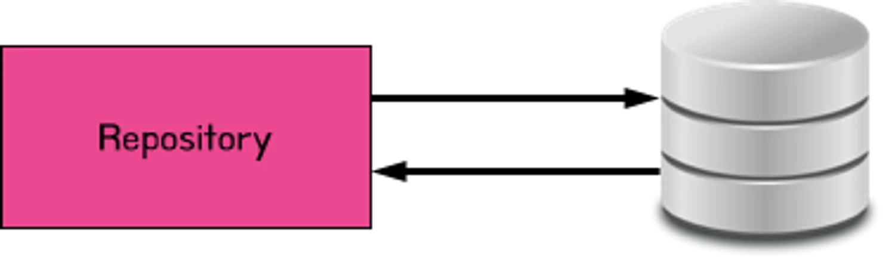
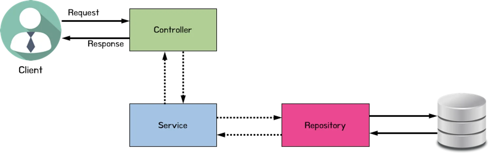
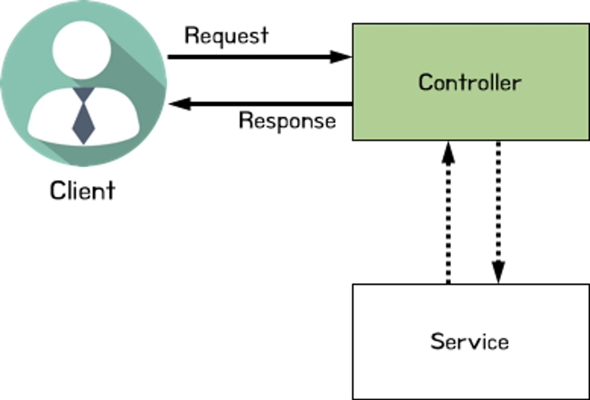

<a id="1c3eda9b0fe181be8765c928fcb0e252"></a>

## 3Layer Achitecture

> 🧐 이전에 작성한 메모장 앱은 <strong><code>Controller</code></strong> <strong><u>하나</u></strong>에 <strong><u>모든 API를 처리</u></strong>한다&#46; 
> 
> <a id="1c3eda9b0fe181dbb8fcf78f2f7dada2"></a>
> 
> 현재는 API 수가 적고 기능이 단순하여 코드가 복잡해 보이지 않지만 앞으로 기능이 추가되고 앱이 더 복잡해진다면 아래와 같은 문제 발생한다&#46; 
> 
> > <strong>하나의 클래스</strong>에 <u>너무 많은 코드가 존재</u>하여 코드를 이해하기 어렵다&#46;
> > 
> > <a id="1c3eda9b0fe181f39307dd146c4d5ebe"></a>
> > 
> > 따라서 <u>유지보수 측면에서 너무 많은 비용이 소모</u>된다&#46; 
> 
> <a id="1c3eda9b0fe181bfae37e76855186d6b"></a>
> 
> 따라서 <strong>하나의 컨트롤러</strong>를 아래와 같이  <strong>3 Layer Architecture</strong> 인 <strong>Controller, Service, Repository </strong>로 <strong><u>레이어를 나누어 각 역할을 부여</u></strong>함으로써 위 문제를 해결한다&#46;

<a id="1c3eda9b0fe18183aa4efd223b935c3d"></a>

### 1&#46; Controller


> 📌 • 클라이언트의 요청을 받고 Service에 전달한다&#46; 
> 
> >  Request 데이터가 있을 시 같이 전달함
> 
> <a id="1c3eda9b0fe181109df8f6a2b61228b6"></a>
> 
> (요청에 대한 로직 Service에서 처리한다)
> 
> <a id="1c3eda9b0fe181059c1bd79ddf788514"></a>
> 
> <br>• Service에서 처리가 완료된 결과를 클라이언트에게 응답한다&#46; 

<a id="1c3eda9b0fe18115ac55e0fb45d8c5d2"></a>

### 2&#46; Service


> 📌 • <strong><u>사용자의 요구사항을 처리&#91;</u></strong><strong>비지니스  로직&#93;</strong>  담당  
> 
> > 요청과 응답에 대한 로직을 처리를 담당하여 가장 코드의 양이 많고 가장 중요하다&#46;
> 
> <a id="1c3eda9b0fe181d383ffe32884910b17"></a>
> 
> • <strong><u>DB 저장 및 조회</u></strong>가 필요 시 <strong>Repository</strong> 에 요청 및 응답

<a id="1c3eda9b0fe18148838ed08312f2f939"></a>

### <strong>3&#46; Repository</strong>



> 📌 • DB 관리(연결, 해제, 자원 관리) 담당<br>• DB CRUD 작업 처리

---

<a id="1c3eda9b0fe1817793d0f28cd54bcbfb"></a>

### 전체 흐름



<a id="1c3eda9b0fe18186832ff40d50d79404"></a>

ex)

<details>
<summary>크롬 브라우저(Client)에서 게시글 작성 요청</summary>

<a id="1c3eda9b0fe18143ac21ddf9db66ab14"></a>

➡  <strong>Request Message ( HTTP, </strong><strong><code>POST</code></strong><strong> )</strong> Controller 에서 받아옴

-  <code>DispatcherServlet</code>이 해당 요청 매칭 및 데이터 처리하여 Controller 전달

<a id="1c3eda9b0fe181ba973fc19211f4be4f"></a>

➡  <code>&#91; Controller &#93;</code> Service 데이터 전달 ( 받아온 요청 데이터 있을 시, 같이 전달)

<a id="1c3eda9b0fe1816d9f91f62e6cf4a62f"></a>

➡  <code>&#91; Service &#93;</code> 요청에 따른 비지니스 구현, 예시는 게시글 저장임으로 해당하는 로직 처리

<a id="1c3eda9b0fe181bdb884f1ead5adc477"></a>

➡  <code>&#91; Repository &#93;</code> Service에서 전달 받은 데이터 DB에 저장 

</details>

<details>
<summary>Client에서 게시글 읽어올 시 </summary>

<a id="1c3eda9b0fe181ceab8be468eebf23c2"></a>

➡  <strong>Request Message ( HTTP, </strong><strong><code>GET</code></strong><strong> )</strong> Controller 에서 받아옴

-  <code>DispatcherServlet</code>이 해당 요청 매칭 및 데이터 처리하여 Controller 전달

<a id="1c3eda9b0fe181bc8311d83e770435f6"></a>

➡  <code>&#91; Controller &#93;</code> Service로 데이터 전달 ( 받아온 요청 데이터 있을 시, 같이 전달)

<a id="1c3eda9b0fe181a6861efebd48268f1c"></a>

➡  <code>&#91; Service &#93;</code> 요청에 따른 비지니스 구현, 요청 받은 게시글 id Repository로 전달 

<a id="1c3eda9b0fe1814ab3b6e580c99c5c72"></a>

➡ <code>&#91; Repository &#93;</code> 받아온 id 값으로 DB에 해당 데이터 조회 및 Service로 반환

<a id="1c3eda9b0fe181b1ad7defb80f280434"></a>

➡  반환된 데이터 &#91; service → controller →

<a id="1c3eda9b0fe181048e66dd64a6e1a83e"></a>

       <strong>Response Message ( HTTP )</strong> client 전달, view 생성  &#93;

</details>

<a id="1c3eda9b0fe181af9359e16845412941"></a>

## 실습) 메모 앱 &#45; 3Layer Achitecture 적용 

<a id="1c3eda9b0fe1810f8ffbcdc458eb167b"></a>

### 1) Controller &#45; Service 분리



> ☝🏻 controller의 api 메서드 명칭과 service의 비지니스 로직 메서드 명칭을 동일하게 사용하면 각 api 와 비지니스 로직이 매칭되어 쉽게 알아 볼 수 있다&#46;  <br>따라서 <strong>Controller</strong>의 <strong><code>api 메서드명</code></strong> 과 <strong>Service</strong>의 <strong><code>비지니스 로직 메서드명</code></strong>은 <strong>동일</strong>하게 사용하는 것을 권장한다&#46;

<details>
<summary>Service 클래스(<code>MemoService</code>) 생성</summary>

<a id="1c3eda9b0fe18169b20dc1e9a0509eca"></a>

```java
package com.sparta.memo.service;

import org.springframework.stereotype.Service;

@Service
public class MemoService {
}

```

</details>

<details>
<summary><code>JdbcTemplate</code> 적용</summary>

<a id="1c3eda9b0fe181529367c62908e6dea4"></a>

```java
  private final JdbcTemplate jdbcTemplate;

  public MemoService(JdbcTemplate jdbcTemplate) {
      this.jdbcTemplate = jdbcTemplate;
  }
```

</details>

<details>
<summary><strong> 메모 생성 ( </strong><strong><code>createMemo</code></strong><strong> )</strong></summary>

<details>
<summary>1&#46; <code>MemoController</code>에 <code>MemoService</code> <strong>인스턴스 생성 </strong>및 <strong>요청 데이터(</strong><code>requestDto</code><strong>) 전달</strong></summary>

<a id="1c3eda9b0fe1819386c6c8fb2d392118"></a>

```java
@PostMapping("/memos")
public MemoResponseDto createMemo(@RequestBody MemoRequestDto requestDto) {
	  MemoService memoService = new MemoService(jdbcTemplate);
	  return memoService.createMemo (requestDto);
}
```

</details>

<details>
<summary>2&#46; 비지니스 로직 <code>MemoService</code>에 옮기기</summary>

<a id="1c3eda9b0fe1819fa3bcf36f423243c0"></a>

```java
package com.sparta.memo.service;

import com.sparta.memo.dto.MemoRequestDto;
import com.sparta.memo.dto.MemoResponseDto;
import com.sparta.memo.entity.Memo;
import org.springframework.jdbc.core.JdbcTemplate;
import org.springframework.jdbc.support.GeneratedKeyHolder;
import org.springframework.jdbc.support.KeyHolder;
import org.springframework.stereotype.Service;

import java.sql.PreparedStatement;
import java.sql.Statement;

@Service
public class MemoService {

		// JdbcTemplate 사용을 위한 설정
    private final JdbcTemplate jdbcTemplate;

    public MemoService(JdbcTemplate jdbcTemplate) {
        this.jdbcTemplate = jdbcTemplate;
    }

		// 비지니스 로직:  메모 생성 
    public MemoResponseDto createMemo(MemoRequestDto requestDto) {
        // RequestDto -> Entity
        Memo memo = new Memo(requestDto);

        // DB 저장
        KeyHolder keyHolder = new GeneratedKeyHolder(); // 기본 키를 반환받기 위한 객체

        String sql = "INSERT INTO memo (username, contents) VALUES (?, ?)";
        jdbcTemplate.update( con -> {
                    PreparedStatement preparedStatement = con.prepareStatement(sql,
                            Statement.RETURN_GENERATED_KEYS);

                    preparedStatement.setString(1, memo.getUsername());
                    preparedStatement.setString(2, memo.getContents());
                    return preparedStatement;
                },
                keyHolder);

        // DB Insert 후 받아온 기본키 확인
        Long id = keyHolder.getKey().longValue();
        memo.setId(id);

        // Entity -> ResponseDto
        MemoResponseDto memoResponseDto = new MemoResponseDto(memo);

        return memoResponseDto;
    }
}


```

</details>

<details>
<summary><code>Controller</code> &#45; createMemo</summary>

<a id="1c3eda9b0fe18173ab3ecf94ce5774b5"></a>

```java
@PostMapping("/memos")
    public MemoResponseDto createMemo(@RequestBody MemoRequestDto requestDto) {
        MemoService memoService = new MemoService(jdbcTemplate);
        return memoService.createMemo (requestDto);
    }
```

</details>

<details>
<summary><code>Service</code> &#45; createMemo</summary>

<a id="1c3eda9b0fe1818bb422d6e2c02dd014"></a>

```java
public MemoResponseDto createMemo(MemoRequestDto requestDto) {
        // RequestDto -> Entity
        Memo memo = new Memo(requestDto);

        // DB 저장
        KeyHolder keyHolder = new GeneratedKeyHolder(); // 기본 키를 반환받기 위한 객체

        String sql = "INSERT INTO memo (username, contents) VALUES (?, ?)";
        jdbcTemplate.update( con -> {
                    PreparedStatement preparedStatement = con.prepareStatement(sql,
                            Statement.RETURN_GENERATED_KEYS);

                    preparedStatement.setString(1, memo.getUsername());
                    preparedStatement.setString(2, memo.getContents());
                    return preparedStatement;
                },
                keyHolder);

        // DB Insert 후 받아온 기본키 확인
        Long id = keyHolder.getKey().longValue();
        memo.setId(id);

        // Entity -> ResponseDto
        MemoResponseDto memoResponseDto = new MemoResponseDto(memo);

        return memoResponseDto;
    }
```

</details>

</details>

<details>
<summary><strong>메모 조회 ( </strong><strong><code>getMemos</code></strong><strong> )</strong></summary>

> 과정 동일 

<details>
<summary><code>Controller</code> &#45; <strong>getMemos</strong></summary>

<a id="1c3eda9b0fe18191a540fd5491371308"></a>

```java
@GetMapping("/memos")
public List<MemoResponseDto> getMemos() {
    MemoService memoService = new MemoService(jdbcTemplate);
    return memoService.getMemos ();
}
```

</details>

<details>
<summary><code>Service</code> &#45; <strong>getMemos</strong></summary>

<a id="1c3eda9b0fe1818da823e5d3e142e33a"></a>

```java
public List<MemoResponseDto> getMemos() {
    // DB 조회
    String sql = "SELECT * FROM memo";

    return jdbcTemplate.query(sql, new RowMapper<MemoResponseDto>() {
        @Override
        public MemoResponseDto mapRow(ResultSet rs, int rowNum) throws SQLException {
            // SQL 의 결과로 받아온 Memo 데이터들을 MemoResponseDto 타입으로 변환해줄 메서드
            Long id = rs.getLong("id");
            String username = rs.getString("username");
            String contents = rs.getString("contents");
            return new MemoResponseDto(id, username, contents);
        }
    });
}
```

</details>

</details>

<details>
<summary><strong>메모 수정  ( </strong><strong><code>updateMemo</code></strong><strong> )</strong></summary>

> 과정 동일 

<details>
<summary><code>Controller</code> &#45; <strong>updateMemo</strong></summary>

<a id="1c3eda9b0fe18117b1bfdbd3ee8d1d68"></a>

```java
@PutMapping("/memos/{id}")
public Long updateMemo(@PathVariable Long id, @RequestBody MemoRequestDto requestDto) {
    MemoService memoService = new MemoService(jdbcTemplate);
    return memoService.updateMemo(id, requestDto);
}

```

</details>

<details>
<summary><code>Service</code> &#45; <strong>updateMemo</strong></summary>

<a id="1c3eda9b0fe18180b0eac77bee8c7c54"></a>

```java
public Long updateMemo(@PathVariable Long id, @RequestBody MemoRequestDto requestDto) {
    // 해당 메모가 DB에 존재하는지 확인
    Memo memo = findById(id);
    if(memo != null) {
        // memo 내용 수정
        String sql = "UPDATE memo SET username = ?, contents = ? WHERE id = ?";
        jdbcTemplate.update(sql, requestDto.getUsername(), requestDto.getContents(), id);

        return id;
    } else {
        throw new IllegalArgumentException("선택한 메모는 존재하지 않습니다.");
    }
}
```

</details>

</details>

<details>
<summary><strong>메모 삭제  ( </strong><strong><code>deleteMemo</code></strong><strong>  )</strong></summary>

> 과정 동일 

<details>
<summary><code>Controller</code> &#45; <strong>deleteMemo</strong></summary>

<a id="1c3eda9b0fe1817cb389ea8c08b4f52a"></a>

```java
@DeleteMapping("/memos/{id}")
public Long deleteMemo(@PathVariable Long id) {
    MemoService memoService = new MemoService(jdbcTemplate);
    return memoService.deleteMemo(id);
}
```

</details>

<details>
<summary><code>Service</code> &#45; <strong>deleteMemo</strong></summary>

<a id="1c3eda9b0fe1812a8218e0ca94e39857"></a>

```java
public Long deleteMemo(Long id){
    // 해당 메모가 DB에 존재하는지 확인
    Memo memo = findById(id);
    if(memo != null) {
        // memo 삭제
        String sql = "DELETE FROM memo WHERE id = ?";
        jdbcTemplate.update(sql, id);

        return id;
    } else {
        throw new IllegalArgumentException("선택한 메모는 존재하지 않습니다.");
    }
}
```

</details>

</details>

---

> 1&#46; Controller는 API 요청을 받고 Service에 받아온 데이터와 함께 요청을 넘긴다&#46;

<details>
<summary><strong>MemoController</strong></summary>

<a id="1c3eda9b0fe181e5b048e5810adaf562"></a>

```java
package com.sparta.memo.controller;

import com.sparta.memo.dto.MemoRequestDto;
import com.sparta.memo.dto.MemoResponseDto;
import com.sparta.memo.service.MemoService;
import org.springframework.jdbc.core.JdbcTemplate;
import org.springframework.web.bind.annotation.*;

import java.util.List;

@RestController
@RequestMapping("/api")
public class MemoController {

    private final JdbcTemplate jdbcTemplate;

    public MemoController(JdbcTemplate jdbcTemplate) {
        this.jdbcTemplate = jdbcTemplate;
    }

    @PostMapping("/memos")
    public MemoResponseDto createMemo(@RequestBody MemoRequestDto requestDto) {
        MemoService memoService = new MemoService(jdbcTemplate);
        return memoService.createMemo(requestDto);
    }

    @GetMapping("/memos")
    public List<MemoResponseDto> getMemos() {
        MemoService memoService = new MemoService(jdbcTemplate);
        return memoService.getMemos();
    }

    @PutMapping("/memos/{id}")
    public Long updateMemo(@PathVariable Long id, @RequestBody MemoRequestDto requestDto) {
        MemoService memoService = new MemoService(jdbcTemplate);
        return memoService.updateMemo(id, requestDto);
    }

    @DeleteMapping("/memos/{id}")
    public Long deleteMemo(@PathVariable Long id) {
        MemoService memoService = new MemoService(jdbcTemplate);
        return memoService.deleteMemo(id);
    }
}
```

</details>

> 2&#46; 요청을 전달받은 Service는 해당하는 비지니스 로직을 수행한다&#46;

<details>
<summary><strong>MemoService</strong></summary>

<a id="1c3eda9b0fe181258064dbbd0a929a45"></a>

```java
package com.sparta.memo.service;

import com.sparta.memo.dto.MemoRequestDto;
import com.sparta.memo.dto.MemoResponseDto;
import com.sparta.memo.entity.Memo;
import org.springframework.jdbc.core.JdbcTemplate;
import org.springframework.jdbc.core.RowMapper;
import org.springframework.jdbc.support.GeneratedKeyHolder;
import org.springframework.jdbc.support.KeyHolder;

import java.sql.PreparedStatement;
import java.sql.ResultSet;
import java.sql.SQLException;
import java.sql.Statement;
import java.util.List;

public class MemoService {

    private final JdbcTemplate jdbcTemplate;

    public MemoService(JdbcTemplate jdbcTemplate) {
        this.jdbcTemplate = jdbcTemplate;
    }

    public MemoResponseDto createMemo(MemoRequestDto requestDto) {
        // RequestDto -> Entity
        Memo memo = new Memo(requestDto);

        // DB 저장
        KeyHolder keyHolder = new GeneratedKeyHolder(); // 기본 키를 반환받기 위한 객체

        String sql = "INSERT INTO memo (username, contents) VALUES (?, ?)";
        jdbcTemplate.update( con -> {
                    PreparedStatement preparedStatement = con.prepareStatement(sql,
                            Statement.RETURN_GENERATED_KEYS);

                    preparedStatement.setString(1, memo.getUsername());
                    preparedStatement.setString(2, memo.getContents());
                    return preparedStatement;
                },
                keyHolder);

        // DB Insert 후 받아온 기본키 확인
        Long id = keyHolder.getKey().longValue();
        memo.setId(id);

        // Entity -> ResponseDto
        MemoResponseDto memoResponseDto = new MemoResponseDto(memo);

        return memoResponseDto;
    }

    public List<MemoResponseDto> getMemos() {
        // DB 조회
        String sql = "SELECT * FROM memo";

        return jdbcTemplate.query(sql, new RowMapper<MemoResponseDto>() {
            @Override
            public MemoResponseDto mapRow(ResultSet rs, int rowNum) throws SQLException {
                // SQL 의 결과로 받아온 Memo 데이터들을 MemoResponseDto 타입으로 변환해줄 메서드
                Long id = rs.getLong("id");
                String username = rs.getString("username");
                String contents = rs.getString("contents");
                return new MemoResponseDto(id, username, contents);
            }
        });
    }

    public Long updateMemo(Long id, MemoRequestDto requestDto) {
        // 해당 메모가 DB에 존재하는지 확인
        Memo memo = findById(id);
        if(memo != null) {
            // memo 내용 수정
            String sql = "UPDATE memo SET username = ?, contents = ? WHERE id = ?";
            jdbcTemplate.update(sql, requestDto.getUsername(), requestDto.getContents(), id);

            return id;
        } else {
            throw new IllegalArgumentException("선택한 메모는 존재하지 않습니다.");
        }
    }

    public Long deleteMemo(Long id) {
        // 해당 메모가 DB에 존재하는지 확인
        Memo memo = findById(id);
        if(memo != null) {
						// memo 삭제
            String sql = "DELETE FROM memo WHERE id = ?";
            jdbcTemplate.update(sql, id);

            return id;
        } else {
            throw new IllegalArgumentException("선택한 메모는 존재하지 않습니다.");
        }
    }

    private Memo findById(Long id) {
        // DB 조회
        String sql = "SELECT * FROM memo WHERE id = ?";

        return jdbcTemplate.query(sql, resultSet -> {
            if(resultSet.next()) {
                Memo memo = new Memo();
                memo.setUsername(resultSet.getString("username"));
                memo.setContents(resultSet.getString("contents"));
                return memo;
            } else {
                return null;
            }
        }, id);
    }
}
```

</details>

> 🤔 <strong>개선점</strong>
> 
> <details>
> <summary><strong>개선점) 인스턴스 중복 생성</strong></summary>
> 
> <a id="1c3eda9b0fe181ecb0ebea3bc1f02544"></a>
> 
> 모든 메서드마다 memoService 인스턴스를 중복 생성함
> 
> <a id="1c3eda9b0fe1813881edd18eac9d291b"></a>
> 
> ```java
> MemoService memoService = new MemoService(jdbcTemplate);
> ```
> 
> </details>
> 
> <details>
> <summary><strong>개선) </strong><u>중복 로직 제거</u> 및 <u>인스턴스 생성자로 주입</u></summary>
> 
> <a id="1c3eda9b0fe181989f27c0be6573ad49"></a>
> 
> ```java
> @RestController
> @RequestMapping("/api")
> public class MemoController {
> 
>     private final JdbcTemplate jdbcTemplate;
>     private final MemoService memoService;
> 
>     public MemoController(JdbcTemplate jdbcTemplate, MemoService memoService) {
>         this.jdbcTemplate = jdbcTemplate;
>         this.memoService = memoService;
>     }
> 
>     @PostMapping("/memos")
>     public MemoResponseDto createMemo(@RequestBody MemoRequestDto requestDto) {
>         return memoService.createMemo (requestDto);
>     }
> 
>     @GetMapping("/memos")
>     public List<MemoResponseDto> getMemos() {
>         return memoService.getMemos ();
>     }
> 
>     @PutMapping("/memos/{id}")
>     public Long updateMemo(@PathVariable Long id, @RequestBody MemoRequestDto requestDto) {
>         return memoService.updateMemo(id, requestDto);
>     }
> 
>     @DeleteMapping("/memos/{id}")
>     public Long deleteMemo(@PathVariable Long id) {
>         return memoService.deleteMemo(id);
>     }
> }
> ```
> 
> </details>

<a id="1c3eda9b0fe1811dbcd3c7440d20dca0"></a>

### 2) Service &#45; Repository 분리


<details>
<summary>Repository 클래스(<code>MemoRepository</code>) 생성</summary>

<a id="1c3eda9b0fe181f5a07fd137069a0996"></a>

```java
package com.sparta.memo.repository;

import org.springframework.stereotype.Repository;

@Repository
public class MemoRepository {
}
```

</details>

<details>
<summary><code>JdbcTemplate</code> 적용</summary>

<a id="1c3eda9b0fe181949d52d9d86642f1e4"></a>

```java
private final JdbcTemplate jdbcTemplate;

public MemoRepository(JdbcTemplate jdbcTemplate) {
    this.jdbcTemplate = jdbcTemplate;
}
```

</details>

<details>
<summary><strong>메모 생성 </strong></summary>

<details>
<summary><code>Service</code> &#45; <strong>createMemo</strong></summary>

<a id="1c3eda9b0fe181459493fb431178f21e"></a>

```java
 public MemoResponseDto createMemo(MemoRequestDto requestDto) {
    // RequestDto -> Entity
    Memo memo = new Memo(requestDto);

    // DB 저장
    MemoRepository memoRepository = new MemoRepository(jdbcTemplate);
    Memo saveMemo = memoRepository.save(memo);

    // Entity -> ResponseDto
    MemoResponseDto memoResponseDto = new MemoResponseDto(saveMemo);

    return memoResponseDto;
}
```

</details>

<details>
<summary><code>Repository</code> &#45;<strong> save</strong></summary>

<a id="1c3eda9b0fe18166af7dd18a9df3d742"></a>

```java
public Memo save(Memo memo) {
    KeyHolder keyHolder = new GeneratedKeyHolder(); // 기본 키를 반환받기 위한 객체

    String sql = "INSERT INTO memo (username, contents) VALUES (?, ?)";
    jdbcTemplate.update( con -> {
                PreparedStatement preparedStatement = con.prepareStatement(sql,
                        Statement.RETURN_GENERATED_KEYS);

                preparedStatement.setString(1, memo.getUsername());
                preparedStatement.setString(2, memo.getContents());
                return preparedStatement;
            },
            keyHolder);

    // DB Insert 후 받아온 기본키 확인
    Long id = keyHolder.getKey().longValue();
    memo.setId(id);

    return memo;
}
```

</details>

</details>

<details>
<summary><strong>메모 조회 </strong></summary>

<details>
<summary><code>Service</code> &#45; <strong>getMemos</strong></summary>

<a id="1c3eda9b0fe1813c8c34d60844a82ab9"></a>

```java
public List<MemoResponseDto> getMemos() {
	  MemoRepository memoRepository = new MemoRepository(jdbcTemplate);
	  return memoRepository.findAll();
}
```

</details>

<details>
<summary><code>Repository</code> &#45; <strong>findAll</strong></summary>

<a id="1c3eda9b0fe18163b75bf57aee96942e"></a>

```java
public List<MemoResponseDto> findAll() {
    // DB 조회
    String sql = "SELECT * FROM memo";

    return jdbcTemplate.query(sql, new RowMapper<MemoResponseDto>() {
        @Override
        public MemoResponseDto mapRow(ResultSet rs, int rowNum) throws SQLException {
            // SQL 의 결과로 받아온 Memo 데이터들을 MemoResponseDto 타입으로 변환해줄 메서드
            Long id = rs.getLong("id");
            String username = rs.getString("username");
            String contents = rs.getString("contents");
            return new MemoResponseDto(id, username, contents);
        }
    });
}
```

</details>

</details>

<details>
<summary><strong>메모 수정 </strong></summary>

<details>
<summary><code>Service</code> &#45; <strong>updateMemo</strong></summary>

<a id="1c3eda9b0fe181c98b0ed6f88a1abb1b"></a>

```java
public Long updateMemo(@PathVariable Long id, @RequestBody MemoRequestDto requestDto) {
    MemoRepository memoRepository = new MemoRepository(jdbcTemplate);

    // 해당 메모가 DB에 존재하는지 확인
    Memo memo = memoRepository.findById(id);

    if(memo != null) {
        memoRepository.update(id, requestDto);

        return id;
    } else {
        throw new IllegalArgumentException("선택한 메모는 존재하지 않습니다.");
    }
}
```

</details>

<details>
<summary><code>Repository</code> &#45; <strong>update</strong></summary>

<a id="1c3eda9b0fe181cb9870c8feb061a0e0"></a>

```java
public void update(Long id, MemoRequestDto requestDto) {
    // memo 내용 수정
    String sql = "UPDATE memo SET username = ?, contents = ? WHERE id = ?";
    jdbcTemplate.update(sql, requestDto.getUsername(), requestDto.getContents(), id);
}
```

</details>

</details>

<details>
<summary><strong>메모 삭제 </strong></summary>

<details>
<summary><code>Service</code> &#45; <strong>deleteMemo</strong></summary>

<a id="1c3eda9b0fe1813a8e1cd90f8252861a"></a>

```java
public Long deleteMemo(Long id){
    MemoRepository memoRepository = new MemoRepository(jdbcTemplate);

    // 해당 메모가 DB에 존재하는지 확인
    Memo memo = memoRepository.findById(id);

    if(memo != null) {
        memoRepository.delete(id);

        return id;
    } else {
        throw new IllegalArgumentException("선택한 메모는 존재하지 않습니다.");
    }
}
```

</details>

<details>
<summary><code>Repository</code> &#45; <strong>delete</strong></summary>

<a id="1c3eda9b0fe181169518d8e22c8c7915"></a>

```java
public void delete(Long id) {
    // memo 삭제
    String sql = "DELETE FROM memo WHERE id = ?";
    jdbcTemplate.update(sql, id);
}
```

</details>

</details>

---

> 1&#46; DB와 연결 및 CRUD 

<details>
<summary><strong>MemoRepository</strong></summary>

<a id="1c3eda9b0fe1814f889afca230eb73ff"></a>

```java
package com.sparta.memo.repository;

import com.sparta.memo.dto.MemoRequestDto;
import com.sparta.memo.dto.MemoResponseDto;
import com.sparta.memo.entity.Memo;
import org.springframework.jdbc.core.JdbcTemplate;
import org.springframework.jdbc.core.RowMapper;
import org.springframework.jdbc.support.GeneratedKeyHolder;
import org.springframework.jdbc.support.KeyHolder;
import org.springframework.stereotype.Repository;

import java.sql.PreparedStatement;
import java.sql.ResultSet;
import java.sql.SQLException;
import java.sql.Statement;
import java.util.List;

@Repository
public class MemoRepository {

    private final JdbcTemplate jdbcTemplate;
    
    public MemoRepository(JdbcTemplate jdbcTemplate) {
        this.jdbcTemplate = jdbcTemplate;
    }

    public Memo save(Memo memo) {
        KeyHolder keyHolder = new GeneratedKeyHolder(); // 기본 키를 반환받기 위한 객체

        String sql = "INSERT INTO memo (username, contents) VALUES (?, ?)";
        jdbcTemplate.update( con -> {
                    PreparedStatement preparedStatement = con.prepareStatement(sql,
                            Statement.RETURN_GENERATED_KEYS);

                    preparedStatement.setString(1, memo.getUsername());
                    preparedStatement.setString(2, memo.getContents());
                    return preparedStatement;
                },
                keyHolder);

        // DB Insert 후 받아온 기본키 확인
        Long id = keyHolder.getKey().longValue();
        memo.setId(id);

        return memo;
    }

    public List<MemoResponseDto> findAll() {
        // DB 조회
        String sql = "SELECT * FROM memo";

        return jdbcTemplate.query(sql, new RowMapper<MemoResponseDto>() {
            @Override
            public MemoResponseDto mapRow(ResultSet rs, int rowNum) throws SQLException {
                // SQL 의 결과로 받아온 Memo 데이터들을 MemoResponseDto 타입으로 변환해줄 메서드
                Long id = rs.getLong("id");
                String username = rs.getString("username");
                String contents = rs.getString("contents");
                return new MemoResponseDto(id, username, contents);
            }
        });
    }

    public void update(Long id, MemoRequestDto requestDto) {
        // memo 내용 수정
        String sql = "UPDATE memo SET username = ?, contents = ? WHERE id = ?";
        jdbcTemplate.update(sql, requestDto.getUsername(), requestDto.getContents(), id);
    }

    public void delete(Long id) {
        // memo 삭제
        String sql = "DELETE FROM memo WHERE id = ?";
        jdbcTemplate.update(sql, id);
    }


    public Memo findById(Long id) {
        // DB 조회
        String sql = "SELECT * FROM memo WHERE id = ?";

        return jdbcTemplate.query(sql, resultSet -> {
            if(resultSet.next()) {
                Memo memo = new Memo();
                memo.setUsername(resultSet.getString("username"));
                memo.setContents(resultSet.getString("contents"));
                return memo;
            } else {
                return null;
            }
        }, id);
    }
}

```

</details>

> 2&#46; DB 작업을 Repository에 요청

<details>
<summary><strong>MemoService</strong></summary>

<a id="1c3eda9b0fe181c4844ed55f0e40577f"></a>

```java
package com.sparta.memo.service;

import com.sparta.memo.dto.MemoRequestDto;
import com.sparta.memo.dto.MemoResponseDto;
import com.sparta.memo.entity.Memo;
import com.sparta.memo.repository.MemoRepository;
import org.springframework.jdbc.core.JdbcTemplate;
import org.springframework.stereotype.Service;
import org.springframework.web.bind.annotation.PathVariable;
import org.springframework.web.bind.annotation.RequestBody;


import java.util.List;

@Service
public class MemoService {
    private final JdbcTemplate jdbcTemplate;

    public MemoService(JdbcTemplate jdbcTemplate) {
        this.jdbcTemplate = jdbcTemplate;
    }

    public MemoResponseDto createMemo(MemoRequestDto requestDto) {
        // RequestDto -> Entity
        Memo memo = new Memo(requestDto);

        // DB 저장
        MemoRepository memoRepository = new MemoRepository(jdbcTemplate);
        Memo saveMemo = memoRepository.save(memo);

        // Entity -> ResponseDto
        MemoResponseDto memoResponseDto = new MemoResponseDto(saveMemo);

        return memoResponseDto;
    }

    public List<MemoResponseDto> getMemos() {
        MemoRepository memoRepository = new MemoRepository(jdbcTemplate);
        return memoRepository.findAll();
    }

    public Long updateMemo(@PathVariable Long id, @RequestBody MemoRequestDto requestDto) {
        MemoRepository memoRepository = new MemoRepository(jdbcTemplate);

        // 해당 메모가 DB에 존재하는지 확인
        Memo memo = memoRepository.findById(id);

        if(memo != null) {
            memoRepository.update(id, requestDto);

            return id;
        } else {
            throw new IllegalArgumentException("선택한 메모는 존재하지 않습니다.");
        }
    }

    public Long deleteMemo(Long id){
        MemoRepository memoRepository = new MemoRepository(jdbcTemplate);

        // 해당 메모가 DB에 존재하는지 확인
        Memo memo = memoRepository.findById(id);

        if(memo != null) {
            memoRepository.delete(id);

            return id;
        } else {
            throw new IllegalArgumentException("선택한 메모는 존재하지 않습니다.");
        }
    }
}
```

</details>

> 🤔 <strong>객체간의 이동</strong> 즉, <strong>다른 클래스의 메서들을 호출</strong>하려면 <strong><u>해당 클래스의 인스턴스를 생성 후 불</u></strong>러와야 한다&#46; (<strong>instance 화</strong> )<br>따라서 controller에서 service로 데이터를 전달하려면  <br><strong><u>controller 내부에서 service 인스턴스를 생성</u></strong>하여 <strong>인자 값으로 해당 데이터를 전달</strong>해주어야 한다&#46; <br><br>&#43;) 이러한 <strong><u>객체 내부에 인스턴스 생성</u></strong>은<strong><u> </u></strong><strong><u>객체들 사이</u></strong>에 <strong><u>의존성을 증가</u></strong>시키고 <strong><u>응집도를 높</u></strong>인다&#46; <br>따라서<strong> 앱의 유연성과 확장성이 떨</strong>어지고 <strong>유지보수 측면에 많은 어려움</strong>이 생긴다&#46; <br>이는 <strong>객체 지향 프로그래밍</strong> 이라는<strong> </strong><strong><u>자바의 패러다임을 전혀 활용하지 못한 Bad Case</u></strong>이다&#46; <br><br>이러한 문제들을 해결하기위해 <strong>의존성 주입(DI), IoC</strong><strong> </strong>라는 개념이 등장했으며, 이는 스프링이 추구하는 객체지향 프로그래밍에 대한  핵심 개념이다&#46; <br>(다음 챕터에서 학습함)<br>
