> ☝🏻 
> 
> <a id="1c3eda9b0fe1813f8849d6e875c5f7a3"></a>
> 
> 스레드를 제대로 이해하려면 자바 메모리 구조를 이해해야 한다&#46; 

<a id="1c3eda9b0fe18140868ddc6b7025f3d2"></a>

## 자바 메모리 구조

---

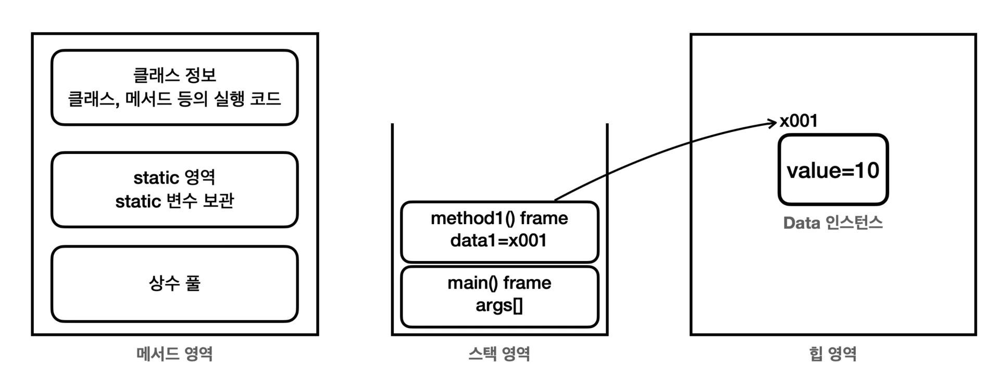

<details>
<summary><strong><code>메서드 영역</code></strong><strong> ( </strong><strong><code>Method Area</code></strong><strong> )</strong></summary>

- 메서드 영역은 프로그램을 실행하는데 필요한 공통 데이터를 관리한다&#46; <br>이 영역은 프로그램의 모든 영역에서 공유한다&#46; 
    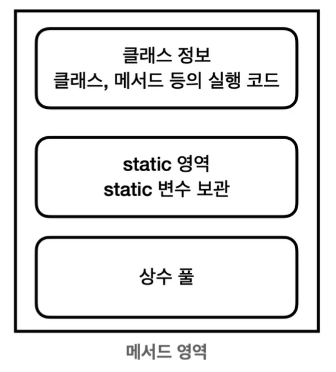

    - <code>클래스 정보</code>&#58; 클래스의 실행 코드(바이트 코드), 필드, 메서드와 생성자 코드 등 모든 실행 코드가 존재한다&#46; 

    - <code>static 영역</code>&#58; static 변수들을 보관한다&#46; 

    - <code>런타임 상수 풀</code>&#58;  프로그램을 실행하는데 필요한 공통 리터럴 상수를 보관한다&#46;

</details>

<details>
<summary><strong><code>스택 영역</code></strong><strong> ( </strong><strong><code>Stack Area</code></strong><strong> )</strong></summary>

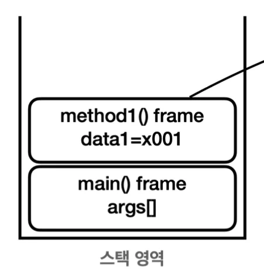

- 자바 실행 시, 하나의 실행 스택이 생성된다&#46; 각 스택 프레임은 지역 변수, 중간 연산 결과 메서드 호출 정보 등을 포함한다&#46;
    - <code>스택 프레임</code>&#58; 스택 영역에 쌓이는 네모 박스가 하나의 스택 프레임이다&#46; 메서드를 호출할 때마다 하나의 스택 프레임이 쌓이고, 메서드가 종료되면 해당 스택 프레임이 제거된다&#46; 

</details>

<details>
<summary><strong><code>힙 영역</code></strong><strong> ( </strong><strong><code>Heap Area</code></strong><strong> ) </strong></summary>

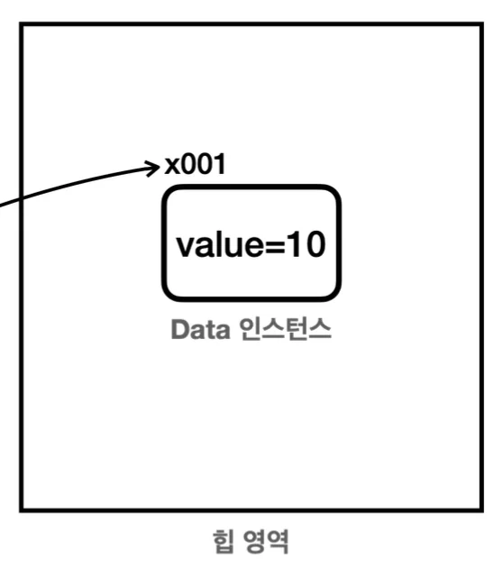

- 객체(인스턴스)와 배열이 생성되는 영역이다&#46; 

- 가비지 컬렉션(GC)이 이뤄지는 주요 영역이며, 더이상 참조되지 않는 객체는 GC에 의해 제거된다&#46; 

</details>

> ✏️ 
> 
> <a id="1c3eda9b0fe1816b86aec0a7437efedf"></a>
> 
> 스택 영역은<strong><u> 각 스레드 별로 하나의 실행 스택이 생성</u></strong>된다&#46; 따라서 <strong>스레드 수 만큼 스택이 생성</strong>된다&#46; <br>예시는 스레드를 1개만 사용하기 때문에, 스택도 하나이다&#46; <br>이후 스레드를 추가되면 스택도 스레드 수 만큼 증가한다&#46;

<a id="1c3eda9b0fe18196ba63c82102ec52e1"></a>

## 스레드 생성

---

> 📖 
> 
> <a id="1c3eda9b0fe18177a97df669de706b18"></a>
> 
> 스레드를 만들 때는 <strong><u>Thread  클래스</u></strong><strong>를 상속</strong> 받는 방법과 <strong><u>Runnable</u></strong><u> 인터페이스</u>를 구현하는 방법이 있다&#46; 

<a id="1c3eda9b0fe181fe9162c20be8b77677"></a>

### Thread 상속

---

> ✏️ 
> 
> <a id="1c3eda9b0fe18196a14bd85d9ab31734"></a>
> 
> 자바는 많은 것을 객체로 다룬다&#46; 자바가 예외를 객체로 다루듯이, <strong><u>스레드도 객체로 다룬다&#46; </u></strong>
> 
> <a id="1c3eda9b0fe181e79818d8f0b3b99a29"></a>
> 
> <strong><u>스레드가 필요</u></strong>하면,<strong> </strong><strong><u>스레드 객체를 생성해서 사용</u></strong>하면 된다&#46; 

<details>
<summary><code>Thread</code> 클래스 생성 및 사용</summary>

<details>
<summary>&#91; 코드 &#93; HelloThead </summary>

<a id="1c3eda9b0fe1818780bff671408f9d1b"></a>

```java
 package thread.start;
 
 public class HelloThread extends Thread {
 
		 @Override
		 public void run() {
				  System.out.println(Thread.currentThread().getName() + ": run()");
		 }
 }
```

- <strong><u><code>Thread</code></u></strong><strong><u> 클래스를 </u></strong><strong><u>상속</u></strong>하고, <strong>스레드가 </strong><strong><u>실행할 코드</u></strong>를 <strong><code>run()</code></strong> 메서드에 <u>재정의 ( 오버라이딩)</u>  한다&#46; 

- <strong><code>Thread&#46;currentThread()</code></strong>를 호출하면 <u>해당 코드를 실행</u>하는 <strong><u>스레드 객체를 조회</u></strong>할 수 있다&#46; 

- <strong><code>Thread&#46;currentThread()&#46;getName()</code></strong>&#58; <strong><u>실행 중인 스레드의 이름을 조회</u></strong>한다&#46; 

</details>

<details>
<summary>&#91; 코드 &#93; HelloThreadMain</summary>

> ☝🏻 
> 
> <a id="1c3eda9b0fe1814e88c5fe0083c90532"></a>
> 
> <code>run()</code> 메서드가 아닌, 반드시 <code>start()</code> 메서드를 호출해야 한다&#46; 
> 
> <a id="1c3eda9b0fe181f2bd73e14a39956ffb"></a>
> 
> 그래야 별도의 스레드에서 <code>run()</code> 코드가 실행된다&#46; 

<a id="1c3eda9b0fe1818298d0cef9469d5505"></a>

```java
package thread.start;

public class HelloThreadMain {
    public static void main(String[] args) {
        System.out.println(Thread.currentThread().getName() + ": main() start");

        HelloThread helloThread = new HelloThread();
        System.out.println(Thread.currentThread().getName() + ": start() 호출 전");

        helloThread.start();
        System.out.println(Thread.currentThread().getName() + ": start() 호출 후");

        System.out.println(Thread.currentThread().getName() + ": main() end");
    }
}
```

- 앞서 만든 <code>HelloThread</code> 스레드 객체를 생성하고 <code>start()</code> 메서드를 호출한다&#46; 

- <code>start()</code>메서드는 스레드를 실행하는 아주 특별한 메서드이다&#46; 

- <code>start()</code>를 호출하면 <code>HelloThead</code>스레드가 <code>run()</code> 메서드를 실행한다&#46; 

- 실행 결과
    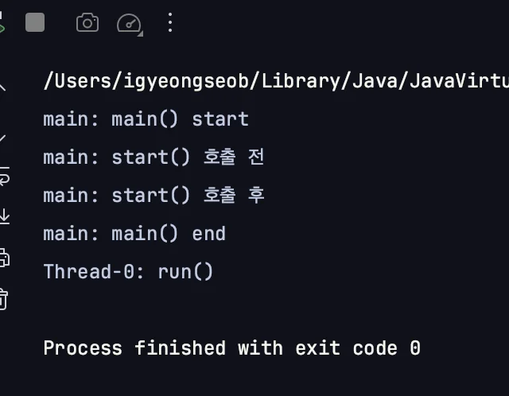

    - 실행 결과는 스레드 실행 순서에 따라 약간 다를 수 있다&#46; 

</details>

</details>

<details>
<summary>스레드 동작 설명</summary>

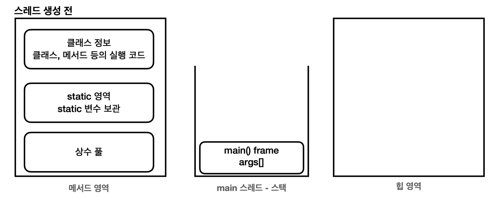

<a id="1c3eda9b0fe181928479caf15b78c06f"></a>

실행 결과를 보면 <code>main()</code> 메서드는 main 스레드에서 실행된다&#46; 

<a id="1c3eda9b0fe1817ea248e306e2b5b1f3"></a>

프로세스가 동작하려면 스레드가 최소한 하나는 있어야 한다&#46; 그래야 코드를 실행할 수 있다&#46; 

<a id="1c3eda9b0fe1819bb99af96770947d2f"></a>

자바는 실행 시점에 <code>main</code>이라는 이름의 스레드를 만들고 프로그램의 시작점인 <code>main()</code> 메서드를 실행한다&#46;

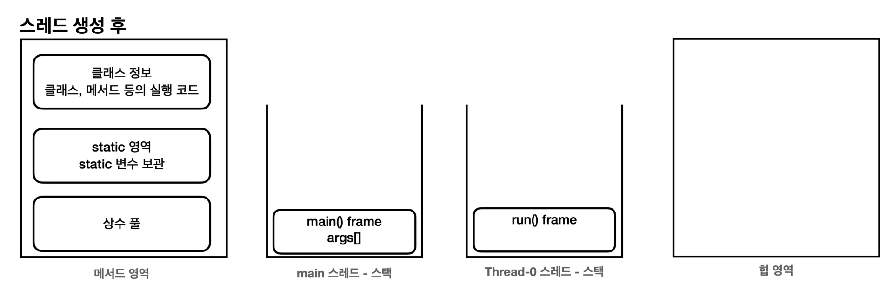

<a id="1c3eda9b0fe1812eb6dec6de8ee69bee"></a>

<strong><code>HelloThread</code></strong> 스레드 객체를 생성한 다음 <strong><u><code>start()</code></u></strong><u> 메서드를 호출</u>하면 자바는 새로 생성되는 스레드를 위한 <strong><u>별도의 스택 공간을 할당</u></strong>한다&#46; 

<a id="1c3eda9b0fe18154b829d84931de11af"></a>

위 그림과 같이 새로운 <strong><code>Thead&#45;0</code></strong> 스레드가 사용할 전용 스택 공간이 생성되며, <strong><code>run()</code></strong> 메서드의 스택 프레임을 해당 스택에 올리면서 <strong><code>run()</code></strong>메서드를 시작한다&#46; 

- 스레드 객체 생성 후, 반드시<u> </u><u><code>start()</code></u><u>  메서드를 호출</u>해야 <strong><u>새로운 스택 공간을 할당</u></strong> 받고 <strong><u>새로 생성된 스레드에서 동작</u></strong>한다&#46;
    <details>
    <summary>🧐 <code>start()</code> 가 아닌 <code>run()</code>으로 실행하는 경우</summary>

    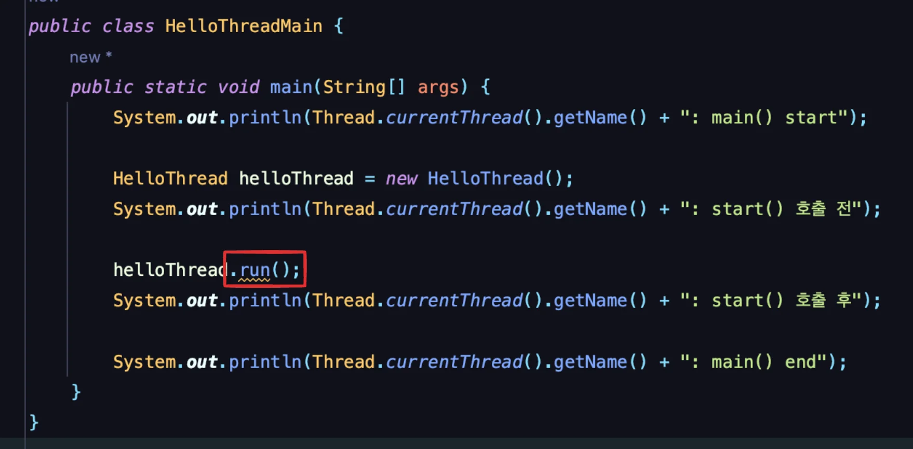

    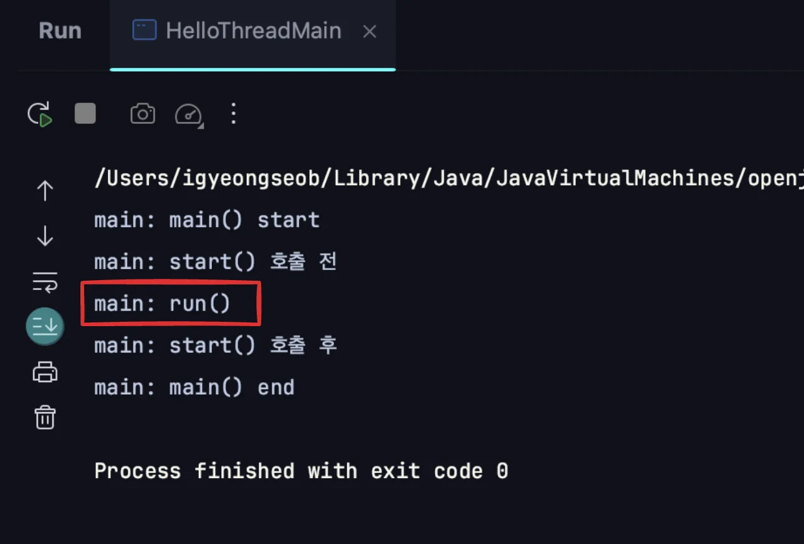

    - 위와 같이 새로 스레드가 생성되지 않고 <strong><u>기존의 main 스레드에서 처리</u></strong>되는 것을 확인할 수 있다&#46;

    </details>

- 스레드에 이름을 부여하지 않으면, <strong><code>Thread&#45;0</code></strong>,<strong> </strong><strong><code>Thread&#45;1</code></strong><strong>과</strong> 같은 임의의 이름을 부여한다&#46; 

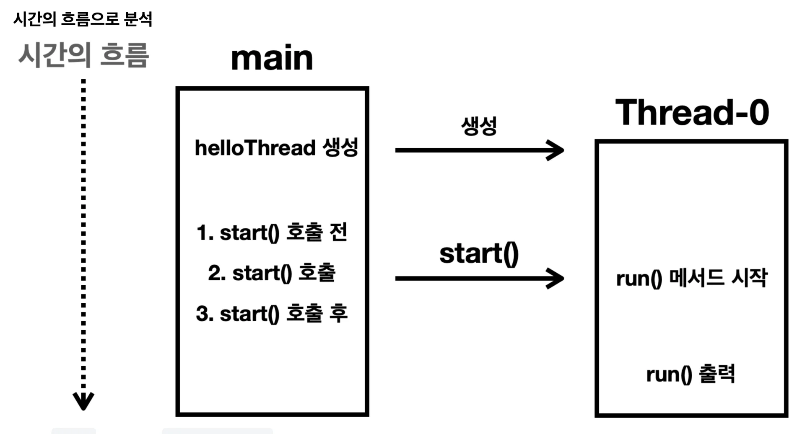

1. main 스레드가 <code>HelloThread</code> 인스턴스를 생성한다&#46; 이때 스레드에 이름을 부여하지 않으면 자바가 <code>Thread&#45;0</code>, <code>Thread&#45;1</code> 과 같은 임의의 이름을 부여한다&#46; 

1. <strong><code>start()</code></strong><strong> </strong>메서드를 호출하면, <strong><code>Thead&#45;0</code></strong> 스레드가 시작되면서 <strong><code>Thead&#45;0</code></strong><strong> </strong>스레드가 <strong><code>run()</code></strong> 메서드를 호출한다&#46; 
    - <code>main</code> 스레드가 아닌 <strong><code>Thead&#45;0</code></strong> 스레드가 <strong><code>run()</code></strong> 메서드를 실행한다&#46; 

    - <code>main</code> 스레드는 단지 <code>start()</code> 메서드를 통해 <code>Thead&#45;0</code> 스레드에게 실행을 지시할 뿐이다&#46; 따라서 다른 스레드(<code>Thead&#45;0</code>)에게 일을 시작하라고 지시만하고, 바로 <code>start()</code> 메서드를 빠져나온다&#46; 

1. main 스레드와 <code>Thead&#45;0</code> 스레드는 동시에 실행된다&#46; 

1. 1, 2, 3 번 코드는 <strong><code>main</code></strong> 스레드에서 <strong><u>멈추지 않고 계속 수행</u></strong><strong> </strong>되며<br><strong><code>run()</code></strong> 메서드는 <strong><code>Thead&#45;0</code></strong> 스레드에서 <strong><u>병렬로 실행</u></strong>된다&#46; 

> ☝🏻 
> 
> <a id="1c3eda9b0fe181c7be1af5e9a07d3876"></a>
> 
> <strong>스레드 간 실행 순서는 보장하지 않는다&#46; </strong>
> 
> - 스레드는 동시에 실행되기 때문에 스레드 간에 실행 순서는 얼마든지 달리질 수 있다&#46; 
>     <details>
>     <summary>ex) <code>main</code> 스레드가 빨리 실행된 경우</summary>
> 
>     <a id="1c3eda9b0fe181c0a98cf9f54f315df7"></a>
> 
>     ```plaintext
>     main: main() start 
>     main: start() 호출 전
>     main: start() 호출 후
>     main: main() end
>     Thread-0: run()
>     ```
> 
>     - <code>main</code> 스레드가 모든 로직을 다 수행한 다음에 <code>Thread&#45;0</code>가 수행된다&#46; 
> 
>     </details>
> 
>     <details>
>     <summary>ex) <code>Thread&#45;0</code>스레드가 빨리 실행된 경우</summary>
> 
>     <a id="1c3eda9b0fe18114a678c1981d103f39"></a>
> 
>     ```plaintext
>     main: main() start 
>     main: start() 호출 전
>     Thread-0: run()
>     main: start() 호출 후
>     main: main() end
>     ```
> 
>     - <code>Thread&#45;0</code> <code> start()</code>이후 <code>Thread&#45;0</code>가 먼저 수행되고, <code>main</code>이 수행된다
> 
>     </details>
> 
>     <details>
>     <summary>ex) <code>main</code> 스레드 실행 중간에 <code>Thread&#45;0</code> 스레드가 실행된 경우</summary>
> 
>     <a id="1c3eda9b0fe181d69810e9e51b1639b7"></a>
> 
>     ```plaintext
>     main: main() start 
>     main: start() 호출 전
>     main: start() 호출 후
>     Thread-0: run()
>     main: main() end
>     ```
> 
>     - <code>main</code> 스레드가 “start() 호출 후”를 출력한 다음에 <code>Thead&#45;0</code>스레드 <code>run()</code>을 출력한다&#46; 
> 
>     </details>

<a id="1c3eda9b0fe1817ba8d1fbfd7246c921"></a>

스레드 간의 실행 순서는 얼마든지 달라질 수 있다&#46; 

- CPU 코어가 2개 이상인 경우, 물리적으로 동시에 실행될 수 있다 ( 멀티프로세싱)

- CPU 코어가 1개인 경우,  하나의 CPU 코어에 시간을 나누어 실행될 수 도 있다&#46;  ( 멀티태스킹 )

<a id="1c3eda9b0fe181bca36ae8df4c7a62a9"></a>

한 스레드가 얼마나 오랜 기간 실행되는지도 보장하지 않는다&#46; 

<a id="1c3eda9b0fe181f8a399ffada7ca698a"></a>

한 스레드가 먼저 다 수행된 다음에 다른 스레드가 수행될 수 있고, 둘이 완전히 번갈아 가면서 수행되는 경우도 있다&#46; 

<a id="1c3eda9b0fe1815d9315d44628a64907"></a>

이렇게 스레드의 순서와 실행 기간을 모두 보장하지 않는 것이 <code>멀티스레드</code>이다&#46;  

</details>

<a id="1c3eda9b0fe1819db967e028bf829a22"></a>

### <code>Start()</code> vs <code>run()</code>

> /icons/checkmark-line_lightgray.svg 
> 
> <a id="1c3eda9b0fe181e49306e6c22d18a11f"></a>
> 
> <code>start()</code> 대신 재정의한 <code>run()</code> 메서드를 직접 호출

<details>
<summary>&#91; 코드  &#93;  BadThreadMain ( <code>run()</code> )</summary>

<a id="1c3eda9b0fe1817b8150e1e255debb70"></a>

```java
package thread.start;

public class BadThreadMain {

    public static void main(String[] args) {
        System.out.println(Thread.currentThread().getName() + ": main() start");

        HelloThread helloThread = new HelloThread();
        System.out.println(Thread.currentThread().getName() + ": start() 호출 전");

        helloThread.run();
        System.out.println(Thread.currentThread().getName() + ": start() 호출 후");

        System.out.println(Thread.currentThread().getName() + ": main() end");
    }
}

```

- 실행 결과
    <a id="1c3eda9b0fe181a3953bc0e8810990db"></a>

    ```plaintext
    main: main() start 
    main: run() 호출 전 
    main: run()
    main: run() 호출 후 
    main: main() end
    ```

</details>

<details>
<summary>동작 설명</summary>

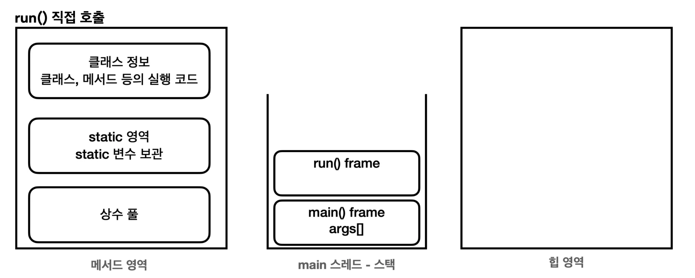

<a id="1c3eda9b0fe181bf811feef704ea3564"></a>

별도의 스레드가 아닌, <code>main</code> 스레드에서 <code>run()</code> 메서드를 호출한다&#46; 

1. 자바를 처음 실행하면 main 스레드가 main() 메서드를 호출하면서 시작한다&#46; 

1. main 스레드는 HelloThread 인스턴스에 있는 run() 메서드를 호출한다&#46; 

1. main 스레드가 run() 메서드를 실행했기 때문에 main 스레드가 사용하는 스택 위에 run() 스택 프레임이 올라간다&#46; 

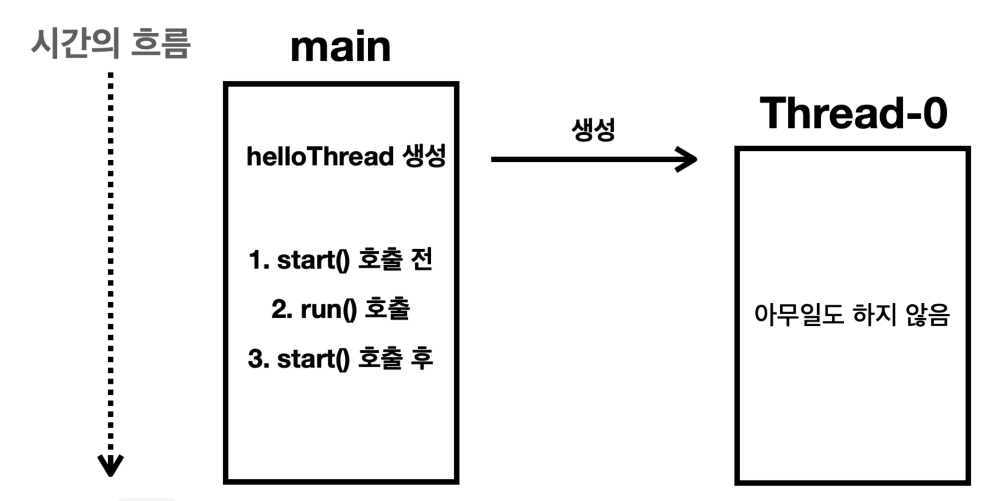

<a id="1c3eda9b0fe181aaba7bc6ab062b185a"></a>

main 스레드에서 모든 것을 처리한다&#46; 

- <code>Thread&#45;0</code> 스레드에서는 아무 동작이 일어나지 않는다&#46; 

> ✏️ 
> 
> <a id="1c3eda9b0fe1813aa166eb71fd2dd96b"></a>
> 
> 스레드의 <code>start()</code> 메서드는 <strong><u>스레드에 스택 공간을 할당하면서 스레드를 시작</u></strong>하는 아주 특별한 메서드이다&#46; 그리고 해당 스레드에서  <code>run()</code> 메서드를 실행한다&#46;
> 
> <a id="1c3eda9b0fe181b6a53df6a08a0eaeb7"></a>
> 
> 따라서 main 스레드가 아닌 <strong><u>별로의 스레드</u></strong><strong><u>에서 재정의한 </u></strong><strong><u><code>run() </code></u></strong><strong><u>메서드를 실행</u></strong>하려면, <strong>반드시 </strong><strong><code>start()</code></strong><strong> 메서드를 호출</strong>해야 한다&#46; 

</details>
