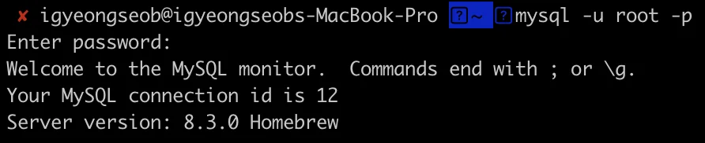

Reference

<a href="https://passing-story.tistory.com/entry/MySQL-mysql%EB%A1%9C%EA%B7%B8%EC%9D%B8-%EC%98%A4%EB%A5%98-mysql-%EB%B9%84%EB%B0%80%EB%B2%88%ED%98%B8-%EC%9E%AC%EC%84%A4%EC%A0%95">https&#58;//passing&#45;story&#46;tistory&#46;com/entry/MySQL&#45;mysql로그인&#45;오류&#45;mysql&#45;비밀번호&#45;재설정</a>

<a href="https://velog.io/@security_code/ERROR-1045-28000-Access-denied-for-user-rootlocalhost-using-password-YES">https&#58;//velog&#46;io/&#64;security&#95;code/ERROR&#45;1045&#45;28000&#45;Access&#45;denied&#45;for&#45;user&#45;rootlocalhost&#45;using&#45;password&#45;YES</a> <a href="https://velog.io/@taelee/mysql-user%ED%99%95%EC%9D%B8-%EB%B0%8F-%EC%B6%94%EA%B0%80">https&#58;//velog&#46;io/&#64;taelee/mysql&#45;user확인&#45;및&#45;추가</a>

<a href="https://vkein.tistory.com/entry/MySQL-%EC%A0%91%EC%86%8D-%EB%AA%85%EB%A0%B9%EC%96%B4">https&#58;//vkein&#46;tistory&#46;com/entry/MySQL&#45;접속&#45;명령어</a>

### 오류

> ⚠️ <strong>ERROR 1045 (28000)&#58; Access denied for user &#39;root&#39;&#64;&#39;localhost&#39; (using password&#58; YES)</strong>
> 
> > <strong>root의 비번이 설정되지 않</strong>아 발생되는 오류이다&#46; 

<code>mysql &#45;u root &#45;p</code> 입력 후, 비밀번호 없이 접속(<code>Enter</code>) 시 정상 접속된다&#46; 

### 비밀번호 설정하기
