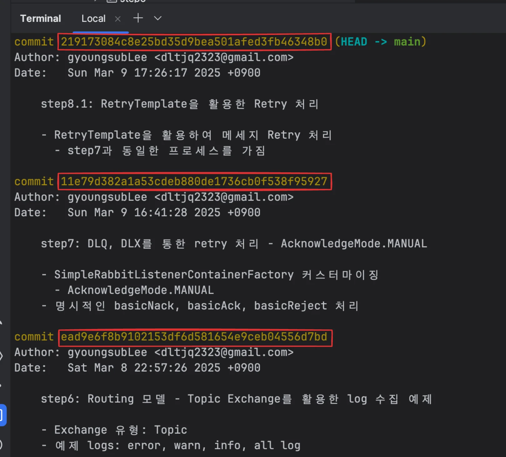
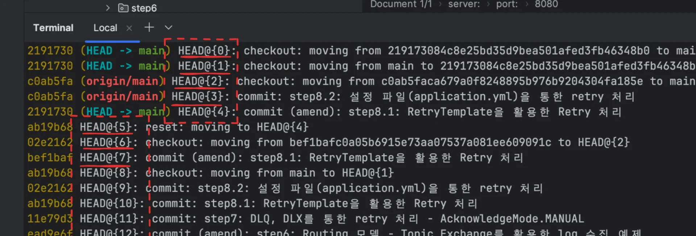

<a id="1c3eda9b0fe181bc9c77f6f325598b4f"></a>

‣

<a id="1c3eda9b0fe1816fb966ed25d131baba"></a>

### 이전 버전(commit) 보고 돌아오기

---

<details>
<summary>1&#46; git commit 내역 조회</summary>

<a id="1c3eda9b0fe181d69f65f0f80f5e89b8"></a>

```bash
# ID 조회
git log
```



<a id="1c3eda9b0fe18176bb17e0478a0275d0"></a>

```bash
# 'HEAD 번호'로 조회
git reflog 
```



- git 작업 내역을 HEAD 번호로 조회 가능

</details>

<details>
<summary>2&#46; 특정 commit으로 전환(checkout)</summary>

<a id="1c3eda9b0fe181b5ba06d0527a577b13"></a>

```bash
# 특정 커밋으로 checkout
git checkout [commit_ID] 또는 [commit HEAD]
```

</details>

<details>
<summary>3&#46; 되돌아가기</summary>

<a id="1c3eda9b0fe1811e9a05e10d135d4add"></a>

```bash
# 해당 브랜치의 최신 커밋으로 돌리기
git checkout 브랜치 이름

# main
git checkout -B main
# git push origin main --force

# 단계별로 되돌아가기
git checkout head~1
  # - 최신 커밋으로부터 한단계 전으로 되돌린다.
  # - 1에 해당하는 부분을 바꿔서 원하는 단계만큼 지정할 수 있다
```

</details>

<a id="1c3eda9b0fe181f49a1ce8f9ce168fb4"></a>

### 이전 버전으로 되돌리기

---

- 되돌리는 버전을 새로 커밋 &#91; 권장 &#93;
    <a id="1c3eda9b0fe181998d14db800219a5a9"></a>

    ```bash
    git revert head~1

    git revert 커밋해시코드
    ```

- 되돌리는 버전 이후의 커밋을 삭제하기(권장 ❌)
    <a id="1c3eda9b0fe181d0901beb3f01179fd0"></a>

    ```bash
    git reset --hard head~1

    git reset --hard 커밋해시코드
    ```
