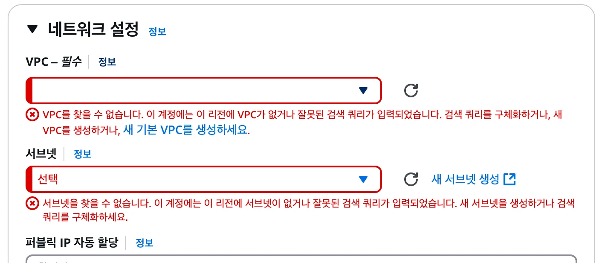
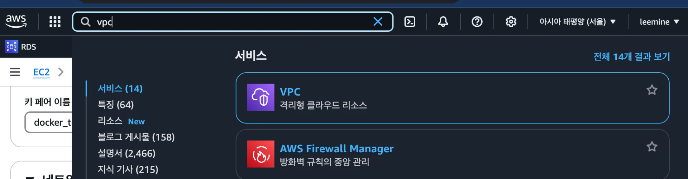
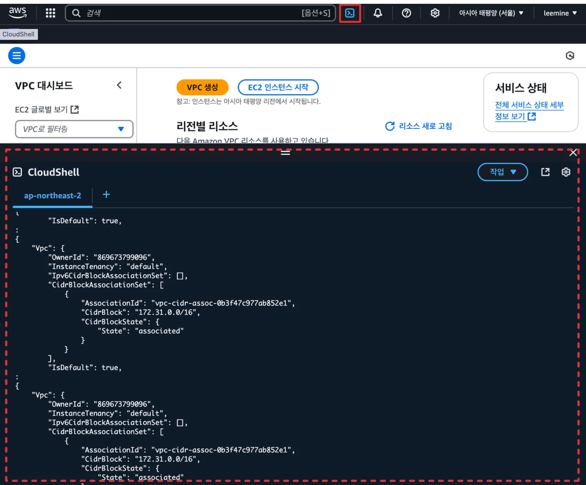
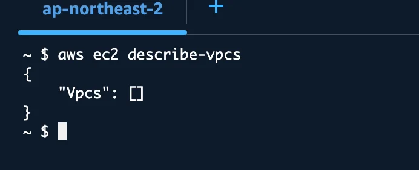
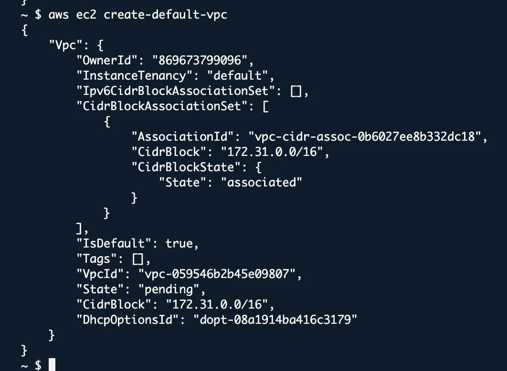
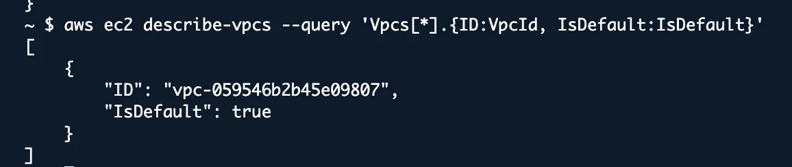
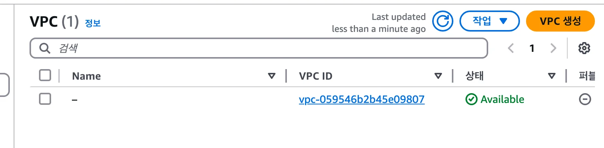
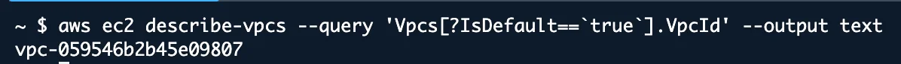
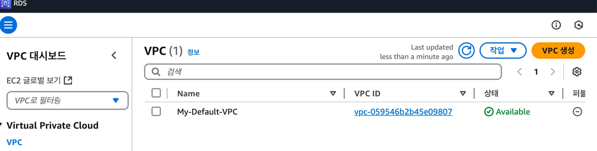

<a id="1c3eda9b0fe181f39c42cc2092d50b14"></a>

## &#91; 오류 &#93; VPC 기본 설정  존재하지 않음

---

<a id="1c3eda9b0fe181efbfc3dfcb94e49d51"></a>

EC2 생성 중 VPC를 설정하는데 있어서, 기본 VPC 설정이 존재하지 않음

<a id="1c3eda9b0fe1811db847f5e0939149cf"></a>

### 오류



<a id="1c3eda9b0fe181c7856bfbc83c141c34"></a>

기본 VPC 생성이 필요함

<a id="1c3eda9b0fe181359d08d07128b8a9f1"></a>

### 해결 &#45; 기본 VPC 생성

---

- VPC
    

- 콘솔창 열기
    

- 기본 VPC 조회
    <a id="1c3eda9b0fe181329ce3cc32ea4af45f"></a>

    ```shell
    aws ec2 describe-vpcs
    ```

    - <code>“Vpcs”&#58; &#91;&#93;</code>&#58;  VPC가 존재하지 않음
        

- 기본 VPC가 존재하지 않을 경우, 다시 생성
    <a id="1c3eda9b0fe1812da9a6e29e8132b12e"></a>

    ```shell
    aws ec2 create-default-vpc
    ```

    

- 기본 VPC가 정상적으로 생성되었는지 확인
    <a id="1c3eda9b0fe181448a08f92307fdc6d2"></a>

    ```shell
    aws ec2 describe-vpcs --query 'Vpcs[*].{ID:VpcId, IsDefault:IsDefault}'
    ```

    

<a id="1c3eda9b0fe181cd9a2ef0c34e4c1ac2"></a>

### 추가 &#45; VPC 이름 변경

---



<a id="1c3eda9b0fe181d5bf61f4435b557035"></a>

cli 로 생성한 vpc 이름이 <code>&#45;</code> 로 설정됨

<a id="1c3eda9b0fe18132a2d3d333b8fa313d"></a>

따라서 해당 부분을 수정을 진행함

- <strong>기본 VPC ID 확인</strong>
    <a id="1c3eda9b0fe18139bf21f98ad5261bb0"></a>

    ```shell
    aws ec2 describe-vpcs --query 'Vpcs[?IsDefault==`true`].VpcId' --output text
    ```

    

-  <strong>태그 업데이트 (이름 변경)</strong>
    <a id="1c3eda9b0fe181f2b939f35fe900711a"></a>

    ```shell
    aws ec2 create-tags --resources [VPC ID] --tags Key=Name,Value="My-Default-VPC"
    ```

    

    <a id="1c3eda9b0fe18122adaac294fb9177a6"></a>

    정상적으로 이름이 수정된 것을 확인할 수 있음
