> 👉🏻 Reference)<a href="https://online.spartacodingclub.kr/enrolleds/62005d3aee0e206491269e43/edetails/62005d3aee0e206491269e44?course_id=606bfa74c11b70df6da82cfd"> </a><a href="https://online.spartacodingclub.kr/enrolleds/62005d3aee0e206491269e10/rounds/606bfb39c11b70df6da82d54/roadmap">스파르타 코딩 클럽</a>

- 기간&#58; 23&#46;10&#46;01(일) &#126;23&#46;10&#46;03(화)

- 설정이 너무 추상적인 관계로 진행을 중단함

- &#91;인프런&#93; 김영한 &#45; 자바 시리즈 참<br>

<a id="1c3eda9b0fe181acab55cc2240e660ac"></a>

<br><br>

[생성자 ( Constructor )](#/post/1c3eda9b-0fe1-81c4-8d7d-ecfafbbc02bf)

[12.  스트림(stream())](#/post/1c3eda9b-0fe1-8137-ad7e-fa366cb44628)

[클래스의 메소드 참조( :: ), "System.out::println"](#/post/1c3eda9b-0fe1-816a-b449-d277bad3e7e6)

[Collection 을 복사하는 여러 방법(stream)](#/post/1c3eda9b-0fe1-8198-b701-fc2f42a97f3f)

[Stream → List 변환[.collect(Collectors.toList()) vs Stream.toList()]](#/post/1c3eda9b-0fe1-816e-859a-e7c5e8e433f0)

[ArrayList , List 차이?](#/post/1c3eda9b-0fe1-81e2-8ff4-eb6fe679e475)

<a id="1c3eda9b0fe18106b988f428d1a5c3f2"></a>

### 1) Hello worrld

<a id="1c3eda9b0fe1817792e2d8efe51661aa"></a>

자바 언어는 항상 main 함수 부터 실행됨&#46;(class 이름은 달라도 됨)

<a id="1c3eda9b0fe18115ac0befc41c3a12fa"></a>

```java
public class Main {
	public static void main(String[ args) {
		System.out.println("Hello World");
}
```

<a id="1c3eda9b0fe18142a596cbecf1b93c90"></a>

# 2) 변수, 상수

<a id="1c3eda9b0fe18124aec6c5ea60b099a8"></a>

변수&#58; 어떠한 데이터를 저장하기 위한 메모리 공간의 이름, 재할당 가능

<a id="1c3eda9b0fe181e0b0aed01c06443f11"></a>

상수&#58; 변하지 않는 값, 재할당 불가능

- 변수 &#91; 접근제어자 &#93; &#91;데이터타입&#93; &#91;변수&#93; = &#91; 값(value) &#93;

<a id="1c3eda9b0fe181f0a346cd0d3fc76503"></a>

```html
public class Main {
    public static void main(String[] args) { // write your code here
				int num;           // 숫자형 변수 선언 
        num = 5;
        System.out.println(num);   // 5

				// 문자형
				String sparta = "Hello Sparta!"  // 문자형 변수 선언
			  System.out.println(sparta);      // Hello Sparta
				
				sparta = "Goodbye Sparta"        // 재할당
				System.out.println(sparta);      // Goodbye Sparta
    }
} 
```

- 상수 &#91; final &#93; &#91; 데이터타입 &#93; &#91; 변수 &#93; = &#91; 값(value) &#93;

<a id="1c3eda9b0fe1818c8a69d63d00a53662"></a>

```java
public class Main {
    public static void main(String[] args) {
        final int num2 = 10; // (final )
        System.out.println(num2);
        num2 = 50;  // Error: 재할당 불가(java: cannot assign a value to final variable)
    }
}
```

> /icons/bell_gray.svg 에러는 여러가지 종류가 있는데, 그 중 프로그래밍 언어의 문법적으로 불가능한 코드를 작성한 경우 발생되는 에러는 <strong>컴파일에러(compile error) </strong>라고 한다&#46;( 컴파일 에러는 프로그램 실행 전에 알고 고칠 수 있다&#46; , 빨간색으로 표시)

<a id="1c3eda9b0fe181569362cba77ed6fff1"></a>

# 3) 자료형

<a id="1c3eda9b0fe181f28196c7f10c585056"></a>

## 기본 자료형(Primitive Type)

<a id="1c3eda9b0fe1817295b6e64ec386b5f5"></a>

## <strong>1) </strong><strong><a href="https://staticclass.tistory.com/15">숫자</a></strong>

> /icons/bell_gray.svg <code>byte</code>, <code>short</code>, <code>int</code>, <code>long</code>, <code>float</code>, <code>double </code>

- 예문)

<a id="1c3eda9b0fe181f48702e003cae8d44d"></a>

```java
short s = 1;
System.out.println(s);

int a = 3; // 정수형 변수 선언
 System.out.println(a);  // 3

long b = 1234567890L; // Long 정수형 변수 선언
 System.out.println(b);

float c = 5.5F; // float 실수형 변수 선언
 System.out.println(c);

double d = 9.12345678901234567890d; // double 실수형 변수 선언
System.out.println(d);
```

> byte&#58; 모든 기본 데이터 타입,  문자(아스키코드) byte로 표현 가능함&#46;
> 
> <a id="1c3eda9b0fe18182913ec52533c1fef8"></a>
> 
> ```java
> // ex)
> byte data = ‘d’ 
> System.out.println(data);   // 100 (아스키 코드)
> ```

<a id="1c3eda9b0fe181b5a313e424d7c32021"></a>

### 1&#45;1)정수형 

- byte &#45; short &#45; int &#45; long 관계

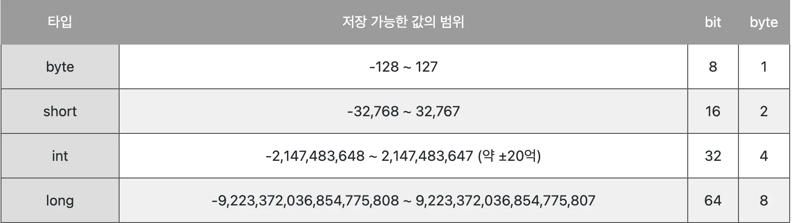

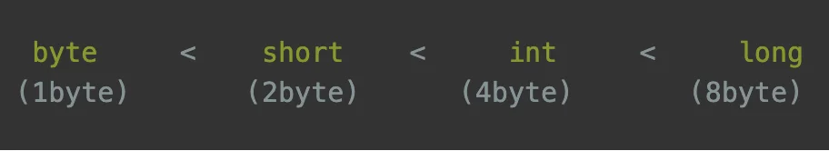

> 2배씩 증가, 1byte = 8bits

> ● 정수형 선택 기준<br><strong>byte </strong>와 <strong>short </strong>는메모리 절약이 가능하지만,  범위가 작아 연산시 범위를 넘어가 잘못된 결과를 얻기가 쉽다&#46;<br>따라서 정수형 변수 선언 시, 보통 <strong>int 타입</strong>을 사용, <code>약 </code><strong><code>±20억</code></strong>이 넘어갈 시 <strong>long 타입</strong> 사용

<a id="1c3eda9b0fe181af93a8ef02518e65e9"></a>

### 1&#45;2) 실수형 (float, double)

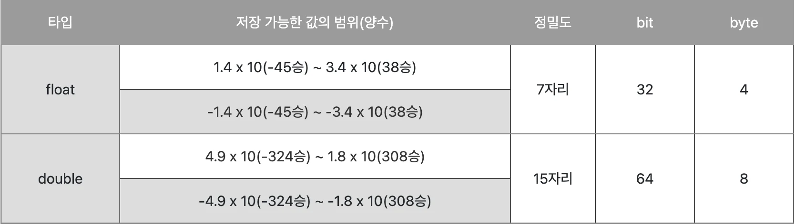

> ● 실수형 선택 기준<br>연산 속도 향상, 메모리 절약&#58; <code>float<br></code>더 큰 값의 범위(7자리 이상), 높은 정밀도&#58; <code>double</code>

<a id="1c3eda9b0fe181bdb199c2a6a36913e4"></a>

### 1&#45;3) 각 타입의 최소, 최대 값 출력

<a id="1c3eda9b0fe181d7a324e6dc8e82d53b"></a>

```java
System.out.println(Short.MIN_VALUE); // -32768
System.out.println(Integer.MAX_VALUE); // 2147483647
System.out.println(Integer.MIN_VALUE); // -2147483648
System.out.println(Long.MAX_VALUE); // 9223372036854775807
System.out.println(Long.MIN_VALUE); // -9223372036854775808
System.out.println(Float.MAX_VALUE); // 3.4028235E38
System.out.println(Float.MIN_VALUE); // 1.4E-45
System.out.println(Double.MAX_VALUE); // 1.7976931348623157E308
System.out.println(Double.MIN_VALUE); // 4.9E-324
```

<a id="1c3eda9b0fe181549e5dc23ffeb7b1f2"></a>

## 2) 문자 

> /icons/bell_gray.svg <code>char</code> 변수명 =  값;<br><code>String</code> 변수명 = 값;

<a id="1c3eda9b0fe18157b238f155e4c7feb2"></a>

```java
//ex)
char c = 'A'
System.out.println(c);   // A
```

<a id="1c3eda9b0fe181f58576e23df7ff2efe"></a>

## 3) 불리언(boolean)

> /icons/bell_gray.svg <code>boolean</code> 변수명 = 값

<a id="1c3eda9b0fe18114bf3dd7ab9bf9b406"></a>

```java
//ex)
boolean fact = true;
fact = false
System.out.println(fact);   // false
```

<a id="1c3eda9b0fe181f79f21f4aa05a477af"></a>

## 참조 자료형(Reference Type)

> 💡 기본형 자료형이 아닌 모든 것을 참조형 자료라고 한다&#46; <br>(참조형 자료 = 자바의 인스턴스를 가리킬 수 있는 자료형)

<a id="1c3eda9b0fe1814895e4fdad7cf0c306"></a>

## 1) 배열

<a id="1c3eda9b0fe1816693f0f0aff1549a85"></a>

<strong>배열</strong>&#58; <strong>동일한 자료형의 데이터를 연속된 공간에 저장</strong>하기 위한 자료구조

> /icons/bell_gray.svg <code>자료형&#91;&#93; 변수 = new 자료형 &#91; 배열의 크기 &#93;</code><br><br>배열은 선언과 동시에 크기를 지정 받는다&#46; 따라서 <strong>고정된 크기</strong>를 가진다&#46;<br>실제 실무에는 고정된 크기의 배열이 아닌 <code>ArrayList</code> 라는 <code>Collection</code><strong> </strong>을 쓴다&#46; 

<a id="1c3eda9b0fe181b1821ed9c37e8c16c9"></a>

```java
import java.util.Arrays;

public class Main {
    public static void main(String[] args) {
        int[] intEmptyArray = new int[5]; // int의 5자리 배열 선언
        System.out.println(Arrays.toString(intEmptyArray)); // [0, 0, 0, 0, 0]

        int[] intArray = new int[] {1,2,3,4,5}; // int 배열 선언, 초기화
        System.out.println(Arrays.toString(intArray));  // [1, 2, 3, 4, 5]

        String[] stringEmptyArray = new String[5]; // 참조자료형 String 5자리 배열 선언
        System.out.println(Arrays.toString(stringEmptyArray)); // [null, null, null, null, null]

        String[] months = {"1월","2월","3월","4월","5월","6월","7월","8월","9월","10월","11월","12월"};
        System.out.println(Arrays.toString(months)); // [1월, 2월, 3월, 4월, 5월, 6월, 7월, 8월, 9월, 10월, 11월, 12월]
    }
}
```

<a id="1c3eda9b0fe181e0b34be0996e00cbf2"></a>

```java
int[] scores = new int[4] // 베열 선언
scores[0] = 5; //인덱스를 통한 배열 값 할당
scores[1] = 10;
System.out.println(scores[1]) // 10

// 2차원 배열 선언
int[][]	arr = new int[4][3]
```

<a id="1c3eda9b0fe1811ea90ffb3375cde862"></a>

### quiz) 크기 3, 정수형 배열, 10, 20, 30

<a id="1c3eda9b0fe1811d87f4e6fd3fed44f8"></a>

```java
import java.util.Arrays;

public class Main {
    public static void main(String[] args) {
        int[] nums = new int[] {10,20,30}; // int[] nums = {10, 20, 30};
        System.out.println(nums);
    }
}
```

<a id="1c3eda9b0fe1813e99ead87635af8436"></a>

# 4) 연산자  

<a id="1c3eda9b0fe18175ab0af0dda5449c96"></a>

수식을 계산하거나 비교하는 것을 도와주는 기호들

<a id="1c3eda9b0fe1816086d3c61e9b434b2b"></a>

종류&#58; <strong>산술연산자, 대입연산자, 논리연산자, 관계연산자</strong>

<a id="1c3eda9b0fe18141b5c9e2d2e77fbca5"></a>

### 관계연산자

- <code>==</code>&#58; 두 값이 같은지,

- <code>&#33;=</code>&#58; 두 값이 다른지&#46;

<a id="1c3eda9b0fe18181a496d028acbd3667"></a>

```java
// ex)
int num1 = 10; 
int num2 = 20; 
int num3 = 10;
System.out.println(num1 > num2); // 10 > 20 
System.out.println(num1 >= num3); // 10 >= 10 
System.out.println(num1 < num2); // 10 < 20 
System.out.println(num1 <= num2); // 10 <= 20 
System.out.println(num1 == num3); // 10 == 10 
System.out.println(num1 != num2); // 10 != 20
```

<a id="1c3eda9b0fe181a28b42cb0e1de5bb74"></a>

### 논리연산자

- and 연산자 (<code>&#38;&#38;</code>)&#58;  두가지가 모두 참일 경우만 → <code>true</code>

- or 연산자 ( <code>&#124;&#124;</code>) &#58; 둘 중 하나만 참이여도  → <code>true</code>

<a id="1c3eda9b0fe1810588fbdd8c8dd673c8"></a>

```java
boolean a = true; 
boolean b = false;
System.out.println(a && b); // a,b 모두 = true -> return: true
System.out.println(a || b); // a,b 중 하나만 true여도 -> return: true
```

<a id="1c3eda9b0fe181ab8bade02856d62caf"></a>

### 비트연산자

<a id="1c3eda9b0fe18133b3caec01e5da1537"></a>

피연산자를 비트단위로 논리 연산, 피연산자를 이진수로 표현했을 때의 각 자리를 규칙에 따라 연산 수행

> reference)<br><a href="http://www.tcpschool.com/c/c_operator_bitwise">http&#58;//www&#46;tcpschool&#46;com/c/c&#95;operator&#95;bitwise<br></a><a href="https://en.wikipedia.org/wiki/Bitwise_operation">https&#58;//en&#46;wikipedia&#46;org/wiki/Bitwise&#95;operation</a>

<a id="1c3eda9b0fe181eebe9bf9b4a1ee61ef"></a>

# 5)조건문

<a id="1c3eda9b0fe18104ae53d9f7711a9fe5"></a>

### if 문 (<code>if</code>&#126;<code>else if</code>)

<a id="1c3eda9b0fe1812a8af4e7af2b2fd9c0"></a>

```java
int num1 = 100;
int num2 = 150;

if (num1 > num2) {
	 . . .
} else {
   . . .
}
```

<a id="1c3eda9b0fe181829aa4c27e2a3ae977"></a>

### switch 문

<a id="1c3eda9b0fe18108abc9cd3aeb0d5e22"></a>

```java
switch(입력 변수) {
	case value1: 실행 구문
		break;
	case value2: 실행 구문
		break;
	case value3: 실행 구문
		break;
	case value4: 실행 구문
		break;
}
```

<a id="1c3eda9b0fe181119e35d4e471bf7c35"></a>

### 삼항연산자 ( <code>조건 ? truthy &#58; falsy</code> ) 

<a id="1c3eda9b0fe181c59037ca01d315ed69"></a>

```java
int a = 5;

String result = (a < 10) ? "10보다 작습니다." : "10보다 큽니다."
System.out.println(result);  // "10보다 작습니다."
```

<a id="1c3eda9b0fe18123ba9ac5c0cb170810"></a>

# 6) 반목문

<a id="1c3eda9b0fe181168fccd4b3172c4839"></a>

## for 문

<a id="1c3eda9b0fe1819c8bbfc4224a52aa05"></a>

for( <code>초기값; 조건식; 증감식</code>) {<br>	실행 코드 블럭<br>}

<a id="1c3eda9b0fe1811ba407ff756f333f80"></a>

```java
// ex)
int sum = 0;

for ( int i = 0; i < 10; i++) {
	sum += (i + 1);
}
System.out.println(sum);  // 55
```

<a id="1c3eda9b0fe1812b9c48ee09c7eccdc7"></a>

## for &#45; each 문

<a id="1c3eda9b0fe181b0b0ccdd160dcc704b"></a>

배열, Collection 등에 사용 가능

<a id="1c3eda9b0fe181b2b190f433c999aff1"></a>

```java
String[] days = {"Monday", "Tuesday", "Wednesday", "Thursday", "Friday", "Saturday", "Sunday"};

for (String day : days) { 
	System.out.println(day);
}
```

<a id="1c3eda9b0fe181f7b5d3eb6728520dfe"></a>

## while 문

<a id="1c3eda9b0fe181cbb1c6dd0479cf086b"></a>

while ( 조건식 ) {

<a id="1c3eda9b0fe181689cdbd0fbcd275f40"></a>

실행 코드 블럭

<a id="1c3eda9b0fe181d7bfb7d80120ebbd35"></a>

}

<a id="1c3eda9b0fe181bc9c9edfc5ec85dd83"></a>

```java
// ex1)
int i = 0;
int sum = 0; 
while (i < 10) {
	sum += i + 1;
	i += 1; 
}
System.out.println(sum);

// ex2)
int i = 0; 
while (i < 10){
	if (i==5){
		break;
	}
	i += 1; 
}
System.out.println(i);
```

<a id="1c3eda9b0fe18142a658e3b1a7be84a0"></a>

### break

<a id="1c3eda9b0fe1814a9c66d1b179b52075"></a>

### continue 

<a id="1c3eda9b0fe1810b8d4bcaf7407fd9e7"></a>

continue 를 만날 시, 해당 반복 회차?를 바로 종료하다 다음 회차로 넘어감&#46;

<a id="1c3eda9b0fe1815dae7bf5e129677627"></a>

```java
for(int i=0;i<10;i++){ 
	if (i==5){
		continue; 
	}
	System.out.println(i); 
}

// 1, 2, 3, 4, 6, 7, 8, 9
```

<a id="1c3eda9b0fe18170a349f023df489637"></a>

## do &#45; while 문

<a id="1c3eda9b0fe18114a00dced87d17790a"></a>

while은 문은 조건식에 부합할 경우 코드 블럭을 실행하지만, 

<a id="1c3eda9b0fe1819fb7b0d5c538a9ee2d"></a>

do&#45;while문은 일단 코드 블럭을 <strong>무조건 한번 실행 후</strong>, while문의 조건과 비교한다&#46;

<a id="1c3eda9b0fe1811790b7da1b31ced7c2"></a>

```java
int i = 1;
int result = 0; 

do {
	result += i;
	i += 1;
} while (i < 2);

System.out.println(result);  // 1

// 무조건 한번 실행되기 때문에, do 블록 내부의 실행문이 한번 실행 후 while 조건을 판별하여 반복 여부 결정
```

<a id="1c3eda9b0fe181cbb283c724925bc226"></a>

# <code>&#43;)</code> <a href="https://mangkyu.tistory.com/47">Static</a>

<a id="1c3eda9b0fe1813b9c37c4adee651eaa"></a>

Java에서 <code>static</code> 키워드 는 <strong>메모리에 할당</strong>하여 <strong>프로그램이 종료될 때, 해제</strong>된다&#46;


<a id="1c3eda9b0fe1818ea06ff8e37eccbf0a"></a>

<strong>일반적으로 작성한 객체(Class) 는 Static 영역에 생성</strong>되고,<strong> new 연산을 통해 생성한 인스턴스는 Heap영역에 생성</strong>된다&#46; 인스턴스 생성 시, <strong>할당된 Heap 영역의 메모리</strong>는 <strong><u>Garbage Collector</u></strong><strong>를 통해 수시로 관리 받</strong>는다&#46; <strong><u>그러나 Static 영역은 그렇지 않다&#46; </u></strong>

<a id="1c3eda9b0fe1810bbc25f93baa80ddb6"></a>

따라서, <strong><u>Static 영역에 할당된 메모리</u></strong>는 <strong>모든 객체가 공유하는 메모리</strong>지만, <strong><u>Garbage collecto</u></strong><strong>r의 관리 영역 밖</strong><strong>에 존재</strong>하여 자주 사용 시, <strong>프로그램의 종료시까지 메모리가 할당된 채로 존재</strong>하므로 <strong>시스템 퍼포먼스의 악영향</strong>을 줄 수 있다&#46; 

> • Static 변수는 <strong>클래수 변수</strong>이다&#46;<br>• <strong>인스턴스를 생성하지 않고 Static 자원에 접근 가능</strong>하다&#46; 
> 
> <details>
> <summary>ex) </summary>
> 
> <a id="1c3eda9b0fe1812aa04deb5e854e6edd"></a>
> 
> ```java
> public class MyCalculator {
>     public static String appName = "MyCalculator";
> 	    
> 	public static int add(int x, int y) {
> 	    return x + y;
> 	}
> 
> 	public int min(int x, int y) {
> 	    return x - y;
> 	}
> }
> 
> MyCalculator.add(1, 2);   // [O] static 메소드 O, 인스턴스 생성 없이 사용 가능
> MyCalculator.min(1, 2);   // [X] static 메소드 X, 인스턴스 생성 후에 사용 가능
> 
> 
> MyCalculator cal = new MyCalculator(); // 인스턴스 생성
> cal.add(1, 2);   // [O] 가능은 하지만 권장하지 않는 방법
> cal.min(1, 2);   // [O] 
> ```
> 
> </details>

<a id="1c3eda9b0fe18175bdc3c299dffedf51"></a>

## 1) Static 변수(정적 변수)

<a id="1c3eda9b0fe181aea09ae6a7e5860851"></a>

위에서 설명했듯이 Static 키워드로 생성되는, <code>정적(Static) 변수</code>도 이와 같이 한번 메모리에 할당되어 프로그램이 종료될 때 해제된다&#46; 

<a id="1c3eda9b0fe181af8a5cc66aa0873152"></a>

또한  생성되는 인스턴스가 해당 메모리(static 영역))를 공유하기 때문에,  생성되는<strong><u> static 변수를 참조 가능하다&#46; (전역변수)</u></strong>

<details>
<summary>why? 🧐 어떻게 Heap영역에 인스턴스가 Static 영역의 변수를  참조 가능한지? )</summary>


</details>

<details>
<summary>ex)</summary>

<a id="1c3eda9b0fe181bab357f4412c38a7c9"></a>

```java
public class Person {
	private String gender="남성";

		public void printName() {
			System.out.println(this.gender);
		}
}
```

<a id="1c3eda9b0fe1819a9c32d154fb75d86f"></a>

예를 들어, 성별(gender)이 남성인 사람인 100명의 객체를 생성하면, “남성” 값을 갖는 메모리 100개 중복해서 생성된다&#46; 이런 경우 static 키워드를 사용하여 여러 인스턴스들이 하나의 static 변수만을 참조하도록 하면 메모리 효율성을 개선할 수있다&#46; 

<a id="1c3eda9b0fe1818aa5aed090688d3b2b"></a>

```java
public class Person {
	public static final String gender="남성";

		public void printName() {
			System.out.println(this.gender);
		}
}
```

<a id="1c3eda9b0fe181e6a2daccb16025b31c"></a>

또한 <u>“남성”이라는 값은 변하지 않는 값(상수</u>)이므로, 상수는 <code>final 키워드</code>와 <code>public키워드</code>를 통해 선언한다&#46; 일반적으로 <strong><u>상수는 중복으로 값을 갖는 경우가 많</u></strong>기에, <code>static 변수</code>를 통해 많이 처리한다&#46; , 따라서 <code>public static final</code>로 많이 선언된다&#46;

<details>
<summary>🧐 <code>final 키워드</code> ? </summary>


</details>

</details>

<a id="1c3eda9b0fe181439c03ef9848935f9a"></a>

## 2) Static 메소드(정적 메소드)

<a id="1c3eda9b0fe181738acbede0ae537dba"></a>

Static Method는 객체의 인스턴스 생성 없이 호출이 가능 (인스턴스에서의 호출은 가능하지만, 지양)

<a id="1c3eda9b0fe181d0a2b2ff6df8052a3d"></a>

유틸리티 관련 함수들은 여러 번 사용되므로 static 메소드로 구현하는 것이 좋다&#46; 

<a id="1c3eda9b0fe181518f09d5093dccf5ed"></a>

( static 메소드를 사용하는 대표적인 Util Class로는 <code>java&#46;util&#46;Math</code>가 있다&#46;)

<a id="1c3eda9b0fe18114906ec1eb05579c5d"></a>

```java
public class Test {
    private String name1 = "MangKyu";
    private static String name2 = "MangKyu";
 
		// 1) Static 메소드 - Util Class(Math)
    public static void printMax(int x, int y) {
        System.out.println(Math.max(x, y));  // 인스턴스 생성 없이 바로 호출 가능
    }
    // 2) Static 메소드 - Static 변수
    public static void printName(){
       // System.out.println(name1); // Error
       System.out.println(name2);
    }
}
```

<a id="1c3eda9b0fe181ea8ddcd5f6ccaa4d2e"></a>

### 1) Static 메소드 &#45; Util Class(Math)

<a id="1c3eda9b0fe181fbb046f8b3b60bdc61"></a>

static 메소드로 선언된 max 함수, <strong><u>초기화 없이 사용</u></strong>

<a id="1c3eda9b0fe181dfaadaed7c54fc0fcc"></a>

### 2)  🧐  static 메소드, static변수만 접근 가능

<a id="1c3eda9b0fe181bdba10d65d0cb83e59"></a>

   <strong>  → 이건 이해가 안감…</strong><strong><u>  Math(static 메서드)에  int로 선언된 변수들 잘만 들어가던데&#46;&#46;??</u></strong>

<a id="1c3eda9b0fe18147ac49c34f169f70d1"></a>

## 3) 활용

<a id="1c3eda9b0fe18179b24fd727ab19a673"></a>

### 1) Static 변수 &#45; 상수

- <code>public static final</code> &#91; 변수명 &#93;

- <strong>상수의 변수명</strong>은 <code>대문자</code>, <code>&#95;</code> 를 조합하여 지음

<a id="1c3eda9b0fe18164863ed50b23d6e20d"></a>

```java
public final class AppConstants {
    public static final String MY_NAME = "GyoungSubLEE";      
}
```

<a id="1c3eda9b0fe18147aee9fc669affa537"></a>

### 2) Static 메소드 &#45; 유틸 함수

<a id="1c3eda9b0fe181bd95f0f00f7c8f39b6"></a>

유틸 함수도 마찬가지로 <strong><u>상속을 방지</u></strong>하기 위해 <code>final class</code> 로 선언한다&#46;

<a id="1c3eda9b0fe1813c963cce1c1fee1f61"></a>

```java
import java.text.SimpleDateFormat;
import java.util.Date;
import android.util.Patterns;
 
public final class CommonUtils {
 
    public static String getCurrentDate() {
        Date date = new Date();
        SimpleDateFormat dateFormat = new SimpleDateFormat("yyMMdd");
        return dateFormat.format(date);
    }
     
    public static boolean isEmailValid(String email) {
        return Patterns.EMAIL_ADDRESS.matcher(email).matches();
    }
}
```

<a id="1c3eda9b0fe181ea8b5dd0524ab68629"></a>

# 7) 객체지향언어

<a id="1c3eda9b0fe1813e9274f51d248a83b9"></a>

장점&#58; 재사용성, 중복 코드 제거, 구조화

<a id="1c3eda9b0fe18101b2f7fdbf01cd21bd"></a>

## 7&#45;1) 클래스, 인스턴스, 메소드

<a id="1c3eda9b0fe18158b586c861dae2f912"></a>

### <a href="https://kephilab.tistory.com/46">클래스 </a>

---

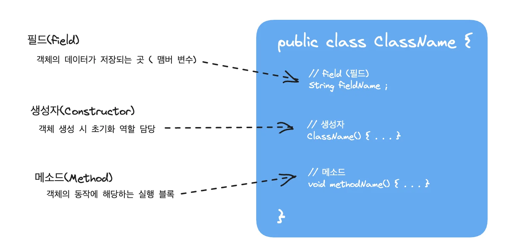

- 필드 
    <a id="1c3eda9b0fe18170b4cffccd08d9c8da"></a>

    <strong>객체의 고유 데이터(부품 객체, 상태 정보 …)</strong>를 저장하는 곳

    <a id="1c3eda9b0fe1818cb5ddcccd8cd772d3"></a>

    선언된 형태는 변수와 비슷하지만,<strong> 필드를 변수라 부르지는 않</strong>는다&#46;

    <a id="1c3eda9b0fe181b89286cc56b44c3498"></a>

    변수는 생성자와 메서드 내에서만 사용되고, 생성자와 메서드가 실행 종료되면 자동 소멸된다&#46;<br>그러나 <strong>필드는 생성자와 메서드 전체에서 사용되며, 객체가 소멸되지 않는 한 객체와 함께 존재한다&#46;</strong>

- 생성자
    <a id="1c3eda9b0fe181b6a25acf252a80c410"></a>

    <strong>new 연산자로 호출되는 특별한 중괄호 {} 블록</strong>이다&#46;

    <a id="1c3eda9b0fe18126951ce2f4c567d563"></a>

    객체 생성 시 <strong>초기화를 담당</strong>한다&#46; (필드를 초기화하거나, 메서드를 호출해서 객체를 사용할 준비를 한다&#46;)

    <a id="1c3eda9b0fe18172a43be262073aed10"></a>

    메서드와 비슷하게 생겼지만, <strong>클래스 이름</strong>으로 되어 있고, <strong>반환 타입이 없</strong>다&#46; 

<a id="1c3eda9b0fe1819d81dcd69fc4cc8cd8"></a>

### 클래스,  인스턴스,  메소드

> • 클래스&#58; <code>class &#91;클래스 명&#93; { body } </code>
> 
> <a id="1c3eda9b0fe181fc8564cc499f822c0d"></a>
> 
> • 인스턴스&#58; <code>&#91;클래스 명&#93; &#91;인스턴스 명&#93; = new 클래스명()</code>
> 
> <a id="1c3eda9b0fe1814eb17bc9a944ad320e"></a>
> 
> • 메소드&#58; <code>&#91;인스턴스 명&#93;&#46;&#91;메소드 명&#93;</code> 

<details>
<summary>ex) </summary>

<a id="1c3eda9b0fe18151b601d02ce187cfba"></a>

```java
// 클래스 
class Calculation {
	// 메소드
	int add(int x, int y){
		return x + y;
	}
	int subtract(int x, int y) {
		return x + y
	}
}

// 인스턴스  
Calculation calculation = new Calculation()
int addResult = calculation.add(x:1, y:2)
int subtractResult = calculation.subtract(x: 5, y: 3)


System.out.println(addResult);  // 3
System.out.println(subtract);   // 8
```

</details>

<a id="1c3eda9b0fe18153b81be2675cd8d12c"></a>

### 메소드(method)

> <code>&#91;반환타입&#93;  &#91;메소드명&#93;</code>  (<code>&#91;타입&#93;&#91;변수명&#93;</code>, <code>&#91;타입&#93;&#91;변수명&#93;</code>, …) {
> 
> <a id="1c3eda9b0fe181068fadc9e0f1ab39b7"></a>
> 
>                                    <strong>수행될 코드<br></strong>}

<details>
<summary>ex)</summary>

<a id="1c3eda9b0fe181d2bd01cc0968ad041d"></a>

```java
int add(int x, int y) {
	int result = x + y; 
	return result;
}

// void: 반환값 X
```

</details>

<a id="1c3eda9b0fe1810b94afd2566913d94d"></a>

## 7&#45;2) 생성자(<code>constructor</code>)

<a id="1c3eda9b0fe181b7a409f3da9b8cdd02"></a>

```plaintext
생성자(Constructor)는 객체가 생성(new..)될때 자동으로 호출되는 특수 목적의 멤버함수(메소드)로객체의 초기화를 위해 사용된다.
```

> • <strong>클래스 명 과 </strong><strong><code>같은 이름</code></strong><strong> 으로 생성<br></strong>•<strong> </strong><code>return 값</code>이 존재하지 않음<br>•  생성자(<code>contructor</code>)가 존재하지 않는 경우, Java complier가 아무것도 없는 빈 생성자 하나를 자동으로 만들줌 ( 모든 클래스에는 반드시 하나 이상의 생성자가 있어야 함 )

<details>
<summary>ex) <code>constructor</code>가 없는 경우</summary>

<a id="1c3eda9b0fe18159b799d4f8017b779e"></a>

```java
// constructor가 없는 경우 -> Java complier가 빈 constructor 자동으로 생성
class Phone {
    String model;
    String Color;
    int price;
}

public class Main {
		// 빈 constructor이기 때문에 argument 없이 빈 값으로 생성 
    Phone galaxy = new Phone();
    Phone iphone = new Phone()
}
```

</details>

<details>
<summary>ex ) <code>constructor</code></summary>

<a id="1c3eda9b0fe18179804be92039e35245"></a>

```java
class Phone {
    String model;
    String color;
    int price;

		// constructor -> constructor 명 = 클래스 명, return 값 X
    public Phone(String model, String color, int price) {
        this.model = model;
        this.color = color;
        this.price = price;
    }
}

public class Main {
		// 명시된 parameter 인자 값으로 안 넘겨줄 시 Error
    Phone galaxy = new Phone("galexy10", "black", 100);  
    Phone iphone = new Phone("iphone", "black", 200);
}
```

</details>

<a id="1c3eda9b0fe1812abcfdfd5d51884cb4"></a>

### <code>cmd</code> &#43;<code> N </code>&#58; 코드 자동 제네레이션(인텔리제)

<a id="1c3eda9b0fe1817a9918d6ac2ddef01d"></a>

<code>constructor</code>  클릭 후 아래와 같이 생성한 변수를 클릭(<code>shift</code> 로 중복 지정 가능)

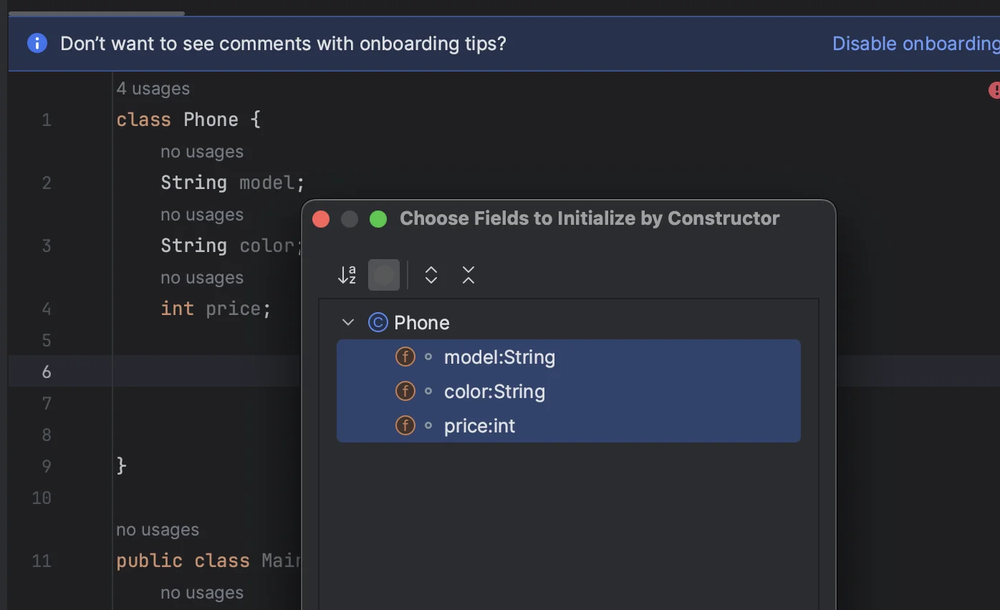

<a id="1c3eda9b0fe181cb9183f09125e38d19"></a>

아래와 같이 해당 내용 자동으로 생성해줌&#46;

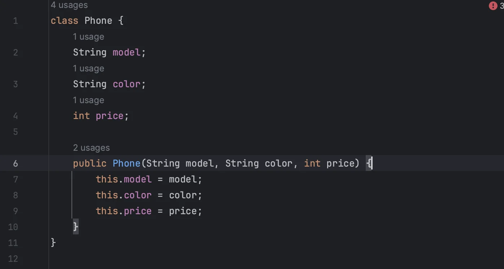

<a id="1c3eda9b0fe181619e1eeac80c18f626"></a>

### <code>&#43;</code>인스턴스(멤버) 변수의 <u>기본값</u>

<a id="1c3eda9b0fe181869d39fbd58dd54a39"></a>

class에 선언된 변수는 instance가 생성될 때 값이 초기화(initialize)된다&#46;

<a id="1c3eda9b0fe18188ba7fc9036389e19a"></a>

이때, 변수의 선언부나 생성자를 통해서 초기화를 해주지 않는다면, 기본값(default value)를 가진다&#46;

<a id="1c3eda9b0fe18157862ec8c124a128da"></a>

```java
class DefaultValueTest {
	byte byteDefaultValue;
	int intDefaultValue;
	short shortDefaultValue; 
	long longDefaultValue;
	float floatDefaultValue; 
	double doubleDefaultValue;
	boolean booleanDefaultValue; 
	String referenceDefaultValue;
}

public class Main {
	public static void main(String[] args) {
		DefaultValueTest defaultValueTest = new DefaultValueTest();
		System.out.println("byte default: " + defaultValueTest.byteDefaultValue);
		System.out.println("short default: " + defaultValueTest.shortDefaultValue);
		System.out.println("int default: " + defaultValueTest.intDefaultValue);
		System.out.println("long default: " + defaultValueTest.longDefaultValue);
		System.out.println("float default: " + defaultValueTest.floatDefaultValue);
		System.out.println("double default: " + defaultValueTest.doubleDefaultValue); 
		System.out.println("boolean default: " + defaultValueTest.booleanDefaultValue); 
		System.out.println("reference default: " + defaultValueTest.referenceDefaultValue);
	} 
}

==================================================================================

byte default: 0 // 1byte를 구성하는 8개의 bit가 모두 0이라는 뜻.
short default: 0
int default: 0
long default: 0
float default: 0.0 
double default: 0.0 
reference default: null
```

<a id="1c3eda9b0fe181e48c21e279b9b0b0f1"></a>

## 7&#45;3) 상속 ( <code>extends</code>, <code>overloading</code> , <code>overriding</code>  )

> <strong>OOP(객체지향) 의 특징(5개)</strong>
> 
> ---
> 
> - <strong>상속과 인터페이스 (계층성)</strong>
> 
> - <strong> </strong>다형성, 사용편의성 (모듈화)
> 
> -  캡슐화, 정보은닉
> 
> - <strong> 자료 추상화 (모델링)</strong>
> 
> -  동적 바인딩

[https://t1.daumcdn.net/cfile/tistory/994CCA505B5F2D051A](https://t1.daumcdn.net/cfile/tistory/994CCA505B5F2D051A)

>  • 부모 클래스로 정의된 필드와 메소드를 물려받음(<code>extends</code>)<br>• 새로운 필드와 메소드 추가 가능 ( <code>overloading</code> )<br>• 부모 클래스에서 물려받은 메소드 수정 가능 (<code>overriding</code>)

<a id="1c3eda9b0fe1818c891eff2fb273e522"></a>

## <strong>상속( </strong><strong><code>extends</code></strong><strong> )</strong>

<a id="1c3eda9b0fe181138747ffc33aa04cec"></a>

기존의 클래스를 재사용하는 방식 중 하나

<a id="1c3eda9b0fe181159f97f350e10e1a6a"></a>

한번 작성한 코드가 재사용이 필요하면, 변경사항만 코드로 작성 

<a id="1c3eda9b0fe18184a1f8e6660706d965"></a>

→ 적은 양의 코드 작성 → 재사용성 증가, 관리 용이

<details>
<summary>ex)  <code>extends</code></summary>

<a id="1c3eda9b0fe181c3bab2c846479ac4f0"></a>

```java
class Animal {
    String name;
    public void cry() {
        System.out.println(name + " is crying.");
    }
}
class Dog extends Animal {
    Dog(String name) {
        this.name = name;
    }
    public void swim() {
        System.out.println(name + " is swimming!");
    }
}
public class Main {
    public static void main(String[] args) {
        Dog dog = new Dog("코코");
        dog.cry();
        dog.swim();

        Animal dog2 = dog;  // 부모 클래스로 타입 선언 가능 -> 자식 클래스 메소드 사용 X
        dog2.cry();
				// dog2.swim(); // compile error
    }
```

</details>

<a id="1c3eda9b0fe181fda2e5e2e3ce63abb7"></a>

## 확장(<code>overloading</code> )

<a id="1c3eda9b0fe181c986cdf483c44f6f49"></a>

한 클래스 내에 동일한 이름의 메소드 여러개 정의

> • <strong>메소드 이름 동일(=)</strong><br>• 매개변수의 <code>개수</code>  or <code>타입</code>이 달라야 함&#46;

<details>
<summary>ex) 오버로딩 &#91; X , O &#93;</summary>

<a id="1c3eda9b0fe18158a744e7cf71c4b194"></a>

```java
public class Main {
    public static void main(String[] args) {
				// write your code here
    }
    int add(int x, int y, int z) {
        int result = x + y + z;
        return result;
    }

    // [X] 반환타입은 다르지만, 매개변수의 [type, 개수] 는 같기에 오버로딩이 아님
    long add(int a, int b, int c) {
        long result = a + b + c;
        return result;
    }

		// [O] 오버로딩의 조건에 부합하는 예제
    long add(int a, int b, long c) {
        long result = a + b + c;
        return result;
    }
    int add(int a, int b) {
        int result = a + b;
        return result;
    }
}
```

</details>

<a id="1c3eda9b0fe18173b1ccd8c866adc8ba"></a>

## 재정의( <code>overriding</code>)

<a id="1c3eda9b0fe18160bacde06b3ef84dd7"></a>

부모 클래스로 부터 상속 받은 메서드를 재정의 하는 것(덮어쓰기)

> 부모 클래스&#95;메서드 <code>명</code><strong> </strong><strong>=</strong> 오버라이딩&#95;메서드 <code>명</code> (이름이 같아야함)<br>부모 클래스&#95;메서드 <code>매개변수</code>  <strong>= </strong> 오버라이딩&#95;메서드 <code>매개변수</code> (매개변수<strong>&#91;타입, 개수</strong>&#93;가 같아야 함)<br>부모 클래스&#95;메서드 <code>반환타입</code> <strong>=</strong> 오버라이딩&#95;메서드 <code>반환타입</code> (반환타입이 같아야 함)

<details>
<summary>ex) <a href="https://velog.io/@god1hyuk/Javaclass-%EC%98%A4%EB%B2%84%EB%9D%BC%EC%9D%B4%EB%94%A9overriding%EA%B3%BC-%EC%98%A4%EB%B2%84%EB%A1%9C%EB%94%A9overloading#2-%EC%98%A4%EB%B2%84%EB%A1%9C%EB%94%A9overloading">오버라이딩 &#91; X, O &#93; </a></summary>

<details>
<summary>Error &#45; <code>반환 타입</code>에러</summary>

<a id="1c3eda9b0fe181659b4ac2e3611e36fd"></a>

```java
class Car {
    int speed = 0;

    public void setSpeed(int speed_change) {
        this.speed += speed_change;
        System.out.println(this.speed);
    }
}

class Sonata extends Car {
    final int MAX_SPEED = 150;

    public int setSpeed(int speed) {
        this.speed += speed;

        if (this.speed > MAX_SPEED) {
            this.speed = MAX_SPEED;
        }

        return this.speed;
    }
}

public class CarOverridingTest {
    public static void main(String[] args) {
        Car car = new Car();
		car.setSpeed(30);

        Sonata sonata = new Sonata();
		sonata.setSpeed(180);
    }
}
```

</details>

<details>
<summary>올바른 오버라이딩</summary>

<a id="1c3eda9b0fe181d29a91d2a9b1bbf672"></a>

```java
class Car {
    int speed = 0;

    public int setSpeed(int speed_change) {
        this.speed += speed_change;
        return this.speed;
    }
}

class Sonata extends Car {
    final int MAX_SPEED = 150;

    public int setSpeed(int speed) {
        this.speed += speed;

        if (this.speed > MAX_SPEED) {
            this.speed = MAX_SPEED;
        }

        return this.speed;
    }
}

public class CarOverridingTest {
    public static void main(String[] args) {
        Car car = new Car();
				car.setSpeed(30);

        Sonata sonata = new Sonata();
				sonata.setSpeed(180);
    }
}
```

</details>

</details>

<a id="1c3eda9b0fe181d7a074c677555dec74"></a>

### 🧐  <code>extends</code>  vs <code>implements</code>  

> ●  <strong><code>extends<br></code></strong>오버라이딩 안해도 됨&#46;<br>다중속성 X (자바 지원 X → implements(인터페이스)로 해결)
> 
> <details>
> <summary>ex) </summary>
> 
> <a id="1c3eda9b0fe18150982de2618036032d"></a>
> 
> ```java
> class Vehicle {
>   protected int speed = 3;
>   
>   public int getSpeed(){
>     return speed;
>   }
>   public void setSpeed(int speed){
>     this.speed = speed;
>   }
> }
> 
> class Car extends Vehicle{
>   public void printspd(){
>     System.out.println(speed);
>   }
> }
> 
> public class ExtendsSample {
>   public static main (String[] args){
>     Car A = new Car();
>     System.out.println(A.getSpeed());
>     A.printspd();
>   }
> ```
> 
> </details>

> ●  <strong><code>implements</code></strong>
> 
> <a id="1c3eda9b0fe1817e8d30c4881b464999"></a>
> 
> 부모의 메소드를 <u>반드시 </u><strong><u>오버라이딩(재정의)</u></strong> 해야한다&#46;
> 
> <a id="1c3eda9b0fe181de9c08f102b1256abc"></a>
> 
> <strong><u>다중상속</u></strong>이 가능하다&#46; 
> 
> <details>
> <summary>ex) 오버라이딩</summary>
> 
> <a id="1c3eda9b0fe181afb9e2c7a4bb5eabe6"></a>
> 
> ```java
> interface TestInterface{
>   public static int num = 8;
>   public void fun1();
>   public void fun2();
> }
> 
> class InterfaceExam implements TestInterface{
>   @Override
>   public void fun1(){
>     System.out.println(num);
>   }
>   
>   @Override
>   public void fun2() {
>     
>   }
> }
> 
> public class InterfaceSample{
>   public static void main(String args[]){
>     InterfaceExam exam = new InterfaceExam();
>     exam.fun1();
>   }
> }
> ```
> 
> </details>
> 
> <details>
> <summary>ex 다중상속</summary>
> 
> <a id="1c3eda9b0fe181c8b308e1740fd58d6d"></a>
> 
> ```java
> public class Son implements Father, Mother{...}
> ```
> 
> </details>

> ● <strong>정리</strong>
> 
> 1. extends는 일반 클래스와 abstract 클래스 상속에 사용되고, implement는 interface 상속에 사용된다&#46;
> 
> 1. class가 class를 상속받을 땐 extends를 사용하고, interface가 interface를 상속 받을 땐 extends를 사용한다&#46;
> 
> 1. class가 interface를 사용할 땐 implements를 써야하고
> 
> 1. interface가 class를 사용할 땐 implements를 쓸수 없다&#46;
> 
> 1. extends는 클래스 한 개만 상속 받을 수 있다&#46;
> 
> 1. extends 자신 클래스는 부모 클래스의 기능을 사용한다&#46;
> 
> 1. implements는 여러개 사용 가능하다&#46;
> 
> 1. implements는 설계 목적으로 구현 가능하다&#46;
> 
> 1. implements한 클래스는 implements의 내용을 다 사용해야 한다&#46;

<a id="1c3eda9b0fe18107af30e19ef017c878"></a>

### 🧐  <code>overloading</code> vs  <code>overriding</code>

> 오버로딩(<code>overloading</code>) &#58; 기존에 없는<strong> 새로운 메소드를 정의</strong><br>오버라이딩(<code>overriding</code>)  &#58; <strong>상속받은 메소드의 내용을 변경</strong>

<a id="1c3eda9b0fe181a9902fdf8e6b654c24"></a>

## 7&#45;4)  접근제어자 

> <strong>OOP(객체지향) 의 특징(5개)</strong>
> 
> ---
> 
> - 상속과 인터페이스 (계층성)
> 
> - <strong> </strong>다형성, 사용편의성 (모듈화)
> 
> - <strong> 캡슐화, 정보 은닉</strong>
> 
> - <strong> </strong>자료 추상화 (모델링)
> 
> -  동적 바인딩

<details>
<summary><code>&#43;</code>  <strong>자바의 클래스 인식 방식</strong>(<code>package</code> &#43; <code>class</code>)</summary>

> <strong>import &#91; 패키지 명&#93;&#46;&#91;클래스 명&#93;</strong>

<a id="1c3eda9b0fe18183808ed38cf5631984"></a>

위 와 같이 <strong>패키지 명</strong> 와 <strong>클래스 명</strong>으로 패키지(모듈)를 인식한다&#46; 

<a id="1c3eda9b0fe18187a553db6b9e5f5287"></a>

 ex) <strong>pkg2&#46;class</strong><strong><code> ≠</code></strong><strong> pak&#46;class</strong>

<a id="1c3eda9b0fe1811ba113c062c4345093"></a>

따라서 클래스를 불러올 시 내가 필요한 패키지의 클래스인지 확인해야 한다&#46; 

<a id="1c3eda9b0fe181a288d8d01cb8222e67"></a>

<del>→ </del><del><strong>multiple choices(</strong></del><del><code>alt</code></del><del> &#43; </del><del><code>enter</code></del><del>)&#58; 해당하는 클래스명을 가진 패키지들을 보여줌  (안됨&#46; )</del>

<a id="1c3eda9b0fe18130a041e4ac7ef68534"></a>

→ <code>option</code> &#43; <code>enter</code> &#58; 패케지 불러오기 가능 

</details>

<a id="1c3eda9b0fe1812f80e0e404cc00a84c"></a>

### 접근 제어자(access modifier)

<a id="1c3eda9b0fe18185bdbaf772c5010a01"></a>

⇒ <strong>접근 제어자</strong>는 <u>멤버의 </u><strong><u>변수/함수</u></strong><u> 혹은</u><strong><u> 클래스</u></strong>에 사용되며 <strong>외부에서의 접근을 제한</strong>하는 역활을 한다&#46; <br>이를 통해, 클래스 내부 데이터에 접근 을 제한하여, 부적절한 사용으로부터 데이터를 보호한다&#46; (<strong>캡슐화, 은닉화</strong>)

- <strong>접근 제어자 종류</strong>
    - <code>private</code>&#58;  <strong><u>같은 클래스 내</u></strong>에서만 접근 가능

    - <code>default(nothing)</code>&#58; <strong><u>같은 패키지 내</u></strong>에서만 접근 가능

    - <code>protected</code>&#58; <strong><u>같은 패키지 내, 다른 패키지의 자손 클래스</u></strong>에서 접근 가능

    - <code>public</code>&#58; 제한 없음

> ⚠️ <strong>접근 범위</strong><br>(좁음)                                                                 (넓음)<br><code>private</code>     →     <code>default</code>     →      <code>protected</code>     →     <code>public</code>

<details>
<summary>ex) private, public, protected</summary>

<a id="1c3eda9b0fe18135b80ec6427c968576"></a>

```java
// pkg/ModifierTest.java
package pkg;

public class ModifierTest {
    private void messageInSide(){
        System.out.println("This is private modifier");
    }
    public void messageOutSide(){
        System.out.println("This is public modifier");
        messageInSide();
    }

    protected void messageProtected(){
        System.out.println("This is protected");
    }
}
```

<a id="1c3eda9b0fe181508a49f5b9fec493ec"></a>

```java
import pkg.ModifierTest;

class Child extends ModifierTest{
    void callParentProtected(){
        System.out.println("call my parent's protected method");
        super.messageProtected();  // super: 상속받은 부모 클래스(Child)를 가리킴
    }
}

public class Main {
    public static void main(String[] args) {
        ModifierTest modifierTest = new ModifierTest();
        modifierTest.messageOutSide();  // pubilc, private 둘다 호출
        modifierTest.messageInSide();   // private 호출 불가
        modifierTest.messageProtected();  // protected 호출 불가

        Child child=new Child();
        child.messageProtected();   // 부모 클래스의 protected 메소드 호출 불가
        child.callParentProtected();  // protected 메소드 호출
    }
}

=======================================================================
This is public modifier
This is private modifier
call my parent's protected method
This is protected
```

- <code>public</code>&#58; 그냥 호출 가능

- <code>private</code>&#58; <strong>public을 통한 내부 클래스에서의 호출</strong>로 출력 가능  
    <a id="1c3eda9b0fe1810895e7fad3bc015013"></a>

                         → protected 와 연동하면<code> OOP&#45;은닉성</code> 가능할 듯?

- <code>protected</code>&#58; 다른 패키지에서 접근 시, <code>상속(extends&#45;super)</code> 을 통해서 접근 가능

</details>

<a id="1c3eda9b0fe1815480c7d088ac4e7477"></a>

## 7&#45;5) 추상클래스, 인터페이스

<a id="1c3eda9b0fe181328011efdcb473b4ba"></a>

# 8)  예외, 에러 처리

<a id="1c3eda9b0fe181a3aa10e5d825fcd296"></a>

## 예외처리 (<code> try, catch, finally </code>)

> reference&#58; <a href="https://mozi.tistory.com/550">https&#58;//mozi&#46;tistory&#46;com/550</a><br>→ 해당 블로그 내용 발췌

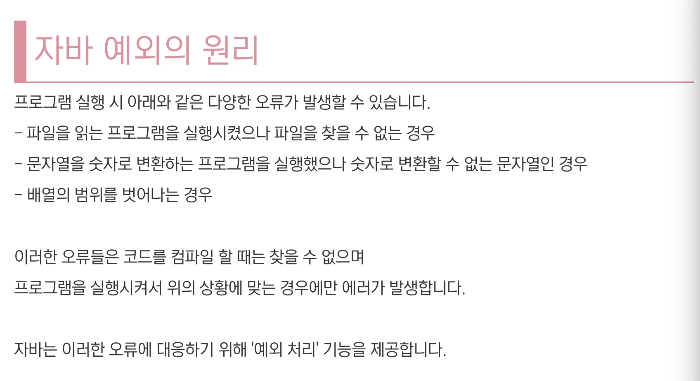

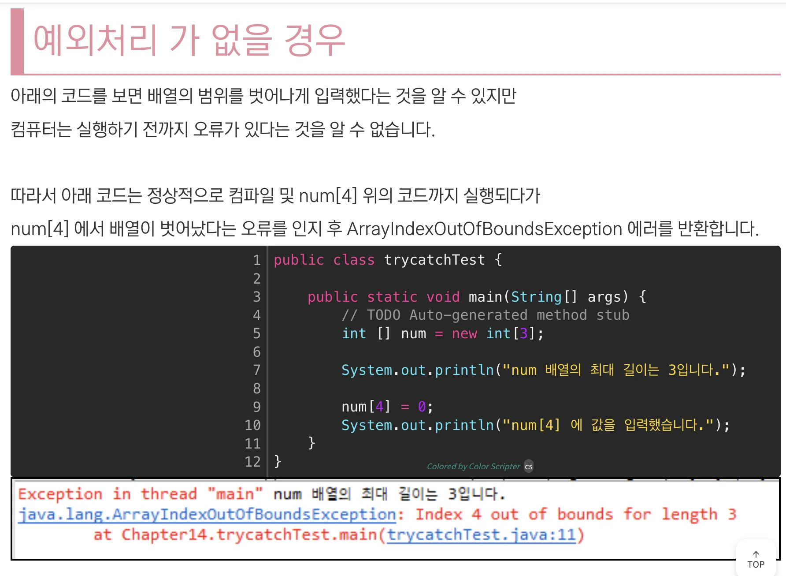

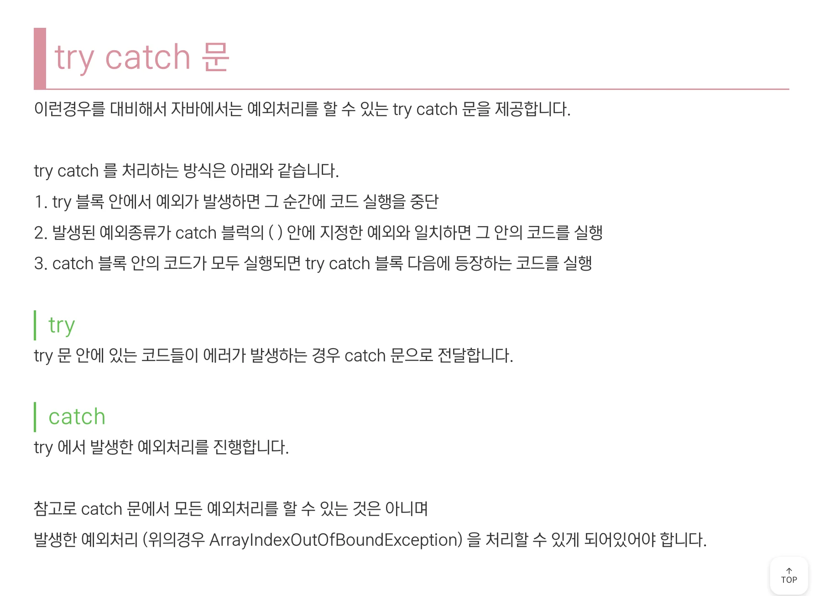

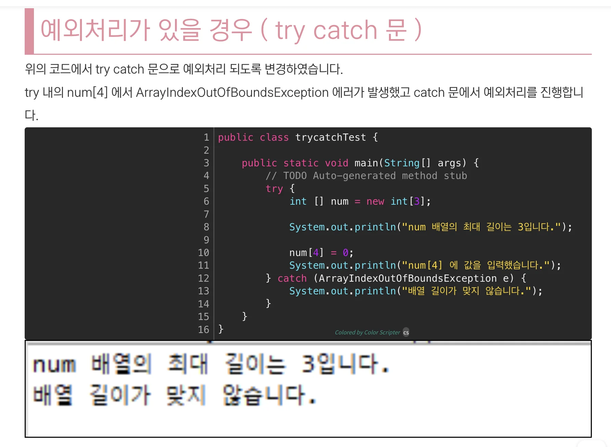


<a id="1c3eda9b0fe181a388ace5d7a3bb7285"></a>

## <a href="https://mangkyu.tistory.com/70">Optional&#60;T&#62;</a> → 정리 중

> <strong>Optional&#60;T&#62;</strong><strong>&#58;</strong><strong> </strong> <strong>null이 올 수 있는 값을 감싸는 Wrapper 클래스</strong>

<a id="1c3eda9b0fe181d7843aef631d058a12"></a>

<strong>NPE(Null&#95;Pointer&#95;Exception)</strong> 을 방지를 위해  java8에서부터 도입됨&#46;

<a id="1c3eda9b0fe181e5a29efd71f7aa2e3e"></a>

null 값을 클래스로 감싸 NPE가 발생되지 않는다&#46; 

<a id="1c3eda9b0fe181b488f5ee32fc200ff9"></a>

… 추후 정리 

<a id="1c3eda9b0fe181e0ba4be00cbd18435c"></a>

# 9) <a href="https://blog.breakingthat.com/2018/05/07/java-collection-%EA%B0%9C%EC%9A%94-%EC%9E%90%EB%A3%8C%EA%B5%AC%EC%A1%B0/">Collection(프레임워크)</a>

> 💡 Collection은 자바에서 자료구조를 표현하는 인터페이스이다&#46; (파이썬과 동일한 듯?)<br>(데이터를 다루는데 도움을 주는 다양한 클래스와 기본함수를 제공함)<br>Collection의 프레임워크의 모든 클래스는 <code>Collection</code> interface를 구현(implement)하는 클래스 또는 인터페이스이다&#46; 

> 👉🏻 Collection을 사용하여 만든 객체를 담을 수 있는 타입? → 참조형 자료(reference type)만 가능, primitive 타입 불가 → 내용 이해 안됨&#46; 예시 추가 필요&#46;<br><br>숫자형(int) 클래스 → Integer <br>문자형 클래스 → String (이건 문자열 기본)

> 👉🏻 입력 순서 보장 X → Set, Map

<a id="1c3eda9b0fe181d6a137f10b6948c5b2"></a>

## 9&#45;1) 자료구조

<a id="1c3eda9b0fe1814c8914c10a02c41387"></a>

### List 

<a id="1c3eda9b0fe181beb9d5d868b46f8420"></a>

순서가 있는 데이터 집합, 데이터 중복 허용   ex&#46;) ArrayList, LinkedList, Stack, Queue 등

<a id="1c3eda9b0fe181119f43f6ffea90c7ce"></a>

```java
List<Integer> integerList = new ArrayList<>();
  // 추가: Array.add();
  integerList.add(1);
  integerList.add(5);
  integerList.add(4);
  integerList.add(11);
  integerList.add(10);

  System.out.println(integerList); // [1, 5, 4, 11, 10]

  // 정렬: Collections.sort(Array);
  Collections.sort(integerList);
  System.out.println(integerList);  // [1, 4, 5, 10, 11], default: 오름차순

  // 길이: Array.size();
  System.out.println(integerList.size());  // 5

  // 제거; Array.remove(index);
  integerList.remove(4);
  System.out.println(integerList);  // [1, 4, 5, 10]

  // 조회: Array.get(index);
  for(int i=0; i<integerList.size(); i++){
      System.out.println(integerList.get(i));
  } // 1 4 5 10

  // 조회2: for - each 문
  for ( int current : integerList){
      System.out.println(current);
  }  // 1 4 5 10
```

<a id="1c3eda9b0fe181aabb64ce6a603f29c0"></a>

### Set

<a id="1c3eda9b0fe181d5ad7acd606773abfa"></a>

순서를 유지하지 않는 데이터의 집합, 데이터 <code>중복 허용 X</code>  ex&#46;) HashMap, TreeMap

<a id="1c3eda9b0fe181f79e72ea54501001f3"></a>

```java
import java.util.ArrayList;
import java.util.List;
import java.util.Set;
import java.util.HashSet;

public class Main {
    public static void main(String[] args) {
    // ex1) type:Integer
        Set<Integer> integerSet = new HashSet<>();
        // 추가: add
        integerSet.add(1);
        integerSet.add(1);
        integerSet.add(4);
        integerSet.add(2);
        integerSet.add(2);
        integerSet.add(5);
        integerSet.add(7);
        System.out.println(integerSet);  // [1, 2, 4, 5, 7], 지동 정렬, 중복 허용 X

// ex2) type: String
        Set<String> stringSet = new HashSet<>();
        stringSet.add("LA");
        stringSet.add("New York");
        stringSet.add("LasVegas");
        stringSet.add("Seoul");
        System.out.println(stringSet);  // [New York, LasVegas, LA, Seoul]

        // 제거: remove(value); 입력 순서가 보장되지 않기 때문에, value 값으로 지정한다.
        stringSet.remove("Seoul"); // [New York, LasVegas, LA]
        System.out.println(stringSet);

        // 범위형제거: removeAll(collection);
        List<String> target = new ArrayList<>();
        target.add("New York");
        target.add("LasVegas");
        stringSet.removeAll(target);
        System.out.println(stringSet);  // [LA]

        // 포함여부 확인(Boolean): contain(value);
        System.out.println("LA 포합되어있나요? " + stringSet.contains("LA"));       // LA 포합되어있나요? true
        System.out.println("Seoul 포합되어있나요? " + stringSet.contains("Seoul")); // Seoul 포합되어있나요? false
        System.out.println(stringSet.size());  // 1

        // 초기화: claer()
        stringSet.clear();
        System.out.println(stringSet);  []
    }
}
```

<a id="1c3eda9b0fe181e3bbced7b4131a26fe"></a>

### Map

<a id="1c3eda9b0fe18128ac11f8e51334998a"></a>

키(key)와 값(value)의 쌍으로 이루어지 자료구조

<a id="1c3eda9b0fe181dbae21fa372d982c59"></a>

 순서 X, 키&#58; 중복 X, 값&#58; 중복 O

<a id="1c3eda9b0fe181d59f0fe1863aa95d0b"></a>

```java
import java.util.Map;
import java.util.HashMap;

public class Main {
    public static void main(String[] args) {
        // Map< key타입, value타입 > 명 = new HashMap<>();
        Map<Integer, String> map = new HashMap<>();

        // 추가: put();
        map.put(1, "apple");
        map.put(2, "berry");
        map.put(3, "cherry");
        System.out.println(map);  // {1=apple, 2=berry, 3=cherry}

        // 조회: get(key);
        System.out.println("1st in map: " + map.get(1)); // 1st in map: apple

        // 업데이트:

        // 제거: remove(key);
        map.remove(2);
        System.out.println(map);  // {1=apple, 3=cherry}

        // 포함 여부 확인: [boolean] containsKey(key);, containsValue(value);
        System.out.println(map.containsKey(2)); // false
        System.out.println(map.containsValue("cherry")); // true
    }
}
```

<a id="1c3eda9b0fe181b09148c80fd3b76328"></a>

### 스택(Stack)

<a id="1c3eda9b0fe1817bb0c5f29438c340c4"></a>

FILO&#58; First In Last Out

<a id="1c3eda9b0fe181df8025f47844ed1f05"></a>

```java
import java.util.Stack;

public class Main {
    public static void main(String[] args) {
        Stack<Integer> stack = new Stack<>();

        // 추가: push();
        stack.push(1);
        stack.push(3);
        stack.push(7);
        stack.push(5);
        System.out.println(stack);  // [1, 3, 7, 5]  

        // 크기(길이) 조회: size()
        System.out.println(stack.size());  // 4

        // 조회: peek()  , 마지막(Last) 요소 확인
        System.out.println(stack.peek());  // 5
        System.out.println(stack);  // [1, 3, 7, 5]

        // 제거(추출): pop()  , 마지막 요소 추출(Last Out)
        System.out.println(stack.pop());
        System.out.println(stack);   // [1, 3, 7]

        // 포함여부 확인: contains(value)
        System.out.println(stack.contains(1));  // true

        // 초기화:clear(), 초기화 여부 확인: empty(), isEmpty()
        System.out.println(stack.empty());  // false
        stack.clear();
        System.out.println(stack.isEmpty());  // true
    }
}
```

<a id="1c3eda9b0fe181c38aa2f0c0661b4cd4"></a>

### Queue(큐)

> ListedList 로 만든다&#46;

<a id="1c3eda9b0fe1819cb090df46a51a3d9f"></a>

FIFO&#58; First In First Out

<a id="1c3eda9b0fe18137a6dde08a5c93d6e8"></a>

```java
import java.util.Queue;
import java.util.LinkedList;

public class Main {
    public static void main(String[] args) {
        Queue<Integer> queue = new LinkedList<>();

        // 추가: add()
        queue.add(1);
        queue.add(2);
        queue.add(3);
        System.out.println(queue);

        // 추출(제거): poll(),  첫번째 요소 추출(First Out)
        System.out.println(queue.poll());  // 1
        System.out.println(queue);  // [2, 3]

        // 조회: peek()
        System.out.println(queue.peek());  // 2
        System.out.println(queue); // [2, 3]
    }
}
```

<a id="1c3eda9b0fe181be8dfff8c6d03e6390"></a>

### <a href="https://hbase.tistory.com/128">ArrayDeque(데큐)&#58; &#91; 스택 &#43; 큐 &#93;</a>

<a id="1c3eda9b0fe18147a09eec65e905691f"></a>

양쪽 삽입, 추출 가능 

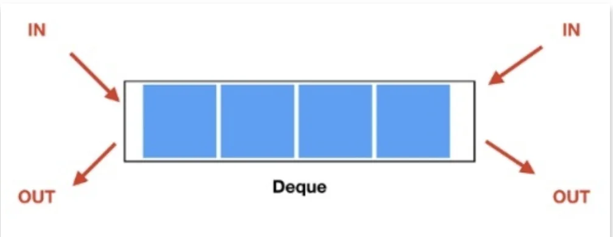

<details>
<summary>생성</summary>

<a id="1c3eda9b0fe1810e9405c129fe168f34"></a>

```java
Deque<String> deque1 = new ArrayDeque<>();
Deque<String> deque2 = new LinkedBlockingDeque<>();
Deque<String> deque3 = new ConcurrentLinkedDeque<>();
Deque<String> linkedList = new LinkedList<>();
```

</details>

<details>
<summary>삽입(추가)</summary>

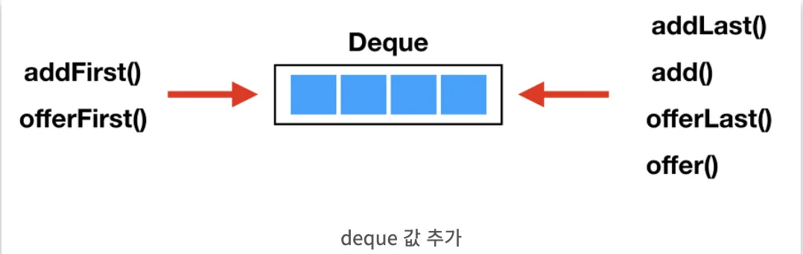

<a id="1c3eda9b0fe181ceb0e3e1cd599ebd01"></a>

```java
deque.addFirst(); // Deque의 앞쪽에 데이터를 삽입, 용량 초과시 Exception
deque.offerFirst(); //  Deque의 앞쪽에 데이터를 삽입 후 true, 용량 초과시 false

deque.addLast(); // Deque의 뒤쪽에 데이터를 삽입, 용량 초과시 Exception
deque.add(); // addLast()와 동일
deque.offerLast(); //Deque의 뒤쪽에 데이터를 삽입 후 true, 용량 초과시 false
deque.offer(); // offerLast()와 동일

deque.push(); // addFirst()와 동일
deque.pop(); // removeFirst()와 동일
```

</details>

<details>
<summary>추출(제거)</summary>

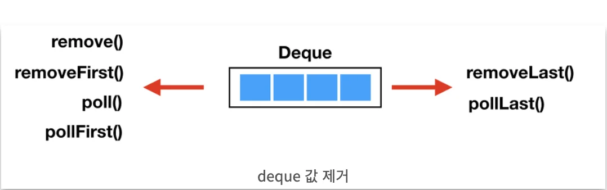

<a id="1c3eda9b0fe18118b355f9e129eacb4b"></a>

```java
deque.removeFirst(); // Deque의 앞에서 제거, 비어있으면 예외
deque.remove(); // removeFirst()와 동일
deque.poll(); // Deque의 앞에서 제거, 비어있으면 null 리턴
deque.pollFirst(); // poll()과 동일

deque.removeLast(); // Deque의 뒤에서 제거, 비어있으면 예외
deque.pollLast(); // Deque의 뒤에서 제거, 비어있으면 null 리턴
```

<a id="1c3eda9b0fe181af9671ded2efb665f1"></a>

```java
// Deque의 앞쪽에서 찾아서 첫 번째 데이터를 삭제
deque.removeFirstOccurrence(Object o);

// Deque의 뒤쪽에서 찾아서 첫 번째 데이터를 삭제
deque.removeLastOccurrence(Object o);

// removeFirstOccurrence() 메소드와 동일
deque.remove(Object o);
```

</details>

<details>
<summary>조회</summary>

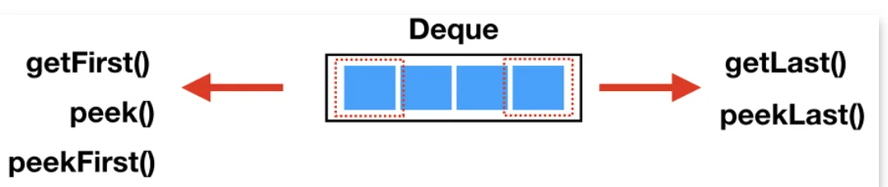

<a id="1c3eda9b0fe181ada365ce50abb1d3c2"></a>

```java
deque.getFirst(); // 첫 번째 엘리먼트를 확인, 비어있으면 예외
deque.peekFirst(); // 첫 번째 엘리먼트를 확인, 비어있으면 null 리턴
deque.peek();// peekFirst()와 동일

deque.getLast(); // 마지막 엘리먼트를 확인, 비어있으면 예외
deque.peekLast();// 마지막 엘리먼트를 확인, 비어있으면 null 리턴

deque.contain(Object o); // Object 인자와 동일한 엘리먼트가 포함되어 있는지 확인
deque.size(); // Deque에 들어있는 엘리먼트의 개수
```

</details>

<details>
<summary>순회</summary>

<a id="1c3eda9b0fe181e08968f159d839341c"></a>

```java
// for 문을 이용한 순회
for (String elem : deque1) {
  System.out.println(elem);
}

// Iterator를 이용한 순회
Iterator<String> iterator = deque1.iterator();
while (iterator.hasNext()) {
  String elem = iterator.next();
  System.out.println(elem);
}

// 역순순회 
Iterator<String> reverseIterator = deque1.descendingIterator();
while (reverseIterator.hasNext()) {
  String elem = reverseIterator.next();
  System.out.println(elem);
}
```

</details>

<a id="1c3eda9b0fe1811397acfc278e21bac6"></a>

### 컬렉션 인터페이스

<a id="1c3eda9b0fe1814da73decdc52fd27ca"></a>

## 9&#45;2) 스택, 큐, ArrayDeque

<a id="1c3eda9b0fe181078e0ddd34efca1f33"></a>

## 람다표현식( JS &#45; arrow function 문법적으로 유사 )

<a id="1c3eda9b0fe181c4b5a7c12e34f2556c"></a>

JDK 8 버전부터 <strong>익명(=무명) 함수 (Anonymous Function)</strong> 를 표현하기 위한<strong> </strong><strong><u>람다 표현식( 자바스크립트에서의 arrow function) </u></strong><u>을 지원</u>

<a id="1c3eda9b0fe1817f83dfd5203964ff2d"></a>

```java
(매개변수) -> { 실행 코드 }
```

<details>
<summary>ex) 기본</summary>

<a id="1c3eda9b0fe181e69162c1eb2e253559"></a>

```java
(int x, int y) -> { return x + y; }
```

<a id="1c3eda9b0fe181edb1dfef15f8f0bb44"></a>

 

</details>

<a id="1c3eda9b0fe18142ba84e8e57747eb84"></a>

### ex) 응용? 

<a id="1c3eda9b0fe181e7b132dc479a419410"></a>

### 타입 생략 가능

<a id="1c3eda9b0fe1815a9d73f6eca040b513"></a>

보통의 경우 대입되는 시점에서 매개변수의 타입을 추론할 수 있으므로, 아래와 가이 타입을 생략해서 사용

<a id="1c3eda9b0fe181ecad01fd5038c225de"></a>

```java
(x, y) -> { return x + y; }
```

<a id="1c3eda9b0fe181f4843ce5349a7f5773"></a>

### <strong>매개변수가 없을 경우</strong>

<a id="1c3eda9b0fe1815ba7f4e75b46f6567c"></a>

매개변수가 없을경우 반드시 아래와 같이 빈 괄호 (<strong><code>()</code></strong>) 를 사용

<a id="1c3eda9b0fe181cd9ef2f6e3160e15b0"></a>

```java
() -> { System.out.println("Hello World"); }
```

<a id="1c3eda9b0fe18102b4c6eb1741902ad9"></a>

### 하나의 매개변수만 있는 경우

<a id="1c3eda9b0fe181089621d814c6e42022"></a>

소괄호 <code>()</code> 생략 가능

<a id="1c3eda9b0fe1817bbd34f4431aeb7b36"></a>

```java
x -> { System.out.println(x);
```

<a id="1c3eda9b0fe181018bdcc536d63fea26"></a>

### 한줄의 실행코드만 있는 경우 

<a id="1c3eda9b0fe1814f86cad9b1097525a8"></a>

중괄호 <code>{}</code> 생략 가능

<a id="1c3eda9b0fe1813db0eae16f09957b22"></a>

```java
() -> System.out.println("Hello");
```

<a id="1c3eda9b0fe181d39fb9dc1dbca1ef80"></a>

###  실행 코드에 반환문만 있는 경우

<a id="1c3eda9b0fe181ec816ef9ea4982a96f"></a>

중괄호<code>{}</code>, <code>return</code> 생략 가능 

<a id="1c3eda9b0fe181d78238e9a115be6793"></a>

```java
(x, y) -> x + y  
```
