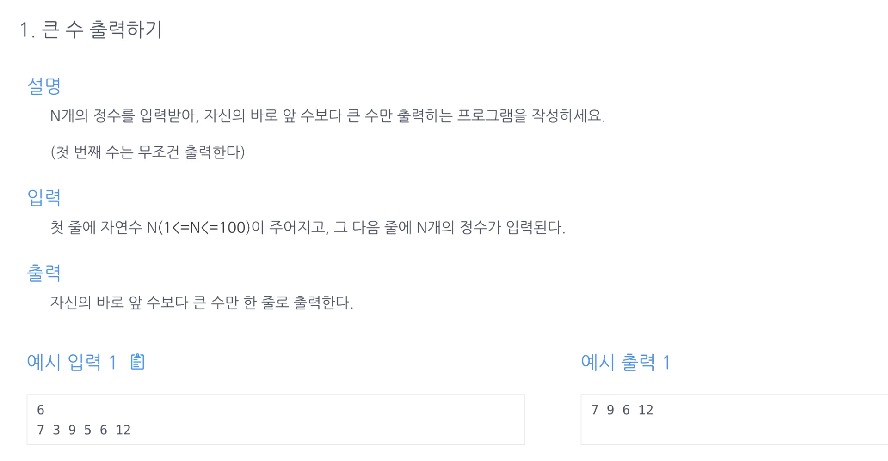

<a id="1c3eda9b0fe181f196fff9d37a3e7742"></a>

## 문제)



<a id="1c3eda9b0fe1814aaa17efd2c89f0a4b"></a>

## 풀이)

<a id="1c3eda9b0fe18142b102c3b8adc8812e"></a>

### 내 풀이)

<a id="1c3eda9b0fe18155a437f2554b9c4c6f"></a>

```java
import java.util.ArrayList;
import java.util.Scanner;

public class Main {
    public ArrayList<Integer> solution(int n, int[] list){
        ArrayList<Integer> answer = new ArrayList<>();
        for (int i=0; i<n; i++){
            if (i == 0){
                answer.add(list[i]);
            }
            else if (i>0&& list[i-1] < list[i]){
                answer.add(list[i]);
            }
        }
        return answer;
    }
    public static void main(String[] args) {
        Main m = new Main();
        Scanner sc = new Scanner(System.in);
        int n = sc.nextInt();
        int[] arr= new int[n];
        for(int i=0; i<n; i++){
            arr[i]= sc.nextInt();
        }
        for(int x : m.solution(n, arr)){
            System.out.print(x+" " );
        }
    }
}
```

<a id="1c3eda9b0fe181d2b76ed649bd86afb4"></a>

### 강의 풀이)

<a id="1c3eda9b0fe1815da180d96689152dcf"></a>

i=0은 굳이 조건문에 넣지 않아도 됨&#46; 

<a id="1c3eda9b0fe181a8a8e0e640b9c2fc16"></a>

```java
import java.util.ArrayList;
import java.util.Scanner;

public class Main {
    public ArrayList<Integer> solution(int n, int[] list){
        ArrayList<Integer> answer = new ArrayList<>();
				answer.add(list[0]);
        for(int i=1; i<n; i++){
            if(list[i-1] < list[i]){
                answer.add(list[i]);
            }
        }
        return answer;
    }
    public static void main(String[] args) {
        Main m = new Main();
        Scanner sc = new Scanner(System.in);
        int n = sc.nextInt();
        int[] arr= new int[n];
        for(int i=0; i<n; i++){
            arr[i]= sc.nextInt();
        }
        for(int x : m.solution(n, arr)){
            System.out.print(x+" " );
        }
    }
}
```
