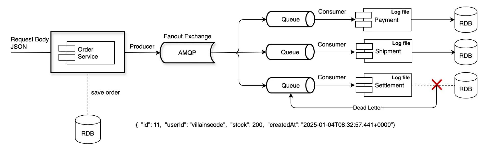
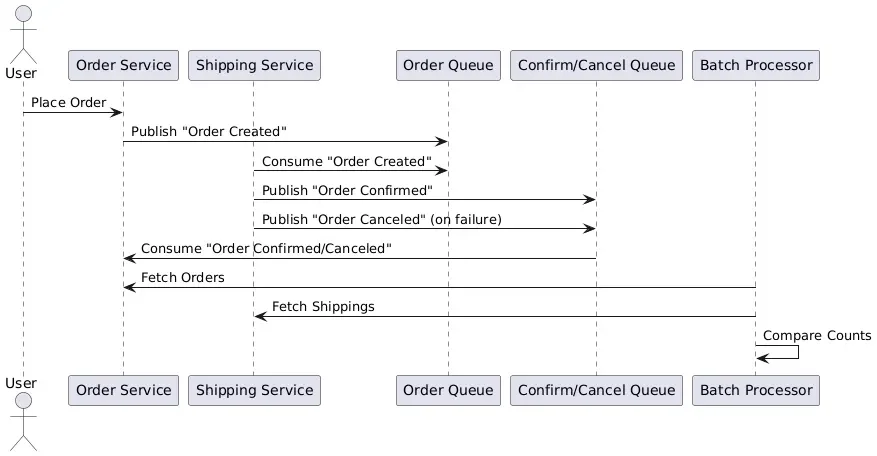

Reference

<a href="https://beautiful-college-c84.notion.site/1792d6475f8580b0b73ff25c9d10d79c">페이지</a> 

<a href="https://beautiful-college-c84.notion.site/1882d6475f85801ea723c4e51e399c39">페이지</a> 

> ☝🏻 
> 
> 
> 
> <code>Publisher &#45; Confirms 방식</code>은 대용량 데이터를 처리하는데 있어 비동기를  활용한다는 장점이 있지만, 속도 측면에 있어서 크게 의미있는 이점이 있지는 않다&#46; 
> 
> 
> 
> 따라서 <strong><u>TCC의 방식을 권장</u></strong>한다&#46; 
> 
> - <strong><code>TCC</code></strong><strong> </strong>&#62; <strong><code>Publisher &#45; Confirms</code></strong> &#62; <strong><code>RabbitMQ 트랜잭션</code></strong>

TCC 방식

메세지 큐를 가공하여 다른 시스템에 전달하는 비동기 방식에서 트랜잭션으로 묶는다는 자체가 비동기 아키텍처  

- 비지니스 로직을 트랜잭션으로 묶어 처리하고 난 뒤, 그 다음 트랜잭션 바깥에서 비동기로 메세지를 전송하는 방법이 비동기 아키텍처에 적합하다&#46;

### TCC 기법을 활용한 데이터 보정(Recognition)과 대사(Reconciliation)

메세지 큐를 가공하여 <strong><u>다른 시스템에 전달</u></strong> 했을 때, 이는 <strong><u>비동기</u></strong>이기 때문에 <strong><u>트랜잭션으로 묶을 수 없</u></strong>다&#46; 

일반적인 케이스에서 물리적으로 코드도 다른 서버에 있으며, 트랜잭션으로 처리를 한다는 것이 큐의 비동기 사상과 맞지 않다&#46;

따라서 양쪽 (전송자, 수신자) 서버에서 데이터가 맞는지 대사 ( recognition, data Integrity and consistency ) 작업을 통해 양쪽 데이터가 일치하는지 여부를 확인하는 단계를 둔다&#46; 

시간 배치 작업이나 분산 서버간의 트랜잭션 처리를 TCC(Try&#45;Confirm/Cancle)로 만들어 취소/확인 과 확정 단계를 두는 방식으로 처리하면 상당 부분의 트랜잭션은 비교적 어렵지 않게 처리할 수 있다&#46; 

- TCC&#58; 취소 와 확인, 보정이라는 안정장치와 절차들을 통해 데이터를 확정짓는 패턴

> ✏️ 
> 
> 
> 
> <strong><code>TCC를 이용한 구현(Try&#45;Confirm/Concel) 패턴</code></strong><strong> </strong><strong><u>서로 다른 두개의 도메인에 각각 요청한 결과</u></strong>에 대해서 <strong><u>정상적으로 처리 된 경우</u></strong>의 응답이 오면 <strong><u>둘다 확정</u></strong> 처리하며 <strong><u>중간에 에러가 발생한 경우</u></strong> 다른 하나에 대해서 <strong><u>취소 처리 프로세스를 호출</u></strong>한다&#46;

### 1) TCC의 진행 프로세스

- 직접적인 트랜잭션 레이어가 아니라 <strong><u>방어/보상 로직</u></strong>을 통해 <strong><u>확정(confirm) or 취소(cancel)</u></strong> 하는 방식이다&#46;

- <strong><u>전송되는 데이터의 원본 (JSON) 을 저장</u></strong>하고 <strong><u>호출이 정상 종료</u></strong><strong><u>일 경우 </u></strong><strong><u>확정</u></strong>, <strong><u>비정상</u></strong><strong><u>일 경우 </u></strong><strong><u>취소</u></strong><strong><u> 처리</u></strong> 한다&#46;

- consumer가 confirm( 확정 ) or exception 시 cancel을 한 곳의 queue에 발행한다&#46; 

- 각 경계에서 전달되는 데이터들은 JSON으로 저장하고 이를 이용하여 로직을 처리하고 상태를 확정 처리한다&#46; 

- 타임아웃이나 예외가 발생하면 취소(cancel) 상태를 요청 혹은 Exprire 필드를 두어 처리한다&#46;  

### 2) 주문 / 배송 간의 시나리오 예시

- Order 도메인&#58; 주문 상태를 초기 상태로 설정하고 메세지를 전송

- <strong>Consumer(Shipping 도메인)</strong>&#58; 주문 상태를 CONFIRM(처리 성공) 또는 CANCEL(처리 실패)로 변경하여 메시지 발행

- <strong>최종 큐</strong>&#58; CONFIRM/CANCEL 상태 메시지는 Order가 바라보는 단일 큐로 수신&#46;

- <strong>배치 처리</strong>&#58; Order와 Shipping 도메인에서 시간 단위로 메시지 카운트를 대조하여 보정&#46;

<strong>Message 레이어를 통한 Retry와 보정(후처리)</strong>

각 도메인으로 연결되는 경계 로직에서 Message Queue로 데이터를 Publish하고 각 도메인은 이 Queue를 바라보고 Message를 Consume 한다&#46;

이 단계에서 Message 솔루션들은 토픽에 대한 손실을 방지하기 위해 자체적인 저장소를 유지해야 한다&#46; 이 저장소를 통해 미 처리된 Message 에 대해서 retry를 시도하여 최종적으로 요청된 토픽이 처리 될 수 있도록 하며, 전송측과 구독측의 데이터 보정을 위해 주기적으로 Sync하는 추가 로직이 존재해야 한다&#46;
