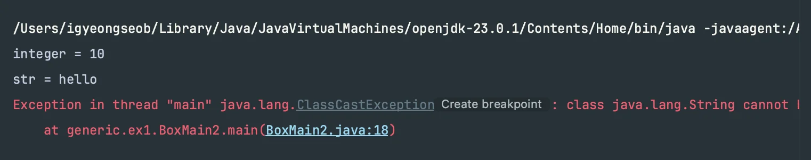
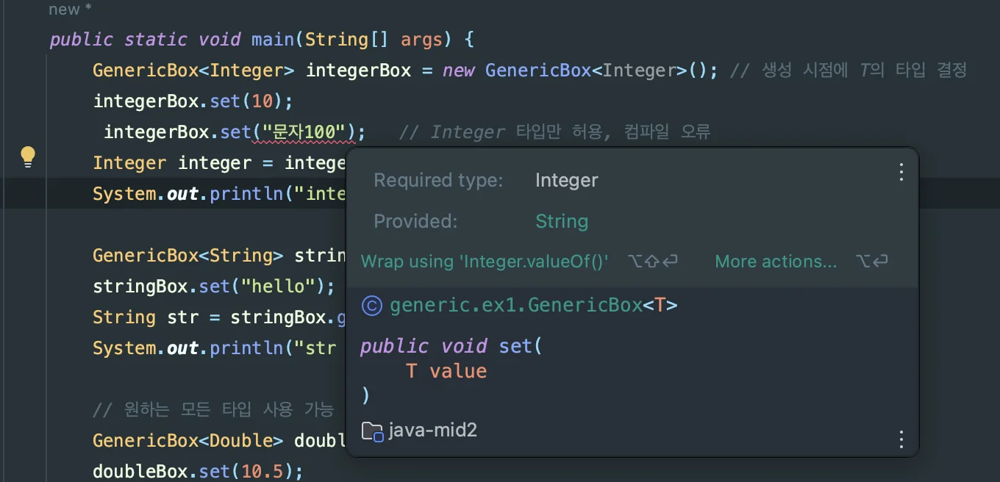
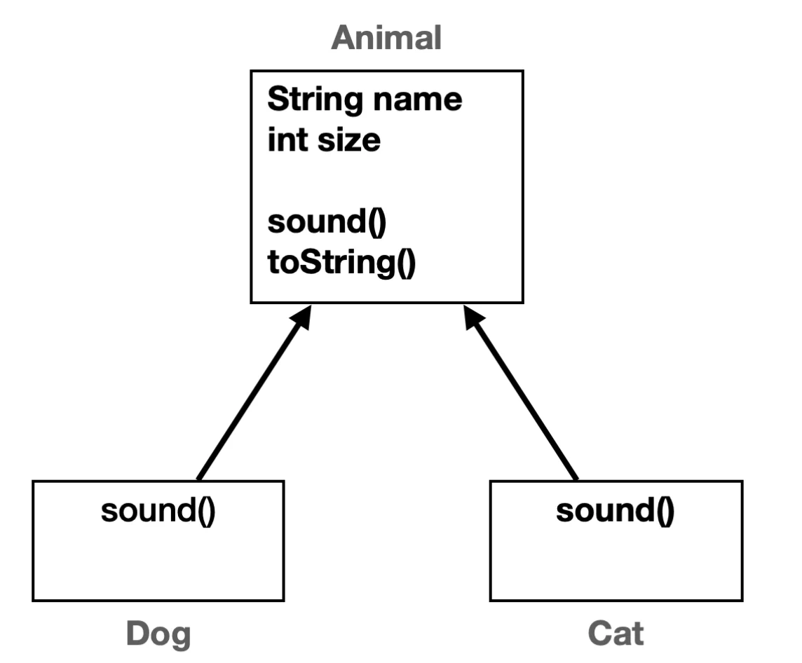

<a id="1c3eda9b0fe1818885c6cbee49394569"></a>

## 1&#46;1 &#45; 제네릭이 필요한 이유

> ✏️ 
> 
> <a id="1c6eda9b0fe1803eaafcc41a3b4dd26f"></a>
> 
> <strong><code>StringBox</code></strong>, <strong><code>IntegerBox</code></strong> 클래스들은 <strong><u>타입만 다를 뿐, 동일한 형태</u></strong>의 코드이다&#46;
> 
> <a id="1c6eda9b0fe1803f8ad5d6493d8d3368"></a>
> 
> 만약 <strong><code>Double</code></strong>, <strong><code>Boolean</code></strong> 등  <u>다양한 타입으로 Box 클래스를 확장</u>한다면, <br>타입별로 <strong><code>DoubleBox</code></strong>, <strong><code>BooleanBox</code></strong> &#46;&#46;&#46;  와 같이 클래스를 새로 만들어야 한다&#46;
> 
> <a id="1c6eda9b0fe180a59d38c7122326e85d"></a>
> 
> 만약 확장되는 타입이 수십개라면, 수십개의 <code>xxxBox</code> 클래스를 만들어야 한다&#46; 
> 
> <a id="1c6eda9b0fe180b3a583ce064a495d5c"></a>
> 
> <br>이는<u> 동일한 구조를 중복하여 확장</u>시키는 <strong><u>안티 패턴</u></strong>이다&#46;
> 
> - Box 내부에 변경 부분이 생긴다면 <code>StringBox</code>,  <code>IntegerBox</code>&#46;&#46;&#46; 등 Box 구조를 가지는 모든 코드를 일일이 수정해야 한다&#46;
> 
> - 이와 같이 <strong><u>유지보수 및 확장 측면</u></strong>에서 많은 비용을 발생시키다&#46;
> 
> <a id="1c6eda9b0fe1808b8df2c2370d948466"></a>
> 
> <br>이를 해결하기 위해 나온 방법이 <strong><u>제네릭</u></strong><strong> </strong>이다&#46; 
> 
> - 제네릭을 통해 <strong><u>컴파일 타임에 타입 할당 가능</u></strong>하다&#46;

<a id="1c6eda9b0fe18052811aea1a1ade0459"></a>

### 코드

[1.1 - 제네릭의 필요성](https://github.com/gyungsubLee/inflearn_java-mid2/commit/280e224d03e83032f79174ea9ea19d2bea65b238)

<details>
<summary>&#91; 코드 &#93; IntegerBox</summary>

<a id="1c3eda9b0fe1818ea2f9f0d2e4e524ea"></a>

```java
package generic.ex1;

public class IntegerBox {

    private Integer value;

    public void set(Integer value){
        this.value = value;
    }

    public Integer get(){
        return value;
    }
}

```

</details>

<details>
<summary>&#91; 코드 &#93; StringBox</summary>

<a id="1c3eda9b0fe18193a5f2edfbb72fac4a"></a>

```java
package generic.ex1;

public class StringBox {

    private String value;

    public void set(String value) {
        this.value = value;
    }

    public String get(){
        return value;
    }
}

```

</details>

<details>
<summary>&#91; 코드 &#93; BoxMain1</summary>

<a id="1c3eda9b0fe181d588fbdf7514155c91"></a>

```java
package generic.ex1;

public class BoxMain1 {

    public static void main(String[] args){
        IntegerBox integerBox = new IntegerBox();
        integerBox.set(10);
        Integer integer = integerBox.get();
        System.out.println("integer = " + integer); // integer = 10

        StringBox stringBox = new StringBox();
        stringBox.set("hello");
        String string = stringBox.get();
        System.out.println("string = " + string); // string = hello

    }
}

```

</details>

<a id="1c3eda9b0fe18144bd90e6854ae84eba"></a>

## 1&#46;2 &#91; 🤬 Bad Case &#93;  <code>Object</code>를 통한 중복 해결 시도

> ✏️ 
> 
> <a id="1c3eda9b0fe181588516d59e52097ca1"></a>
> 
> 다형성(부모타입 참조)을 사용해서 문제를 해결 시도
> 
> <a id="1c3eda9b0fe181cfa572ef1ceb01cb05"></a>
> 
> <strong><code>Object</code></strong><strong> </strong>는 <strong>모든 클래스(타입)의 부모</strong>이다&#46; 따라서 <strong><u>모든 하위 타입은 Object 에 속한다&#46;</u></strong>
> 
> <a id="1c6eda9b0fe18093ad28f2ce0d97aa34"></a>
> 
> 따라서 <code>다형성</code>을 활용하면 <strong><u>중복된 구조를 통합하여 하나의 클래스로 만</u></strong>들 수 있다&#46;
> 
> <a id="1c6eda9b0fe1803ba9ced5546e97f09c"></a>
> 
> 그러나 이는 <strong><u>문제점</u></strong><strong><u>이 있</u></strong>다&#46; 

<a id="1c6eda9b0fe180e0812bd661bd739a0e"></a>

### 코드

[1.2 - 다형성(Object)를 활용](https://github.com/gyungsubLee/inflearn_java-mid2/commit/4426c8a381e084258c751b862e364d08e9d935c9)

<details>
<summary>&#91; 코드 &#93; ObjectBox</summary>

<a id="1c3eda9b0fe181cba6facf5a880e7062"></a>

```java
package generic.ex1;

public class ObjectBox {

    private Object value;

    public Object get() {
        return value;
    }

    public void set(Object value) {
        this.value = value;
    }
}
```

-  <code>Object value</code>
    - Object는 모든 타입의 부모이다&#46; 

    - 부모는 자식을 담을 수 있으므로 (다형성)  <br>모든 타입을 ObjectBox에 보관할 수 있다&#46; 

</details>

<details>
<summary>&#91; 코드 &#93; BoxMain2</summary>

<a id="1c3eda9b0fe181eaa5f9d024d865282a"></a>

```java
package generic.ex1;

public class BoxMain2 {

    public static void main(String[] args) {
        ObjectBox integerBox = new ObjectBox();
        integerBox.set(10);
        Integer integer = (Integer) integerBox.get();   // Object -> Integer 캐스팅
        System.out.println("integer = " + integer);

        ObjectBox stringBox = new ObjectBox();
        stringBox.set("hello");
        String str = (String) stringBox.get();
        System.out.println("str = " + str);

        // 잘못된 인수 전달 시
        integerBox.set("문자100");
        Integer result = (Integer) integerBox.get();    // String -> Integer 캐스팅 예
        System.out.println("result = " + result);
    }
}
```

</details>

<a id="1c6eda9b0fe18026a5fbce076a6230a0"></a>

### 문제점

<details>
<summary><strong>&#91; 🤬 문제 &#93;</strong> 반환 타입이 맞지 않음 → 직접 다운 캐스팅</summary>

<a id="1c3eda9b0fe181f089d6f9faf4f1b858"></a>

```java
Integer integer = (Integer) integerBox.get();
```

- 위와 같이 반환 타입을 맞추기 위해 접 다운 캐스팅<code>()</code>을 해야한다&#46;

</details>

<details>
<summary><strong>&#91; 🤬 문제 &#93;</strong> 잘못된 타입 인수 전달</summary>

> 아래와 같이 <u>호환되지 않는 형변환</u>이 발생될 수 있다&#46; → <strong><code>ClassCastException</code></strong>

- String ( <code>“문자100”</code> ) → Integer 캐스팅 
    <a id="1c3eda9b0fe18114a1bbce99ea86dfca"></a>

    ```java
    integerBox.set("문자100");
    ```

- 아래와 같이 <strong><code>ClassCastException</code></strong> 발생
    

<a id="1c3eda9b0fe181e496a7d0dfc5e7693d"></a>

<br>

</details>

> ⚠️ 
> 
> <a id="1c3eda9b0fe181b1af9afe4eeff939a1"></a>
> 
> <code>다형성</code>(<strong><code>Object</code></strong>, 상위 형식 타입 할당 가능)을 통해 코드의 중복을 제거하고, 기존 코드를 재사용할 수 있게 되었다&#46; 그러나 입력 시, <strong><u>실수로 </u></strong><strong><u>원하지 않는 타입이 할당</u></strong>될 수 있는  <strong><u>타입 안정성의 문제</u></strong>가 발생된다&#46; 
> 
> - 위 코드 예시 처럼<strong><code>IntegerBox</code></strong>에는 숫자만 들어가야만 하고 <code>StringBox</code>에는 문자열만 입력할 수 있어야 한다&#46;<br>그렇지 않을 시,  <strong><code>ClassCastException</code></strong><strong> 예외가 발생된다&#46; </strong>
> 
> <a id="1c6eda9b0fe180f093f7eafbdc1cb9ae"></a>
> 
> 하지만 <strong><u>Setter의 매개변수 타입</u></strong>이 <strong><u>Object</u></strong>이기 때문에, <strong><u>다른 타입의 값이 입력</u></strong>될 수 있다&#46;
> 
> <a id="1c6eda9b0fe180a2994cdcd620ccaf5e"></a>
> 
> 또한  <strong><u>반환 타입</u></strong><strong><u> </u></strong>또한<strong><u> Object</u></strong>이기 때문에 <strong><u>원하는 타입을 정확하게 받을 수 없</u></strong>고, 항상 <strong><u>위험한 다운 캐스팅을 시도</u></strong>해야 한다&#46;
> 
> - 결과적으로 <strong><u>타</u></strong><u>입 안정성이 떨</u>어서 <strong><u>오류 발생 확률이 높</u></strong><strong>아</strong><strong>진</strong>다&#46; 

<a id="1c3eda9b0fe18104885dc81b00435e2d"></a>

## 1&#46;3&#46; &#45; 제네릭 적용

> ✏️ 
> 
> <a id="1c3eda9b0fe18148b0a9d0f75ee07dbf"></a>
> 
> <strong><code>제네릭</code></strong>을 사용하면 <strong>코드의 재사용</strong>, <strong>타입 안정성</strong> <u>둘다 만족</u>시킬 수 있게 코드 작성이 가능하다&#46; 

<a id="1c6eda9b0fe180a8a5e5dc6492071a83"></a>

### 코드

[1.3 - 제네릭 적용](https://github.com/gyungsubLee/inflearn_java-mid2/commit/a295bd9b97a598da97453b5c426f0b784bb2fec2)

<details>
<summary>&#91; 코드 &#93; GenericBox</summary>

<a id="1c3eda9b0fe181edb947f6a61ed77a56"></a>

```java
package generic.ex1;

public class GenericBox<T> {

    private T value;

    public void set(T value) {
        this.value = value;
    }

    public T get() {
        return value;
    }
}

```

</details>

<details>
<summary>&#91; 코드 &#93; BoxMain3</summary>

<a id="1c3eda9b0fe1810ba26ed9021f268842"></a>

```java
package generic.ex1;

public class BoxMain3 {
    public static void main(String[] args) {
        GenericBox<Integer> integerBox = new GenericBox<Integer>(); // 생성 시점에 T의 타입 결정
        integerBox.set(10);
        // integerBox.set("문자100");   // Integer 타입만 허용, 컴파일 오류
        Integer integer = integerBox.get();;   // Integer 타입 반환 (캐스팅 X)
        System.out.println("integer = " + integer);

        GenericBox<String> stringBox = new GenericBox<String>();
        stringBox.set("hello");       // String 타입만 허용
        String str = stringBox.get();   // String 타입 반환
        System.out.println("str = " + str);

        // 원하는 모든 타입 사용 가능
        GenericBox<Double> doubleBox = new GenericBox<Double>();
        doubleBox.set(10.5);
        Double doubleValue = doubleBox.get();
        System.out.println("doubleValue = " + doubleValue);

        // 타입 추론: 생성하는 제네릭 타입 생략 가능
        GenericBox<Integer> integerBox2 = new GenericBox<>();
    }
}
```

</details>

<a id="1c6eda9b0fe180e9ab71e2254e31835c"></a>

### 제네릭

<details>
<summary>기본 문법</summary>

- <code>&#60;&#62;</code> &#58; 다이아몬드 

- <code>T</code>&#58; 타입 매개변수

<details>
<summary>제네릭 클래스</summary>

- <code>&#60;&#62;</code> 를 사용한 클래스

<a id="1c3eda9b0fe181058ac2c70a6e952b21"></a>

```java
public class GenericBox<T> { ... };
```

</details>

</details>

<details>
<summary>생성 시점(컴파일 타임)에 타입 할당 </summary>

<details>
<summary>제네릭 클래스 ( GenericBox )</summary>

<a id="1c3eda9b0fe18106bc75fe63a03e9791"></a>

```java
public class GenericBox<T> {

    private T value;

    public void set(T value) {
        this.value = value;
    }

    public T get() {
        return value;
    }
}
```

</details>

- 아래와 같이 생성 시점에 타입을 할당
    <a id="1c3eda9b0fe1810e9e62e22c87b2dd85"></a>

    ```java
    GenericBox<Integer> integerBox = new GenericBox<Integer>();
    ```

- 그러면 제네릭 클래스의 타입 매개변수의 위치에  아래와 같이 할당한 타입으로 컴파일러가 해석한다&#46; 
    <a id="1c3eda9b0fe181f7b7bce1a07b5f17be"></a>

    ```java
    public class GenericBox<Integer> {

        private Integer value;

        public void set(TIntegervalue) {
            this.value = value;
        }

        public Integer get() {
            return value;
        }
    }
    ```

</details>

<details>
<summary><strong><u>타입 캐스팅 없</u></strong>이 할당한 타입으로 저장(<code>set()</code>), 조회(<code>get()</code>) 가능</summary>

- Setter
    <a id="1c3eda9b0fe181b4a3e9e1d73988a4a5"></a>

    ```java
    integerBox.set(10); //성공
    integerBox.set("문자100"); // Integer 타입만 허용, 컴파일 오류
    ```

- getter
    <a id="1c3eda9b0fe181b8bc34f74afc8bfc2b"></a>

    ```java
    Integer integer = integerBox.get(); // Integer 타입 반환 (캐스팅 X)
    ```

</details>

<details>
<summary>지정한 타입과 다를 시 <strong><u>컴파일 시점</u></strong>에서 <strong><u>오류 확인 가능</u></strong>하다&#46;</summary>

<a id="1c3eda9b0fe1813db112cf9c8b1e591b"></a>

```java
GenericBox<Integer> integerBox = new GenericBox<Integer>(); // 생성 시점에 T의 타입 결정
integerBox.set("문자100");  // 컴파일 오류
```



</details>

<details>
<summary>원하는 모든 타입 적용 가능</summary>

<a id="1c3eda9b0fe18103ba83e3b16af070da"></a>

```java
new GenericBox<Double>()
new GenericBox<Boolean>()
new GenericBox<MyClass>()
```

</details>

<details>
<summary>타입 추론</summary>

> <strong><u>선언부</u></strong>에 <strong><u>타입 정보</u></strong>가 있어야 한다&#46; 

-  자바가 스스로 타입 정보를 추론해서 개발자가 타입 정보를 생략할 수 있는 것

- 자바 컴파일러가 타입을 추론할 수 있는 상황에만 가능, 쉽게 이야기해 서 읽을 수 있는 타입 정보가 주변에 있어야 추론할 수 있다&#46;

<a id="1c3eda9b0fe181eca01dc63087197b06"></a>

```java
GenericBox<Integer> integerBox = new GenericBox<Integer>() // 타입 직접 입력
GenericBox<Integer> integerBox = new GenericBox<>(); // 타입 추론
```

</details>

<a id="1c3eda9b0fe1811eaf31ec649f0da38c"></a>

## 1&#46;4  &#45; 제네릭 용어와 관례

> ✏️ 
> 
> <a id="1c3eda9b0fe1813a8d4dc79b343c16b2"></a>
> 
> 제네릭 핵심은 <strong><u>사용할 타입을 미리 결정하지 않</u></strong>는 것이다&#46;
> 
> <a id="1c3eda9b0fe18120b3c6f93a4e43b3ab"></a>
> 
> 즉, <u>클래스 내부에서 사용</u>하는 <strong>타입</strong>을 클래스를 정의하는 시점이 아닌,<strong> </strong><strong><u>실제 사용하는 </u></strong><strong><u>생성 시점</u></strong><strong>에서</strong><strong><u> 타입을 결정</u></strong>한다&#46; 

<a id="1c7eda9b0fe1801db3edfd053b5dc24b"></a>

### 메서드 &#45; 매개변수, 인자

<details>
<summary><strong>&#91; 🤬 Bad Case &#93;</strong> 메서드에 필요한 값을 <strong><u>메서드 정의 시점</u></strong><strong><u>에 미리 </u></strong><strong><u>결정</u></strong>→ <strong>재사용성 ↓</strong></summary>

<a id="1c3eda9b0fe1814ca65acdc0c19082f4"></a>

```java
void method1() {
     println("hello");
}
```

- 위와 같이 값을 메서드 정의 시정메 미리 결정

- 해당 메서드는 오직 <code>“hello”</code> 라는 값만 출력 가능
    <a id="1c3eda9b0fe181c89e7bdc5ae0651265"></a>

    → <strong>재사용성 ↓</strong>

</details>

<details>
<summary><strong>&#91; ✅ Best Case &#93;</strong> 메서드에 필요한 값을 인자를 통해 <strong><u>매개변수로 전달</u></strong>, 메서드의 사용 시점에서  값을 결정</summary>

<a id="1c3eda9b0fe18190a728ca7e1c1825ca"></a>

```java
 void method2(String param) {
     println(param);
}
 void main() {
     method2("hello");
     method2("hi");
}
```

- 메서드에 필요한 값을 메서드 정의 시점이 아닌 <strong><u>메서드</u></strong>를 <strong><u>실제 사용하는 시점</u></strong>에서 결정한다&#46;

<details>
<summary>인자를 통해 원하는 값 매개변수로 전달</summary>

<details>
<summary>매개변수&#58; <code>String param</code></summary>

<a id="1c3eda9b0fe1810386e3c4be7fe1d384"></a>

```java
void method2(String param) { // 매개변수
   println(param);
}
```

</details>

<details>
<summary>인자&#58; <code>“hello”</code>, <code>“hi”</code></summary>

<a id="1c3eda9b0fe18102a6edf4e94f64302b"></a>

```java
void main() {
   method2("hello"); // 인수("hello") 전달
   method2("hi");
}
```

</details>

<a id="1c3eda9b0fe18180b9e2f838bda4f1c2"></a>

```java
//method2("hello") 호출 예
void method2(String param="hello") {
   println(param);      // "hello" 출력됨
}
```

<a id="1c3eda9b0fe1811995c9e5c7e952ac7e"></a>

```java
//method2("hi") 호출 예
void method2(String param="hi") {
   println(param);      // "hi" 출력됨
```

</details>

</details>

<a id="1c7eda9b0fe180498fb3f02a63d40123"></a>

제네릭도 메서드의 매개변수, 인자와 동일하게 사용시점에 타입 인자를 넘겨, 코드의 재사용성 및 확장성을 높이는 방식으로 동작한다&#46;?

<a id="1c3eda9b0fe18155aaffc056f7a10ef6"></a>

### 제네릭 &#45; <strong><u>타입 매개변수</u></strong><strong>, </strong> <strong><u>타입 인자</u></strong>

> ✏️ 
> 
> <a id="1c3eda9b0fe181d780b3dd668e5d8b7c"></a>
> 
> <code>메서드</code>&#58; 매개변수에 인자 전달, 사용할 값 결정
> 
> <a id="1c3eda9b0fe1816286d5eca4ed25d6ec"></a>
> 
> <code>제네릭 클래스</code>&#58; 타입 매개변수에 타입 인자 전달, 사용할 타입 결정

- <strong><u>제네릭</u></strong>의 <code>타입 매개변수</code>와 <code>타입 인자</code>는 <strong><u>메서드</u></strong>의 <code>매개변수</code> 와 <code>인자</code>와 유사하게 동작한다&#46; 

- 차이가 있다면 <strong><u>메서드의 매개변수</u></strong>는 <u>사용할 값</u>에 대한 결정을 <strong><u>메서드 사용 시점</u></strong>에 결정하는 것이고, <strong><u>제네릭의 타입 매개변수</u></strong>는 <u>사용할 타입</u>을 <strong><u>클래스 사용(생성) 시점</u></strong>에 결정하는 것이다&#46; 
    - <strong><code>제네릭 클래스</code></strong><strong>는 </strong> <strong><u>인스턴스 생성 시점</u></strong>에 내부에서 사용할 <strong><u>타입을 결정</u></strong>한다&#46;

> ✏️ 
> 
> <a id="1c7eda9b0fe180628766fb7ec14f2f97"></a>
> 
> <strong><u>제네릭</u></strong><u>에서 사용하는 용어</u>도 <code>매개변수</code>, <code>인자</code> <u>용어를 그대로 가져와 사용</u>한다&#46;<br>다만, 값이 아닌 <strong><u>타입을 결정</u></strong>하는 것이기 때문에 <strong><u>앞에 타입을 붙</u></strong>인다&#46;
> 
> - 제네릭 타입의 타입 매개변수 <code>&#60;T&#62;</code>에 <strong><u>타입 인자를 전달</u></strong>하여 사용할 타입을 결정한다&#46;
> 
> ---
> 
> - <code>타입 매개변수</code>&#58; <code>GenericBox&#60;T&#62;</code>에서  <code>T</code>
> 
> - <code>타입 인자</code>
>     - <code>GenericBox&#60;Integer&#62;</code>에서 <code>Integer</code>
> 
>     - <code>GenericBox&#60;String&#62;</code>에서 <code>String</code>

<details>
<summary>ex) <code>GenericBox&#60;T&#62;</code></summary>

-  <code>Integer</code> &#45;&#62; <code>GenericBox&#60;Integer&#62;</code>

-  <code>String</code> &#45;&#62; <code>GenericBox&#60;String&#62;</code>

</details>

<a id="1c3eda9b0fe1815a8681d7086425379e"></a>

### 용어 정리

<details>
<summary>제네릭(Generic) 단어</summary>

- 제네릭이라는 영어 단어는 ‘일반적’, ‘범용적’ 이라는 뜻을 가진다&#46;

- 풀어보면 특정 타입에 속한 것이 아닌 ‘일반적, 범용적으로 사용할 수 있다’는 뜻이다&#46; 

</details>

<details>
<summary>제네릭 타입(Generic Type)</summary>

- <code>클래스</code>나 <code>인터페이스</code>를 정의할 때 <strong><u><code>타입 매개변수</code></u></strong><strong><u>를 사용</u></strong>하는 것을 말한다&#46;

- <code>제네릭 클래스</code>, <code>제네릭 인터페이스</code>를 모두 합쳐서 <code>제네릭 타입</code>이라 한다&#46;
    - 타입은 클래스, 인터페이스, 기본형(int 등)을 모두 합쳐서 부르는 말임

<details>
<summary>예시) 제네릭 타입 </summary>

<a id="1c3eda9b0fe18150884ad3a03e2aec6c"></a>

```java
class GenericBox<T> { 
		private T t; 
}
```

- 제네릭 타입 = 제네릭 클래스  = <code>GenericBox&#60;T&#62;</code>

</details>

</details>

<details>
<summary>타입 매개변수(Type Parameter)</summary>

- 제네릭 타입이나 메서드에서 사용되는 변수

- 실제 타입으로 대체됨
    - ex) <code>GenericBox&#60;T&#62;</code> → <code>T</code>&#58; 타입 매개변수

</details>

<details>
<summary>타입 인자(Type Argument)</summary>

- 제네릭 타입을 사용할 때, 제공되는 실제 타입

- ex) &#58; <code>GenericBox&#60;Integer&#62;</code> &#45;&#62; <code>Integer</code>&#58; 타입 인자

</details>

<a id="1c3eda9b0fe1810a8f14cc8d5a3dfbe7"></a>

### 제네릭 명명 관례 

> ✏️ 
> 
> <a id="1c7eda9b0fe1809fa8afd42850201195"></a>
> 
> 주로 사용하는 키워드
> 
> - <code>E</code> &#45; Element
> 
> - <code>K</code> &#45; Key
> 
> - <code>N</code> &#45; Number
> 
> - <code>T</code> &#45; Type
> 
> - <code>V</code> &#45; Value
> 
> - <code>S</code>, <code>U</code>, <code>V</code> etc &#45; 2nd, 3rd, 4th types

<details>
<summary><strong>한번에 여러 타입 매개변수를 선언할 수 있다</strong></summary>

<a id="1c3eda9b0fe181df8c38ed967f073416"></a>

```java
class Data<K, V> {}
```

</details>

<details>
<summary><strong>타입 인자로 기본형은 사용할 수 없다 ⇒  </strong><u>래퍼 클래스</u><strong> 사용</strong></summary>

- 타입 인자로 기본형( <code>int</code> , <code>double</code> &#46;&#46;)은 사용할 수 없다&#46;
    <a id="1c3eda9b0fe1813eb2f1ee7f0039d8c0"></a>

     ⇒ 래퍼 클래스( <code>Integer</code> , <code>Double</code> )를 사용

</details>

<a id="1c3eda9b0fe18154890bd2dc8a78c0b3"></a>

### <code>raw Type</code> (<code>로타입</code>, <code>원시 타입</code>) → 사용 ❌

<a id="1c3eda9b0fe181d4903ee7513e6ae447"></a>

```java
GenericBox integerBox = new GenericBox();  // 타입 지정 X -> Object 사용
integerBox.set(10);
Integer result = (Integer) integerBox.get(); 
System.out.println("result = " + result);
```

- 위와 같이 <code>&#60;&#62;</code>을  지정하지 않음 → <code>Object</code> 할당
    - 따라서 <strong><u>타입 안정성이 떨</u></strong>어져 <strong><u>오류</u></strong>가 발생될 수 있다&#46; 
        <a id="1c3eda9b0fe1811c9752c24e6bd7ffae"></a>

        ⇒   사용 ❌ 

<details>
<summary>🧐 왜 <code>raw Type(원시타입)</code>이 지원되는가?</summary>

<a id="1c3eda9b0fe1817190aaf62b82ae7036"></a>

제네릭 타입을 사용할 때는 항상 <code>&#60;&#62;</code> 를 사용해서 사용 시점에 타입을 지정해야 한다&#46; 

> 🧐 그런데 왜 이런 로타입을 지원하는 것 인가?

<a id="1c3eda9b0fe181ef980bf39a0e67f341"></a>

제네릭은 자바가 처음 등장할 때 부터 있던 것이 아닌, 오랜 사용 후에 등장한 개념이다&#46; 따라서 제네릭 사용 이전 코드와의 하위 호환을 위해 지원한다&#46;

</details>

<a id="1c3eda9b0fe181ce9ce9e4b246d470bb"></a>

## 1&#46;5 &#45; 제네릭 활용 예제



<a id="1c7eda9b0fe180898b82cacb5fa375a9"></a>

### 코드

[1.5 - 제네릭 활용 예제](https://github.com/gyungsubLee/inflearn_java-mid2/commit/c963f1fee0ab45e215e770ac5da339f479dd8890)

<details>
<summary>&#91; 코드 &#93; Animal</summary>

<a id="1c3eda9b0fe18136ba2ec5d1786b07e1"></a>

```java
package generic.animal;

public class Animal {

    private String name;
    private int size;

    public Animal(String name, int size) {
        this.name = name;
        this.size = size;
    }

    public String getName() {
        return name;
    }

    public int getSize() {
        return size;
    }

    public void sound() {
        System.out.println("동물 울음 소리");
    }

    @Override
    public String toString() {
        return "Animal{" +
                "name='" + name + '\'' +
                ", size=" + size +
                '}';
    }
}

```

</details>

<details>
<summary>&#91; 코드 &#93; Dog</summary>

<a id="1c3eda9b0fe181cb9596dcf88d0e2469"></a>

```java
package generic.animal;

public class Dog extends Animal {

    public Dog(String name, int size) {
        super(name, size);
    }

    @Override
    public void sound() {
        System.out.println("멍멍");
    }
}

```

</details>

<details>
<summary>&#91; 코드 &#93; Cat</summary>

<a id="1c3eda9b0fe1819b8187ca3f8c88d39b"></a>

```java
package generic.animal;

public class Cat extends Animal {

    public Cat(String name, int size) {
        super(name, size);
    }

    @Override
    public void sound() {
        System.out.println("냐옹");
    }
}

```

</details>

<details>
<summary>&#91; 코드 &#93; Box</summary>

<a id="1c3eda9b0fe1819aa9fac7ea4e6bb53f"></a>

```java
package generic.ex2;

public class Box<T> {

    private T value;

    public void set(T value) {
        this.value = value;
    }

    public T get(){
        return value;
    }
}

```

</details>

---

<details>
<summary>&#91; 코드 &#93; AnimalMain1 &#45; 제네릭 활용 및 조회</summary>

<a id="1c3eda9b0fe1814686aafe5a4c0993c6"></a>

```java
package generic.ex2;

import generic.animal.Animal;
import generic.animal.Cat;
import generic.animal.Dog;

public class AnimalMain1 {

    public static void main(String[] args) {
        Animal animal = new Animal("동물", 0);
        Dog dog = new Dog("멍멍이", 100);
        Cat cat = new Cat("냐옹이", 50);

        Box<Dog> dogBox = new Box<>();
        dogBox.set(dog);
        Dog fingDog = dogBox.get();
        System.out.println("fingDog = " + fingDog);

        Box<Cat> catBox = new Box<>();
        catBox.set(cat);
        Cat findCat = catBox.get();
        System.out.println("findCat = " + findCat);

        Box<Animal> animalBox = new Box<>();
        animalBox.set(animal);
        Animal findAnimal = animalBox.get();
        System.out.println("findAnimal = " + findAnimal);
    }
}
```

<a id="1c7eda9b0fe18008ac80fffdcc8d0843"></a>

<strong>출력값</strong>

<a id="1c3eda9b0fe181e18b00ca5224de71a3"></a>

```plaintext
findDog = Animal{name='멍멍이', size=100}
findCat = Animal{name='냐옹이', size=50}
findAnimal = Animal{name='동물', size=0}
```

</details>

<details>
<summary>&#91; 코드 &#93; AnimalMain2 &#45; 제네릭 &#43; 다형성 </summary>

> ✏️ 
> 
> <a id="1c7eda9b0fe1808da5c3f1826f7672e9"></a>
> 
> 다형성 활용
> 
> - 제네릭 클래스인 Box의 매개변수에 부모 클래스인 Animal을 타입 인자로 넘김
> 
> - 자식 클래스인 Dog, Cat 모두 Animal 타입으로 생성된 animalBox에 설정 가능

<a id="1c3eda9b0fe181c5867dea4079e6cc5d"></a>

```java
package generic.ex2;

import generic.animal.Animal;
import generic.animal.Cat;
import generic.animal.Dog;

public class AnimalMain2 {

    public static void main(String[] args) {
        Animal animal = new Animal("동물", 0);
        Dog dog = new Dog("멍멍이", 100);
        Cat cat = new Cat("냐옹이", 50);

        Box<Animal> animalBox = new Box<>();
        animalBox.set(animal);
        System.out.println("findAnimal = " + animalBox.get());


        animalBox.set(dog);     // Animal = Dog
        System.out.println("findAnimal = " + animalBox.get());

        animalBox.set(cat);     // Animal = Cat
        System.out.println("findAnimal = " + animalBox.get());
    }
}
```

<a id="1c3eda9b0fe181d78259cfd04cf264b4"></a>

<strong>출력값</strong>

<a id="1c3eda9b0fe181f8aad2e08078060041"></a>

```plaintext
findAnimal = Animal{name='동물', size=0}
findAnimal = Animal{name='멍멍이', size=100}
findAnimal = Animal{name='냐옹이', size=50}
```

</details>

<a id="1c3eda9b0fe181ebb4caf3e5c8dabaa7"></a>

## 1&#46;6 &#45; 문제와 풀이1

<a id="1c3eda9b0fe1811b821fc7e88ae42024"></a>

### 문제1 &#45; 제네릭 기본1

<details>
<summary>문제 설명</summary>

<a id="1c3eda9b0fe181a1b408c4922e112517"></a>

```java
package generic.test.ex1;

public class ContainerTest {
    public static void main(String[] args) {
        Container<String> stringContainer = new Container<>();
        System.out.println("빈값 확인1: " + stringContainer.isEmpty());
        
        stringContainer.setItem("data1");
        System.out.println("저장 데이터: " + stringContainer.getItem());
        System.out.println("빈값 확인2: " + stringContainer.isEmpty());
        
        Container<Integer> integerContainer = new Container<>();
        integerContainer.setItem(10);
        System.out.println("저장 데이터: " + integerContainer.getItem());
    }
}
```

- 다음 코드와 실행 결과를 참고해서 <code>Container</code> 클래스를 만들어라&#46;

- <code>Container</code> 클래스는 제네릭을 사용해야 한다&#46;

</details>

<details>
<summary>풀이</summary>

<details>
<summary>&#91; 코드 &#93; 제네릭 클래스 &#45;  Container</summary>

<a id="1c3eda9b0fe181b6b2ecec53acbe7ee2"></a>

```java
package generic.test.ex1;

public class Container<T> {

    private T item;

    public void setItem(T item){
        this.item = item;
    }

    public T getItem(){
        return item;
    }

    public boolean isEmpty() {
        return item == null;
    }
}

```

</details>

</details>

<a id="1c3eda9b0fe181fbaab4fdd5aa29cac2"></a>

### 문제2 &#45; 제네릭 기본2

<details>
<summary>문제 설명 </summary>

- 다음 코드와 실행 결과를 참고해서 <code>Pair</code> 클래스를 만들어라&#46; 

- <code>Pair</code> 클래스는 제네릭을 사용해야 한다&#46;
    <a id="1c3eda9b0fe18185bd66f2d6b8d996e4"></a>

    ```java
     package generic.test.ex2;
     
     public class PairTest {
         public static void main(String[] args) {
             Pair<Integer, String> pair1 = new Pair<>();
             pair1.setFirst(1);
             pair1.setSecond("data");
             System.out.println(pair1.getFirst());
             System.out.println(pair1.getSecond());
             System.out.println("pair1 = " + pair1);
             
             Pair<String, String> pair2 = new Pair<>();
             pair2.setFirst("key");
             pair2.setSecond("value");
             System.out.println(pair2.getFirst());
             System.out.println(pair2.getSecond());
             System.out.println("pair2 = " + pair2);
    		} 
    }
    ```

</details>

<details>
<summary>풀이 </summary>

<a id="1c7eda9b0fe180b9a414efd25474f78f"></a>

```java
class Pair<T, S> {
		private T first;
		private S second;
		
		public void setFirst(T first) {
				this.first = first
		}

		public void setSecond(T second) {
				this.second = second
		}
		
		public T getFirst() {
				return first;
		}
		
		public S getSecond() {
				return second;
		}
		
		@Override
    public String toString() {
        return "Pair{" +
                "first=" + first +
                ", second=" + second +
                '}';
    }
}
```

<a id="1c3eda9b0fe1812d9784ef25b342d6d3"></a>

```java
package generic.test.ex2;

public class Pair<T1, T2> {
    private T1 first;
    private T2 second;

    public void setFirst(T1 first){
        this.first = first;
    }

    public void setSecond(T2 second){
        this.second = second;
    }

    public T1 getFirst(){
        return first;
    }

    public T2 getSecond(){
        return second;
    }

    @Override
    public String toString() {
        return "Pair{" +
                "first=" + first +
                ", second=" + second +
                '}';
    }
}

```

</details>
