<a id="1cdeda9b0fe180ebbca1ccece85a111d"></a>

### 리스트 ( List ) vs 세트 ( Set )

> ✏️ 
> 
> <a id="1cdeda9b0fe18063a365eb1d748fe45b"></a>
> 
> <strong>List ( 리스트 )</strong>
> 
> ---
> 
> 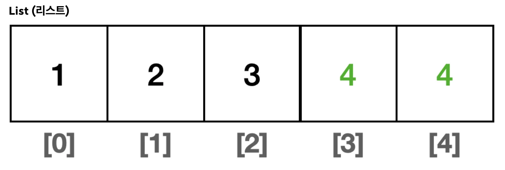
> 
> - <strong> 순서</strong>&#58; <strong>O </strong>
> 
> - <strong>중복 허용&#58; </strong><strong>O </strong>
> 
> - <strong>인덱스 접근</strong>
> 
> <a id="1cdeda9b0fe18092be3ef634f7822954"></a>
> 
>       ⇒  순서가 중요하고 중복된 요소를 허용 해야하는 경우 사용

> ✏️ 
> 
> <a id="1cdeda9b0fe180b0bd69dbbaf877c142"></a>
> 
> <strong>Set ( 세트, 셋 )</strong>
> 
> ---
> 
> 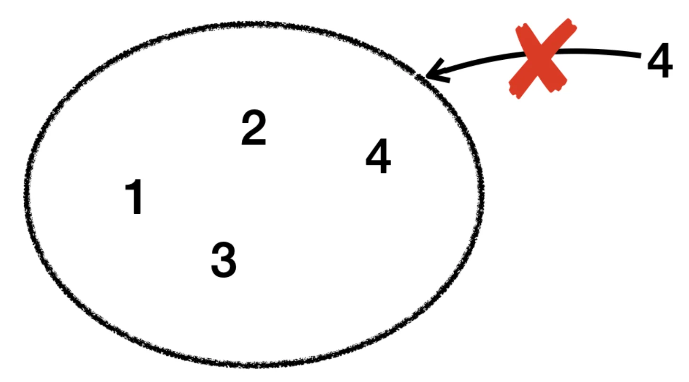
> 
> - 순서&#58; ❌  
> 
> - 중복 허용&#58; ❌  ( 유일성 )
> 
> - 빠른 검색 ( 추가 자료 조사 ) 
>     - 요소의 유무를 빠르게 확인할 수 있도록 최적화되어 있다&#46;
> 
>     - 이는 데이터의 중복을 방지하고 빠른 조회를 가능하게 한다&#46;

- ex)
    - List&#58; 장바구니 목록, 순서가 중요한 일련의 이벤트 목록

    - Set&#58; 회원 ID 집합, 고유한 항목의 집합

<a id="1cdeda9b0fe1802fabd0c11839253a99"></a>

### V0&#58; 직접 구현하는 Set 

<a id="1cdeda9b0fe180169478f57fdfeace8d"></a>

### 코드

<details>
<summary>&#91; 코드 &#93; MyHashSetV0</summary>

<a id="1cdeda9b0fe1806a9ebbed7b7329d539"></a>

```java
package collection.set.v0;

import java.util.Arrays;

public class MyHashSetV0 {

    private int[] elementData = new int[10];
    private int size = 0;

    // O(n)
    public boolean add(int value) {
        if (contains(value)) {
            return false;
        }
        elementData[size] = value;
        size++;
        return true;
    }

    // O(n)
    public boolean contains(int value) {
        for (int data : elementData) {
            if (data == value) {
                return true;
            }
        }
        return false;
    }

    public int getSize() {
        return size;
    }

    @Override
    public String toString() {
        return "MyHashSetV0{" +
                "elementData=" + Arrays.toString(Arrays.copyOf(elementData, size)) +
                ", size=" + size +
                '}';
    }
}

```

</details>

<details>
<summary>&#91; 코드 &#93; MyHashSetV0Main</summary>

<a id="1cdeda9b0fe18031ae92eea22525529a"></a>

```java
package collection.set.v0;

public class MyHashSetV0Main {

    public static void main(String[] args) {
        MyHashSetV0 set = new MyHashSetV0();
        set.add(1);   // O(1)
        set.add(2);   // O(n)
        set.add(3);   // O(n)
        set.add(4);   // O(n)
        System.out.println(set);

        boolean result = set.add(4);  // 중복 데이터 저장
        System.out.println("중복 데이터 저장 결과 = " + result);
        System.out.println(set);

        System.out.println("set.contains(3) = " + set.contains(3));  // O(n)
        System.out.println("set.contains(3) = " + set.contains(99));  // O(n)
    }
}

```

</details>

<details>
<summary>실행 결과</summary>

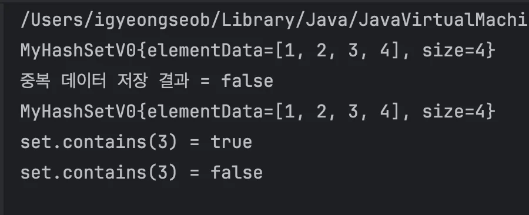

</details>

<a id="1cdeda9b0fe18003a8fcf6fb59940dd4"></a>

### 개선점

<a id="1cdeda9b0fe18008b732d8c27ec16d7d"></a>

<strong><code>add()</code></strong> 시 <strong><u>매번 배열 순회</u></strong>를 통해 중복 요소 확인을 한다&#46; → <code class="language-math">O(n)</code>

<a id="1cdeda9b0fe18013a10aee89d4f8f322"></a>

따라서<strong> </strong><strong>성능이 좋지 않</strong>기 때문에 리펙토링이 필요하다&#46;

<details>
<summary>&#91;  코드 &#93; <strong><code>add()</code></strong> </summary>


<a id="1cdeda9b0fe1808e8f48ded4d6742242"></a>

```java
public boolean add(int value) {
    if (contains(value)) {
        return false;
    }
    elementData[size] = value;
    size++;
    return true;
}


public boolean contains(int value) {
    for (int data : elementData) {   <- O(n)
        if (data == value) {
            return true;
        }
    }
    return false;
}
```

</details>

<a id="1cdeda9b0fe180ab9c13e051b7c81d85"></a>

## 해시 알고리즘

<a id="1cdeda9b0fe180139d97ef392c767b65"></a>

### V1&#58; index 사용

---

<a id="1cdeda9b0fe18016985ed5235c8d38f7"></a>

### 코드

<details>
<summary><strong>&#91; 🤬 개선 전 &#93;</strong><strong>   순회,</strong><strong> </strong><code class="language-math">O(n)</code></summary>

<a id="1cdeda9b0fe1808a85d1ffb109dc27ee"></a>

```java
package collection.set.v1;

import java.util.Arrays;

public class HashStart1 {

    public static void main(String[] args) {
        Integer[] inputArray = new Integer[4];
        inputArray[0] = 1;
        inputArray[1] = 3;
        inputArray[2] = 5;
        inputArray[3] = 6;
        System.out.println("Arrays.toString(inputArray) = " + Arrays.toString(inputArray));

        int searchValue = 8;
        // O(n)
        for (Integer inputValue : inputArray) {
            if (inputValue == searchValue) {
                System.out.println(inputValue);
            }
        }
    }
}
```

<a id="1cdeda9b0fe180da9041c8e74a55f05f"></a>

<br><strong>실행 결과</strong>

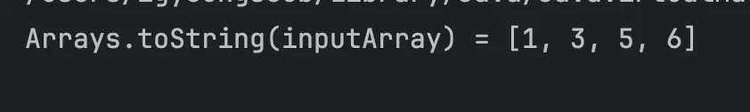

</details>

<details>
<summary><strong>&#91; 😆 index 적용 &#93;</strong>  조회 시 인덱스 사용, <code class="language-math">O(1)</code></summary>

<a id="1cdeda9b0fe180ce9a07d0e4c82e7186"></a>

```java
package collection.set.v1;

import java.util.Arrays;

public class HashStart2 {

    public static void main(String[] args) {
        // 입력: 1, 2, 5, 8
        // [null, 1, 2, null, null, 5, null, null, 8, null]
        Integer[] inputArray = new Integer[10];
        inputArray[1] = 1;
        inputArray[2] = 2;
        inputArray[5] = 5;
        inputArray[8] = 8;
        System.out.println("inputArray = " + Arrays.toString(inputArray));

        int searchValue = 0;
        Integer result = inputArray[searchValue];  // O(1)
        System.out.println(result);
    }
}

```

<a id="1cdeda9b0fe180feaac9f2073a56eed9"></a>

<strong>실행 결과</strong>

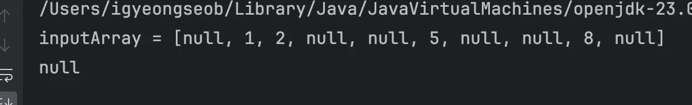

</details>

<a id="1cdeda9b0fe1806ca58fda30f16b74df"></a>

### 설명

<details>
<summary><strong>value = index</strong></summary>

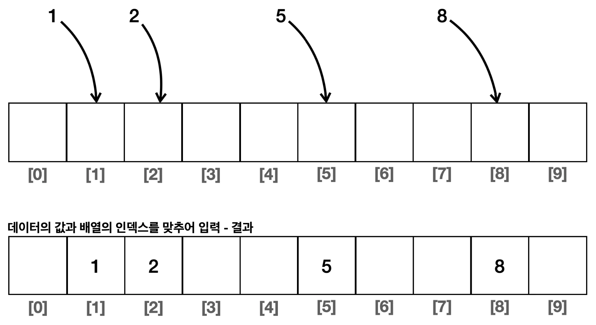

- 저장하는 데이터와 동일한 인덱스를 사용

-  인덱스 번호가 데이터가 되고, 데이터가 인덱스 번호 되기 때문에 <strong><u>value를 통한 배열 접근</u></strong>이 곧 <strong><u>인덱스를 사용</u></strong>한 것이 된다&#46;

- 그러나 한계점이 명확하다&#46;

</details>

<a id="1cdeda9b0fe180d488f6e55c9223c61d"></a>

### 개선점

<a id="1cdeda9b0fe180dfa4a4d6b871a5c365"></a>

데이터의 값 자체를 배열의 인덱스로 사용하여 요소 탐색  → <code class="language-math">O(1)</code>

<a id="1cdeda9b0fe18008b12fddb6b6c33788"></a>

검색 성능을 획기적으로 개선할 수 있었지만, 한계가 명확하다 &#46;

<a id="1cdeda9b0fe18047ac5def51dec280df"></a>

입력 값의 범위가 크면 <strong><u>그만큼 큰 배열을 사용</u></strong>해야 하며, 따라서 <strong><u>배열에 낭비되는 공간이 많이 발생</u></strong>한다&#46; 

<a id="1cdeda9b0fe1800b827bf9f96c9809fc"></a>

### V2&#58; 메모리 낭비

---

<a id="1cdeda9b0fe1809bab50c2bb8bf4c773"></a>

### 코드

<details>
<summary>&#91; 코드 &#93; 메모리 낭비 </summary>

<a id="1cdeda9b0fe180b9ad1edc44476ccd70"></a>

```java
package collection.set.v1;

import java.util.Arrays;

public class HashStart3 {

    public static void main(String[] args) {
        // {1, 2, 5, 8, 14, 99}
        // [null, 1, 2, null, null, 5, null, null, 8, .., 14 ....., 99]
        Integer[] inputArray = new Integer[100];
        inputArray[1] = 1;
        inputArray[2] = 2;
        inputArray[5] = 5;
        inputArray[8] = 8;
        inputArray[14] = 14;
        inputArray[99] = 99;

        System.out.println("inputArray = " + Arrays.toString(inputArray));
        int searchValue = 99;
        Integer result = inputArray[searchValue]; // O(1)
        System.out.println(result);
    }
}

```

<a id="1cdeda9b0fe180e898aef7a057ca7369"></a>

<strong>실행 결과</strong>

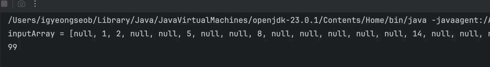

<a id="1cdeda9b0fe1802b9919fb33a367403e"></a>

```plaintext
 inputArray = [null, 1, 2, null, null, 5, null, null, 8, null, null, null, null,
 null, 14, null, null, null, null, null, null, null, null, null, null, null,
 null, null, null, null, null, null, null, null, null, null, null, null, null,
 null, null, null, null, null, null, null, null, null, null, null, null, null,
 null, null, null, null, null, null, null, null, null, null, null, null, null,
 null, null, null, null, null, null, null, null, null, null, null, null, null,
 null, null, null, null, null, null, null, null, null, null, null, null, null,
 null, null, null, null, null, null, null, null, 99]

99
```

<a id="1cdeda9b0fe18043a1d3c5b72a7457a9"></a>

<br><br>	<br>

</details>

<a id="1cdeda9b0fe180f08d6ee4e743cd4b6c"></a>

### 설명

<details>
<summary>한계점 &#45; 메모리 낭비</summary>

<a id="1cdeda9b0fe1800e8de8d563914c1bde"></a>

데이터의 값을 인덱스로 사용한 덕분에 O(1)의 매우 빠른 검색 속도를 얻을 수 있다&#46;

<a id="1cdeda9b0fe1805c966dfd336a04418e"></a>

하지만 낭비되는 메모리 공간이 너무 많다&#46;

<a id="1cdeda9b0fe180ad84acdb310120f530"></a>

만약 입력 값의 범위를 <code>0&#126;99</code> 를 넘어서 <code>int</code> 숫자의 모든 범위를 입력 할 수 있도록 하려면?

- <strong><code>int 범위</code></strong>&#58; <code>&#45;2,147,483,648</code> &#126; <code>2,147,483,647</code>

<a id="1cdeda9b0fe180bfa9edf898cff9bf7f"></a>

약 42억 사이즈의 배열 필요하다&#46; (&#43;&#45; 모두 포함)

- 4byte &#42; 42억 = 약 17기가 바이트 필요

<a id="1cdeda9b0fe180cd9f7ed2d46eddfdab"></a>

데이터의 값을 인덱스로 사용할 때,입력할 수 있는 값의 범위가 <code>int</code> 라면 한번의 연산에 컴퓨터의 메모리가거의 다 소모되어 버린다&#46;

<a id="1cdeda9b0fe180d18be2d872af39df66"></a>

 만약 사용자가 1, 2, 1000, 200000의 네 개의 값만 입력한다면 나머지 대부분의 메모리가 빈 공 간으로 낭비될 것이다&#46; 

<a id="1cdeda9b0fe18059b2bdc20cc3a8100e"></a>

뿐만 아니라 처음 배열을 생성하기 위해 메모리를 할당하는데도 너무 오랜 시간이 소모된다&#46;<br>따라서 데이터의 값을 인덱스로 사용하는 방식은 입력 값의 범위가 넓다면 사용하기 어려워 보인다&#46;

</details>

<a id="1cdeda9b0fe18085b9d1fe36518de216"></a>

### 개선점

<a id="1cdeda9b0fe180709109e5799e9d3ad5"></a>

 데이터의 값을 인덱스로 사용하는 방법은 매우 빠른 성능을 보장하지만, 입력 값의 범위가 조금만 커져도 메모리 낭비가 너무 심하다&#46;

- 해당 부분 리펙토링 필요

<a id="1cdeda9b0fe1802392f0f12f38110203"></a>

### V3&#58; 나머지 연산

> ✏️ 
> 
> <a id="1cdeda9b0fe1808fb664f41b54ccffc8"></a>
> 
> 데이터를 인덱스로 사용하는 방법은 메모리가 낭비되는 문제점이 있었다 &#46;
> 
> <a id="1cdeda9b0fe18060b1a3d0bcd61368f1"></a>
> 
> 이를 <strong><u>나머지 연산</u></strong>을 사용하면 개선할 수 있다&#46;

<a id="1cdeda9b0fe18093af32d6b6d0d22b38"></a>

### 설명

<details>
<summary>나머지 연산</summary>

<a id="1cdeda9b0fe18040bd6cd22bb4b2600b"></a>

```plaintext
1 % 10 = 1
2 % 10 = 2
5 % 10 = 5
8 % 10 = 8
14 % 10 = 4
99 % 10 = 9
```

- 14, 99는 10보다 큰 값이다&#46; 따라서 일반적인 방법으로는 크기가 10인 배열의 인덱스로 사용할 수 없다&#46;<br>하지만 나머지 연산의 결과를 사용하면 14는 4로, 99는 9가 되기 때문에, 크기가 10인 배열의 인덱스로 활용 가능하다&#46;

- 따라서 크기가 10인 배열에 나머지 연산 10을 한다면 10을 넘지 않으면서 그보다 큰 수를 다를 수 있게 된다&#46; 

- 그러나 중복 수 즉, 충돌에 대한 문제가 생긴다&#46; 

</details>

<details>
<summary>해시 인덱스</summary>

> ✏️ 
> 
> <a id="1cdeda9b0fe18047a51efaa8cfc1937f"></a>
> 
> 배열의 인덱스로 사용할 수 있도록 <strong><u>원래의 값을 계산</u></strong>한 인덱스를 <strong><u>해시 인덱스(hashIndex)</u></strong>라 한다&#46;
> 
> <details>
> <summary>ex) 나머지 연산</summary>
> 
> - 14의 해시 인덱스는 4
> 
> - 99의 해시 인덱스는 9<br>
> 
> </details>

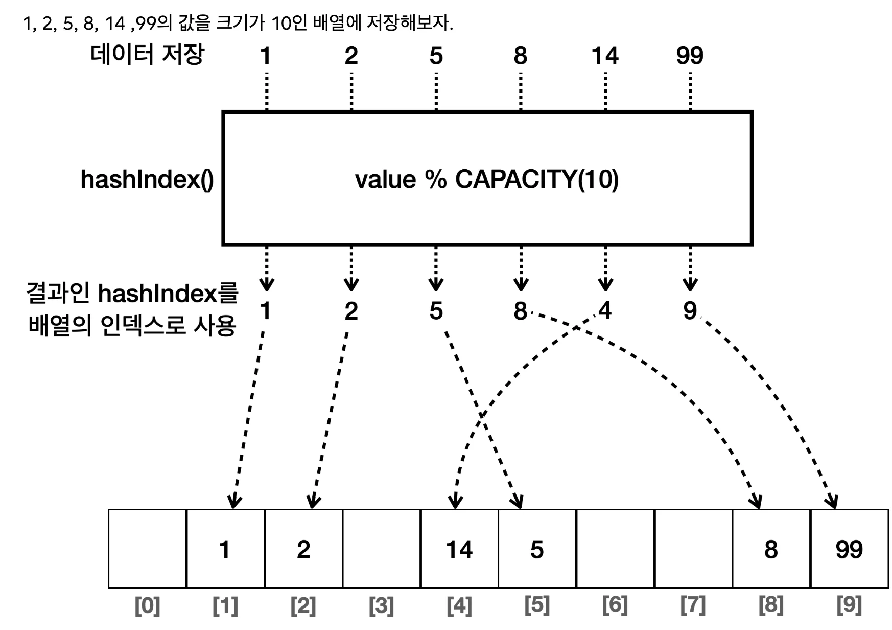

- 인덱스만 해시 인덱스를 사용하고, 값은 원래 값을 저장한다&#46;

- 배열의 인덱스를 사용하기 때문에 하나의 값을 저장하는데 O(1)로 빠른 성능을 제공한다&#46;

</details>

<details>
<summary>ex) 해시 인덱스&#58; &#91; 2, 14, 99&#93;</summary>

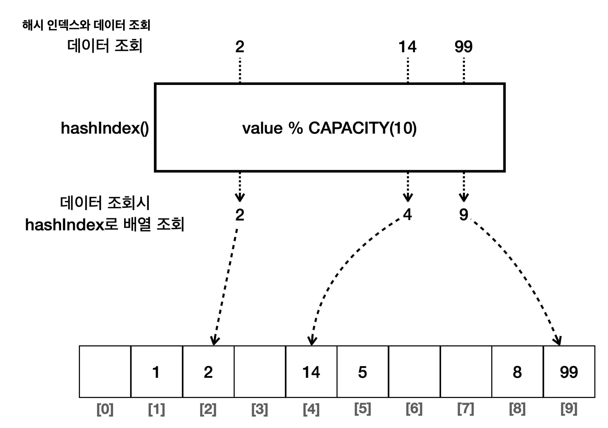

- 해시 인덱스&#58; 나머지 연산
    <a id="1cdeda9b0fe180df9ac0e95572718a73"></a>

    ```plaintext
    2 % 10 = 2

    14 % 10 = 4

    99 % 10 = 9
    ```

- 해시 인덱스를 배열의 인덱스로 사용해서 데이터를 조회한다&#46;
    - 예) <code>int value = inputArray&#91;hashIndex&#93;</code>

- 배열의 인덱스를 사용 ⇒ 탐색&#58; <code class="language-math">O(1)</code>

</details>

<a id="1cdeda9b0fe1803795e5f3081fa9b2aa"></a>

### 코드

> ✏️ 
> 
> <a id="1cdeda9b0fe180948fe7ca708eaf06d3"></a>
> 
> 입력 값의 범위가 넓어도 실제 모든 값이 들어오지는 않기 때문에 배열의 크기를 제한하고, 나머지 연산을 통해 메모리가 낭비되는 문제도 해결할 수 있다&#46;<br>해시 인덱스를 사용해서 O(1)의 성능으로 데이터를 저장하고, O(1)의 성능으로 데이터를 조회할 수 있게 되었다&#46;<br>덕분에 자료 구조의 조회 속도를 비약적으로 향상할 수 있게 되었다&#46;

<details>
<summary>&#91; 코드 &#93; HashStart4</summary>

<a id="1cdeda9b0fe1800d926acb940db349a2"></a>

```java
package collection.set.v2;

import java.util.Arrays;

public class HashStart4 {
    static final int CAPACITY = 10;

    public static void main(String[] args) {
        //{1, 2, 5, 8, 14, 99}
        System.out.println("hashIndex(1) = " + hashIndex(1));
        System.out.println("hashIndex(2) = " + hashIndex(2));
        System.out.println("hashIndex(5) = " + hashIndex(5));
        System.out.println("hashIndex(8) = " + hashIndex(8));
        System.out.println("hashIndex(14) = " + hashIndex(14));
        System.out.println("hashIndex(99) = " + hashIndex(99));
        Integer[] inputArray = new Integer[CAPACITY];

        add(inputArray, 1);
        add(inputArray, 2);
        add(inputArray, 5);
        add(inputArray, 8);
        add(inputArray, 14);
        add(inputArray, 99);
        System.out.println("inputArray = " + Arrays.toString(inputArray));

        // 검색
        int searchValue = 14;
        int hashIndex = hashIndex(searchValue);
        System.out.println("searchValue hashIndex = " + hashIndex);
        Integer result = inputArray[hashIndex]; // O(1)
        System.out.println(result);
    }

    private static void add(Integer[] inputArray, int value) {
        int hashIndex = hashIndex(value);
        inputArray[hashIndex] = value;
    }

    static int hashIndex(int value) {
        return value % CAPACITY;
    }
}

```

</details>

<details>
<summary>실행 결과</summary>

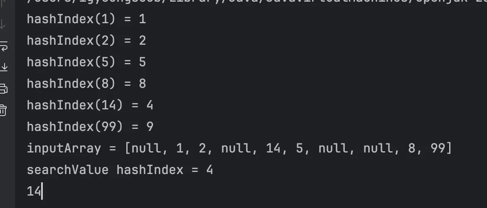

</details>

<a id="1cdeda9b0fe1802ea4cfed4ce4704fd2"></a>

### 개선점

<details>
<summary>저장할 위치가 충돌할 수 있다는 한계가 있다&#46;   ← <strong>해시 충돌</strong></summary>

- ex 1) 1, 11의 두 값은 10으로 나누면 같은 값 1이 나온다&#46;
    <a id="1cdeda9b0fe180748f8ce20256da962a"></a>

    ```plaintext
    1 % 10 = 1

    11 % 10 = 1
    ```

- ex 2) 9, 99의 두 값은 10으로 나누면 같은 값 9 가 나온다&#46;
    <a id="1cdeda9b0fe180b0bac2c3de1773bd2c"></a>

    ```plaintext
    99 % 10 = 9

    9 % 10 = 9
    ```

</details>

<a id="1cdeda9b0fe1803fb670e31933a5f562"></a>

### 해시 충돌의 문제 와 해결 방법

> 이전 정리&#58; ‣

<details>
<summary>해시 충돌 문제</summary>

- ex 2) 9, 99의 두 값은 10으로 나누면 같은 값 9 가 나온다&#46;
    <a id="1cdeda9b0fe180aba0f0e6dc9d5cde18"></a>

    ```plaintext
    99 % 10 = 9

    9 % 10 = 9
    ```

<a id="1cdeda9b0fe180dc921ac8ec63e32013"></a>

위와 같은 경우 9, 99 모두 9의 해시 인덱스를 가진다&#46; 

<a id="1cdeda9b0fe1803d86f6d0f95c60bcaa"></a>

해시 인덱스가 동일하여 충돌이 일어나면  아래와 같은 문제점이 발생된다&#46;

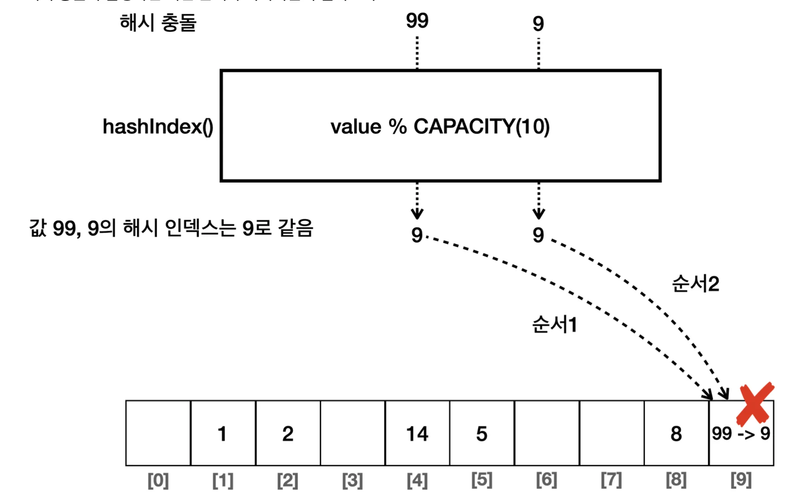

- 먼저 99의 값을 저장한다&#46; 해시 인덱스는 9이므로 9번 인덱스에 99 값을 저장한다&#46;

- 다음으로 9의 값을 저장한다&#46; 해시 인덱스는 9이므로 9번 인덱스에 9 값을 저장한다&#46;

- 결과적으로 배열의 인덱스 9에는 처음에 저장한 값 99는 사라지고, 마지막에 저장한 값 9만 남게된다&#46;

<a id="1cdeda9b0fe1809489a4e9ba0594c368"></a>

⇒ 이전에 저장한 값을 덮어씌운다&#46;

</details>

<details>
<summary><strong>&#91; X &#93;</strong><strong> </strong><strong>해결 </strong><strong>방법 1</strong> &#45; CAPACITY를 값의 입력 범위 만큼 키우기</summary>

- 위 예시의 경우 99까지만 입력하므로 CAPACITY를 100으로 늘리면 된다

- 그러나 해당 방법은 메모리 낭비가 심하고 모든 <code>int</code> 숫자를 다 받는 문제를 해결할 수 없다&#46;

</details>

<details>
<summary><strong>&#91; O &#93;</strong><strong> 해결 방법 2</strong> &#45; 중첩 배열</summary>

<details>
<summary>중첩 배열을 통한 충돌 해결</summary>

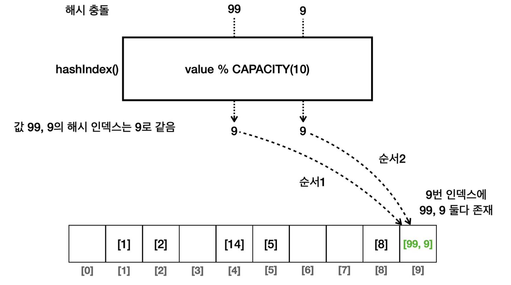

- <strong>배열 안에 배열 생성</strong>
    - 배열 안 에 리스트 같은 다른 자료구조를 사용해도 된다&#46;

</details>

<details>
<summary>해시 충돌 조회</summary>

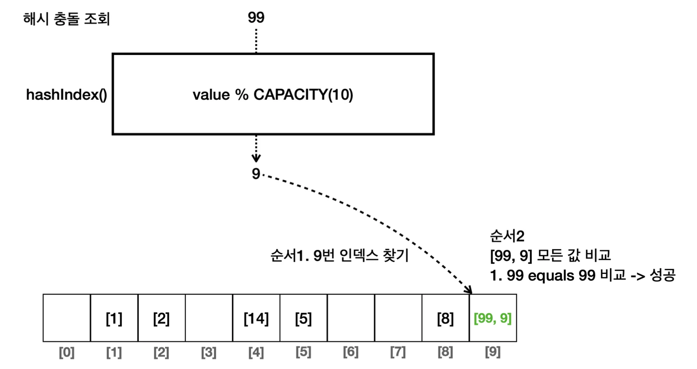

- 99의 해시 인덱스는 9이다&#46; 배열에서 9번 인덱스를 찾는다&#46;

- 배열 안에는 또 배열이 들어있다&#46; 여기에 있는 모든 값을 검색할 값과 하나씩 비교한다&#46;
    - &#91;99, 9&#93;의 데이터가 들어있는데, 첫 비교해서 원하는 데이터를 찾을 수 있다&#46;

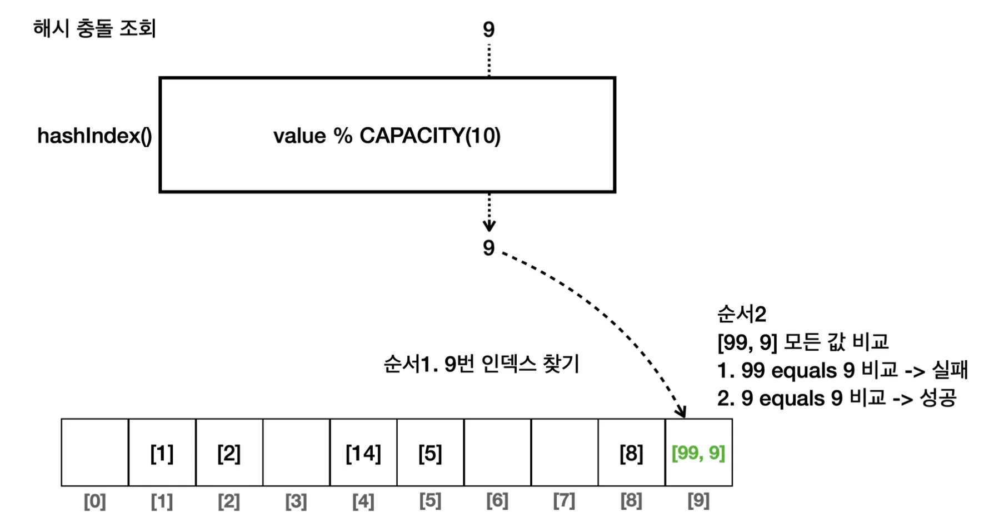

1. 9의 해시 인덱스는 9이다&#46; 배열에서 9번 인덱스를 찾는다&#46;

1. 내부 배열의 모든 값들을 비교하여 탐색한다&#46;
    - &#91;99, 9&#93;의 데이터가 들어있다&#46; 첫 비교에서 <code>99 equals 9</code> 는 거짓이므로 실패한다&#46; 

    - 다음 비교에서 <code>9 equals 9</code> 는 참이므로 해당 데이터를 반환한다&#46;

</details>

<details>
<summary><strong>&#91; 최악의 경우&#93;</strong> 모든 경우 해시 충돌이 발생 →  O(n)</summary>

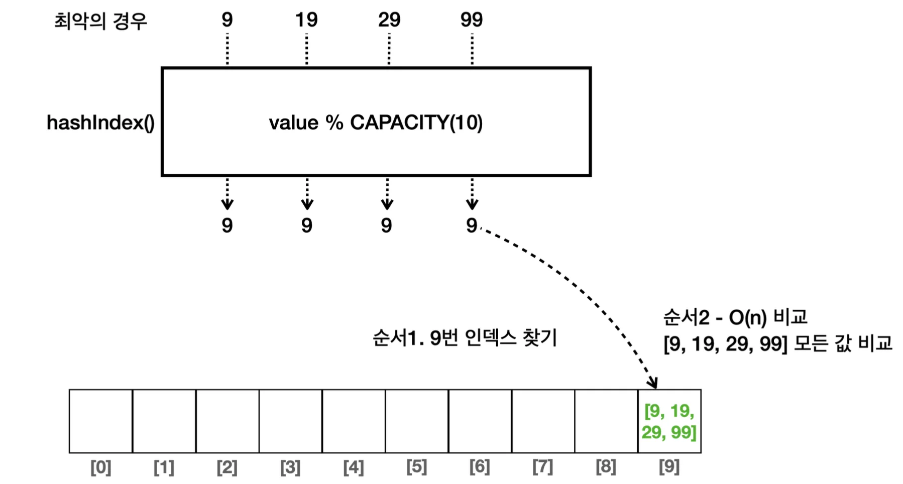

- ex) 9, 19, 29, 99
    - 위 경우, 해시 알고리즘을 나머지 연산으로 사용하면 모든 요소들의 해시 인덱스가 9를 가지면서 모드 9 index에 할당된다&#46; 

    - 따라서 특정 값을 탐색하기 위해서는 9 인덱스의 내부 배열을 탐색해야 하며, <br>해당 내부 배열에 모든 요소들이 할당 되었기 때문에 O(n) 연산 비용이 발생된다&#46;

<a id="1cdeda9b0fe180ed8cd0f9fdcad02087"></a>

⇒ 해시 알고리즘에 대한 변경이 필요함

</details>

</details>

<a id="1cdeda9b0fe180f4801ac171595f717d"></a>

### V4&#58; 해시 충돌

<a id="1cdeda9b0fe180b1becbedf418cf1c71"></a>

### 코드

<details>
<summary>&#91; 코드 &#93;  Set  2중첩 &#91; 배열 &#45; 연결 리스트 &#93;</summary>

<a id="1cdeda9b0fe18054b751e88a9d89dd08"></a>

```java
package collection.set.v3;

import java.util.Arrays;
import  java.util.LinkedList;

public class HashStart5 {
    static final int CAPACITY = 10;

    public static void main(String[] args) {
        //{1, 2, 5, 8, 14, 99 ,9}
        LinkedList<Integer>[] buckets = new LinkedList[CAPACITY];
        for (int i = 0; i < CAPACITY; i++) {
            buckets[i] = new LinkedList<>();
        }

        add(buckets, 1);
        add(buckets, 2);
        add(buckets, 5);
        add(buckets, 8);
        add(buckets, 14);
        add(buckets, 99);
        add(buckets, 9); //중복
        System.out.println("buckets = " + Arrays.toString(buckets));

        //검색
        int searchValue = 9;
        boolean contains = contains(buckets, searchValue); System.out.println("buckets.contains(" + searchValue + ") = " +  contains);
    }

    private static void add(LinkedList<Integer>[] buckets, int value) {
        int hashIndex = hashIndex(value);
        LinkedList<Integer> bucket = buckets[hashIndex]; // O(1)
        if (!bucket.contains(value)) { // O(n)
            bucket.add(value);
        }
    }

    private static boolean contains(LinkedList<Integer>[] buckets, int searchValue) {
        int hashIndex = hashIndex(searchValue);
        LinkedList<Integer> bucket = buckets[hashIndex]; // O(1)
        return bucket.contains(searchValue); // O(n)
    }

    static int hashIndex(int value) {
        return value % CAPACITY;
    }
}

```

<a id="1cdeda9b0fe18034aa93d92ee8b86d9a"></a>

실행 결과

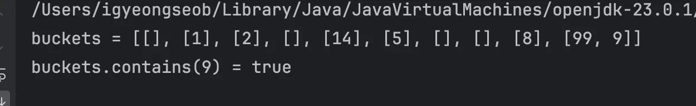

</details>

<a id="1cdeda9b0fe18041bed6efc9c1221f90"></a>

### 설명

<details>
<summary>중첩 구조&#58; 배열 &#45;  연결리스트</summary>

<a id="1cdeda9b0fe180c19a18c4075034375f"></a>

```java
LinkedList<Integer>[] buckets = new LinkedList[CAPACITY]
```

- 해시 충돌을 고려하여 배열 안에 요소들을 연결리스트로 추가한다&#46;
    - 배열 → 연결리스트 → 데이터 

</details>

<details>
<summary>데이터 등록</summary>

<a id="1cdeda9b0fe1809cad47f2a56153a21e"></a>

```java
private static void add(LinkedList<Integer>{} buckets, int value) {
		int hashIndex = hashIndex(value);
		LinkedList<Integer> bucket = buckets[hashIndex];  // O(1)
		if (!bucket.contains(value) {   // O(n)
				bucket.add(value);
		}
}
```

1. 해시 인덱스(hashIndex) 구한다&#46;

1. 해시 인덱스(hashIndex) 로 배열의 인덱스 찾기

1. set은 중복을 허용하지 않기 때문에, bukets에 값을 저장하기 전에 <code>contains()</code>를 사용해서 중복 여부를 확인하다&#46; 만약 bukets 해당 데이터가 없다면 저장한다&#46;
    -  연결리스트의 <code>contains()</code>는 모든 항목을 다 순회하기 때문에 O(n)의 비용이 든다&#46; 

    - 충돌이 없으면 1개의 데이터만 가지고 있기 때문에 <code>O(1)</code>  이다&#46;

</details>

<details>
<summary>데이터 검색</summary>

<a id="1cdeda9b0fe18003a383dc1ccdba47aa"></a>

```java
private static boolean contains(LinkedList<Integer>[] buckets, int searchValue) {
		int hashIndex = hashIndex(searchValue);
		LinkedList<Integer> bucket = buckets[hashIndex];  // O(1)
		return bucket.contains(searchValue);  // O(n)
}
```

1. 해시 인덱스로 배열의 인덱스를 찾음

1. 연결 리스트의 <code>bucket&#46;contains(searchValue)</code> 메서드를 사용해서 찾는 데이터가 있는지 확인
    - 연결 리스트의 <code>contains()</code>는 모든 항목을 다 순회하기 때문에 <code>O(n)</code>의 비용이 든다&#46;

    - 하지만 해시 충돌이 발생하지 않으면 데이터가 1개만 들어있기 때문에 <code>O(1)</code>의 성능을 제공한다&#46;

</details>

<a id="1cdeda9b0fe180278c83f4e423df5290"></a>

### 해시 인덱스 충돌 확률 

> 📖 
> 
> <a id="1cdeda9b0fe18003b098c67fc1c4b402"></a>
> 
> 해시 충돌이 발생하면 데이터를 추가하거나 조회할 때, 연결 리스트 내부에서 O(n)의 추가 연산을 해야 하므로 성능이 떨어진다&#46; 따라서 해시 충돌은 가급적 발생하지 않도록 해야 한다&#46;
> 
> <a id="1cdeda9b0fe180a68d74f0298bd7270f"></a>
> 
> 해시 충돌이 발생할 확률은 입력하는 데이터의 수와 배열의 크기와 관련이 있는데, 입력하는 데이터의 수와 비교해서 배열 의 크기가 클 수록 충돌 확률은 낮아진다&#46;
> 
> - 입력 데이터 / 배열의 크기  ↑  = 충돌 확률 ↓

<details>
<summary> 배열의 크기인 <code>CAPACITY</code> 값 변경에 따른 충돌 확률 변화</summary>

<a id="1cdeda9b0fe180d19e54d448ef1bde68"></a>

<strong>예제</strong>

<a id="1cdeda9b0fe1807cb491ca625def8ffa"></a>

```java
CAPACITY = 1: [[1, 2, 5, 8, 14, 99, 9]]

CAPACITY = 5: [[5], [1], [2], [8], [14, 99, 9]]

CAPACITY = 10: [[], [1], [2], [], [14], [5], [], [], [8], [99, 9]]

CAPACITY = 11: [[99], [1], [2], [14], [], [5], [], [], [8], [9], []]

CAPACITY = 15: [[], [1], [2], [], [], [5], [], [], [8], [99, 9], [], [], [], [], [14]]
```

- <strong><code>CAPACITY = 1</code></strong><strong>&#58;</strong> 배열의 크기가 하나밖에 없을 때는 모든 해시가 충돌한다&#46;

- <strong><code>CAPACITY = 5</code></strong>&#58; 배열의 크기가 입력하는 데이터 수 보다 작은 경우 해시 충돌이 자주 발생한다&#46;

- <strong><code>CAPACITY = 10</code></strong>&#58; 저장할 데이터가 7개 인데, 배열의 크기는 10이다&#46; <strong><u>7/10 약 70% 정도</u></strong>로 약간 여유있게 데이터가 저장된다&#46; 이 경우 가끔 충돌이 발생한다&#46;

- <strong><code>CAPACITY = 11</code></strong>&#58; 저장할 데이터가 7개 인데, 배열의 크기는 11이다&#46; 가끔 충돌이 발생한다&#46; 여기서는 충돌이 발생하지 않았다&#46;

- <strong><code>CAPACITY = 15</code></strong>&#58; 저장할 데이터가 7개 인데, 배열의 크기는 15이다&#46; 가끔 충돌이 발생한다&#46; 여기서는 충돌이 하나 발생했다&#46;

> ✏️ 
> 
> <a id="1cdeda9b0fe180818589e378119295e3"></a>
> 
> 통계적으로 <strong><u>입력한 데이터의 수가 배열의 크기를 75% 넘지 않</u></strong>으면 <strong><u>해시 인덱스는 자주 충돌하지 않</u></strong>는다&#46; 반대로 75%를 넘으면 자주 충돌하기 시작한다&#46;
> 
> <a id="1cdeda9b0fe180e88eeee493db0b57b2"></a>
> 
> 배열의 크기를 크게 만들면 해시 충돌은 줄어서 성능은 좋아지지만, 많은 메모리가 낭비된다&#46;<br>반대로 배열의 크기를 너 무 작게 만들면 해시가 자주 충돌해서 성능이 나빠진다&#46; 
> 
> <a id="1cdeda9b0fe18079aa52c3c7a930f696"></a>
> 
> 따라서 상황에 따라 다르겠지만 <strong><u>보통 75%를 적절한 크기</u></strong>로 기준 잡는 것이 효과적이다&#46;

</details>

> 🗒️ 
> 
> <a id="1cdeda9b0fe18020ac30dc5fa130ad0f"></a>
> 
> <strong>정리&#58; </strong>해시  인덱스를 사용하는 경우
> 
> > 데이터 저장
> 
> - 평균&#58; <code>O(1)</code>
> 
> - 최악&#58; <code>O(n)</code>
> 
> > 데이터 조회
> 
> - 평균&#58; <code>O(1)</code>
> 
> - 최악&#58; <code>O(n)</code>
> 
> ---
> 
> <a id="1cdeda9b0fe180f9b92cd8164b5ec2df"></a>
> 
> 해시  인덱스를 사용하는 방식은 사실 최악의 경우는 거의 발생하지 않는다&#46; 
> 
> <a id="1cdeda9b0fe18021b009f4a0c442942b"></a>
> 
> 배열의 크기만 적절하게 잡아주면 대부분 O(1)에 가까운 매우 빠른 성능을 보여준다&#46;
