<a id="1c3eda9b0fe181acbe35ca4e1da3aea9"></a>

### 🧐 값 타입 vs 엔티티 

> 식별자 유무  → 식별자를 통해 값이 변경되어도 추적 가능함 

<details>
<summary><strong>값 타입</strong></summary>

<a id="1c3eda9b0fe181a59009e424847844c5"></a>

<strong>자바 기본 타입</strong>( <code>Int</code>, <code>Integer</code>, <code>String</code> … ), <strong>객체</strong>

<a id="1c3eda9b0fe18113a8cbc6165560a95f"></a>

<strong><u>식별자가 없고 값만 있</u></strong><strong>으므로 </strong><strong><u>변경 시 추적 불가</u></strong><strong>함<br></strong>

- 기본값 타입

- 임베디드 타입

- 컬렉션 타입

<a id="1c3eda9b0fe181bd832ed60602efd366"></a>

     →  시작일, 종료일, 우편번호, 죄표(x, y)

</details>

<details>
<summary>엔티티 타입</summary>

<a id="1c3eda9b0fe1816cba86fa3807ad4ff0"></a>

<code>&#64;Entity</code>로 정의하는 객체

<a id="1c3eda9b0fe18194b11cee33d54c7e95"></a>

데이터가 변해도 <em><strong>식별자 </strong></em>로 지속해서 추적 가능

<a id="1c3eda9b0fe1814bb270c79f106f7242"></a>

   ex) 회원 엔티티의 키나 나이 값을 변경해도 식별자로 인식 가능

</details>

<a id="1c3eda9b0fe181dca4cdd99c6fac9b79"></a>

## <strong>기본값 타입</strong>

> 📌 <strong>생명주기를 엔티티의 의존</strong>
> 
> <a id="1c3eda9b0fe181b9a64ae36d263d62b8"></a>
> 
>    →  <strong>회원(Member) 엔티티를 삭제</strong>하면 <strong>이름, 나이 필드도 함께 삭제</strong>
> 
> <a id="1c3eda9b0fe1814ba6b1c4730996dad8"></a>
> 
> <strong>값 타입은 공유(복사) X</strong>
> 
> <a id="1c3eda9b0fe181c4b560ee36fb265ad0"></a>
> 
>   → <strong>회원 이름 변경 시 다른 회원의 이름도 함께 변경되면 안됨</strong>
> 
> - <strong>자바 기본 타입</strong> (int, double)
> 
> - <strong>래퍼 클래스</strong> (Integer, Long)
> 
> - <strong>String</strong>

> 🤔 <strong>Deep copy, Shallow copy</strong>
> 
> <details>
> <summary><a href="https://www.geeksforgeeks.org/copy-python-deep-copy-shallow-copy/">깊은 복사 ( Deep copy )</a> = <strong>기본 값 타입</strong></summary>
> 
> 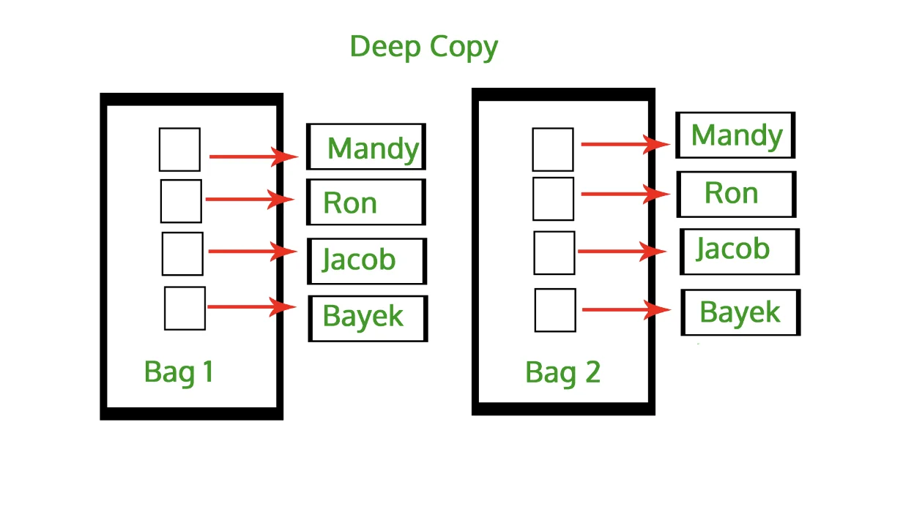
> 
> <a id="1c3eda9b0fe18105b55bf582bdd6afc5"></a>
> 
> 메모리 내부 데이터를 복사, 두 값은 메모리 내부에서 독립적으로 존재한다&#46;<br>따라서 복사 객체가 변경되어도 원본 객체는 변경되지 않는다&#46;
> 
> <a id="1c3eda9b0fe18173985ec912d76b29d5"></a>
> 
> 자바에서 <strong><u>기본값 타입</u></strong> 사용 시 <strong>Deep copy(깊은 복사)</strong>를 하기 때문에, 복사한 값이 변경되어도 원본 값에는 영향을 주지 않는다&#46; 
> 
> <a id="1c3eda9b0fe1811197d3e0228c1ade0f"></a>
> 
> ```java
> int a = 10;
> int b = a;
> 
> b = 20;
> 
> System.out.println("a = " + a);     // 10
> System.out.println("b = " + b);     // 20
> ```
> 
> </details>
> 
> <details>
> <summary> <a href="https://www.geeksforgeeks.org/copy-python-deep-copy-shallow-copy/">얕은 복사 (Shallow copy)</a>  = <strong>래퍼 클래스, String ( setter 로 변경 시 )</strong></summary>
> 
> 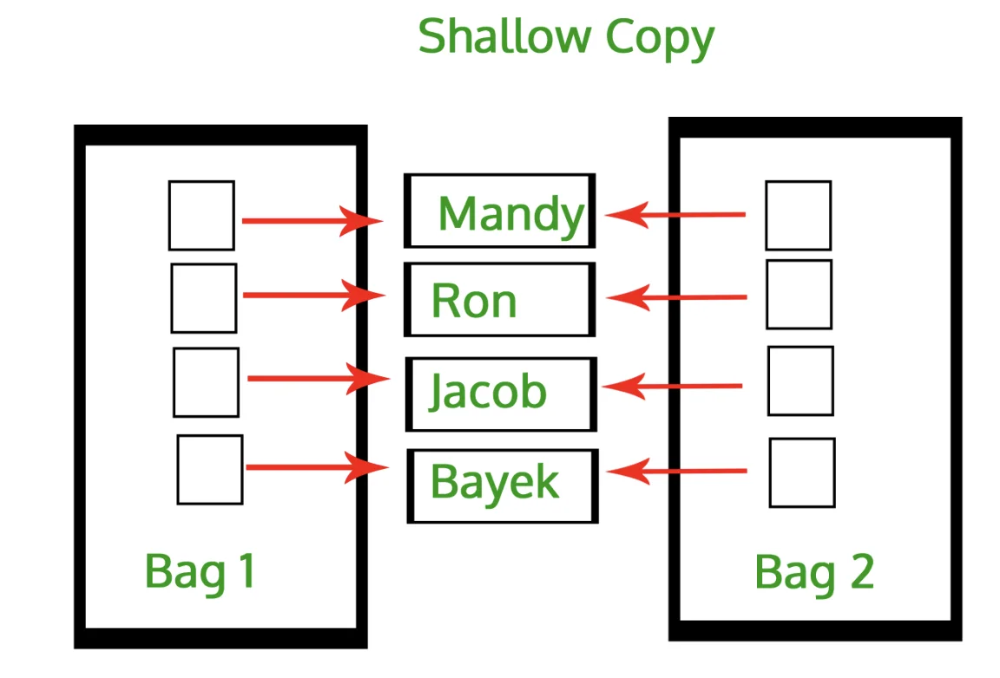
> 
> <a id="1c3eda9b0fe181739162eadd9791da0d"></a>
> 
> 객체를 생성하고 참조값을 보관한다&#46; <br>따라서 복사 객체 변경 시, 원본 값도 같이 변경된다&#46; <br>
> 
> <a id="1c3eda9b0fe181f3b000e58198768f10"></a>
> 
> <strong>래퍼 타입(Integer, Long),  String 같은 특수한 클래스는 </strong><strong>얕은 복사</strong>를 해<strong><u> 복사 객체 변경 시 원본 객체도 변경</u></strong>된다&#46;
> 
> <a id="1c3eda9b0fe1810caf35da3235c7b050"></a>
> 
> ```java
> // new Integer는 사용 X, 예시로써 잠깐 사용
> Integer a = new Integer((10));
> Integer b = a;
> 
> a.setValue(20);
> 
> System.out.println("a = " + a);
> System.out.println("b = " + b);
> ```
> 
> </details>

> ⚠️ <strong>중요&#33;<br>int, double 같은 </strong><strong>기본 타입(primitive type)은 절대 공유 </strong><br>기본 타입은 항상 값을 복사(Deep copy)함<br>따라서 공유한 값을 사용하여 한번에 <br><br>Integer 같은 <strong>래퍼 클래스</strong>나 <strong>String 같은 특수한 클래스</strong>는 공유 가능한 객체이지만 <strong>변경 X</strong>

<a id="1c3eda9b0fe181a6b66fdf7c0a67b94b"></a>

## 임베디드 타입 (복합 값 타입)

> 📌 <strong>Point</strong><strong><br></strong><strong><u>비슷한 속성</u></strong><strong>을</strong><strong> </strong><strong><u>캡슐화</u></strong><strong>하여 </strong><strong><u>직접 정의</u></strong><strong>하는 값 타입</strong><strong><br>JPA</strong>는 <strong>임베디드 타입(embedded type)</strong>이라 하며 <br>주로 <strong>기본값 타입을 모아서 만</strong>들어서 <strong><u>복합 값 타입</u></strong>이라고도 함<br>
> 
> - <strong><code>&#64;Embeddable</code></strong><strong>&#58; 값 타입을 정의하는 곳에 사용</strong>
> 
> - <strong><code>&#64;Embedded</code></strong><strong>&#58; 값 타입을 사용하는 곳에 표시</strong>
> 
> 
> <details>
> <summary><strong>장점</strong></summary>
> 
> - <strong>재사용</strong>
> 
> - <strong>높은 응집도</strong>
> 
> - <strong>해당 값 타입만 사용하는 메서드 생성 가능 </strong>  ex) Period&#46;isWork()
> 
> - <strong>임베디드 타입을 포함한 모든 값 타입은, 값 타입을 소유한 엔티티에 생명주기를 의존함</strong>
> 
> </details>

<details>
<summary><strong> 분리 전 회원 엔티티</strong></summary>

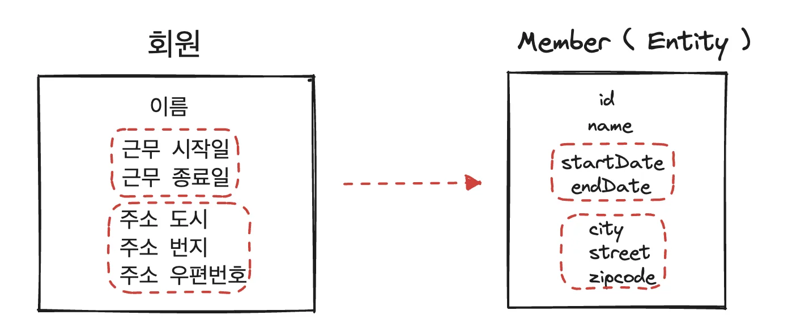

</details>

<details>
<summary><strong>임베디트 타입을 사용한 캡슐화</strong></summary>

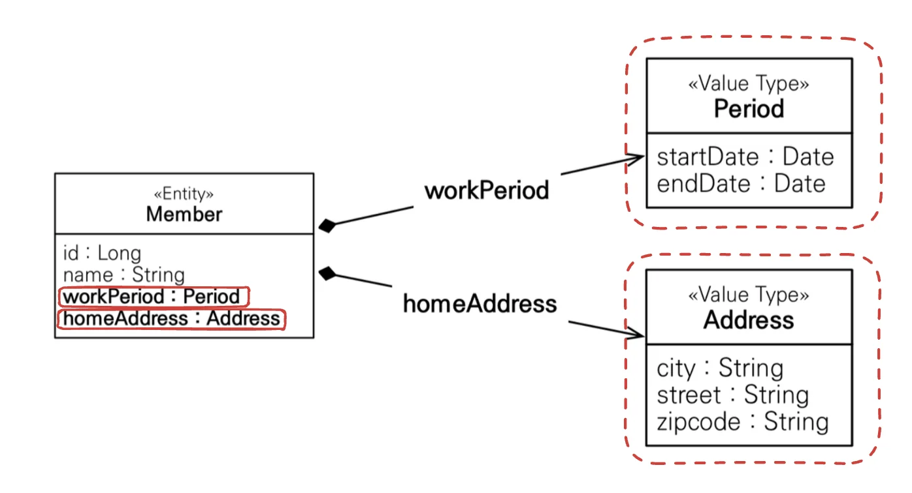

</details>

<details>
<summary><strong>코드</strong></summary>

<details>
<summary><strong>Member</strong></summary>

<a id="1c3eda9b0fe181598db3d613f644b9e7"></a>

```java
@Entity
public class Member {

    @Id
    @GeneratedValue
    @Column(name = "MEMBER_ID")
    private Long id;

    @Column(name = "USERNAME")
    private String username;

    // 기간(Period)
    @Embedded
    private Period period;
    // private LocalDateTime startDate;
    // private LocalDateTime endDate;
    

    // 주소(Address)
    @Embedded
    private Address address;
    // private String city;
    // private String street;
    // private String zipcode;
    
```

</details>

<details>
<summary><strong>Address</strong></summary>

<a id="1c3eda9b0fe1810088bbca1815797327"></a>

```java
package jpabook.jpashop.domain;

import jakarta.persistence.Embeddable;

@Embeddable
public class Address {
    private String city;
    private String street;
    private String zipcode;
		
		// 기본 생성자 필수
    public Address() {
    }

    public Address(String city, String street, String zipcode) {
        this.city = city;
        this.street = street;
        this.zipcode = zipcode;
    }

    public String getCity() {
        return city;
    }

    public void setCity(String city) {
        this.city = city;
    }

    public String getStreet() {
        return street;
    }

    public void setStreet(String street) {
        this.street = street;
    }

    public String getZipcode() {
        return zipcode;
    }

    public void setZipcode(String zipcode) {
        this.zipcode = zipcode;
    }
}

```

</details>

<details>
<summary><strong>Period</strong></summary>

<a id="1c3eda9b0fe181769e05f41be929143f"></a>

```java
package jpabook.jpashop.domain;

import jakarta.persistence.Embeddable;

import java.util.Date;

@Embeddable
public class Period {
    private Date startDate;
    private Date endtDate;

		// 기본 생성자 필수
    public Period() {
    }

    public Date getStartDate() {
        return startDate;
    }

    public void setStartDate(Date startDate) {
        this.startDate = startDate;
    }

    public Date getEndtDate() {
        return endtDate;
    }

    public void setEndtDate(Date endtDate) {
        this.endtDate = endtDate;
    }
}


```

</details>

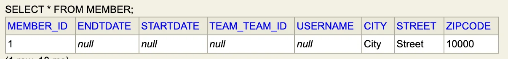

</details>

<a id="1c3eda9b0fe1814e8041d52952b625ea"></a>

###  ‘엔티티’ 와 ‘값 타입’ 연관관계 및 테이블 매핑

> 📌 <strong>임베디드 타입</strong>은<strong> 값을 캡슐화한 타입</strong>일 뿐, <strong><u>이전과 매핑하는 테이블</u></strong><u>은</u><strong><u> </u></strong><strong><u>동일</u></strong>하다&#46;<br>객체와 테이블을 <a href="https://m.blog.naver.com/leekdh1965/220742446934">아주 세밀하게(find&#45;grained)</a> 매핑하는 것이 가능하다&#46;<br><strong><u>잘 설계한 ORM 애플리케이션은 매핑한 테이블 수보다 클래스의 수가 더 많다</u></strong><strong>&#46;</strong>

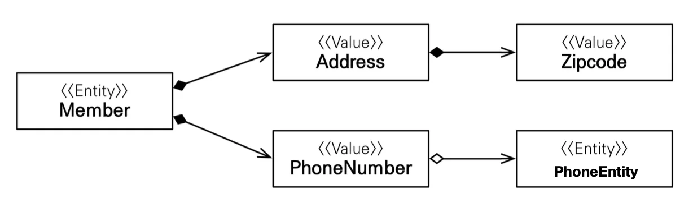

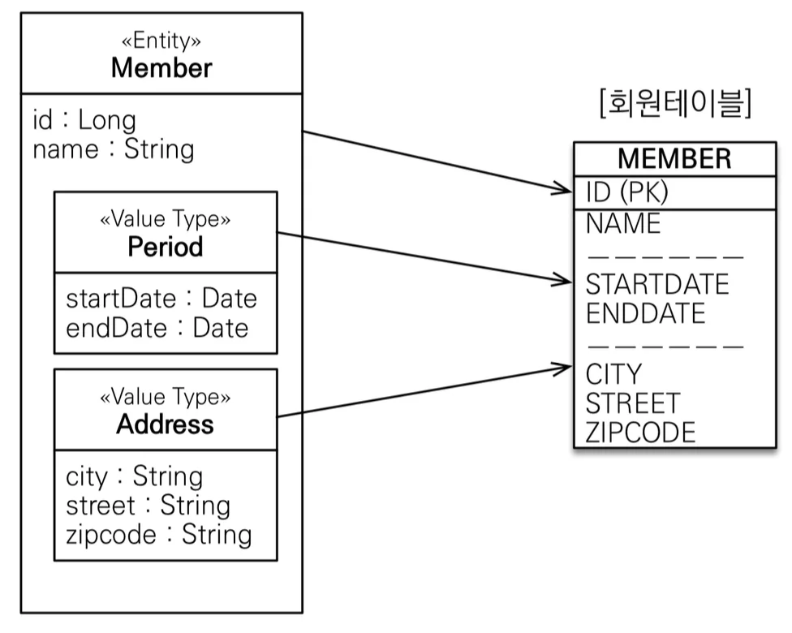

<a id="1c3eda9b0fe18127aabade0aaa5bc330"></a>

### <strong>&#64;AttributeOverride&#58; 속성 재정의</strong>

<a id="1c3eda9b0fe18124879bdbc83f9dad55"></a>

## 값 타입과 불변 객체

<a id="1c3eda9b0fe181bfa5bde996d2e17142"></a>

값 타입은 객체를 조금 더 구조화 및 단순화를 위해 나온 개념이다&#46; 따라서 단순하고 안전하게 다룰 수 있어야 한다&#46; 

<details>
<summary><strong>🤔 불변성을 유지하지 않으면 발생되는 오류 </strong></summary>

<a id="1c3eda9b0fe181edb5bcf1826832a4bb"></a>

불변성을 유지하지 않으면 아래와 같이 <strong>인스턴스 간의 속성 공유(shallow copy)</strong>가 일어나서 <strong>다른 인스턴스의 값까지 변경되는 심각한 오류가 발생</strong>된다&#46; 

<a id="1c3eda9b0fe181c6b363d86f7e435a5d"></a>

실무에서는 수십만개, 많으면 수백만개의 회원 인스턴스가 있는데, 이러한 버그가 발생되면… 못잡는다… 절대로 하면 안되는 실수이다&#46; 

<a id="1c3eda9b0fe1817f9b66f12a88c79f5f"></a>

```java
// JpaMain
Address address = new Address("city", "street", "10000");

Member member = new Member();
member.setUsername("member1");
member.setAddress(address);
em.persist(member);

Member member2 = new Member();
member2.setUsername("member2");
member2.setAddress(address);
em.persist(member2);

//

member.getAddress().setCity("newCity");
```

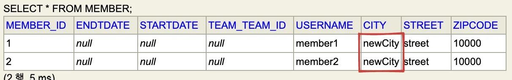

</details>

<details>
<summary><strong>값을 복사해서 사용  ⇒ </strong><strong>한계점</strong></summary>

<a id="1c3eda9b0fe1818dbdd6e485cad3cbd8"></a>

아래와 같이 항상 값을 복사해서 사용하면 공유 참조로 인해 발생되는 부작용을 피할 수는 있다 

<a id="1c3eda9b0fe181d79ea5dd8793fad63e"></a>

```java
// JpaMain
Address address = new Address("city", "street", "10000");

Member member = new Member();
member.setUsername("member1");
member.setAddress(address);
em.persist(member);

Address copyAddress = new Address(address.getCity(), address.getStreet(), address.getZipcode());

Member member2 = new Member();
member2.setUsername("member2");
member2.setAddress(copyAddress);
em.persist(member2);

//

member.getAddress().setCity("newCity");
```

<a id="1c3eda9b0fe1810d9396f85bc1d300e9"></a>

그러나 <strong>임베디드 타입</strong>처럼 <strong>직접 정의한 값 타입</strong>은 자바의 기본 타입이 아닌 <strong>객체 타입</strong>이다&#46; 

<a id="1c3eda9b0fe181b28c4bd2c029cb1184"></a>

위 기본값 타입에서 한번 정리 했듯  <strong>객체 타입</strong>은 <strong><u>참조값을 복사</u></strong>해서 넘기는 <strong>얕은 복사(shallow copy)</strong>를 한다&#46;

<a id="1c3eda9b0fe181b68f32c8b47b0fd675"></a>

객체를 복사해도 결국 참조값을 복사하는 것이며 이는 <strong><u>한 인스턴스를 공유</u></strong>한다는 것이다&#46; 

<a id="1c3eda9b0fe18123bfaefd47f1f70153"></a>

따라서 하나의 속성 값을 수정 시, 참조된 모든 인스턴스의 값이 변경되며 이로 인해 부작용(side effect)이 발생된다&#46; 

</details>

<a id="1c3eda9b0fe1813da921ca824cc369eb"></a>

### 해결)  불변 객체

<a id="1c3eda9b0fe181b9bc4ee8836866b7d4"></a>

<strong>객체 타입을 수정할 수 없</strong>게 만들어 부작용(side effect)을 아에 차단한다&#46; 

> <strong><code>불변 객체</code></strong>&#58; <strong><u>생성 시점 이후 절대 값을 변경할 수 없</u></strong>는 객체<br>    &#45; <code>Integer</code>, <code>String</code>은 자바에서 제공되는 대표적인 <u>불변객체</u>이다&#46;

> 📌 <strong>방법1)  </strong><strong>생성자로만 값을 설정</strong>하고, <strong>수정자(Setter)</strong> ❌

<details>
<summary>ex) Address &#45; 수정자 제거</summary>

<a id="1c3eda9b0fe181a89020ecdbda3a0514"></a>

```java
// Address
@Embeddable
public class Address {
	  private String city;
	  private String street;
	  private String zipcode;
	
	  public Address() {
	  }
	
	  public Address(String city, String street, String zipcode) {
	      this.city = city;
	      this.street = street;
	      this.zipcode = zipcode;
	  }
	
	  public String getCity() {
	      return city;
	  }
	  
	  public String getStreet() {
	      return street;
	  }
	
	  public String getZipcode() {
	      return zipcode;
	  }
}
```

</details>

> 📌 <strong>방법2) </strong><strong>수정자(Setter)</strong>를 <code>private</code> 으로 생성

<a id="1c3eda9b0fe181dbafd6c43f50486b1a"></a>

<strong>private access</strong>이기 때문에 <strong><u>실제  사용되는 곳에서는 접근이 안</u></strong>되서 <strong>컴파일 오류</strong>가 발생되어 <strong>불변성이 유지</strong>된다&#46;

<details>
<summary>ex) Address &#45;  수정자(Setter)&#95; <code>private</code> Access 로 변경</summary>

<a id="1c3eda9b0fe18122be82d9976e42c67e"></a>

```java
   .   .   .

private void setCity(String city) {
    this.city = city;
}

private void setStreet(String street) {
    this.street = street;
}

private void setZipcode(String zipcode) {
    this.zipcode = zipcode;
}
```

</details>

> 📌 <strong>생성된 인스턴스의 속성 값을 변경하고 싶은 경우</strong>

<a id="1c3eda9b0fe1810aa76cc1e8254e7671"></a>

아래와 같이 <strong>다시 인스턴스를 생성</strong>하여 <strong>인스턴스 자체를 교체</strong>한다&#46;

<a id="1c3eda9b0fe1817b82a6d169ff57186f"></a>

```java
Address address = new Address("city", "street", "10000");

Member member = new Member();
member.setUsername("member1");
member.setAddress(address);
em.persist(member);

Address newAddress = new Address("NewCity", address.getStreet(), address.getZipcode());
member.setAddress(newAddress);
em.persist(member);
```

<a id="1c3eda9b0fe1811381ede1bf793fcf78"></a>

## 값 타입의 비교

> 📌 직접 값을 정의하는 <strong>인베디드 타입 (복합 값 타입)</strong>과 같은 경우, 비교는 항상 <strong><code>equals</code></strong>(동등성 비교)를 사용해야 한다&#46;<br>( equals 사용 시 <strong>Override</strong> 필요함)

<a id="1c3eda9b0fe1811d9871d7b4ca935847"></a>

### 동등성 비교를 위한 <code>equals()</code>  오버라이드

> ⚠️ <strong>사용 시, 자동 오버라이드만 사용</strong>
> 
> >  <code>cmd</code> &#43; <code>n</code> ,  equals 검색
> 
> 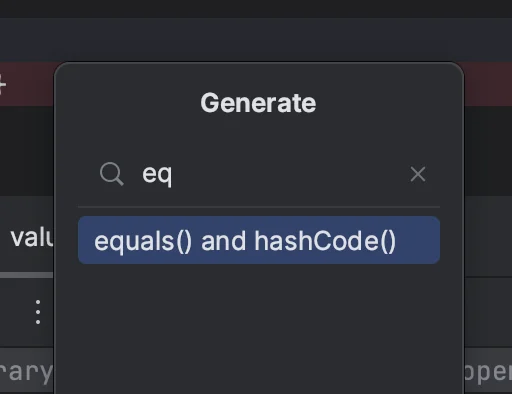
> 
> <a id="1c3eda9b0fe1810b804ae0a6c8b4d2b5"></a>
> 
> equals 사용 시 hash code도 구현해야된다&#46;
> 
> <a id="1c3eda9b0fe181b9b588f4bad8f5711d"></a>
> 
> → hash를 사용하는 Map 등 Collection에서 효율적으로 사용할 수 있다&#46;

<details>
<summary><strong>Address</strong></summary>

<a id="1c3eda9b0fe1813abf47cf23e589eeb8"></a>

```java
// Address

 .  .  .

@Override
public boolean equals(Object o) {
    if (this == o) return true;
    if (o == null || getClass() != o.getClass()) return false;
    Address address = (Address) o;
    return Objects.equals(city, address.city) && Objects.equals(street, address.street) && Objects.equals(zipcode, address.zipcode);
}

@Override
public int hashCode() {
    return Objects.hash(city, street, zipcode);
}
```

</details>

<details>
<summary><strong>valueMain</strong></summary>

> 👉🏻 <strong>동일성(identity) 비교</strong>&#58; 인스턴스 참조값 비교, <code>==</code> <br><strong>동등성(equivalence)</strong>&#58; 비교&#58; 인스턴스 값을 비교, <code>equals()</code>

<a id="1c3eda9b0fe181ef8b8cf647f0089465"></a>

```java
package jpabook.jpashop.domain;

public class valueMain {
    public static void main(String[] args) {
        int a = 10;
        int b = 10;

        System.out.println("a == b: " + (a == b));

        Address address1 = new Address("city", "street", "10000");
        Address address2 = new Address("city", "street", "10000");
        
        
			  // 동일성 비교(==): false
        System.out.println("address1 == address2: " + (address1==address2));
        
        // 동등성 비교(equals): true,   equals 오버라이드 필요
        System.out.println("address1 equals address2: " + (address1.equals(address2)));   
    }
}

```

</details>

<a id="1c3eda9b0fe181bd9492e4c83c901a8f"></a>

## 값 타입 컬렉션

<details>
<summary><strong>Reference</strong></summary>

<a id="1c3eda9b0fe18110a02ecfd6df0bf696"></a>

<a href="https://www.inflearn.com/course/lecture?courseSlug=ORM-JPA-Basic&#38;unitId=21716&#38;tab=curriculum">https&#58;//www&#46;inflearn&#46;com/course/lecture?courseSlug=ORM&#45;JPA&#45;Basic&#38;unitId=21716&#38;tab=curriculum</a>

<a id="1c3eda9b0fe181d3ad53d494bd26bccc"></a>

<a href="https://www.inflearn.com/course/lecture?courseSlug=ORM-JPA-Basic&#38;unitId=21716&#38;tab=curriculum">https&#58;//www&#46;inflearn&#46;com/course/lecture?courseSlug=ORM&#45;JPA&#45;Basic&#38;unitId=21716&#38;tab=curriculum</a>

<a id="1c3eda9b0fe18105b041c2e1967d8922"></a>

<a href="https://dangdangee.tistory.com/entry/JPA-ElementCollection-CollectionTable%EC%9D%84-%ED%86%B5%ED%95%9C-%EA%B0%92-%ED%83%80%EC%9E%85-%EC%BB%AC%EB%A0%89%EC%85%98-%EC%82%AC%EC%9A%A9%EB%B2%95">https&#58;//dangdangee&#46;tistory&#46;com/entry/JPA&#45;ElementCollection&#45;CollectionTable을&#45;통한&#45;값&#45;타입&#45;컬렉션&#45;사용법</a>

<a id="1c3eda9b0fe181b0b4e5e6bfa7678c89"></a>

<a href="https://prohannah.tistory.com/133">https&#58;//prohannah&#46;tistory&#46;com/133</a>

<a id="1c3eda9b0fe1812e866bdbfea174c406"></a>

<a href="https://blog.naver.com/PostView.nhn?blogId=qjawnswkd&#38;logNo=222074814530">https&#58;//blog&#46;naver&#46;com/PostView&#46;nhn?blogId=qjawnswkd&#38;logNo=222074814530</a>

</details>

<a id="1c3eda9b0fe1811cb9b9f0d063a16496"></a>

<strong>값 타입 컬렉션</strong>이란 값 타입을 하나 이상 저장하는 경우, <strong>값 타입을 </strong><strong><u>컬렉션</u></strong><strong>에 담</strong>아서 사용하는 것을말한다&#46; 

<a id="1c3eda9b0fe181a4b39ed3a4b8ebecc0"></a>

그러나 <strong>관계형 데이터베이스(RDB)</strong><strong>에서는 내부적으로 </strong><strong>컬렉션을 담을 수 없</strong>고 <strong><u>value 값</u></strong><strong>만 담</strong>을 수 있다&#46; <br>( JSON이 지원되어 가능한 DB도 있음)

<a id="1c3eda9b0fe1817fa81ffb90d77d6bc5"></a>

<strong>🧐 그렇다면 어떻게 값 타입 컬렉션을 테이블(DB)과 매핑하는가? </strong>

<a id="1c3eda9b0fe18103bb68f4e73585b26c"></a>

<strong><u>각 컬렉션</u></strong><u>에</u><strong><u> 해당하는 테이블 생성</u></strong>하여<strong> </strong> 컬렉션 요소들을 테이블에 저장 및 관리한다&#46;<strong><br></strong>또한 <strong>엔티티의 PK 값</strong>을  <strong>FK(외래키)</strong>로 가져와 <strong><u>엔티티 테이블</u></strong>과<strong> </strong><strong><u>컬렉션 테이블</u></strong><strong> 사이 </strong><strong><u>연관관계</u></strong>를 형성하여 매핑한다&#46;

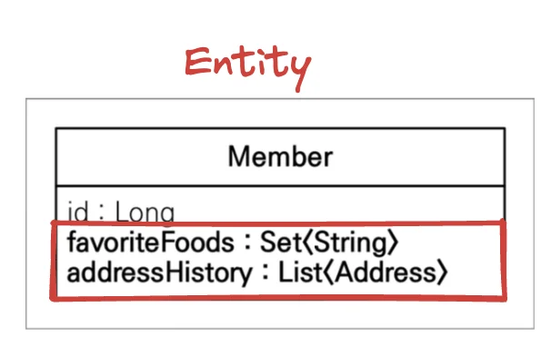

<a id="1c3eda9b0fe1812ab199c45f8cf62acf"></a>

위 예시 Entity를 보면  <strong><u>값 타입 컬렉션</u></strong>인 <strong>favoriteFoods</strong>(<strong><code>Set</code></strong>)<strong>, addressHistory</strong>(<strong><code>List</code></strong><strong> </strong>)가  존재한다&#46; 

<a id="1c3eda9b0fe18152b6f2cdf7f8b320e4"></a>

이를 RDB에서 구현 시, 아래의 테이블 구조처럼  <strong><u>각 컬렉션에 해당하는  테이블을 만</u></strong>들고<strong> </strong>해당 컬렉션들이 담긴<strong> Member 엔티티의 PK 값을 FK(외래키)</strong>로<strong> 가져와 연관관계를 형성</strong>하여 테이블을 매핑한다&#46; 

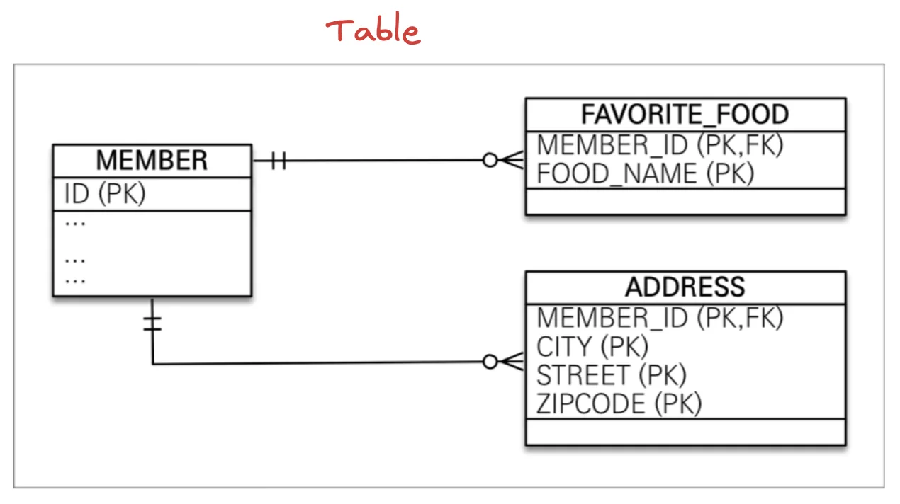

<a id="1c3eda9b0fe181b0a48de6d9aa27f590"></a>

### 구현

> 📌 • <code>&#64;ElementCollection</code>&#58; <strong>컬렉션 객체임을 JPA가 인식</strong>할 수 있게한다, <strong>JPA는 인식한 컬렉션을 테이블로 생성</strong>함 <br>• <code>&#64;CollectionTable</code>&#58; 값 타입 컬렉션이 <strong>매핑될 테이블 역활을 지정</strong> ( 테이블 이름, 조인 정보)<br>• <code>&#64;JoinColumn</code>&#58; <strong>외래키를 통한 테이블 간의 연관관계 형성</strong>

<details>
<summary>🧐 <code>&#64;ElementCollection</code> 테이블 생성 테스트 </summary>

<a id="1c3eda9b0fe18149b064edc7301e745e"></a>

아래와 같이 <code>&#64;ElementCollection</code>만을 통한 컬렉션에 해당하는 테이블이 생성되는지 테스트해봄

<a id="1c3eda9b0fe181618697cd686d3b48cf"></a>

```java
@Entity
public class Member {

    .  .  . 

    @ElementCollection
//    @CollectionTable(
//            name = "FAVORITE_FOOD",
//            joinColumns = @JoinColumn(name="MEMEBER_ID")
//    )
    private Set<String> favoriteFoods = new HashSet<>();
```

<a id="1c3eda9b0fe1818cacb4fefbd75a1722"></a>

아래와 같이 값 타입 컬렉션을 JPA가 인식하고 테이블을 생성하는 것을 확인함

<a id="1c3eda9b0fe181cfa592ef4390248c68"></a>

```java
... 

Hibernate: 
    create table Member_favoriteFoods (
        Member_MEMBER_ID bigint not null,
        favoriteFoods varchar(255)
    )
```

</details>

<details>
<summary><strong>Member </strong></summary>

<a id="1c3eda9b0fe181d09418eb1ee885adc3"></a>

```java
@Entity
public class Member {

    @Id
    @GeneratedValue
    @Column(name = "MEMBER_ID")
    private Long id;
    
    @Embedded
    private  Address homeAddress;
    
    @ElementCollection
    @CollectionTable(
            name = "FAVORITE_FOOD", 
            joinColumns = @JoinColumn(name="MEMEBER_ID")
    )
    private Set<String> favoriteFoods = new HashSet<>();

    @ElementCollection
    @CollectionTable(
            name = "ADDRESS", 
            joinColumns = @JoinColumn(name = "MEMBER_ID")
		)
    private List<Address> addressHistory = new ArrayList<>();
    
    
    .   .   .
   
```

</details>

<details>
<summary><strong>JpaMain</strong></summary>

<a id="1c3eda9b0fe1815d9368fc86302f27d9"></a>

```java
Member member = new Member();
member.setUsername("member1");
member.setHomeAddress(new Address("homeCity", "street", "10000"));

member.getFavoriteFoods().add("미나리");
member.getFavoriteFoods().add("볶음밥");
member.getFavoriteFoods().add("된장국");

member.getAddressHistory().add(new Address("city1", "street1", "10000"));
member.getAddressHistory().add(new Address("city2", "street2", "20000"));

em.persist(member);

tx.commit();
```

</details>

<details>
<summary><strong>쿼리</strong></summary>

<a id="1c3eda9b0fe181968981f2618a43bacb"></a>

```sql
// create table
Hibernate: 
    create table ADDRESS (
        MEMBER_ID bigint not null,
        city varchar(255),
        street varchar(255),
        zipcode varchar(255)
    )
Hibernate: 
    create table FAVORITE_FOOD (
        MEMEBER_ID bigint not null,
        favoriteFoods varchar(255)
    )


// 연관관계 형성
Hibernate: 
    alter table if exists ADDRESS 
       add constraint FKsuulxb5rmrxvb83yr43ox86wn 
       foreign key (MEMBER_ID) 
       references Member
Hibernate: 
  alter table if exists FAVORITE_FOOD 
     add constraint FK8hgtf6sclwm1i16eer90xxra8 
     foreign key (MEMEBER_ID) 
     references Member 
    
    
    
// 시퀀스 PK 값 적용
Hibernate: 
    select
        next value for Member_SEQ     


// insert
Hibernate: 
    /* insert for
        jpabook.jpashop.domain.Member.addressHistory */insert 
    into
        ADDRESS (MEMBER_ID, city, street, zipcode) 
    values
        (?, ?, ?, ?)
Hibernate: 
    /* insert for
        jpabook.jpashop.domain.Member.addressHistory */insert 
    into
        ADDRESS (MEMBER_ID, city, street, zipcode) 
    values
        (?, ?, ?, ?)
Hibernate: 
    /* insert for
        jpabook.jpashop.domain.Member.favoriteFoods */insert 
    into
        FAVORITE_FOOD (MEMEBER_ID, favoriteFoods) 
    values
        (?, ?)
Hibernate: 
    /* insert for
        jpabook.jpashop.domain.Member.favoriteFoods */insert 
    into
        FAVORITE_FOOD (MEMEBER_ID, favoriteFoods) 
    values
        (?, ?)
Hibernate: 
    /* insert for
        jpabook.jpashop.domain.Member.favoriteFoods */insert 
    into
        FAVORITE_FOOD (MEMEBER_ID, favoriteFoods) 
    values
        (?, ?)
```

</details>

<a id="1c3eda9b0fe181f2ac99c8525848138d"></a>

아래와 같이 Member의 pk 값을 외래키로 가지며 연관관계가 형성된 것을 확인할 수 있음

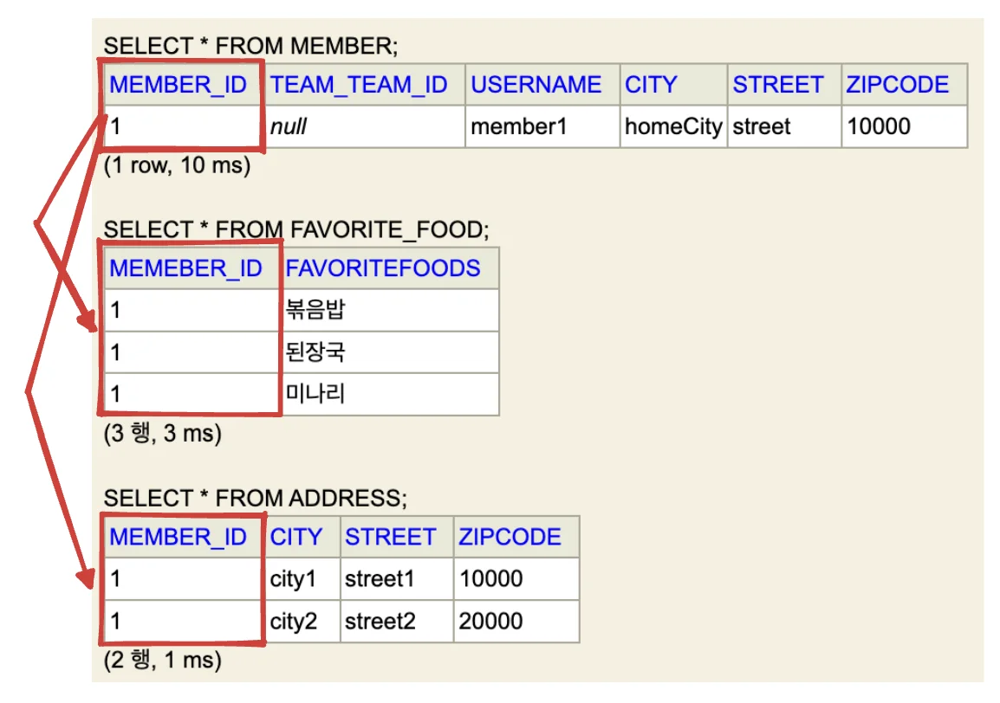

<a id="1c3eda9b0fe1815589a2f2dc7be61dde"></a>

### 특징

<details>
<summary><strong>특징 1) </strong><strong><u>값 타입 컬렉션</u></strong><strong>은 </strong><strong>의존하는 엔티티의 생명주기를 따</strong><strong>른다&#46; </strong></summary>

<a id="1c3eda9b0fe18134992ddf43beebebe3"></a>

```java
Member member = new Member();
member.setUsername("member1");
member.setHomeAddress(new Address("homeCity", "street", "10000"));

member.getFavoriteFoods().add("미나리");
member.getFavoriteFoods().add("볶음밥");
member.getFavoriteFoods().add("된장국");

member.getAddressHistory().add(new Address("city1", "street1", "10000"));
member.getAddressHistory().add(new Address("city2", "street2", "20000"));

em.persist(member);
```

<a id="1c3eda9b0fe1812f9627c829b475891d"></a>

위 코드에서 Entity만 저장(persist)하여도 값 타입 컬렉션들이 자동으로 같이 저장된다&#46; 

> <strong>🧐 </strong><strong><u>값 타입 컬렉션</u></strong><strong>은  테이블을 새로 생성하여 매핑되는데도 엔티티 저장 시 자동으로 같이 저장된다&#46; 왜 그런 것인가?</strong>

<a id="1c3eda9b0fe181b78d7bcba95640de75"></a>

<strong>값 타입</strong>은 <strong>본인의 생명주기(Life Cycle)가 존재하지 않</strong>으며 속한<strong><u> 엔티티의 생명주기를 따른</u></strong>다&#46;

<a id="1c3eda9b0fe18190b2a0c05d96a83aea"></a>

 따라서 <strong>임베디드 타입</strong>인 <strong>HomeAddress</strong> 와 <strong>값 타입 컬렉션</strong>인<strong> FAVORITE&#95;FOOD, ADDRESS</strong>는 <strong><u>엔티티</u></strong><u>인</u><strong><u> Member</u></strong><u>의 Life Cycle(생명주기)를 의존</u>한다&#46; 

<a id="1c3eda9b0fe181e887cacea0c1877f75"></a>

<strong>값 타입은 별도로  persist 하거나 업데이트 할 필요가 없</strong>으며 <strong>의존하는 엔티티</strong>에서<strong> 값을 변경</strong>하면 그냥<strong> 자동 업데이트 </strong>된다&#46; 

> <strong><u>영속성 전이(CASCADE)</u></strong><strong>와 </strong><strong><u>고아 객체</u></strong><strong>가 적용된 상태와 동일</strong>하다&#46;
> 
> - <strong>CASCADE</strong>(<strong><code>cascade = CascadeType&#46;ALL</code></strong><strong>)&#58; 부모 엔티티 저장 시 자식 엔티티들 자동으로 저장</strong>
> 
> - <strong>OrphanRemoval(</strong><strong><code>orphanRemoval = true</code></strong><strong>)&#58; 부모 엔티티와 생명주기 동일 설정, 부모 엔티티 삭제 → 자식 엔티티 삭제 </strong>

</details>

<details>
<summary><strong>특징 2) </strong><strong><u>값 타입 컬렉션</u></strong><strong>의 기본값은 </strong><strong>지연로딩</strong><strong>이다&#46;</strong></summary>

> <code>&#64;ElementCollection</code> 코드

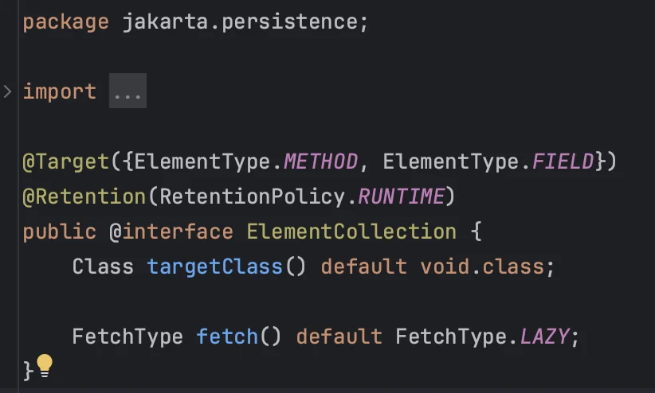

<a id="1c3eda9b0fe1811799a5e7b29dfd42a3"></a>

 

<a id="1c3eda9b0fe1811cbe57da38d3298e38"></a>

```java
// JpaMain
Member member = new Member();
member.setUsername("member1");
member.setHomeAddress(new Address("homeCity", "street", "10000"));

member.getFavoriteFoods().add("미나리");
member.getFavoriteFoods().add("볶음밥");
member.getFavoriteFoods().add("된장국");

member.getAddressHistory().add(new Address("city1", "street1", "10000"));
member.getAddressHistory().add(new Address("city2", "street2", "20000"));

em.persist(member);

em.flush();
em.clear();

System.out.println("================ START ================");

Member member1 = em.find(Member.class, member.getId());
```

<a id="1c3eda9b0fe18174b31ece7924bad709"></a>

member 조회 시, 아래와 같이 쿼리가 실행된다&#46; <strong>값 타입 컬렉션</strong>이 기본값으로 <strong>지연로딩</strong> 설정인 것을 확인할 수 있다&#46; 

<a id="1c3eda9b0fe181c995f3f6b725cbce88"></a>

```sql
   .   .   .

================ START ================
Hibernate: 
    select
        m1_0.MEMBER_ID,
        m1_0.city,
        m1_0.street,
        m1_0.zipcode,
        m1_0.team_TEAM_ID,
        m1_0.USERNAME 
    from
        Member m1_0 
    where
        m1_0.MEMBER_ID=?
```

<a id="1c3eda9b0fe181a68bf1eb3367f570ec"></a>

<br>

<a id="1c3eda9b0fe181c396d1d7930c2e6cdc"></a>

```java
// JpaMain
  
  .  .  .

System.out.println("================ START ================");

Member findMember = em.find(Member.class, member.getId());

List<Address> addressHistory = findMember.getAddressHistory();
for (Address address : addressHistory) {
    System.out.println("address = " + address.getCity());
}

Set<String> favoriteFoods = findMember.getFavoriteFoods();
for (String favoriteFood : favoriteFoods) {
    System.out.println("favoriteFood = " + favoriteFood);
}
```

<a id="1c3eda9b0fe181a7a458fdcc88987bbe"></a>

위와 같이 컬렉션의 값들을 조회 시, 해당하는 컬렉션 테이블에 쿼리를 날리는 것을 확인할 수 있다&#46; <br>

<a id="1c3eda9b0fe181059ebbea7cf183e553"></a>

```sql
================ START ================
Hibernate: 
    select
        m1_0.MEMBER_ID,
        m1_0.city,
        m1_0.street,
        m1_0.zipcode,
        m1_0.team_TEAM_ID,
        m1_0.USERNAME 
    from
        Member m1_0 
    where
        m1_0.MEMBER_ID=?
        
Hibernate: 
    select
        ah1_0.MEMBER_ID,
        ah1_0.city,
        ah1_0.street,
        ah1_0.zipcode 
    from
        ADDRESS ah1_0 
    where
        ah1_0.MEMBER_ID=?
address = city1
address = city2

Hibernate: 
    select
        ff1_0.MEMEBER_ID,
        ff1_0.favoriteFoods 
    from
        FAVORITE_FOOD ff1_0 
    where
        ff1_0.MEMEBER_ID=?
favoriteFood = 볶음밥
favoriteFood = 된장국
favoriteFood = 미나리
```

</details>

<details>
<summary><strong>특징 3) 값 타입은 </strong><strong>불변성</strong><strong>을 유지해야한다&#46; </strong></summary>

<a id="1c3eda9b0fe181188c7ae6b8386a7e95"></a>

값 타입은 식별자가  없기 때문에 추적이 불가하다&#46; 

<a id="1c3eda9b0fe1819ca3d7e125e2b08afa"></a>

따라서 데이터가 한번 생성 후 변하지 않는 <strong>불변성</strong>을 유지해야하며, <br>만약 <strong><u>수정</u></strong> 필요할 시, <strong><u>기존 인스턴스 데이터를 복사</u></strong> 및<strong> </strong><strong><u>새로운 값을 추가</u></strong>한 <strong>새로운 인스턴스</strong>로 <strong>교체</strong> 해줘야한다&#46;

<a id="1c3eda9b0fe18160a34cecb991055aaf"></a>

```java
Member findMember = em.find(Member.class, member.getId());

// homeCity  ->  newCity
//  findMember.getHomeAddress().setCity("newCity");  <- setter 사용, 불변성 X
Address a = findMember.getHomeAddress();
findMember.setHomeAddress(new Address("newCity", a.getStreet(), a.getZipcode()));

// 치킨 -> 한식
```

</details>

<details>
<summary>특징 4) 컬렉션을 다룰 경우 <code>equals()</code>, <code>hashCode()</code>를 <strong>오버라이드</strong> 해야한다&#46; </summary>

<a id="1c3eda9b0fe181e58671fcc5f813b637"></a>

equals 나 hashCode를 Override 해야 해당하는 값을 찾고 제거한다&#46; 

<a id="1c3eda9b0fe181f888c7cc8bfacdfef9"></a>

```java
// Member
   .  .  . 
 
@Override
public boolean equals(Object o) {
    if (this == o) return true;
    if (o == null || getClass() != o.getClass()) return false;
    Member member = (Member) o;
    return Objects.equals(favoriteFoods, member.favoriteFoods) && Objects.equals(addressHistory, member.addressHistory);
}

@Override
public int hashCode() {
    return Objects.hash(favoriteFoods, addressHistory);
}
```

<a id="1c3eda9b0fe181179fffd3187df37e00"></a>

```java
// JpaMain 
 .   .   .
   
findMember.getAddressHistory().remove(new Address("city1", "street1", "10000"));
findMember.getAddressHistory().add(new Address("newCity1", "street1", "10000")); 
```

</details>

<a id="1c3eda9b0fe181498d25d900c6a706b6"></a>

### 값 타입 컬렉션의 제약사항

<a id="1c3eda9b0fe181b89184ef23a4b038bb"></a>

 값 타입 컬렉션에 변경사항이 발생하면, 주인 엔티티와 연관된 모든 데이터를 삭제하고, 값 타입 컬렉션에 있는 현재 값을 모두 다시 저장한다&#46; 

<a id="1c3eda9b0fe181239ba8ea516e60c813"></a>

값 타입 컬렉션을 매핑하는 테이블은 모든 컬럼을  묶어서 기본 키를 구성해야 한다&#46; 

<a id="1c3eda9b0fe1816889e8ec32427ee249"></a>

→ null 입력 X, 중복 저장 X

<a id="1c3eda9b0fe181bab787cae142b33caf"></a>

```java
findMember.getAddressHistory().remove(new Address("city1", "street1", "10000"));
findMember.getAddressHistory().add(new Address("newCity1", "street1", "10000")); 
```

<a id="1c3eda9b0fe181ac8722c08e6b2d2aaf"></a>

### 해결책) <u>일대다 관계</u> &#43; 영속성 전이, 고아 객체 적용

> 실제로 본인이 실무에서 많이 쓰는 방법이라 하심

<a id="1c3eda9b0fe1819ab70ddebb0a7b78d8"></a>

실무에서 <strong>값 타입 컬렉션 대신</strong>에 <strong><u>일대다 관계</u></strong>를 고려하는 것이 낫다&#46;

<a id="1c3eda9b0fe181bf9215d872b287d27e"></a>

<strong>→ 일대다 관계를 위한 엔티티를 만</strong>들고, 여기에서 값 타입을 사용한다&#46;

<a id="1c3eda9b0fe181278094f5a576f2ee0e"></a>

<strong>→ </strong><strong>영속성 전이(Cascade)</strong><strong>, </strong><strong>고아 객체</strong>를 적용하여 ‘<strong><u>값 타입 컬렉션’ 처럼 사용</u></strong>한다

> 📌 <strong>방법1)</strong> 양방향 기본 매핑&#58; <code>&#64;OneToMany</code> , <code>&#64;ManyToOne</code>
> 
> <a id="1c3eda9b0fe181e38d8be5599106271d"></a>
> 
> <strong>방법2)</strong> 단방향 매핑 &#43; 영속성 전이, 고아객체&#58; <code>&#64;OneToMany</code>, <code>Cascade</code>, <code>OrphanRemoval</code>

<details>
<summary>ex)<strong> 방법2 &#45; 단방향 매핑</strong> &#43; <strong>영속성 전이, 고아객체</strong></summary>

<a id="1c3eda9b0fe181e3b09ccb99abdb461d"></a>

해당 방법을 활용하면 이전 값 타입 컬렉션 보다 횔씬 더 활용할 수 있는게 많아진다&#46; 

<a id="1c3eda9b0fe181649791cfe7821f5e73"></a>

실무에서도 쿼리 최적화하기에도 훨씬 유리하다&#46;

<details>
<summary><strong>AddressEntity</strong></summary>

<a id="1c3eda9b0fe18146a675d6c4cbe36fcc"></a>

```java

package jpabook.jpashop.domain;

import jakarta.persistence.Entity;
import jakarta.persistence.GeneratedValue;
import jakarta.persistence.Id;

@Entity
@Table(name = "ADDRESS")
public class AddressEntity {

    @Id @GeneratedValue
    private Long id;

    private Address address;
    
     public AddressEntity(String city, String street, String zipcode) {
        this.address = new Address(city, street, zipcode);
    }

    public Long getId() {
        return id;
    }

    public void setId(Long id) {
        this.id = id;
    }

    public Address getAddress() {
        return address;
    }

    public void setAddress(Address address) {
        this.address = address;
    }
}

```

</details>

<details>
<summary><strong>Member</strong></summary>

<a id="1c3eda9b0fe18122b137c0e7bab5d89a"></a>

```java
  .   .   . 

//    @ElementCollection
//    @CollectionTable(
//            name = "ADDRESS",
//            joinColumns = @JoinColumn(name = "MEMBER_ID")
//    )
//    private List<Address> addressHistory = new ArrayList<>();

@OneToMany(cascade = CascadeType.ALL, orphanRemoval = true)
@JoinColumn(name = "MEMBER_ID")
private List<AddressEntity> addressHistory = new ArrayList<>();
```

</details>

</details>

<a id="1c3eda9b0fe181ea9163c25cb0cdaf36"></a>

### 값 타입 vs 엔티티 

<a id="1c3eda9b0fe181d5810df3036f687ee8"></a>

엔티티 타입 

- 식별자 O 

- 생명 주기 관리

- 공유

<a id="1c3eda9b0fe181d1ae89d6c5ed1b1153"></a>

값 타입의 특징

- 식별자 X

- 생명주기를 엔티티에 의존

- 공유하지 않는 것이 안전(복사해서 사용)

- 불변 객체로 만드는 것이 안전

<a id="1c3eda9b0fe1810e87a7cbba45201eb0"></a>

값 타입은 정말 값 타입이라 판단될 때만 사용

<a id="1c3eda9b0fe18137b938d8184ef12f72"></a>

엔티티와 값 타입을 혼동해서 엔티티를 값 타입으로 만들면 안된다&#46; 

<a id="1c3eda9b0fe181cc93e4dc56331d0669"></a>

식별자가 필요하고, 지속해서 값을 추적, 변경해야 한다면 그것은 값 타입이 아닌 엔티티이다&#46; 

<a id="1c3eda9b0fe1815692e2dcf28b5e21b2"></a>

## 실전 예제 &#45; 6&#46; 값 타입 매핑

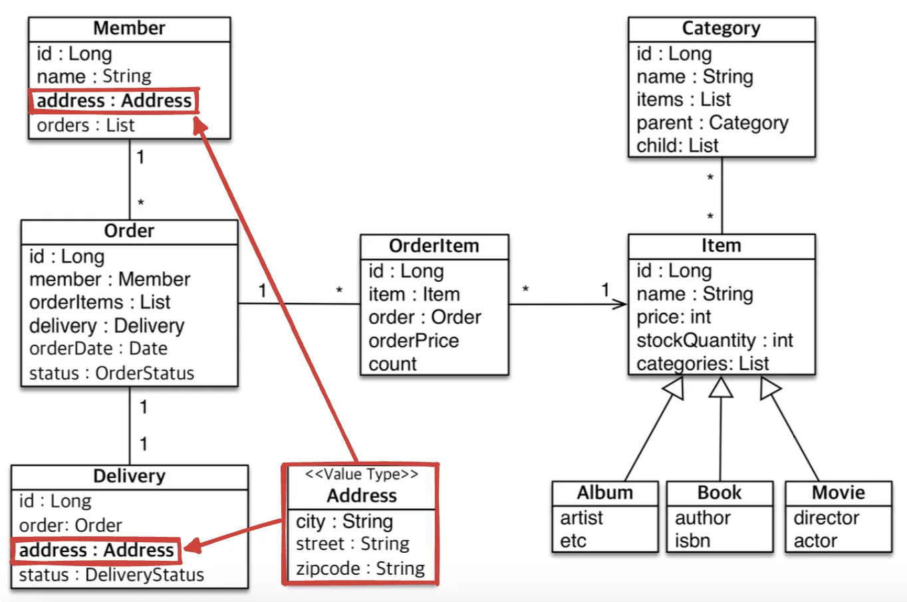
