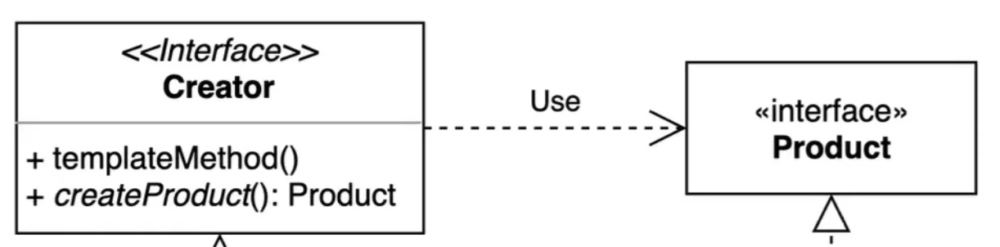
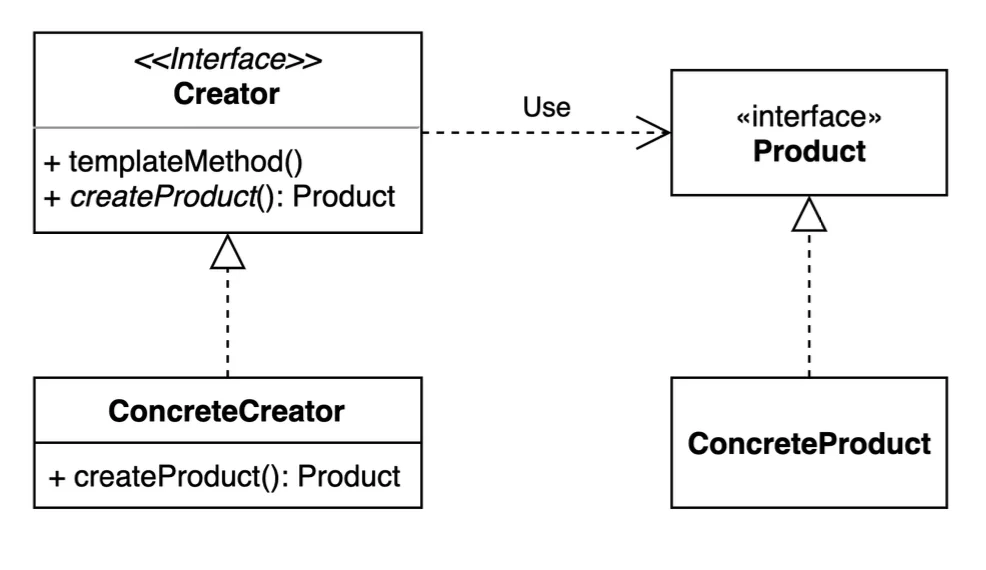
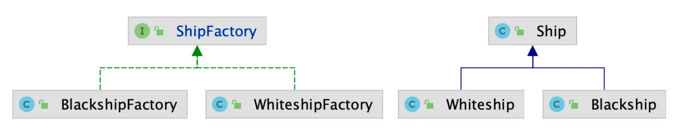
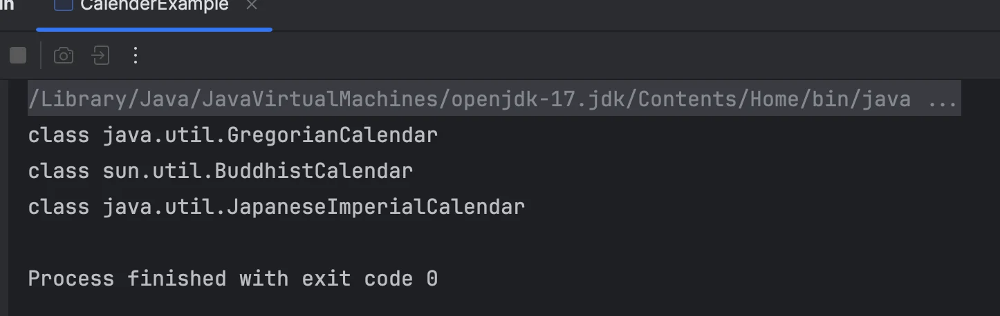

> 📝 
> 
> <a id="1c3eda9b0fe18128a623cfa18fb1c905"></a>
> 
> <strong>질문</strong>
> 
> <details>
> <summary>팩토리 메서드 패턴을 적용했을 때의 장•단점</summary>
> 
> - OCP 준수
>     -  기존의 어떤 인스턴스를 만드는 로직을 건드리지 않고 유사한 새로운 클래스를 얼마든지 확장할 수 있다&#46; 
>         - 객체지향 &#45; 다형성, 상속, 캡슐화
> 
>     - produc 와 creator 간의 결합을 느슨하게 만든다&#46; 
>         
> 
>         - 느슨한 결합 ( Loose Coupling )
> 
>     - 따라서 확장에는 열려있고 변경에는 닫혀있게 설계할 수 있다&#46;
>         - 기존 코드를 건드리지 않으면서 확장할 수 있기 때문에, 코드는 훨씬 더 간결해지고 복잡해지지 않는다&#46; 
> 
>         - 이로 인해, 코드의 재사용성, 유지보수성을 높일 수있다&#46;
> 
> - 객체의 생성 책임을 분리할 수 있다&#46; 
> 
> - 그러므로써 객체 간의 의존성을 느슨하게 가져갈 수 있다&#46;
> 
> </details>
> 
> <details>
> <summary>“확장에 열려있고, 변경에 닫혀있는 객체 지향 원칙” 설명</summary>
> 
> > ✏️ 
> > 
> > <a id="1c3eda9b0fe18111951bd0b0287f3fa7"></a>
> > 
> > “<code>OCP(Open&#45;Closed Principle)</code>는 객체지향 설계의 핵심 원칙 중 하나로, <strong><u>소프트웨어 구성 요소는 확장에는 열려 있고, 변경에는 닫혀 있어야 한다</u></strong>는 원칙이다&#46; 즉, <u>새로운 기능을 추가할 때 기존 코드를 수정하지 않고, 클래스를 </u><strong><u>상속하거나 조합</u></strong><u>하여 동작을 확장</u>하는 것을 의미한다&#46; 이 원칙을 잘 지키면 <strong><u>유지보수성과 확장성이 뛰어난 시스템을 만들 수 있</u></strong>다&#46; 전략 패턴, <strong><u>템플릿 메서드 패턴, 데코레이터 패턴, 책임 연쇄 패턴 등</u></strong> 다양한 디자인 패턴들이 OCP를 실현하는 데 도움을 준다&#46;”
> > 
> > - 클린코드를 대표하는 <strong>SOLID 원칙 중의 하나</strong>
> > 
> > - <strong>기존 코드를 변경하지 않고, 클래스를 확장</strong>
> 
> <details>
> <summary><strong>OCP (Open&#45;Closed Principle)</strong></summary>
> 
> <a id="1c3eda9b0fe18171befde59f2aa490c3"></a>
> 
> <em>“기존 코드를 수정하지 않고도 새로운 기능을 추가할 수 있도록 설계하는 원칙이다&#46;”</em>
> 
> - 즉, <strong>기능 추가 시 코드의 수정 없이 클래스나 모듈을 확장(상속, 위임, 전략 교체 등)하는 방식이다&#46;</strong>
> 
> </details>
> 
> <details>
> <summary>객체지향 패러다임에 있어 가장 중요한 원칙 중 하나이며, 팩토리 메서드를 포함한 다양한 디자인패턴들이 이에 해당된다&#46; </summary>
> 
> > ✏️ 
> > 
> > <a id="1c3eda9b0fe181008f93e44d892e6d92"></a>
> > 
> > <strong>아래의 패턴 대부분 “상속보다는 </strong><strong><code>구성(Composition)</code></strong><strong>을 활용”</strong> 하거나, <strong><u>인터페이스와 다형성을 통해 확장</u></strong>을 구현한다&#46;
> 
> - <strong>전략 패턴 (Strategy)</strong>
> 
> - <strong>템플릿 메서드 패턴 (Template Method)</strong>
> 
> - <strong>데코레이터 패턴 (Decorator)</strong>
> 
> - <strong>상태 패턴 (State)</strong>
> 
> - <strong>책임 연쇄 패턴 (Chain of Responsibility)</strong>
> 
> - <strong>플러그인 아키텍처 (Plugin Architecture)</strong>
> 
> - …
> 
> </details>
> 
> <details>
> <summary>실무 사용</summary>
> 
> - <strong>if&#45;else, switch문이 반복되는 구조</strong>는 OCP를 위반하는 대표적 예시이다&#46;
>     - 전략 패턴이나 다형성으로 개선 가능
> 
> - Spring에서는 <strong>빈 주입</strong>과 <strong>&#64;Component 기반 구조</strong> 자체가 OCP에 잘 맞는 구조이다&#46;
>     - <strong><code>IoC(Inversion of Control, 제어의 역전)</code></strong>, 객체 생성 외부에서 주입, 느슨한 결합 형성
> 
> - JPA의 <strong>엔티티 리스너</strong>, <strong>커스텀 Repository</strong>, <strong>AOP</strong>도 기존 기능에 영향 없이 동작을 추가하는 대표적인 OCP 실천 방식이다&#46;
> 
> </details>
> 
> </details>
> 
> <details>
> <summary>자바 8에 추가된 default 메서드에 대해 설명</summary>
> 
> <a id="1c3eda9b0fe181b49eb9d40a9b81f53e"></a>
> 
> 자바 8 이후 부터, <code>default</code> 키워드를 통해 interface의 메서드의 동작을 지정할 수 있다 
> 
> - 이전에는 불가능 했다&#46;<br> 따라서 공통적으로 사용되는 메서드의 경우, 추상 클래스틑 통해서 동작을 정의한 후 상속 처리했다&#46;
> 
> <a id="1c3eda9b0fe1818792a2e493d6605770"></a>
> 
> 또한 자바 9 이후, private 키워드를 사용하여 
> 
> </details>

<a id="1c3eda9b0fe1810f97d2cf10f040f634"></a>

## 팩토리 메서드 패턴

---

> ✏️ 
> 
> 
> 
> <a id="1c3eda9b0fe18153ad1acf1e833ff5f1"></a>
> 
> <strong><u>구체적으로 어떤 인스턴스가 만</u></strong>들지를 <strong><u>서브 클래스에서 </u></strong>정한다&#46; 
> 
> <a id="1c3eda9b0fe18179875fd29228fc08d2"></a>
> 
> <strong><u>인스턴스를 생성하는 책임</u></strong>을 구체적인 클래스가 아닌 <u>추상적인 인터페이스의 메서드로 감싼다&#46;</u> 
> 
> - 객체 생성 책임 분리 ( SIR 준수 ) 
> 
> <details>
> <summary>다양한 구현체 ( Product ) 가 있고, 그 중에서 특정한 구현체를 만들 수 있는 다양한 팩토리(Creator)를 제공 가능하다&#46; </summary>
> 
> - 객체 지향의 <code>다형성</code>, <code>추상화</code> 활용
> 
> - SRP ( 단일 책임 원칙 )
> 
> - OCP ( 열림/폐쇠 원칙 )
>     - 확장에 열려있고 변경에 닫혀있는 구조
> 
> </details>

<a id="1c3eda9b0fe181208e3cfbac49f6236c"></a>

### 1&#46; 기본 예제

[DesignPattern&#95;with&#95;jave/src/&#95;01&#95;creational&#95;patterns/&#95;02&#95;factory&#95;method/&#95;01&#95;before at main · gyungsubLee/DesignPattern&#95;with&#95;jave]()

<details>
<summary>&#91; 코드 &#93; ShipFactory</summary>

<a id="1c3eda9b0fe181aea0b9e59145545be8"></a>

```java
package _01_creational_patterns._02_factory_method._01_before;

public class ShipFactory {

    public static Ship orderShip(String name, String email) {
        // validate
        if (name == null || name.isBlank()) {
            throw new IllegalArgumentException("배 이름을 지어주세요.");
        }
        if (email == null || email.isBlank()) {
            throw new IllegalArgumentException("연락처를 남겨주세요.");
        }

        prepareFor(name);

        Ship ship = new Ship();
        ship.setName(name);

        // Customizing for specific name
        if (name.equalsIgnoreCase("whiteship")) {
            ship.setLogo("\uD83D\uDEE5️");
        } else if (name.equalsIgnoreCase("blackship")) {
            ship.setLogo("⚓");
        }

        // coloring
        if (name.equalsIgnoreCase("whiteship")) {
            ship.setColor("whiteship");
        } else if (name.equalsIgnoreCase("blackship")) {
            ship.setColor("black");
        }

        // notify
        sendEmailTo(email, ship);

        return ship;
    }

    private static void prepareFor(String name) {
        System.out.println(name + " 만들 준비 중");
    }

    private static void sendEmailTo(String email, Ship ship) {
        System.out.println(ship.getName() + " 다 만들었습니다.");
    }

}
```

</details>

<details>
<summary>&#91; 코드 &#93; Ship</summary>

<a id="1c3eda9b0fe181f2a1edda1fc7da831a"></a>

```java
package _01_creational_patterns._02_factory_method._01_before;

public class Ship {

    private String name;

    private String color;

    private String logo;

    public String getName() {
        return name;
    }

    public void setName(String name) {
        this.name = name;
    }

    public String getColor() {
        return color;
    }

    public void setColor(String color) {
        this.color = color;
    }

    public String getLogo() {
        return logo;
    }

    public void setLogo(String logo) {
        this.logo = logo;
    }

    @Override
    public String toString() {
        return "Ship{" +
                "name='" + name + '\'' +
                ", color='" + color + '\'' +
                ", logo='" + logo + '\'' +
                '}';
    }
}
```

</details>

<details>
<summary>&#91; 코드 &#93; Client</summary>

<a id="1c3eda9b0fe181e29077c3bb8570f9e5"></a>

```java
package _01_creational_patterns._02_factory_method._01_before;

public class Client {

    public static void main(String[] args) {
        Ship whiteship = ShipFactory.orderShip("Whiteship", "keesun@mail.com");
        System.out.println(whiteship);

        Ship blackship = ShipFactory.orderShip("Blackship", "keesun@mail.com");
        System.out.println(blackship);
    }
}
```

</details>

<a id="1c3eda9b0fe18127b962d56beed84c6d"></a>

위 코드는 하얀색 배(white ship)을 생산하는 간단한 예제이다&#46; 

<a id="1c3eda9b0fe181058e10d2edfd729a0a"></a>

해당 예제의 문제점은 하나의 클래스에 여러 책임이 할당 되었고,  각 동작들이 분리되어 있지 않다는 점이다&#46; 

<a id="1c3eda9b0fe1812499ffc89046cf7bcb"></a>

만약 검은색 배(black ship)의 생산 로직을 추가한다고 한다면, 기존의 코드의 변경이 불가피하다&#46; 

<a id="1c3eda9b0fe181f88c31c73df0bbd0a4"></a>

아니면 아에 동일한 코드를 따로 클래스로 만들어서 확장 해야한다&#46; 

<a id="1c3eda9b0fe181f4a192cda25b4405bd"></a>

이로 인해, 코드의 재사용성이 떨어지며 유지보수 관점에서 굉장히 비용이 많이든다&#46; 

- 코드 변경이 이뤄져야 한다면 해당되는 동일 코드를 모두 바꿔야 한다&#46; 

<a id="1c3eda9b0fe18179a11ff53430051b84"></a>

### 2&#46; 팩토리 메서드 패턴 적용



<details>
<summary>factory</summary>

<details>
<summary>&#91; 코드 &#93; &#60;interface&#62; ShipFactory</summary>

<a id="1c3eda9b0fe1812d8a06d7eca03871dd"></a>

```java
package _01_creational_patterns._02_factory_method._02_after.factory;

import _01_creational_patterns._02_factory_method._02_after.ship.Ship;

public interface ShipFactory {

    default Ship orderShip(String name, String email) {
        validate(name, email);
        prepareFor(name);
        Ship ship = createShip();
        sendEmailTo(email, ship);
        return ship;
    }

    private void validate(String name, String email) {
        if (name == null || name.isBlank()) {
            throw new IllegalArgumentException("배 이름을 지어주세요.");
        }
        if (email == null || email.isBlank()) {
            throw new IllegalArgumentException("연락처를 남겨주세요.");
        }
    }

    private void prepareFor(String name) {
        System.out.println(name + " 만들 준비 중");
    }

    Ship createShip();
     void sendEmailTo(String email, Ship ship);
}

```

</details>

<details>
<summary>&#91; 코드 &#93; &#60;abstract class&#62; DefaultShipFactory</summary>

<a id="1c3eda9b0fe1811499cbd05f0ad380d9"></a>

```java
package _01_creational_patterns._02_factory_method._02_after.factory;

import _01_creational_patterns._02_factory_method._02_after.ship.Ship;

public abstract class DefaultShipFactory implements ShipFactory{

    @Override
    public void sendEmailTo(String email, Ship ship) {
        System.out.println(ship.getName() + " 다 만들었습니다.");
    }
}

```

</details>

<details>
<summary>&#91; 코드 &#93; WhiteshipFactory</summary>

<a id="1c3eda9b0fe181edbcdec5e1e04920cd"></a>

```java
package _01_creational_patterns._02_factory_method._02_after.factory;

import _01_creational_patterns._02_factory_method._02_after.ship.Ship;
import _01_creational_patterns._02_factory_method._02_after.ship.Whiteship;

public class WhiteshipFactory extends DefaultShipFactory {

    @Override
    public Ship createShip() {
        return new Whiteship("whiteship", "white", "\uD83D\uDEE5");
    }
}

```

</details>

<details>
<summary>&#91; 코드 &#93; BlackshipFactory</summary>

<a id="1c3eda9b0fe18122aa58c75e9b4d07fe"></a>

```java
package _01_creational_patterns._02_factory_method._02_after.factory;

import _01_creational_patterns._02_factory_method._02_after.ship.Blackship;
import _01_creational_patterns._02_factory_method._02_after.ship.Ship;

public class BlackshipFactory extends DefaultShipFactory{
    @Override
    public Ship createShip() {
        return new Blackship("blackship", "black", "⚓");
    }
}
```

</details>

</details>

<details>
<summary>ship</summary>

<details>
<summary>&#91; 코드 &#93; Ship</summary>

<a id="1c3eda9b0fe1817bb3b3f87d3526c60e"></a>

```java
package _01_creational_patterns._02_factory_method._02_after.ship;

public class Ship {

    private String name;
    private String color;
    private String logo;
    // getter, setter
    public String getName() {
        return name;
    }

    public void setName(String name) {
        this.name = name;
    }

    public String getColor() {
        return color;
    }

    public void setColor(String color) {
        this.color = color;
    }

    public String getLogo() {
        return logo;
    }

    public void setLogo(String logo) {
        this.logo = logo;
    }

    @Override
    public String toString() {
        return "Ship{" +
                "name='" + name + '\'' +
                ", color='" + color + '\'' +
                ", logo='" + logo + '\'' +
                '}';
    }
}

```

</details>

<details>
<summary>&#91; 코드 &#93; Whiteship</summary>

<a id="1c3eda9b0fe181f8a7a4f021e9fb819d"></a>

```java
package _01_creational_patterns._02_factory_method._02_after.ship;

public class Whiteship extends Ship {

    public Whiteship(String name, String color, String logo) {
        setName(name);
        setColor(color);
        setLogo(logo);
    }
}
```

</details>

<details>
<summary>&#91; 코드 &#93; Blackship</summary>

<a id="1c3eda9b0fe181d9b2cfee749c98603c"></a>

```java
package _01_creational_patterns._02_factory_method._02_after.ship;

public class Blackship extends Ship{

    public Blackship(String name, String color, String log) {
        setName(name);
        setColor(color);
        setLogo(log);
    }
}

```

</details>

</details>

<details>
<summary>&#91; 코드 &#93; &#60;test&#62; ShipFactoryTest</summary>

<a id="1c3eda9b0fe1817d9bded7492b068ec0"></a>

```java
package _01_creational_patterns._02_factory_method._02_after.test;

import _01_creational_patterns._02_factory_method._02_after.factory.BlackshipFactory;
import _01_creational_patterns._02_factory_method._02_after.factory.ShipFactory;
import _01_creational_patterns._02_factory_method._02_after.factory.WhiteshipFactory;
import _01_creational_patterns._02_factory_method._02_after.ship.Ship;
import org.junit.jupiter.api.Test;

import static org.junit.jupiter.api.Assertions.*;

class ShipFactoryTest {
    ShipFactory whiteShipFactory = new WhiteshipFactory();
    ShipFactory blackShipFactory = new BlackshipFactory();

    @Test
    void createWhtiteshipTest() {
        // given
        String name = "whiteship";
        String color = "white";
        String logo = "\uD83D\uDEE5";

        // when
        Ship whiteShip = whiteShipFactory.createShip();

        // then
        assertEquals(name, whiteShip.getName());
        assertEquals(color, whiteShip.getColor());
        assertEquals(logo, whiteShip.getLogo());
    }

    @Test
    void createBlackshipTest() {
        // given
        String name = "blackship";
        String color = "black";
        String logo = "⚓";

        // when
        Ship blackship = blackShipFactory.createShip();

        // then
        assertEquals(name, blackship.getName());
        assertEquals(color, blackship.getColor());
        assertEquals(logo, blackship.getLogo());
    }
}
```

</details>

<details>
<summary>&#91; 코드 &#93; Client</summary>

<a id="1c3eda9b0fe1819cbc31d179d64f9523"></a>

```java
package _01_creational_patterns._02_factory_method._02_after;


import _01_creational_patterns._02_factory_method._02_after.factory.BlackshipFactory;
import _01_creational_patterns._02_factory_method._02_after.factory.ShipFactory;
import _01_creational_patterns._02_factory_method._02_after.factory.WhiteshipFactory;

public class Client {

    public static void main(String[] args) {
        Client client = new Client();
        client.print(new WhiteshipFactory(), "whiteship", "keesun@mail.com");
        client.print(new BlackshipFactory(), "blackship", "keesun@mail.com");
    }

    private void print(ShipFactory shipFactory, String name, String email) {
        System.out.println(shipFactory.orderShip(name, email));
    }
}
```

</details>

---

<a id="1c3eda9b0fe18117a754f6258e1beb7f"></a>

<em><strong>팩토리 메서드 패턴 </strong></em>을  적용하여 코드의 <strong><u>변경은 막고, 확장 열려있도록 설계</u></strong> 할 수있다&#46; 

- 다형성, 추상화, 캡슐화, 상속 활용

<a id="1c3eda9b0fe18122bfdbee0d10ff1ceb"></a>

### 3&#46; 실무 사용

> ✏️ 
> 
> <a id="1c3eda9b0fe1815496acd3ba895d72e2"></a>
> 
> 단순한 팩토리 패턴
> 
> - <strong><u>매개변수의 값에 따라 메서드에 따라 각기 다른 인스턴스를 리턴</u></strong>하는 단순한 버전의 팩토리 패턴
>     - <code>java&#46;lang&#46;Calender</code> or <code>java&#46;lang&#46;NumberFormat</code>
> 
> - 스프링 BeanFactory
>     - Object 타입의 Product를 만드는 BeanFactory 라는 Creator

<details>
<summary>&#91; 코드 &#93; SimpleFactory</summary>

<a id="1c3eda9b0fe18192a95fd80aabd1bd81"></a>

```java
package _01_creational_patterns._02_factory_method._03_java;


import _01_creational_patterns._02_factory_method._02_after.ship.Blackship;
import _01_creational_patterns._02_factory_method._02_after.ship.Whiteship;

public class SimpleFactory {

    public Object createProduct(String name) {
        if (name.equals("whiteship")) {
            return new Whiteship("whiteship", "white", "\uD83D\uDEE5");
        } else if (name.equals("blackship")) {
            return new Blackship("blackship", "black", "⚓");
        }

        throw new IllegalArgumentException();
    }
}
```

<a id="1c3eda9b0fe181c09377fe71f911e466"></a>

조금 극단적인 예시지만 위와 같이 if &#45; else 문을 통해 인자에 따라 객체 생성을 control 가능하다

</details>

<details>
<summary>&#91; 코드 &#93; CalenderExample</summary>

<a id="1c3eda9b0fe1819c90b1cd72230aba40"></a>

```java
package _01_creational_patterns._02_factory_method._03_java;

import java.util.Calendar;
import java.util.Locale;

public class CalenderExample {

    public static void main(String[] args) {
        System.out.println(Calendar.getInstance().getClass());
        System.out.println(Calendar.getInstance(Locale.forLanguageTag("th-TH-x-lvariant-TH")).getClass());
        System.out.println(Calendar.getInstance(Locale.forLanguageTag("ja-JP-x-lvariant-JP")).getClass());
    }
}
```



</details>

<details>
<summary>&#91; 코드 &#93; Config</summary>

<a id="1c3eda9b0fe181f38d95d57ea44fe1ff"></a>

```java
@Configuration
public class Config {

    @Bean
    public String hello() {
        return "hello";
    }
}
```

</details>

<details>
<summary>&#91; 코드 &#93; SpringBeanFactoryExample</summary>

<a id="1c3eda9b0fe181f6ae24f6cb77536d89"></a>

```java
package _01_creational_patterns._02_factory_method._03_java;

public class SpringBeanFactoryExample {

    public static void main(String[] args) {
        BeanFactory xmlFactory = new ClassPathXmlApplicationContext("config.xml");
        String hello = xmlFactory.getBean("hello", String.class);
        System.out.println(hello);

        BeanFactory javaFactory = new AnnotationConfigApplicationContext(Config.class);
        String hi = javaFactory.getBean("hello", String.class);
        System.out.println(hi);
    }
}
```

</details>
